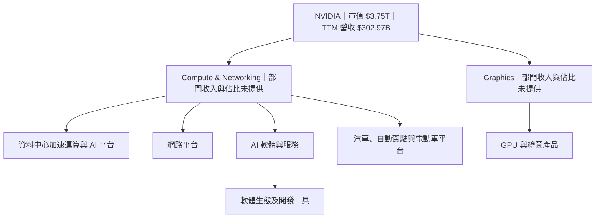
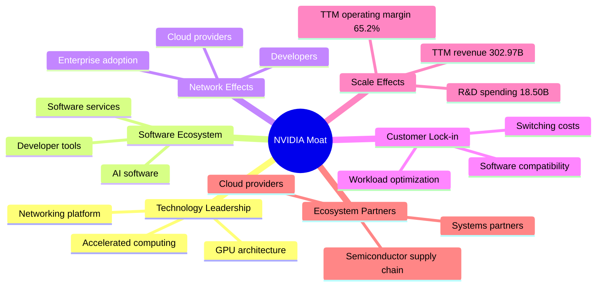
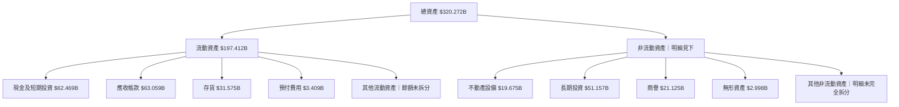
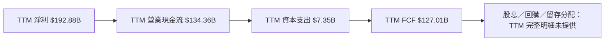
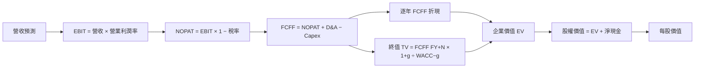
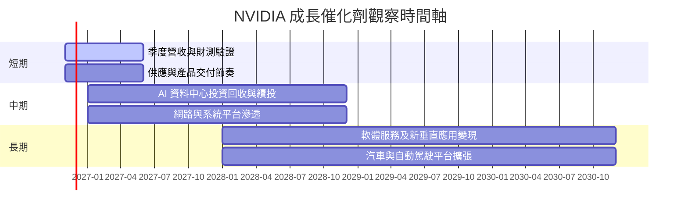
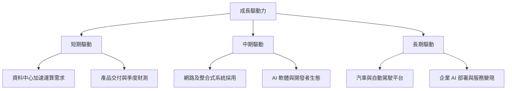
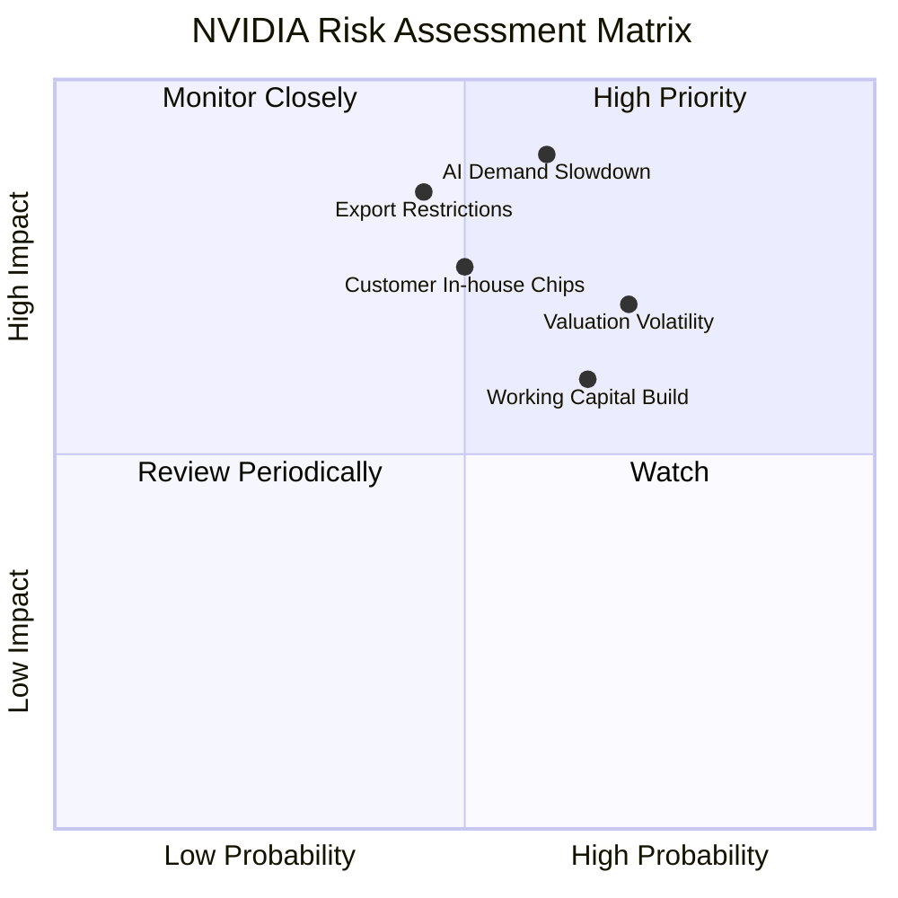
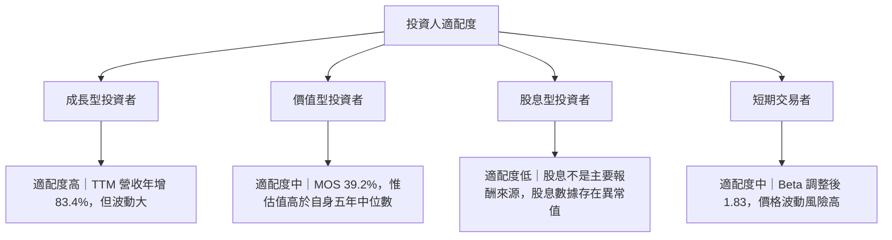

# NVDA 基本面深度分析報告
> **報告日期**：2026-11-18 ｜ **語言**：繁體中文 ｜ **數據來源**：SEC 申報資料 (XBRL)、Yahoo Finance、Finviz、StockAnalysis、Roic.ai ｜ **分析師**：CFA 級機構研究

## 目錄

| # | 章節 | 核心結論 |
|---|------|----------|
| 1 | 執行摘要 | 強烈買入；加權合理價值 $255.70；MOS +39.2% |
| 2 | 公司概覽與商業模式 | AI 加速運算平台具技術、生態與規模優勢；分部營收拆分未提供 |
| 3 | 損益表深度分析 | TTM 營收 $302.97B、年增 83.4%；TTM 營業利益率 65.2% |
| 4 | 資產負債表分析 | 淨現金 $23.22B；DSO、DIO 上升，CCC 延長 |
| 5 | 現金流量深度分析 | TTM FCF $127.01B，FCF Yield 3.38% |
| 6 | 獲利能力與資本效率 | ROIC 80.6% 對 WACC 14.00%，資本回報遠高於資金成本 |
| 7 | 相對估值分析 | 相對同業估值不高，但相對自身五年估值中位數偏高 |
| 8 | DCF 內在價值評估 | 基準 DCF $164.66；加權合理價值 $255.70；兩者口徑不同 |
| 9 | 成長催化劑 | 資料中心需求、平台迭代與軟體生態為主要觀察方向 |
| 10 | 風險矩陣 | 需求正常化、供應鏈／出口限制、競爭與估值波動為主要風險 |
| 11 | 投資建議 | 依 MOS 評級為強烈買入；建議以財報指標分批驗證 |

---

## 1. 執行摘要

### 1.0 一頁式投資儀表板（Portfolio Manager 30 秒速讀）

| 項目 | 內容 |
|------|------|
| **投資論點（3 句）** | ① TTM 營收 $302.97B、年增 83.4%，最新一季年增 105.9%，顯示 AI 加速運算需求仍推動高速擴張。② TTM 營業利益率 65.2%、ROIC 80.6%，相對採用的 WACC 14.00% 高出 66.6 個百分點。③ TTM FCF $127.01B、FCF Yield 3.38%，現金創造力高，但營運資金 CCC 已由 105 天增至 155 天。 |
| **綜合評分** | **8.5/10**（引用 1.1 評分卡） |
| **財務健康** | 🟢 現金與短期投資 $56.59B、總債務 $33.37B，淨現金 $23.22B；營運資金天數惡化是主要監控點。 |
| **ROIC vs WACC** | **80.6% vs 14.00%**；目前明顯創造股東價值。 |
| **FCF 趨勢** | FY2024 至 FY2026 年度 FCF 由 $27.02B 增至 $96.68B；TTM FCF $127.01B，FCF Yield **3.38%**。 |
| **估值** | Forward P/E 約 **9.8x**（Yahoo Finance 市場資料）；EV/EBITDA TTM **18.6x**；FCF Yield **3.38%**。 |
| **DCF 內在價值（基準）** | **$164.66**；現價相對 DCF 折價約 **5.6%**，折溢價基準為 DCF。 |
| **安全邊際（MOS）** | **+39.2%**＝($255.70 − $155.46) ÷ $255.70；🟢 以加權合理價值為基準，MOS >25%。 |
| **預期報酬（基準情境 12M）** | DCF 基準情境相對現價 **+5.9%**；加權合理價值隱含上行空間 **+64.5%**，兩者不可混用。 |
| **關鍵風險（前二）** | AI 資本支出增速正常化；出口限制、客戶自研與競爭加劇造成成長或利潤率下修。 |
| **評級 + 信心度** | 🟢 **強烈買入** ｜ 信心：中。MOS 來自多方法加權，惟 DCF 假設與原始數據存在可複算性限制。 |

### 1.1 綜合評分卡（全報告唯一）

| 維度 | 評分（1–10） | 主要依據（引用數字與其來源章節） |
|------|--------------|----------------------------------|
| 成長性 | 9.5 | TTM 營收年增 83.4%、最新一季年增 105.9%（第 3 章）；但高基期意味增速正常化風險。 |
| 獲利能力 | 9.5 | TTM 營業利益率 65.2%、ROIC 80.6%，WACC 14.00%；Piotroski F-Score 5/9（第 6 章）。 |
| 財務健康 | 8.5 | 淨現金 $23.22B；流動比率 4.589（市場資料）；CCC 155 天，較一年前增加 50 天（第 4 章）。 |
| 估值 | 7.0 | MOS +39.2%，但 P/E 19.7x 高於自身五年中位數 11.3x，且 DCF 基準僅高於現價 5.9%（第 7–8 章）。 |
| 護城河 | 9.0 | 年營收 $302.97B、TTM 毛利率 74.7%、營業利益率 65.2%；平台生態具黏著力，但市場份額數字未提供（第 2 章）。 |
| 管理層與資本配置 | 7.5 | FY2026 SBC $6.39B，約佔營收 3.0%；稀釋股數測試通過，但回購金額及資本配置完整分項未提供（第 3、5 章）。 |
| **綜合評分** | **8.5** | 六項算術平均： (9.5 + 9.5 + 8.5 + 7.0 + 9.0 + 7.5) ÷ 6 = **8.5**。 |

### 1.2 五大投資論點 + 三大核心風險

| 類型 | 項目 | 具體依據 | 信心度 |
|------|------|----------|--------|
| 🟢 **投資論點①** | AI 算力需求仍處高增長階段 | TTM 營收 $302.97B、年增 83.4%；最新一季營收年增 105.9%。 | 🟢 高 |
| 🟢 **投資論點②** | 高利潤率帶來營運槓桿 | TTM 營業利益率 65.2%、淨利率 63.7%，每增加收入可形成顯著營業利益。 | 🟢 高 |
| 🟢 **投資論點③** | 資本效率高於資金成本 | ROIC 80.6% 對 WACC 14.00%，利差 66.6 個百分點。 | 🟢 高 |
| 🟢 **投資論點④** | 現金流支持研發與供應鏈投資 | TTM OCF $134.36B、FCF $127.01B，資本支出 $7.35B。 | 🟢 高 |
| 🟢 **投資論點⑤** | 相對同業倍數具吸引力 | NVDA P/E TTM 19.7x；AMD 107.6x、AVGO 43.6x（Peer multiples）。 | 🟡 中 |
| 🟡 **風險①** | 成長率快速正常化 | DCF 假設第一年營收成長 30%，低於目前 TTM 83.4%；若實際低於 30%，基準估值下修。 | 🟡 中 |
| 🔴 **風險②** | 資料中心投資與供應鏈週期 | DSO 76 天、DIO 150 天，CCC 155 天；若應收與存貨繼續快於營收增加，現金轉換可能惡化。 | 🔴 高衝擊 |
| 🔴 **風險③** | 出口限制與客戶替代方案 | 產品供應及可服務市場可能受政策限制；客戶自研或替代加速器若具競爭力，將壓低價格或份額。 | 🔴 高衝擊 |

### 1.3 快速統計卡片

| 指標 | 公司實際值（期間） | 同業中位數 | 狀態 |
|------|--------------------|------------|------|
| 營收成長（TTM） | **83.4%** | — | 🟢 |
| 營收成長（最新一季年增） | **105.9%** | **44.7%**（AMD、AVGO、INTC） | 🟢 |
| 毛利率（TTM） | **74.7%** | **56.0%**（AMD、AVGO、INTC） | 🟢 |
| 營業利益率（TTM） | **65.2%** | — | 🟢 |
| ROIC（TTM） | **80.6%** | — | 🟢 |
| Forward P/E | **9.8x**（市場資料） | **28.5x**（同業中位數） | 🟢 |
| FCF Yield（TTM） | **3.38%** | — | 🟡 |
| Piotroski F-Score | **5 / 9** | — | 🟡 |

### 1.4 投資結論

╔══════════════════════════════════════════════════════════════════╗  
║                    📊 投資結論摘要                               ║  
╠══════════════════════════════════════════════════════════════════╣  
║ 評級：強烈買入（MOS +39.2%，ROIC 80.6% > WACC 14.00%）            ║  
║ 價格（2026-11-17 收盤）：$155.46                                 ║  
║ DCF 內在價值（基準）：$164.66（現價折價約 5.6%）                  ║  
║ 安全邊際 MOS：+39.2%＝($255.70−$155.46)÷$255.70                  ║  
║ 加權合理價值（8.8）：$255.70                                     ║  
║ DCF 情境價值：悲觀 $75.00（−51.8%）                               ║  
║               基準 $164.66（+5.9%）                                ║  
║               樂觀 $338.85（+118.0%）                              ║  
║ 綜合評分：8.5/10（引用 1.1）                                      ║  
║ 適合投資人：能承受高波動、以長期 AI 算力需求為投資主軸者          ║  
╚══════════════════════════════════════════════════════════════════╝  

---

## 2. 公司概覽與商業模式

### 2.1 業務結構與收入來源

公司資料顯示 NVIDIA 經營 Compute & Networking、Graphics 兩大部門，涵蓋資料中心加速運算、網路、AI 軟體、遊戲繪圖、汽車及自動駕駛平台。各部門最新收入及佔比未提供，因此不拆分比例。

### 2.2 市場份額

市場份額數據未提供，故不估計比例。相對規模方面，NVDA TTM 營收為 $302.97B，最新一季年增 105.9%；同業最新一季營收年增率為 AMD 44.7%、AVGO 85.5%、INTC 20.9%。此比較顯示 NVDA 當期增長速度較快，但不能替代各市場的份額資料。

### 2.3 競爭護城河分析

### 2.4 護城河強度

| 護城河項目 | 強度（強／中／弱） | 證據（引用數字或事實） | 會削弱它的情況 |
|------------|--------------------|------------------------|----------------|
| 技術領先 | 強 | TTM 營業利益率 65.2%、毛利率 74.7%，反映產品組合與定價能力。 | 競品性能／能效追上，或客戶轉向自研晶片。 |
| 軟體生態系統 | 強 | 公司業務包含 AI 解決方案、軟體與開發平台；產品與軟體共同部署提高轉換成本。 | 軟體標準化、開源工具降低遷移成本。 |
| 網路效應 | 中 | 開發者、雲端服務商與系統夥伴互相擴大平台採用；可量化網路效應指標未提供。 | 替代生態形成，開發者不再優先支援其平台。 |
| 客戶鎖定 | 中至強 | 工作負載、軟體工具與系統整合可能提高切換成本；客戶集中度數字未提供。 | 大型客戶議價或多供應商策略擴大。 |
| 規模效應 | 強 | TTM 營收 $302.97B、研發費用 FY2026 $18.50B，可支撐持續產品投入。 | 需求反轉造成產能／庫存成本上升。 |
| 生態夥伴 | 中至強 | 業務涉及全球資料中心、網路及汽車平台；供應鏈夥伴集中風險仍存在。 | 出口限制、封裝與晶圓供應受阻。 |

1.1「護城河」評分 **9.0/10**，主要依據是 74.7% 的 TTM 毛利率、65.2% 的營業利益率及跨硬體、軟體、網路的平台組合；市場份額與客戶集中度未提供，故未評為滿分。

---

## 3. 損益表深度分析

### 3.1 年度收入成長趨勢（近 4 年）

年度營收：FY2023 $26.97B、FY2024 $60.92B、FY2025 $130.50B、FY2026 $215.94B。FY2023–FY2026 三年 CAGR 約 100.0%，計算為 \((215.94÷26.97)^{1/3}-1\)。

╔══════════════════════════════════════════════════════════════════╗  
║              NVIDIA 年度收入趨勢（FY2023–FY2026）                ║  
╠══════════════════════════════════════════════════════════════════╣  
║ FY2023  $26.97B   ███░░░░░░░░░░░░░░░░░░░░  YoY +0.2%   🟡       ║  
║ FY2024  $60.92B   ██████░░░░░░░░░░░░░░░░░  YoY +125.9% 🟢       ║  
║ FY2025 $130.50B   █████████████░░░░░░░░░░  YoY +114.2% 🟢       ║  
║ FY2026 $215.94B   ██████████████████████░  YoY +65.5%  🟢       ║  
║                                                                  ║  
║ 三年累計 CAGR：約 +100.0%                                         ║  
╚══════════════════════════════════════════════════════════════════╝  

增長由 FY2024、FY2025 的三位數成長，降至 FY2026 的 65.5%；絕對營收仍增加 $85.44B。這反映快速擴張下增速自然回落，後續應看絕對營收增量及資料中心需求，而非只看百分比。

### 3.2 季度收入趨勢分析

| 季度 | 營收 | QoQ 成長 | YoY 成長 | 備註 |
|------|------:|---------:|---------:|------|
| 2025-10-31 | $57.01B | +22.0% | +62.5% | YoY 相對 2024 年同季。 |
| 2026-01-31 | $68.13B | +19.5% | +73.2% | 季增仍近兩成。 |
| 2026-04-30 | $81.62B | +19.8% | +85.2% | 年增進一步加速。 |
| 2026-07-26 | $96.22B | +17.9% | +105.9% | YoY 超過一倍；季度增幅略低於前三季。 |

QoQ 由 22.0% 降至 17.9%，代表單季增長率有溫和放緩，但最新一季比較基期較低，YoY 升至 105.9%。最新季 SEC 10-Q 期間截至 2026-07-26；財務資料其他表格將該季列為 2026-07-31，期間標示略有差異。

### 3.3 利潤率演變分析

| 利潤率指標 | FY2023 | FY2024 | FY2025 | FY2026 | 趨勢 | 評估 |
|------------|-------:|-------:|-------:|-------:|------|------|
| **毛利率** | 56.9% | 72.7% | 75.0% | 71.1% | 先大幅提升、FY2026 回落 | 🟢 |
| **營業利益率** | 20.7% | 54.1% | 62.4% | 60.4% | 規模擴張改善，FY2026 小幅收縮 | 🟢 |
| **淨利率** | 16.2% | 48.8% | 55.9% | 55.6% | 保持高位 | 🟢 |

年度利潤率由年度損益表毛利、營業利益及淨利除以營收計算；與最新 TTM 毛利率 74.7%、營業利益率 65.2%、淨利率 63.7% 的口徑／期間不同。FY2026 毛利率與營業利益率較 FY2025 回落，可能反映產品組合、供應成本與快速擴產的影響；但 TTM 利潤率仍高，顯示高附加價值加速運算產品與營運槓桿仍支撐獲利。

### 3.4 費用結構分析

提供的數據沒有完整 TTM 銷售、管理、研發及其他費用總額拆分，因此不以營收減毛利反推費用比例，也不繪製推估圓餅圖。FY2026 研發支出為 $18.50B，FY2025 為 $12.91B，增加約 43.3%；持續研發有利於平台迭代，但短期需確保收入增速足以覆蓋投入。

### 3.5 季度 EPS 趨勢與盈餘品質（Quality of Earnings）

最近四季 EPS 預估與實際值均為 N/A，因此不能判定各季超預期或不及預期。已知每股盈餘由 2025-10-31 的 $1.30 增至 2026-07-31 的 $2.46；季度 EPS YoY 增幅資料顯示最新一季為 127.8%。營收、營業利益及淨利實際上逐季上升，但「盈餘超預期」資料缺失。

| 盈餘品質項目 | 數值／佔比 | 評估 |
|--------------|-----------|------|
| 股權薪酬 SBC / 營收 | FY2026 $6.39B ÷ $215.94B = **2.96%** | 🟡 SBC 占比不高，但仍會稀釋股東經濟利益；TTM SBC 未提供。 |
| SBC / 營業現金流 | FY2026 $6.39B ÷ $102.72B = **6.22%** | 🟡 以 FY2026 年度數據計算，SBC 不是主要現金流來源，但不能視為無成本。 |
| FCF / 淨利（現金轉換率） | TTM $127.01B ÷ TTM 淨利 $192.88B = **65.8%** | 🟡 FCF 低於淨利；需關注應收與存貨占用及營運資金變化。 |
| 一次性／非經常性損益 | N/A（項目明細未提供） | 無法確認一次性損益是否影響本期盈餘。 |
| 有效稅率異常 | 最新年度有效稅率 **15.1%** | 未見資料顯示稅務利益主導獲利；各年度稅率細項未提供。 |
| 資本化支出 vs 費用化 | TTM Capex $7.35B；資本化明細 N/A | Capex 已在現金流中列示，資本化政策的細項無法評估。 |

**盈餘品質結論**：獲利有營業現金流及正 FCF 支撐，並非單靠非現金收益；但 TTM FCF／淨利約 65.8%，且 CCC 增長，代表獲利轉現仍低於淨利，應收與庫存吸收現金可能是原因之一。GAAP EBIT 已將 SBC 作為費用，本報告 DCF 不再重複扣除 SBC。

---

## 4. 資產負債表分析

### 4.1 資產結構分解

下圖採用 2026-07-26 附近的 TTM 資產負債表資料，金額以 $B 計；僅列出有資料的主要科目。

### 4.2 流動性與營運資金分析

流動比率 4.589、速動比率 2.918（市場資料）；現金及短期投資 $56.59B，短期償債能力充足。

| 指標 | 最新 TTM | 一年前 TTM | 變化 | 解讀 |
|------|----------|------------|------|------|
| DSO 應收帳款天數 | 76 天 | 61 天 | +15 天 | 應收回款天數增加；需檢視客戶付款條件與營收增速差異。 |
| DIO 存貨天數 | 150 天 | 110 天 | +40 天 | 庫存天數上升幅度較大，若需求與出貨不及預期，可能增加折價或庫存風險。 |
| DPO 應付帳款天數 | 72 天 | 66 天 | +6 天 | 付款週期延長可部分抵銷應收與庫存的現金占用。 |
| CCC 現金轉換週期 | 155 天 | 105 天 | +50 天 | 現金被營運週期占用的時間延長，需持續觀察。 |

### 4.3 債務結構分析

╔══════════════════════════════════════════════════════════════════╗  
║                   NVIDIA 債務健康診斷                            ║  
╠══════════════════════════════════════════════════════════════════╣  
║ 總債務：        $33.37B  ███████░░░░░░░░░░░░░  🟡               ║  
║ 現金+短期投資： $56.59B  ████████████████████  🟢               ║  
║ 淨現金：        $23.22B  █████████░░░░░░░░░░░  🟢               ║  
║                                                                  ║  
║ 流動比率：4.589x；速動比率：2.918x                                ║  
║ Debt/EBITDA：N/A（同期間、同口徑資料未提供）                      ║  
║ 利息保障倍數：N/A（利息費用資料未提供）                           ║  
╚══════════════════════════════════════════════════════════════════╝  

不同資料來源的市場資料另列總現金 $62.47B、總債務 $38.86B、淨現金 $23.61B；本報告涉及淨現金時依 VERIFIED FIGURES 採用 $56.59B、$33.37B、$23.22B，不混用不同口徑數字。

### 4.4 股東權益趨勢

| 財年 | 股東權益 | YoY 變化 |
|------|---------:|---------:|
| FY2023 | $22.10B | — |
| FY2024 | $42.98B | +94.5% |
| FY2025 | $79.33B | +84.6% |
| FY2026 | $157.29B | +98.3% |

股東權益增長反映累積獲利增加；但帳面權益不是判斷資本效率的唯一標準，需結合 ROIC 及資本成本觀察。

╔══════════════════════════════════════════════════════════════════╗  
║ 股東權益：FY2023 $22.10B → FY2024 $42.98B → FY2025 $79.33B       ║  
║           → FY2026 $157.29B                                      ║  
║ 變化方向：持續擴大；FY2026 年底權益約為 FY2023 的 7.1 倍          ║  
╚══════════════════════════════════════════════════════════════════╝  

---

## 5. 現金流量深度分析

### 5.1 現金流量瀑布圖

OCF 低於淨利，表示非現金項目與營運資金變動對現金流有影響；扣除 $7.35B 資本支出後仍有 $127.01B FCF，可支援研發、供應鏈及股東回報。

### 5.2 FCF 轉換率趨勢

| 財年 | FCF | 淨利 | FCF / 淨利 |
|------|----:|-----:|-----------:|
| FY2023 | $3.81B | $4.37B | 87.2% |
| FY2024 | $27.02B | $29.76B | 90.8% |
| FY2025 | $60.85B | $72.88B | 83.5% |
| FY2026 | $96.68B | $120.07B | 80.5% |

年度 FCF／淨利由 FY2024 的 90.8% 降至 FY2026 的 80.5%，仍維持高現金轉換，但下行趨勢與應收、存貨增加及資本支出上升相符。TTM 口徑比率為約 65.8%，與年度數據期間不同。

### 5.3 自由現金流趨勢

| 財年 | FCF | 年增 | FCF Yield |
|------|----:|-----:|----------|
| FY2023 | $3.81B | — | N/A |
| FY2024 | $27.02B | +609.7% | N/A |
| FY2025 | $60.85B | +125.2% | N/A |
| FY2026 | $96.68B | +58.8% | N/A |
| TTM | **$127.01B** | N/A | **3.38%** |

╔══════════════════════════════════════════════════════════════════╗  
║                 自由現金流趨勢（年度資料）                       ║  
╠══════════════════════════════════════════════════════════════════╣  
║ FY2023  $3.81B   █░░░░░░░░░░░░░░░░░░░░░                         ║  
║ FY2024 $27.02B   ██████░░░░░░░░░░░░░░░                         ║  
║ FY2025 $60.85B   █████████████░░░░░░░░                         ║  
║ FY2026 $96.68B   ████████████████████░                         ║  
║ TTM   $127.01B   年度及 TTM 口徑不同；FCF Yield 3.38%             ║  
╚══════════════════════════════════════════════════════════════════╝  

### 5.4 資本配置評估

資本配置總額的股息、回購、投資與留存拆分未完整提供，因此不製作比例圓餅圖。FY2026 資本支出 $6.04B、股息支付 $0.974B、SBC $6.39B；TTM 資本支出為 $7.35B。FY2026 股息支付遠低於 FCF，現金配置主要仍可用於營運、研發與其他投資；回購金額未提供，無法量化回購效益。

---

## 6. 獲利能力與資本效率

### 6.1 ROE / ROA / ROIC 趨勢

| 指標 | 最新可用值 | 評估 |
|------|----------:|------|
| ROE（TTM，品質指標） | 84.2% | 🟢 高；依指定 QUALITY FIGURES 口徑。 |
| ROA（TTM，市場資料） | 53.6% | 🟢 資產獲利能力高。 |
| ROIC（TTM） | 80.6% | 🟢 顯著高於資本成本。 |
| 歷年同口徑 ROE／ROA／ROIC | N/A | 沒有完整可比歷史序列，不補推估值。 |

市場資料另列 ROE 117.2%，與 QUALITY FIGURES 的 TTM ROE 84.2% 不一致；本報告杜邦分析及評分採用指定品質指標的 84.2%，不混用口徑。行業均值未提供，不列比較欄。

### 6.2 ROIC vs WACC 分析（核心價值創造判斷）

╔══════════════════════════════════════════════════════════════════╗  
║                ROIC vs WACC 深度分析                             ║  
╠══════════════════════════════════════════════════════════════════╣  
║ WACC 輸入（依資本成本資料）：                                    ║  
║ ├── 無風險利率：5.10%                                            ║  
║ ├── ERP：5.00%                                                   ║  
║ ├── Beta 原始值 2.25；採用調整後 Beta 1.83                      ║  
║ ├── Ke = 5.10% + 1.83 × 5.00% = 14.25%（資料列示 14.26%）        ║  
║ ├── 稅前 Kd：0.78%；稅率 15.1%；稅後 Kd 約 0.66%                ║  
║ ├── 股權／債務權重：99.1%／0.9%                                 ║  
║ └── 計算 WACC 14.14%，依 7%–14% 區間上限採用 WACC 14.00%         ║  
║                                                                  ║  
║ ROIC（TTM）：80.6%                                               ║  
║ ROIC − WACC = 80.6% − 14.00% = 66.6 個百分點                    ║  
║ 結論：回報率遠高於資金成本，現階段創造股東價值                  ║  
╚══════════════════════════════════════════════════════════════════╝  

### 6.3 杜邦三因素分解

| 因素 | 數值（TTM） | 解讀 |
|------|-------------|------|
| 淨利率 | 63.7% | 每美元收入轉化為約 0.637 美元淨利，獲利率是 ROE 的主要驅動因素。 |
| 資產週轉率 | 0.95 | 資產週轉率接近 1 次，並非極端高週轉模式。 |
| 權益乘數 | 1.40 | 槓桿程度不高，ROE 並非主要依賴負債放大。 |
| **ROE** | **84.2%** | 63.7% × 0.95 × 1.40 = 84.7%，資料列示 ROE 為 84.2%；差異來自因子四捨五入。 |

### 6.4 財務體質：Piotroski F-Score

Piotroski F-Score **5 / 9**。九項測試逐項照列：

| 測試 | 結果 | 解讀 |
|------|------|------|
| ROA > 0 | ✅ 通過 | TTM 獲利為正。 |
| 營業現金流 > 0 | ✅ 通過 | TTM OCF $134.36B。 |
| ROA 高於一年前 | ❌ 未通過 | 獲利能力相對一年前未改善。 |
| 營業現金流 > 淨利 | ❌ 未通過 | OCF $134.36B 低於淨利，現金轉換需觀察。 |
| 長期負債 ÷ 總資產低於一年前 | ❌ 未通過 | 槓桿改善測試未通過，需留意資產負債變化。 |
| 流動比率高於一年前 | ✅ 通過 | 流動性相對改善。 |
| 稀釋股數未增加 | ✅ 通過 | 期間稀釋股數測試通過。 |
| 毛利率高於一年前 | ✅ 通過 | 毛利率相對改善。 |
| 資產週轉率高於一年前 | ❌ 未通過 | 資產擴張速度可能快於收入週轉改善。 |

整體得分 5/9 表示強獲利與流動性之外，應計品質、槓桿及資產週轉的趨勢並非全數改善；不應僅以高 ROIC 判定所有財務質量指標均無虞。

---

## 7. 相對估值分析

### 7.1 同業估值比較表格

同業倍數採 Yahoo Finance Peer multiples。INTC 的 TTM P/E 為 N/A，該欄不替其補值。NVDA 的 Forward P/E 約 9.8x 取市場資料；相對估值方法另使用程式列示的同業 Forward P/E 中位數 28.5x。

| 估值指標 | **NVDA** | **AMD** | **AVGO** | **INTC** | 本公司評估 |
|----------|---------:|--------:|--------:|--------:|-----------|
| **Trailing P/E** | 19.7x | 107.6x | 43.6x | N/A | 🟢 低於有數值同業，但盈利週期和產品結構不同。 |
| **Forward P/E** | 9.8x | 28.5x | 17.6x | 30.8x | 🟢 表面倍數偏低；預期 EPS 與估值分母風險較高。 |
| **P/S Ratio** | 12.5x | 18.3x | 18.3x | 4.9x | 🟡 低於 AMD、AVGO，但高於 INTC。 |
| **EV/EBITDA** | 18.6x | 73.5x | 31.9x | 16.0x | 🟢 低於 AMD、AVGO，略高於 INTC。 |
| **最新一季營收 YoY** | 105.9% | 44.7% | 85.5% | 20.9% | 🟢 NVDA 當季增速最高；增速差異可能解釋估值差異。 |
| **毛利率 TTM** | 74.7% | 56.0% | 75.5% | 40.2% | 🟢 接近 AVGO，顯著高於 AMD、INTC。 |

### 7.2 歷史估值區間分析

╔══════════════════════════════════════════════════════════════════╗  
║ NVDA 五年估值位置（TTM）                                         ║  
╠══════════════════════════════════════════════════════════════════╣  
║ P/E：        區間 2.3x ───────────── 現值 19.7x ─────── 49.3x    ║  
║              五年中位數 11.3x｜當前百分位 71%                    ║  
║ P/S：        區間 1.2x ───── 現值 12.5x ────────────── 31.0x    ║  
║              五年中位數 2.7x｜當前百分位 57%                     ║  
║ EV/EBITDA：  區間 3.4x ─────── 現值 18.6x ──────────── 47.8x    ║  
║              五年中位數 8.9x｜當前百分位 57%                     ║  
╚══════════════════════════════════════════════════════════════════╝  

目前三項倍數均高於自身五年中位數，但百分位在 57%–71% 間，並非逼近歷史最高值。較高倍數代表市場仍為成長預期支付溢價；若增速或利潤率下降，估值倍數可能回歸中位數。

### 7.3 情境價值（Bear / Base / Bull，照抄 DCF MODEL）

| 情境 | 第 1 年營收成長 | 期末營業利潤率 | WACC | 每股價值 | 相對現價 | 機率 | 會發生的條件 |
|------|----------------|----------------|------|----------|----------|------|--------------|
| 🔴 悲觀 | 15.0% | 51.3% | 15.00% | $75.00 | −51.8% | 25% | 資料中心投資放緩、價格與產品組合承壓，資本成本上行。 |
| 🟡 基準 | 30.0% | 60.4% | 14.00% | $164.66 | +5.9% | 50% | 成長逐步放緩、利潤率向五年中位數收斂。 |
| 🟢 樂觀 | 45.0% | 66.4% | 13.00% | $338.85 | +118.0% | 25% | AI 投資持續擴大、產品供應與平台定價優於基準。 |

### 7.4 相對估值隱含價格區間

╔══════════════════════════════════════════════════════════════════╗  
║ 相對估值／參考價值（美元／股）                                  ║  
╠══════════════════════════════════════════════════════════════════╣  
║ DCF 基準               $164.66                                   ║  
║ 同業 EV/EBITDA          $200.47                                   ║  
║ 分析師共識               $265.23                                   ║  
║ 同業 Forward P/E         $452.80                                   ║  
║ 現價                    $155.46                                   ║  
╚══════════════════════════════════════════════════════════════════╝  

- **同業 Forward P/E：$452.80**，依據 AMD、AVGO、INTC 同業中位數 **28.5x × Forward EPS $15.86**。
- **同業 EV/EBITDA：$200.47**，依據 AVGO、INTC 同業中位數 **23.9x × TTM EBITDA**，並加回淨現金。
- 兩種相對估值均高於現價，但 Forward P/E 回推值對遠期 EPS 與同業倍數極為敏感，不能單獨視為確定目標價。

---

## 8. DCF 內在價值評估（Discounted Cash Flow）

### 8.0 估值推理鏈（Thinking Logic）

**核心命題**：價值主要由資料中心／加速運算業務的營收規模及高利潤率支配；兩大分部的當前收入占比未提供，因此不能把收入拆成具體業務比例。相較之下，DCF 假設營收第一年成長 30%，營業利益率由 65.2% 漸降至 60.4%，所以利潤率及現金流持續性共同主導估值。

| 決策點 | 本報告採用 | 理由（含數字） | 曾考慮但否決 | 否決理由 |
|--------|-----------|----------------|--------------|----------|
| 現金流定義 | FCFF | 與 WACC 折現、先求 EV 再橋接股權價值一致。 | FCFE | 資本結構已由 WACC 處理，FCFE 不作為本模型。 |
| 預測期 N | 10 年 | DCF 模型設定 10 年；反映高增長逐步衰減至成熟成長。 | 5 年 | 沒有模型輸出可支持改用不同預測期，且不得另建模型。 |
| 終值方法 | Gordon Growth | 永續成長 3.0%，低於 WACC 14.00%。 | 單獨退出倍數 | DCF 模型未提供退出倍數結果，不能自行造值。 |
| EBIT 基礎 | GAAP | 模型使用 GAAP EBIT。 | 非 GAAP | 會與模型口徑不一致。 |

**關鍵假設推導鏈**

- **營收成長**：錨點＝TTM 年增 83.4%、最新一季年增 105.9%；調整＝考慮高基期及十年期成熟化；**採用第一年 30.0%，線性降至第十年 3.0%**；否決延續 83.4% 作為十年成長率，因為那會把單一高速期外推至長期。
- **營業利益率**：錨點＝TTM 65.2%；調整＝模型將利潤率逐年收斂至過去五年中位數；**採用 65.2% 降至 60.4%**；否決永久維持 65.2%，因模型假設與歷史中位數收斂。
- **預測期 N**：錨點＝模型設定 10 年；調整＝收入成長每年下降 3 個百分點、終年 3.0%；**採用 10 年**；否決自行延伸或縮短，因缺乏另一套可稽核模型輸出。
- **Capex／營收**：錨點＝TTM 2.4%；調整＝隨成熟度下降，若比例高於 1.1 倍 D&A 則收斂；**採用 FY+1 2.4% 降至 FY+10 1.3%**；否決永久固定 2.4%，因模型假設投資強度逐步下降。
- **永續成長率 g**：錨點＝模型採用 3.0%；調整＝長期成熟企業低於 WACC 且不外推高成長期；**採用 3.0%**；否決高於 3.0% 的基準值，避免終值過度依賴高長期增長。
- **有效稅率**：錨點＝最新年度有效稅率 15.1%；採用 15.1%，沒有把稅率另行調整。
- **D&A／營收**：錨點＝TTM 1.2%；採用 1.2% 固定。
- **營運資金變動**：模型不建模 ΔWC；因此 FCFF 口徑為 NOPAT + D&A − Capex，與完整營運資金模型有差異。
- **EBIT 與 SBC**：採用 GAAP EBIT；SBC 已在費用內，不再於 FCFF 重複扣除。
- **股數稀釋**：採固定股數、不另放大；近期間稀釋股數測試通過。模型沒有提供未來稀釋率，因此不另行估算。
- **WACC**：採用程式列示的限制後 14.00%，來源與計算詳見 8.2。

**最脆弱的一環**：高增長階段能否轉化為預測期內持續的營收與利潤率；悲觀情境每股價值為 $75.00，較現價低 51.8%，而基準敏感度矩陣中 WACC 由 14% 升至 15% 時價值由 $164.66 降至 $148.79。

### 8.1 模型假設總表（Model Inputs）

| 假設項目 | 採用值 | 依據／來源 | 敏感度 |
|----------|--------|-------------|--------|
| 預測期長度 **N** | 10 年 | DCF 模型；增長率由 30.0% 線性降至 3.0%。 | 🟡 中 |
| 營收成長路徑 | FY+1 30.0% 降至 FY+10 3.0% | TTM 成長 83.4% 作錨，按高基期及成熟化下修。 | 🔴 高 |
| 營業利潤率 | FY+1 65.2% → FY+10 60.4% | TTM 65.2% 起步，向過去五年中位數收斂。 | 🔴 高 |
| 有效稅率 | 15.1% | 最新年度有效稅率。 | 🟢 低 |
| Capex / 營收 | FY+1 2.4% → FY+10 1.3% | TTM 2.4%；模型假設逐步趨近 1.1 倍 D&A。 | 🟡 中 |
| D&A / 營收 | 1.2% | TTM 比率，固定。 | 🟢 低 |
| 營運資金變動 | 不建模 | 模型明示 working capital is not modelled。 | 🟡 中 |
| EBIT 基礎 | GAAP EBIT | 模型逐年 GAAP EBIT。 | 🟡 中 |
| SBC 處理 | GAAP EBIT 已含費用，不重扣 | 遵循模型設定。 | 🟡 中 |
| 年稀釋率 | 0%（固定股數口徑） | SBC 已納入 GAAP 費用；模型指定不再稀釋股數。 | 🟡 中 |
| 永續成長率 g | 3.0% | DCF 模型輸入，低於 WACC。 | 🔴 高 |
| 終值方法 | Gordon Growth | 模型明列 TV 計算。退出倍數交叉驗證值未提供。 | 🔴 高 |
| WACC | 14.00% | 資本成本資料：計算值 14.14%，受 7%–14% 區間限制後採 14.00%。 | 🔴 高 |

**FCFF 定義**：FCFF = NOPAT + D&A − Capex；模型未扣除 ΔWC。  
**SBC 組合**：本模型採用 **(A) GAAP EBIT + 固定股數**，故 SBC 影響已計入一次；不再減 SBC，也不另行增加股數稀釋。

### 8.2 折現率推導（WACC）

╔══════════════════════════════════════════════════════════════════╗  
║                    WACC 推導（折現率）                           ║  
╠══════════════════════════════════════════════════════════════════╣  
║ 股權成本 Ke（CAPM）：                                             ║  
║ ├── 無風險利率 Rf：5.10%（10 年期美債輸入值；觀察日期未提供）     ║  
║ ├── ERP：5.00%（假設值，依資本成本輸入）                          ║  
║ ├── 原始 Beta：2.25；調整後 Beta：1.83                            ║  
║ ├── 調整方式：⅔ × 2.25 + ⅓ × 1 = 1.83                            ║  
║ ├── 規模／國別溢酬：0.00%（未另加）                               ║  
║ └── Ke = 5.10% + 1.83 × 5.00% = 14.25%（輸入列示 14.26%）         ║  
║                                                                  ║  
║ 債務成本 Kd：                                                     ║  
║ ├── 稅前 Kd：0.78%（資本成本輸入；利息及平均計息負債分項未提供）  ║  
║ ├── 稅率：15.1%                                                   ║  
║ └── 稅後 Kd = 0.78% × (1 − 15.1%) = 0.6622% ≈ 0.66%             ║  
║                                                                  ║  
║ 資本結構：股權 99.1%，債務 0.9%                                   ║  
║ ├── 計算值：14.14%；受 7%–14% 上限限制後採用 **14.00%**            ║  
╚══════════════════════════════════════════════════════════════════╝  

**逐步演算與資料限制**

1. **Ke（CAPM）**：5.10% + 1.83 × 5.00% + 0.00% = **14.25%**；資料輸入列示 14.26%，差異為輸入精度。
2. **稅前 Kd**：採用資料列示 **0.78%**；利息費用及平均計息負債金額未提供，故不能獨立重算分子、分母。
3. **稅後 Kd**：0.78% × (1 − 15.1%) = 0.78% × 0.849 = **0.66222%**。
4. **權重**：股權 99.1%，債務 0.9%；資本成本區塊未提供可供獨立重算的完整市值／同口徑計息債務明細，因此沿用其權重。
5. **WACC**：以資料列示 Ke 14.26%、稅前 Kd 0.78%、稅率 15.1% 計算，原始計算值列示 **14.14%**；依指定 7%–14% 範圍上限，折現採用 **14.00%**。

WACC 與第 6.2 節完全一致。原始 Beta 2.25 高於 1.5，故使用調整後 Beta 1.83；Rf 日期、ERP 原始市場估計依據、利息費用及平均計息負債明細未提供，這些是 WACC 可獨立驗算的限制。

### 8.3 逐年自由現金流預測（基準情境）

金額單位：$B；折現因子依模型列示至三位小數。模型沒有 ΔWC 項，故不列該行。

| 年度 | FY+1 | FY+2 | FY+3 | FY+4 | FY+5 | FY+6 | FY+7 | FY+8 | FY+9 | FY+10 |
|------|-----:|-----:|-----:|-----:|-----:|-----:|-----:|-----:|-----:|------:|
| 營收 | 393.86 | 500.20 | 620.25 | 750.50 | 885.59 | 1,018.43 | 1,140.64 | 1,243.30 | 1,317.90 | 1,357.44 |
| 營收 YoY | 30.0% | 27.0% | 24.0% | 21.0% | 18.0% | 15.0% | 12.0% | 9.0% | 6.0% | 3.0% |
| 營業利潤率 | 65.2% | 64.7% | 64.1% | 63.6% | 63.1% | 62.5% | 62.0% | 61.5% | 60.9% | 60.4% |
| EBIT（GAAP） | 256.85 | 323.52 | 397.83 | 477.35 | 558.51 | 636.82 | 707.11 | 764.08 | 802.85 | 819.64 |
| − 稅 | (38.83) | (48.91) | (60.14) | (72.16) | (84.43) | (96.27) | (106.89) | (115.51) | (121.37) | (123.91) |
| = NOPAT | 218.02 | 274.61 | 337.69 | 405.19 | 474.08 | 540.55 | 600.22 | 648.57 | 681.48 | 695.74 |
| + D&A | 4.79 | 6.09 | 7.55 | 9.13 | 10.78 | 12.39 | 13.88 | 15.13 | 16.04 | 16.52 |
| − Capex | (9.56) | (11.54) | (13.55) | (15.49) | (17.21) | (18.56) | (19.41) | (19.65) | (19.24) | (18.17) |
| **= FCFF** | **213.26** | **269.16** | **331.68** | **398.82** | **467.65** | **534.39** | **594.69** | **644.05** | **678.28** | **694.09** |
| 折現因子 @14.00% | 0.877 | 0.769 | 0.675 | 0.592 | 0.519 | 0.456 | 0.400 | 0.351 | 0.308 | 0.270 |
| **FCFF 現值 PV** | **187.07** | **207.11** | **223.88** | **236.14** | **242.88** | **243.46** | **237.66** | **225.78** | **208.58** | **187.23** |

**預測期 PV 加總**：$187.07 + $207.11 + $223.88 + $236.14 + $242.88 + $243.46 + $237.66 + $225.78 + $208.58 + $187.23 = **$2,199.79B**；模型列示合計 **$2,199.78B**，差額 $0.01B，屬分項四捨五入範圍。

**逐步演算（FY+1）**

1. 營收：$302.97B × (1 + 30.0%) = **$393.86B**。
2. EBIT：模型列示 FY+1 EBIT **$256.85B**；以表列營收及四捨五入利潤率直接相乘，會有輕微差異，可能來自模型未顯示的內部精度。
3. 稅：$256.85B × 15.1% = $38.783B，模型列示 **$38.83B**；兩者差異超出僅以顯示位數能完全解釋的範圍，故保留原模型數字並列為模型複算限制。
4. NOPAT：$256.85B − $38.83B = **$218.02B**。
5. D&A：模型列示 **$4.79B**；按 1.2% × $393.86B 的顯示值計算為約 $4.73B，可能有未列出的內部精度／輸入差異。
6. Capex：模型列示 **$9.56B**。
7. ΔWC：模型不建模，故不扣除。
8. FCFF：$218.02B + $4.79B − $9.56B = **$213.25B**；模型列示 $213.26B，差額 $0.01B。
9. 折現：$213.26B × 0.877 = $187.03B；模型 PV 列示 **$187.07B**，反映模型使用未顯示精度。

因此，逐年輸出值照錄模型，但由於部分展示數字無法在僅使用表列四捨五入數值時逐項完全復算，DCF 小數位不應被解讀為比模型精度更高。

**合理性自檢**

- 預測 FCFF FY+1 $213.26B 至 FY+10 $694.09B，九年間 CAGR 約 **14.0%**；歷史 FY2024–FY2026 FCF CAGR 約 **89.1%**，差異反映預測採用成長放緩與利潤率收斂。
- FY+10 FCFF 利潤率：$694.09B ÷ $1,357.44B = **51.1%**；目前 TTM FCF／營收：$127.01B ÷ $302.97B = **41.9%**。同業最佳 FCF 利潤率資料未提供。
- 預測期間 FCFF 均為正；不存在預測年度 FCF 為負的情況。

╔══════════════════════════════════════════════════════════════════╗  
║            自由現金流：歷史實際 vs 模型預測                      ║  
╠══════════════════════════════════════════════════════════════════╣  
║ FY2024（實） $27.02B  ███░░░░░░░░░░░░░░░░░░  YoY +609.7%         ║  
║ FY2025（實） $60.85B  ████████░░░░░░░░░░░░  YoY +125.2%          ║  
║ FY2026（實） $96.68B  ███████████░░░░░░░░░  YoY +58.8%           ║  
║ FY+1（預）  $213.26B  █████████████████░░░  模型預測             ║  
║ FY+10（預） $694.09B  ████████████████████  FCFF CAGR 約 14.0%   ║  
╠══════════════════════════════════════════════════════════════════╣  
║ 預測增速低於歷史高速擴張；但十年累積現金流仍高度依賴利潤率假設。║  
╚══════════════════════════════════════════════════════════════════╝  

### 8.4 終值計算（Terminal Value）

**適用性檢查**：WACC **14.00%** vs g **3.0%** → WACC > g？✅

| 方法 | 計算式 | 終值 TV | TV 現值 | 佔總 EV 比重 |
|------|--------|---------|---------|--------------|
| Gordon Growth | $694.09 × (1 + 3.0%) ÷ (14.00% − 3.0%) | $6,499.17B | $1,753.11B | 44.4% |
| 退出倍數法 | N/A | N/A（DCF 模型未提供退出倍數） | N/A | N/A |

**逐步演算**

1. FY+N 的 FCFF = **$694.09B**。
2. 分子 = $694.09B × 1.03 = $714.9127B。
3. 分母 = 14.00% − 3.0% = **11.00%**；$714.9127B ÷ 11.00% = 約 $6,499.21B。模型列示 TV **$6,499.17B**，差異來自底層未四捨五入數值。
4. PV(TV) = 模型 TV $6,499.17B × 模型折現因子 0.270 = 模型列示 **$1,753.11B**；以表列數值相乘會有四捨五入差異。
5. 終值佔比 = $1,753.11B ÷ $3,952.89B = **44.4%**。

退出倍數法未提供必要輸入，故不補造倍數或終值。

### 8.5 企業價值 → 每股內在價值（Bridge）

╔══════════════════════════════════════════════════════════════════╗  
║              企業價值 → 每股內在價值 橋接表                      ║  
╠══════════════════════════════════════════════════════════════════╣  
║ 預測期 FCF 現值合計             +$2,199.78B                       ║  
║ 終值現值 PV(TV)                 +$1,753.11B                       ║  
║ = 企業價值 EV                    $3,952.89B                       ║  
║ + 淨現金                         +$23.22B                         ║  
║ = 股權價值                       $3,976.11B                       ║  
║ 稀釋股數                         24.15B 股                        ║  
║ 每股價值                         $164.66                           ║  
║ 2026-11-17 收盤價                $155.46                           ║  
║ 折溢價：現價÷DCF 價值−1          約 −5.6%（折價）                  ║  
╚══════════════════════════════════════════════════════════════════╝  

1. **EV**：$2,199.78B + $1,753.11B = **$3,952.89B**。
2. **股權價值**：$3,952.89B + $23.22B = **$3,976.11B**。
3. **每股價值**：模型列示 $3,976.11B 股權價值，使用 24.15B 股近似相除約 $164.64；DCF 模型按其「equity value × price ÷ market cap」方法列示 **$164.66**。
4. **折溢價**：($155.46 ÷ $164.66) − 1 = 約 **−5.6%**，即現價較 DCF 基準值折價。
5. **本節不計算 MOS**：MOS 固定以第 8.8 節加權合理價值為分母。

股數採市場資料列示流通股數 24.15B，固定股數與 8.1 的 (A) 組合相容。現金與債務以 DCF 模型淨現金 $23.22B 橋接；該值為 TTM 資料。模型每股換算結果與直接使用兩位小數股數相除有約 $0.02 差異，沿用模型原值。

### 8.6 敏感性分析（WACC × 永續成長率）

矩陣每格為每股價值；括號為相對 $155.46 現價的上行空間。

| g（列）／WACC（欄） | 12.00% | 13.00% | **14.00%（基準）** | 15.00% | 16.00% |
|-----------|------:|------:|----------------:|------:|------:|
| **2.0%** | $195.90（+26.0%） | $175.14（+12.7%） | $157.97（+1.6%） | $143.56（−7.6%） | $131.31（−15.5%） |
| **2.5%** | $201.36（+29.5%） | $179.28（+15.3%） | $161.17（+3.7%） | $146.07（−6.0%） | $133.31（−14.2%） |
| **3.0%** | $207.42（+33.4%） | $183.83（+18.3%） | **$164.66（+5.9%）** | $148.79（−4.3%） | $135.46（−12.9%） |
| **3.5%** | $214.20（+37.8%） | $188.87（+21.5%） | $168.49（+8.4%） | $151.76（−2.4%） | $137.79（−11.4%） |
| **4.0%** | $221.82（+42.7%） | $194.47（+25.1%） | $172.70（+11.1%） | $154.98（−0.3%） | $140.31（−9.7%） |

**逐步演算（選擇 WACC 13.00%、g 3.0%）**

所選格 WACC **13.00% > g 3.0%** ✅。模型敏感度矩陣列示該格價值 **$183.83**。程式沒有提供此格的預測期 PV、TV、EV 逐步橋接值；若用公開表格重新計算將構成另建模型，因此不補造中間值。

**三情境 DCF（模型原值）**

| 情境 | 第一年成長 | 期末營業利潤率 | WACC | 每股價值 | 相對現價 | 機率 |
|------|-----------:|---------------:|-----:|---------:|---------:|-----:|
| 🔴 悲觀 | 15.0% | 51.3% | 15.00% | $75.00 | −51.8% | 25% |
| 🟡 基準 | 30.0% | 60.4% | 14.00% | $164.66 | +5.9% | 50% |
| 🟢 樂觀 | 45.0% | 66.4% | 13.00% | $338.85 | +118.0% | 25% |
| **機率加權** | — | — | — | **$185.79** | **+19.5%** | **100%** |

模型只提供各情境的第一年成長、期末利潤率、WACC 與每股價值，沒有提供情境專屬的 FY+10 營收、FCFF、終值中間值；依數據一致性要求不自行重建。機率加權複算為 $75.00 × 25% + $164.66 × 50% + $338.85 × 25% = **$185.79**。

**敏感度結論**

- g 由 2.5% 升至 3.5%（WACC 14%）：$161.17 → $168.49，增加 **$7.32**，約 **4.5%**。
- WACC 由 14% 升至 15%（g 3%）：$164.66 → $148.79，減少 **$15.87**，約 **9.6%**。
- 期末營業利潤率每增加 1 個百分點的單獨敏感度：N/A（模型未提供該敏感度矩陣）。
- 可用數據顯示 WACC 變化對價值影響較大；8.0 Step 1 所述的營收成長與利潤率仍是經營端主要驅動，但無法用現有矩陣量化利潤率彈性。

### 8.7 反推 DCF（Reverse DCF：市場在預期什麼）

Reverse DCF 模型列示以下兩個單變數結果：第一年營收成長率與固定營業利潤率。其餘項目的反解結果及逐步試算軌跡未提供，因此不另行估算。

| 求解的變數（一次一個） | 其餘變數設定 | 市場隱含值（令 DCF = 現價） | 公司歷史實際 | 判斷 |
|------------------------|--------------|------------------------------|--------------|------|
| 年 1 營收成長率 | 其他輸入固定為基準值 | **28.3%** | TTM 成長 83.4% | 🟡 市場定價要求的年 1 成長低於目前 TTM，但仍需要高於長期成熟增速。 |
| 固定營業利潤率 | 其他輸入固定為基準值 | **58.3%** | TTM 營業利益率 65.2% | 🟢 低於目前 TTM 利潤率，具有一定緩衝。 |
| 永續成長率 g | 未提供單變數解 | 未計算 | — | N/A |
| 預測期 N | 未提供單變數解 | 未計算 | — | N/A |

模型未提供營收成長率的逐次試算軌跡或各級距 EPS／FCF，因此不能聲稱已獨立驗證 28.3% 收斂。按模型反推結果，現價大致要求年 1 成長 28.3%，或在其他輸入固定下要求長期固定營業利益率 58.3%；其合理性取決於營收成長能否維持、利潤率是否平順收斂。

### 8.8 估值三角驗證與安全邊際

| 估值方法 | 隱含每股價值 | 上行空間（÷現價） | 權重 | 說明 |
|----------|--------------:|-------------------:|------|------|
| DCF（基準） | $164.66 | +5.9% | 40% | 十年 FCFF、WACC 14.00%、g 3.0%。 |
| 同業 Forward P/E | $452.80 | +191.3% | 25% | 同業中位數 28.5x × Forward EPS $15.86。 |
| 同業 EV/EBITDA | $200.47 | +29.0% | 25% | 同業中位數 23.9x × TTM EBITDA，加回淨現金。 |
| 分析師共識目標價 | $265.23 | +70.6% | 10% | 55 位分析師平均目標價。 |
| **加權合理價值** | **$255.70** | **+64.5%** | **100%** | 盈利型公司估值方法固定權重。 |

**加權演算**：$164.66 × 40% + $452.80 × 25% + $200.47 × 25% + $265.23 × 10%  
= $65.864 + $113.200 + $50.1175 + $26.523  
= **$255.7045，四捨五入至 $255.70**。  
方法及權重依盈利型公司設定；四種方法均有數值，沒有剔除方法。

╔══════════════════════════════════════════════════════════════════╗  
║                  估值區間與安全邊際                              ║  
╠══════════════════════════════════════════════════════════════════╣  
║ $75.00 ───── $155.46 ───── [$255.70] ───── $338.85               ║  
║ 悲觀DCF      現價          加權合理值       樂觀DCF                ║  
║                                                                  ║  
║ MOS = ($255.70 − $155.46) ÷ $255.70 = **+39.2%**                ║  
║ 上行空間 = ($255.70 − $155.46) ÷ $155.46 = **+64.5%**            ║  
║ MOS 評估：🟢 >25% 充足                                            ║  
║ 建議買入區間：$155.46 – $230.13（對應 MOS ≥10%，上限=價值×90%）  ║  
║ 合理持有區間：$230.13 – $338.85                                  ║  
║ 減碼考慮區間：高於 $338.85                                        ║  
╚══════════════════════════════════════════════════════════════════╝  

MOS 與執行摘要一致，均以加權合理價值 $255.70 為分母；DCF 折溢價則固定以 $164.66 為分母。

> 🔎 **程式複算（Python，依本節各項自動重算）**
>
> 加權合理價值 = $164.66 × 40% + $452.80 × 25% + $200.47 × 25% + $265.23 × 10% = **$255.70**（權重合計 100%）
>
> 以價格 $155.46 計：MOS = **+39.2%**，上行空間 = **+64.5%**
>
> ✅ 與本節所寫數值一致。

### 8.9 DCF 模型的局限與失效條件

- **終值依賴度**：終值現值佔 EV **44.4%**，估值近半來自第十年後的現金流假設。
- **最脆弱假設**：營收成長由第一年 30.0% 平滑降至第十年 3.0%，以及營業利益率僅收斂至 60.4%。若市場需求、定價或產品組合惡化，悲觀情境價值為 $75.00。
- **營運資金缺口**：CCC 從 105 天增至 155 天，但 DCF 未建模 ΔWC；若應收與存貨持續吸收現金，模型可能高估 FCFF。
- **股數與 SBC**：模型使用 GAAP EBIT 並固定股數，反映 SBC 費用但不再另行稀釋。若未來 SBC 導致股數增加，當前每股價值可能偏高。
- **資料精度限制**：部分逐年 EBIT、稅項、D&A、FCFF 與折現值無法由顯示的四捨五入輸入完全重算；應視為程式模型輸出而非具更高精度的精確估值。
- **與風險矩陣連結**：AI 投資減速會影響營收成長；產品競爭或出口限制會壓低利潤率；存貨與應收累積會使未建模 ΔWC 成為下修因子。

### 8.10 複算檢核表（Audit Trail）

| # | 檢核項目 | 檢查方式 | 結果 |
|---|----------|----------|------|
| 1 | 所有高／中敏感度輸入有推導 | 逐項對照 8.0、8.1 | ⚠️ 已列推導；部分替代情境原始模型未提供。 |
| 2 | 每個假設都有來歷 | 檢查 8.1 依據欄 | ✅ 有列模型／歷史錨點；缺漏處明示未提供。 |
| 3 | WACC 五步算式與權重 | 核對 Ke、Kd、稅率、權重、上限 | ⚠️ 資本成本完整分項及 Kd 平均債務分母未提供。 |
| 4 | Kd 分母與債務權重範圍一致 | 核對計息負債組成 | ⚠️ 債務組成及計息負債明細未提供，沿用已列 WACC 輸入。 |
| 5 | WACC 與第 6.2 同值 | 比對 | ✅ 均採 14.00%。 |
| 6 | 逐年欄位數與 N 相符 | 10 欄對照 N=10 | ✅ FY+1 至 FY+10 完整。 |
| 7 | FY+1 代表年度可複算 | 依顯示輸入重算 | ⚠️ 部分數值與模型列示有小幅差異，已揭露而未自行改值。 |
| 8 | 預測期 PV 加總 | 分項相加 | ✅ 分項 $2,199.79B，模型合計 $2,199.78B，差 $0.01B。 |
| 9 | WACC > g | 14.00% 比 3.0% | ✅ |
| 10 | 終值基於 FY+N 並折現 N 期 | 檢查第十年 FCFF 與折現因子 | ✅ 模型依 FY+10 計算。 |
| 11 | EV 至每股橋接 | 核對 EV、淨現金、股數 | ⚠️ 模型每股公式與顯示股數直接相除有約 $0.02 差異，沿用模型原值。 |
| 12 | SBC 組合相容 | GAAP EBIT、無 SBC 再扣、固定股數 | ✅ 採 (A)。 |
| 13 | 矩陣基準格等於 DCF 基準值 | 比對 14%、g 3% | ✅ 均為 $164.66。 |
| 14 | 敏感度矩陣有效格 | WACC 12%–16% 均大於 g 2%–4% | ✅ 無 WACC ≤ g 格。 |
| 15 | 三情境機率 | 25% + 50% + 25% | ✅ 加總 100%；加權價值 $185.79。 |
| 16 | Reverse DCF 一次一個變數 | 檢查已列兩個輸出 | ⚠️ 已避免同時解多變數；迭代軌跡未提供，未自行補造。 |
| 17 | MOS 與折溢價分母 | 1.0、8.5、8.8 對照 | ✅ MOS 以 $255.70；折溢價以 $164.66。 |
| 18 | 報告完整至第 11 章 | 檢查章節 | ✅ |
| 19 | 加權合理價值等於加權總和 | 重算四方法乘權重 | ✅ $255.7045，四捨五入 $255.70。 |
| 20 | 評級符合 MOS 門檻 | MOS 39.2%、ROIC > WACC | ✅ 強烈買入，未調整一級。 |

---

## 9. 成長催化劑

### 9.1 催化劑時間軸

上述時間軸為催化劑監控區間，不代表公司公布的財務指引；相關業務收入拆分及變現規模未提供。

### 9.2 TAM 市場規模分析

N/A（TAM 數據未提供）。可確認的公司規模是 TTM 營收 $302.97B、TTM 年增 83.4%、最新一季年增 105.9%；這代表短期需求擴張速度快，但沒有可引用的 TAM 金額與市場滲透率，故不推估市場規模。

### 9.3 成長驅動力結構圖

---

## 10. 風險矩陣

### 10.1 風險評分矩陣

機率與衝擊位置為分析判斷，不是公司揭露的統計機率；具體財務門檻列於 10.2。

### 10.2 風險清單詳細分析

| # | 風險項目 | 發生機率 | 財務衝擊 | 風險評分 | 緩解措施 |
|---|----------|----------|----------|----------|----------|
| 1 | 🔴 AI 資料中心支出減速 | 中高 | 高；營收增長與倍數可能同時下修 | 🔴 高 | 每季追蹤營收 YoY、財測、毛利率及 FCF。 |
| 2 | 🔴 出口限制與地緣政治 | 中 | 高；可能限制可服務市場或產品組合 | 🔴 高 | 監控政策變化、地區收入及供應鏈替代能力。 |
| 3 | 🔴 客戶自研／競品替代 | 中 | 高；可能壓價、侵蝕市占或毛利 | 🔴 高 | 追蹤毛利率是否低於 70%、營業利益率是否連續收縮。 |
| 4 | 🟡 應收、存貨及現金週期惡化 | 中高 | 中高；CCC 已由 105 天升至 155 天 | 🟡 中高 | 若 DIO、DSO 持續增加且 FCF 轉換率下降，重新評估品質。 |
| 5 | 🟡 估值波動與利率敏感 | 高 | 中高；P/E 19.7x 高於五年中位數 11.3x | 🟡 中高 | 使用分批進場，依加權價值與季度基本面更新估值。 |

---

## 11. 投資建議

### 11.1 最終評級與評分

依規則 20，MOS 為 **+39.2%** 且 ROIC **80.6%** 高於 WACC **14.00%**，評級為 **🟢 強烈買入**，沒有因質化因素調整一級。1.1 綜合評分為 **8.5/10**，六項分數依序為成長性 9.5、獲利能力 9.5、財務健康 8.5、估值 7.0、護城河 9.0、管理層與資本配置 7.5。

### 11.2 合理價值與隱含報酬率

| 估值參考 | 每股價值 | 相對現價 | 機率／權重 |
|----------|---------:|---------:|-----------:|
| 加權合理價值 | **$255.70** | **+64.5% 上行空間** | 方法權重 100% |
| 悲觀 DCF 情境 | $75.00 | −51.8% | 25% |
| 基準 DCF 情境 | $164.66 | +5.9% | 50% |
| 樂觀 DCF 情境 | $338.85 | +118.0% | 25% |
| 機率加權 DCF | $185.79 | +19.5% | 100% |

加權合理價值是多方法估值結果；DCF 基準與機率加權 DCF 是不同口徑，不應將其中任一數字誤稱為 MOS 的分母。

### 11.3 買入時機與觸發因素

╔══════════════════════════════════════════════════════════════════╗  
║                  ✅ 買入觸發因素 Checklist                       ║  
╠══════════════════════════════════════════════════════════════════╣  
║ 立即買入觸發條件（多數符合）：                                   ║  
║ ✅ 價格不高於加權合理價值 $255.70 的 90%，即約 $230.13           ║  
║ ✅ 最新季營收年增仍高於 30%，且財測沒有明顯下修                   ║  
║ ✅ TTM 營業利益率維持約 60% 以上                                 ║  
║                                                                  ║  
║ 加碼觸發條件（出現以下任一）：                                   ║  
║ ☐ 股價回到 $155.46 以下，且季度營收與利潤率仍符合投資論點        ║  
║ ☐ CCC 停止上升，DIO 或 DSO 回落                                  ║  
║ ☐ 新財報顯示 FCF 增長不低於淨利增長的可持續水準                  ║  
║                                                                  ║  
║ 減碼／停損觸發條件（出現以下任一）：                              ║  
║ ☐ 營收年增連續兩季低於 30%                                       ║  
║ ☐ 營業利益率低於 60% 且連續兩季下降                              ║  
║ ☐ FCF 轉負或 CCC 持續擴大並伴隨應收／存貨增速高於營收            ║  
╚══════════════════════════════════════════════════════════════════╝  

### 11.4 投資人適配度分析

### 11.5 每季財報監控清單（Quarterly Watch List）

| 監控指標 | 最新參考值 | 觸發加碼 | 觸發減碼／重估 |
|----------|-----------:|----------|----------------|
| 單季營收 YoY | 105.9% | 高於 30%，且公司財測穩定 | 連續兩季低於 30%或指引下修 |
| TTM 營業利益率 | 65.2% | 維持 60% 以上 | 低於 60%並連續下降 |
| TTM FCF | $127.01B | FCF 持續增加，FCF Yield 不因基本面惡化而上升 | FCF 轉負或現金轉換持續低於淨利 |
| Capex TTM | $7.35B | 增加後營收與 FCF 同步擴張 | 投資增加但營收／現金流未跟上 |
| DSO / DIO / CCC | 76 / 150 / 155 天 | CCC 開始回落 | CCC 進一步延長、應收與存貨增加快於營收 |
| ROIC vs WACC | 80.6% vs 14.00% | ROIC 維持高於 WACC | ROIC 接近或跌破 WACC |
| SBC | FY2026 $6.39B | SBC／營收維持低於 3% 左右 | SBC 增長顯著快於營收且稀釋股數上升 |
| 財測與供應交付 | N/A | 財測維持或上修，交付改善 | 財測下修、供應延遲或客戶取消訂單 |

### 11.6 反面論證：什麼會證明論點錯誤（What Would Change My Mind）

╔══════════════════════════════════════════════════════════════════╗  
║              ⚠️ 論點失效條件（Disconfirming Evidence）           ║  
╠══════════════════════════════════════════════════════════════════╣  
║ 本投資論點在下列情況成立時應重新檢視或退出：                    ║  
║ ☐ 最新一季營收年增連續兩季低於 30%                               ║  
║ ☐ TTM 營業利益率低於 60%，或較 65.2% 收縮超過 5 個百分點         ║  
║ ☐ TTM FCF 轉負，或 FCF／淨利長期低於 50%                         ║  
║ ☐ ROIC 跌破 WACC 14.00%，代表價值創造優勢消失                    ║  
║ ☐ CCC 從 155 天繼續上升，且 DSO、DIO 增速持續高於營收增速         ║  
║ ☐ 股權薪酬增長快於營收、稀釋股數開始明顯增加                     ║  
╚══════════════════════════════════════════════════════════════════╝  

> **免責聲明**：本報告為 AI 自動生成，僅供研究參考，不構成投資建議。投資有風險，入市需謹慎。

---

## 資料與來源

| 項目 | 內容 |
|------|------|
| 價格 | 155.46 USD，2026-11-17 收盤（Yahoo Finance 即時報價（該交易日已收盤）） |
| 財務報表 | SEC 10-Q filed 2026-08-26，最新季度 2026-07-26（FY2027 Q2） |
| 有回應的資料來源 | SEC 申報資料 (XBRL)、Yahoo Finance、Finviz、StockAnalysis、Roic.ai |
| 由程式計算 | TTM 數字、WACC、DCF 模型、估值方法與權重、加權合理價值、MOS、評級門檻、F-Score、杜邦分解、營運資金天數、綜合評分 |
| 撰寫模型 | openai / gpt-6-luna |

> 本區塊由產生報告的程式依實際取得的資料填寫，非模型撰寫。「由程式計算」的數字不是模型的估計；其餘判斷（評分、情境、策略）是模型的分析。
