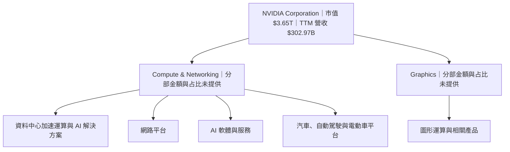
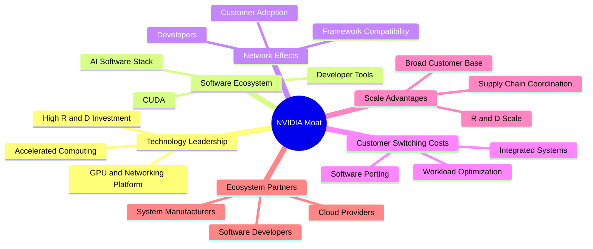
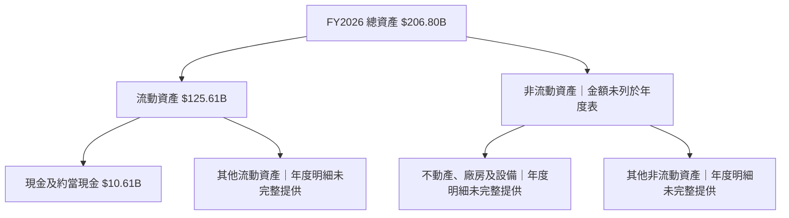
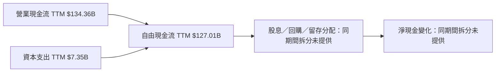
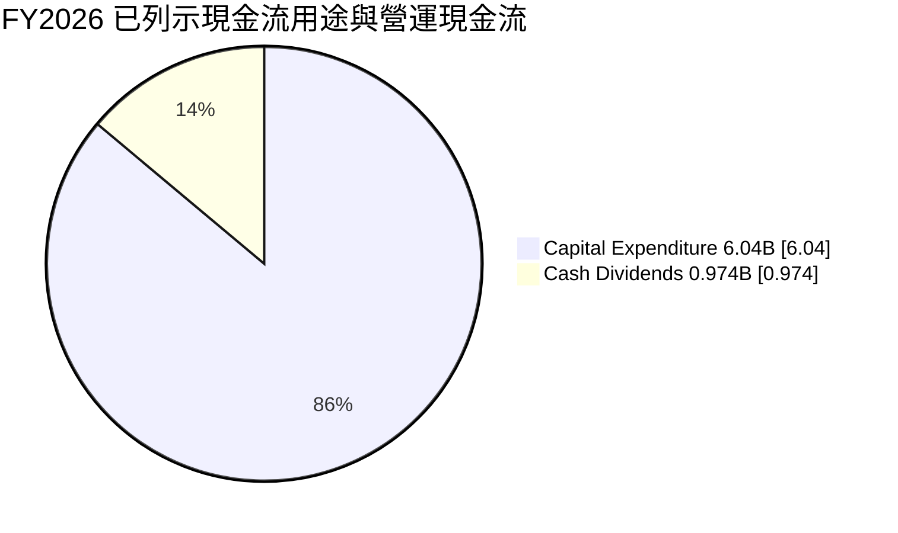
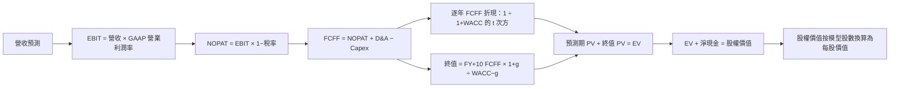
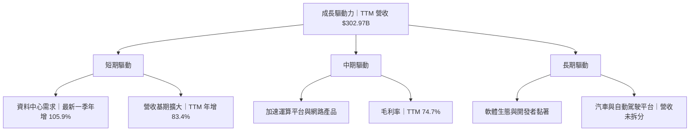
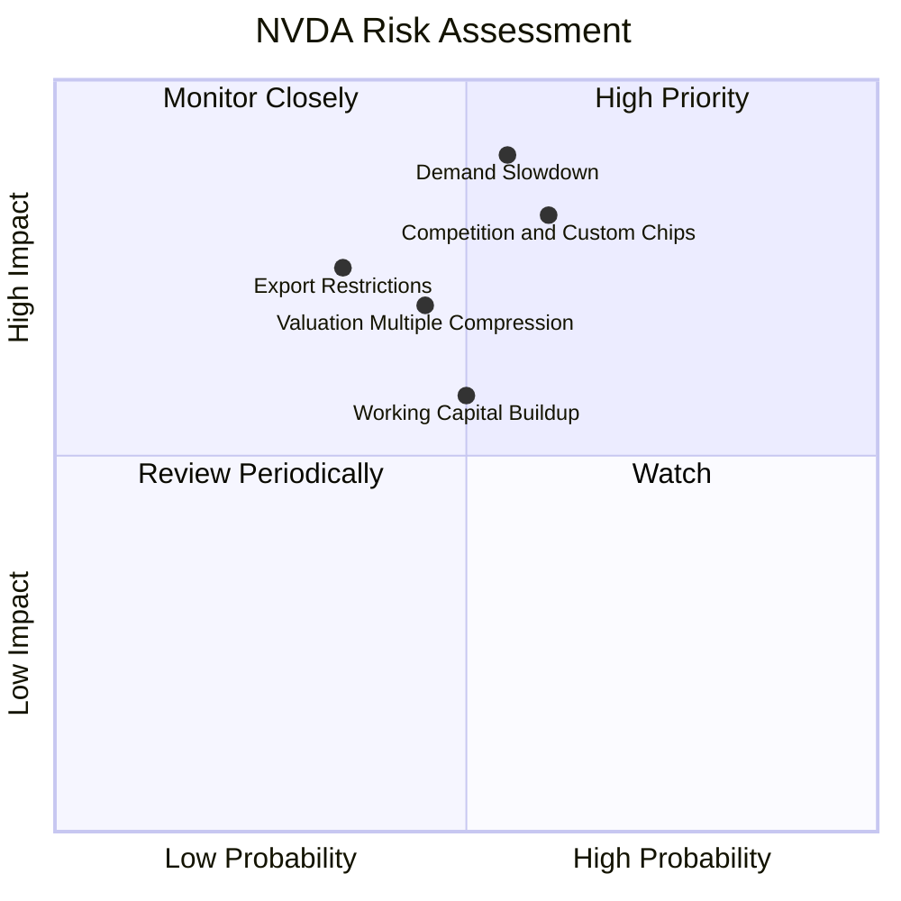
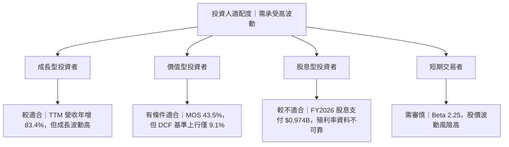

# NVDA 基本面深度分析報告
> **報告日期**：2026-11-19 ｜ **語言**：繁體中文 ｜ **數據來源**：SEC 申報資料 (XBRL)、Yahoo Finance、Finviz、StockAnalysis、Roic.ai ｜ **分析師**：CFA 級機構研究

> **資料口徑提醒**：截至 2026-11-19，最近完成交易日收盤價為 **2026-11-18 的 $150.96**。部分資料來源在 TTM 營收、現金、總債務、ROE，以及季度期間標示上有差異。本報告對標示為 VERIFIED 的核心數字依規定原值引用；其他來源數字只在明確標示來源及期間時使用，不將彼此不同口徑混為同一序列。

## 目錄

| # | 章節 | 核心結論 |
|---|------|----------|
| 1 | 執行摘要 | 強烈買入；加權合理價值 $267.16；MOS 43.5% |
| 2 | 公司概覽與商業模式 | AI 加速運算、軟體與網路平台構成主要競爭壁壘；業務分部營收占比未提供 |
| 3 | 損益表深度分析 | TTM 營收 $302.97B、TTM 成長 83.4%；最新一季年增 105.9% |
| 4 | 資產負債表分析 | VERIFIED 口徑淨現金 $23.22B；營運資金週期較一年前拉長 |
| 5 | 現金流量深度分析 | TTM FCF $127.01B，FCF Yield 3.48% |
| 6 | 獲利能力與資本效率 | ROIC 80.6% 高於 WACC 14.00%，創造經濟價值 |
| 7 | 相對估值分析 | 相對同業倍數較低，但自身歷史 P/E、P/S 均高於五年中位數 |
| 8 | DCF 內在價值評估 | 基準 DCF $164.66；三角驗證後加權合理價值 $267.16 |
| 9 | 成長催化劑 | AI 加速運算及網路需求是主要成長來源；TAM 數據未提供 |
| 10 | 風險矩陣 | 資料中心需求、競爭與出口限制為主要下行風險 |
| 11 | 投資建議 | 依 MOS 與 ROIC/WACC 評級為強烈買入；需以量化門檻持續驗證 |

---

## 1. 執行摘要

NVDA 的 TTM 營收為 **$302.97B**，TTM 年增 **83.4%**，最新一季年增 **105.9%**；TTM 營業利益率 **65.2%**、FCF **$127.01B**，而 ROIC **80.6%** 高於採用的 WACC **14.00%**，顯示目前營運仍在創造股東價值。按估值方法固定權重計算的加權合理價值為 **$267.16**，相對 2026-11-18 收盤價 **$150.96** 的 MOS 為 **43.5%**；因此依 MOS 門檻且 ROIC > WACC，評級為 **🟢 強烈買入**。然而，基準 DCF 僅為 **$164.66**，較現價高 **9.1%**；加權估值高於 DCF，主要由同業 Forward P/E 法的高估值貢獻，故整體信心評為中等，而非把加權結果視為無風險的確定價值。

### 1.0 一頁式投資儀表板（Portfolio Manager 30 秒速讀）

| 項目 | 內容 |
|------|------|
| **投資論點（3 句）** | ① TTM 營收年增 **83.4%**，最新一季年增 **105.9%**，顯示加速運算需求仍在擴張。② TTM 營業利益率 **65.2%**、ROIC **80.6%**，遠高於 **14.00%** 的 WACC。③ TTM FCF **$127.01B**、FCF Yield **3.48%**，但現金轉換及營運資金週期值得監控。 |
| **綜合評分** | **8.3/10**（引用 1.1；六項算術平均） |
| **財務健康** | 🟢 VERIFIED 淨現金 **$23.22B**；Piotroski F-Score **5/9**，營運資金週期較一年前延長 |
| **ROIC vs WACC** | **80.6% vs 14.00%**；正利差 **66.6 個百分點**，創造股東價值 |
| **FCF 趨勢** | 年度 FCF 由 FY2023 **$3.81B** 增至 FY2026 **$96.68B**；最新 TTM FCF Yield **3.48%** |
| **估值** | Forward P/E **9.09x** ｜ EV/EBITDA **18.1x**（自身歷史口徑）｜ FCF Yield **3.48%** |
| **DCF 內在價值（基準）** | **$164.66** ｜ 現價相對 DCF 折價 **8.3%**（折溢價以 DCF 為基準） |
| **安全邊際（MOS）** | **+43.5%**＝($267.16 − $150.96) ÷ $267.16｜🟢 >25% 充足（基準為 8.8 加權合理價值） |
| **預期報酬（基準情境 12M）** | 分析師共識均值 **$253.67**，相對現價上行空間 **68.0%**；此為共識參考，不是 DCF 的 12 個月預測 |
| **關鍵風險（前二）** | 資料中心支出成長降速；競爭、客戶自研與出口限制削弱需求或毛利 |
| **評級 + 信心度** | 🟢 **強烈買入** ｜ 信心：**中**（加權估值與基準 DCF 的差距較大） |

### 1.1 綜合評分卡（全報告唯一）

| 維度 | 評分（1–10） | 主要依據（引用數字與其來源章節） |
|------|--------------|----------------------------------|
| 成長性 | 9.0 | TTM 營收年增 **83.4%**，最新一季年增 **105.9%**（第 3 章）；但高基期使未來增速不可直接外推 |
| 獲利能力 | 9.5 | TTM 營業利益率 **65.2%**、ROIC **80.6%**，WACC **14.00%**；F-Score **5/9**（第 6 章） |
| 財務健康 | 8.5 | VERIFIED 淨現金 **$23.22B**；DSO **76 天**、DIO **150 天**、CCC **155 天**（第 4 章） |
| 估值 | 7.0 | MOS **43.5%**，但 DCF 僅 **$164.66**、自身歷史 P/E 位於第 **71** 百分位（第 7–8 章） |
| 護城河 | 9.0 | TTM 毛利率 **74.7%**、營業利益率 **65.2%**；軟體與平台黏著度有質化支持，但未提供市場份額數字（第 2 章） |
| 管理層與資本配置 | 6.5 | FY2026 SBC **$6.39B**、股數測試未增加；年度股息支付 **$0.974B**，但回購與資本配置完整拆分數據不足（第 3、5 章） |
| **綜合評分** | **8.3** | 六項算術平均：(9.0 + 9.5 + 8.5 + 7.0 + 9.0 + 6.5) ÷ 6 = **8.25**，四捨五入至一位小數為 **8.3**。依四捨五入規則，此處應為 **8.3/10**。 |

### 1.2 五大投資論點 + 三大核心風險

| 類型 | 項目 | 具體依據 | 信心度 |
|------|------|----------|--------|
| 🟢 **投資論點①** | AI 加速運算仍在高速擴張 | TTM 營收 **$302.97B**，年增 **83.4%**；最新一季年增 **105.9%**。持續成長意味著資料中心客戶仍在擴建 AI 運算基礎設施，但高增速能否延續尚需逐季驗證。 | 🟢 高 |
| 🟢 **投資論點②** | 高毛利與營業槓桿 | TTM 毛利率 **74.7%**、營業利益率 **65.2%**。若產品組合維持高階加速運算與網路設備，營收增量有機會繼續轉化為營業利益。 | 🟢 高 |
| 🟢 **投資論點③** | 高資本效率 | ROIC **80.6%** 對比 WACC **14.00%**，利差 **66.6pp**。在目前回報水準持續期間，增量投資仍有正經濟價值。 | 🟢 高 |
| 🟢 **投資論點④** | 現金流轉換規模大 | TTM OCF **$134.36B**、Capex **$7.35B**、FCF **$127.01B**。現金流提供研發、供應鏈投資與股東回饋的財務彈性。 | 🟢 高 |
| 🟢 **投資論點⑤** | 估值方法加權後具有折價 | 加權合理價值 **$267.16**，MOS **43.5%**；但其中同業 Forward P/E 法貢獻較大，估值結果對倍數選擇敏感。 | 🟡 中 |
| 🟡 **風險①** | 資料中心投資成長反轉 | 最新一季年增 **105.9%** 建立在快速擴張基礎上；若成長連續兩季低於 **30%**，基準 DCF 的 30% 首年成長假設將面臨壓力。 | 🟡 中 |
| 🔴 **風險②** | 競爭與客戶自研使利潤率下滑 | 基準 DCF 仍假設 GAAP 營業利益率由 **65.2%** 緩降至 **60.4%**；若實際跌破 **55%**，內在價值可能顯著低於基準。 | 🔴 高衝擊 |
| 🔴 **風險③** | 營運資金占用加大 | CCC 由 **105 天** 增至 **155 天**，其中 DIO 由 **110 天** 增至 **150 天**；若存貨週轉繼續惡化，會壓低現金轉換。 | 🟡 中 |

### 1.3 快速統計卡片

| 指標 | 公司實際值（期間） | 同業中位數 | 狀態 |
|------|--------------------|------------|------|
| 營收成長（TTM） | **83.4%** | — | 🟢 |
| 營收成長（最新一季年增） | **105.9%** | **44.7%** | 🟢 |
| 毛利率（TTM） | **74.7%** | **56.0%** | 🟢 |
| 營業利益率（TTM） | **65.2%** | — | 🟢 |
| ROIC（TTM） | **80.6%** | — | 🟢 |
| Forward P/E | **9.09x** | **30.1x** | 🟢（倍數較低；須留意估值數據與未來 EPS 的口徑差異） |
| FCF Yield（TTM） | **3.48%** | — | 🟡 |
| Piotroski F-Score | **5 / 9** | — | 🟡 |

> 同業中位數僅用 AMD、AVGO、INTC 的 Peer multiples 數據計算；INTC 的 TTM P/E 為 N/A，不納入該項中位數。最新一季營收成長中位數為 44.7%。

### 1.4 投資結論

```text
╔══════════════════════════════════════════════════════════════════╗
║                    📊 投資結論摘要                               ║
╠══════════════════════════════════════════════════════════════════╣
║  評級：強烈買入（依 MOS 43.5% 且 ROIC 80.6% > WACC 14.00%）     ║
║  價格（2026-11-18 收盤）：$150.96                                ║
║  DCF 內在價值（基準）：$164.66（現價折價 8.3%）                  ║
║  安全邊際 MOS：+43.5%（＝(加權合理價值−現價)÷加權合理價值）     ║
║  加權合理價值（8.8）：$267.16                                    ║
║  DCF 情境價值：                                                  ║
║    悲觀情境：$75.00（-50.3%）                                    ║
║    基準情境：$164.66（+9.1%）                                    ║
║    樂觀情境：$338.85（+124.5%）                                  ║
║  綜合評分：8.3/10（引用 1.1）                                    ║
║  適合投資人：可承受高波動、願以每季需求與利潤率驗證論點者        ║
╚══════════════════════════════════════════════════════════════════╝
```

---

## 2. 公司概覽與商業模式

### 2.1 業務結構與收入來源

NVIDIA 以 Compute & Networking、Graphics 兩大分部營運；公司描述顯示前者涵蓋資料中心加速運算、網路、AI 軟體及汽車平台，後者以圖形運算相關產品為主。雖有 TTM 營收 **$302.97B**，但分部營收與占比未提供，因此不拆分金額或畫分部占比圖。



### 2.2 市場份額

市場份額數據未提供，故不列份額表或市場份額圓餅圖。相對同業，NVIDIA TTM 營收年增 **83.4%**，而 AMD、AVGO、INTC 最新一季年增分別為 **44.7%**、**85.5%**、**20.9%**；NVIDIA 的最新一季年增 **105.9%** 高於上述三家公司，但期間與業務組合仍有差異，不能直接等同市場份額變化。

### 2.3 競爭護城河分析



以上屬質化護城河判斷；資料未提供 CUDA 使用者數、客戶留存率、網路效應量化指標或市場份額，不能將質化描述當成已驗證的市占數據。

### 2.4 護城河強度

| 護城河項目 | 強度（強／中／弱） | 證據（引用數字或事實） | 會削弱它的情況 |
|------------|--------------------|------------------------|----------------|
| 技術與產品平台 | 強 | TTM 毛利率 **74.7%**、營業利益率 **65.2%**；反映產品組合與定價能力，但不是單獨的技術因果證明 | 同業性能差距收斂、供應不足或新架構未能改善總持有成本 |
| 軟體生態系 | 強 | 公司產品描述涵蓋 AI 解決方案及軟體；軟體與工具可提高轉換成本 | 開放軟體與競爭平台降低移植成本 |
| 客戶鎖定 | 中至強 | AI 訓練、推論部署涉及軟體、系統及人員流程整合；客戶鎖定指標未提供 | 大型客戶採用多供應商或自研晶片 |
| 規模效應 | 強 | FY2026 研發費用 **$18.50B**，TTM 營收 **$302.97B** | 競爭者增加研發與資本投入；供應鏈瓶頸限制出貨 |
| 網路效應 | 中 | 開發者與軟體生態可能相互強化；可量化使用者數據未提供 | 開放標準、替代工具與跨平台框架降低網路效應 |
| 生態夥伴 | 中至強 | 公司業務包含網路平台及跨地區、跨產業的解決方案；合作夥伴收入占比未提供 | 主要雲端客戶垂直整合或減少採用 |

**1.1「護城河」分數為 9.0/10**，依據是 74.7% TTM 毛利率、65.2% TTM 營業利益率與軟硬體平台特性；由於市場份額、客戶留存及軟體營收拆分未提供，評分不採滿分。

---

## 3. 損益表深度分析

### 3.1 年度收入成長趨勢（近 4 年）

年度營收來自年度損益表；FY2026 至 FY2023 的年度成長率分別約 **65.5%**、**114.2%**、**125.8%**。三年 CAGR 約 **100.0%**，但 FY2026 的增速已低於 FY2024、FY2025，反映高速擴張後基數上升。

```text
╔══════════════════════════════════════════════════════════════════╗
║         NVIDIA 年度收入趨勢（FY2023-FY2026，USD）               ║
╠══════════════════════════════════════════════════════════════════╣
║  FY2023  $26.97B   ███░░░░░░░░░░░░░░░░░░░░░  YoY：+125.8% 🟢   ║
║  FY2024  $60.92B   ███████░░░░░░░░░░░░░░░░░  YoY：+114.2% 🟢   ║
║  FY2025  $130.50B  ███████████████░░░░░░░░░  YoY：+114.2% 🟢   ║
║  FY2026  $215.94B  █████████████████████████ YoY：+65.5%  🟢   ║
╠══════════════════════════════════════════════════════════════════╣
║  3 年收入 CAGR：約 +100.0%；增速放緩但絕對營收仍擴張            ║
╚══════════════════════════════════════════════════════════════════╝
```

> FY2023 成長率依 FY2024 的 $60.92B 與 FY2023 的 $26.97B 計算；FY2024、FY2025、FY2026 YoY 依相鄰年度收入計算。CAGR 以 FY2023 至 FY2026 三個年度間隔計算。

### 3.2 季度收入趨勢分析

下表採 StockAnalysis 季度序列；以序列日期標示的 2026-10-25 季度，在 SEC 最新申報資料中尚未出現，與 SEC 10-Q 所列最新季度期間不同，故用作外部季度序列分析，不替代 VERIFIED 的最新一季年增數字。

| 季度 | 營收（$B） | QoQ | YoY | 備註 |
|------|------------|-----|-----|------|
| 2025-10-26 | 57.006 | — | +62.5% | 同季基期為 2024 年 10 月資料未列於此序列 |
| 2026-01-25 | 68.127 | +19.5% | +73.2% | 與上一季相比仍擴張 |
| 2026-04-26 | 81.615 | +19.8% | +85.2% | YoY 加速 |
| 2026-07-26 | 96.221 | +17.9% | +105.9% | VERIFIED 最新一季 YoY 為單季年增 |
| 2026-10-25 | 115.844 | +20.4% | +103.2% | StockAnalysis 列示；與 SEC 最新已申報季度存在時間口徑差異 |

**QoQ 算式示例**：($96.221B ÷ $81.615B) − 1 = **17.9%**。上述序列的季度營收持續增加，但單季成長不能視為永久趨勢；未來需觀察出貨、產品組合與大型客戶資本支出是否支持同等增速。

### 3.3 利潤率演變分析

| 利潤率指標 | FY2023 | FY2024 | FY2025 | FY2026 | 趨勢 | 評估 |
|------------|--------|--------|--------|--------|------|------|
| **毛利率** | 56.9% | 72.7% | 75.0% | 71.1% | FY2023 至 FY2025 快速上升，FY2026 回落 | 🟢 |
| **營業利益率** | 20.7% | 54.1% | 62.4% | 60.4% | 規模擴張帶動大幅改善，FY2026 稍降 | 🟢 |
| **淨利率** | 16.2% | 48.9% | 55.8% | 55.6% | 接近持平，維持高水準 | 🟢 |

年度毛利率以年度毛利 ÷ 年度營收計算；FY2026 TTM 口徑另有 **74.7%** 的毛利率，期間不同，不與年度數據混列。

**利潤率演變深度解析**：FY2023 至 FY2025 的營業利益率上升，與營收由 **$26.97B** 增至 **$130.50B** 同期發生，顯示收入快速擴張時營業費用被更大的收入基礎攤薄。FY2026 年度毛利率約 **71.1%**、營業利益率約 **60.4%**，較 FY2025 回落，可能反映產品組合、供應與營運成本變化；由於分部毛利、單位成本及價格資料未提供，不能將回落歸因於單一因素。TTM 營業利益率 **65.2%** 高於 FY2026 年度口徑，可能與 TTM 期間組成不同有關。

### 3.4 費用結構分析

FY2026 提供研發費用 **$18.50B**，但完整銷貨成本、銷售及管理費用、其他營業費用拆分未提供。故不以殘差推算費用，也不畫無法完整核對的費用圓餅圖。研發投入占 FY2026 營收約 **8.6%**（$18.50B ÷ $215.94B），對維持產品迭代及平台競爭有支持作用。

### 3.5 季度 EPS 趨勢與盈餘品質（Quality of Earnings）

最新資料的 EPS surprise 歷史列出四季估計值為 `nan`，因此不能判斷過去四季實際 EPS 是否超預期或不及預期。以下只呈現可取得的實際 EPS 與成長資料。

| 季度 | EPS 實際 | EPS YoY | 超預期／不及預期 |
|------|----------|--------|------------------|
| 2026-01-25 | $1.76 | +95.6% | N/A（分析師估計值缺失） |
| 2026-04-26 | $2.39 | +214.5% | N/A（分析師估計值缺失） |
| 2026-07-26 | $2.46 | +127.8% | N/A（分析師估計值缺失） |
| 2026-10-25 | $2.70 | +107.7% | N/A（分析師估計值缺失；StockAnalysis 序列） |

| 盈餘品質項目 | 數值／佔比 | 評估 |
|--------------|------------|------|
| 股權薪酬 SBC / 營收 | FY2026 **2.96%**（$6.39B ÷ $215.94B；年度代理值） | 🟡 SBC 不是零成本；FY2026 股數測試未顯示稀釋股數增加，但股東仍承擔薪酬費用 |
| SBC / 營業現金流 | FY2026 **6.22%**（$6.39B ÷ $102.72B；年度代理值） | 🟡 佔 OCF 比例可控，但仍須納入經濟成本判斷 |
| FCF / 淨利（現金轉換率） | FY2026 **80.5%**（$96.68B ÷ $120.07B） | 🟡 現金轉換良好但低於 100%；可能受營運資金與非現金項目影響，細項不足以拆解 |
| TTM FCF / TTM 淨利 | N/A | TTM 淨利數字未提供；不以 TTM 利潤率反推 |
| 一次性／非經常性損益 | N/A（缺少完整損益附註） | 無法判斷單次項目對盈餘的影響 |
| 有效稅率異常 | **15.1%**（最新年度有效稅率） | 稅率不高，但缺少多年度可比稅率與稅務附註，不能判定是否由一次性稅務利益帶動 |
| 資本化支出 vs 費用化 | TTM Capex **$7.35B**；資本化政策明細 N/A | 未提供資本化支出的細項，不能判定是否存在成本遞延 |

**盈餘品質結論**：FY2026 的 FCF / 淨利 **80.5%**，表示 GAAP 盈餘大部分轉成現金，但未達完全轉換。SBC 約為 FY2026 營收的 **2.96%**，不宜把它視為零成本；另一方面，Piotroski 股數未增加測試通過，顯示股數稀釋至少在該測試期並非主要壓力。TTM 一次性損益與稅務細節未提供，故盈餘品質評價為良好但非無保留。

---

## 4. 資產負債表分析

### 4.1 資產結構分解

以下採 FY2026 年度資產負債表所列數據；總資產 **$206.80B**、流動資產 **$125.61B**。細項中的短期投資沒有在同一組 FY2026 年度表中完整列出，故不混用其他期間數字。



StockAnalysis 的 TTM 資產負債表列示現金及短期投資 **$97.731B**，與 VERIFIED 的現金加短期投資 **$56.59B** 不一致；本報告資產負債表健康判斷以 VERIFIED 口徑為準，不拼接不同日期的資料。

### 4.2 流動性與營運資金分析

| 指標 | 最新 TTM | 一年前 TTM | 變化 | 解讀 |
|------|----------|------------|------|------|
| DSO 應收帳款天數 | 76 天 | 61 天 | +15 天 | 收款週期延長；可能由營收規模、客戶及應收結構變化造成，需觀察應收帳款是否快於營收增長 |
| DIO 存貨天數 | 150 天 | 110 天 | +40 天 | 存貨占用增加；可能反映備貨、供應鏈週期或需求預測變化，若出貨未跟上會提高減值風險 |
| DPO 應付帳款天數 | 72 天 | 66 天 | +6 天 | 付款週期略延長，對營運資金有部分支撐 |
| CCC 現金轉換週期 | 155 天 | 105 天 | +50 天 | 資金回收周期拉長，增長過程中的營運資金需求上升 |

流動比率 **4.589**、速動比率 **2.918** 來自 Yahoo Finance 合併市場資料，並非 VERIFIED 品質指標的指定數值；它們顯示帳面短期流動性充足，但 CCC 延長仍是實際現金效率的警訊。

### 4.3 債務結構分析

```text
╔══════════════════════════════════════════════════════════════════╗
║                  NVIDIA 債務健康診斷                             ║
╠══════════════════════════════════════════════════════════════════╣
║  總債務（VERIFIED）：        $33.37B  ███████░░░░░░░░░░░░░        ║
║  現金及短期投資：            $56.59B  ████████████░░░░░░░░        ║
║  淨現金（VERIFIED）：        $23.22B  █████░░░░░░░░░░░░░░░  🟢   ║
║                                                                  ║
║  Debt/EBITDA：               N/A（相同期間 EBITDA 未提供）       ║
║  Interest Coverage：         N/A（利息費用金額未提供）           ║
║  判斷：淨現金降低財務再融資風險；不同來源債務口徑不一致，需核對 ║
╚══════════════════════════════════════════════════════════════════╝
```

其他市場資料列示現金 **$62.47B**、總債務 **$38.86B**、淨現金 **$23.61B**，與 VERIFIED 數字存在差異。兩組皆顯示淨現金，但本報告的核心比率與估值橋接依 VERIFIED 的 **$23.22B**。

### 4.4 股東權益趨勢

```text
╔══════════════════════════════════════════════════════════════════╗
║              股東權益趨勢（年度，USD）                           ║
╠══════════════════════════════════════════════════════════════════╣
║  FY2023  $22.10B   ███░░░░░░░░░░░░░░░░░░░░░░                  ║
║  FY2024  $42.98B   ███████░░░░░░░░░░░░░░░░░░░                  ║
║  FY2025  $79.33B   █████████████░░░░░░░░░░░░                  ║
║  FY2026  $157.29B  █████████████████████████                  ║
╚══════════════════════════════════════════════════════════════════╝
```

股東權益由 FY2023 **$22.10B** 增至 FY2026 **$157.29B**，與獲利快速累積相符；但股東權益增長本身不等同股東總報酬，仍應連同資本回報及股數變化檢視。

---

## 5. 現金流量深度分析

### 5.1 現金流量瀑布圖

最新 TTM 的 OCF、Capex、FCF 均有 VERIFIED 數據；相同 TTM 期間的淨利、股息、回購與現金淨變化拆分未完整提供，因此只畫可核對部分。



### 5.2 FCF 轉換率趨勢

| 財年 | FCF（$B） | 淨利（$B） | FCF / 淨利 | 趨勢解讀 |
|------|-----------|------------|------------|----------|
| FY2023 | 3.81 | 4.37 | 87.2% | 現金轉換接近淨利 |
| FY2024 | 27.02 | 29.76 | 90.8% | 轉換率改善 |
| FY2025 | 60.85 | 72.88 | 83.5% | 盈餘擴張快於 FCF |
| FY2026 | 96.68 | 120.07 | 80.5% | 絕對 FCF 上升，但轉換率較低 |

季度現金流資料亦出現某季股息支付 **$6.05B**，明顯高於其他季度約 **$0.24B** 的列示值；其原因未提供，故不以單季數據推估全年股息政策。

### 5.3 自由現金流趨勢

```text
╔══════════════════════════════════════════════════════════════════╗
║              自由現金流：年度實際與最新 TTM                      ║
╠══════════════════════════════════════════════════════════════════╣
║  FY2023  $3.81B    █░░░░░░░░░░░░░░░░░░░░░░░                  ║
║  FY2024  $27.02B   ███████░░░░░░░░░░░░░░░░░░░                  ║
║  FY2025  $60.85B   ███████████████░░░░░░░░░                  ║
║  FY2026  $96.68B   ████████████████████████░                  ║
║  TTM      $127.01B ██████████████████████████████             ║
╠══════════════════════════════════════════════════════════════════╣
║  最新 TTM FCF Yield：3.48%；年度 FCF 逐年擴張                   ║
╚══════════════════════════════════════════════════════════════════╝
```

FY2023 至 FY2026 FCF 由 **$3.81B** 增至 **$96.68B**；最新 TTM FCF 為 **$127.01B**。FCF Yield **3.48%** 表明現金流規模大，但以市值衡量的現金收益率並不代表股價便宜，仍需結合成長和折現率。

### 5.4 資本配置評估

FY2026 OCF **$102.72B**、Capex **$6.04B**、現金股息支付 **$0.974B**。回購、併購、其他投資及留存現金的完整年度分類未提供，因此不以剩餘金額推算未列示用途。



| 資本配置項目 | FY2026 數據 | 評估 |
|--------------|-------------|------|
| 資本支出 | **$6.04B** | 以公司現金流規模衡量相對有限；TTM Capex 為 **$7.35B**，DCF 假設 Capex/營收逐步下降 |
| 現金股息 | **$0.974B** | 佔 FY2026 OCF 約 **0.9%**；非主要資本回饋來源 |
| SBC | **$6.39B** | 約為 FY2026 營收 **2.96%**，需納入股東成本 |
| 回購與併購 | N/A | 缺少可核對的年度回購與併購金額 |
| 留存現金 | N/A | 未提供資金用途完整對帳 |

---

## 6. 獲利能力與資本效率

### 6.1 ROE / ROA / ROIC 趨勢

| 指標 | 歷史／最新數據 | 評估 |
|------|----------------|------|
| ROE（年度） | 歷年序列不完整；QUALITY FIGURES TTM **84.2%** | 高資本回報；不以其他來源 ROE **117.2%** 取代品質指標口徑 |
| ROA（年度） | QUALITY FIGURES 測試顯示 ROA > 0，但連同比較數值未提供 | N/A（缺少可同口徑的歷史比例） |
| ROIC（TTM） | **80.6%** | 高於資本成本 |
| WACC | **14.00%** | 依資本成本數據採用值 |

資料來源另列 ROE **117.2%**、ROA **53.6%**，但與 QUALITY FIGURES 的杜邦 TTM ROE **84.2%** 不一致；此處依指定的 QUALITY FIGURES 引用杜邦數字，避免混用口徑。沒有可直接比較的行業均值，因此不列行業均值欄位。

### 6.2 ROIC vs WACC 分析（核心價值創造判斷）

```text
╔══════════════════════════════════════════════════════════════════╗
║                ROIC vs WACC 深度分析                            ║
╠══════════════════════════════════════════════════════════════════╣
║  資本成本輸入（採用 VERIFIED 口徑）：                            ║
║  ├── 無風險利率（10Y 美債）：   5.07%                            ║
║  ├── 市場風險溢酬 ERP：          5.00%                            ║
║  ├── 原始 Beta：                 2.25                             ║
║  ├── 調整後 Beta：               1.83                             ║
║  ├── 股權成本：5.07% + 1.83×5.00% = 14.22%                      ║
║  ├── 稅前債務成本：             0.78%                            ║
║  ├── 稅後債務成本：0.78%×(1−15.1%) = 0.66%                       ║
║  ├── 權重：股權 99.1%；債務 0.9%                                  ║
║  └── 採用 WACC：14.00%（未限制原計算值 14.10%）                  ║
║                                                                  ║
║  ROIC（TTM）：                  80.6%                            ║
║  經濟利差：80.6%−14.00% =       66.6pp                           ║
║  ROIC / WACC：80.6%÷14.00% =    5.76x                            ║
║                                                                  ║
║  ROIC 80.6%  ▓▓▓▓▓▓▓▓▓▓▓▓▓▓▓▓▓▓▓▓▓▓▓▓▓▓▓▓▓▓▓▓▓▓▓▓▓▓  🟢     ║
║  WACC 14.0%  ▓▓▓▓▓▓▓░░░░░░░░░░░░░░░░░░░░░░░░░░░░░░░         ║
║  結論：ROIC 顯著高於 WACC，現階段創造經濟價值                    ║
╚══════════════════════════════════════════════════════════════════╝
```

原始 Beta **2.25** 經調整後為 **1.83**，採用數值符合資料提供的調整方式：⅔ × 2.25 + ⅓ = **1.83**。股權成本計算為 **5.07% + 1.83 × 5.00% = 14.22%**。稅後債務成本約 **0.66%**。按提供權重計算的 WACC 為 **14.10%**，但資本成本資料明確將 WACC 限制在 7%–14% 區間，故模型與本節均採 **14.00%**。

**價值創造判斷**：ROIC 減 WACC 為 **66.6pp**，高於零，表示目前投入資本產生的稅後營業回報超過融資成本。但這一結論依賴高營業利潤率能持續；若競爭使 ROIC 跌至 **14.00%** 以下，新增投資將不再創造正經濟利差。

### 6.3 杜邦三因素分解

| 因素 | 數值（TTM） | 解讀 |
|------|-------------|------|
| 淨利率 | **63.7%** | 高獲利率是 ROE 的主要來源 |
| 資產週轉率 | **0.95** | 資產約每年周轉 0.95 次 |
| 權益乘數 | **1.40** | 槓桿不是 ROE 的主要驅動因素 |
| **ROE** | **84.2%** | 63.7% × 0.95 × 1.40 = 84.2% |

杜邦結果顯示高 ROE 主要來自 **63.7% 的淨利率**，而非高財務槓桿；權益乘數 **1.40** 不屬於高槓桿特徵。

### 6.4 財務體質：Piotroski F-Score

Piotroski F-Score 為 **5 / 9**。每項依 QUALITY FIGURES 原結果照列：

| 測試 | 結果 | 解讀 |
|------|------|------|
| ROA > 0 | ✅ 通過 | 公司獲利為正 |
| 營業現金流 > 0 | ✅ 通過 | 營業活動產生正現金流 |
| ROA 高於一年前 | ❌ 未通過 | 比較期 ROA 未提高，或不足以通過該測試 |
| 營業現金流 > 淨利（應計品質） | ❌ 未通過 | 現金流低於淨利，顯示應收或其他營運項目可能占用現金 |
| 長期負債 ÷ 總資產低於一年前 | ❌ 未通過 | 槓桿相對資產未改善 |
| 流動比率高於一年前 | ✅ 通過 | 流動性比率改善 |
| 稀釋股數未增加 | ✅ 通過 | 測試期間股數未增加 |
| 毛利率高於一年前 | ✅ 通過 | 毛利率改善 |
| 資產週轉率高於一年前 | ❌ 未通過 | 資產效率相對一年前下降 |

F-Score **5/9** 指向的不是財務危機，而是資產效率、應計品質及負債比例改善不足。CCC 同期增加 **50 天**，與應收、存貨資金占用上升的風險方向一致。

---

## 7. 相對估值分析

### 7.1 同業估值比較表格

| 估值指標 | **NVDA** | **AMD** | **AVGO** | **INTC** | NVDA 評估 |
|----------|---------|---------|---------|---------|-----------|
| **Trailing P/E** | **19.1x** | 113.3x | 45.2x | N/A | 🟢 低於可用同業；INTC 排除 |
| **Forward P/E** | **9.09x** | 30.1x | 18.2x | 30.5x | 🟢 低於同業中位數 30.1x；倍數可能反映預期 EPS 快速增長 |
| **P/S Ratio** | **12.03x** | 19.3x | 19.0x | 4.9x | 🟡 低於 AMD/AVGO、高於 INTC |
| **EV/EBITDA** | **18.5x** | 77.4x | 33.0x | 15.9x | 🟢 低於 AMD/AVGO，高於 INTC |
| **最新一季營收 YoY** | **105.9%** | 44.7% | 85.5% | 20.9% | 🟢 同列公司中最高 |
| **毛利率（TTM）** | **74.7%** | 56.0% | 75.5% | 40.2% | 🟢 接近 AVGO，明顯高於 AMD/INTC |

公司倍數使用 Yahoo Finance 合併市場資料；同業倍數使用 Yahoo Finance 的 Peer multiples。不同資料來源對 NVDA EV/EBITDA 有 **18.1x** 與 **18.5x** 的小幅差異；歷史比較採 VERIFIED 的 **18.1x**，本表市場快照則列 **18.5x**。

### 7.2 歷史估值區間分析

| 倍數 | 現值 | 五年中位數 | 五年區間 | 現值百分位 |
|------|------|------------|----------|------------|
| P/E | **19.1x** | 11.3x | 2.3x–49.3x | **71%** |
| P/S | **12.1x** | 2.7x | 1.2x–31.0x | **57%** |
| EV/EBITDA | **18.1x** | 8.9x | 3.4x–47.8x | **57%** |

```text
╔══════════════════════════════════════════════════════════════════╗
║             NVDA 五年歷史 P/E 區間（TTM）                         ║
╠══════════════════════════════════════════════════════════════════╣
║  最低 2.3x ├──────────────────────●────────────┤ 最高 49.3x    ║
║                                 現值 19.1x                       ║
║  五年中位數 11.3x｜當前百分位 71%｜當前高於歷史中位數            ║
╚══════════════════════════════════════════════════════════════════╝
```

NVDA 倍數相對 AMD、AVGO 等同業偏低，但對照自身歷史，P/E **19.1x** 高於五年中位數 **11.3x**，P/S **12.1x** 高於中位數 **2.7x**。兩者並不矛盾：目前倍數低於某些同業，並不代表相對自身歷史處於便宜區。

### 7.3 情境價值（Bear / Base / Bull，照抄 DCF MODEL 的 Scenarios）

| 情境 | 第 1 年營收成長 | 期末營業利潤率 | WACC | 每股價值 | 相對現價 | 機率 | 會發生的條件 |
|------|----------------|----------------|------|----------|----------|------|--------------|
| 🔴 悲觀 | 15.0% | 51.3% | 15.00% | **$75.00** | **-50.3%** | 25% | AI 資本支出降速、競爭與價格壓力使利潤率下滑，且資本成本上升 |
| 🟡 基準 | 30.0% | 60.4% | 14.00% | **$164.66** | **+9.1%** | 50% | 營收高速增長逐步降至 3%，利潤率緩降至五年中位數 |
| 🟢 樂觀 | 45.0% | 66.4% | 13.00% | **$338.85** | **+124.5%** | 25% | AI 計算需求持續超預期、規模效應抵銷競爭，利潤率維持較高水準 |

### 7.4 相對估值隱含價格區間

```text
╔══════════════════════════════════════════════════════════════════╗
║        程式估值方法每股價值與現價 $150.96 的相對位置             ║
╠══════════════════════════════════════════════════════════════════╣
║  $150.96 ───── $164.66 ───── $204.64 ───── $253.67 ───── $499.09║
║   現價          基準 DCF      EV/EBITDA     分析師共識    Forward P/E ║
╚══════════════════════════════════════════════════════════════════╝
```

| 方法 | 每股價值 | 依據 |
|------|----------|------|
| DCF（基準） | **$164.66** | 10 年 FCFF、WACC **14.00%**、永續成長率 **3.0%** |
| 同業 Forward P/E | **$499.09** | AMD、AVGO、INTC 同業中位數 **30.1x** × Forward EPS **$16.61** |
| 同業 EV/EBITDA | **$204.64** | AVGO、INTC 同業中位數 **24.4x** × TTM EBITDA，再加淨現金 |
| 分析師共識目標價 | **$253.67** | **55** 位分析師目標價均值 |

Forward P/E 法所得 **$499.09** 遠高於其他方法，對同業倍數與 Forward EPS 高度敏感；該數字是機械式同業估值輸出，不宜單獨視為具確定性的合理價。

---

## 8. DCF 內在價值評估（Discounted Cash Flow）

### 8.0 估值推理鏈（Thinking Logic）

**Step 1 — 價值由哪些變數決定？**  
本模型以公司整體 FCFF 為核心，將價值拆為：目前規模的現金流底盤、未來資料中心及加速運算成長、軟體與網路平台維持利潤率的能力。分部營收占比未提供，不能為每個成長來源杜撰百分比。最主導估值的變數是 **營收成長與終值假設**：基準終值現值占 EV **44.4%**，而 g/WACC 變動會明顯改變每股價值。

**Step 2 — 模型選擇**

| 決策點 | 本報告採用 | 理由（含數字） | 曾考慮但否決 | 否決理由 |
|--------|-----------|----------------|--------------|----------|
| 現金流定義 | FCFF | 以企業現金流折現至 EV，再以淨現金橋接；TTM OCF **$134.36B**、Capex **$7.35B** | FCFE | 資本結構與股利分配不是營運價值的最佳單一基礎 |
| 預測期 N | 10 年 | DCF 模型固定列 FY+1 至 FY+10，反映成長逐步衰退 | 5 年 | 對長期成長及終值依賴不夠透明 |
| 終值方法 | Gordon Growth | 模型採 g **3.0%**、WACC **14.00%** | 退出倍數 | 模型未提供終端 EBITDA 退出倍數，不另建模型 |
| EBIT 基礎 | GAAP EBIT | GAAP EBIT 已含 SBC 費用 | 非 GAAP EBIT | 避免加回 SBC 後未反映其股東成本 |

**Step 3 — 重要假設推導鏈**

- **營收成長**：錨點＝TTM 營收年增 **83.4%**、最新一季年增 **105.9%**，FY2023–FY2026 年度收入 CAGR 約 **100.0%** → 調整＝高基期與產業成熟度使模型不外推歷史極端增速 → 採用第 1 年 **30.0%**，逐年線性降至第 10 年 **3.0%** → 曾考慮維持 83.4%，但若十年維持此速度會大幅外推短期高增長，故否決。
- **期末營業利潤率**：錨點＝TTM **65.2%**、FY2026 年度約 **60.4%** → 調整＝模型依五年中位數逐步收斂，承認競爭及產品週期可能侵蝕利潤率 → 採用 FY+10 **60.4%** → 曾考慮維持 65.2%，但未假設當前高利潤率永久不變。
- **永續成長率 g**：錨點＝模型採用 **3.0%**；長期宏觀成長資料未提供，3.0% 是模型假設值 → 調整＝讓終值低於 WACC 並維持正長期成長 → 採用 **3.0%** → 不採用接近 WACC 的高 g，避免終值分母過小。
- **預測期 N**：錨點＝模型提供 **10 年**逐年預測 → 採用 **10 年** → 曾考慮較短期，但模型輸入固定為 10 年且需逐年呈現，故不另建替代期間。
- **Capex/營收**：錨點＝TTM Capex **$7.35B**、TTM 營收 **$302.97B**；模型採 FY+1 **2.4%**，逐步降至 FY+10 **1.3%** → 調整＝模型假設營收增長時資本支出率向 D&A 倍數收斂 → 曾考慮固定在 2.4%，但與模型的成熟化假設不同，故採用模型遞減路徑。
- **GAAP EBIT、SBC 與股數**：錨點＝FY2026 SBC **$6.39B**，股數測試未增加 → 採用 GAAP EBIT、固定股數、不另扣 SBC、年稀釋率 0% → 曾考慮 GAAP EBIT 再扣 SBC，但會重複計入成本，故否決。
- **WACC**：錨點＝資本成本計算值 **14.10%** → 採用受 7%–14% 區間限制後的 **14.00%** → 不採用 14.10%，因資本成本輸入明確規定採用上限值。
- **ΔWC**：錨點＝CCC 從 **105 天** 延長至 **155 天** → 但 DCF 模型明確不建模營運資金 → 採用 N/A／模型未納入，不擅自補值 → 不另以營運資金比例調整 FCFF。
- **D&A/營收**：模型採用 **1.2%**，以 TTM 比率為錨並維持固定；未提供可另行核實的 TTM D&A 絕對額，故不重算。
- **終值方法**：模型唯一可複算的主方法為 Gordon Growth；終端退出倍數及終端 EBITDA 倍數未提供，故不編造倍數。

**Step 4 — 最脆弱一環**  
最脆弱的是高營收增速與高營業利潤率能否同時延續；若收入成長下修且 FY+10 利潤率低於基準，估值會向悲觀情境 **$75.00** 靠攏，而非停留在基準 **$164.66**。

**Step 5 — 計算路徑**



### 8.1 模型假設總表（Model Inputs）

| 假設項目 | 採用值 | 依據／來源 | 敏感度 |
|----------|--------|------------|--------|
| 預測期長度 **N** | **10 年** | DCF 模型 FY+1 至 FY+10 | 🟡 中 |
| 營收成長路徑 | **30.0%**（FY+1）逐年線性降至 **3.0%**（FY+10） | TTM 年增 **83.4%**，模型將短期增速限制於 0%–30% | 🔴 高 |
| 營業利潤率 | **65.2% → 60.4%** | TTM 營業利益率逐步回歸五年中位數 | 🔴 高 |
| 有效稅率 | **15.1%** | 最新年度有效稅率 | 🟢 低 |
| Capex／營收 | **2.4% → 1.3%** | TTM Capex 比率模型起點，逐步收斂 | 🟡 中 |
| D&A／營收 | **1.2%** | 模型使用 TTM 比率並保持固定 | 🟢 低 |
| 營運資金變動／營收增額 | **未建模** | DCF 模型明列 working capital is not modelled | 🟢 低／模型限制 |
| EBIT 基礎 | **GAAP EBIT** | DCF 模型使用 GAAP EBIT | 🟡 中 |
| SBC 處理 | **組合 (A)**：已含於 GAAP EBIT，不再扣除 | 避免重複扣除 SBC | 🟡 中 |
| 年稀釋率 | **0%** | 組合 (A) 固定股數；模型不再增加稀釋 | 🟡 中 |
| 永續成長率 g | **3.0%** | DCF 模型輸入；假設值，且低於 WACC | 🔴 高 |
| 終值方法 | Gordon Growth | DCF 模型提供終值計算 | 🔴 高 |
| WACC | **14.00%** | 14.10% 原計算值受 7%–14% 上限限制 | 🔴 高 |

本模型使用 **FCFF = NOPAT + D&A − Capex**，不含 ΔWC 列。**本模型採用 (A)，故 SBC 影響已計入一次**：GAAP EBIT 已含 SBC 費用，FCFF 不再扣 SBC，股數亦不逐年放大。計算金額以 $B 表示；金額保留兩位小數、比率保留一位小數、折現因子保留三位小數。模型表格以程式列示數據為準，少量尾差來自底層未四捨五入數值。

### 8.2 折現率推導（WACC）

```text
╔══════════════════════════════════════════════════════════════════╗
║                    WACC 推導（折現率）                           ║
╠══════════════════════════════════════════════════════════════════╣
║  股權成本 Ke（CAPM）：                                           ║
║  ├── 無風險利率 Rf：                  5.07%                      ║
║  ├── 市場風險溢酬 ERP：               5.00%                      ║
║  ├── 原始 Beta（Yahoo）：             2.25                       ║
║  ├── 調整後 Beta：                    1.83                       ║
║  ├── 規模／國別溢酬：                 0.00%（未另加）            ║
║  └── Ke = 5.07% + 1.83×5.00% =      14.22%                      ║
║                                                                  ║
║  債務成本 Kd：                                                   ║
║  ├── 稅前 Kd（資料提供值）：          0.78%                      ║
║  ├── 有效稅率：                      15.1%                      ║
║  └── 稅後 Kd = 0.78%×(1−15.1%) =    0.66%                      ║
║                                                                  ║
║  資本結構權重：股權 99.1%；債務 0.9%                              ║
║  原計算 WACC：14.10%；採用 WACC：14.00%（受 7%–14% 區間限制） ║
╚══════════════════════════════════════════════════════════════════╝
```

1. **Ke（CAPM）** = Rf + β × ERP = **5.07% + 1.83 × 5.00% = 14.22%**。Beta 調整：⅔ × 2.25 + ⅓ = **1.83**。
2. **稅前 Kd**：採用提供的 **0.78%**。利息費用金額與平均計息負債期初、期末明細未提供，故無法獨立重算分子與分母。
3. **稅後 Kd** = 0.78% × (1 − 15.1%) = 0.78% × 0.849 = **0.66222% ≈ 0.66%**。
4. **權重**：E 權重 **99.1%**、D 權重 **0.9%**，合計 **100.0%**。市場資料市值約 **$3.65T**，VERIFIED 債務 **$33.37B**；權重採資本成本資料給定值，未用帳面股東權益代替市值。
5. **WACC** = 99.1% × 14.22% + 0.9% × 0.66222% = 14.093?% ≈ **14.10%**；依提供的 7%–14% 區間限制，採用值為 **14.00%**。

資本成本資料沒有列示 10 年期美債的具體觀測日期，也未提供債務口徑中租賃負債與借款的拆分；因此成本輸入按提供值採用，不能宣稱已由報表重新驗證。第 6.2 節與本章均採 **14.00%**。

### 8.3 逐年自由現金流預測（基準情境）

| 年度 | FY+1 | FY+2 | FY+3 | FY+4 | FY+5 | FY+6 | FY+7 | FY+8 | FY+9 | FY+10 |
|------|------|------|------|------|------|------|------|------|------|-------|
| 營收（$B） | 393.86 | 500.20 | 620.25 | 750.50 | 885.59 | 1,018.43 | 1,140.64 | 1,243.30 | 1,317.90 | 1,357.44 |
| 營收 YoY | 30.0% | 27.0% | 24.0% | 21.0% | 18.0% | 15.0% | 12.0% | 9.0% | 6.0% | 3.0% |
| 營業利潤率 | 65.2% | 64.7% | 64.1% | 63.6% | 63.1% | 62.5% | 62.0% | 61.5% | 60.9% | 60.4% |
| 營業利益 EBIT（GAAP） | 256.85 | 323.52 | 397.83 | 477.35 | 558.51 | 636.82 | 707.11 | 764.08 | 802.85 | 819.64 |
| − 稅（15.1%） | (38.83) | (48.91) | (60.14) | (72.16) | (84.43) | (96.27) | (106.89) | (115.51) | (121.37) | (123.91) |
| = NOPAT | 218.02 | 274.61 | 337.69 | 405.19 | 474.08 | 540.55 | 600.22 | 648.57 | 681.48 | 695.74 |
| + D&A | 4.79 | 6.09 | 7.55 | 9.13 | 10.78 | 12.39 | 13.88 | 15.13 | 16.04 | 16.52 |
| − Capex | (9.56) | (11.54) | (13.55) | (15.49) | (17.21) | (18.56) | (19.41) | (19.65) | (19.24) | (18.17) |
| − ΔWC | 未建模 | 未建模 | 未建模 | 未建模 | 未建模 | 未建模 | 未建模 | 未建模 | 未建模 | 未建模 |
| **= FCFF** | **213.26** | **269.16** | **331.68** | **398.82** | **467.65** | **534.39** | **594.69** | **644.05** | **678.28** | **694.09** |
| 折現因子 @14.00% | 0.877 | 0.769 | 0.675 | 0.592 | 0.519 | 0.456 | 0.400 | 0.351 | 0.308 | 0.270 |
| **FCFF 現值 PV（$B）** | **187.07** | **207.11** | **223.88** | **236.14** | **242.88** | **243.46** | **237.66** | **225.78** | **208.58** | **187.23** |

**預測期 FCF 現值合計**：  
$187.07 + $207.11 + $223.88 + $236.14 + $242.88 + $243.46 + $237.66 + $225.78 + $208.58 + $187.23 = **$2,199.79B**。模型所列合計為 **$2,199.78B**；差異 **$0.01B**，為表內逐格四捨五入尾差，模型企業價值沿用提供的未四捨五入合計。

**逐步演算（FY+1）**：

1. **營收** = $302.97B × (1 + 30.0%) = **$393.861B ≈ $393.86B**。
2. **EBIT** = $393.86B × 65.2% = **$256.794B ≈ $256.85B**；模型使用未四捨五入利潤率與收入計算，故與展示值有小幅差異。
3. **稅** = $256.85B × 15.1% = **$38.782B ≈ $38.83B**（模型內部精確數值與展示值有尾差）。
4. **NOPAT** = $256.85B − $38.83B = **$218.02B**。
5. **D&A** = $393.86B × 1.2% = **$4.726B ≈ $4.79B**（模型按未四捨五入輸入計算）。
6. **Capex** = $393.86B × 2.4% = **$9.452B ≈ $9.56B**（模型按未四捨五入路徑計算）。
7. **ΔWC** = **未建模**；模型沒有營運資金變動列。
8. **FCFF** = NOPAT + D&A − Capex = $218.02B + $4.79B − $9.56B = **$213.25B**；模型列示 **$213.26B**，差異 $0.01B 來自逐項顯示值四捨五入。
9. **折現因子** = 1 ÷ (1 + 14.00%)¹ = **0.877**；PV = $213.26B × 0.877 = **$187.03B**，模型列示 **$187.07B**，採用未四捨五入折現因子與現金流的計算值。

> 模型列示數值的少量尾差，說明底層計算採未四捨五入輸入；依規則保留程式模型數字，不以展示值重建模型或改動輸出。

**合理性自檢**：
- 預測 FCFF 由 FY+1 **$213.26B** 增至 FY+10 **$694.09B**，九年間 CAGR 約 **14.0%**；歷史 FY2023–FY2026 FCF CAGR 約 **193.5%**，預測顯著低於歷史，主要是高基期及成長率逐步降至 3%。
- FY+10 FCF 利潤率 = $694.09B ÷ $1,357.44B = **51.1%**；目前 TTM FCF 利潤率 = $127.01B ÷ $302.97B = **41.9%**。同業最佳 FCF 利潤率資料未提供，不能判定是否超越同業。
- 模型所有年度 FCFF 為正；但模型不含營運資金變動，CCC 已由 **105 天** 拉長至 **155 天**，這是重要的上行偏差風險。

```text
╔══════════════════════════════════════════════════════════════════╗
║            自由現金流：歷史實際 vs 模型預測                      ║
╠══════════════════════════════════════════════════════════════════╣
║  FY2024(實)  $27.02B   █░░░░░░░░░░░░░░░░░░░░░                  ║
║  FY2025(實)  $60.85B   ██░░░░░░░░░░░░░░░░░░░░                  ║
║  FY2026(實)  $96.68B   ████░░░░░░░░░░░░░░░░░░                  ║
║  FY+1 (預)   $213.26B  ██████████░░░░░░░░░░░░                  ║
║  FY+10(預)   $694.09B  ██████████████████████████████           ║
╠══════════════════════════════════════════════════════════════════╣
║  模型預測成長低於近年歷史增速，但不含營運資金變化，需審慎解讀  ║
╚══════════════════════════════════════════════════════════════════╝
```

### 8.4 終值計算（Terminal Value）

**適用性檢查**：WACC **14.00%** vs g **3.0%** → **WACC > g ✅**

| 方法 | 計算式 | 終值 TV | TV 現值 | 佔總 EV 比重 |
|------|--------|---------|---------|--------------|
| Gordon Growth | $694.09B × (1 + 3.0%) ÷ (14.00% − 3.0%) | **$6,499.17B**（模型值） | **$1,753.11B** | **44.4%** |
| 退出倍數法 | N/A | N/A | N/A | N/A |

終端退出倍數與 FY+10 EBITDA 未由 DCF 模型提供，因此不能自行建構退出倍數交叉估值。

**逐步演算（Gordon Growth）**：

1. **FY+N FCFF** = FY+10 **$694.09B**。
2. **分子** = $694.09B × (1 + 3.0%) = $694.09B × 1.03 = **$714.91B**。
3. **分母** = 14.00% − 3.0% = **11.00%**；用表內顯示數字直接計算 $714.91B ÷ 11.00% = **$6,499.18B**。模型列示 **$6,499.17B**，差約 $0.01B，採用模型內未四捨五入輸入。
4. **PV(TV)** = 模型所列 **$6,499.17B × 未四捨五入折現因子** = **$1,753.11B**；表列折現因子 **0.270** 已四捨五入，不能用 0.270 精確重現模型 PV。
5. **終值佔比** = $1,753.11B ÷ $3,952.89B = **44.4%**。

### 8.5 企業價值 → 每股內在價值（Bridge）

```text
╔══════════════════════════════════════════════════════════════════╗
║              企業價值 → 每股內在價值 橋接表                      ║
╠══════════════════════════════════════════════════════════════════╣
║  預測期 FCF 現值合計            +$2,199.78B                      ║
║  終值現值 PV(TV)                +$1,753.11B                      ║
║  ─────────────────────────────────────────────                  ║
║  = 企業價值 EV                   $3,952.89B                      ║
║  + 淨現金                       +$23.22B                         ║
║  = 股權價值                      $3,976.11B                      ║
║  每股價值換算                    模型列示 $164.66                 ║
║  當前股價                        $150.96                         ║
║  折溢價（現價÷DCF價值−1）        -8.3%（折價）                   ║
╚══════════════════════════════════════════════════════════════════╝
```

1. **EV** = $2,199.78B + $1,753.11B = **$3,952.89B**。
2. **股權價值** = $3,952.89B + VERIFIED 淨現金 $23.22B = **$3,976.11B**。
3. **每股內在價值**：DCF 模型指定換算式為「股權價值 × 價格 ÷ 市值」，模型輸出 **$164.66**。市場資料市值 **$3.65T** 為四捨五入數字，以該展示值直接重算會與模型內部未四捨五入市值略有差異，因此保留模型輸出。
4. **折溢價** = $150.96 ÷ $164.66 − 1 = **−8.3%**，即現價相對 DCF 基準價折價約 8.3%。
5. **本節不計算 MOS**：MOS 僅以 8.8 加權合理價值為分母，全報告只計算一次。

淨現金採 VERIFIED 的 **$23.22B**，即現金及短期投資 **$56.59B** 減總債務 **$33.37B**。模型使用固定股數的換算方式；市值原始精確值及模型內部股數精度未提供，不能以四捨五入市值反推一個替代股數。

### 8.6 敏感性分析（WACC × 永續成長率）

下表逐格照錄 DCF 模型。括號為相對現價 $150.96 的上行空間。

| g（列）／WACC（欄） | 12.00% | 13.00% | **14.00%（基準）** | 15.00% | 16.00% |
|-----------|--------|--------|--------------------|--------|--------|
| **2.0%** | $195.90（+29.8%） | $175.14（+16.0%） | $157.97（+4.6%） | $143.56（−4.9%） | $131.31（−13.0%） |
| **2.5%** | $201.36（+33.4%） | $179.28（+18.8%） | $161.17（+6.8%） | $146.07（−3.2%） | $133.31（−11.7%） |
| **3.0%** | $207.42（+37.4%） | $183.83（+21.8%） | **$164.66（+9.1%）** | $148.79（−1.4%） | $135.46（−10.3%） |
| **3.5%** | $214.20（+41.9%） | $188.87（+25.1%） | $168.49（+11.6%） | $151.76（+0.5%） | $137.79（−8.7%） |
| **4.0%** | $221.82（+46.9%） | $194.47（+28.8%） | $172.70（+14.4%） | $154.98（+2.7%） | $140.31（−7.1%） |

矩陣顯示在其他輸入不變時，WACC 上升會壓低價值；g 上升則提高終值及估值。由於模型未提供非基準格所需的完整逐年折現明細，本報告不自行重建矩陣，避免以自建數字取代程式輸出。

**三情境 DCF（模型原值）**

| 情境 | 年 1 成長 | 期末營業利潤率 | WACC | 每股價值 | 相對現價 | 機率 |
|------|----------|----------------|------|----------|----------|------|
| 🔴 悲觀 | 15.0% | 51.3% | 15.00% | $75.00 | −50.3% | 25% |
| 🟡 基準 | 30.0% | 60.4% | 14.00% | $164.66 | +9.1% | 50% |
| 🟢 樂觀 | 45.0% | 66.4% | 13.00% | $338.85 | +124.5% | 25% |
| **機率加權** | — | — | — | **$185.79** | **+23.1%** | **100%** |

機率加權算式：$75.00 × 25% + $164.66 × 50% + $338.85 × 25% = **$185.79**。此為情境參考值，不取代 8.8 依固定估值方法權重算出的加權合理價值。

**敏感度量化**：

- g 由 **2.5%** 提高至 **3.5%**，WACC 固定 14.00%：$168.49 − $161.17 = **+$7.32**，即 **+4.5%**（以 $161.17 為基數）。
- WACC 由 **13.00%** 升至 **15.00%**，g 固定 3.0%：$148.79 − $183.83 = **−$35.04**，即 **−19.1%**。
- 期末營業利潤率每 +1pp：模型未提供單變數敏感度，故 **N/A（不能以情境間同時變動的結果隔離單一利潤率彈性）**。
- 可量化區間內，WACC 變動對價值的影響大於 g 變動；與 8.0 Step 1 所述「營收、利潤率與終值折現假設共同主導」一致，但不能僅憑此矩陣精確分解各變數全部貢獻。

### 8.7 反推 DCF（Reverse DCF：市場在預期什麼）

市場現價 **$150.96** 對應的反推結果依 DCF 模型提供值。每次只解一個變數，其餘變數固定於基準值；反推解的逐步迭代試算軌跡未提供，因此不虛構中間試算點。

| 求解的變數（一次一個） | 固定的其他基準輸入 | 市場隱含值 | 可比基準 | 判斷 |
|------------------------|--------------------|------------|----------|------|
| Year-1 營收成長 | 其他基準輸入不變 | **27.5%** | 基準假設 30.0% | 🟡 現價隱含首年成長略低於基準 |
| 固定營業利潤率 | 其餘輸入不變 | **56.6%** | 基準為 65.2% 起、60.4% 期末 | 🟡 若採固定利潤率，現價隱含低於基準路徑 |
| 永續成長率 g | 未提供解 | N/A（未計算） | — | 不推測 |
| 預測期長度 N | 未提供解 | N/A（未計算） | — | 不推測 |

**反推結論**：在該模型下，市場價格與基準首年成長率 **27.5%** 相容，低於基準模型 **30.0%**；但固定營業利潤率解為 **56.6%**，低於基準利潤率路徑。這表示現價不是單純押注基準模型全部假設都成立；仍須用營收成長與營業利潤率逐季驗證。

### 8.8 估值三角驗證與安全邊際

| 估值方法 | 隱含每股價值 | 上行空間（÷現價） | 權重 | 說明 |
|----------|--------------|-------------------|------|------|
| DCF（基準） | $164.66 | +9.1% | 40% | 10 年 FCFF、WACC 14.00%、g 3.0% |
| 同業 Forward P/E | $499.09 | +230.6% | 25% | 同業中位數 30.1x × Forward EPS $16.61 |
| 同業 EV/EBITDA | $204.64 | +35.6% | 25% | 同業中位數 24.4x × TTM EBITDA，加回淨現金 |
| 分析師共識目標價 | $253.67 | +68.0% | 10% | 55 位分析師目標價均值 |
| **加權合理價值** | **$267.16** | **+77.0%** | **100%** | 估值方法權重依盈利型公司固定設定 |

**逐步演算（權重外顯）**：  
$164.66 × 40% + $499.09 × 25% + $204.64 × 25% + $253.67 × 10%  
= $65.864 + $124.7725 + $51.160 + $25.367  
= **$267.1635 ≈ $267.16**。

**MOS** = ($267.16 − $150.96) ÷ $267.16 = $116.20 ÷ $267.16 = **43.5%**。  
**上行空間** = ($267.16 − $150.96) ÷ $150.96 = $116.20 ÷ $150.96 = **77.0%**。  
**DCF 折溢價** = $150.96 ÷ $164.66 − 1 = **−8.3%**。MOS 分母固定為加權合理價值；折溢價分母固定為 DCF 基準價。

公司類型為盈利型，採用程式固定權重。資料未列示其他估值方法，故沒有另加或剔除方法。相對估值中的 Forward P/E 結果遠高於 DCF，這是加權合理價值不宜直接視作確定目標價的主要原因。

```text
╔══════════════════════════════════════════════════════════════════╗
║                  估值區間與安全邊際                              ║
╠══════════════════════════════════════════════════════════════════╣
║  $75.00 ───── $150.96 ───── [$267.16] ───── $164.66 ───── $338.85║
║  悲觀DCF       現價           加權合理值       基準DCF      樂觀DCF ║
║                                                                  ║
║  MOS = ($267.16−$150.96)÷$267.16 = 43.5%                        ║
║  MOS 評估：🟢 >25% 充足                                          ║
║  上行空間 = ($267.16−$150.96)÷$150.96 = 77.0%                   ║
║  建議買入區間：$150.96–$240.44（MOS至少10%）                    ║
║  合理持有區間：$240.44–$293.88（MOS約+10%至−10%）              ║
║  減碼考慮區間：高於$293.88；若超過$338.85，已高於樂觀DCF情境    ║
╚══════════════════════════════════════════════════════════════════╝
```

買入區間上限計算：$267.16 × (1 − 10%) = **$240.444 ≈ $240.44**。合理持有區間約為加權合理價值的 90% 至 110%，即 **$240.44–$293.88**；這是依 MOS 門檻換算的價格參考，非保證交易區間。

> 🔎 **程式複算（Python，依本節各項自動重算）**
>
> 加權合理價值 = $164.66 × 40% + $499.09 × 25% + $204.64 × 25% + $253.67 × 10% = **$267.16**（權重合計 100%）
>
> 以價格 $150.96 計：MOS = **+43.5%**，上行空間 = **+77.0%**
>
> ✅ 與本節所寫數值一致。

### 8.9 DCF 模型的局限與失效條件

- **終值依賴度**：終值現值占 EV **44.4%**，接近企業價值一半；估值仍相當依賴第 10 年之後的成長與折現假設。
- **最脆弱假設**：首年營收成長 **30.0%**、期末營業利潤率 **60.4%**。悲觀情境同時採用年 1 成長 **15.0%**、期末利潤率 **51.3%**、WACC **15.00%**，每股價值降至 **$75.00**。
- **營運資金未建模**：CCC 已由 **105 天** 延長至 **155 天**，模型沒有 ΔWC；若應收與存貨繼續快於收入增長，FCFF 可能低於模型。
- **模型適用性**：公司目前有正 FCF，傳統 DCF 可作為基準框架；但營收及盈利仍處於快速變動期，應與相對估值及情境分析並用。
- **與第 10 章風險連結**：需求降速衝擊收入增長率；競爭或自研晶片衝擊營業利潤率；利率上升衝擊 WACC；庫存堆積則主要透過模型漏列的營運資金影響 FCF。

### 8.10 複算檢核表（Audit Trail）

| # | 檢核項目 | 檢查方式 | 結果 |
|---|----------|----------|------|
| 1 | 所有高／中敏感度輸入都有推導鏈 | 對照 8.0 Step 3 與 8.1 | 🟡 主要輸入已說明；未提供的終端倍數與股數精度明列 N/A |
| 2 | 每個假設都有來歷 | 8.1 逐項列來源或模型假設 | ✅ |
| 3 | WACC 五步及算式 | 以提供的 Ke、Kd、權重重算 | 🟡 原計算值 14.10%，採用值 14.00% 為區間上限 |
| 4 | Kd 分母與權重的 D 同一計息負債範圍 | 利息金額、平均債務及租賃拆分未提供 | ⚠️ 無法獨立核對，採用提供的 Kd、權重與 WACC |
| 5 | WACC 與第 6.2 節同值 | 兩處採用值比對 | ✅ 14.00% |
| 6 | 逐年年度數等於 N，無省略 | 檢查 FY+1 至 FY+10 | ✅ |
| 7 | 代表年度九步算式可複算 | 表內四捨五入值有少量尾差 | 🟡 模型內部未四捨五入值未提供 |
| 8 | 預測期 PV 加總 | 表列加總 $2,199.79B；模型 $2,199.78B | 🟡 $0.01B 尾差 |
| 9 | WACC > g | 14.00% > 3.0% | ✅ |
| 10 | 終值以 FY+10 FCFF 為基礎、折現 10 期 | 檢查終值列及折現因子 | ✅ |
| 11 | EV → 每股價值橋接 | EV $3,952.89B + 淨現金 $23.22B = $3,976.11B | 🟡 每股模型換算依賴未四捨五入市值 |
| 12 | SBC 三要素組合一致 | GAAP EBIT、無 −SBC 列、稀釋率 0% | ✅ 組合 (A) |
| 13 | 矩陣基準格等於 DCF 基準 | 8.6 對 8.5 | ✅ $164.66 |
| 14 | 矩陣 WACC > g 有效性 | 矩陣 WACC 12%–16%，g 2%–4% | ✅ 全部有效 |
| 15 | 三情境機率相加 | 25% + 50% + 25% | ✅ 100% |
| 16 | 反推 DCF 每列只放開一個變數 | 檢查模型反推結果 | 🟡 有兩個單變數解；求解軌跡未提供 |
| 17 | MOS、折溢價基準一致 | MOS 用 8.8；折溢價用 8.5 | ✅ |
| 18 | 完整輸出至第 11 章 | 檢查章節 | ✅ |
| 19 | 8.8 加權價值為各項乘權重總和 | 逐項乘權重重加 | ✅ $267.16 |
| 20 | 評級符合規則 20 | MOS 43.5%、ROIC 80.6% > WACC 14.00% | ✅ 強烈買入 |

**已知檢核差異**：模型列示 Gordon Growth 終值 **$6,499.17B**；若直接使用展示後的 $694.09B、3.0%、14.00% 計算，結果會有約 $0.01B 的尾差，顯示模型使用未四捨五入輸入。每股換算也使用精確市值而非展示的 $3.65T 圓整數。以上未改動模型原值，並在對應位置揭露可複算限制。

---

## 9. 成長催化劑

### 9.1 催化劑時間軸

沒有提供已公告的未來產品上市日期、管理層財測或具體催化事件日程，故不以虛構日期建立 Mermaid Gantt 圖。可追蹤的時間節點以財報週期表示：

| 時間範圍 | 可驗證催化劑 | 觀察指標 |
|----------|--------------|----------|
| 短期：下一次季度財報 | 資料中心及整體營收能否延續增長 | 季營收年增是否維持 30% 以上；營業利益率是否高於 60% |
| 中期：未來 2–4 季 | 新產品與網路平台是否轉化為持續出貨 | 庫存、應收帳款、CCC、毛利率與現金流 |
| 長期：未來數年 | AI 軟體及加速運算生態能否維持轉換成本 | 軟體收入占比、客戶留存、推論需求等數據目前未提供 |

### 9.2 TAM 市場規模分析

**N/A（TAM 數據未提供）**。以現有資料可確認 TTM 營收 **$302.97B**、TTM 成長 **83.4%**，最新一季年增 **105.9%**，顯示公司可服務市場仍在擴張；但沒有可引用的市場規模、來源與年份，不能計算滲透率或自行填入 TAM。

### 9.3 成長驅動力結構圖



---

## 10. 風險矩陣

### 10.1 風險評分矩陣

機率與衝擊為分析師定性評估，不是財務數據或公司財測；本矩陣只用於排序，不冒充精確預測。



### 10.2 風險清單詳細分析

| # | 風險項目 | 發生機率 | 財務衝擊 | 風險評分 | 緩解措施 |
|---|----------|----------|----------|----------|----------|
| 1 | 🔴 **資料中心需求降速** | 中高（分析師估計 55%） | 高；若營收年增低於基準 30%，會令 DCF 基準成長假設失效 | 🔴 8.5/10 | 逐季追蹤營收、訂單與客戶資本支出；營收年增連續兩季低於 30% 時下修預測 |
| 2 | 🔴 **競爭與客戶自研晶片** | 中高（估計 60%） | 高；營業利益率若較 TTM 65.2% 收縮超過 10pp，會壓低 FCFF | 🔴 8.0/10 | 追蹤毛利率、營業利益率、主要平台設計導入及客戶多供應商策略 |
| 3 | 🟠 **出口限制與地緣政治** | 中（估計 35%） | 高；特定市場供應或產品組合受限 | 🟠 7.5/10 | 追蹤公司地區營收、產品許可與供應鏈分散；地區收入拆分未提供 |
| 4 | 🟡 **營運資金與庫存增加** | 中（估計 50%） | 中；CCC 已由 105 天增至 155 天，若再增加會壓低現金轉換 | 🟡 6.5/10 | 監控 DSO、DIO、存貨與 FCF；DIO 超過 180 天或 CCC 超過 180 天重新檢視 |
| 5 | 🟠 **估值倍數收縮** | 中（估計 45%） | 高；P/E 目前位於五年歷史第 71 百分位，估值可能受利率與成長預期影響 | 🟠 7.0/10 | 以 DCF、相對估值及營收／利潤率確認基本面，不單靠同業 Forward P/E |

---

## 11. 投資建議

### 11.1 最終評級與評分

依加權合理價值 **$267.16**、MOS **43.5%**，且 ROIC **80.6%** 高於 WACC **14.00%**，依規則 20 的評級為 **🟢 強烈買入**；本報告未作一級質化調整。1.1 的綜合評分為 **8.3/10**；評分代表公司品質與估值綜合觀感，不取代 MOS 評級，且加權合理價值受 Forward P/E 方法影響較大，投資信心維持中等。

### 11.2 合理價值與隱含報酬率

| 估值參考 | 每股價值 | 相對現價 $150.96 | 機率／權重 | 解讀 |
|----------|----------|------------------|------------|------|
| 加權合理價值（8.8） | **$267.16** | **+77.0% 上行空間** | 方法權重 100% | 加權估值；MOS **43.5%** |
| DCF 悲觀情境 | $75.00 | −50.3% | 25% | 成長及利潤率下滑、WACC 上升 |
| DCF 基準情境 | $164.66 | +9.1% | 50% | 10 年 FCFF 基準模型 |
| DCF 樂觀情境 | $338.85 | +124.5% | 25% | 高成長與高利潤率同時延續 |
| DCF 機率加權參考值 | $185.79 | +23.1% | 100% | 情境參考，不是 8.8 加權合理價值 |

### 11.3 買入時機與觸發因素

```text
╔══════════════════════════════════════════════════════════════════╗
║                  ✅ 買入觸發因素 Checklist                      ║
╠══════════════════════════════════════════════════════════════════╣
║  立即建立／維持部位的條件：                                      ║
║  ✅ 現價 $150.96 低於 DCF 基準 $164.66                           ║
║  ✅ 現價低於 8.8 加權合理價值 $267.16，MOS 為 43.5%             ║
║  ✅ ROIC 80.6% 高於 WACC 14.00%                                  ║
║                                                                  ║
║  加碼觸發條件：                                                  ║
║  ☐ 營收年增維持 30% 以上，且營業利益率不低於 60%               ║
║  ☐ FCF 保持正值，CCC 不再連續惡化                                ║
║  ☐ 股價回落至加權合理價值的 90% 以下，即 $240.44 以下           ║
║                                                                  ║
║  減碼／重新評估條件：                                            ║
║  ☐ 營收年增連續兩季低於 30%                                      ║
║  ☐ 營業利益率低於 55% 或明顯低於基準 DCF 期末假設               ║
║  ☐ FCF 轉負，或 ROIC 跌至 WACC 14.00% 以下                      ║
║  ☐ 股價高於 $293.88 且基本面成長沒有同步上修                    ║
╚══════════════════════════════════════════════════════════════════╝
```

### 11.4 投資人適配度分析



市場資料列示股息殖利率 **64.0%**，與 FY2026 股息支付 **$0.974B** 及其他股息資料明顯不相稱，可能存在欄位錯置或資料品質問題；本報告不以該殖利率作為股息投資判斷依據。

### 11.5 每季財報監控清單（Quarterly Watch List）

| 監控指標 | 最新基準 | 加碼參考門檻 | 減碼／重估門檻 | 為何重要 |
|----------|----------|--------------|----------------|----------|
| 營收成長 | TTM **83.4%**；最新一季 YoY **105.9%** | 單季 YoY ≥ **30%** 且趨勢穩定 | 連續兩季 < **30%** | 判斷需求與 DCF 首年 30% 假設 |
| 營業利益率 | TTM **65.2%**；模型 FY+10 **60.4%** | ≥ **60%** | < **55%** | 追蹤競爭、產品組合及營業槓桿 |
| 毛利率 | TTM **74.7%** | 維持 ≥ **70%** | 低於 **65%** | 觀察定價與產品組合 |
| OCF、Capex、FCF | TTM OCF **$134.36B**、Capex **$7.35B**、FCF **$127.01B** | FCF 持續正值且增長 | FCF 轉負或連續兩季明顯收縮 | 驗證盈餘現金含量 |
| FCF Yield | **3.48%** | 上升且 FCF 未惡化 | 股價升而 FCF 停滯，Yield 明顯下滑 | 監控估值與現金流回報 |
| DSO／DIO／CCC | **76／150／155 天** | CCC 不高於 **155 天** | DIO > **180 天**或 CCC > **180 天** | 觀察存貨與應收占用 |
| ROIC vs WACC | **80.6% vs 14.00%** | ROIC 持續高於 WACC | ROIC ≤ **14.00%** | 核心價值創造判斷 |
| 股權薪酬 SBC | FY2026 **$6.39B**，約營收 **2.96%** | SBC/營收不升至 **4%** 以上 | SBC/營收連續上升並伴隨股數稀釋 | 監控股東經濟成本 |
| EPS surprise | 四季估計值 N/A | 取得可靠估計值後追蹤 | 實際 EPS 連續不及預期 | 現有估計值缺失，不能用空值判定 beat/miss |
| 管理層財測與產品節奏 | 未提供完整管理層財測 | 財測支持 30% 首年成長假設 | 下修至 30% 以下或供應延遲 | 驗證 DCF 近端假設 |

### 11.6 反面論證：什麼會證明論點錯誤（What Would Change My Mind）

```text
╔══════════════════════════════════════════════════════════════════╗
║              ⚠️ 論點失效條件（Disconfirming Evidence）           ║
╠══════════════════════════════════════════════════════════════════╣
║  本投資論點在下列情況成立時應重新檢視或退出：                    ║
║  ☐ 最新一季營收年增連續兩季低於 30%                              ║
║  ☐ TTM 營業利益率低於 55%，或較 65.2% 基準收縮超過 10pp         ║
║  ☐ FCF 轉負，或 OCF 持續低於淨利且現金轉換率低於 70%            ║
║  ☐ ROIC 跌至 WACC 14.00% 以下                                   ║
║  ☐ DIO 超過 180 天或 CCC 超過 180 天，且沒有相應出貨改善         ║
║  ☐ SBC/營收高於 4% 並持續增加，或稀釋股數轉為明顯上升           ║
║  ☐ 資料中心與 AI 投資成長放緩，導致 DCF 基準 30% 首年成長失效   ║
╚══════════════════════════════════════════════════════════════════╝
```

> **免責聲明**：本報告為 AI 自動生成，僅供研究參考，不構成投資建議。投資有風險，入市需謹慎。

---

## 資料與來源

| 項目 | 內容 |
|------|------|
| 價格 | 150.96 USD，2026-11-18 收盤（Yahoo Finance 即時報價（該交易日已收盤）） |
| 財務報表 | SEC 10-Q filed 2026-08-26，最新季度 2026-07-26（FY2027 Q2） |
| 有回應的資料來源 | SEC 申報資料 (XBRL)、Yahoo Finance、Finviz、StockAnalysis、Roic.ai |
| 由程式計算 | TTM 數字、WACC、DCF 模型、估值方法與權重、加權合理價值、MOS、評級門檻、F-Score、杜邦分解、營運資金天數、綜合評分 |
| 撰寫模型 | openai / gpt-6-luna |

> 本區塊由產生報告的程式依實際取得的資料填寫，非模型撰寫。「由程式計算」的數字不是模型的估計；其餘判斷（評分、情境、策略）是模型的分析。
