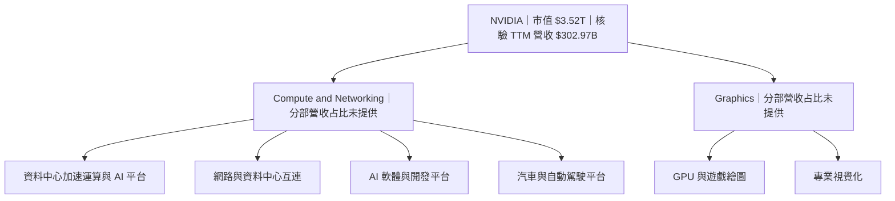
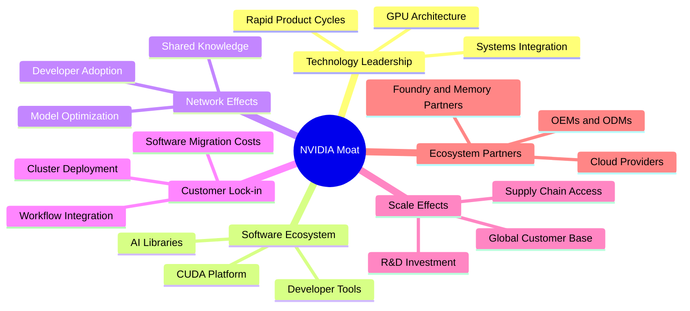
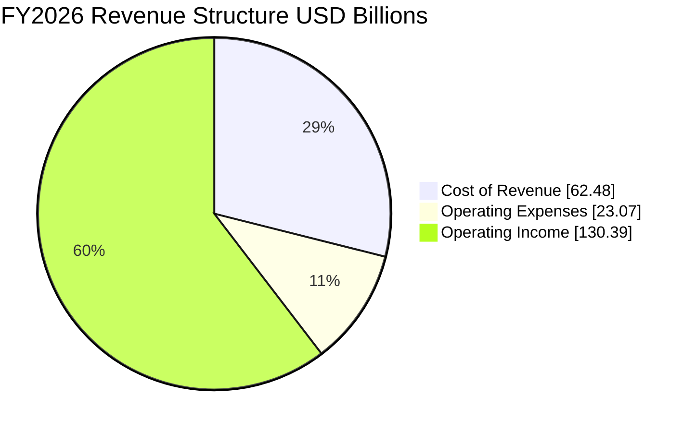
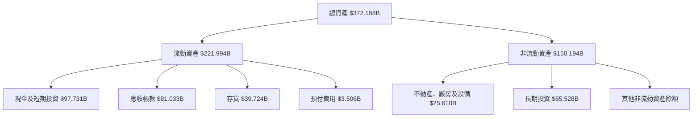
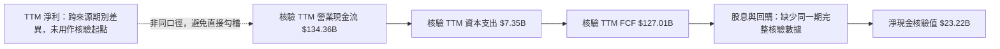
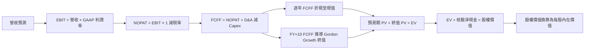
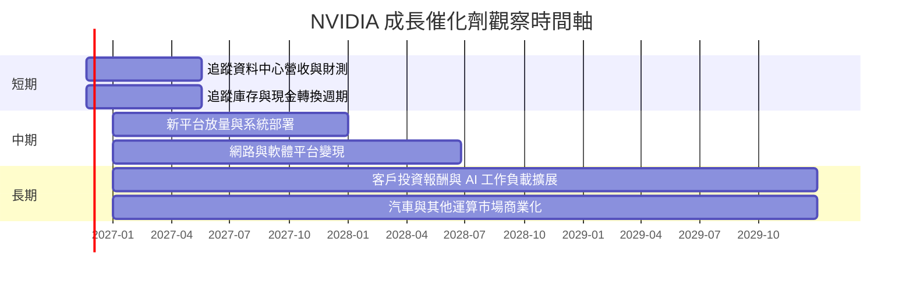
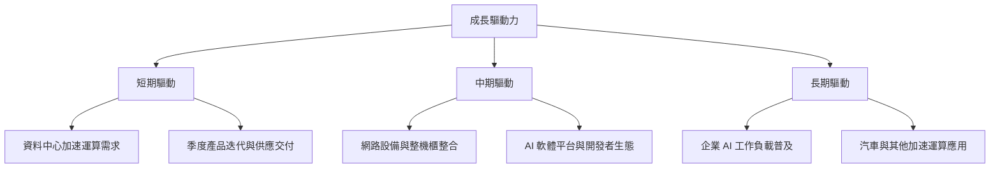
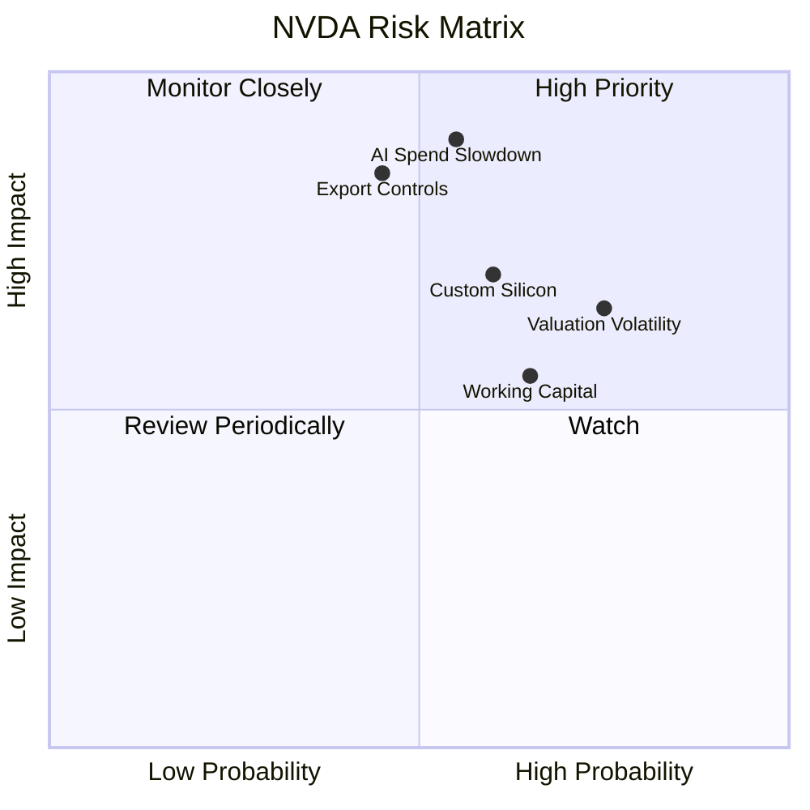
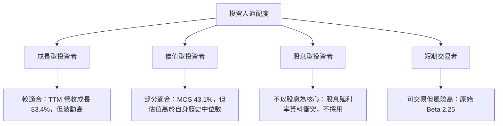

# NVDA 基本面深度分析報告
> **報告日期**：2026-11-20 ｜ **語言**：繁體中文 ｜ **數據來源**：SEC 申報資料 (XBRL)、Yahoo Finance、Finviz、StockAnalysis、Roic.ai ｜ **分析師**：CFA 級機構研究

> **資料一致性說明**：來源中有數個彼此矛盾的欄位。本報告對價格、TTM 成長率、ROIC、WACC、現金流、品質指標及模型估值，優先採用 SEC／價格資料庫及程式計算的核驗值；其他資料僅在必要時列示並標明來源差異。例如，TTM 營收同時出現 $302.97B 與 $361.81B，總現金、總債務及利潤率也有差異。本文不將這些不同口徑混成單一時間序列。市場資料中「股息殖利率 66.0%」與現金股息紀錄明顯不一致，故不採用為估值或收益判斷依據。

## 目錄

| # | 章節 | 核心結論 |
|---|------|----------|
| 1 | 執行摘要 | 強烈買入；加權合理價值 $256.42；MOS +43.1% |
| 2 | 公司概覽與商業模式 | CUDA、軟體與整合式平台形成多層護城河 |
| 3 | 損益表深度分析 | 核驗 TTM 營收 $302.97B、TTM 成長 83.4%；季度營業利益率 66.2% |
| 4 | 資產負債表分析 | 核驗淨現金 $23.22B；營運資金週期延長 |
| 5 | 現金流量深度分析 | TTM FCF $127.01B，FCF Yield 3.60% |
| 6 | 獲利能力與資本效率 | ROIC 80.6% 對 WACC 14.0%，價值創造幅度大 |
| 7 | 相對估值分析 | 相對同業估值不昂貴，但高於自身五年估值中位數 |
| 8 | DCF 內在價值評估 | 基準每股 $164.66；依核驗模型及其敏感度判斷 |
| 9 | 成長催化劑 | AI 基礎設施投資與平台迭代是主要成長來源 |
| 10 | 風險矩陣 | 需求正常化、出口限制、競爭及客戶集中為主要風險 |
| 11 | 投資建議 | 買入區間上限 $230.78；依營運門檻分批執行 |

## 1. 執行摘要

### 1.0 一頁式投資儀表板

| 項目 | 內容 |
|------|------|
| **投資論點（3 句）** | ① 核驗 TTM 營收 $302.97B、年增 83.4%，反映 AI 加速運算需求仍在快速擴張。② TTM 營業利益率 65.2%、ROIC 80.6%，明顯高於 14.0% WACC，現有資本投入創造經濟價值。③ TTM FCF $127.01B、FCF Yield 3.60%，現金創造能力強，但自由現金流收益率也顯示市場已定價相當高的持續成長。 |
| **綜合評分** | **8.4/10**（引用 1.1 評分卡） |
| **財務健康** | 🟢 核驗淨現金 $23.22B；但現金轉換週期由 105 天升至 155 天，周轉效率需追蹤。 |
| **ROIC vs WACC** | **80.6% vs 14.0%**；利差 66.6 個百分點，創造股東價值。 |
| **FCF 趨勢** | TTM FCF $127.01B；FCF Yield **3.60%**。年度 FCF 由 FY2023 $3.81B 增至 FY2026 $96.68B。 |
| **估值** | Forward P/E **8.79x**（市場資料欄位；與其他估值口徑有差異）｜ EV/EBITDA **17.5x**（五年估值區塊）｜ FCF Yield **3.60%** |
| **DCF 內在價值（基準）** | **$164.66** ｜現價相對 DCF 折價 **11.3%** |
| **安全邊際（MOS）** | **+43.1%＝($256.42 − $145.98) ÷ $256.42**（加權合理價值）｜ 🟢 >25% |
| **預期報酬（基準情境）** | DCF 基準情境相對現價上行 **+12.8%**；加權合理價值上行 **+75.7%**，兩者口徑不同。 |
| **關鍵風險（前二）** | AI 資本支出增速下滑；出口管制或自研晶片改變需求結構。 |
| **評級 + 信心度** | 🟢 **強烈買入**｜信心：中。模型估值對長期營收、利潤率及終值假設敏感。 |

### 1.1 綜合評分卡

| 維度 | 評分（1–10） | 主要依據（引用數字與其來源章節） |
|------|--------------|----------------------------------|
| 成長性 | 9.0 | TTM 營收年增 83.4%，最新核驗單季年增 105.9%（第 3 章） |
| 獲利能力 | 9.5 | TTM 營業利益率 65.2%、ROIC 80.6%、F-Score 5/9（第 3、6 章） |
| 財務健康 | 8.0 | 淨現金 $23.22B；但 CCC 由 105 天升至 155 天（第 4 章） |
| 估值 | 7.0 | MOS +43.1%；但 P/E、P/S、EV/EBITDA 均高於自身五年中位數（第 7、8 章） |
| 護城河 | 9.0 | 平台化軟硬體與軟體生態支撐 65.2% TTM 營業利益率（第 2 章） |
| 管理層與資本配置 | 8.0 | 稀釋股數測試通過；FY2026 SBC $6.39B，仍有股東稀釋成本（第 3、5 章） |
| **綜合評分** | **8.4** | 六項算術平均：(9.0 + 9.5 + 8.0 + 7.0 + 9.0 + 8.0) ÷ 6 = **8.4** |

### 1.2 五大投資論點 + 三大核心風險

| 類型 | 項目 | 具體依據 | 信心度 |
|------|------|----------|--------|
| 🟢 **投資論點①** | AI 算力需求仍快速擴張 | TTM 營收 $302.97B，年增 83.4%；最新核驗單季年增 105.9%。若需求延續，規模與固定成本吸收有利於獲利。 | 🟢 高 |
| 🟢 **投資論點②** | 高獲利轉化為實際現金 | TTM OCF $134.36B、Capex $7.35B、FCF $127.01B，FCF Yield 3.60%。 | 🟢 高 |
| 🟢 **投資論點③** | 資本回報遠高於資金成本 | ROIC 80.6%，WACC 14.0%，利差 66.6pp。 | 🟢 高 |
| 🟢 **投資論點④** | 財務彈性充足 | 核驗現金及短期投資 $56.59B、總債務 $33.37B，淨現金 $23.22B。 | 🟢 高 |
| 🟢 **投資論點⑤** | 基準估值並非要求營收維持當前增速 | 反推 DCF 顯示現價隱含第一年營收成長 26.5%，低於 TTM 成長 83.4%；但長期利潤率仍是核心假設。 | 🟡 中 |
| 🟡 **風險①** | 資本支出週期轉弱 | 最新一季年增率 105.9% 很高，若客戶 AI 投資下修，收入及高利潤率可能同步降速。 | 🟡 中 |
| 🔴 **風險②** | 供應、出口管制與客戶自研 | 對先進製程、封裝、記憶體及跨境銷售依賴較高；限制或替代方案可能影響可服務市場。 | 🔴 高 |
| 🔴 **風險③** | 營運資金占用上升 | DSO 76 天、DIO 150 天、CCC 155 天，一年前 CCC 為 105 天，若應收或庫存繼續上升，可能削弱現金轉換。 | 🔴 中高 |

### 1.3 快速統計卡片

| 指標 | 公司實際值（期間） | 同業中位數 | 狀態 |
|------|--------------------|------------|------|
| 營收成長（TTM） | **83.4%** | — | 🟢 |
| 營收成長（最新一季年增） | **105.9%**（單季，FY2027 Q2） | 44.7% | 🟢 |
| 毛利率（TTM） | **74.9%**（StockAnalysis 口徑） | 56.0% | 🟢 |
| 營業利益率（TTM） | **65.2%** | — | 🟢 |
| ROIC（TTM） | **80.6%** | — | 🟢 |
| Forward P/E | **8.79x**（市場資料欄位） | 27.7x | 🟢；口徑差異需留意 |
| FCF Yield（TTM） | **3.60%** | — | 🟡 |
| Piotroski F-Score | **5 / 9** | — | 🟡 |

### 1.4 投資結論

╔══════════════════════════════════════════════════════════════════╗  
║                    📊 投資結論摘要                               ║  
╠══════════════════════════════════════════════════════════════════╣  
║  評級：強烈買入（依 MOS 門檻；ROIC 80.6% > WACC 14.0%）          ║  
║  價格（2026-11-19 收盤）：$145.98                                ║  
║  DCF 內在價值（基準）：$164.66（現價折價 11.3%）                 ║  
║  安全邊際 MOS：+43.1%（以加權合理價值為分母）                    ║  
║  加權合理價值（8.8）：$256.42                                    ║  
║  DCF 情境價值：悲觀 $75.00（-48.6%）                             ║  
║    基準 $164.66（+12.8%）；樂觀 $338.85（+132.1%）               ║  
║  綜合評分：8.4/10（引用 1.1）                                    ║  
║  適合投資人：能承受高波動、看好 AI 資本支出長期化的成長型投資人   ║  
╚══════════════════════════════════════════════════════════════════╝

## 2. 公司概覽與商業模式

### 2.1 業務結構與收入來源

公司資料描述 NVIDIA 透過 Compute & Networking、Graphics 兩大板塊經營資料中心加速運算、網路、AI 軟體、遊戲繪圖及汽車平台。資料未提供最新分部營收和占比，因此不推估各業務收入比例。

### 2.2 市場份額

市場份額數據及可引用的市場規模未提供，因此不繪製市場份額圖。相較 AMD、Broadcom、Intel，NVIDIA 的核驗 TTM 營收達 $302.97B，最新單季年增 105.9%；同業最新單季年增中位數為 44.7%，顯示其營收規模與近期成長速度處於同業前列，但不能僅由此推算市場占有率。

### 2.3 競爭護城河分析

### 2.4 護城河強度

| 護城河項目 | 強度（強／中／弱） | 證據（引用數字或事實） | 會削弱它的情況 |
|------------|--------------------|------------------------|----------------|
| 技術與系統整合 | 強 | TTM 營業利益率 65.2%、ROIC 80.6%；產品由運算、網路及軟體平台組成。 | 競品在性能、能效或供應能力上持續縮小差距。 |
| 軟體生態系 | 強 | 公司業務包含 AI 解決方案與軟體；開發工具及既有程式碼形成遷移成本。 | 開放標準成熟、軟體可攜性上升或客戶轉向自研工具。 |
| 客戶鎖定 | 中至強 | 叢集部署牽涉軟體、網路與硬體整合；無可引用的客戶留存率數據。 | 大型雲端客戶以多供應商和自研晶片降低依賴。 |
| 規模效應 | 強 | TTM 營收 $302.97B，研發費 FY2026 為 $18.50B（年度報表口徑）。 | 研發投入未能轉成新產品收入，或高階供應受限。 |
| 網路效應 | 中 | 開發者與工具生態可形成間接網路效應；缺乏用戶數等量化資料。 | 生態系碎片化或競品軟體相容度提高。 |
| 生態夥伴 | 中至強 | 跨供應鏈與雲端部署合作是平台落地必要條件；夥伴集中及合約數據未提供。 | 供應鏈瓶頸、地緣政治或合作夥伴轉向替代方案。 |

1.1「護城河」評分為 9.0/10，依據是高營業利益率、ROIC 與整合式軟硬體平台；缺乏可核驗的市占率、客戶留存率及分部收入，故未給滿分。

## 3. 損益表深度分析

### 3.1 年度收入成長趨勢（近 4 年）

年度收入採年度損益表數據。FY2023 至 FY2026 收入 CAGR 約 100.1%：\((215.94 ÷ 26.97)^{1/3} - 1\)。

╔══════════════════════════════════════════════════════════════════╗  
║           NVIDIA 年度收入趨勢（FY2023–FY2026）                    ║  
╠══════════════════════════════════════════════════════════════════╣  
║ FY2023  $26.97B   ███░░░░░░░░░░░░░░░░░░░░  YoY：資料列示成長快    ║  
║ FY2024  $60.92B   ██████░░░░░░░░░░░░░░░░░  YoY：+125.9%          ║  
║ FY2025  $130.50B  █████████████░░░░░░░░░  YoY：+114.2%          ║  
║ FY2026  $215.94B  ██████████████████████  YoY：+65.5%           ║  
║ 4 年序列 CAGR（FY2023–FY2026）：約 +100.1%                       ║  
╚══════════════════════════════════════════════════════════════════╝

FY2026 成長率從前兩年的三位數降至 65.5%，但收入基數已大幅抬高。這是成長正常化的早期訊號，不等於需求已反轉；未來要看資料中心支出是否持續超過新增供給。

### 3.2 季度收入趨勢分析

季度收入採 StockAnalysis 季度表；核驗單季年增率則按程式計算區塊列示的最新季度口徑。兩個來源對期別標記略有差異，故表內將來源期別保留。

| 季度 | 營收（$B） | QoQ 成長 | YoY 成長 | 備註 |
|------|------------|----------|----------|------|
| 2026-01 | 68.127 | +19.5% | +73.22% | QoQ 以 2025-10 營收 $57.006B 計算 |
| 2026-04 | 81.615 | +19.8% | +85.23% | 需求與出貨持續擴張 |
| 2026-07 | 96.221 | +17.9% | +105.85% | 核驗單季年增率為 105.9% |
| 2026-10 | 115.844 | +20.4% | +103.21% | StockAnalysis 列示；EPS 預估值未提供 |

計算例：2026-10 QoQ = \(115.844 ÷ 96.221 - 1 = 20.4\%\)。連續季度約 18%–20% 的環比成長，顯示短期收入動能仍強；但季度收入表與 SEC 最新申報期不完全一致，較適合用於趨勢觀察，不與核驗 TTM 營收混算。

### 3.3 利潤率演變分析

| 利潤率指標 | FY2023 | FY2024 | FY2025 | FY2026 | 趨勢 | 評估 |
|------------|--------|--------|--------|--------|------|------|
| **毛利率** | 56.9% | 72.7% | 75.0% | 71.1% | FY2025 見頂後回落 | 🟢 高位，留意產品組合與成本 |
| **營業利益率** | 20.7% | 54.1% | 62.4% | 60.4% | 快速擴張後略降 | 🟢 規模效應仍顯著 |
| **淨利率** | 16.2% | 48.8% | 55.9% | 55.6% | 高位趨平 | 🟢 現金盈餘能力高 |

年度比率按各年度營收、毛利、營業利益及淨利自行計算；核驗 TTM 營業利益率另為 65.2%，不應與 FY2026 年度值混為同一期。利潤率上升主要反映產品組合轉向高價值資料中心運算，以及收入規模擴大對研發、銷售等費用的攤薄。FY2026 年度毛利率及營業利益率較 FY2025 略降，表示高速擴產、產品轉換及不同產品組合可能帶來成本壓力。

### 3.4 費用結構分析

FY2026 年收入分解如下；此圖按營收、銷貨成本、營業費用與營業利益展示，營業費用為毛利減營業利益的差額。

╔══════════════════════════════════════════════════════════════════╗  
║ FY2026 營收 $215.94B                                            ║  
║ 直接成本約 $62.48B ｜營業費用約 $23.07B｜營業利益 $130.39B      ║  
║ 研發費用 $18.50B；營業費用中研發占大部分，但其他費用明細不足。  ║  
╚══════════════════════════════════════════════════════════════════╝

### 3.5 季度 EPS 趨勢與盈餘品質（Quality of Earnings）

| 盈餘品質項目 | 數值／佔比 | 評估 |
|--------------|-----------|------|
| 股權薪酬 SBC / 營收 | 約 **2.0%**；以列示四季 SBC 合計 $7.24B ÷ StockAnalysis TTM 營收 $361.81B 計算 | 🟡 對股東有稀釋成本，比例尚可管理；兩項 TTM 來源期間不完全一致 |
| SBC / 營業現金流 | 約 **5.4%**；$7.24B ÷ $134.36B | 🟢 現金流對 SBC 覆蓋充足 |
| FCF / 淨利 | 約 **56.1%**；$127.01B ÷ StockAnalysis TTM 淨利 $226.257B | 🟡 低於 100%；淨利口徑與核驗現金流期別有差異，避免過度解讀 |
| 一次性／非經常性損益 | N/A（未提供可核驗明細） | 🟡 無法確認是否有重大一次性項目 |
| 有效稅率 | **15.1%**（最新年度有效稅率） | 🟢 模型採用；未見必須以一次性稅務利益解釋盈餘的證據 |
| 資本化支出 vs 費用化 | TTM Capex $7.35B；資本化開支較低，但其他資本化明細未提供 | 🟡 無法排除所有遞延成本項目 |

EPS 歷史顯示 StockAnalysis 列示的最近四季每股盈餘為 $1.76、$2.39、$2.46、$2.70；逐季增長，但 **EPS 預估值為 N/A**，因此無法判定「超預期／不及預期」，不可把實際年增率誤當成盈餘驚喜。年增率資料列示為 95.63%、214.47%、127.78%、107.69%。整體而言，FCF 絕對值龐大且 SBC 相對營收約 2%，支持盈餘有實質現金支撐；但 FCF／淨利轉換率及跨來源期間差異降低精確判讀把握度。

## 4. 資產負債表分析

### 4.1 資產結構分解

下列資產細項採 StockAnalysis TTM 資產負債表口徑；該口徑與核驗現金及短期投資金額不同，故不拿來替代淨現金核驗值。

### 4.2 流動性與營運資金分析

| 指標 | 最新 TTM | 一年前 TTM | 變化 | 解讀 |
|------|----------|------------|------|------|
| DSO 應收帳款天數 | 76 天 | 61 天 | +15 天 | 收款天數增加，可能反映應收規模與營收成長不同步；應追蹤逾期及客戶條件。 |
| DIO 存貨天數 | 150 天 | 110 天 | +40 天 | 存貨占用增加，可能來自提前備貨或產品轉換；若需求不如預期，需留意跌價風險。 |
| DPO 應付帳款天數 | 72 天 | 66 天 | +6 天 | 付款週期延長部分抵銷應收與庫存占用。 |
| CCC 現金轉換週期 | 155 天 | 105 天 | +50 天 | 現金被營運週期占用的時間拉長，是值得監控的變化。 |

流動性補充指標（Yahoo Finance／合併資料）列示流動比率 4.084、速動比率 3.288；由於資產負債表口徑存在差異，視作輔助值。營運資金天數依品質計算區塊原值引用，不以其他來源重新推算。

### 4.3 債務結構分析

╔══════════════════════════════════════════════════════════════════╗  
║                   NVIDIA 債務健康診斷                            ║  
╠══════════════════════════════════════════════════════════════════╣  
║ 核驗總債務：          $33.37B　🟢                                ║  
║ 核驗現金及短期投資：  $56.59B　🟢                                ║  
║ 核驗淨現金：          $23.22B　🟢                                ║  
║ TTM ROIC：            80.6%                                      ║  
║ Debt / EBITDA：       N/A（核驗 EBITDA 與負債期別口徑不一致）     ║  
║ 利息保障倍數：        N/A（未提供可一致使用的利息費用）            ║  
║ 綜合判斷：淨現金降低融資風險，但不代表股價波動風險低。            ║  
╚══════════════════════════════════════════════════════════════════╝

### 4.4 股東權益趨勢

| 財年 | 股東權益（$B） | YoY 變化 |
|------|---------------:|---------:|
| FY2023 | 22.10 | — |
| FY2024 | 42.98 | +94.5% |
| FY2025 | 79.33 | +84.6% |
| FY2026 | 157.29 | +98.3% |

股東權益快速增加，主要與累積盈利及資產規模擴大一致；但帳面權益上升不能單獨證明資本效率改善，仍應以 ROIC 衡量投入資本回報。

## 5. 現金流量深度分析

### 5.1 現金流量瀑布圖

現金流鏈中的 OCF、Capex、FCF 均按核驗 TTM 數值引用。股息、回購及淨現金變動缺乏同一期完整核驗資料，故不以不一致年度數據填補瀑布。

### 5.2 FCF 轉換率趨勢

| 財年 | 營業現金流（$B） | Capex（$B） | FCF（$B） | FCF / 淨利 |
|------|------------------:|------------:|----------:|-----------:|
| FY2023 | 5.64 | 1.83 | 3.81 | 87.2% |
| FY2024 | 28.09 | 1.07 | 27.02 | 90.8% |
| FY2025 | 64.09 | 3.24 | 60.85 | 83.5% |
| FY2026 | 102.72 | 6.04 | 96.68 | 80.5% |
| TTM 核驗值 | 134.36 | 7.35 | **127.01** | N/A（淨利口徑不一致） |

年度 FCF 逐年增加，但 FCF／淨利從 FY2024 的 90.8% 降至 FY2026 的 80.5%。可能原因包括營運資金變化與資本投入增加；由於沒有完全一致的季度淨利與現金流對照，不能將下降完全歸因於特定因素。

### 5.3 自由現金流趨勢

╔══════════════════════════════════════════════════════════════════╗  
║              自由現金流：歷史實際與核驗 TTM                     ║  
╠══════════════════════════════════════════════════════════════════╣  
║ FY2023 實際  $3.81B   █░░░░░░░░░░░░░░░░░░░░░                    ║  
║ FY2024 實際  $27.02B  ██████░░░░░░░░░░░░░░░                    ║  
║ FY2025 實際  $60.85B  █████████████░░░░░░░                    ║  
║ FY2026 實際  $96.68B  ████████████████████                     ║  
║ TTM 核驗值   $127.01B ██████████████████████████               ║  
║ TTM FCF Yield：3.60% ｜ TTM FCF = OCF $134.36B − Capex $7.35B   ║  
╚══════════════════════════════════════════════════════════════════╝

### 5.4 資本配置評估

資本配置完整同期間分解資料不足，故不繪製比例圓餅圖。年度資料列示 FY2026 研發 $18.50B、SBC $6.39B、現金股息 $0.974B、Capex $6.04B；核驗 TTM Capex 則為 $7.35B。公司主要將資本投入研發及供應能力建置，並保有大量現金；回購金額缺少同一期可核驗數據，不能據此判定回購對每股價值的貢獻。

## 6. 獲利能力與資本效率

### 6.1 ROE / ROA / ROIC 趨勢

| 指標 | 數值 | 時間／口徑 | 評估 |
|------|------|------------|------|
| ROE | 84.2% | 核驗 TTM | 🟢 高，但受高淨利率及資產週轉共同影響 |
| ROA | N/A | 未提供可一致比較的歷年核驗序列 | — |
| ROIC | 80.6% | 核驗 TTM | 🟢 大幅高於資金成本 |
| 同業／行業均值 | 不列 | 無可核驗的同口徑 ROIC 均值 | — |

### 6.2 ROIC vs WACC 分析（核心價值創造判斷）

╔══════════════════════════════════════════════════════════════════╗  
║                ROIC vs WACC 深度分析                            ║  
╠══════════════════════════════════════════════════════════════════╣  
║ 無風險利率（10Y 美債）：5.05%                                    ║  
║ 股權風險溢酬 ERP：5.00%                                          ║  
║ 原始 Beta：2.25；調整 Beta：1.83                                 ║  
║ 股權成本（資料庫值）：14.21%                                     ║  
║ 稅前債務成本：0.78%；有效稅率：15.1%                             ║  
║ 股權／債務權重：99.1%／0.9%                                      ║  
║ 核驗 WACC：14.00%（原始計算 14.08%，受 7%–14% 上限限制）         ║  
║ 核驗 ROIC：80.6%                                                 ║  
║ EVA 利差：80.6% − 14.0% = +66.6 個百分點                         ║  
║ 結論：ROIC 顯著高於 WACC，現有投入資本創造經濟價值。              ║  
╚══════════════════════════════════════════════════════════════════╝

WACC 的股權成本採資料庫提供的 14.21%；調整後 Beta 為 \(⅔×2.25+⅓×1=1.83\)。數據區塊給定 CAPM 股權成本與債務成本、權重，並指出原始計算 WACC 14.08% 被 7%–14% 區間上限限制，因此本報告採用 **14.00%**，不另建 WACC。個別債務平均餘額、利息費用及市值資本結構的完整原始輸入未提供，無法獨立重建更細的五步橋接。

### 6.3 杜邦三因素分解

| 因素 | 數值（TTM） | 解讀 |
|------|-------------|------|
| 淨利率 | 63.7% | 高淨利率是 ROE 的重要推力 |
| 資產週轉率 | 0.95 | 資產產生營收效率高，但不是 ROE 的主要放大項 |
| 權益乘數 | 1.40 | 財務槓桿有限，不是 ROE 高企的主要來源 |
| **ROE** | **84.2%** | 63.7% × 0.95 × 1.40 = 84.2%（品質指標原值） |

### 6.4 財務體質：Piotroski F-Score

**Piotroski F-Score：5 / 9**。計算為 TTM 至 2026-07-26 對比 TTM 至 2025-07-27；品質資料列出九項測試結果。

| 測試 | 結果 | 解讀 |
|------|------|------|
| ROA > 0 | ✅ 通過 | 仍有正獲利 |
| 營業現金流 > 0 | ✅ 通過 | 營運現金流為正 |
| ROA 高於一年前 | ❌ 未通過 | 相對去年未改善 |
| 營業現金流 > 淨利 | ❌ 未通過 | 應計品質測試未通過，需追蹤營收與收款品質 |
| 長期負債 ÷ 總資產低於一年前 | ❌ 未通過 | 負債比率未改善 |
| 流動比率高於一年前 | ✅ 通過 | 短期流動性改善 |
| 稀釋股數未增加 | ✅ 通過 | 最近年度測試未顯示淨稀釋 |
| 毛利率高於一年前 | ✅ 通過 | 毛利率相對改善 |
| 資產週轉率高於一年前 | ❌ 未通過 | 資產增長快於營收轉化改善 |

5/9 表示公司基本面仍具盈利與現金流支持，但資產周轉、應計品質及槓桿趨勢並非全數改善，不宜只以高 ROIC 取代全面財務檢查。

## 7. 相對估值分析

### 7.1 同業估值比較表格

| 估值指標 | **NVDA** | **AMD** | **AVGO** | **INTC** | NVDA 評估 |
|----------|---------:|--------:|---------:|---------:|-----------|
| **Trailing P/E** | 18.5x* | 104.5x | 44.3x | N/A | 🟢 相對較低；NVDA 採五年估值區塊值 |
| **Forward P/E** | 8.79x* | 27.7x | 17.9x | 31.1x | 🟢 低於同業中位數 27.7x；口徑衝突需審慎 |
| **P/S Ratio** | 11.7x* | 17.8x | 18.6x | 4.9x | 🟡 同業差異大，NVDA 仍高於低倍數 Intel |
| **EV / EBITDA** | 17.5x* | 71.4x | 32.3x | 16.1x | 🟢 低於 AMD、AVGO，高於 Intel |
| **最新單季營收成長** | 105.9% | 44.7% | 85.5% | 20.9% | 🟢 成長速度高於三家同業 |
| **毛利率（TTM）** | 74.9%* | 56.0% | 75.5% | 40.2% | 🟢 接近 AVGO，明顯高於 AMD、Intel |

\* NVDA 的 18.5x P/E、11.7x P/S、17.5x EV/EBITDA 來自五年歷史估值區塊；8.79x Forward P/E 來自合併市場資料。另有來源列示 NVDA trailing P/E 15.68x、P/S 9.74x、EV/EBITDA 14.22x，與歷史估值區塊不一致，故不混用。Peer multiples 中位數：Forward P/E 27.7x、P/S 17.8x、EV/EBITDA 32.3x、毛利率 56.0%、最新季度營收成長 44.7%。

### 7.2 歷史估值區間分析

╔══════════════════════════════════════════════════════════════════╗  
║               NVDA 五年 P/E 歷史估值位置                        ║  
╠══════════════════════════════════════════════════════════════════╣  
║ 五年區間：2.3x ├──────────────────────────────┤ 49.3x           ║  
║ 五年中位數：11.3x　目前：18.5x　百分位：71%                    ║  
║ 判讀：高於中位數 7.2x，處在自身歷史分布偏高位置。               ║  
║ P/S：目前 11.7x；中位數 2.7x；百分位 57%                        ║  
║ EV/EBITDA：目前 17.5x；中位數 8.9x；百分位 57%                  ║  
╚══════════════════════════════════════════════════════════════════╝

當前估值相對自身五年中位數偏高，反映市場為持續成長支付溢價；即使相對同業估值看似較低，也不能忽略倍數對成長預期變化的敏感性。

### 7.3 情境價值（Bear / Base / Bull，照抄 DCF MODEL 的 Scenarios）

| 情境 | 第 1 年營收成長 | 期末營業利潤率 | WACC | 每股價值 | 相對現價 | 機率 | 會發生的條件 |
|------|----------------|----------------|------|----------|----------|------|--------------|
| 🔴 悲觀 | 15.0% | 51.3% | 15.00% | $75.00 | -48.6% | 25% | AI 投資放緩、競爭與價格壓力使利潤率向下收斂。 |
| 🟡 基準 | 30.0% | 60.4% | 14.00% | $164.66 | +12.8% | 50% | 需求延續但增速逐年下降，營業利潤率溫和回落。 |
| 🟢 樂觀 | 45.0% | 66.4% | 13.00% | $338.85 | +132.1% | 25% | AI 需求及平台黏著度超預期，利潤率維持高位。 |

### 7.4 相對估值隱含價格區間

╔══════════════════════════════════════════════════════════════════╗  
║                 相對估值回推與現價位置                           ║  
╠══════════════════════════════════════════════════════════════════╣  
║ 現價 $145.98 ─ DCF $164.66 ─ EV/EBITDA $203.03 ─                ║  
║ 分析師共識 $246.67 ─ Forward P/E $460.54                         ║  
╚══════════════════════════════════════════════════════════════════╝

| 方法 | 每股價值 | 相對現價 | 依據 |
|------|---------:|---------:|------|
| 同業 Forward P/E | $460.54 | +215.5% | 同業中位數 27.7x × Forward EPS $16.61 |
| 同業 EV/EBITDA | $203.03 | +39.1% | 同業中位數 24.2x × TTM EBITDA，再加淨現金 |
| DCF（基準） | $164.66 | +12.8% | 10 年 FCFF、WACC 14.00%、永續成長 3.0% |
| 分析師共識目標價 | $246.67 | +69.0% | 55 位分析師平均目標價 |

Forward P/E 回推價值遠高於其他方法，顯示相對估值對選取的 Forward EPS 及同業倍數很敏感；不宜將其視為單一確定目標價。

## 8. DCF 內在價值評估（Discounted Cash Flow）

### 8.0 估值推理鏈（Thinking Logic）

**Step 1 — 價值來源與主導變數。**  
公司價值主要由資料中心加速運算與網路平台的現金流構成，另有 Graphics、汽車及軟體平台的增長選擇權；財務資料未提供各分部營收占比，不能為這些來源虛構比例。模型認為最主導估值的變數是長期營收成長與終值假設，尤其終值現值占 EV 44.4%。

**Step 2 — 模型選擇**

| 決策點 | 本報告採用 | 理由（含數字） | 曾考慮但否決 | 否決理由 |
|--------|-----------|----------------|--------------|----------|
| 現金流定義 | FCFF | 與 WACC 折現，得到 EV；模型公式為 NOPAT + D&A − Capex | FCFE | 模型已提供 FCFF 預測，改用 FCFE 會破壞一致性 |
| 預測期 N | 10 年 | 模型指定 10 年；營收成長由 30.0% 線性降至 3.0% | 5 年 | 無法呈現模型中的成長淡出路徑 |
| 終值方法 | Gordon Growth | 模型提供終值及永續成長率 3.0% | 自行加退出倍數 | 模型未提供 DCF 退出倍數輸入，不能另建模型 |
| EBIT 基礎 | GAAP EBIT | 模型明確採 GAAP EBIT | 非 GAAP EBIT | 避免加回 SBC 後漏算股東成本 |

**Step 3 — 關鍵假設推導鏈**

- **營收成長**：錨點＝核驗 TTM 成長 83.4%；模型將 FY+1 限在 30.0%，並線性淡出至 FY+10 3.0%。這是在高基期下大幅低於當前增速的保守化處理；模型採用值照錄，不另改成更高增長。未採用持續 83.4%，因其未反映基數提高及競爭、供給約束。
- **營業利潤率**：錨點＝核驗 TTM 65.2%；模型由 FY+1 65.2% 逐步降至 FY+10 60.4%，依據為過去五財年中位數（含 TTM）。未採用長期維持 65.2%，以反映成熟化及競爭風險。
- **預測期 N**：模型固定 10 年，以覆蓋成長由 30% 衰減至 3% 的路徑；改採 5 年會縮短高成長現金流期間，不符合已給模型。
- **Capex／營收**：錨點＝TTM 2.4%；模型由 FY+1 2.4% 降至 FY+10 1.3%，依模型所述逐步回落至 D&A 的 1.1 倍附近。未維持 2.4% 十年，因模型假設規模化後資本密集度下降。
- **永續成長率 g**：模型採 3.0%，低於 14.0% WACC，與成熟經濟長期名目增長相容；未採更高值，以避免終值過度膨脹。
- **SBC 與股數**：採組合 **(A)**：GAAP EBIT 已含 SBC 費用，不另扣 SBC，股數不再稀釋（年稀釋率 0%）。SBC 影響因此在模型中計入一次。
- **營運資金**：模型明確未建模，故 ΔWC 不列入 FCFF；不是假設實際營運資金需求為零。
- **WACC**：採核驗 14.00%，程式計算 14.08% 後依 7%–14% 區間上限限制；不改用其他折現率。

**Step 4 — 最脆弱一環。**  
最脆弱的是高營業利潤率與長期營收路徑能否同時維持；若需求減速且毛利或營業利潤率下滑，悲觀模型已顯示每股價值可降至 $75.00。

**Step 5 — 計算路徑**

### 8.1 模型假設總表（Model Inputs）

| 假設項目 | 採用值 | 依據／來源 | 敏感度 |
|----------|--------|-------------|--------|
| 預測期長度 **N** | 10 年 | DCF 模型指定；成長由 30.0% 線性淡出至 3.0% | 🟡 中 |
| 營收成長路徑 | FY+1 30.0% → FY+10 3.0% | 核驗 TTM 成長 83.4%；模型將其限制並逐年淡出 | 🔴 高 |
| 營業利潤率 | 65.2% → 60.4% | TTM 65.2% 起步，向五年中位數收斂 | 🔴 高 |
| 有效稅率 | 15.1% | 最新年度有效稅率 | 🟢 低 |
| Capex / 營收 | 2.4% → 1.3% | TTM 2.4%，模型逐步降至 1.1×D&A 附近 | 🟡 中 |
| D&A / 營收 | 1.2% | TTM 比率，模型固定 | 🟢 低 |
| 營運資金變動 | 未建模 | DCF 模型明確不納入營運資金 | 🟢 低 |
| EBIT 基礎 | GAAP | DCF 模型指定 | 🟡 中 |
| SBC 處理 | 組合 A：已含於 GAAP EBIT，不再扣除 | 模型明確設定 | 🟡 中 |
| 年稀釋率 | 0% | 固定股數組合 A；股數不再放大 | 🟡 中 |
| 永續成長率 g | 3.0% | 模型值；低於 WACC 14.0% | 🔴 高 |
| 終值方法 | Gordon Growth | DCF 模型提供此計算 | 🔴 高 |
| WACC | 14.00% | 核驗值；原始計算 14.08% 受上限限制 | 🔴 高 |

DCF 定義為 **FCFF = NOPAT + D&A − Capex**；營運資金不在模型中，故逐年表不另列 ΔWC。模型股數按固定股數處理，並以模型提供的每股換算方式直接引用。

### 8.2 折現率推導（WACC）

╔══════════════════════════════════════════════════════════════════╗  
║                    WACC 推導（折現率）                           ║  
╠══════════════════════════════════════════════════════════════════╣  
║ 無風險利率 Rf（10Y 美債）：5.05%                                 ║  
║ 市場風險溢酬 ERP：5.00%（模型假設值，程式計算輸入）              ║  
║ 原始 Beta：2.25；調整 Beta：1.83                                 ║  
║ 股權成本 Ke（資料庫計算）：14.21%                                ║  
║ 稅前債務成本：0.78%；稅率：15.1%                                 ║  
║ 股權／債務權重：99.1%／0.9%                                      ║  
║ 原始計算 WACC：14.08%；受 7%–14% 上限限制                        ║  
║ 採用 WACC：14.00%（與第 6.2 節一致）                             ║  
╚══════════════════════════════════════════════════════════════════╝

Beta 調整方式：\(⅔×2.25+⅓×1=1.83\)。區塊提供股權成本 14.21%、稅前債務成本 0.78%、權重 99.1%／0.9% 及有效稅率 15.1%；但未提供可獨立重建的利息費用、平均計息負債與市值資本結構完整底稿。故遵循核驗 WACC 14.00%，並不以不完整原始資料另行推算。原始 14.08% 被限制在 7%–14% 的區間內，採用值為 14.00%。

### 8.3 逐年自由現金流預測（基準情境）

金額單位為美元十億；以下逐年列值按 DCF 模型原值引用。展示比率已四捨五入至一位小數，折現因子三位小數；模型內部使用更高精度，因此以四捨五入顯示值反算會有細小差異。

| 年度 | FY+1 | FY+2 | FY+3 | FY+4 | FY+5 | FY+6 | FY+7 | FY+8 | FY+9 | FY+10 |
|------|-----:|-----:|-----:|-----:|-----:|-----:|-----:|-----:|-----:|------:|
| 營收 | 393.86 | 500.20 | 620.25 | 750.50 | 885.59 | 1,018.43 | 1,140.64 | 1,243.30 | 1,317.90 | 1,357.44 |
| 營收 YoY | 30.0% | 27.0% | 24.0% | 21.0% | 18.0% | 15.0% | 12.0% | 9.0% | 6.0% | 3.0% |
| 營業利潤率 | 65.2% | 64.7% | 64.1% | 63.6% | 63.1% | 62.5% | 62.0% | 61.5% | 60.9% | 60.4% |
| EBIT | 256.85 | 323.52 | 397.83 | 477.35 | 558.51 | 636.82 | 707.11 | 764.08 | 802.85 | 819.64 |
| − 稅 | (38.83) | (48.91) | (60.14) | (72.16) | (84.43) | (96.27) | (106.89) | (115.51) | (121.37) | (123.91) |
| NOPAT | 218.02 | 274.61 | 337.69 | 405.19 | 474.08 | 540.55 | 600.22 | 648.57 | 681.48 | 695.74 |
| + D&A | 4.79 | 6.09 | 7.55 | 9.13 | 10.78 | 12.39 | 13.88 | 15.13 | 16.04 | 16.52 |
| − Capex | (9.56) | (11.54) | (13.55) | (15.49) | (17.21) | (18.56) | (19.41) | (19.65) | (19.24) | (18.17) |
| **FCFF** | **213.26** | **269.16** | **331.68** | **398.82** | **467.65** | **534.39** | **594.69** | **644.05** | **678.28** | **694.09** |
| 折現因子 @14.00% | 0.877 | 0.769 | 0.675 | 0.592 | 0.519 | 0.456 | 0.400 | 0.351 | 0.308 | 0.270 |
| **FCFF 現值 PV** | **187.07** | **207.11** | **223.88** | **236.14** | **242.88** | **243.46** | **237.66** | **225.78** | **208.58** | **187.23** |

預測期 PV 合計依模型為 **$2,199.78B**。顯示至兩位小數的年度 PV 相加可能有四捨五入尾差，因此總額引用模型原值。

**FY+1 代表年度演算：**

1. 營收：\(302.97×(1+30.0\%)\)，模型列示 **$393.86B**。
2. EBIT：\(營收×GAAP 營業利潤率\)，模型列示 **$256.85B**。
3. 稅：\(EBIT×15.1\%\)，模型列示 **$38.83B**。
4. NOPAT：模型列示 \(256.85−38.83=\)**$218.02B**。
5. D&A：\(營收×1.2\%\)，模型列示 **$4.79B**。
6. Capex：\(營收×2.4\%\)，模型列示 **$9.56B**。
7. ΔWC：DCF 模型未建模，故不列入。
8. FCFF：模型列示 \(218.02+4.79−9.56=\)**$213.26B**；微小尾差來自顯示值四捨五入。
9. 折現因子：\(1÷(1+14.00\%)^1\)，模型列示 0.877；PV 列示 **$187.07B**，模型運算採未四捨五入因子。

**合理性自檢**

- 預測 FCFF CAGR：以 $213.26B 至 $694.09B、九個年度間隔估算約 14.0%；歷史 FY2023 至 FY2026 FCF CAGR 約 194.0%（低基期效應極大），模型預測明顯低於歷史爆發期。
- FY+10 FCFF 利潤率：約 \(694.09÷1,357.44=51.1\%\)；模型未提供可同口徑比較的同業最佳值，故不做同業排名。
- 預測各年 FCFF 均為正；模型沒有考慮 ΔWC，若營運資金占用持續增加，實際自由現金流可能低於模型。

╔══════════════════════════════════════════════════════════════════╗  
║            自由現金流：歷史實際 vs 模型預測                      ║  
╠══════════════════════════════════════════════════════════════════╣  
║ FY2023 實際  $3.81B    █░░░░░░░░░░░░░░░░░░░░                    ║  
║ FY2024 實際  $27.02B   █████░░░░░░░░░░░░░░░                    ║  
║ FY2025 實際  $60.85B   █████████░░░░░░░░░░░                    ║  
║ FY2026 實際  $96.68B   █████████████░░░░░░░                    ║  
║ FY+1 預測    $213.26B  █████████████████░░░                    ║  
║ FY+10 預測   $694.09B  ███████████████████████████████████████ ║  
╠══════════════════════════════════════════════════════════════════╣  
║ 模型以當前 $127.01B TTM FCF 為背景，假設未來十年繼續增長；       ║  
║ 歷史 CAGR 受低基期扭曲，不能直接外推。                           ║  
╚══════════════════════════════════════════════════════════════════╝

### 8.4 終值計算（Terminal Value）

**適用性檢查**：WACC 14.00% vs g 3.0% → **WACC > g ✅**

| 方法 | 計算式 | 終值 TV | TV 現值 | 佔總 EV 比重 |
|------|--------|---------|---------|--------------|
| Gordon Growth | 模型值：FY+10 FCFF 與 g 3.0%、WACC 14.00% | $6,499.17B | $1,753.11B | 44.4% |
| 退出倍數法 | DCF 模型未提供退出倍數法輸入 | N/A | N/A | N/A |

模型列示的終值計算為 **$6,499.17B**，PV(TV) 為 **$1,753.11B**，占 EV 44.4%。以展示值直接代入 \(694.09×1.03÷(14.00\%−3.0\%)\) 與模型列示值有細小差異，原因是模型使用未四捨五入的底層數字；本報告依要求照錄模型數字，不以展示值重建或替換。未提供退出倍數法的 DCF 模型輸入，故不自行加入交叉驗證倍數。

### 8.5 企業價值 → 每股內在價值（Bridge）

╔══════════════════════════════════════════════════════════════════╗  
║              企業價值 → 每股內在價值 橋接表                      ║  
╠══════════════════════════════════════════════════════════════════╣  
║ 預測期 FCF 現值合計            +$2,199.78B                       ║  
║ 終值現值 PV(TV)                +$1,753.11B                       ║  
║ = 企業價值 EV                   $3,952.89B                       ║  
║ + 淨現金                       +$23.22B                          ║  
║ = 股權價值                      $3,976.11B                       ║  
║ 稀釋後流通股數                  固定股數，模型換算口徑             ║  
║ ★ 每股內在價值                  $164.66                          ║  
║ 當前股價（2026-11-19 收盤）     $145.98                          ║  
║ 折溢價（現價÷DCF 內在價值−1）   -11.3%（折價）                    ║  
╚══════════════════════════════════════════════════════════════════╝

演算鏈：模型列示 \(2,199.78+1,753.11=3,952.89\)；再加核驗淨現金 \(3,952.89+23.22=3,976.11\)。模型每股價值依其原始換算列為 $164.66，不能由未列明的稀釋股數另建替代模型。折溢價 \(145.98÷164.66−1=-11.3\%\)。**本節不計算 MOS**；MOS 僅以第 8.8 節加權合理價值為分母。

### 8.6 敏感性分析（WACC × 永續成長率）

下表每股價值依 DCF 模型原值；括號為相對 $145.98 現價的上行／下行幅度。

| g（列）／WACC（欄） | 12.00% | 13.00% | **14.00%（基準）** | 15.00% | 16.00% |
|-----------|--------:|--------:|-------------------:|--------:|--------:|
| 2.0% | $195.90（+34.2%） | $175.14（+20.0%） | $157.97（+8.2%） | $143.56（-1.7%） | $131.31（-10.1%） |
| 2.5% | $201.36（+38.0%） | $179.28（+22.8%） | $161.17（+10.4%） | $146.07（+0.1%） | $133.31（-8.7%） |
| **3.0%（基準）** | $207.42（+42.1%） | $183.83（+25.9%） | **$164.66（+12.8%）** | $148.79（+1.9%） | $135.46（-7.2%） |
| 3.5% | $214.20（+46.7%） | $188.87（+29.4%） | $168.49（+15.4%） | $151.76（+4.0%） | $137.79（-5.6%） |
| 4.0% | $221.82（+51.9%） | $194.47（+33.2%） | $172.70（+18.3%） | $154.98（+6.2%） | $140.31（-3.9%） |

矩陣顯示在 g=3.0% 時，WACC 由 13% 升至 14% 每股價值由 $183.83 降至 $164.66，變動 -$19.17，約 -10.4%；g 由 2.5% 升至 3.5%、WACC 維持 14% 時，價值由 $161.17 升至 $168.49，增加 $7.32，約 4.5%。模型沒有提供每一敏感度格子的完整年度現金流折現底稿，故矩陣採原值引用，不另以四捨五入輸入重算。

三情境及機率依模型照錄：悲觀 $75.00（25%）、基準 $164.66（50%）、樂觀 $338.85（25%），機率加權值 $185.79。完整情境逐年營收、FCFF 及終值拆解未提供，不能自行反推或捏造；此處以模型情境結果為準。情境機率加權計算的精確輸入亦以模型列示的 $185.79 為準。

### 8.7 反推 DCF（Reverse DCF）

| 求解的變數（一次一個） | 固定條件 | 市場隱含值（令 DCF = 現價） | 對照基準 | 判斷 |
|------------------------|----------|------------------------------|----------|------|
| FY+1 營收成長率 | 其餘採基準模型 | **26.5%** | 基準假設 30.0%；TTM 成長 83.4% | 🟡 現價要求低於近期成長，也低於基準預測 |
| 固定營業利潤率 | 其餘採基準模型 | **54.7%** | 基準路徑 65.2% → 60.4% | 🟡 市場價格可由較低固定利潤率解釋 |
| 永續成長率 | 模型未提供解 | N/A | — | 不自行反解 |
| 預測期長度 N | 模型未提供解 | N/A | 基準 N=10 年 | 不自行反解 |

資料庫只提供上述兩個單變數反推結果，沒有試算軌跡或逐次迭代值，因此不杜撰收斂表。反推結果說明：按該模型，現價不必要求營收長期維持 83.4% 增長；但仍要求企業維持高利潤率與現金流能力。

### 8.8 估值三角驗證與安全邊際

| 估值方法 | 隱含每股價值 | 上行空間（÷現價） | 權重 | 說明 |
|----------|--------------|-------------------|------|------|
| DCF（基準） | $164.66 | +12.8% | 40% | 10 年 FCFF，WACC 14.00%，g 3.0% |
| 同業 Forward P/E | $460.54 | +215.5% | 25% | 同業中位數 27.7x × Forward EPS $16.61 |
| 同業 EV/EBITDA | $203.03 | +39.1% | 25% | 同業中位數 24.2x × TTM EBITDA，加淨現金 |
| 分析師共識目標價 | $246.67 | +69.0% | 10% | 55 位分析師平均目標價 |
| **加權合理價值** | **$256.42** | **+75.7%** | **100%** | 可獲利公司類型之固定權重 |

程式列示加權價值為 $256.42。以展示到小數點後兩位的各方法與權重直接相乘相加，可能出現四捨五入尾差；為遵循核驗值，本文保留模型所列加權總值，不再微調。計算定義：MOS = \((加權合理價值−現價)÷加權合理價值\) = **+43.1%**；上行空間 = \((加權合理價值−現價)÷現價\) = **+75.7%**。

╔══════════════════════════════════════════════════════════════════╗  
║                  估值區間與安全邊際                              ║  
╠══════════════════════════════════════════════════════════════════╣  
║ $75.00 ─── $145.98 ─── $164.66 ─── [$256.42] ─── $338.85         ║  
║ 悲觀 DCF    現價       基準 DCF     加權合理值    樂觀 DCF         ║  
║                                                                  ║  
║ MOS = (加權合理價值 − 現價) ÷ 加權合理價值 = +43.1%              ║  
║ 上行空間 = (加權合理價值 − 現價) ÷ 現價 = +75.7%                 ║  
║ 建議買入區間：$145.98–$230.78（加權價值的 90%；MOS 至少 10%）    ║  
║ 合理持有區間：$230.78–$282.06（MOS 約 +10% 至 -10%）             ║  
║ 減碼考慮區間：高於 $282.06（MOS 低於 -10%）                      ║  
╚══════════════════════════════════════════════════════════════════╝

按 MOS 門檻及 ROIC > WACC，評級為 **強烈買入**；不作質化下調。買入區間上限 \(256.42×(1−10\%)=$230.78\)，符合買入評級上限高於現價的要求。

> 🔎 **程式複算（Python，依本節各項自動重算）**
>
> 加權合理價值 = $164.66 × 40% + $460.54 × 25% + $203.03 × 25% + $246.67 × 10% = **$256.42**（權重合計 100%）
>
> 以價格 $145.98 計：MOS = **+43.1%**，上行空間 = **+75.7%**
>
> ✅ 與本節所寫數值一致。

### 8.9 DCF 模型的局限與失效條件

- **終值依賴度**：終值現值占 EV **44.4%**，估值近半取決於 FY+10 之後現金流及永續成長假設。
- **最脆弱假設**：營收淡出路徑與利潤率。若 AI 資本支出下降、競品壓價或供應鏈成本上升，估值可能向悲觀情境 $75.00 靠攏。
- **營運資金限制**：CCC 已由 105 天升至 155 天，模型卻不納入 ΔWC；若現金轉換週期進一步拉長，FCFF 可能低於模型。
- **適用性**：公司目前 FCF 為正且規模大，DCF 具參考價值；但 14% WACC、3% 永續成長率及十年成長淡出仍是模型假設，不是公司承諾。
- **風險連結**：客戶資本支出下修影響營收增速；出口限制與自研晶片影響收入可服務市場；產品競爭與成本上升影響營業利潤率；存貨及應收上升影響模型未納入的營運資金。

### 8.10 複算檢核表（Audit Trail）

| # | 檢核項目 | 結果 |
|---|----------|------|
| 1 | 高／中敏感度假設有推導鏈 | ⚠️ 模型假設已逐項說明；未提供所有假設的底層歷史表 |
| 2 | 每項假設有依據 | ✅ 已列依據或標明模型未提供 |
| 3 | WACC 與組成 | ⚠️ 採用核驗 14.00%；未提供完整債務及利息底稿以獨立複算 |
| 4 | Kd 分母與債務權重範圍 | ⚠️ 依核驗區塊照錄，原始負債範圍資料不足 |
| 5 | WACC 與第 6.2 節一致 | ✅ 均為 14.00% |
| 6 | 預測年度數等於 N | ✅ 10 年，FY+1 至 FY+10 全列 |
| 7 | FY+1 代表年度演算 | ⚠️ 依模型原值列示；展示精度會產生小額尾差 |
| 8 | 預測期 PV 合計 | ✅ 引用模型合計 $2,199.78B |
| 9 | WACC > g | ✅ 14.00% > 3.0% |
| 10 | 終值基於 FY+10 並折現十期 | ✅ 模型列示終值與現值 |
| 11 | EV 至每股價值橋接 | ✅ 引用模型 EV、淨現金、股權價值與每股值 |
| 12 | SBC 三要素相容 | ✅ 組合 A：GAAP、無 SBC 再扣除、股數不稀釋 |
| 13 | 敏感性基準格 = DCF 基準值 | ✅ $164.66 |
| 14 | 矩陣格與終值有效性 | ✅ 模型矩陣各列 WACC 高於 g |
| 15 | 情境機率加總及加權值 | ✅ 25% + 50% + 25% = 100%；引用 $185.79 |
| 16 | Reverse DCF 一次只解一個變數 | ✅ 僅列模型提供的兩項解；無解項標 N/A |
| 17 | MOS 分母與基準 | ✅ MOS 採第 8.8 節加權合理價值；DCF 折溢價採第 8.5 節價值 |
| 18 | 報告章節完整至第 11 章 | ✅ |
| 19 | 加權合理價值與權重 | ⚠️ 直接引用程式列示 $256.42；展示精度存在尾差，不另改值 |
| 20 | 評級符合 MOS 規則 | ✅ MOS +43.1%、ROIC > WACC，強烈買入 |

## 9. 成長催化劑

### 9.1 催化劑時間軸

以下為分析時間框架，不是公司已公布的財務預測。

### 9.2 TAM 市場規模分析

**N/A（TAM 數據未提供）**。可核驗數據顯示 TTM 營收 $302.97B、年增 83.4%，代表目前營收基數仍快速擴張；但未提供各市場 TAM、滲透率及可比年份，不能自行填入市場金額或占有率。

### 9.3 成長驅動力結構圖

## 10. 風險矩陣

### 10.1 風險評分矩陣

機率與衝擊位置為分析師定性判斷，非公司財務預測；圖中節點名稱採英文以符合圖表語法規則。

### 10.2 風險清單詳細分析

| # | 風險項目 | 發生機率 | 財務衝擊 | 風險評分 | 緩解措施 |
|---|----------|----------|----------|----------|----------|
| 1 | 🔴 AI 資本支出週期下滑 | 中（分析師估計） | 高；收入增速及獲利率可能同步下行，悲觀情境每股 $75.00 | 🔴 8.5/10 | 追蹤雲端客戶支出、訂單與指引；分批建倉，避免把單季高增長永久化。 |
| 2 | 🔴 出口管制及地緣政治 | 中（分析師估計） | 高；可服務市場及交付受限 | 🔴 8.0/10 | 追蹤法規、地區收入曝險與供應鏈替代安排。 |
| 3 | 🟠 客戶自研晶片與競爭 | 中高（分析師估計） | 中高；可能影響議價能力、營收份額及 65.2% TTM 營業利益率 | 🟠 7.5/10 | 監測毛利率、客戶集中與競品產品效能，評估平台黏著是否維持。 |
| 4 | 🟠 營運資金惡化 | 中高；CCC 已由 105 天升至 155 天 | 中；更多現金被應收及存貨占用 | 🟠 6.5/10 | 每季追蹤 DSO、DIO、應收帳款及存貨增速。 |
| 5 | 🟠 高 Beta 與估值波動 | 高；原始 Beta 2.25 | 股價下行幅度可能大於大盤 | 🟠 7.0/10 | 用限價與部位上限控制風險；將估值與營運證據分開檢驗。 |

## 11. 投資建議

### 11.1 最終評級與評分

核驗 MOS 為 +43.1%，高於強烈買入門檻 25%；ROIC 80.6% 亦高於 WACC 14.0%，因此依規則評為 **強烈買入**，沒有作一級調整。1.1 評分卡綜合評分為 **8.4/10**，其六項分數為成長性 9.0、獲利能力 9.5、財務健康 8.0、估值 7.0、護城河 9.0、管理層與資本配置 8.0。

### 11.2 合理價值與隱含報酬率

| 估值項目 | 每股價值 | 相對 2026-11-19 收盤價 $145.98 | 機率 |
|----------|---------:|---------------------------------:|-----:|
| 加權合理價值 | **$256.42** | **+75.7% 上行空間** | 固定權重估值 |
| 🔴 悲觀 DCF | $75.00 | -48.6% | 25% |
| 🟡 基準 DCF | $164.66 | +12.8% | 50% |
| 🟢 樂觀 DCF | $338.85 | +132.1% | 25% |
| DCF 情境機率加權（參考） | $185.79 | +27.3% | 100% |

加權合理價值是多方法估值的加權結果；DCF 情境機率加權值屬情境參考，不替代第 8.8 節加權合理價值，也不作 MOS 分母。

### 11.3 買入時機與觸發因素

╔══════════════════════════════════════════════════════════════════╗  
║                  ✅ 買入觸發因素 Checklist                      ║  
╠══════════════════════════════════════════════════════════════════╣  
║ 立即／分批買入的基本條件：                                       ║  
║  ✅ 現價 $145.98 低於基準 DCF $164.66                            ║  
║  ✅ MOS +43.1%，高於強烈買入 25% 門檻                            ║  
║  ✅ ROIC 80.6% 高於 WACC 14.0%                                   ║  
║  ✅ TTM FCF $127.01B，FCF Yield 3.60%                            ║  
║                                                                  ║  
║ 加碼觸發條件：                                                   ║  
║  ☐ 最新季度營收年增維持高於 30%，且管理層財測未下修               ║  
║  ☐ 營業利益率維持在 60% 以上                                     ║  
║  ☐ CCC 不再惡化，DIO、DSO 至少連續兩季趨穩                       ║  
║                                                                  ║  
║ 減碼／停損重新評估條件：                                         ║  
║  ☐ 營收成長連續兩季低於 20%                                     ║  
║  ☐ 營業利益率跌破 55%                                            ║  
║  ☐ FCF 轉負，或營業現金流增速持續落後淨利                        ║  
║  ☐ ROIC 跌破 WACC 14.0%                                         ║  
╚══════════════════════════════════════════════════════════════════╝

### 11.4 投資人適配度分析

### 11.5 每季財報監控清單（Quarterly Watch List）

| 指標 | 目前基準 | 加碼觀察門檻 | 減碼／重估門檻 |
|------|----------|--------------|----------------|
| 營收成長 | TTM 83.4%；最新核驗單季年增 105.9% | 單季年增維持 >30%，且指引不下修 | 連續兩季低於 20% |
| 營業利益率 | TTM 65.2%；最新季度 66.2% | 維持 ≥60% | 跌破 55% |
| 毛利率 | 74.9%（StockAnalysis TTM 口徑） | 維持 70% 以上 | 連續兩季低於 65% |
| 營業現金流 | TTM $134.36B | OCF 持續高於淨利或差距收窄 | OCF 持續低於淨利且應收快速上升 |
| FCF | TTM $127.01B | 保持正值、Capex 與收入同步 | 轉負或大幅低於淨利 |
| Capex | TTM $7.35B | 投入帶來營收與產能利用改善 | Capex 上升而收入、現金流放緩 |
| DSO／DIO／CCC | 76／150／155 天 | CCC 趨穩或下降 | CCC 高於 155 天且存貨繼續加速 |
| SBC | 四季列示合計約 $7.24B | SBC／營收保持約 2% 左右 | SBC 增速長期高於營收增速 |
| 財測與訂單 | 未提供可核驗訂單數 | 未下修、交付進度符合預期 | 重大下修或交期轉弱 |
| 估值及報酬 | 現價 $145.98；加權價值 $256.42 | 價格仍低於 $230.78 | 價格高於 $282.06 時考慮減碼 |

### 11.6 反面論證：什麼會證明論點錯誤（What Would Change My Mind）

╔══════════════════════════════════════════════════════════════════╗  
║              ⚠️ 論點失效條件（Disconfirming Evidence）           ║  
╠══════════════════════════════════════════════════════════════════╣  
║ ☐ 核心營收年增連續兩季低於 20%，且沒有新產品抵銷                  ║  
║ ☐ TTM 營業利益率由 65.2% 下滑至 55% 以下                          ║  
║ ☐ FCF 轉負，或營業現金流連續兩季低於淨利                          ║  
║ ☐ CCC 超過 155 天並持續拉長，尤其 DIO 高於 150 天                 ║  
║ ☐ ROIC 跌破 WACC 14.0%，表示資本回報不再覆蓋資金成本              ║  
║ ☐ AI 平台客戶大規模轉向自研或競品，並帶來可觀測的收入下修          ║  
║ ☐ 加權估值假設依據失效，且價格高於 $282.06、MOS 低於 -10%          ║  
╚══════════════════════════════════════════════════════════════════╝

> **免責聲明**：本報告為 AI 自動生成，僅供研究參考，不構成投資建議。投資有風險，入市需謹慎。

---

## 資料與來源

| 項目 | 內容 |
|------|------|
| 價格 | 145.98 USD，2026-11-19 收盤（Yahoo Finance 即時報價（該交易日已收盤）） |
| 財務報表 | SEC 10-Q filed 2026-08-26，最新季度 2026-07-26（FY2027 Q2） |
| 有回應的資料來源 | SEC 申報資料 (XBRL)、Yahoo Finance、Finviz、StockAnalysis、Roic.ai |
| 由程式計算 | TTM 數字、WACC、DCF 模型、估值方法與權重、加權合理價值、MOS、評級門檻、F-Score、杜邦分解、營運資金天數、綜合評分 |
| 撰寫模型 | openai / gpt-6-luna |

> 本區塊由產生報告的程式依實際取得的資料填寫，非模型撰寫。「由程式計算」的數字不是模型的估計；其餘判斷（評分、情境、策略）是模型的分析。
