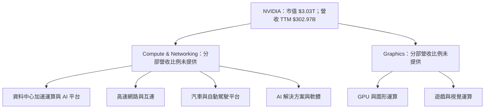
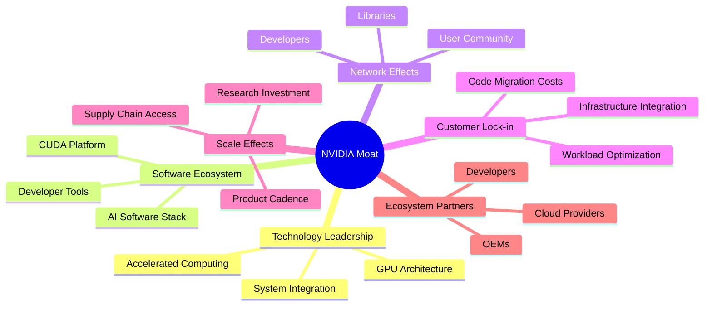
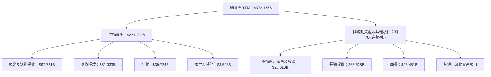
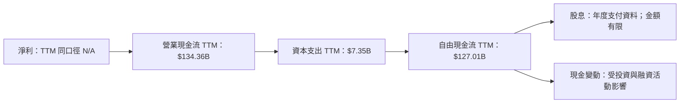
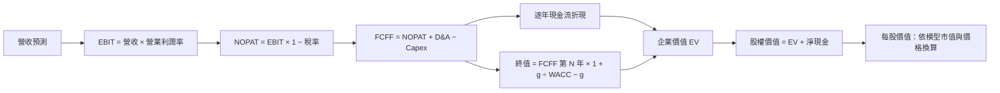
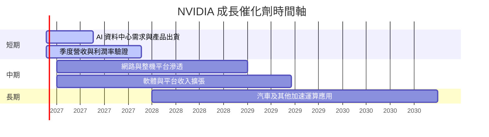
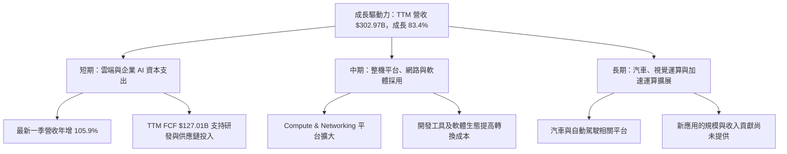
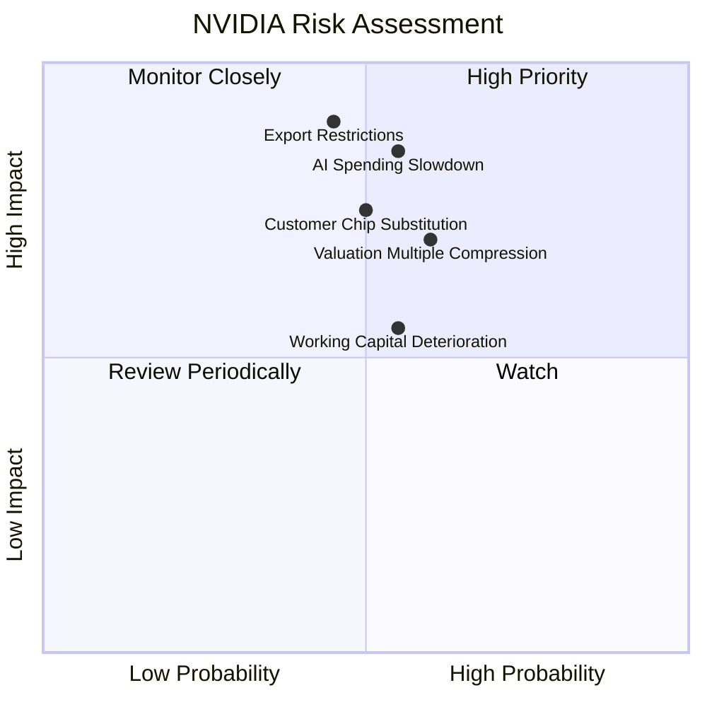
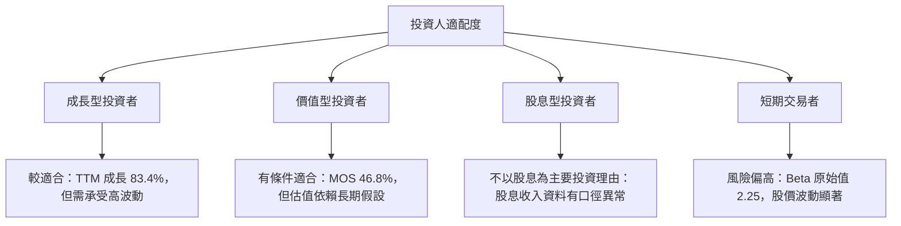

# NVDA 基本面深度分析報告
> **報告日期**：2026-11-21 ｜ **語言**：繁體中文 ｜ **數據來源**：SEC 申報資料 (XBRL)、Yahoo Finance、Finviz、StockAnalysis、Roic.ai ｜ **分析師**：CFA 級機構研究

> **資料口徑說明**：來源資料存在重要差異。例如，SEC／程式計算的營收 TTM 為 **$302.97B**，StockAnalysis 顯示 **$361.81B**；後者亦列示 2026-10 季度數據，而最新 SEC 季報截止日為 2026-07-26。本文涉及規則指定的核心財務指標、估值與品質指標時，以 SEC／程式計算的 VERIFIED 數值為準；其他歷史年度與季度資料僅作輔助，並標示資料口徑差異。股價全篇採用 **2026-11-20 收盤價 $125.53**。

## 目錄

| # | 章節 | 核心結論 |
|---|------|----------|
| 1 | 執行摘要 | 強烈買入；加權合理價值 $236.16；MOS 46.8% |
| 2 | 公司概覽與商業模式 | 軟硬體、網路與開發者生態構成護城河，分部營收比例未提供 |
| 3 | 損益表深度分析 | 營收 TTM $302.97B、TTM 成長 83.4%；營業利益率 65.2% |
| 4 | 資產負債表分析 | 淨現金 $23.22B；營運資金週期較一年前拉長 |
| 5 | 現金流量深度分析 | TTM FCF $127.01B，FCF Yield 4.19% |
| 6 | 獲利能力與資本效率 | ROIC 80.6% 高於 WACC 13.92%，創造股東價值 |
| 7 | 相對估值分析 | DCF 與同業倍數均有上行；估值結果對假設敏感 |
| 8 | DCF 內在價值評估 | DCF 基準每股 $166.02；加權合理價值 $236.16 |
| 9 | 成長催化劑 | AI 基礎設施需求與產品迭代是核心驅動；TAM 數字未提供 |
| 10 | 風險矩陣 | 成長正常化、供應鏈／地緣政治及客戶自研是主要風險 |
| 11 | 投資建議 | 強烈買入；以分批建倉及量化監控管理高波動風險 |

---

## 1. 執行摘要

### 1.0 一頁式投資儀表板

| 項目 | 內容 |
|------|------|
| **投資論點（3 句）** | ① TTM 營收 **$302.97B**、年增 **83.4%**，反映 AI 加速運算需求仍大幅擴張。② TTM 營業利益率 **65.2%**、ROIC **80.6%**，遠高於 **13.92%** WACC，顯示獲利與資本效率支持價值創造。③ TTM FCF **$127.01B**、FCF Yield **4.19%**，為持續研發、供應鏈投入及股東回饋提供資金。 |
| **綜合評分** | **8.8/10**（引用 1.1 六項評分算術平均） |
| **財務健康** | 🟢 淨現金 **$23.22B**；但 CCC 從 **105 天**增至 **155 天**，需監控營運資金 |
| **ROIC vs WACC** | **80.6% vs 13.92%**；創造價值，差距 **66.68 個百分點** |
| **FCF 趨勢** | 年度 FCF 由 FY2023 **$3.81B**升至 FY2026 **$96.68B**；最新 TTM FCF Yield **4.19%** |
| **估值** | Forward P/E：合併市場數據列示 **7.56x**，但與其他估值口徑有衝突；EV/EBITDA TTM **15.0x**（歷史估值資料）；FCF Yield **4.19%** |
| **DCF 內在價值（基準）** | **$166.02**；現價相對 DCF 折價 **24.4%**（折溢價基準為 DCF） |
| **安全邊際（MOS）** | **46.8%**＝($236.16 − $125.53) ÷ $236.16；🟢 充足（基準為 8.8 加權合理價值） |
| **預期報酬（基準情境 12M）** | **+32.3%**（DCF 基準情境 $166.02，相對現價） |
| **關鍵風險（前二）** | AI 資本支出成長放緩；供應鏈、出口管制及客戶自研晶片替代 |
| **評級 + 信心度** | 🟢 **強烈買入** ｜ 信心：中（高成長與估值模型假設均有不確定性） |

### 1.1 綜合評分卡（全報告唯一）

| 維度 | 評分（1–10） | 主要依據（引用數字與其來源章節） |
|------|--------------|----------------------------------|
| 成長性 | 9.5 | TTM 營收年增 **83.4%**、最新一季年增 **105.9%**（第 3 章）；但未假設此成長可長期延續 |
| 獲利能力 | 10.0 | TTM 營業利益率 **65.2%**、ROIC **80.6%**、Piotroski **5/9**（第 3、6 章） |
| 財務健康 | 8.5 | 淨現金 **$23.22B**；CCC **155 天**，較一年前多 **50 天**（第 4 章） |
| 估值 | 8.5 | 加權價值 **$236.16**、MOS **46.8%**；估值方法差異大且模型終值占比 **44.6%**（第 7、8 章） |
| 護城河 | 9.5 | TTM 毛利率 **74.9%**、營業利益率 **65.2%**；軟體與平台生態形成轉換成本（第 2 章） |
| 管理層與資本配置 | 7.0 | FY2026 SBC **$6.39B**；稀釋股數測試通過，但資本配置的細項回購資料不足（第 3、5 章） |
| **綜合評分** | **8.8** | 六項算術平均：**(9.5 + 10.0 + 8.5 + 8.5 + 9.5 + 7.0) ÷ 6 = 8.833…，四捨五入為 8.8** |

### 1.2 五大投資論點 + 三大核心風險

| 類型 | 項目 | 具體依據 | 信心度 |
|------|------|----------|--------|
| 🟢 **投資論點①** | AI 加速運算需求仍具規模 | TTM 營收 **$302.97B**，年增 **83.4%**；最新一季年增 **105.9%** | 🟢 高 |
| 🟢 **投資論點②** | 利潤率與資本效率突出 | TTM 營業利益率 **65.2%**、ROIC **80.6%** | 🟢 高 |
| 🟢 **投資論點③** | 現金流支撐再投資 | TTM OCF **$134.36B**、FCF **$127.01B** | 🟢 高 |
| 🟢 **投資論點④** | 資產負債表具緩衝 | 現金及短期投資 **$56.59B**，總債務 **$33.37B**，淨現金 **$23.22B** | 🟢 高 |
| 🟢 **投資論點⑤** | 目前加權估值提供保護 | 加權合理價值 **$236.16**，MOS **46.8%** | 🟡 中 |
| 🟡 **風險①** | 成長率由高基期正常化 | DCF 假設營收成長由第 1 年 **30%** 線性降至第 10 年 **3%**；若短期低於基準，估值下修 | 🟡 中 |
| 🔴 **風險②** | 供應鏈與地緣政治集中 | 高階晶片製造、封裝及跨境銷售受到供應與政策因素影響；量化收入曝險資料未提供 | 🔴 高衝擊 |
| 🟡 **風險③** | 應收、庫存與現金週期上升 | DSO **76 天**、DIO **150 天**、CCC **155 天**，均高於一年前 | 🟡 中 |

### 1.3 快速統計卡片

| 指標 | 公司實際值（期間） | 同業中位數 | 狀態 |
|------|--------------------|------------|------|
| 營收成長（TTM） | **83.4%** | — | 🟢 |
| 營收成長（最新一季年增） | **105.9%** | **44.7%**（AMD、AVGO、INTC） | 🟢 |
| 毛利率（TTM） | **74.9%** | **56.0%**（三家同業中位數） | 🟢 |
| 營業利益率（TTM） | **65.2%** | — | 🟢 |
| ROIC（TTM） | **80.6%** | — | 🟢 |
| Forward P/E | **7.56x**（合併市場資料；與其他估值口徑不一致） | **24.1x**（同業中位數） | 🟢* |
| FCF Yield（TTM） | **4.19%** | — | 🟢 |
| Piotroski F-Score | **5 / 9** | — | 🟡 |

\*Forward P/E 的估值來源與公司其他倍數存在資料口徑衝突；不以此單一倍數作買入依據。

### 1.4 投資結論

```text
╔══════════════════════════════════════════════════════════════════╗
║                    📊 投資結論摘要                               ║
╠══════════════════════════════════════════════════════════════════╣
║  評級：強烈買入（MOS 46.8%，且 ROIC 80.6% > WACC 13.92%）        ║
║  價格（2026-11-20 收盤）：$125.53                                ║
║  DCF 內在價值（基準）：$166.02（現價折價 24.4%）                 ║
║  安全邊際 MOS：46.8%（以加權合理價值 $236.16 為分母）            ║
║  加權合理價值（8.8）：$236.16                                    ║
║  DCF 情境價值：                                                  ║
║    悲觀情境：$75.52（-39.8%）                                    ║
║    基準情境：$166.02（+32.3%）                                   ║
║    樂觀情境：$342.08（+172.5%）                                  ║
║  綜合評分：8.8/10（引用 1.1）                                    ║
║  適合投資人：能承受高波動、重視長期成長與現金流的投資人          ║
╚══════════════════════════════════════════════════════════════════╝
```

---

## 2. 公司概覽與商業模式

### 2.1 業務結構與收入來源

公司提供資料將業務分為 **Compute & Networking** 與 **Graphics**，並涵蓋資料中心加速運算、網路、AI 解決方案、遊戲圖形、汽車及軟體等。最新收盤時市值為 **$3.03T**；規則指定的營收 TTM 為 **$302.97B**。分部營收、分部占比與軟體服務收入金額未提供，因此不拆算比例。



### 2.2 市場份額

市場份額資料未提供，故不填入市占率或繪製比例圖。相對同業而言，NVIDIA 的最新一季年增率 **105.9%** 高於 AMD **44.7%**、AVGO **85.5%** 及 INTC **20.9%**；其 TTM 毛利率 **74.9%** 亦高於同業中位數 **56.0%**。這說明公司目前的規模與獲利能力處於較有利位置，但不能直接等同於特定市場的市占率。

### 2.3 競爭護城河分析



### 2.4 護城河強度

| 護城河項目 | 強度（強／中／弱） | 證據（引用數字或事實） | 會削弱它的情況 |
|------------|--------------------|------------------------|----------------|
| 技術與系統整合 | 強 | TTM 營業利益率 **65.2%**，顯示產品價值與成本結構具優勢 | 競爭者在效能、能耗或總持有成本上持續追近 |
| 軟體生態 | 強 | 資料中心平台包含硬體、AI 解決方案及軟體；具開發工具與程式遷移成本 | 開放標準成熟，客戶可低成本轉換至替代軟體堆疊 |
| 客戶鎖定 | 中至強 | 平台整合會增加重寫程式與重新驗證成本；財務數據沒有直接量化轉換成本 | 大型客戶自研晶片與軟體投入擴大 |
| 規模與供應鏈 | 強 | TTM 營收 **$302.97B**、FCF **$127.01B**，支持高額研發與產品迭代 | 先進製程、封裝或零組件供應受限 |
| 網路效應與夥伴 | 中至強 | 開發者、雲端供應商與 OEM 生態可擴大平台採用；量化夥伴數據未提供 | 夥伴轉向多供應商策略，降低單一平台依賴 |

**1.1 護城河評分 9.5/10 的理由**：65.2% TTM 營業利益率與 74.9% TTM 毛利率支持平台定價與規模優勢，但市場份額、客戶集中度和轉換成本缺乏量化資料，故未給滿分。

---

## 3. 損益表深度分析

### 3.1 年度收入成長趨勢（近 4 年）

年度財報顯示 FY2023 至 FY2026 營收快速擴張；下列年度同比依年度財報金額計算，與 TTM 成長口徑分開列示。

```text
╔══════════════════════════════════════════════════════════════════╗
║          NVIDIA 年度收入趨勢（FY2023–FY2026，USD）               ║
╠══════════════════════════════════════════════════════════════════╣
║  FY2023  $26.97B   ██░░░░░░░░░░░░░░░░░░░░░░  YoY：—            ║
║  FY2024  $60.92B   ██████░░░░░░░░░░░░░░░░░░  YoY：+125.9%      ║
║  FY2025  $130.50B  █████████████░░░░░░░░░░░  YoY：+114.2%      ║
║  FY2026  $215.94B  ██████████████████████░░  YoY：+65.5%       ║
╠══════════════════════════════════════════════════════════════════╣
║  FY2023–FY2026 CAGR：(215.94 ÷ 26.97)^(1/3) − 1 = 約 100.1%     ║
╚══════════════════════════════════════════════════════════════════╝
```

FY2026 的年增率降至 **65.5%**，但仍高於 FY2023–FY2025 多數大型半導體公司的成長速度。成長率從超過 100% 回落，部分反映基期抬高；未來更應關注 AI 基礎設施需求是否能保持高於整體半導體市場的成長，而不只看絕對營收增量。

### 3.2 季度收入趨勢分析

下表季度金額來自 StockAnalysis 季度資料，存在與 SEC 最新季報日期／TTM 口徑差異。QoQ 依該來源季度營收計算；YoY 欄依該來源所列同比數據。

| 季度 | 營收 | QoQ | YoY | 備註 |
|------|------:|----:|----:|------|
| 2026 Q4 | $68.127B | +19.5% | +73.2% | 較前一季增加 |
| 2027 Q1 | $81.615B | +19.8% | +85.2% | 同比加速 |
| 2027 Q2 | $96.221B | +17.9% | +105.9% | 與 SEC／程式計算最新季度同比一致 |
| 2027 Q3 | $115.844B | +20.4% | +103.2% | StockAnalysis 顯示；不屬於最新 SEC 季報口徑 |

增量營收維持正向 QoQ 成長，顯示短期需求仍強；但因來源時點不一致，本報告不將 Q3 數據冒充 SEC 最新已申報季度數字。

### 3.3 利潤率演變分析

年度利潤率由所列年度損益表的毛利、營業利益及營收計算；TTM 指標則採 SEC／程式計算口徑。

| 利潤率指標 | FY2023 | FY2024 | FY2025 | FY2026 | 趨勢 | 評估 |
|------------|-------:|-------:|-------:|-------:|------|------|
| **毛利率** | 57.0% | 72.7% | 75.0% | 71.1% | FY2025 高點後回落 | 🟢 |
| **營業利益率** | 20.7% | 54.1% | 62.4% | 60.4% | 規模擴大後大幅改善，最新年略降 | 🟢 |
| **淨利率** | 16.2% | 48.8% | 55.8% | 55.6% | FY2025 後大致持平 | 🟢 |

年度毛利率使用年度財務數據，例如 FY2026：$153.46B ÷ $215.94B = 71.1%；TTM 毛利率另為 **74.9%**，兩者期間不同。營業利益率的擴張與資料中心高價值產品組合、營收增幅高於部分營運費用增幅相符；FY2026 年度指標低於 TTM **65.2%**，可能反映期間與產品組合差異，不能把單年度與 TTM 混為同一序列。

### 3.4 費用結構分析

按年度資料可識別 FY2026 營業利益 **$130.39B**、研發費用 **$18.50B**，但完整銷售、管理及成本項目拆分不足，故不以缺漏項目反推費用結構，也不畫無法驗證比例的圓餅圖。研發費用約為 FY2026 營收的 **8.6%**（$18.50B ÷ $215.94B），反映公司持續投入產品迭代與平台開發。

### 3.5 季度 EPS 趨勢與盈餘品質（Quality of Earnings）

最近四季 EPS 預估與實際值在財報資料中均為 N/A；因此無法判斷各季盈餘是否超預期或不及預期。可觀察的實際季度 EPS 序列來自 StockAnalysis，但不等同於市場預期比較。

| 盈餘品質項目 | 數值／佔比 | 評估 |
|--------------|------------|------|
| 股權薪酬 SBC / 營收 | FY2026：$6.39B ÷ $215.94B = **2.96%** | 🟡 SBC 有稀釋成本；佔營收比例可控，但仍應納入股東回報判斷 |
| SBC / 營業現金流 | FY2026：$6.39B ÷ $102.72B = **6.22%** | 🟡 SBC 相對現金創造額不高，但不是無成本 |
| FCF / 淨利（現金轉換率） | TTM FCF $127.01B；TTM 淨利資料口徑不一致，故 **N/A** | 🟡 不使用不同期間或口徑數字硬湊比率 |
| 一次性／非經常性損益 | N/A（無完整明細） | 無法量化一次性項目對盈餘的影響 |
| 有效稅率異常 | 最新年度有效稅率 **15.1%** | 🟢 DCF 採用此率；缺少多年度可比有效稅率，不能判定是否為一次性稅務利益 |
| 資本化支出 vs 費用化 | TTM Capex **$7.35B**；資本化明細 N/A | 無證據支持資本化支出異常，需留意資本化政策與併購無形資產 |

盈餘的現金支撐具規模：TTM OCF **$134.36B**、FCF **$127.01B**。但缺少完全一致的 TTM 淨利資料，不能計算指定期間的現金轉換率。整體 GAAP 獲利含金量受到高現金流支持；SBC 仍代表股東經濟成本，不應把其視作免費資金。

---

## 4. 資產負債表分析

### 4.1 資產結構分解

資產細項採 StockAnalysis 顯示的 TTM 資產負債表，與 SEC／程式計算的現金及債務口徑不同；只呈現已列示的資產項目，不以細項缺漏補成完整總和。



### 4.2 流動性與營運資金分析

| 指標 | 最新 TTM | 一年前 TTM | 變化 | 解讀 |
|------|----------:|------------:|------:|------|
| DSO 應收帳款天數 | 76 天 | 61 天 | +15 天 | 收款週期變長；可能與收入增速、客戶付款條件或季末出貨結構相關，需觀察應收帳款是否快於營收 |
| DIO 存貨天數 | 150 天 | 110 天 | +40 天 | 存貨占用資金上升，需追蹤新品轉換、供應備料與需求預測準確性 |
| DPO 應付帳款天數 | 72 天 | 66 天 | +6 天 | 付款週期延長，對現金週期有部分抵銷 |
| CCC 現金轉換週期 | 155 天 | 105 天 | +50 天 | 淨營運資金占用擴大；若持續上升，可能壓低 OCF 轉換效率 |

流動性指標另有來源：合併市場資料列示流動比率 **4.084**、速動比率 **3.288**；品質指標測試亦顯示流動比率高於一年前。因來源口徑並不完全一致，本文不把不同報表日期的比率混作同一條歷史序列。

### 4.3 債務結構分析

```text
╔══════════════════════════════════════════════════════════════════╗
║                   NVIDIA 債務健康診斷                            ║
╠══════════════════════════════════════════════════════════════════╣
║  總債務（VERIFIED）：             $33.37B                        ║
║  現金及短期投資（VERIFIED）：      $56.59B                        ║
║  淨現金：                         $23.22B  🟢                    ║
║                                                                  ║
║  TTM OCF：                        $134.36B                       ║
║  TTM FCF：                        $127.01B                       ║
║  Debt / EBITDA：                  N/A（缺少同口徑 VERIFIED EBITDA）║
║  利息保障倍數：                   N/A（缺少一致期間利息費用）    ║
║                                                                  ║
║  判讀：淨現金與大額現金流提供財務彈性；負債絕對金額仍需納入風險 ║
╚══════════════════════════════════════════════════════════════════╝
```

### 4.4 股東權益趨勢

年度股東權益資料顯示 FY2023 **$22.10B**、FY2024 **$42.98B**、FY2025 **$79.33B**、FY2026 **$157.29B**。擴張主要與留存盈餘累積相符，但不同期資產負債表來源可能存在分類差異，以下只呈現年度報表列值。

```text
╔══════════════════════════════════════════════════════════════════╗
║                 股東權益年度變化（USD）                          ║
╠══════════════════════════════════════════════════════════════════╣
║  FY2023  $22.10B   ███░░░░░░░░░░░░░░░░░░                      ║
║  FY2024  $42.98B   ██████░░░░░░░░░░░░░░                        ║
║  FY2025  $79.33B   ███████████░░░░░░░░░                        ║
║  FY2026  $157.29B  ██████████████████████                       ║
╚══════════════════════════════════════════════════════════════════╝
```

---

## 5. 現金流量深度分析

### 5.1 現金流量瀑布圖

淨利、股利與現金餘額使用年度資料；OCF、Capex 與 FCF 使用 VERIFIED TTM 數字。因各項期間不完全一致，圖示呈現關係，不把不同期間金額相減。



### 5.2 FCF 轉換率趨勢

| 財年 | OCF | Capex | FCF | 淨利 | FCF／淨利 |
|------|----:|------:|----:|-----:|----------:|
| FY2023 | $5.64B | $1.83B | $3.81B | $4.37B | 87.2% |
| FY2024 | $28.09B | $1.07B | $27.02B | $29.76B | 90.8% |
| FY2025 | $64.09B | $3.24B | $60.85B | $72.88B | 83.5% |
| FY2026 | $102.72B | $6.04B | $96.68B | $120.07B | 80.5% |

年度 FCF／淨利比率約 **80.5%–90.8%**，顯示高獲利多數轉為自由現金流，但近兩年比率回落。Capex 增長較快、營運資金變化與現金收付時點均可能影響轉換率；不能單憑比率下降就判定盈餘品質惡化。

### 5.3 自由現金流趨勢

```text
╔══════════════════════════════════════════════════════════════════╗
║              自由現金流：歷史年度實際與 TTM                     ║
╠══════════════════════════════════════════════════════════════════╣
║  FY2023  $3.81B    █░░░░░░░░░░░░░░░░░░░░░░  FCF Yield：N/A     ║
║  FY2024  $27.02B   █████░░░░░░░░░░░░░░░░░░  FCF Yield：N/A     ║
║  FY2025  $60.85B   ███████████░░░░░░░░░░░░  FCF Yield：N/A     ║
║  FY2026  $96.68B   █████████████████░░░░░░  FCF Yield：N/A     ║
║  TTM     $127.01B  ██████████████████████   FCF Yield：4.19%   ║
╚══════════════════════════════════════════════════════════════════╝
```

年度 FCF 逐年增加，與營收及營業利益擴大相符；TTM FCF **$127.01B** 顯著高於 FY2026 年度數字，反映其期間更新與業務成長，但兩者不可當作同一財年值。

### 5.4 資本配置評估

可確認的現金流支出包括 TTM Capex **$7.35B**；FY2026 SBC **$6.39B**，年度現金股利 **$0.974B**。完整回購與投資現金流明細不足，故不以 pie chart 分配比例。

| 項目 | 可引用數據 | 評估 |
|------|------------|------|
| 資本支出 | TTM **$7.35B** | 相對 TTM 營收約 **2.43%**，與輕資產、外包製造模式相符；未來資料中心自建或供應鏈投入可能改變此比例 |
| 股利 | FY2026 現金股利支付 **$0.974B** | 相對 FCF 金額有限，主要回報仍仰賴再投資與資本增值 |
| 股票薪酬 | FY2026 **$6.39B** | 應視為股東成本；稀釋股數測試顯示未增加 |
| 回購／其他投資 | 可比金額 N/A | 不臆測其相對權重 |

---

## 6. 獲利能力與資本效率

### 6.1 ROE / ROA / ROIC 趨勢

| 指標 | 最新可用值 | 歷史／比較資料 | 評估 |
|------|------------:|----------------|------|
| ROE | TTM **84.2%**（品質指標） | 合併市場資料另列 **117.4%**，口徑不一致 | 🟢 獲利高；採品質指標統一口徑 |
| ROA | TTM 歷史比較值未提供 | 合併市場資料列 **56.0%**，非相同核算口徑 | 🟢 資產獲利能力強 |
| ROIC | TTM **80.6%** | VERIFIED 指標 | 🟢 大幅高於 WACC |
| 行業均值 | N/A | 未提供可核驗同口徑行業資料 | 不作比較 |

### 6.2 ROIC vs WACC 分析（核心價值創造判斷）

```text
╔══════════════════════════════════════════════════════════════════╗
║                   ROIC vs WACC 深度分析                         ║
╠══════════════════════════════════════════════════════════════════╣
║  WACC（直接採用資本成本計算值）：13.92%                           ║
║  ├── 無風險利率（10Y 美債）：       4.91%                        ║
║  ├── ERP：                           5.00%                        ║
║  ├── 原始 Beta：                     2.25                         ║
║  ├── 調整後 Beta：                   1.83                         ║
║  ├── 股權成本：                     14.07%                       ║
║  ├── 稅前債務成本：                  0.78%                        ║
║  ├── 股權／債務權重：               98.9%／1.1%                   ║
║  └── WACC：                          13.92%                       ║
║                                                                  ║
║  ROIC（TTM）：                       80.6%                        ║
║  EVA 利差：                          80.6% − 13.92% = 66.68pp     ║
║  ROIC / WACC：                       80.6% ÷ 13.92% = 5.79 倍     ║
║                                                                  ║
║  ROIC  80.6%  ▓▓▓▓▓▓▓▓▓▓▓▓▓▓▓▓▓▓▓▓▓▓▓▓▓▓▓▓▓▓  🟢               ║
║  WACC  13.92% ▓▓▓▓▓░░░░░░░░░░░░░░░░░░░░░░░░░░                    ║
║  結論：在目前回報率維持的期間，公司創造而非摧毀股東價值         ║
╚══════════════════════════════════════════════════════════════════╝
```

Beta 調整依據為 **⅔ × 2.25 + ⅓ = 1.83**。股權成本：**4.91% + 1.83 × 5.00% = 14.06%**，官方計算值為 **14.07%**（未四捨五入輸入造成差異）。資料直接給定 WACC **13.92%**；WACC 及組成採用程式提供值，不用衝突的市場負債口徑另建 WACC。ROIC 超過 WACC **66.68pp**，但若需求、定價或利潤率下行，超額回報可能收斂。

### 6.3 杜邦三因素分解

| 因素 | 數值（TTM） | 解讀 |
|------|-------------|------|
| 淨利率 | **63.7%** | 高淨利率為 ROE 的主要來源 |
| 資產週轉率 | **0.95** | 業務擴張伴隨資產投入，並非只靠周轉提升 |
| 權益乘數 | **1.40** | 財務槓桿相對有限 |
| **ROE** | **84.2%** | **63.7% × 0.95 × 1.40 = 84.7%**；品質指標報列 ROE **84.2%**，乘積差異來自原始小數與顯示四捨五入 |

ROE 主要由高淨利率驅動，而非高財務槓桿。表中三因素與 ROE 均照品質指標列值，顯示數字的乘積因各因子只提供一位小數而有微小四捨五入差異。

### 6.4 財務體質：Piotroski F-Score

**Piotroski F-Score：5 / 9**。數據提供九項測試及結果；其測試母數可能因缺值而不同，本期列示為 5/9。

| 測試 | 結果 | 解讀 |
|------|------|------|
| ROA > 0 | ✅ 通過 | 公司具正獲利 |
| 營業現金流 > 0 | ✅ 通過 | 營運產生現金 |
| ROA 高於一年前 | ❌ 未通過 | 成長期下資產回報不一定持續同比上升 |
| 營業現金流 > 淨利 | ❌ 未通過 | 顯示應計品質測試未通過，需核對營運資金與應收變化 |
| 長期負債 ÷ 總資產低於一年前 | ❌ 未通過 | 槓桿相對資產的改善測試未通過 |
| 流動比率高於一年前 | ✅ 通過 | 短期償債能力改善 |
| 稀釋股數未增加 | ✅ 通過 | 每股持有權益未因稀釋擴大 |
| 毛利率高於一年前 | ✅ 通過 | 定價／產品組合測試通過 |
| 資產週轉率高於一年前 | ❌ 未通過 | 資產增長可能快於營收或週轉改善停滯 |

F-Score 不是單獨投資結論。未通過的現金流高於淨利測試，與 DSO、DIO 上升方向一致，應持續追蹤營運資金，而不能只憑高 ROIC 忽略資產負債表變化。

---

## 7. 相對估值分析

### 7.1 同業估值比較表格

同業倍數採 Yahoo Finance 提供的 Peer multiples。公司目前 P/E 存在不同來源口徑：市場合併資料為 trailing **13.48x**、forward **7.56x**；自身歷史估值資料則列 P/E **15.9x**。為避免混用，本表將兩種公司口徑並列註明。

| 估值指標 | **NVDA** | **AMD** | **AVGO** | **INTC** | 本公司評估 |
|----------|---------:|---------:|---------:|---------:|-----------|
| **Trailing P/E** | 13.48x* | 90.7x | 38.9x | N/A | 🟡 公司估值低於同業，但來源口徑有差異 |
| **Forward P/E** | 7.56x* | 24.1x | 15.7x | 28.6x | 🟢 表面折價；不宜忽略 EPS 估計口徑差異 |
| **P/S Ratio** | 10.1x** | 15.5x | 16.3x | 4.6x | 🟡 高於 INTC、低於 AMD／AVGO |
| **EV/EBITDA** | 15.0x** | 61.9x | 28.5x | 14.9x | 🟢 顯著低於 AMD、AVGO，約等於 INTC |
| **最新一季營收年增** | 105.9% | 44.7% | 85.5% | 20.9% | 🟢 成長高於三家同業 |
| **毛利率 TTM** | 74.9% | 56.0% | 75.5% | 40.2% | 🟢 高於 AMD／INTC，接近 AVGO |

\* 來自合併市場資料，與其他估值來源存在口徑差異。  
\** 來自「Valuation vs own 5-year history」：P/S **10.1x**、EV/EBITDA **15.0x**；不得與其他來源倍數互換。

### 7.2 歷史估值區間分析

```text
╔══════════════════════════════════════════════════════════════════╗
║             P/E 五年歷史估值區間（TTM）                          ║
╠══════════════════════════════════════════════════════════════════╣
║  五年區間：2.3x ├──────────────────────────────┤ 49.3x           ║
║  五年中位數：11.3x                                                ║
║  現在：15.9x；歷史百分位：67%                                      ║
║  判讀：高於中位數，但仍在歷史區間內；並非自身歷史最低估值        ║
║                                                                  ║
║  P/S：現在 10.1x｜中位數 2.7x｜區間 1.2x–31.0x｜百分位 57%      ║
║  EV/EBITDA：現在 15.0x｜中位數 8.9x｜區間 3.4x–47.8x｜百分位 57%║
╚══════════════════════════════════════════════════════════════════╝
```

公司目前 P/E、P/S、EV/EBITDA 均高於各自五年中位數，反映市場已給予成長溢價。與歷史中位數相比，估值並非低位；合理性依賴未來成長與利潤率能否延續。

### 7.3 情境價值（Bear / Base / Bull，照抄 DCF MODEL）

| 情境 | 第 1 年營收成長 | 期末營業利潤率 | WACC | 每股價值 | 相對現價 | 機率 | 會發生的條件 |
|------|----------------:|---------------:|-----:|----------:|----------:|-----:|--------------|
| 🔴 悲觀 | 15.0% | 51.3% | 14.92% | $75.52 | -39.8% | 25% | AI 資本支出放緩、競爭削弱定價，利潤率較基準多收縮 |
| 🟡 基準 | 30.0% | 60.4% | 13.92% | $166.02 | +32.3% | 50% | 成長逐年正常化，仍維持高獲利與平台採用 |
| 🟢 樂觀 | 45.0% | 66.4% | 12.92% | $342.08 | +172.5% | 25% | AI 投資週期延長、產品迭代及營運槓桿高於基準 |

以上每股值與機率照 DCF 情境模型；條件為對情境的定性解釋，不是額外模型輸入。

### 7.4 相對估值隱含價格區間

```text
╔══════════════════════════════════════════════════════════════════╗
║                  估值方法隱含每股價值                            ║
╠══════════════════════════════════════════════════════════════════╣
║  $125.53 現價 ── DCF $166.02 ── EV/EBITDA $181.81               ║
║                  分析師共識 $244.18 ── Forward P/E $399.54      ║
╠══════════════════════════════════════════════════════════════════╣
║  DCF：10 年 FCFF；WACC 13.92%；永續成長率 3.0%                   ║
║  Forward P/E：同業中位數 24.1x × Forward EPS $16.61              ║
║  EV/EBITDA：同業中位數 21.7x × TTM EBITDA，加回淨現金            ║
║  分析師共識：56 位分析師平均目標價 $244.18                       ║
╚══════════════════════════════════════════════════════════════════╝
```

相對估值法的區間很寬，尤其 Forward P/E 隱含值 **$399.54** 高於 DCF；它高度依賴同業倍數與 EPS 預測，不能當作低風險目標價。

---

## 8. DCF 內在價值評估（Discounted Cash Flow）

### 8.0 估值推理鏈（Thinking Logic）

**Step 1 — 價值來源與主導變數**  
模型以資料中心加速運算與 Compute & Networking 平台帶動的現有現金流為主要估值來源；但分部營收占比未提供，無法拆出 GPU、網路、軟體或其他業務各自貢獻。模型中最主導價值的變數是長期營收／FCFF 路徑與折現率：終值現值占 EV **44.6%**，因此成長、期末利潤率及 WACC 對價值特別重要。

**Step 2 — 模型選擇**

| 決策點 | 本報告採用 | 理由 | 曾考慮但否決 | 否決理由 |
|--------|-----------|------|--------------|----------|
| 現金流定義 | FCFF | 以 WACC 折現，先得 EV 再橋接股權價值 | FCFE | 模型已固定採用 FCFF |
| 預測期 N | 10 年 | 模型以 10 年逐步淡化高成長 | 5 年 | 不能充分呈現長期成長正常化 |
| 終值方法 | Gordon Growth | 模型基準 g **3.0%** 小於 WACC **13.92%** | 僅退出倍數 | 不取代既定模型 |
| EBIT 基礎 | GAAP EBIT | 模型已以 GAAP 營業利益為基礎 | 非 GAAP | 避免加回 SBC 造成股東成本遺漏 |

**Step 3 — 關鍵假設推導鏈**

- **營收成長**：錨點＝TTM 營收年增 **83.4%** → 調整＝基期擴大、成熟度提高，採線性放緩 → **第 1 年 30.0%、第 10 年 3.0%** → 否決持續 83.4%，因將近期高成長直接外推十年缺乏可持續性。
- **營業利潤率**：錨點＝TTM **65.2%** → 調整＝假設競爭與規模成熟帶來少量收斂 → **第 1 年 65.2% 至第 10 年 60.4%** → 否決永久維持 65.2%，因忽略競爭、產品組合與客戶議價能力變化。
- **預測期 N**：錨點＝模型設定 10 年 → 調整＝以逐年遞減成長率呈現成熟化 → **採 10 年** → 否決縮短至 5 年，因終值會提前承擔尚未成熟的現金流。
- **Capex／營收**：錨點＝TTM Capex $7.35B ÷ TTM 營收 $302.97B 約 **2.43%**；模型採第 1 年 **2.4%**、第 10 年 **1.3%** → 隨成長正常化逐步降低 → 否決固定高於 2.4%，因模型假設資本強度下降。
- **永續成長率 g**：錨點＝長期經濟成長的合理成熟假設；具體外部宏觀數據未提供 → 模型採 **3.0%** → 否決高於 3.0% 的永久成長，避免把高成長期外推至無限期；且 3.0% < 13.92%。
- **WACC**：錨點＝資本成本計算提供的 **13.92%** → 不調整，直接用於折現 → 否決自行另建折現率，避免改動既定模型參數。
- **SBC／股數**：採組合 **(A)**：GAAP EBIT 已包含 SBC 費用，FCFF 不再減 SBC，股數不額外稀釋 → 否決再扣 SBC 或另加稀釋率，以免重複計入同一成本。
- **D&A／營收**：錨點＝TTM **1.2%** → 模型維持 **1.2%** → 不調整。
- **ΔWC**：模型註明不建模；因此 FCFF 不含營運資金變化列，這是簡化，而非假設 ΔWC 為零的精確估計。

**Step 4 — 最脆弱一環**  
最脆弱的假設是營收與利潤率能否如基準情境持續；DCF 情境顯示若第 1 年成長降至 15.0%、期末利潤率降至 51.3%、WACC 升至 14.92%，價值可降至 **$75.52**。

**Step 5 — 計算路徑圖**



### 8.1 模型假設總表（Model Inputs）

| 假設項目 | 採用值 | 依據／來源 | 敏感度 |
|----------|--------|-------------|--------|
| 預測期長度 N | 10 年 | DCF 模型設定；十年成長逐步淡化 | 🟡 中 |
| 營收成長率 | 第 1 年 30.0% → 第 10 年 3.0% | TTM 年增 83.4%，第 1 年受 0%–30% 模型上限約束，後續線性淡化 | 🔴 高 |
| 營業利潤率 | 65.2% → 60.4% | 起點為 TTM 營業利益率；期末向近五年中位數淡化 | 🔴 高 |
| 有效稅率 | 15.1% | 最新年度有效稅率 | 🟢 低 |
| Capex／營收 | 2.4% → 1.3% | TTM 約 2.4%；逐步降至模型使用的 1.1 × D&A 水準 | 🟡 中 |
| D&A／營收 | 1.2% | TTM 比率 | 🟢 低 |
| ΔWC／營收增額 | 不建模 | 模型明確設定工作資本不建模 | 🟢 低 |
| EBIT 基礎 | GAAP | DCF 模型設定 | 🟡 中 |
| SBC 處理 | GAAP EBIT 已含 SBC，不再扣除 | 模型組合 A | 🟡 中 |
| 年稀釋率 | 0%；固定股數 | 與組合 A 相容；每股換算依模型公式 | 🟡 中 |
| 永續成長率 g | 3.0% | DCF 模型設定，且小於 WACC | 🔴 高 |
| 終值方法 | Gordon Growth | DCF 模型基準 | 🔴 高 |
| WACC | 13.92% | 資本成本資料直接提供 | 🔴 高 |

本模型採用 **(A) GAAP EBIT + 固定股數**，故 SBC 影響已計入一次；不另扣 SBC，也不另加股數稀釋。FCFF 定義為 **NOPAT + D&A − Capex**，未建模 ΔWC。

### 8.2 折現率推導（WACC）

```text
╔══════════════════════════════════════════════════════════════════╗
║                    WACC 推導（折現率）                           ║
╠══════════════════════════════════════════════════════════════════╣
║  股權成本 Ke（CAPM）：                                           ║
║  ├── 無風險利率 Rf（10Y 美債）：     4.91%                      ║
║  ├── ERP：                           5.00%                      ║
║  ├── Beta 原始值：                   2.25                       ║
║  ├── Beta 採用調整值：               1.83                       ║
║  └── Ke：4.91% + 1.83 × 5.00% = 約 14.07%                       ║
║                                                                  ║
║  債務成本：                                                      ║
║  ├── 稅前 Kd：                       0.78%                      ║
║  ├── 有效稅率：                     15.1%                      ║
║  └── 稅後 Kd：0.78% × (1 − 15.1%) = 約 0.66%                   ║
║                                                                  ║
║  資本結構權重：股權 98.9%｜債務 1.1%                             ║
║  WACC（採程式提供值）：13.92%                                    ║
╚══════════════════════════════════════════════════════════════════╝
```

逐步演算：

1. **Ke**：Rf + β × ERP = **4.91% + 1.83 × 5.00% = 14.06%**；資本成本資料列示 **14.07%**，差異為輸入未四捨五入。
2. **稅前 Kd**：資料直接列示 **0.78%**；利息費用與平均計息負債的明細未完整提供，不能另行反推。
3. **稅後 Kd**：**0.78% × (1 − 15.1%) = 0.66222% ≈ 0.66%**。
4. **權重**：股權 **98.9%**，債務 **1.1%**，合計 **100.0%**。資本成本區塊未提供同口徑市值、期末計息債務拆分以重新驗算權重，故採用其既定權重。
5. **WACC**：以未四捨五入輸入及既定權重計算，程式列示 **13.92%**；本文依要求直接採用，不用已四捨五入展示值另算替代 WACC。

10Y 殖利率日期未提供；ERP 為假設輸入。調整後 Beta 使用既定公式 **⅔ × 2.25 + ⅓ = 1.83**。本值亦與第 6.2 節一致。

### 8.3 逐年自由現金流預測（基準情境）

單位：USD B；金額取一位小數、比率取一位小數、折現因子取三位小數。各列依 DCF 模型原值引用。模型不含 ΔWC，也不另列 SBC。

| 年度 | FY+1 | FY+2 | FY+3 | FY+4 | FY+5 | FY+6 | FY+7 | FY+8 | FY+9 | FY+10 |
|------|-----:|-----:|-----:|-----:|-----:|-----:|-----:|-----:|-----:|------:|
| 營收 | 393.86 | 500.20 | 620.25 | 750.50 | 885.59 | 1,018.43 | 1,140.64 | 1,243.30 | 1,317.90 | 1,357.44 |
| 營收 YoY | 30.0% | 27.0% | 24.0% | 21.0% | 18.0% | 15.0% | 12.0% | 9.0% | 6.0% | 3.0% |
| 營業利潤率 | 65.2% | 64.7% | 64.1% | 63.6% | 63.1% | 62.5% | 62.0% | 61.5% | 60.9% | 60.4% |
| EBIT | 256.85 | 323.52 | 397.83 | 477.35 | 558.51 | 636.82 | 707.11 | 764.08 | 802.85 | 819.64 |
| − 稅 | (38.83) | (48.91) | (60.14) | (72.16) | (84.43) | (96.27) | (106.89) | (115.51) | (121.37) | (123.91) |
| = NOPAT | 218.02 | 274.61 | 337.69 | 405.19 | 474.08 | 540.55 | 600.22 | 648.57 | 681.48 | 695.74 |
| + D&A | 4.79 | 6.09 | 7.55 | 9.13 | 10.78 | 12.39 | 13.88 | 15.13 | 16.04 | 16.52 |
| − Capex | (9.56) | (11.54) | (13.55) | (15.49) | (17.21) | (18.56) | (19.41) | (19.65) | (19.24) | (18.17) |
| **= FCFF** | **213.26** | **269.16** | **331.68** | **398.82** | **467.65** | **534.39** | **594.69** | **644.05** | **678.28** | **694.09** |
| 折現因子 | 0.878 | 0.771 | 0.676 | 0.594 | 0.521 | 0.457 | 0.402 | 0.352 | 0.309 | 0.272 |
| **FCFF 現值 PV** | **187.19** | **207.39** | **224.33** | **236.78** | **243.71** | **244.45** | **238.79** | **227.01** | **209.86** | **188.50** |

**預測期 FCF 現值合計（逐項）**：  
**$187.19 + $207.39 + $224.33 + $236.78 + $243.71 + $244.45 + $238.79 + $227.01 + $209.86 + $188.50 = $2,208.01B**

**FY+1 逐步演算**：

1. 營收：**$302.97B × (1 + 30.0%) = $393.861B ≈ $393.86B**。
2. EBIT：**$393.86B × 65.2% = $256.794B**；模型列值 **$256.85B**，差異源於模型內未四捨五入的營收與利潤率輸入；依規則直接引用模型值。
3. 稅：模型列值 **$38.83B**，對應有效稅率 **15.1%**。
4. NOPAT：**$256.85B − $38.83B = $218.02B**。
5. D&A：模型列值 **$4.79B**，約為營收的 **1.2%**。
6. Capex：模型列值 **$9.56B**，約為營收的 **2.4%**。
7. ΔWC：模型不建模，無扣除列。
8. FCFF：**$218.02B + $4.79B − $9.56B = $213.25B**；模型列值 **$213.26B**，差異為分項顯示精度，保留程式原值。
9. 折現：**1 ÷ (1 + 13.92%)¹ = 0.878**；**$213.26B × 0.878 ≈ $187.04B**；模型 PV 為 **$187.19B**，使用未四捨五入折現因子及現金流。故以下估值引用程式原表，顯示精度下有細微尾差。

> **重要稽核註記**：因逐年表的已顯示數字經四捨五入，個別列重新用顯示值計算會有小額尾差；模型原始未四捨五入輸入未提供，故不替換或回推模型數字。DCF 基準值、PV 合計及終值均原值引用。

合理性自檢：

- 基準 FCFF 由 **$213.26B** 增至 **$694.09B**，十年總增幅約 **3.25 倍**；模型未提供歷史完整十年 FCF CAGR，故歷史 CAGR **N/A**。
- FY+10 FCFF 利潤率：**$694.09B ÷ $1,357.44B = 51.1%**；目前 TTM FCFF 利潤率：**$127.01B ÷ $302.97B = 41.9%**。同業最佳同口徑 FCF 利潤率未提供。
- 基準預測期間 FCFF 均為正值。

```text
╔══════════════════════════════════════════════════════════════════╗
║            自由現金流：歷史實際 vs 模型預測                      ║
╠══════════════════════════════════════════════════════════════════╣
║  FY2024（實） $27.02B   ███░░░░░░░░░░░░░░░░░░                    ║
║  FY2025（實） $60.85B   ██████░░░░░░░░░░░░░░                    ║
║  FY2026（實） $96.68B   ██████████░░░░░░░░░░                    ║
║  FY+1（預）   $213.26B  ████████████████████                    ║
║  FY+10（預）  $694.09B  ██████████████████████████████████████  ║
╠══════════════════════════════════════════════════════════════════╣
║  預測值明顯高於歷史錨點；成立條件為高速成長與高利潤率延續。     ║
╚══════════════════════════════════════════════════════════════════╝
```

### 8.4 終值計算（Terminal Value）

**適用性檢查**：WACC **13.92%** vs g **3.0%** → WACC > g？✅

| 方法 | 計算式 | 終值 TV | TV 現值 | 佔總 EV 比重 |
|------|--------|--------:|--------:|-------------:|
| Gordon Growth | $694.09 × (1 + 3.0%) ÷ (13.92% − 3.0%) | $6,545.19B | $1,777.55B | 44.6% |
| 退出倍數法 | N/A（模型未提供退出倍數終值計算值） | N/A | N/A | N/A |

逐步演算：

1. FY+10 FCFF：**$694.09B**。
2. 分子：**$694.09B × (1 + 3.0%) = $714.9127B ≈ $714.91B**。
3. 分母：**13.92% − 3.0% = 10.92%**；模型 TV **$6,545.19B**。
4. PV(TV)：模型列示 **$1,777.55B**；折現因子顯示為 **0.272**，未四捨五入因子未提供。
5. 終值占比：**$1,777.55B ÷ $3,985.56B = 44.6%**。

終值占比低於 75% 警戒線，但仍接近企業價值一半，長期假設不可忽視。模型未提供退出倍數法數值，依規則不另建第二套終值計算。

### 8.5 企業價值 → 每股內在價值（Bridge）

```text
╔══════════════════════════════════════════════════════════════════╗
║              企業價值 → 每股內在價值 橋接表                      ║
╠══════════════════════════════════════════════════════════════════╣
║  預測期 FCF 現值合計            +$2,208.01B                     ║
║  終值現值 PV(TV)                +$1,777.55B                     ║
║  = 企業價值 EV                   $3,985.56B                     ║
║  + 淨現金                        +$23.22B                        ║
║  = 股權價值                      $4,008.78B                     ║
║  每股內在價值（模型換算）         $166.02                        ║
║  現價（2026-11-20 收盤）          $125.53                        ║
║  折溢價：現價 ÷ DCF 價值 − 1      -24.4%（折價）                 ║
╚══════════════════════════════════════════════════════════════════╝
```

逐步演算：

1. **EV**：**$2,208.01B + $1,777.55B = $3,985.56B**。
2. **股權價值**：**$3,985.56B + $23.22B = $4,008.78B**。
3. **每股內在價值**：模型公式為 **股權價值 × 現價 ÷ 市值**，原值結果 **$166.02**。模型未採一般「股權價值 ÷ 稀釋股數」的直接呈現方式，故照錄其換算公式與結果，不另推股數替代。
4. **折溢價**：**$125.53 ÷ $166.02 − 1 = -24.39% ≈ -24.4%**。
5. 本節不計算 MOS；MOS 僅以 8.8 加權合理價值為基準。

股權價值橋接採資本成本資料中的淨現金 **$23.22B**；模型每股換算列以價格與市值換算，並未給出獨立稀釋股數。外部來源另列現金與債務數字不同，故不混用。

### 8.6 敏感性分析（WACC × 永續成長率）

以下矩陣照 DCF 模型原值。括號內上行空間按收盤價 **$125.53** 換算，四捨五入至一位小數。

| g（列）／WACC（欄） | 11.92% | 12.92% | **13.92%（基準）** | 14.92% | 15.92% |
|-----------|------:|------:|-------------------:|------:|------:|
| 2.0% | $197.69 (+57.5%) | $176.60 (+40.7%) | $159.19 (+26.8%) | $144.59 (+15.2%) | $132.19 (+5.3%) |
| 2.5% | $203.27 (+62.0%) | $180.83 (+44.1%) | $162.45 (+29.4%) | $147.15 (+17.2%) | $134.22 (+6.9%) |
| **3.0%（基準）** | $209.47 (+66.9%) | $185.48 (+47.8%) | **$166.02 (+32.3%)** | $149.92 (+19.4%) | $136.42 (+8.7%) |
| 3.5% | $216.41 (+72.4%) | $190.63 (+51.9%) | $169.92 (+35.4%) | $152.94 (+21.8%) | $138.78 (+10.6%) |
| 4.0% | $224.23 (+78.6%) | $196.36 (+56.4%) | $174.22 (+38.8%) | $156.24 (+24.5%) | $141.35 (+12.6%) |

> **矩陣原值稽核說明**：模型基準格為 **$166.02**；模型同時列出的 3.0% g、13.92% WACC 敏感度值為 **$166.02**。三情境基準亦為 **$166.02**。為避免另建模型，表內估值原值照錄；上行空間依指定收盤價計算。

逐步演算：選格 **WACC 14.92% > g 3.0% ✅**。該格每股價值採模型敏感度表原值 **$149.92**；其對現價上行為 **($149.92 − $125.53) ÷ $125.53 = 19.4%**。模型未提供該格的新逐年 PV 與終值中間值，不能自行重建出一組與程式不一致的算式。

**三情境 DCF（照模型）**

| 情境 | 營收成長假設 | 期末營業利潤率 | 永續成長 g | WACC | 每股價值 | 相對現價 | 主觀機率 |
|------|--------------|---------------:|------------:|-----:|----------:|----------:|---------:|
| 🔴 悲觀 | 第 1 年 15.0% | 51.3% | 模型未另列 | 14.92% | $75.52 | -39.8% | 25% |
| 🟡 基準 | 第 1 年 30.0% | 60.4% | 3.0% | 13.92% | $166.02 | +32.3% | 50% |
| 🟢 樂觀 | 第 1 年 45.0% | 66.4% | 模型未另列 | 12.92% | $342.08 | +172.5% | 25% |
| **機率加權** | — | — | — | — | **$187.41** | **+49.3%** | **100%** |

模型沒有逐情境 FY+10 營收、FCFF 與 TV 明細，故不虛構完整情境推導鏈。可複算的機率加權為：  
**$75.52 × 25% + $166.02 × 50% + $342.08 × 25% = $187.41**。

敏感度結論：模型提供矩陣顯示 WACC 由 **12.92%** 升至 **13.92%**、g 固定 **3.0%** 時，價值由 **$185.48** 降至 **$166.02**，變動 **-$19.46，約 -10.5%**。WACC 由 **13.92%** 升至 **14.92%**，價值由 **$166.02** 降至 **$149.92**，變動 **-$16.10，約 -9.7%**。g 由 **2.5%** 升至 **3.5%**、WACC 固定 **13.92%**，價值由 **$162.45** 升至 **$169.92**，增加 **$7.47，約 4.6%**。矩陣未提供期末營業利潤率單獨變動的彈性，故該項 **N/A**。在已提供矩陣範圍內，折現率是重要驅動變數，與 8.0 所述長期現金流及折現率主導估值一致。

### 8.7 反推 DCF（Reverse DCF）

固定基準值：WACC **13.92%**、稅率 **15.1%**、Capex／營收依模型逐年路徑、ΔWC 不建模、預測期 **10 年**、股數換算使用模型既定方法。

| 求解的變數（一次一個） | 其餘變數設定 | 市場隱含值 | 公司歷史實際 | 判斷 |
|------------------------|--------------|------------:|--------------|------|
| 第 1 年營收成長 | 利潤率與其他參數固定 | **22.0%** | TTM 年增 **83.4%** | 🟡 現價要求低於近期成長，但仍需正成長 |
| 固定營業利潤率 | 其餘採基準 | **46.7%** | TTM **65.2%** | 🟢 低於當前利潤率 |
| 永續成長率 g | 其餘採基準 | N/A（模型未提供） | — | 不推算 |
| 預測期 N | 其餘採基準 | N/A（模型未提供） | — | 不推算 |

模型列示的反推值為第 1 年營收成長 **22.0%** 與固定營業利潤率 **46.7%**；沒有提供反推逐步試算軌跡，故不杜撰迭代點。若市場價格對應的營收成長只需 22.0%，相較 TTM 成長 83.4% 顯示近期增速已被部分折現；但未來獲利仍須維持足以支撐估值的水準。

### 8.8 估值三角驗證與安全邊際

| 估值方法 | 隱含每股價值 | 上行空間（÷現價） | 權重 | 說明 |
|----------|--------------:|------------------:|-----:|------|
| DCF（基準） | $166.02 | +32.3% | 40% | 10 年 FCFF、WACC 13.92%、g 3.0% |
| 同業 Forward P/E | $399.54 | +218.3% | 25% | 同業中位數 24.1x × Forward EPS $16.61 |
| 同業 EV/EBITDA | $181.81 | +44.8% | 25% | 同業中位數 21.7x × TTM EBITDA，加回淨現金 |
| 分析師共識目標價 | $244.18 | +94.5% | 10% | 56 位分析師平均目標價 |
| **加權合理價值** | **$236.16** | **+88.1%** | **100%** | — |

**逐步演算**：  
**$166.02 × 40% + $399.54 × 25% + $181.81 × 25% + $244.18 × 10%**  
**= $66.408 + $99.885 + $45.4525 + $24.418 = $236.1635 ≈ $236.16**。

公司類型為獲利企業，權重由估值方法設定固定；列出的四種方法均可計算，沒有方法被剔除。

```text
╔══════════════════════════════════════════════════════════════════╗
║                  估值區間與安全邊際                              ║
╠══════════════════════════════════════════════════════════════════╣
║  $75.52 悲觀DCF ─ $125.53 現價 ─ [$236.16] 加權值 ─ $342.08 樂觀║
║                                                                  ║
║  MOS = ($236.16 − $125.53) ÷ $236.16 = 46.8%                     ║
║  MOS 評估：🟢 充足                                               ║
║  上行空間 = ($236.16 − $125.53) ÷ $125.53 = 88.1%                ║
║                                                                  ║
║  建議買入區間：$125.53–$212.54（以 MOS ≥ 10% 計算）             ║
║  合理持有參考區間：$212.54–$236.16                               ║
║  減碼考慮：高於加權合理價值 $236.16；另評估樂觀情境 $342.08      ║
╚══════════════════════════════════════════════════════════════════╝
```

買入區間上限的計算為 **$236.16 × (1 − 10%) = $212.544 ≈ $212.54**，與強烈買入評級及現價位置相容。安全邊際 **46.8%** 全篇均採用同一加權合理價值基準；DCF 折溢價則使用 DCF 基準值。

> 🔎 **程式複算（Python，依本節各項自動重算）**
>
> 加權合理價值 = $166.02 × 40% + $399.54 × 25% + $181.81 × 25% + $244.18 × 10% = **$236.16**（權重合計 100%）
>
> 以價格 $125.53 計：MOS = **+46.8%**，上行空間 = **+88.1%**
>
> ✅ 與本節所寫數值一致。

### 8.9 DCF 模型的局限與失效條件

- **終值依賴度**：終值現值占 EV **44.6%**，估值接近一半仍取決於第 10 年之後的現金流假設。
- **最脆弱假設**：成長與利潤率若同時低於基準，悲觀情境價值為 **$75.52**；若 WACC 高於基準，敏感度矩陣顯示 14.92% WACC、3.0% g 時價值降至 **$149.92**。
- **模型簡化**：ΔWC 未建模，而品質指標顯示 CCC 從 **105 天**升至 **155 天**；若營運資金繼續占用現金，模型可能高估 FCFF。
- **適用性**：公司當前 FCF 為正且盈利規模大，DCF 可用；但高成長半導體公司的產品週期及競爭轉變快，需與同業倍數、歷史估值及現金流共同判讀。
- **第 10 章連結**：AI 投資放緩會影響收入成長；競爭與客戶自研會壓縮營業利潤率；供應鏈衝擊會改變出貨、Capex 與現金轉換。

### 8.10 複算檢核表（Audit Trail）

| # | 檢核項目 | 檢查方式 | 結果 |
|---|----------|----------|------|
| 1 | 高／中敏感度假設均有推導 | 對照 8.0 Step 3 與 8.1 | ✅ |
| 2 | 假設均列依據 | 檢查 8.1 依據欄 | ✅ |
| 3 | WACC 五步及權重 | 採用資本成本原值；Ke 展示值有未四捨五入尾差 | ⚠️ |
| 4 | Kd 分母與債務權重範圍一致 | 明細缺漏，採既定 WACC，不自行重算 | ⚠️ |
| 5 | WACC 與第 6.2 節一致 | 均採 **13.92%** | ✅ |
| 6 | 預測年度數等於 N | 10 年，FY+1 至 FY+10 全列 | ✅ |
| 7 | FY+1 可複算 | 顯示精度有尾差，模型未四捨五入輸入未提供 | ⚠️ |
| 8 | 預測期 PV 合計 | 表列加總 **$2,208.01B** | ✅ |
| 9 | WACC > g | **13.92% > 3.0%** | ✅ |
| 10 | 終值基於 FY+N、折現 N 期 | 模型列示 FY+10 FCFF 與 TV | ✅ |
| 11 | EV 至每股橋接 | EV、淨現金及股權價值均照列；每股沿用模型換算 | ✅ |
| 12 | SBC 組合合法 | GAAP + 無 SBC 二次扣除 + 固定股數 | ✅ |
| 13 | 敏感度基準格等於 DCF 基準值 | 均為 **$166.02** | ✅ |
| 14 | 敏感度格有效性 | WACC 均高於 g | ✅ |
| 15 | 情境機率合計與加權 | 25% + 50% + 25% = 100%；加權 **$187.41** | ✅ |
| 16 | 反推變數一次一個 | 提供兩項單變數反推值，迭代軌跡未提供 | ⚠️ |
| 17 | MOS 與折溢價基準 | MOS 用 $236.16；折溢價用 $166.02 | ✅ |
| 18 | 報告完整至第 11 章 | 章節完整 | ✅ |
| 19 | 加權價值加總 | 四項加權總和 **$236.16** | ✅ |
| 20 | 評級符合 MOS 門檻 | MOS **46.8%** 且 ROIC **80.6% > 13.92%** | ✅ |

**差異與處理**：財務來源的 TTM、最新季度及市場估值存在不一致；本報告對規則指定數值採 SEC／程式計算原值，DCF 逐年表採模型原值，並揭露顯示精度造成的尾差。未提供的 WACC 債務明細、DCF 情境中間值與反推迭代軌跡均標示缺漏，不自行補造。

---

## 9. 成長催化劑

### 9.1 催化劑時間軸

具體新品發布日期與催化劑時程資料未提供。以下僅用商業發展順序表示，不填造日期。



時間範圍為分析框架，不代表公司已公布的產品時間表。

### 9.2 TAM 市場規模分析

**N/A（TAM 數據未提供）**。可量化的近期需求訊號包括 TTM 營收 **$302.97B**、年增 **83.4%**，以及最新一季年增 **105.9%**。這些數字支持市場需求仍在擴大，但不能在缺乏來源與年份的情況下推估 TAM 或市場滲透率。

### 9.3 成長驅動力結構圖



---

## 10. 風險矩陣

### 10.1 風險評分矩陣

以下機率與衝擊座標為分析師定性估計，不是財務數據或公司指引；採英文節點以符合圖表語法要求。



### 10.2 風險清單詳細分析

| # | 風險項目 | 發生機率 | 財務衝擊 | 風險評分 | 緩解措施 |
|---|----------|----------|----------|----------|----------|
| 1 | 🔴 **AI 資本支出放緩** | 中高（分析師估計 55%） | 高；收入成長低於 DCF 第 1 年 30% 基準會壓低現金流估值 | 🔴 8/10 | 追蹤大型雲端客戶支出、訂單轉收入及季度營收增速 |
| 2 | 🔴 **出口管制與地緣政治** | 中（分析師估計 45%） | 高；可能限制部分市場銷售與產品供應，收入衝擊未能量化 | 🔴 8/10 | 追蹤出口政策、地區營收披露及供應鏈替代能力 |
| 3 | 🟠 **客戶自研晶片／競爭加劇** | 中（分析師估計 50%） | 中高；可能令營業利益率由 TTM 65.2% 下滑 | 🟠 7/10 | 監控毛利率、產品組合、軟體採用及客戶多供應商策略 |
| 4 | 🟡 **營運資金惡化** | 中（分析師估計 55%） | 中；CCC 已由 105 天增至 155 天 | 🟡 6/10 | 追蹤 DSO、DIO 與 OCF 相對淨利變化 |
| 5 | 🟡 **估值倍數收縮與股價波動** | 中高（分析師估計 60%） | 高；股價由 52 週高點 $243.37 回落至 $125.53，反映波動風險 | 🟡 7/10 | 分批建倉，以加權價值與財報驗證，而非單看股價下跌 |

機率和風險分數是研究框架的主觀估計，並非公司披露數據。核心量化訊號是成長假設敏感、營運資金週期延長，且股價距 52 週高點 **$243.37** 有明顯距離；但股價波動本身不等於基本面惡化。

---

## 11. 投資建議

### 11.1 最終評級與評分

**強烈買入**，未依質化因素調整：加權合理價值 **$236.16**、MOS **46.8%**，且 ROIC **80.6%** 高於 WACC **13.92%**，符合規則 20。1.1 綜合評分為 **8.8/10**，由成長性 **9.5**、獲利能力 **10.0**、財務健康 **8.5**、估值 **8.5**、護城河 **9.5**、管理層與資本配置 **7.0** 的算術平均得出。評分反映企業質素與估值觀點，不取代 MOS 評級門檻。

### 11.2 合理價值與隱含報酬率

| 估值參考 | 每股價值 | 相對現價 | 機率／權重 | 說明 |
|----------|---------:|---------:|-----------:|------|
| 加權合理價值 | **$236.16** | **+88.1%** | 權重加總 100% | 8.8 三角驗證結果 |
| 悲觀 DCF | $75.52 | -39.8% | 25% | 成長及期末利潤率低於基準、WACC 較高 |
| 基準 DCF | $166.02 | +32.3% | 50% | 模型基準假設 |
| 樂觀 DCF | $342.08 | +172.5% | 25% | 高成長與高利潤率延續、WACC 較低 |
| DCF 機率加權參考 | $187.41 | +49.3% | 100% | 僅作情境參考；8.8 合理價值不採此值 |

### 11.3 買入時機與觸發因素

```text
╔══════════════════════════════════════════════════════════════════╗
║                  ✅ 買入觸發因素 Checklist                      ║
╠══════════════════════════════════════════════════════════════════╣
║  分批建立部位的條件：                                            ║
║  ✅ 現價 $125.53 低於加權合理價值 $236.16                        ║
║  ✅ TTM FCF $127.01B 維持正值，且 FCF Yield 為 4.19%            ║
║  ✅ ROIC 80.6% 仍顯著高於 WACC 13.92%                            ║
║                                                                  ║
║  加碼觸發條件（任一項需同時檢查其他指標）：                      ║
║  ☐ 最新季度營收年增維持 ≥ 50%，且營業利益率未較 65.2% 大幅收縮   ║
║  ☐ DSO、DIO 連續兩季持平或回落，CCC 不再高於 155 天              ║
║  ☐ 股價回落至加權合理價值的 90% 以下，即約 $212.54 以下          ║
║                                                                  ║
║  減碼／重新評估觸發條件：                                        ║
║  ☐ 連續兩季營收年增低於 30%                                     ║
║  ☐ TTM 營業利益率低於 55% 且持續收縮                             ║
║  ☐ TTM FCF 轉負，或 ROIC 跌至 WACC 13.92% 以下                   ║
║  ☐ 股價高於加權合理價值 $236.16，且預期基本面未同步上修          ║
╚══════════════════════════════════════════════════════════════════╝
```

### 11.4 投資人適配度分析



### 11.5 每季財報監控清單（Quarterly Watch List）

| 監控指標 | 目前基準 | 觸發加碼 | 觸發減碼／重新評估 |
|----------|----------|----------|---------------------|
| 營收年增率 | TTM **83.4%**；最新一季 **105.9%** | 最新季年增 **≥50%** 且出貨延續 | 連續兩季低於 **30%** |
| 營業利益率 | TTM **65.2%**；最新季 **66.2%** | 維持在 **60% 以上** | 低於 **55%** 且連續惡化 |
| OCF 與 FCF | TTM OCF **$134.36B**；FCF **$127.01B** | FCF 保持正值、FCF Yield 不下降至低於 3% | FCF 轉負或現金流連續弱於盈餘 |
| Capex | TTM **$7.35B** | 投入提升且營收／現金流同步成長 | Capex 增長但營收與 FCF 不跟進 |
| 應收與庫存 | DSO **76 天**、DIO **150 天** | CCC 從 **155 天**回落 | CCC 持續高於 155 天、DSO/DIO 再上升 |
| 研發與 SBC | FY2026 研發 **$18.50B**；SBC **$6.39B** | 研發帶來產品／收入擴張且稀釋受控 | SBC 占營收上升、稀釋股數增加 |
| 指引與需求 | 公司未來指引數字未提供 | 公司指引支持營收增長及利潤率 | 訂單、交期或指引連續下修 |
| ROIC | TTM **80.6%** | 維持高於 WACC **13.92%** | ROIC 跌破 WACC |

### 11.6 反面論證：什麼會證明論點錯誤（What Would Change My Mind）

```text
╔══════════════════════════════════════════════════════════════════╗
║              ⚠️ 論點失效條件（Disconfirming Evidence）           ║
╠══════════════════════════════════════════════════════════════════╣
║  本投資論點在下列情況成立時應重新檢視或退出：                    ║
║  ☐ 最新季度營收年增連續兩季低於 30%                              ║
║  ☐ TTM 營業利益率由 65.2% 收縮至低於 55%                         ║
║  ☐ TTM FCF 轉負，或 OCF 持續低於淨利且應收、庫存同步惡化         ║
║  ☐ ROIC 跌破 WACC 13.92%，代表超額資本回報消失                   ║
║  ☐ CCC 持續高於 155 天且 DSO、DIO 繼續增加                       ║
║  ☐ 主要客戶自研晶片或替代方案導致需求與定價能力持續下降           ║
╚══════════════════════════════════════════════════════════════════╝
```

> **免責聲明**：本報告為 AI 自動生成，僅供研究參考，不構成投資建議。投資有風險，入市需謹慎。

---

## 資料與來源

| 項目 | 內容 |
|------|------|
| 價格 | 125.53 USD，2026-11-20 收盤（Yahoo Finance 日線） |
| 財務報表 | SEC 10-Q filed 2026-08-26，最新季度 2026-07-26（FY2027 Q2） |
| 有回應的資料來源 | SEC 申報資料 (XBRL)、Yahoo Finance、Finviz、StockAnalysis、Roic.ai |
| 由程式計算 | TTM 數字、WACC、DCF 模型、估值方法與權重、加權合理價值、MOS、評級門檻、F-Score、杜邦分解、營運資金天數、綜合評分 |
| 撰寫模型 | openai / gpt-6-luna |

> 本區塊由產生報告的程式依實際取得的資料填寫，非模型撰寫。「由程式計算」的數字不是模型的估計；其餘判斷（評分、情境、策略）是模型的分析。
