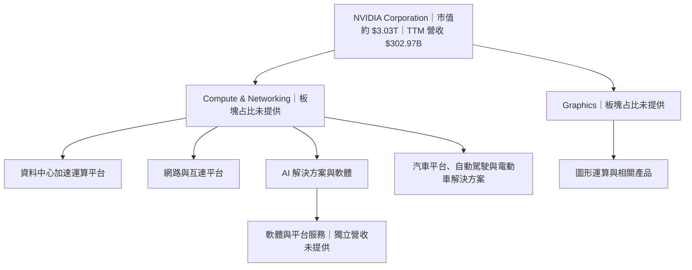
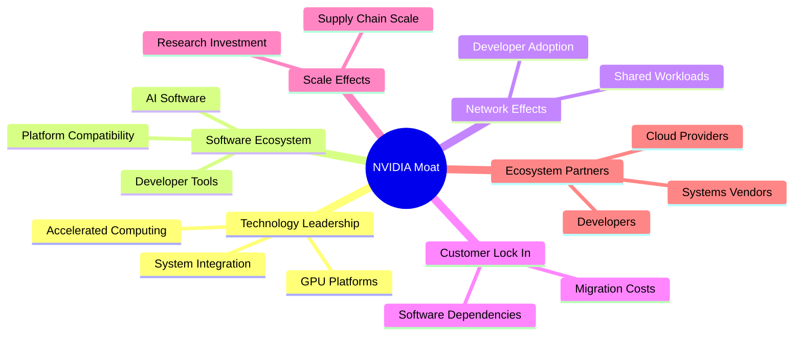
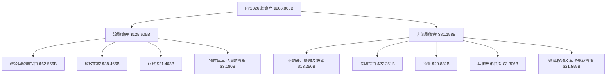
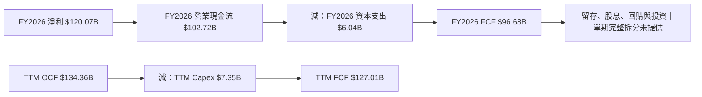
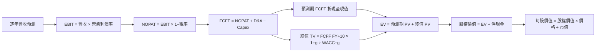
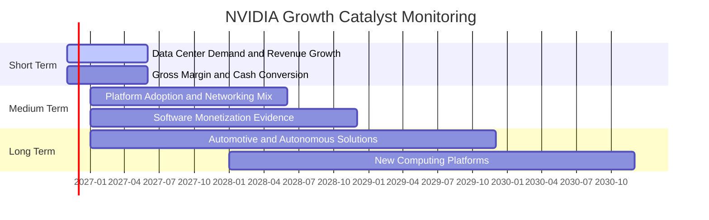
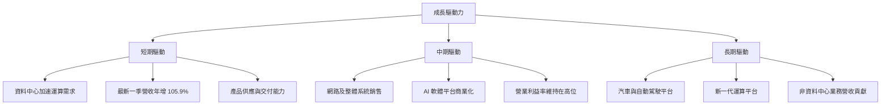
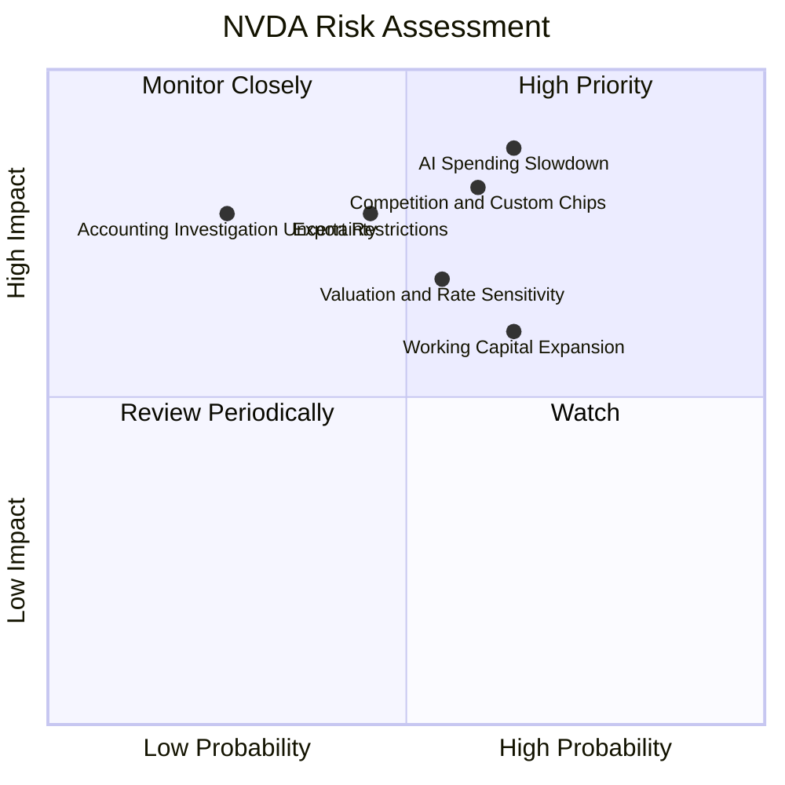
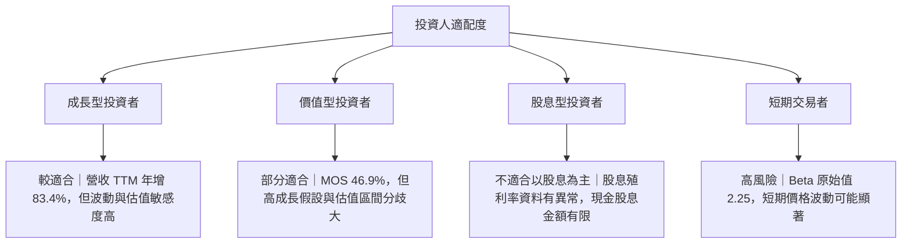

# NVDA 基本面深度分析報告
> **報告日期**：2026-11-21 ｜ **語言**：繁體中文 ｜ **數據來源**：SEC 申報資料 (XBRL)、Yahoo Finance、Finviz、StockAnalysis、Roic.ai ｜ **分析師**：CFA 級機構研究

## 目錄

| # | 章節 | 核心結論 |
|---|------|----------|
| 1 | 執行摘要 | 強烈買入；加權合理價值 $236.21；MOS 46.9% |
| 2 | 公司概覽與商業模式 | Compute & Networking 與 Graphics 是核心板塊；市場份額數據未提供 |
| 3 | 損益表深度分析 | TTM 營收 $302.97B、年增 83.4%；TTM 營業利益率 65.2% |
| 4 | 資產負債表分析 | 淨現金 $23.22B；營運資金週期較一年前延長 50 天 |
| 5 | 現金流量深度分析 | TTM FCF $127.01B、FCF Yield 4.19%；年度 FCF 持續上升 |
| 6 | 獲利能力與資本效率 | ROIC 80.6% 高於 WACC 13.92%，目前創造股東價值 |
| 7 | 相對估值分析 | 相對同業估值有折價；高於自身 5 年估值中位數 |
| 8 | DCF 內在價值評估 | 基準 DCF $166.02；加權合理價值 $236.21 |
| 9 | 成長催化劑 | AI 計算與網路平台延續需求是主要驅動，TAM 數字未提供 |
| 10 | 風險矩陣 | 需求正常化、競爭／自研晶片與出口限制是主要風險 |
| 11 | 投資建議 | 依 MOS 評級為強烈買入；監控營收、毛利、現金轉換與資本效率 |

---

## 1. 執行摘要

NVIDIA 的 TTM 營收為 **$302.97B**，TTM 年增 **83.4%**，最新一季年增 **105.9%**，TTM 營業利益率 **65.2%**，TTM FCF **$127.01B**；ROIC **80.6%** 高於 WACC **13.92%**，代表目前營運回報顯著高於資本成本。以估值而言，2026-11-20 收盤價 **$125.53**，DCF 基準價值 **$166.02**，估值方法加權後合理價值 **$236.21**，安全邊際 MOS **46.9%**。因此，依 MOS 門檻及 ROIC > WACC，評級為 **🟢 強烈買入**，而非先行假定評級；不另作質化調級。

### 1.0 一頁式投資儀表板（Portfolio Manager 30 秒速讀）

| 項目 | 內容 |
|------|------|
| **投資論點（3 句）** | ① TTM 營收 $302.97B、年增 83.4%，反映加速運算平台需求仍強。② TTM 營業利益率 65.2%、ROIC 80.6%，顯示目前規模與定價能力帶來高資本回報。③ TTM FCF $127.01B、FCF Yield 4.19%，提供再投資與資本回饋能力。 |
| **綜合評分** | **8.5/10**（引用 1.1；六項算術平均） |
| **財務健康** | 🟢 淨現金 $23.22B；流動比率 4.084（Yahoo Finance 快照），但 CCC 年增 50 天，營運資金需留意。 |
| **ROIC vs WACC** | **80.6% vs 13.92%**；目前創造價值，差距 66.68 個百分點。 |
| **FCF 趨勢** | 年度 FCF 自 FY2023 $3.81B 增至 FY2026 $96.68B；TTM FCF Yield **4.19%**。 |
| **估值** | Forward P/E **7.56x**（估值快照）｜EV/EBITDA **12.22x**（估值快照）｜FCF Yield **4.19%**。 |
| **DCF 內在價值（基準）** | **$166.02**｜相對現價折價 **24.4%**（折溢價以 DCF 基準值為分母）。 |
| **安全邊際（MOS）** | **46.9%＝($236.21 − $125.53) ÷ $236.21**；🟢 >25% 充足。基準來自 8.8 加權合理價值。 |
| **預期報酬（基準情境 12M）** | **+32.3%**（DCF 基準情境相對現價；不等同加權合理價值上行空間）。 |
| **關鍵風險（前二）** | AI 資本支出成長放緩；競爭、自研晶片或出口限制壓縮需求與毛利。 |
| **評級 + 信心度** | 🟢 **強烈買入**｜信心：中（估值模型敏感，且資料來源存在期間／口徑差異）。 |

### 1.1 綜合評分卡（全報告唯一）

| 維度 | 評分（1–10） | 主要依據（引用數字與其來源章節） |
|------|--------------|----------------------------------|
| 成長性 | 9.5 | TTM 營收年增 83.4%、最新一季年增 105.9%（第 3 章）；成長基期已顯著擴大。 |
| 獲利能力 | 9.5 | TTM 營業利益率 65.2%、ROIC 80.6% 對 WACC 13.92%；Piotroski F-Score 5/9（第 6 章）。 |
| 財務健康 | 8.5 | 淨現金 $23.22B；流動比率 4.084；但 CCC 從 105 天升至 155 天（第 4 章）。 |
| 估值 | 7.0 | MOS 46.9%，但現行 P/E、P/S、EV/EBITDA 均高於自身 5 年中位數（第 7、8 章）。 |
| 護城河 | 9.5 | TTM 營業利益率 65.2%、ROIC 80.6%，且公司提供運算、網路與軟體平台（第 2 章）。 |
| 管理層與資本配置 | 7.0 | FY2026 SBC $6.39B、約佔營收 2.96%；稀釋股數測試通過，但資本配置細項資料有限（第 3、5 章）。 |
| **綜合評分** | **8.5** | 六項算術平均：(9.5+9.5+8.5+7.0+9.5+7.0) ÷ 6 = **8.5**。 |

### 1.2 五大投資論點 + 三大核心風險

| 類型 | 項目 | 具體依據 | 信心度 |
|------|------|----------|--------|
| 🟢 **投資論點①** | AI 計算需求仍推動高成長 | TTM 營收 $302.97B、年增 83.4%；最新一季年增 105.9%。 | 🟢 高 |
| 🟢 **投資論點②** | 高獲利與資本效率 | TTM 營業利益率 65.2%、ROIC 80.6%，均反映高附加價值平台與營業槓桿。 | 🟢 高 |
| 🟢 **投資論點③** | 自由現金流具規模 | TTM OCF $134.36B 減 Capex $7.35B，FCF 為 $127.01B。 | 🟢 高 |
| 🟢 **投資論點④** | 資產負債表有淨現金 | 現金及短期投資 $56.59B、總債務 $33.37B、淨現金 $23.22B。 | 🟢 高 |
| 🟢 **投資論點⑤** | 價格低於估值加權值 | 現價 $125.53；加權合理價值 $236.21，MOS 46.9%。 | 🟡 中 |
| 🟡 **風險①** | 成長率由高基期正常化 | DCF 假設第 1 年營收成長 30%，低於 TTM 83.4%；如實際成長遠低於 30%，估值下修。 | 🟡 中 |
| 🔴 **風險②** | 競爭或客戶自研壓縮利潤 | DCF 假設營業利益率由 65.2% 緩降至 60.4%；若價格競爭使利潤率大幅低於此路徑，DCF 失效。 | 🔴 高衝擊 |
| 🟡 **風險③** | 營運資金占用攀升 | CCC 由 105 天升至 155 天，可能使營收成長與現金流成長脫鉤。 | 🟡 中 |

### 1.3 快速統計卡片

| 指標 | 公司實際值（期間） | 同業中位數 | 狀態 |
|------|--------------------|------------|------|
| 營收成長（TTM） | **83.4%** | — | 🟢 |
| 營收成長（最新一季年增） | **105.9%** | **44.7%**（AMD、AVGO、INTC） | 🟢 |
| 毛利率（TTM） | **74.9%**（Yahoo Finance 快照） | **56.0%**（同業中位數） | 🟢 |
| 營業利益率（TTM） | **65.2%** | — | 🟢 |
| ROIC（TTM） | **80.6%** | — | 🟢 |
| Forward P/E | **7.56x**（估值快照） | **24.1x**（AMD、AVGO、INTC） | 🟢* |
| FCF Yield（TTM） | **4.19%** | — | 🟢 |
| Piotroski F-Score | **5 / 9** | — | 🟡 |

\* 公司倍數來自估值快照，與同業倍數來源及口徑可能不同；另有歷史估值區塊的 P/E 現值 15.9x，故不可把單一快照解讀為無爭議的精確相對估值。

### 1.4 投資結論

```text
╔══════════════════════════════════════════════════════════════════╗
║                    📊 投資結論摘要                               ║
╠══════════════════════════════════════════════════════════════════╣
║  評級：強烈買入（MOS 46.9%，且 ROIC 80.6% > WACC 13.92%）         ║
║  價格（2026-11-20 收盤）：$125.53                                ║
║  DCF 內在價值（基準）：$166.02（現價折價 24.4%）                 ║
║  安全邊際 MOS：46.9%（＝(加權合理價值−現價)÷加權合理價值）       ║
║  加權合理價值（8.8）：$236.21                                    ║
║  DCF 情境價值：                                                   ║
║    悲觀情境：$75.52（-39.8%）                                    ║
║    基準情境：$166.02（+32.3%）                                   ║
║    樂觀情境：$342.08（+172.5%）                                  ║
║  綜合評分：8.5/10（引用 1.1）                                    ║
║  適合投資人：能承受高波動的成長型、長線投資者                    ║
╚══════════════════════════════════════════════════════════════════╝
```

---

## 2. 公司概覽與商業模式

### 2.1 業務結構與收入來源

公司提供資料指出，NVIDIA 分為 **Compute & Networking** 與 **Graphics** 兩個主要業務板塊。未提供兩板塊營收金額或營收占比，因此不對板塊比例作估算。



商業模式核心是將 GPU／加速器、網路互連、系統平台及軟體共同銷售。這種組合提高客戶從單一晶片轉向整體平台的成本，但財務資料未提供軟體訂閱收入、硬體與服務拆分或客戶留存率，故無法量化經常性收入占比。

### 2.2 市場份額

市場份額數據未提供，因此不製作比例圖或填入市場占比。質化比較上，NVDA TTM 營收 $302.97B、最新一季年增 105.9%，高於 AMD 最新一季年增 44.7%、Broadcom 85.5%及 Intel 20.9%；然而公司與同業產品組合不同，成長差異不能直接等同市場份額變化。

### 2.3 競爭護城河分析



### 2.4 護城河強度

| 護城河項目 | 強度（強／中／弱） | 證據（引用數字或事實） | 會削弱它的情況 |
|------------|--------------------|------------------------|----------------|
| 技術領先 | 強 | TTM 營業利益率 65.2%、ROIC 80.6%，顯示產品組合及定價能力目前反映於高回報。 | 加速器效能差距縮小、供應受限或產品迭代失誤。 |
| 軟體生態系統 | 強 | 公司提供 AI 解決方案與軟體；營收拆分及使用者數未提供。 | 開放標準成熟、客戶可低成本移植至替代平台。 |
| 網路效應 | 中 | 開發者與部署量可增加平台吸引力；量化活躍開發者數據未提供。 | 主要雲端及企業客戶降低對單一架構依賴。 |
| 客戶鎖定 | 中至強 | 完整運算與網路平台增加轉換和重構成本；實際客戶留存率未提供。 | 客戶多供應商策略或自研晶片擴大。 |
| 規模效應 | 強 | FY2026 營收 $215.94B、研發支出 $18.50B，規模支撐持續研發與產品整合。 | 供應鏈集中、成本上升或競品達到可比規模。 |
| 生態夥伴 | 中至強 | 公司跨美國、台灣、中國、香港、歐洲等市場營運；夥伴營收貢獻未提供。 | 出口規定、夥伴轉向替代方案或雲端客戶議價力提高。 |

**1.1 護城河評分 9.5/10** 的依據是 65.2% TTM 營業利益率、80.6% ROIC 與軟硬體平台組合；扣分原因是市占、客戶黏著與軟體收入占比缺少直接披露數據。

---

## 3. 損益表深度分析

### 3.1 年度收入成長趨勢（近 4 年）

年度財報列示 FY2023–FY2026 營收依序為 $26.97B、$60.92B、$130.50B、$215.94B。同比成長約為 125.9%、114.2%、65.5%；2023–2026 三年 CAGR 約 100.1%。此高增長與 AI／資料中心平台擴張一致，但年度數列與 TTM 覆蓋期間不同，應分開解讀。

```text
╔══════════════════════════════════════════════════════════════════╗
║             NVIDIA 年度收入趨勢（FY2023-FY2026）                 ║
╠══════════════════════════════════════════════════════════════════╣
║  FY2023  $26.97B   ███░░░░░░░░░░░░░░░░░░░  YoY:  —             ║
║  FY2024  $60.92B   ██████░░░░░░░░░░░░░░░░  YoY: +125.9% 🟢     ║
║  FY2025  $130.50B  █████████████░░░░░░░░░  YoY: +114.2% 🟢     ║
║  FY2026  $215.94B  ██████████████████████  YoY: +65.5%  🟢     ║
╠══════════════════════════════════════════════════════════════════╣
║  FY2023-FY2026 三年營收 CAGR：約 +100.1%                         ║
╚══════════════════════════════════════════════════════════════════╝
```

### 3.2 季度收入趨勢分析

以下為截至 FY2027 Q2 最近四個已列示季度；最新季度營收增長引用 SEC 申報資料的單季年增率。QoQ 由相鄰季度營收計算，數值取一位小數。

| 季度 | 營收（$B） | QoQ 成長 | YoY 成長 | 備註 |
|------|------------:|---------:|---------:|------|
| FY2026 Q3 | 57.006 | +22.2% | +62.5% | 以 FY2026 Q2 $46.743B 為 QoQ 比較基期。 |
| FY2026 Q4 | 68.127 | +19.5% | +73.2% | 相對 Q3 持續增長。 |
| FY2027 Q1 | 81.615 | +19.8% | +85.2% | YoY 加速。 |
| FY2027 Q2 | 96.221 | +17.9% | **+105.9%** | 期間截至 2026-07-26；YoY 採 VERIFIED FIGURES 單季數值。 |

QoQ 增幅由約 22.2%降至 17.9%，但單季 YoY 仍升至 105.9%。這代表季度營收基數快速擴大，QoQ 斜率稍緩不等同需求已反轉；後續須觀察資料中心需求、供應能力與產品轉換週期。

### 3.3 利潤率演變分析

| 利潤率指標 | FY2023 | FY2024 | FY2025 | FY2026 | 趨勢 | 評估 |
|------------|--------|--------|--------|--------|------|------|
| **毛利率** | 56.9% | 72.7% | 75.0% | 71.1% | 大幅提升後回落 | 🟢 |
| **營業利益率** | 20.7% | 54.1% | 62.4% | 60.4% | 快速擴張後略降 | 🟢 |
| **淨利率** | 16.2% | 48.9% | 55.9% | 55.6% | 近兩年高檔 | 🟢 |

FY2026 毛利率由 FY2025 的 75.0%降至 71.1%，營業利益率由 62.4%降至 60.4%；但 TTM 營業利益率為 65.2%、最新季度為 66.2%。期間差異可能反映季度產品組合與增長節奏，不能把單一年度回落外推為持續惡化。高利潤率受高附加價值加速運算平台、產品組合及規模效應支持；反面則是成本、供應、競爭與產品迭代若改變，利潤率可能高於歷史波動幅度回落。

### 3.4 費用結構分析

年度財報提供 FY2026 營收 $215.94B、毛利 $153.46B、營業利益 $130.39B、研發費用 $18.50B。由此可得銷貨成本 $62.48B（營收減毛利），毛利至營業利益的費用差額為 $23.07B；但未提供各營業費用細項及非營業項目完整拆分，不製作不完整的費用圓餅圖。

```text
╔══════════════════════════════════════════════════════════════════╗
║                    FY2026 已披露費用結構                         ║
╠══════════════════════════════════════════════════════════════════╣
║  營收                         $215.94B                           ║
║  ├─ 銷貨成本（營收−毛利）      $62.48B                           ║
║  ├─ 毛利                       $153.46B                          ║
║  ├─ 毛利至營業利益差額          $23.07B                           ║
║  │   └─ 研發費用                $18.50B                           ║
║  └─ 營業利益                   $130.39B                          ║
║  註：費用差額包含未拆分營業費用；不等於單一費用科目。            ║
╚══════════════════════════════════════════════════════════════════╝
```

### 3.5 季度 EPS 趨勢與盈餘品質（Quality of Earnings）

季度 EPS 實際值依資料來源列示，但 EPS 預估值為 N/A，無法判斷過去四季是超預期或不及預期；不得以 EPS 年增率代替「盈餘超預期」。

| 季度 | EPS 實際值 | EPS YoY | 預估／驚喜幅度 | 評估 |
|------|-----------:|--------:|----------------|------|
| FY2026 Q3 | $1.30 | +66.7% | N/A | 實際 EPS 成長；超預期與否無資料。 |
| FY2026 Q4 | $1.76 | +95.6% | N/A | 同比增幅擴大。 |
| FY2027 Q1 | $2.39 | +214.5% | N/A | EPS 成長快於營收，須觀察是否持續。 |
| FY2027 Q2 | $2.46 | +127.8% | N/A | YoY 仍高，但 EPS QoQ 增幅放緩。 |

| 盈餘品質項目 | 數值／佔比 | 評估 |
|--------------|-----------|------|
| 股權薪酬 SBC / 營收 | FY2026 $6.39B ÷ $215.94B = **2.96%** | 🟡 絕對金額增加，但相對營收占比有限；仍是股東經濟成本。 |
| SBC / 營業現金流 | $6.39B ÷ $102.72B = **6.22%** | 🟡 SBC 具一定規模，不可忽略。 |
| FCF / 淨利（現金轉換率） | FY2026 $96.68B ÷ $120.07B = **80.5%** | 🟢 現金轉換良好，但低於 100%，部分淨利未轉成當期 FCF。 |
| 一次性／非經常性損益 | N/A（沒有足夠科目明細） | 無法確認一次性項目是否影響盈餘。 |
| 有效稅率異常 | DCF 採用最新年度有效稅率 **15.1%** | 未有足夠連年有效稅率表判斷是否異常。 |
| 資本化支出 vs 費用化 | FY2026 Capex $6.04B；資本化項目明細 N/A | Capex 相對營收低，但不能據此判定資本化政策是否保守。 |

**盈餘品質結論：** FCF 轉換率 80.5%及 SBC 占營收 2.96%表示 GAAP 盈餘具有一定現金支持，但非完全現金化；SBC 造成股東稀釋或公司回購成本。DCF 使用 GAAP EBIT 並不再額外扣 SBC，避免重複扣除。

---

## 4. 資產負債表分析

### 4.1 資產結構分解

下圖採 FY2026 年度資產負債表。資產細項來自 StockAnalysis.com；與 SEC 最新季度期間並非同一日期，故不與最新季報口徑混算。



### 4.2 流動性與營運資金分析

| 指標 | 最新 TTM | 一年前 TTM | 變化 | 解讀 |
|------|----------|------------|------|------|
| 流動比率 | 4.084（快照） | N/A | N/A | 流動資產對短期負債緩衝充足；歷史同口徑數據未提供。 |
| DSO 應收帳款天數 | 76 天 | 61 天 | +15 天 | 應收款回收週期延長；需觀察是否由快速出貨、客戶付款條件或應收結構改變造成。 |
| DIO 存貨天數 | 150 天 | 110 天 | +40 天 | 存貨持有增加；若需求或產品切換不及預期，可能造成庫存風險。 |
| DPO 應付帳款天數 | 72 天 | 66 天 | +6 天 | 付款天數略增，供應商融資貢獻提高。 |
| CCC 現金轉換週期 | 155 天 | 105 天 | +50 天 | 現金被營運資金占用的時間明顯變長，是 FCF 風險監控重點。 |

DSO、DIO、DPO 及 CCC 均照抄品質指標資料。CCC 增加 50 天主要是 DIO 增加 40 天、DSO 增加 15 天，部分被 DPO 增加 6 天抵銷；若後續數季存貨天數仍增加，需下修現金流轉換假設。

### 4.3 債務結構分析

此處使用 SEC 申報資料計算區塊：現金及短期投資 $56.59B、總債務 $33.37B、淨現金 $23.22B。市場資料快照另列較高現金與債務數，兩者口徑／日期不一致；估值與淨現金分析以規定的 SEC 計算值為準。Debt/EBITDA 與利息保障倍數未提供同口徑精確輸入，不自行估算。

```text
╔══════════════════════════════════════════════════════════════════╗
║                    NVIDIA 債務健康診斷                           ║
╠══════════════════════════════════════════════════════════════════╣
║  總債務：        $33.37B   ███████░░░░░░░░░░░░░  🟡             ║
║  現金+短期投資： $56.59B   ████████████░░░░░░░░  🟢             ║
║  淨現金：        $23.22B   █████░░░░░░░░░░░░░░░  🟢             ║
║                                                                  ║
║  Debt/EBITDA：N/A（缺少同口徑 EBITDA 與債務期末值）              ║
║  Interest Coverage：N/A（未提供利息費用與 EBIT 同期明細）        ║
║  財務判斷：淨現金降低再融資風險，但高成長公司仍須監控營運資金。  ║
╚══════════════════════════════════════════════════════════════════╝
```

### 4.4 股東權益趨勢

| 財年 | 股東權益（$B） | YoY 成長 |
|------|---------------:|---------:|
| FY2023 | 22.10 | — |
| FY2024 | 42.98 | +94.5% |
| FY2025 | 79.33 | +84.6% |
| FY2026 | 157.29 | +98.3% |

股東權益擴大與獲利留存相符；FY2026 權益增加的同時，公司仍有回購及股權薪酬等資本配置項目，但完整股東權益變動表未提供，無法把每一項變動逐筆歸因。

---

## 5. 現金流量深度分析

### 5.1 現金流量瀑布圖

年度現金流量資料提供 FY2026 OCF $102.72B、Capex $6.04B、FCF $96.68B；TTM 則引用規定的 OCF − Capex 定義，FCF 為 $127.01B。股息／回購及淨現金變化使用不同期間資料，不能組成單期精確瀑布。



### 5.2 FCF 轉換率趨勢

| 財年 | FCF（$B） | 淨利（$B） | FCF／淨利 |
|------|----------:|-----------:|----------:|
| FY2023 | 3.81 | 4.37 | 87.2% |
| FY2024 | 27.02 | 29.76 | 90.8% |
| FY2025 | 60.85 | 72.88 | 83.5% |
| FY2026 | 96.68 | 120.07 | 80.5% |

年度 FCF 逐年擴大，但 FCF／淨利由 FY2024 的 90.8%降至 FY2026 的 80.5%。這表示淨利增長仍轉為現金，但營運資金、稅款與資本支出等因素使現金轉換比例下行，與 CCC 延長方向一致。

### 5.3 自由現金流趨勢

| 財年／期間 | FCF（$B） | YoY 成長 | FCF Yield |
|------------|----------:|---------:|----------|
| FY2023 | 3.81 | — | N/A |
| FY2024 | 27.02 | +609.2% | N/A |
| FY2025 | 60.85 | +125.2% | N/A |
| FY2026 | 96.68 | +58.8% | N/A |
| TTM | **127.01** | TTM FCF 成長率未提供 | **4.19%** |

```text
╔══════════════════════════════════════════════════════════════════╗
║                 自由現金流趨勢（年度／TTM）                       ║
╠══════════════════════════════════════════════════════════════════╣
║  FY2023  $3.81B    █░░░░░░░░░░░░░░░░░░░░                       ║
║  FY2024  $27.02B   ██████░░░░░░░░░░░░░░                       ║
║  FY2025  $60.85B   ████████████░░░░░░░░                       ║
║  FY2026  $96.68B   ██████████████████░░                       ║
║  TTM     $127.01B  ████████████████████████  Yield: 4.19%      ║
╚══════════════════════════════════════════════════════════════════╝
```

### 5.4 資本配置評估

FY2026 資料列出 OCF $102.72B、Capex $6.04B、股息支付 $0.974B、SBC $6.39B；回購與收購等分類沒有同一期間完整數據，故不繪製會造成比例錯誤的資本配置圓餅圖。

| 項目 | FY2026 金額 | 評估 |
|------|------------:|------|
| 營業現金流 | $102.72B | 為內部投資及股東回饋提供資金來源。 |
| 資本支出 | $6.04B | 相對營收規模較低，但資本支出分類明細未提供。 |
| 現金股息 | $0.974B | 金額遠低於 OCF；資料另列股息殖利率 69.0%，與現金流資料及 payout ratio 3.5%不一致，視為資料異常，不採用該殖利率。 |
| SBC | $6.39B | 非現金費用，但具有稀釋成本；FY2026 約占營收 2.96%。 |
| 回購／收購／留存 | N/A | 缺少可配平的 FY2026 明細，不反推金額。 |

---

## 6. 獲利能力與資本效率

### 6.1 ROE / ROA / ROIC 趨勢

| 指標 | 最新 TTM | 歷史趨勢可用性 | 評估 |
|------|---------:|----------------|------|
| ROE | 84.2% | QUALITY FIGURES 為 TTM 值；其他快照列示 117.4%，口徑不一致，不混用 | 🟢 高回報，但須配合 DuPont 判讀。 |
| ROA | N/A | QUALITY FIGURES 未列 ROA 數字，只列 Piotroski 測試是否通過 | N/A |
| ROIC | 80.6% | TTM | 🟢 大幅高於資本成本。 |
| 同業／行業均值 | N/A | 沒有可比、同口徑來源 | 不列。 |

### 6.2 ROIC vs WACC 分析（核心價值創造判斷）

```text
╔══════════════════════════════════════════════════════════════════╗
║                 ROIC vs WACC 深度分析                            ║
╠══════════════════════════════════════════════════════════════════╣
║  WACC 輸入（依資本成本計算資料）：                               ║
║  ├── 無風險利率（10Y 美債）：           4.91%                    ║
║  ├── 市場風險溢酬 ERP：                 5.00%                    ║
║  ├── 原始 Beta：                        2.25                     ║
║  ├── 調整後 Beta：                      1.83                     ║
║  ├── 股權成本：                         4.91% + 1.83×5.00%      ║
║  │                                      = 14.06%，採用值 14.07% ║
║  ├── 稅前債務成本：                     0.78%                    ║
║  ├── 稅後債務成本：                     0.78%×(1−15.1%)=0.66%   ║
║  ├── 股權／債務權重：                   98.9%／1.1%              ║
║  └── WACC：                             13.92%                   ║
║                                                                  ║
║  ROIC：                                   80.60%                  ║
║  ROIC−WACC：                             +66.68 個百分點         ║
║  ROIC/WACC：                             80.6% ÷ 13.92% = 5.79x ║
║                                                                  ║
║  ROIC 80.6%  ▓▓▓▓▓▓▓▓▓▓▓▓▓▓▓▓▓▓▓▓▓▓▓▓▓▓▓▓▓▓▓▓▓▓▓▓ 🟢           ║
║  WACC 13.92% ▓▓▓▓▓▓▓░░░░░░░░░░░░░░░░░░░░░░░░░░░░ ──           ║
║  結論：現有 ROIC 明顯高於 WACC，創造股東價值；若 ROIC 回落至    ║
║        13.92% 以下，這項價值創造判斷將不再成立。                ║
╚══════════════════════════════════════════════════════════════════╝
```

WACC 是後續 DCF 採用的唯一折現率。成本資本區塊提供已計算的股權／債務權重與債務成本，但未提供完整利息費用及計息負債範圍明細，因此本節不自行重建另一套 WACC。

### 6.3 杜邦三因素分解

| 因素 | 數值（TTM） | 解讀 |
|------|-------------|------|
| 淨利率 | 63.7% | 高淨利率是 ROE 高的主要來源。 |
| 資產週轉率 | 0.95 | 資產擴張後仍維持近 1 倍週轉。 |
| 權益乘數 | 1.40 | 財務槓桿有限，ROE 並非主要靠高槓桿撐起。 |
| **ROE** | **84.2%** | 63.7% × 0.95 × 1.40 = 84.2%（依 QUALITY FIGURES 原值）。 |

### 6.4 財務體質：Piotroski F-Score

**Piotroski F-Score：5 / 9。** 正負向項目如下，逐項照抄品質指標計算結果。

| 測試 | 結果 | 解讀 |
|------|------|------|
| ROA > 0 | ✅ 通過 | 獲利為正。 |
| 營業現金流 > 0 | ✅ 通過 | TTM OCF 為正。 |
| ROA 高於一年前 | ❌ 未通過 | 相對一年前未改善，不能只看當期高獲利。 |
| 營業現金流 > 淨利（應計品質） | ❌ 未通過 | 營業現金流未高於淨利，需關注應計與營運資金占用。 |
| 長期負債 ÷ 總資產低於一年前 | ❌ 未通過 | 負債比例測試未改善；需結合淨現金狀況觀察。 |
| 流動比率高於一年前 | ✅ 通過 | 短期流動性相較一年前改善。 |
| 稀釋股數未增加 | ✅ 通過 | 此項測試通過，惟 SBC 仍有經濟成本。 |
| 毛利率高於一年前 | ✅ 通過 | 毛利率同比測試通過。 |
| 資產週轉率高於一年前 | ❌ 未通過 | 資產成長未同步帶來更高週轉率。 |

5/9 表示公司盈利及流動性基礎良好，但應計品質、資產週轉與負債比例指標未全面改善；它不是單獨足以否決投資的信號。

---

## 7. 相對估值分析

### 7.1 同業估值比較表格

公司估值欄採 Yahoo Finance／Finviz 合併估值快照；同業欄依指定 Peer multiples。不同資料來源與估值時間可能造成口徑差異，應避免把點估值當成精確套利訊號。

| 估值指標 | **NVDA** | **AMD** | **AVGO** | **INTC** | 本公司評估 |
|----------|---------:|-------:|-------:|--------:|-----------|
| **Trailing P/E** | 13.48x | 90.7x | 38.9x | N/A | 🟢 公司快照倍數較低，但盈餘口徑與日期需核對。 |
| **Forward P/E** | 7.56x | 24.1x | 15.7x | 28.6x | 🟢 NVDA 快照低於同業；同業中位數 24.1x。 |
| **P/S Ratio** | 8.38x | 15.5x | 16.3x | 4.6x | 🟡 低於 AMD、AVGO，高於 INTC。 |
| **EV/EBITDA** | 12.22x | 61.9x | 28.5x | 14.9x | 🟢 相對 AMD、AVGO 較低，略低於 INTC。 |
| 最新一季營收 YoY | 103.2%（估值快照來源） | 44.7% | 85.5% | 20.9% | 🟢 成長快於所列同業；SEC 規定單季值為 105.9%。 |
| 毛利率（TTM） | 74.9% | 56.0% | 75.5% | 40.2% | 🟢 高於 AMD、INTC，接近 AVGO。 |

公司 TTM 營收在不同資料摘錄中存在 $302.97B 與 $361.81B 的口徑差異；本報告涉及核心 TTM 財務數字及 DCF 一律採 SEC 計算區塊的 **$302.97B**。不同來源的倍數快照僅作參考，不將不一致口徑混合建模。

### 7.2 歷史估值區間分析

| 倍數 | 現值 | 5 年中位數 | 5 年區間 | 現值百分位 |
|------|-----:|-----------:|---------:|-----------:|
| P/E | 15.9x | 11.3x | 2.3x–49.3x | 67% |
| P/S | 10.1x | 2.7x | 1.2x–31.0x | 57% |
| EV/EBITDA | 15.0x | 8.9x | 3.4x–47.8x | 57% |

```text
╔══════════════════════════════════════════════════════════════════╗
║                  NVDA 歷史估值位置（5 年）                        ║
╠══════════════════════════════════════════════════════════════════╣
║  P/E       2.3x ─────────────── 11.3x 中位數 ──● 15.9x ── 49.3x ║
║  P/S       1.2x ───────────────  2.7x 中位數 ──● 10.1x ── 31.0x ║
║  EV/EBITDA 3.4x ───────────────  8.9x 中位數 ──● 15.0x ── 47.8x ║
║  位置：P/E 67 百分位；P/S 與 EV/EBITDA 各為 57 百分位。         ║
╚══════════════════════════════════════════════════════════════════╝
```

雖然相對同業快照倍數偏低，但與公司自身 5 年中位數相比，三項倍數均較高。因此估值判斷取決於高速成長是否延續；如果成長率快速正常化，歷史中位數可能是重要的估值風險參考。

### 7.3 情境價值（Bear / Base / Bull，依 DCF MODEL）

| 情境 | 第 1 年營收成長 | 期末營業利潤率 | WACC | 每股價值 | 相對現價 | 機率 | 會發生的條件 |
|------|----------------|----------------|------|----------:|---------:|-----:|--------------|
| 🔴 悲觀 | 15.0% | 51.3% | 14.92% | $75.52 | -39.8% | 25% | AI 投資放緩、競品或客戶自研替代加快，成長與利潤率同步下修。 |
| 🟡 基準 | 30.0% | 60.4% | 13.92% | $166.02 | +32.3% | 50% | 成長由高基期逐年正常化，利潤率溫和回落，平台需求延續。 |
| 🟢 樂觀 | 45.0% | 66.4% | 12.92% | $342.08 | +172.5% | 25% | 新產品與整體系統需求延續高增長，利潤率保持或改善，資本成本下降。 |

### 7.4 相對估值隱含價格區間

```text
╔══════════════════════════════════════════════════════════════════╗
║                相對估值與現價位置（USD／股）                      ║
╠══════════════════════════════════════════════════════════════════╣
║  $125.53 現價 ───── $166.02 DCF ───── $182.00 EV/EBITDA          ║
║                              └──────── $244.18 共識               ║
║                                           └──── $399.54 Forward P/E║
╠══════════════════════════════════════════════════════════════════╣
║  Forward P/E：同業中位數 24.1x × Forward EPS $16.61 → $399.54     ║
║  EV/EBITDA：同業中位數 21.7x × TTM EBITDA，加回淨現金 → $182.00   ║
║  分析師共識：56 位分析師平均目標價 $244.18                        ║
╚══════════════════════════════════════════════════════════════════╝
```

Forward P/E 方法使用 AMD、AVGO、INTC 同業 Forward P/E 中位數 24.1x 乘 NVDA Forward EPS $16.61；EV/EBITDA 方法使用 AVGO 與 INTC 中位數 21.7x，並加回淨現金。相對估值對倍數選取與盈餘口徑敏感，故在第 8.8 節使用固定權重加權，而不以單一方法取代 DCF。

---

## 8. DCF 內在價值評估（Discounted Cash Flow）

### 8.0 估值推理鏈（Thinking Logic）

#### Step 1 — 公司價值由哪些變數決定？

本模型的價值來源是現有加速運算及網路平台產生的自由現金流，以及其後續增長所形成的終值；**各板塊營收占比未提供**，不能可靠拆成資料中心、遊戲、軟體等營收比例。對估值影響最大的變數是 WACC、長期現金流與利潤率：模型終值現值佔企業價值 44.6%，因此折現率及終值假設會顯著影響每股價值。

#### Step 2 — 模型選擇

| 決策點 | 本報告採用 | 理由（含數字） | 曾考慮但否決 | 否決理由 |
|--------|-----------|----------------|--------------|----------|
| 現金流定義 | FCFF | 使用 GAAP EBIT、NOPAT、D&A 與 Capex，並以 WACC 折現至 EV。 | FCFE | FCFE 直接受融資結構影響，與本次企業價值橋接不一致。 |
| 預測期 N | 10 年 | DCF MODEL 設定 10 年，讓超高增長逐步衰減至長期 3%。 | 5 年 | 會更早將成長公司現金流併入終值，模型未提供 5 年版本。 |
| 終值方法 | Gordon Growth | DCF MODEL 使用 g=3.0%、WACC=13.92%。 | 退出倍數 | 模型未提供退出倍數終值，不能另造一個。 |
| EBIT 基礎 | GAAP EBIT | 模型明確採 GAAP EBIT，TMM 營業利益率 65.2%作起點。 | 非 GAAP EBIT | 會加回 SBC 並須另作扣回或稀釋處理，與現有模型不相容。 |

#### Step 3 — 關鍵假設推導鏈

- **營收成長路徑**：錨點＝TTM 營收年增 83.4%，最新一季年增 105.9% → 調整＝高基期與規模擴大，使長期無法維持單季三位數增長 → **採用第 1 年 30.0%、第 10 年 3.0%，中間線性遞減** → 否決將 83.4%直接外推 10 年，因為這會忽略基期擴大與競爭風險。
- **期末營業利潤率**：錨點＝TTM 65.2% → 調整＝成熟化與競爭令利潤率逐步收斂 → **採用 FY+1 65.2%至 FY+10 60.4%** → 否決長期維持 65.2%，因為模型以 5 年歷史中位數為期末收斂錨點。
- **預測期 N**：錨點＝模型使用 10 年預測期 → 調整＝需讓 30%起始增長逐年降至 3%，再進入永續期 → **採用 10 年** → 否決更短期間，因為本次唯一核定模型沒有提供其他預測期結果。
- **Capex／營收**：錨點＝TTM Capex／營收約 2.4%（$7.35B ÷ $302.97B）→ 調整＝模型假設規模化後逐步下降 → **採用 FY+1 2.4%至 FY+10 1.3%** → 否決固定在 2.4%，因為 DCF 設定資本支出率逐步收斂至 D&A 的 1.1 倍。
- **永續成長率 g**：錨點＝模型採用 3.0% → 調整＝對成熟企業長期名目增長的假設，且低於 13.92% WACC → **採用 3.0%** → 否決更高 g，因為終值敏感，且 g 必須低於 WACC。
- **D&A／營收**：錨點＝TTM 1.2% → **採用 1.2%固定**；資料未提供其他歷史平均數，不另行調整。
- **有效稅率**：錨點＝最新年度有效稅率 15.1% → **採用 15.1%**；不同法域、抵免或政策變化可能使實際稅率偏離。
- **營運資金變動**：DCF 模型明確未建模 ΔWC → **採用不單列營運資金變動**；此作法可能高估或低估 FCF，依營運資金需求而定。
- **GAAP EBIT、SBC 與股數**：模型以 GAAP EBIT，SBC 已列費用，股數不再稀釋 → **採用組合 (A)：GAAP EBIT + 不另扣 SBC + 固定股數** → 否決再扣 SBC 或另加年稀釋率，避免重複計成本。
- **WACC**：錨點＝指定資本成本計算值 13.92% → **採用 13.92%** → 不另重算折現率；折現率上升會使模型價值下降。
- **終值方法**：模型錨點＝Gordon Growth → **採用該方法**；退出倍數因缺少模型輸入與結果而不另建，不能用外部倍數替換核定 DCF。

#### Step 4 — 最脆弱的一環

最脆弱假設是長期現金流與 WACC；模型終值現值佔 EV 44.6%，且敏感度矩陣在 g=3.0%時每股價值從 WACC 12.92%下的 $185.48 降至 14.92%下的 $149.92。若資本成本更高或利潤率降幅超過模型路徑，內在價值將低於基準值。

#### Step 5 — 計算路徑圖



### 8.1 模型假設總表（Model Inputs）

| 假設項目 | 採用值 | 依據／來源 | 敏感度 |
|----------|--------|------------|--------|
| 預測期長度 **N** | **10 年** | DCF MODEL；收入增長由 30%逐年降至 3%。 | 🟡 中 |
| 營收成長 | FY+1 30.0% → FY+10 3.0% | TTM 成長 83.4%作高增長錨點，逐步正常化。 | 🔴 高 |
| 營業利潤率 | 65.2% → 60.4% | 起點採 TTM 營業利益率，期末收斂至最近 5 年中位數設定。 | 🔴 高 |
| 有效稅率 | 15.1% | 最新年度有效稅率。 | 🟢 低 |
| Capex／營收 | 2.4% → 1.3% | TTM 比率約 2.4%；模型逐步下降。 | 🟡 中 |
| D&A／營收 | 1.2% | TTM 比率。 | 🟢 低 |
| 營運資金變動 | 未建模 | DCF MODEL 明確未建模；並非假設 ΔWC 為零的經濟事實。 | 🟡 中 |
| EBIT 基礎 | GAAP | DCF MODEL 使用 GAAP EBIT。 | 🟡 中 |
| SBC 處理 | 組合 (A)：GAAP 已含 SBC，不再扣除 | 避免同一成本重複扣除。 | 🟡 中 |
| 年稀釋率 | 0%（模型固定股數） | DCF MODEL 指定股數不再稀釋；未另放大股數。 | 🟡 中 |
| 永續成長率 g | 3.0% | DCF MODEL 設定；低於 WACC 13.92%。 | 🔴 高 |
| 終值方法 | Gordon Growth | DCF MODEL 直接採用；退出倍數未提供。 | 🔴 高 |
| WACC | 13.92% | 指定 Cost of capital 輸入。 | 🔴 高 |

### 8.2 折現率推導（WACC）

```text
╔══════════════════════════════════════════════════════════════════╗
║                    WACC 推導（折現率）                            ║
╠══════════════════════════════════════════════════════════════════╣
║  股權成本 Ke（CAPM）：                                            ║
║  ├── 無風險利率 Rf：                  4.91%                      ║
║  ├── 市場風險溢酬 ERP：               5.00%（假設值）            ║
║  ├── 原始 Beta：                      2.25                       ║
║  ├── 調整後 Beta：                    1.83                       ║
║  │   = ⅔ × 2.25 + ⅓ × 1.00 = 1.83                              ║
║  ├── 規模／國別溢酬：                 0.00%（未另加）            ║
║  └── Ke = 4.91% + 1.83×5.00% = 14.06%；採用值 14.07%            ║
║                                                                  ║
║  債務成本 Kd：                                                    ║
║  ├── 稅前 Kd：                       0.78%                       ║
║  ├── 有效稅率：                      15.1%                       ║
║  └── 稅後 Kd = 0.78%×(1−15.1%) = 0.66%                          ║
║                                                                  ║
║  資本結構（計算區塊提供的市值基礎權重）：                        ║
║  ├── 股權權重 E：                    98.9%                       ║
║  ├── 債務權重 D：                    1.1%                        ║
║  └── WACC = 98.9%×14.07% + 1.1%×0.66% = 13.92%                  ║
╚══════════════════════════════════════════════════════════════════╝
```

**逐步演算（WACC）：**

1. **Ke（CAPM）** = Rf + β × ERP + 溢酬 = 4.91% + 1.83 × 5.00% + 0.00% = **14.06%**；採用區塊列示的 Ke **14.07%**（未四捨五入輸入差異）。
2. **稅前 Kd** = 區塊列示利息／債務成本代理值 = **0.78%**；利息費用與平均計息負債金額未提供，無法列出金額相除的獨立複算。
3. **稅後 Kd** = 0.78% × (1 − 15.1%) = **0.66222% ≈ 0.66%**。
4. **權重** = 區塊列示 E 權重 **98.9%**；D 權重 **1.1%**；98.9% + 1.1% = **100.0%**。完整期末計息負債範圍與市值明細未提供，故不另反推權重。
5. **WACC** = 98.9% × 14.07% + 1.1% × 0.66% = 13.9251% + 0.0073% = **13.9324%**；採用模型值 **13.92%**，差異來自輸入值四捨五入。

Rf 日期未在資本成本輸入明細另行列示；ERP 5.00%為假設輸入。原始 Beta 2.25 高於 1.5，故採用調整後 Beta 1.83。成本資本區塊未限制 WACC 區間；DCF 及第 6.2 節一致採用 **13.92%**。因缺少債務權重計算所需的同日市值與計息負債拆分，這裡只呈現指定權重，不另造債務範圍或平均債務數字。

### 8.3 逐年自由現金流預測（基準情境）

金額單位為 **$B**。FCFF 定義為 **NOPAT + D&A − Capex**；模型未單列 ΔWC。SBC 已含於 GAAP EBIT，無額外扣除。折現因子依模型列示至小數三位。

| 年度 | FY+1 | FY+2 | FY+3 | FY+4 | FY+5 | FY+6 | FY+7 | FY+8 | FY+9 | FY+10 |
|------|-----:|-----:|-----:|-----:|-----:|-----:|-----:|-----:|-----:|------:|
| 營收 | 393.86 | 500.20 | 620.25 | 750.50 | 885.59 | 1,018.43 | 1,140.64 | 1,243.30 | 1,317.90 | 1,357.44 |
| 營收 YoY | 30.0% | 27.0% | 24.0% | 21.0% | 18.0% | 15.0% | 12.0% | 9.0% | 6.0% | 3.0% |
| 營業利潤率 | 65.2% | 64.7% | 64.1% | 63.6% | 63.1% | 62.5% | 62.0% | 61.5% | 60.9% | 60.4% |
| 營業利益 EBIT（GAAP） | 256.85 | 323.52 | 397.83 | 477.35 | 558.51 | 636.82 | 707.11 | 764.08 | 802.85 | 819.64 |
| − 稅（15.1%） | (38.83) | (48.91) | (60.14) | (72.16) | (84.43) | (96.27) | (106.89) | (115.51) | (121.37) | (123.91) |
| = NOPAT | 218.02 | 274.61 | 337.69 | 405.19 | 474.08 | 540.55 | 600.22 | 648.57 | 681.48 | 695.74 |
| + D&A | 4.79 | 6.09 | 7.55 | 9.13 | 10.78 | 12.39 | 13.88 | 15.13 | 16.04 | 16.52 |
| − Capex | (9.56) | (11.54) | (13.55) | (15.49) | (17.21) | (18.56) | (19.41) | (19.65) | (19.24) | (18.17) |
| **= FCFF** | **213.26** | **269.16** | **331.68** | **398.82** | **467.65** | **534.39** | **594.69** | **644.05** | **678.28** | **694.09** |
| 折現因子 @13.92% | 0.878 | 0.771 | 0.676 | 0.594 | 0.521 | 0.457 | 0.402 | 0.352 | 0.309 | 0.272 |
| **FCFF 現值 PV** | **187.19** | **207.39** | **224.33** | **236.78** | **243.71** | **244.45** | **238.79** | **227.01** | **209.86** | **188.50** |

**預測期 FCF 現值合計：**

$187.19 + $207.39 + $224.33 + $236.78 + $243.71 + $244.45 + $238.79 + $227.01 + $209.86 + $188.50 = **$2,208.01B**

#### 逐步演算（FY+1）

1. **營收** = 上年營收 $302.97B × (1 + 30.0%) = $393.861B ≈ **$393.86B**。
2. **EBIT** = $393.86B × 65.2% = **$256.85B**（採模型未四捨五入值）。
3. **稅** = $256.85B × 15.1% = **$38.83B**。
4. **NOPAT** = $256.85B − $38.83B = **$218.02B**。
5. **D&A** = $393.86B × 1.2% = **$4.79B**（採模型未四捨五入值）。
6. **Capex** = $393.86B × 2.4% = **$9.56B**。
7. **ΔWC** = 未建模；模型 FCFF 不含此列。
8. **FCFF** = $218.02B + $4.79B − $9.56B = **$213.25B**；模型未四捨五入 FCFF 列示 **$213.26B**，有 $0.01B 四捨五入差。
9. **折現因子與 PV** = $213.26B × 1 ÷ (1 + 13.92%)¹ = **$187.19B**。表內因子 0.878 為三位小數顯示值，PV 用未四捨五入折現因子計算。

**合理性自檢：**

- 預測期 FCFF CAGR：FY+1 $213.26B 至 FY+10 $694.09B，10 個預測年度端點間隔為 9 年，CAGR = (694.09 ÷ 213.26)^(1/9) − 1 ≈ **14.0%**；年度實際 FY2023–FY2026 FCF CAGR 約 194.0%，差距約 **-180 個百分點**，反映歷史增長含低基期效應，模型採顯著正常化路徑。
- FY+10 FCFF 利潤率 = $694.09B ÷ $1,357.44B = **51.1%**；現有 TTM FCF 利潤率 = $127.01B ÷ $302.97B = **41.9%**。同業最佳 FCF 利潤率資料未提供，不能作同業比較。
- 模型十年 FCFF 均為正；不代表營運資金波動或投資需求不會使實際年度現金流偏離預測。

```text
╔══════════════════════════════════════════════════════════════════╗
║            自由現金流：歷史實際 vs 模型預測                       ║
╠══════════════════════════════════════════════════════════════════╣
║  FY2024(實)  $27.02B   ███░░░░░░░░░░░░░░░░░░░                  ║
║  FY2025(實)  $60.85B   ███████░░░░░░░░░░░░░░                  ║
║  FY2026(實)  $96.68B   ███████████░░░░░░░░░                  ║
║  FY+1 (預)   $213.26B  ███████████████████████                ║
║  FY+10 (預)  $694.09B  ███████████████████████████████████████║
╠══════════════════════════════════════════════════════════════════╣
║  FY+1 至 FY+10 FCFF CAGR 約 14.0%；歷史低基期增速不可直接外推。 ║
╚══════════════════════════════════════════════════════════════════╝
```

### 8.4 終值計算（Terminal Value）

**適用性檢查：** WACC **13.92%** vs g **3.0%** → WACC > g？**✅**

| 方法 | 計算式 | 終值 TV | TV 現值 | 佔總 EV 比重 |
|------|--------|--------:|--------:|------------:|
| Gordon Growth | FCFF(FY+10) × (1+g) ÷ (WACC−g) | $6,545.19B | $1,777.55B | 44.6% |
| 退出倍數法 | DCF MODEL 未提供退出倍數及計算結果 | N/A | N/A | N/A |

**逐步演算（Gordon Growth）：**

1. **FY+N FCFF** = FY+10 FCFF = **$694.09B**。
2. **分子** = $694.09B × (1 + 3.0%) = **$714.9127B**。
3. **分母** = 13.92% − 3.0% = **10.92%**；TV = $714.9127B ÷ 10.92% = **$6,545.19B**（按模型未四捨五入輸入）。
4. **PV(TV)** = $6,545.19B × 1 ÷ (1 + 13.92%)¹⁰ = **$1,777.55B**（依模型未四捨五入折現因子）。
5. **終值佔比** = $1,777.55B ÷ $3,985.56B = **44.6%**。

退出倍數資料未提供，因此不以自選倍數取代核定模型。終值比重低於 75%警戒線，但仍占 EV 近一半，g 與 WACC 不能視為次要輸入。

### 8.5 企業價值 → 每股內在價值（Bridge）

```text
╔══════════════════════════════════════════════════════════════════╗
║              企業價值 → 每股內在價值 橋接表                      ║
╠══════════════════════════════════════════════════════════════════╣
║  預測期 FCF 現值合計            +$2,208.01B                      ║
║  終值現值 PV(TV)                +$1,777.55B                      ║
║  ─────────────────────────────────────────────                  ║
║  = 企業價值 EV                   $3,985.56B                      ║
║  + 淨現金                       +$23.22B                         ║
║  = 股權價值                      $4,008.78B                      ║
║  每股價值計算基礎                股權價值×現價÷市值              ║
║  ★ 每股內在價值                  $166.02                         ║
║    當前股價（2026-11-20）        $125.53                         ║
║    折溢價（現價÷DCF價值−1）      -24.4%（折價）                  ║
╚══════════════════════════════════════════════════════════════════╝
```

**逐步演算（橋接）：**

1. **EV** = 預測期 PV $2,208.01B + PV(TV) $1,777.55B = **$3,985.56B**。
2. **股權價值** = EV $3,985.56B + 淨現金 $23.22B = **$4,008.78B**。
3. **每股價值** = $4,008.78B × $125.53 ÷ 市值（採價格資料庫未四捨五入市值）= **$166.02**。這是模型指定的股權價值、市值比例法，並非直接除以粗略四捨五入股數。
4. **折溢價** = $125.53 ÷ $166.02 − 1 = **-24.4%**。
5. **本節不計算 MOS**：安全邊際一律以 8.8 加權合理價值為分母。

股權價值橋接使用 SEC 計算的淨現金 $23.22B；DCF 模型採用的股數／市值基礎為資料庫計算值，並未另行放大年稀釋股數。本模型採用 **組合 (A)：GAAP EBIT + 固定股數 + 不再扣 SBC**，故 SBC 影響已計入一次。

### 8.6 敏感性分析（WACC × 永續成長率）

下表每格直接照抄 DCF MODEL 的每股價值；括號內上行空間以現價 $125.53 計算。基準格為 **WACC 13.92%、g 3.0%**。

| g（列）／WACC（欄） | 11.92% | 12.92% | **13.92%（基準）** | 14.92% | 15.92% |
|-----------|------:|------:|-------------------:|------:|------:|
| **2.0%** | $197.69（+57.5%） | $176.60（+40.7%） | $159.19（+26.8%） | $144.59（+15.2%） | $132.19（+5.3%） |
| **2.5%** | $203.27（+61.9%） | $180.83（+44.0%） | $162.45（+29.4%） | $147.15（+17.2%） | $134.22（+6.9%） |
| **3.0%（基準）** | $209.47（+66.9%） | $185.48（+47.8%） | **$166.02（+32.3%）** | $149.92（+19.4%） | $136.42（+8.7%） |
| **3.5%** | $216.41（+72.4%） | $190.63（+51.9%） | $169.92（+35.4%） | $152.94（+21.8%） | $138.78（+10.6%） |
| **4.0%** | $224.23（+78.6%） | $196.36（+56.4%） | $174.22（+38.8%） | $156.24（+24.5%） | $141.35（+12.6%） |

**逐步演算（基準格以外的示範格）：** 選格 **WACC 14.92% > g 3.0% ✅**。該格價值 $149.92 直接引用 DCF MODEL 敏感度矩陣。模型沒有提供這一格的重新折現現值、終值及股權價值中間表，為遵守不得另建 DCF 的規定，不臆造其逐年中間值；該格完整演算數據為 **N/A（中間計算未提供）**。

**三情境 DCF（依 DCF MODEL）：**

| 情境 | 第 1 年成長 | 第 10 年營業利潤率 | WACC | 每股內在價值 | 相對現價 | 機率 |
|------|------------:|-------------------:|-----:|-------------:|---------:|-----:|
| 🔴 悲觀 | 15.0% | 51.3% | 14.92% | $75.52 | -39.8% | 25% |
| 🟡 基準 | 30.0% | 60.4% | 13.92% | $166.02 | +32.3% | 50% |
| 🟢 樂觀 | 45.0% | 66.4% | 12.92% | $342.08 | +172.5% | 25% |
| **機率加權** | — | — | — | **$187.41** | **+49.3%** | **100%** |

情境計算的逐年營收、FY+10 FCFF 與情境終值未另列於模型輸出，因此不自行補造推導鏈。所列每股價值、假設與機率均沿用模型。機率加權算式為：

$75.52 × 25% + $166.02 × 50% + $342.08 × 25% = **$187.41**（未四捨五入計算值）。

**敏感度結論（使用已提供的矩陣）：**

- g 從 2.0%升至 3.0%、WACC 固定 13.92%：$159.19 → $166.02，增加 **$6.83／4.3%**。
- WACC 從 12.92%升至 13.92%、g 固定 3.0%：$185.48 → $166.02，減少 **$19.46／10.5%**。
- 期末營業利潤率每 +1pp：模型未提供相應敏感度矩陣，**N/A**，不臆估。
- 已提供數據中 WACC 變化的影響大於 g 由 2%至 3%的影響；這與 8.0 所指出終值與折現率敏感相符，但無法比較利潤率彈性。

### 8.7 反推 DCF（Reverse DCF）

基準設定固定為 WACC **13.92%**、稅率 **15.1%**、預測期 **10 年**、D&A／營收 **1.2%**、Capex 依模型由 **2.4%降至1.3%**、ΔWC 不建模、組合 (A) 固定股數。DCF MODEL 明確提供兩個反推解；未提供 g 與預測期 N 的反推解，不自行求解。

| 求解的變數（一次一個） | 其餘變數設定 | 市場隱含值（令 DCF = 現價） | 公司歷史實際 | 判斷 |
|------------------------|--------------|------------------------------|--------------|------|
| 第 1 年營收成長 | 其餘保持基準模型 | **22.0%** | TTM 成長 83.4%；最新季度年增 105.9% | 🟢 相對基準 30%較保守，但低於極高歷史增速。 |
| 固定營業利潤率 | 其餘保持基準模型 | **46.7%** | TTM 營業利益率 65.2% | 🟢 低於目前利潤率，反映價格已折現一定程度的正常化。 |
| 永續成長率 g | 其餘保持基準模型 | 未計算 | — | 模型未提供反推解。 |
| 預測期長度 N | 其餘保持基準模型 | 未計算 | — | 模型未提供反推解。 |

模型未提供逐步試算表或收斂軌跡；不能聲稱使用特定級距試算，也不重建模型。已提供反推結果表示：按基準模型其餘條件固定時，若第 1 年成長僅 22.0%，或固定營業利益率為 46.7%，DCF 可與現價相符。前者低於基準第 1 年成長 30%，後者低於當前 65.2%，說明現價並非要求公司維持全部現有超額利潤率。

### 8.8 估值三角驗證與安全邊際

| 估值方法 | 隱含每股價值 | 上行空間（÷現價） | 權重 | 說明 |
|----------|--------------:|------------------:|------:|------|
| DCF（基準） | $166.02 | +32.3% | 40% | 10 年 FCFF、WACC 13.92%、永續成長率 3.0%。 |
| 同業 Forward P/E | $399.54 | +218.3% | 25% | 同業中位數 24.1x × Forward EPS $16.61。 |
| 同業 EV/EBITDA | $182.00 | +45.0% | 25% | AVGO、INTC 中位數 21.7x × TTM EBITDA，再加淨現金。 |
| 分析師共識目標價 | $244.18 | +94.5% | 10% | 56 位分析師平均目標價，參考性方法。 |
| **加權合理價值** | **$236.21** | **+88.2%** | **100%** | 公司類型：盈利公司；四種方法皆列入。 |

**逐步演算（權重與總和）：**

$166.02 × 40% + $399.54 × 25% + $182.00 × 25% + $244.18 × 10%  
= $66.408 + $99.885 + $45.500 + $24.418  
= $236.211 ≈ **$236.21**。

MOS = ($236.21 − $125.53) ÷ $236.21 = **46.9%**。  
上行空間 = ($236.21 − $125.53) ÷ $125.53 = **88.2%**。  
DCF 折溢價 = $125.53 ÷ $166.02 − 1 = **-24.4%**，即相對 DCF 基準價值折價。

```text
╔══════════════════════════════════════════════════════════════════╗
║                  估值區間與安全邊際                              ║
╠══════════════════════════════════════════════════════════════════╣
║  $75.52 ───── $125.53 ───── [$236.21] ───── $166.02 ───── $342.08║
║  悲觀DCF       現價          加權合理值      基準DCF       樂觀DCF ║
║                                                                  ║
║  MOS = ($236.21 − $125.53) ÷ $236.21 = 46.9%                    ║
║  MOS 評估：🟢 >25% 充足                                          ║
║  上行空間 = ($236.21 − $125.53) ÷ $125.53 = 88.2%              ║
║                                                                  ║
║  建議買入區間：$125.53 – $212.59                                 ║
║  合理持有區間：$212.59 – $236.21                                 ║
║  減碼考慮區間：高於 $342.08，或基本面假設失效時                  ║
╚══════════════════════════════════════════════════════════════════╝
```

買入區間上限按 MOS 10%邊界推導：價格上限 = $236.21 × (1 − 10%) = **$212.59**。該區間是估值參考，不是保證價格底部。

> 🔎 **程式複算（Python，依本節各項自動重算）**
>
> 加權合理價值 = $166.02 × 40% + $399.54 × 25% + $182.00 × 25% + $244.18 × 10% = **$236.21**（權重合計 100%）
>
> 以價格 $125.53 計：MOS = **+46.9%**，上行空間 = **+88.2%**
>
> ✅ 與本節所寫數值一致。

### 8.9 DCF 模型的局限與失效條件

- **終值依賴度**：終值現值佔 EV **44.6%**，即近半企業價值依賴 FY+10 之後的現金流假設。
- **最脆弱的假設**：WACC 及長期營業利潤率。敏感度矩陣顯示 g=3.0%時 WACC 由 13.92%升至 14.92%，每股價值由 $166.02 降至 $149.92；悲觀情境整體價值為 $75.52。
- **營運資金限制**：CCC 由 105 天增至 155 天，但 DCF 未建模 ΔWC。若營運資金占用繼續增加，FCFF 可能低於模型。
- **非持續性增長**：FY2023–FY2026 歷史增長包含低基期效應；將其外推將高估價值，因此模型採逐年遞減增長。
- **不適用情境說明**：公司目前 FCF 為正且龐大，DCF 可作主要估值工具；但產品周期、資本開支與營運資金變動可能使年度現金流波動，宜與相對估值交叉檢驗。
- **與第 10 章風險矩陣連結**：AI 需求放緩會下修營收成長；價格競爭會下修營業利潤率；供應鏈／客戶付款變化會推升營運資金；利率上升則推高 WACC。

### 8.10 複算檢核表（Audit Trail）

| # | 檢核項目 | 結果 | 備註 |
|---|----------|------|------|
| 1 | 高／中敏感度輸入有推導說明 | ✅ | 8.0 Step 3 已列假設、調整、採用值與替代值。 |
| 2 | 假設均有來歷 | ✅ | 8.1 每項均列模型或財務輸入來源；未建模項已明示。 |
| 3 | WACC 權重與算式 | ⚠️ | 權重 98.9%+1.1%=100%；Ke 輸入四捨五入造成約 0.01pp 差異，採用模型值 13.92%。 |
| 4 | Kd 分母與債務權重範圍一致性 | ⚠️ | 利息費用、平均計息債務及期末計息債務拆分未提供，不能獨立核查。 |
| 5 | WACC 與第 6.2 節相同 | ✅ | 均採 13.92%。 |
| 6 | 預測年度數與 N 一致 | ✅ | FY+1 至 FY+10 共 10 年，無省略。 |
| 7 | FY+1 代表年度演算 | ⚠️ | 原始模型採未四捨五入數；表格圓整後 FCFF 有 $0.01B 尾差。 |
| 8 | 預測期 PV 加總 | ✅ | 10 年 PV 相加為 $2,208.01B。 |
| 9 | WACC > g | ✅ | 13.92% > 3.0%。 |
| 10 | 終值以 FY+N 並折現 N 期 | ✅ | 以 FY+10 FCFF 計算，折現 10 期。 |
| 11 | EV 至每股價值橋接 | ✅ | EV $3,985.56B + 淨現金 $23.22B = 股權價值 $4,008.78B；每股價值沿用模型結果。 |
| 12 | SBC 三要素組合相容 | ✅ | 組合 (A)：GAAP、無額外 SBC 扣除、固定股數。 |
| 13 | 敏感度基準格等於 DCF 基準值 | ✅ | 13.92%／3.0%格為 $166.02。 |
| 14 | 矩陣有效格 | ✅ | 所列 WACC 均高於 g，無需填 N/A 格。 |
| 15 | 三情境機率及加權 | ✅ | 25%+50%+25%=100%；加權值 $187.41。 |
| 16 | 反推每列只放開一個變數及試算軌跡 | ⚠️ | 提供的模型僅列兩個反推解，沒有試算軌跡；不自行補造。 |
| 17 | MOS 與折溢價基準一致 | ✅ | MOS 以 $236.21為基準；折溢價以 DCF $166.02為基準。 |
| 18 | 報告完整至第 11 章 | ✅ | 已列出全部十一章。 |
| 19 | 加權合理價值無事後調整 | ✅ | 四種估值方法加權等於 $236.21。 |
| 20 | 評級符合 MOS 門檻及 ROIC 條件 | ✅ | MOS 46.9%、ROIC 80.6% > WACC 13.92%，依規則為強烈買入。 |

需留意的未完全可複算處是債務成本底層金額、敏感度矩陣單格中間值及反推 DCF 試算軌跡未提供；因此引用模型輸出，不以假設數據填補。

---

## 9. 成長催化劑

### 9.1 催化劑時間軸

以下時間窗為分析框架的觀察期間，不代表公司已公布的產品發布日期；未提供有可驗證日期的管理層時程。



短期監控焦點為營收斜率、毛利率、存貨與 CCC；中期要驗證軟體及網路平台是否提升收入品質；長期則需要觀察汽車及其他計算平台能否形成可量化營收。

### 9.2 TAM 市場規模分析

**N/A（TAM 數據未提供）**。公司 TTM 營收為 $302.97B、TTM 年增 83.4%，最新一季年增 105.9%，顯示目前市場需求與公司出貨規模仍在快速擴張；但沒有可引用、附年份的 TAM 數值，不能推算滲透率或剩餘市場空間。

### 9.3 成長驅動力結構圖



短期最易由財報驗證的是單季營收及毛利；中長期的軟體、汽車與新平台，目前缺少分部營收細節，應以後續季度實際披露驗證，而非預先計入額外估值。

---

## 10. 風險矩陣

### 10.1 風險評分矩陣

機率與衝擊座標為定性研究判斷，不是財報數字或精確統計機率。



### 10.2 風險清單詳細分析

| # | 風險項目 | 發生機率 | 財務衝擊 | 風險評分 | 緩解措施 |
|---|----------|----------|----------|----------|----------|
| 1 | 🔴 **AI 支出正常化** | 中高；研究判斷約 45% | 高；成長低於 DCF 第 1 年 30%假設，估值可能向悲觀情境 $75.52靠近 | 🔴 高 | 每季追蹤營收 YoY、指引、客戶支出及應收款；降低單一季度外推。 |
| 2 | 🔴 **競爭與客戶自研晶片** | 中高；研究判斷約 40% | 高；可能同時壓低營收成長與 65.2%起始營業利潤率 | 🔴 高 | 追蹤毛利率、營業利益率、訂單／平台採用及客戶集中資料。 |
| 3 | 🔴 **出口限制與地緣政治** | 中；研究判斷約 30% | 高；可影響可服務市場、產品組合和供應鏈 | 🔴 高 | 追蹤公司申報的出口規定影響及區域營收；避免將未核准市場需求計入估值。 |
| 4 | 🟡 **營運資金與庫存** | 中高；研究判斷約 45% | 中高；CCC 已由 105 天升至 155 天，可能壓低現金轉換 | 🟡 中高 | 監控 DSO、DIO、CCC；若連續季度增加且 FCF／淨利低於 80.5%，重新評估。 |
| 5 | 🟡 **估值與利率敏感** | 中；研究判斷約 35% | 中高；WACC 由 13.92%提高 1pp，矩陣價值降至 $149.92 | 🟡 中高 | 將估值與基本面分開管理，按季度更新折現率與現金流假設。 |
| 6 | 🟡 **報導中的 SEC 會計調查消息** | 低至中；公開資料待確認 | 若確認重大問題，可能增加法律、披露與估值風險；目前無法量化 | 🟡 中 | 以 SEC 公告、公司申報和正式監管文件為準，不把媒體標題當作已證實指控。 |

上述風險機率為分析師定性估計，並非公司指引或歷史頻率。近期新聞提及 SEC 據報調查會計問題，但提供資料沒有正式監管文件結論，故僅作待確認風險，不據此推定財務錯誤。

---

## 11. 投資建議

### 11.1 最終評級與評分

以加權合理價值 $236.21、現價 $125.53計算，MOS 為 46.9%；ROIC 80.6%又高於 WACC 13.92%，故依評級門檻為 **🟢 強烈買入**，未作一級質化調整。綜合評分引用 1.1 的 **8.5/10**；六項分數為成長性 9.5、獲利能力 9.5、財務健康 8.5、估值 7.0、護城河 9.5、管理層與資本配置 7.0。

### 11.2 合理價值與隱含報酬率

| 估值項目 | 每股價值 | 相對現價變化 | 機率／權重 |
|----------|---------:|-------------:|------------:|
| 加權合理價值（8.8） | **$236.21** | **+88.2% 上行空間** | 權重總計 100% |
| DCF 悲觀情境 | $75.52 | -39.8% | 25% |
| DCF 基準情境 | $166.02 | +32.3% | 50% |
| DCF 樂觀情境 | $342.08 | +172.5% | 25% |
| DCF 機率加權參考值 | $187.41 | +49.3% | 100% |

DCF 機率加權值 $187.41僅作情境參考；依固定估值方法權重，MOS 與評級使用 **$236.21 加權合理價值**，不可用 $187.41替代。

### 11.3 買入時機與觸發因素

```text
╔══════════════════════════════════════════════════════════════════╗
║                  ✅ 買入觸發因素 Checklist                       ║
╠══════════════════════════════════════════════════════════════════╣
║  立即買入觸發條件（以基本面未惡化為前提）：                      ║
║  ✅ 現價 $125.53 低於基準 DCF $166.02 與加權合理值 $236.21       ║
║  ✅ ROIC 80.6% 高於 WACC 13.92%                                  ║
║  ✅ TTM FCF $127.01B、FCF Yield 4.19%                            ║
║  ✅ 逐季確認營收成長仍高於 DCF 基準第 1 年 30%假設               ║
║                                                                  ║
║  加碼觸發條件（出現以下任一）：                                  ║
║  ☐ 股價回落至 $125.53 以下而營收、利潤率與現金流維持基準        ║
║  ☐ CCC 由 155 天轉為下降，且 FCF／淨利改善                      ║
║  ☐ 連續季度營業利益率維持在 60%附近或以上                       ║
║                                                                  ║
║  減碼／重新評估條件（出現以下任一）：                            ║
║  ☐ 連續兩季營收 YoY 低於 30%                                    ║
║  ☐ 營業利益率跌破 60%，並伴隨毛利率持續下行                     ║
║  ☐ CCC 持續高於 155 天且 FCF／淨利跌破 80.5%                    ║
║  ☐ ROIC 跌至 WACC 13.92%以下，或重大監管／會計問題獲正式確認     ║
╚══════════════════════════════════════════════════════════════════╝
```

### 11.4 投資人適配度分析



### 11.5 每季財報監控清單（Quarterly Watch List）

| 追蹤指標 | 目前基準 | 觸發加碼／維持條件 | 觸發減碼／重新評估條件 |
|----------|---------:|------------------|------------------------|
| 營收成長 | TTM +83.4%；最新一季 YoY +105.9% | 營收年增維持高於 30%，並符合公司指引 | 連續兩季 YoY 低於 30%，或明顯低於公司指引 |
| 營業利益率 | TTM 65.2%；最新一季 66.2% | 維持約 60%或以上 | 跌破 60%且無明確暫時性原因 |
| FCF | TTM $127.01B | 維持正值，且 FCF／淨利不再惡化 | FCF 轉負或轉換率低於 FY2026 的 80.5%並持續 |
| Capex | TTM $7.35B | 投資成長伴隨營收與現金流回報 | Capex 大幅上升而營收、FCF未同步改善 |
| 存貨天數 DIO | 150 天 | DIO 下降或庫存增速低於營收增速 | DIO 持續上升且 CCC 超過 155 天 |
| 應收天數 DSO | 76 天 | 維持穩定或改善 | DSO 持續上升並伴隨 OCF／淨利落後 |
| AI／研發投入 | FY2026 R&D $18.50B | 研發投入支持產品更新及客戶採用 | 投入上升但毛利、營收或產品採用不改善 |
| 財測與產品供應 | 最新季度營收 $96.221B | 指引支持基準成長路徑 | 指引下修、供應延遲或產品轉換受阻 |
| ROIC 對 WACC | 80.6% vs 13.92% | ROIC 持續明顯高於 WACC | ROIC 跌破 13.92% |

### 11.6 反面論證：什麼會證明論點錯誤（What Would Change My Mind）

| 可量化條件 | 對多頭論點的影響 | 行動 |
|------------|------------------|------|
| 核心營收成長連續兩季低於 **30%** | 低於 DCF 第 1 年基準增長，可能使基準價值下修。 | 重新估算成長與合理價值，停止按基準情境加碼。 |
| TTM 營業利益率由 **65.2%**跌破 **60%**並持續 | 低於 DCF 期末利潤率假設，顯示競爭或產品組合壓力更大。 | 下調利潤率路徑及估值。 |
| FCF 轉負，或 FCF／淨利持續低於 FY2026 **80.5%** | 現金流品質與估值基礎弱化，尤其模型未納入 ΔWC。 | 重新核查應收、存貨、資本支出與盈餘品質。 |
| ROIC 跌破 WACC **13.92%** | 公司不再以高於資本成本的回報創造經濟價值。 | 重新評級，並降低長期估值倍數。 |
| CCC 持續高於 **155 天**且 DIO 高於 **150 天** | 存貨及營運資金占用可能抵銷帳面獲利成長。 | 降低對 FCF 的信心，要求更多安全邊際。 |
| SEC 正式文件確認重大會計錯誤或重大內控缺失 | 盈餘可依賴性及管理層信用受損。 | 依正式文件重新評估財報、法律風險與持倉。 |

> **免責聲明**：本報告為 AI 自動生成，僅供研究參考，不構成投資建議。投資有風險，入市需謹慎。

---

## 資料與來源

| 項目 | 內容 |
|------|------|
| 價格 | 125.53 USD，2026-11-20 收盤（Yahoo Finance 日線） |
| 財務報表 | SEC 10-Q filed 2026-08-26，最新季度 2026-07-26（FY2027 Q2） |
| 有回應的資料來源 | SEC 申報資料 (XBRL)、Yahoo Finance、Finviz、StockAnalysis、Roic.ai |
| 由程式計算 | TTM 數字、WACC、DCF 模型、估值方法與權重、加權合理價值、MOS、評級門檻、F-Score、杜邦分解、營運資金天數、綜合評分 |
| 撰寫模型 | openai / gpt-6-luna |

> 本區塊由產生報告的程式依實際取得的資料填寫，非模型撰寫。「由程式計算」的數字不是模型的估計；其餘判斷（評分、情境、策略）是模型的分析。
