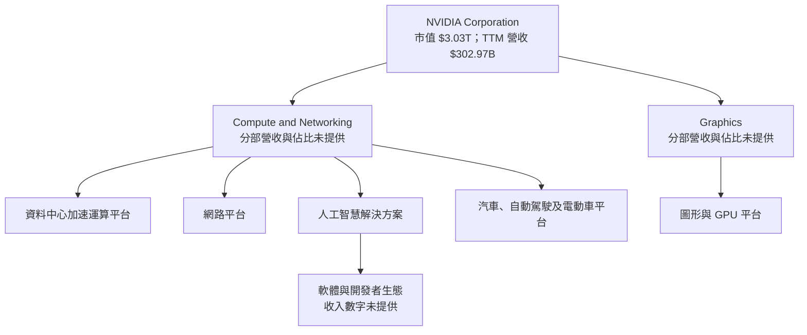
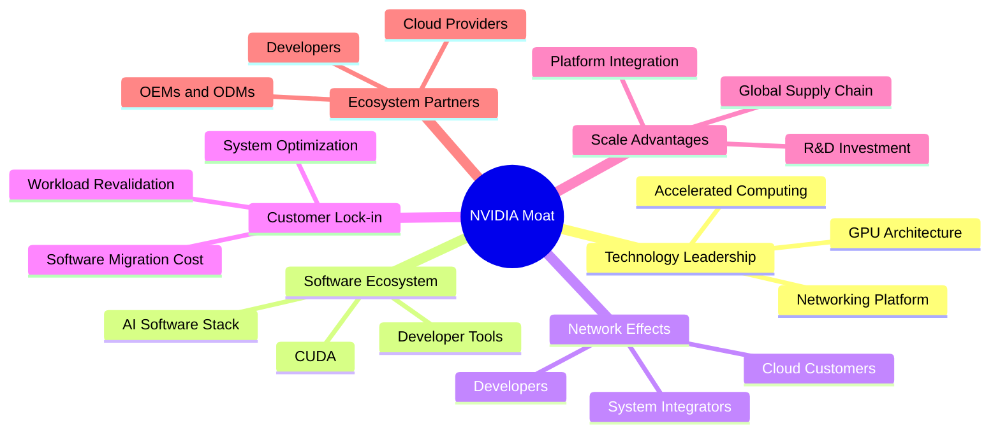
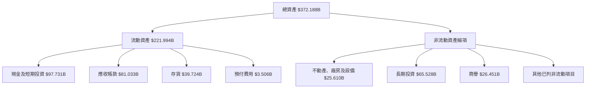
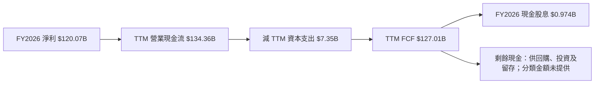
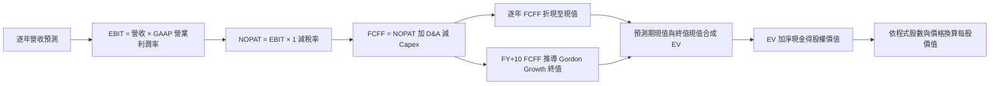
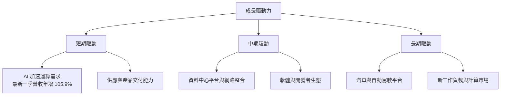
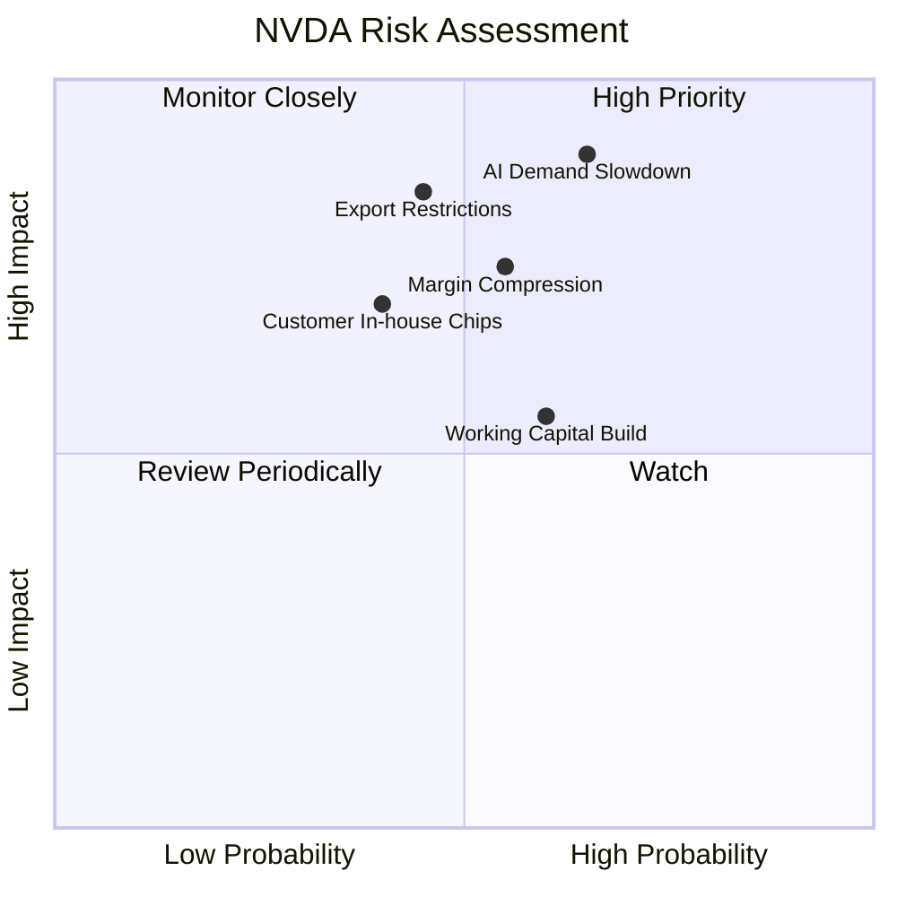
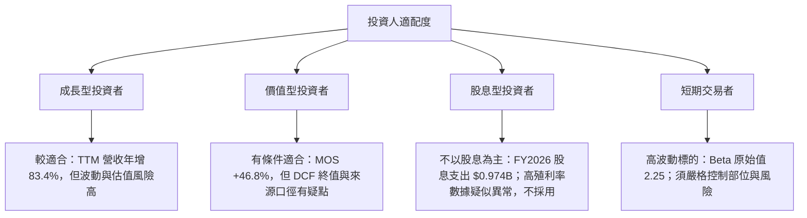

# NVDA 基本面深度分析報告
> **報告日期**：2026-11-23 ｜ **語言**：繁體中文 ｜ **數據來源**：SEC 申報資料 (XBRL)、Yahoo Finance、Finviz、StockAnalysis、Roic.ai ｜ **分析師**：CFA 級機構研究

## 目錄

| # | 章節 | 核心結論 |
|---|------|----------|
| 1 | 執行摘要 | 強烈買入；加權合理價值 $236.16；MOS +46.8% |
| 2 | 公司概覽與商業模式 | AI 加速運算平台與軟體生態系構成主要護城河；細分收入佔比未提供 |
| 3 | 損益表深度分析 | TTM 營收 $302.97B、TTM 年增 83.4%；最新一季年增 105.9% |
| 4 | 資產負債表分析 | 最新口徑淨現金 $23.22B；現金轉換週期較一年前延長 50 天 |
| 5 | 現金流量深度分析 | TTM FCF $127.01B；資本支出低於營業現金流的 5.5% |
| 6 | 獲利能力與資本效率 | ROIC 80.6% 對 WACC 13.92%，利差 66.68 個百分點 |
| 7 | 相對估值分析 | 相對同業多項倍數較低；自身 P/E 高於五年中位數 |
| 8 | DCF 內在價值評估 | 基準 DCF $166.02；加權合理價值 $236.16；模型有需披露的算術不一致 |
| 9 | 成長催化劑 | AI 加速運算、網路與軟體生態是主要方向；TAM 數字未提供 |
| 10 | 風險矩陣 | 需求正常化、出口管制與資本支出／供應鏈風險居前 |
| 11 | 投資建議 | 依 MOS 評級為強烈買入；買入區間依加權合理價值推導 |

---

## 1. 執行摘要

### 1.0 一頁式投資儀表板（Portfolio Manager 30 秒速讀）

| 項目 | 內容 |
|------|------|
| **投資論點（3 句）** | ① TTM 營收 $302.97B、年增 83.4%，反映加速運算需求仍在擴張。② TTM 營業利益率 65.2%、ROIC 80.6%，高於 13.92% 的 WACC，資本回報顯著超過資金成本。③ TTM FCF $127.01B、FCF Yield 4.19%，提供再投資與資本配置能力，但估值對 AI 成長延續仍敏感。 |
| **綜合評分** | **8.5/10**（引用 1.1 六項平均） |
| **財務健康** | 🟢 最新統一口徑淨現金 $23.22B；流動性充裕，但 CCC 從 105 天升至 155 天。 |
| **ROIC vs WACC** | **80.6% vs 13.92%**；🟢 創造股東價值，差距 66.68 個百分點。 |
| **FCF 趨勢** | TTM FCF $127.01B；年度 FCF 由 FY2023 $3.81B 升至 FY2026 $96.68B；最新 FCF Yield 4.19%。 |
| **估值** | Forward P/E 7.56x（市場資料欄位）；EV/EBITDA 12.19x（同欄位）；FCF Yield 4.19%。各來源倍數存在差異，詳見第 7 章。 |
| **DCF 內在價值（基準）** | **$166.02**；相對 2026-11-20 收盤價折價 **24.4%**（折溢價基準為 DCF）。 |
| **安全邊際（MOS）** | **+46.8%＝($236.16 − $125.53) ÷ $236.16**；🟢 充足。基準為第 8.8 節加權合理價值。 |
| **預期報酬（基準情境 12M）** | **+32.3%**，引用 DCF MODEL 基準情境每股價值 $166.02；不是保證報酬。 |
| **關鍵風險（前二）** | AI 資本支出成長若降速，營收與估值倍數可能同時收縮；出口限制或競爭替代可能壓低可服務市場。 |
| **評級 + 信心度** | 🟢 **強烈買入** ｜ 信心：中。估值指標與來源存在不一致，DCF 終值計算亦有可複算差異。 |

> **資料一致性提示：**SEC 申報口徑的 VERIFIED FIGURES 為 TTM 營收 $302.97B、最新一季年增 105.9%、ROIC 80.6%、淨現金 $23.22B；其他彙整欄位另列 TTM 營收 $361.81B、ROE 117.4%及淨現金 $59.58B。為遵循 SEC／程式計算口徑優先原則，本報告核心指標採前者；不將互相矛盾的期間資料混算。

### 1.1 綜合評分卡（全報告唯一）

| 維度 | 評分（1–10） | 主要依據（引用數字與其來源章節） |
|------|--------------|----------------------------------|
| 成長性 | 9.5 | TTM 營收年增 83.4%、最新一季年增 105.9%；見第 3 章。 |
| 獲利能力 | 10.0 | TTM 營業利益率 65.2%、ROIC 80.6%、Piotroski 5/9；見第 3、6 章。 |
| 財務健康 | 8.5 | 淨現金 $23.22B；CCC 155 天，高於一年前 105 天；見第 4 章。 |
| 估值 | 7.0 | 加權合理價值 $236.16、MOS +46.8%，但自身 P/E 15.9x 高於五年中位數 11.3x；見第 7、8 章。 |
| 護城河 | 9.0 | 平台、軟體與網路產品形成轉換成本；收入細分及市場份額數字未提供；見第 2 章。 |
| 管理層與資本配置 | 7.5 | FY2026 SBC $6.39B，約佔營收 3.0%；稀釋股數測試通過，但回購金額明細未提供；見第 3、5 章。 |
| **綜合評分** | **8.6** | 六項算術平均：$(9.5+10.0+8.5+7.0+9.0+7.5)÷6=8.58$，四捨五入為 **8.6**。 |

### 1.2 五大投資論點 + 三大核心風險

| 類型 | 項目 | 具體依據 | 信心度 |
|------|------|----------|--------|
| 🟢 **投資論點①** | AI 加速運算需求仍高速增長 | TTM 營收 $302.97B、年增 83.4%；最新一季年增 105.9%。若需求與供應能力同步延續，營收增長可維持高位。 | 🟢 高 |
| 🟢 **投資論點②** | 獲利結構帶來營業槓桿 | TTM 營業利益率 65.2%，最新一季 66.2%；規模與產品組合支撐高利潤率。 | 🟢 高 |
| 🟢 **投資論點③** | 資本回報遠高於資金成本 | ROIC 80.6% 對 WACC 13.92%；若差距維持，增量投資仍有望創造經濟價值。 | 🟢 高 |
| 🟢 **投資論點④** | 自由現金流提供資產負債表彈性 | TTM OCF $134.36B、Capex $7.35B、FCF $127.01B；FCF Yield 4.19%。 | 🟢 高 |
| 🟢 **投資論點⑤** | DCF 與三角估值均高於現價 | DCF 基準 $166.02；加權合理價值 $236.16，高於 $125.53 收盤價。DCF 模型算術疑點使信心應保留。 | 🟡 中 |
| 🟡 **風險①** | AI 資本支出週期反轉 | 最新一季年增 105.9% 的高成長形成高基期；若大型客戶支出降速，營收成長和估值倍數可能同向下修。 | 🟡 中 |
| 🔴 **風險②** | 供應鏈、出口管制與替代方案 | 業務跨美國、台灣、中國、香港、歐洲等地；法規限制或客戶轉向自研晶片會影響可交付市場。財務衝擊無法由現有資料精確量化。 | 🔴 高衝擊 |
| 🟡 **風險③** | 營運資金佔用上升 | DSO 由 61 天升至 76 天、DIO 由 110 天升至 150 天，CCC 增加 50 天；若延續，現金轉換效率可能弱化。 | 🟡 中 |

### 1.3 快速統計卡片

同業中位數按 AMD、AVGO、INTC 的同業倍數資料計算；營收成長與毛利率分別取三家中位數。

| 指標 | 公司實際值（期間） | 同業中位數 | 狀態 |
|------|--------------------|------------|------|
| 營收成長（TTM） | **83.4%** | — | 🟢 |
| 營收成長（最新一季年增） | **105.9%** | 44.7% | 🟢 |
| 毛利率（TTM） | **74.9%**（彙整資料欄位） | 56.0% | 🟢 |
| 營業利益率（TTM） | **65.2%** | — | 🟢 |
| ROIC（TTM） | **80.6%** | — | 🟢 |
| Forward P/E | **7.56x**（彙整估值欄位） | 24.1x | 🟢* |
| FCF Yield（TTM） | **4.19%** | — | 🟢 |
| Piotroski F-Score | **5 / 9** | — | 🟡 |

\* Forward P/E 來自市場資料彙整欄位；與價格／EPS 及其他估值口徑有差異，不宜單獨視為確定的便宜訊號。

### 1.4 投資結論

╔══════════════════════════════════════════════════════════════════╗  
║                    📊 投資結論摘要                               ║  
╠══════════════════════════════════════════════════════════════════╣  
║  評級：強烈買入（MOS +46.8%，且 ROIC 80.6% > WACC 13.92%）       ║  
║  價格（2026-11-20 收盤）：$125.53                                ║  
║  DCF 內在價值（基準）：$166.02（折價 24.4%）                    ║  
║  安全邊際 MOS：+46.8%（以加權合理價值 $236.16 為分母）          ║  
║  加權合理價值（8.8）：$236.16                                    ║  
║  DCF 情境價值：                                                   ║  
║    悲觀情境：$75.52（-39.8%）                                    ║  
║    基準情境：$166.02（+32.3%）                                   ║  
║    樂觀情境：$342.08（+172.5%）                                  ║  
║  綜合評分：8.6/10（引用 1.1）                                    ║  
║  適合投資人：能承受高波動、重視長期成長與企業自由現金流者        ║  
╚══════════════════════════════════════════════════════════════════╝

---

## 2. 公司概覽與商業模式

### 2.1 業務結構與收入來源

公司資料描述 NVIDIA 透過 Compute & Networking 與 Graphics 兩個板塊營運，另涉及汽車、自動駕駛與電動車平台。但最新分部營收與佔比沒有可核對的數字，依規則不推估板塊比例。

收入增長的實際規模已有可用數據：FY2026 年營收 $215.94B，SEC／程式計算 TTM 營收 $302.97B。兩者財務期間不同，且其他彙整來源的 TTM 為 $361.81B，應以相應申報期間核對後再做分部拆解。

### 2.2 市場份額

**市場份額數據未提供**，因此不繪製比例圖，也不以估計份額代替。相對規模方面，NVDA 的 TTM 營收為 $302.97B，最新一季年增 105.9%，高於 AMD 的 44.7%、AVGO 的 85.5%及 INTC 的 20.9%；但各公司產品組合不同，營收成長不能直接等同市場份額變化。

### 2.3 競爭護城河分析

### 2.4 護城河強度

| 護城河項目 | 強度（強／中／弱） | 證據（引用數字或事實） | 會削弱它的情況 |
|------------|--------------------|------------------------|----------------|
| 技術與系統整合 | 強 | TTM 營業利益率 65.2%；業務涵蓋加速運算、網路及 AI 平台。 | 競爭者性能／能效追平，或客戶改用自研晶片。 |
| 軟體生態系 | 強 | 公司提供 AI 解決方案與軟體；收入金額與訂閱數未提供。 | 軟體移植工具成熟、開放標準降低轉換成本。 |
| 客戶鎖定 | 中至強 | 開發、部署與最佳化成本可能提高轉換門檻；目前沒有客戶留存率數字。 | 大客戶多供應商策略、雲端抽象層降低硬體依賴。 |
| 規模效應 | 強 | FY2026 R&D $18.50B；公司能持續投入硬體與平台研發。 | 研發回報下降或高固定成本無法由需求吸收。 |
| 網路效應 | 中 | 開發者、系統整合商與雲端服務商擴大平台可用性；量化生態數字未提供。 | 客戶與開發者轉向替代平台。 |
| 生態夥伴 | 中至強 | 公司跨美國、台灣、中國、香港、歐洲等地營運；供應鏈與伙伴集中度未提供。 | 出口管制、供應瓶頸或關鍵伙伴議價能力上升。 |

**1.1 護城河評分 9.0/10 的理由：**平台與軟體協同加上 65.2% 的 TTM 營業利益率支持強護城河判斷；但缺乏份額、客戶集中度與軟體收入的量化披露，因此不給滿分。

---

## 3. 損益表深度分析

### 3.1 年度收入成長趨勢（近 4 年）

╔══════════════════════════════════════════════════════════════════╗  
║              NVIDIA 年度收入趨勢（FY2023-FY2026）               ║  
╠══════════════════════════════════════════════════════════════════╣  
║ FY2023  $26.97B   ███░░░░░░░░░░░░░░░░░░░  基期                ║  
║ FY2024  $60.92B   ██████░░░░░░░░░░░░░░░░  YoY +125.9% 🟢       ║  
║ FY2025  $130.50B  █████████████░░░░░░░░░  YoY +114.2% 🟢       ║  
║ FY2026  $215.94B  ██████████████████████  YoY +65.5% 🟢        ║  
╠══════════════════════════════════════════════════════════════════╣  
║ FY2023–FY2026 年營收 CAGR：約 100.1%                             ║  
╚══════════════════════════════════════════════════════════════════╝

FY2024、FY2025 的增速超過 100%，FY2026 放緩至 65.5%，但基數已大幅提高。FY2026 營收仍比 FY2025 增加 $85.44B，說明成長減速不等於需求收縮。

### 3.2 季度收入趨勢分析

季度財報資料列示 FY2026 Q2 至 FY2027 Q2；QoQ 以相鄰季度收入計算，YoY 採來源提供的單季年增率。

| 財季 | 營收（$B） | QoQ 成長 | YoY 成長（單季） | 備註 |
|------|------------:|---------:|-----------------:|------|
| FY2026 Q2 | 46.743 | — | 55.60% | 起始比較季 |
| FY2026 Q3 | 57.006 | +22.0% | 62.49% | 較前季增加 $10.263B |
| FY2026 Q4 | 68.127 | +19.5% | 73.22% | 營收規模持續擴大 |
| FY2027 Q1 | 81.615 | +19.8% | 85.23% | 增速加快 |
| FY2027 Q2 | 96.221 | +17.9% | 105.9%* | 依 VERIFIED FIGURES；彙整來源為 105.85% |

\* 105.9% 是**最新一季年增率**，不是 TTM 成長率。由 FY2026 Q2 的 $46.743B 至 FY2027 Q2 的 $96.221B，單季營收大約翻倍；QoQ 增速則由約 20%區間略降至 17.9%，反映基數提升下仍有高增長，但短期環比動能值得追蹤。

### 3.3 利潤率演變分析

| 利潤率指標 | FY2023 | FY2024 | FY2025 | FY2026 | 趨勢 | 評估 |
|------------|-------:|-------:|-------:|-------:|------|------|
| **毛利率** | 56.9% | 72.7% | 75.0% | 71.1% | FY2025 見高後回落 | 🟡 |
| **營業利益率** | 20.7% | 54.1% | 62.4% | 60.4% | 大幅擴張後小幅收縮 | 🟢 |
| **淨利率** | 16.2% | 48.8% | 55.8% | 55.6% | 高位趨穩 | 🟢 |

FY2026 毛利率由 75.0%降至 71.1%，營業利益率由 62.4%降至 60.4%。在營收仍成長 65.5%時利潤率略降，可能反映產品組合、供應成本與快速擴產的影響；但最新 TTM 營業利益率為 65.2%、最新一季為 66.2%，與年度彙整口徑並不相同，代表期間及來源差異不能忽略。若最新季度利潤率能維持，規模與產品組合仍支撐強勁營業槓桿；若毛利率持續回落，市場可能下修長期利潤率假設。

### 3.4 費用結構分析

FY2026 可核對的費用項目為 R&D $18.50B、營業利益 $130.39B、營收 $215.94B。完整銷貨成本、銷售管理費及其他營業費用拆分未在同一表格提供，因此不以不完整項目畫支出比例圓餅圖。

以披露數字觀察，FY2026 R&D 約佔營收 8.6%（$18.50B ÷ $215.94B）；投資於研發有助產品迭代與生態系，但實際增量回報仍須觀察營收與毛利率是否持續高於投入增速。

### 3.5 季度 EPS 趨勢與盈餘品質（Quality of Earnings）

季度 EPS 實際值有列示，但 EPS 預估值為 N/A，因此無法可靠判斷過去四季「超預期／不及預期」。截至資料列示的 FY2027 Q2，季度 EPS 為 $2.46；之前 FY2027 Q1 為 $2.39、FY2026 Q4 為 $1.76、FY2026 Q3 為 $1.30。這些是每季實際 EPS，不能替代盈餘驚喜值。

| 盈餘品質項目 | 數值／佔比 | 評估 |
|--------------|-----------|------|
| 股權薪酬 SBC / 營收 | FY2026：$6.39B ÷ $215.94B = **2.96%** | 🟡 有稀釋成本；比例不算極高，但仍是股東經濟成本。 |
| SBC / 營業現金流 | FY2026：$6.39B ÷ $102.72B = **6.22%** | 🟡 SBC 規模顯著但低於 OCF 的十分之一。 |
| FCF / 淨利（現金轉換率） | TTM：$127.01B ÷ $226.257B = **56.1%** | 🟡 TTM 現金轉換低於 100%；週轉資金需求及期間差異可能造成落差。 |
| 一次性／非經常性損益 | N/A（資料未提供完整調節表） | 不把未提供項目推定為不存在；應核對 10-Q／10-K 調節。 |
| 有效稅率異常 | DCF 採用最新年度有效稅率 **15.1%** | 🟢 模型稅率已明示；未見足夠資料認定為一次性稅務利益。 |
| 資本化支出 vs 費用化 | TTM Capex $7.35B；FY2026 R&D $18.50B | 未提供資本化研發明細，不能判定成本遞延程度。 |

**盈餘品質結論：**營業現金流和 FCF 規模可觀，但 FCF／TTM 淨利約 56.1%，且 F-Score 的「營業現金流大於淨利」測試未通過，提示應計獲利與營運資金變動值得監控。FY2026 SBC 佔營收 2.96%，DCF 採 GAAP EBIT 已將 SBC 作為費用處理，不應再重複扣除。

---

## 4. 資產負債表分析

### 4.1 資產結構分解

依 StockAnalysis 的 TTM 資產表，總資產 $372.188B、流動資產 $221.994B；以下僅呈現已披露的數字，不把未列項目反推為細項。

其中流動資產細項與總額的差額可能包含其他流動項目；上圖不將資產分項強行加總至總額。

### 4.2 流動性與營運資金分析

流動比率與速動比率的可用彙整數據分別為 4.084、3.288；它們與 VERIFIED FIGURES 的現金及債務口徑期間不同，僅作補充參考。

| 指標 | 最新 TTM | 一年前 TTM | 變化 | 解讀 |
|------|----------|------------|------|------|
| DSO 應收帳款天數 | 76 天 | 61 天 | +15 天 | 回款週期變長，可能反映業務量、付款條件或客戶組合改變；需看應收帳款逾期狀況。 |
| DIO 存貨天數 | 150 天 | 110 天 | +40 天 | 存貨週轉變慢或為備貨與供應鏈需求；若營收不如預期，庫存風險會上升。 |
| DPO 應付帳款天數 | 72 天 | 66 天 | +6 天 | 付款期略延長，可能部分抵銷應收與存貨的資金占用。 |
| CCC 現金轉換週期 | 155 天 | 105 天 | +50 天 | 現金回收週期明顯拉長，對高獲利企業尚可承受，但趨勢需監控。 |

Piotroski 流動比率測試高於一年前並通過，與 CCC 延長並不矛盾：前者是期末流動性比率，後者衡量營運週轉時間，兩者回答不同問題。

### 4.3 債務結構分析

下圖採 SEC／程式計算口徑：現金與短期投資 $56.59B、總債務 $33.37B、淨現金 $23.22B。不同來源另列現金 $97.73B、債務 $38.15B，可能是期間或分類不同，故不混用。

╔══════════════════════════════════════════════════════════════════╗  
║                   NVIDIA 債務健康診斷                            ║  
╠══════════════════════════════════════════════════════════════════╣  
║ 總債務：          $33.37B   ██░░░░░░░░░░░░░░░░░░  🟢             ║  
║ 現金及短期投資：  $56.59B   ████████████████████  🟢             ║  
║ 淨現金：          $23.22B   ████████░░░░░░░░░░░░  🟢             ║  
║ Debt/EBITDA：     N/A（同一期 EBITDA 未提供）                     ║  
║ 利息保障倍數：    N/A（利息費用與同期間 EBIT 未完整提供）         ║  
╚══════════════════════════════════════════════════════════════════╝

淨現金降低財務槓桿風險，但不能消除營運週轉資金擴張或資本支出週期帶來的現金流波動。

### 4.4 股東權益趨勢

| 財年 | 股東權益（$B） | 年增率 |
|------|---------------:|-------:|
| FY2023 | 22.10 | — |
| FY2024 | 42.98 | +94.5% |
| FY2025 | 79.33 | +84.6% |
| FY2026 | 157.29 | +98.3% |

╔══════════════════════════════════════════════════════════════════╗  
║               股東權益趨勢（年度，$B）                            ║  
╠══════════════════════════════════════════════════════════════════╣  
║ FY2023  $22.10B   ███░░░░░░░░░░░░░░░░░░░                       ║  
║ FY2024  $42.98B   ██████░░░░░░░░░░░░░░                         ║  
║ FY2025  $79.33B   ███████████░░░░░░░░                           ║  
║ FY2026  $157.29B  █████████████████████                         ║  
╚══════════════════════════════════════════════════════════════════╝

股東權益增長與留存盈餘累積相符，但權益增長本身不代表每股價值同比增長；仍須結合稀釋股數、ROE 與資本配置評估。

---

## 5. 現金流量深度分析

### 5.1 現金流量瀑布圖

具體股息金額以 FY2026 年報數據為例；回購金額及 TTM 淨現金變化未提供，因此不繪製虛構金額。

圖中淨利為 FY2026 年度、OCF／Capex／FCF 為 TTM，期間不完全一致，故僅呈現指標關係，不代表同一期間的現金流調節表。

### 5.2 FCF 轉換率趨勢

| 財年 | FCF（$B） | 淨利（$B） | FCF／淨利 |
|------|----------:|-----------:|----------:|
| FY2023 | 3.81 | 4.37 | 87.2% |
| FY2024 | 27.02 | 29.76 | 90.8% |
| FY2025 | 60.85 | 72.88 | 83.5% |
| FY2026 | 96.68 | 120.07 | 80.5% |

年度現金轉換率由 FY2024 的 90.8%降至 FY2026 的 80.5%，雖仍有大量現金轉換，但淨利增長快於 FCF 的情況值得追蹤。TTM FCF $127.01B 與 TTM 淨利來源期間不同，不與年度序列直接混為一談。

### 5.3 自由現金流趨勢

| 財年 | FCF（$B） | YoY | FCF Yield |
|------|----------:|----:|----------:|
| FY2023 | 3.81 | — | — |
| FY2024 | 27.02 | +609.2% | — |
| FY2025 | 60.85 | +125.2% | — |
| FY2026 | 96.68 | +58.9% | — |
| TTM | 127.01 | — | 4.19% |

╔══════════════════════════════════════════════════════════════════╗  
║                  自由現金流趨勢（年度，$B）                       ║  
╠══════════════════════════════════════════════════════════════════╣  
║ FY2023  $3.81B   █░░░░░░░░░░░░░░░░░░░░                         ║  
║ FY2024  $27.02B  ██████░░░░░░░░░░░░░░                           ║  
║ FY2025  $60.85B  █████████████░░░░░░░                           ║  
║ FY2026  $96.68B  ████████████████████                           ║  
║ TTM     $127.01B FCF Yield 4.19%                                 ║  
╚══════════════════════════════════════════════════════════════════╝

FCF 成長受營業現金流擴張帶動，TTM Capex 僅 $7.35B，約為 OCF 的 5.5%。但若未來資料中心、供應鏈或自有基礎設施投資提高，現有低資本支出比例未必能長期維持。

### 5.4 資本配置評估

| 配置項目 | 可核對數據 | 評估 |
|----------|-----------|------|
| Capex | TTM $7.35B；FY2026 $6.04B | 相對於現金創造規模低；若公司擴大基礎設施投入，需觀察回報率。 |
| 股息 | FY2026 現金股息 $0.974B | 佔年度 FCF 約 1.0%；回報股東的現金分配比例低。 |
| SBC | FY2026 $6.39B | 佔營收 2.96%；屬非現金支出但會稀釋股東經濟權益。 |
| 回購 | 金額未提供 | 不推算回購金額或佔比。 |
| 留存與其他投資 | 分項金額未提供 | 資產負債表現金及投資上升，但不等於可以直接歸因於特定配置。 |

---

## 6. 獲利能力與資本效率

### 6.1 ROE／ROA／ROIC 趨勢

| 指標 | 最新 TTM／資料期 | 其他可用歷史數據 | 評估 |
|------|------------------:|------------------|------|
| ROE | 84.2%（VERIFIED FIGURES） | 另一彙整欄位列 117.4%，口徑不一致 | 🟢 回報高，但需避免混用期間與資本基礎 |
| ROA | N/A（品質指標列有測試結果，未給數值） | 彙整欄位列 56.0%，來源口徑不同 | 🟢 方向性高，核心分析不以該異源值替代 |
| ROIC | 80.6% | 歷史年度同口徑序列未提供 | 🟢 顯著高於 WACC |

未提供可統一口徑的行業均值，不作無來源的同業平均比較。

### 6.2 ROIC vs WACC 分析（核心價值創造判斷）

╔══════════════════════════════════════════════════════════════════╗  
║                ROIC vs WACC 深度分析                            ║  
╠══════════════════════════════════════════════════════════════════╣  
║ WACC（程式計算採用值）：13.92%                                   ║  
║ ├── 無風險利率（10Y 美債）：4.91%                               ║  
║ ├── 市場風險溢酬（假設值）：5.00%                               ║  
║ ├── Beta 原始值 2.25；調整後採用 1.83                           ║  
║ ├── 股權成本來源值：14.07%                                      ║  
║ ├── 稅前債務成本：0.78%；稅率 15.1%                             ║  
║ ├── 稅後債務成本：0.78% × (1 − 15.1%) = 0.66%                  ║  
║ ├── 權重：股權 98.9%，債務 1.1%                                 ║  
║ └── WACC：98.9% × 14.07% + 1.1% × 0.66% = 13.92%               ║  
║                                                                  ║  
║ ROIC（TTM）：80.6%                                               ║  
║ EVA 利差：80.6% − 13.92% = +66.68 個百分點                      ║  
║ ROIC／WACC：80.6% ÷ 13.92% = 5.79 倍                            ║  
║ ROIC  80.6%  ▓▓▓▓▓▓▓▓▓▓▓▓▓▓▓▓▓▓▓▓▓▓▓▓▓▓▓▓▓▓▓▓▓▓▓▓            ║  
║ WACC  13.92% ▓▓▓▓▓▓░░░░░░░░░░░░░░░░░░░░░░░░░░                ║  
╠══════════════════════════════════════════════════════════════════╣  
║ 結論：以當前數據看，投入資本回報遠高於資金成本，創造股東價值。  ║  
╚══════════════════════════════════════════════════════════════════╝

成本資本資料使用調整後 Beta 1.83，而非原始 Beta 2.25；調整方式為 $\frac{2}{3}×2.25+\frac{1}{3}×1=1.83$。股權成本來源值 14.07%與四捨五入後的 CAPM 輸入直接計算值可能有 0.01 個百分點差異；本報告遵循程式 WACC 13.92%，不另建 WACC。ROIC 與 WACC 的口徑按同一來源數值比較；未將不同期間的資產負債表餘額另行重算 ROIC。

### 6.3 杜邦三因素分解

| 因素 | 數值（TTM） | 解讀 |
|------|-------------|------|
| 淨利率 | 63.7% | 高獲利能力是 ROE 的重要來源。 |
| 資產週轉率 | 0.95 | 資產利用率尚高，但品質數據顯示低於一年前。 |
| 權益乘數 | 1.40 | 槓桿程度有限，ROE 不是主要靠財務槓桿撐起。 |
| **ROE** | **84.2%** | $63.7\%×0.95×1.40=84.7\%$（使用未四捨五入的底層數值後，QUALITY FIGURES 報列 ROE 84.2%；照抄其結果。） |

### 6.4 財務體質：Piotroski F-Score

**Piotroski F-Score：5 / 9。**測試分母依可判定項目計算；現有資料九項均列出結果。

| 測試 | 結果 | 解讀 |
|------|------|------|
| ROA > 0 | ✅ 通過 | 獲利為正。 |
| 營業現金流 > 0 | ✅ 通過 | 營運現金流為正。 |
| ROA 高於一年前 | ❌ 未通過 | 相對一年前未改善，需關注資產擴張是否跑在利潤之前。 |
| 營業現金流 > 淨利（應計品質） | ❌ 未通過 | 現金流低於淨利，與現金轉換率未達 100% 的訊號一致。 |
| 長期負債 ÷ 總資產低於一年前 | ❌ 未通過 | 相對指標未改善；但公司仍為淨現金狀態。 |
| 流動比率高於一年前 | ✅ 通過 | 短期流動性改善。 |
| 稀釋股數未增加 | ✅ 通過 | 該比較期測試通過，不代表 SBC 不造成經濟稀釋。 |
| 毛利率高於一年前 | ✅ 通過 | 比較期毛利率較高。 |
| 資產週轉率高於一年前 | ❌ 未通過 | 資產擴張可能快於收入轉化，需要跟蹤周轉效率。 |

5/9 為中性偏審慎訊號：正營運現金流、流動性及毛利率是正面項目；應計品質、資產週轉與長期負債比例測試未通過，限制了整體財務品質評價。

---

## 7. 相對估值分析

### 7.1 同業估值比較表格

公司當前倍數取市場資料彙整欄位；同業倍數按 Yahoo Finance 同業資料。由於 NVDA 的 TTM P/E 在自身歷史表為 15.9x、另一市場欄位為 13.48x，存在來源差異，表中同時揭露，避免假裝口徑一致。

| 估值指標 | **NVDA** | **AMD** | **AVGO** | **INTC** | NVDA 評估 |
|----------|---------:|------:|-------:|------:|-----------|
| **Trailing P/E** | 13.48x（彙整欄位）；歷史表 15.9x | 90.7x | 38.9x | N/A | 🟢 相較盈利同業低；口徑差異需核實 |
| **Forward P/E** | 7.56x（彙整欄位） | 24.1x | 15.7x | 28.6x | 🟢 表面偏低；估值來源與預期 EPS 口徑須核對 |
| **P/S Ratio** | 8.38x（彙整欄位）；歷史表 10.1x | 15.5x | 16.3x | 4.6x | 🟡 低於 AMD、AVGO，高於 INTC |
| **EV / EBITDA** | 12.19x（彙整欄位）；歷史表 15.0x | 61.9x | 28.5x | 14.9x | 🟢 同業相對較低 |
| **最新一季營收年增** | 105.9% | 44.7% | 85.5% | 20.9% | 🟢 增速高於三家同業 |
| **毛利率（TTM）** | 74.9%（彙整欄位） | 56.0% | 75.5% | 40.2% | 🟢 接近 AVGO，明顯高於 AMD、INTC |

同業倍數是公司盈利、資本結構及增長預期的合成結果，不代表可直接套用為 NVDA 的「合理倍數」。估值平台的公司倍數與 VERIFIED 歷史倍數不同，應以 8.8 固定的程式計算估值方法作為正式三角驗證輸入。

### 7.2 歷史估值區間分析

╔══════════════════════════════════════════════════════════════════╗  
║              NVDA 五年 P/E 歷史區間（TTM）                       ║  
╠══════════════════════════════════════════════════════════════════╣  
║ 最低 2.3x ├──────────────────────────────────┤ 最高 49.3x       ║  
║ 中位數 11.3x ────────────────● 現值 15.9x                     ║  
║ 現值百分位：67%                                                  ║  
║ 評估：高於五年中位數，但仍低於歷史高端；不可只據此判定便宜。    ║  
╚══════════════════════════════════════════════════════════════════╝

其他歷史倍數：P/S 現值 10.1x、五年中位數 2.7x、百分位 57%；EV/EBITDA 現值 15.0x、中位數 8.9x、百分位 57%。歷史估值區間很寬，受盈利週期及股價波動影響，因此適合做相對位置參考，不宜單獨作目標價。

### 7.3 情境價值（Bear / Base / Bull，照抄 DCF MODEL）

| 情境 | 第 1 年營收成長 | 期末營業利潤率 | WACC | 每股價值 | 相對現價 | 機率 | 會發生的條件 |
|------|----------------:|----------------:|-----:|----------:|----------:|-----:|--------------|
| 🔴 悲觀 | 15.0% | 51.3% | 14.92% | $75.52 | -39.8% | 25% | AI 資本支出顯著降速、競爭壓低價格或利潤率，且資金成本上升。 |
| 🟡 基準 | 30.0% | 60.4% | 13.92% | $166.02 | +32.3% | 50% | 營收由高成長逐步降至成熟期，利潤率向歷史中位數收斂。 |
| 🟢 樂觀 | 45.0% | 66.4% | 12.92% | $342.08 | +172.5% | 25% | AI 需求與平台份額持續擴張，規模效應支撐更高利潤率、折現率下降。 |

情境資料未列出各情境的完整逐年營收、FY+10 FCFF 及終值明細；因此不補造模型中未提供的中間值。機率加權價值另列 $187.41，但 8.8 估值權重按規則使用 DCF 基準 $166.02，而非機率加權情境值。

### 7.4 相對估值隱含價格區間

╔══════════════════════════════════════════════════════════════════╗  
║                 相對估值與基準 DCF 每股價值                       ║  
╠══════════════════════════════════════════════════════════════════╣  
║ 悲觀 DCF $75.52 ─ 現價 $125.53 ─ DCF $166.02                    ║  
║              同業 EV/EBITDA $181.81 ─ 加權合理值 $236.16        ║  
║                                Forward P/E $399.54               ║  
╚══════════════════════════════════════════════════════════════════╝

| 方法 | 每股價值 | 依據 |
|------|---------:|------|
| 同業 Forward P/E | $399.54 | AMD、AVGO、INTC 同業中位數 24.1x × NVDA Forward EPS $16.61。 |
| 同業 EV/EBITDA | $181.81 | AVGO、INTC 可計算樣本中位數 21.7x × TTM EBITDA，再加淨現金。 |
| 分析師共識 | $244.18 | 56 位分析師平均目標價；屬參考值，不代表獨立內在價值模型。 |

相對估值結果由 $181.81 至 $399.54，分散度大，反映 Forward P/E 方法對盈利成長與倍數選擇特別敏感。

---

## 8. DCF 內在價值評估（Discounted Cash Flow）

> 本章只採用程式計算的 DCF MODEL；不得以自行重建的模型取代。模型標示 FCFF 不建模營運資金，並使用 GAAP EBIT、固定股數處理 SBC。模型提供的若干算術項目與列示結果不完全相符，本文會原值呈現並在 8.10 指出，不以未授權的改算值替換。

### 8.0 估值推理鏈（Thinking Logic）

**Step 1 — 價值來源與主導變數**

模型將 NVDA 的價值主要拆成現有加速運算與圖形平台現金流，以及由 AI、網路、軟體和汽車相關產品帶來的未來增量；各細分收入佔比未提供，不能填入虛構權重。模型中最能改變結果的可驗證變數是折現率與終值假設：基準終值現值佔 EV 44.6%，因此長期現金流及 WACC／永續成長率的組合對估值有重大影響。

**Step 2 — 模型選擇**

| 決策點 | 本報告採用 | 理由（含數字） | 曾考慮但否決 | 否決理由 |
|--------|-----------|----------------|--------------|----------|
| 現金流定義 | FCFF | 使用 GAAP EBIT、NOPAT 加 D&A 減 Capex，對應 WACC 折現及 EV | FCFE | 公司採用 FCFF／WACC 的預計算模型，避免另建模型 |
| 預測期 N | 10 年 | DCF MODEL 固定為 10 年，並列 FY+1 至 FY+10 | 5 年 | 與程式模型不一致，且不允許改動預測期 |
| 終值方法 | Gordon Growth | 程式模型採永續成長率 3.0% | 另建退出倍數終值 | 模型未提供退出倍數終值輸出，不能自行補建 |
| EBIT 基礎 | GAAP EBIT | 模型說明 GAAP EBIT 已含 SBC 費用 | 非 GAAP EBIT | 會改變 SBC 處理並偏離模型設定 |

**Step 3 — 高／中敏感度假設推導**

- **營收增長路徑**：錨點＝TTM 年增 83.4%；調整＝高基期、需求逐步正常化，因此模型把 FY+1 成長限制在 0%–30%，往後線性降至 FY+10 的 3.0%；**採用 FY+1 30.0%、FY+10 3.0%**；曾考慮維持 83.4%，但否決，因把單一高增長年度延伸十年會顯著高估且不是模型採值。
- **營業利潤率**：錨點＝TTM 65.2%；調整＝逐年降至包含 TTM 的近五年財年中位數；**採用 FY+1 65.2%、FY+10 60.4%**；曾考慮全期維持 65.2%，否決理由是模型依歷史中位數設定收斂。
- **永續成長率 g**：錨點＝模型採用 3.0%；調整理由＝接近長期名目經濟成熟增長假設，且低於 13.92% WACC；**採用 3.0%**；曾考慮高於 3.0%的設定，但未採用，避免長期成長假設無足夠來源，且必須保持低於 WACC。
- **預測期 N**：錨點＝模型設定 10 年；調整理由＝由高成長逐步衰退至長期 3.0%；**採用 10 年**；曾考慮更短期，但不得偏離程式模型。
- **Capex／營收**：錨點＝TTM Capex／營收約 $7.35B ÷ $302.97B = 2.43%；調整理由＝模型隨規模與資產投入成熟而下降；**採用 FY+1 2.4%、FY+10 1.3%**；曾考慮全期維持 2.4%，否決理由是模型設定隨時間收斂。
- **EBIT、SBC 與稀釋**：錨點＝使用 GAAP EBIT；調整理由＝GAAP 已將 SBC 作為費用；**採用 (A) GAAP EBIT + 固定股數、年稀釋率 0%**；曾考慮另扣 SBC 或放大股數，否決理由是會與 GAAP EBIT 已扣費用重複計算。
- **終值方法**：錨點＝模型採 Gordon Growth；調整理由＝模型提供 FY+10 FCFF 與 g；**採用 Gordon Growth**；曾考慮退出倍數法，但模型未提供其指定輸入與計算結果，不能另建。
- **WACC**：錨點＝程式資本成本資料採用 13.92%；調整理由＝Beta、ERP、無風險利率與資本權重已在資本成本資料中計算；**採用 13.92%**；曾考慮其他折現率，但不得另算或替換程式給定值。

**低敏感度輸入：**稅率採最新年度有效稅率 15.1%；D&A／營收採 TTM 1.2%；營運資金變動未建模，數值為 N/A，並非假定為零。

**Step 4 — 最脆弱的一環**

最脆弱的是高成長期能否轉化為模型假設的營收路徑與利潤率：若 AI 投資週期提早正常化，基準 DCF $166.02 可能向悲觀情境 $75.52 靠近；這與第 8.6 節中 WACC 上升及終值變動造成的敏感度一致。

**Step 5 — 計算路徑**

### 8.1 模型假設總表（Model Inputs）

| 假設項目 | 採用值 | 依據／來源 | 敏感度 |
|----------|--------|-------------|--------|
| 預測期長度 **N** | 10 年 | DCF MODEL 固定 10 年預測期 | 🟡 中 |
| 營收成長 | FY+1 30.0% 線性降至 FY+10 3.0% | TTM 年增 83.4%；模型限制首年成長並逐步收斂 | 🔴 高 |
| 營業利潤率 | FY+1 65.2% 降至 FY+10 60.4% | TTM 營業利益率及近五年財年中位數 | 🔴 高 |
| 有效稅率 | 15.1% | 最新年度有效稅率 | 🟢 低 |
| Capex／營收 | FY+1 2.4% 降至 FY+10 1.3% | TTM Capex／營收約 2.43%；模型逐步收斂 | 🟡 中 |
| D&A／營收 | 1.2% | TTM 比率，模型固定 | 🟢 低 |
| 營運資金變動 | 未建模，N/A | DCF MODEL 明確排除營運資金 | 🟢 低 |
| EBIT 基礎 | GAAP | 模型指定 GAAP EBIT | 🟡 中 |
| SBC 處理 | 組合 (A)：GAAP EBIT 已費用化；不再扣 SBC | DCF MODEL 說明 SBC 已在 GAAP EBIT 中 | 🟡 中 |
| 年稀釋率 | 0%（固定股數） | 與組合 (A) 相容；模型固定股數 | 🟡 中 |
| 永續成長率 g | 3.0% | DCF MODEL；低於 WACC 13.92% | 🔴 高 |
| 終值方法 | Gordon Growth | DCF MODEL 提供終值 | 🔴 高 |
| WACC | 13.92% | Cost of capital 程式計算值 | 🔴 高 |

**FCFF 定義：**採 FCFF＝NOPAT＋D&A−Capex；營運資金未建模，因此不可將其解讀為 ΔWC=0。  
**SBC 相容性：**本模型採用 **(A) GAAP EBIT + 固定股數**，故 SBC 影響已計入一次；8.3 不另列 −SBC，股數不逐年放大。

### 8.2 折現率推導（WACC）

╔══════════════════════════════════════════════════════════════════╗  
║                    WACC 推導（折現率）                           ║  
╠══════════════════════════════════════════════════════════════════╣  
║ 股權成本 Ke（CAPM）：                                            ║  
║ ├── 無風險利率 Rf：4.91%                                         ║  
║ ├── 市場風險溢酬 ERP（假設值）：5.00%                            ║  
║ ├── 原始 Beta：2.25；調整後 Beta：1.83                           ║  
║ ├── 規模／國別溢酬：0.00%（未另加）                              ║  
║ └── Ke 來源值：14.07%                                            ║  
║                                                                  ║  
║ 債務成本 Kd：                                                    ║  
║ ├── 稅前 Kd：0.78%                                               ║  
║ ├── 有效稅率：15.1%                                              ║  
║ └── 稅後 Kd = 0.78% × (1 − 15.1%) = 0.66%                       ║  
║                                                                  ║  
║ 資本結構（程式提供權重）：                                       ║  
║ ├── 股權權重 E：98.9%                                            ║  
║ ├── 債務權重 D：1.1%                                             ║  
║ └── WACC：98.9% × 14.07% + 1.1% × 0.66% = 13.92%                ║  
╚══════════════════════════════════════════════════════════════════╝

**逐步演算（遵循程式資本成本輸入）：**

1. **Ke（CAPM）**：來源數值直接列為 14.07%；以已顯示的四捨五入輸入重算，$4.91\%+1.83×5.00\%=14.06\%$，與來源值差 0.01 個百分點，屬底層精度／四捨五入差異；DCF 使用來源 Ke。
2. **稅前 Kd**：程式提供值為 0.78%；利息費用及平均計息負債明細未提供，不能另行重算分子、分母。
3. **稅後 Kd**：$0.78\%×(1−15.1\%)=0.66222\%\approx0.66\%$。
4. **權重**：程式提供股權 98.9%、債務 1.1%；總和 $98.9\%+1.1\%=100.0\%$。精確市值及同一口徑計息債務權重計算明細未提供，不用帳面股東權益替代市值。
5. **WACC**：$98.9\%×14.07\%+1.1\%×0.66222\%=13.91523\%+0.00728\%=13.92251\%\approx13.92\%$。

無風險利率日期未在成本資本欄位註明，故只能引用 4.91%，不能自行指定觀察日。ERP 5.00%為假設值，沒有提供外部估計依據。Beta 原始值 2.25 高於 1.5，模型採用調整後 1.83。未加入額外規模／國別溢酬。第 6.2 節使用同一 WACC 13.92%。

### 8.3 逐年自由現金流預測（基準情境）

金額單位：$B；折現因子保留三位小數。FCFF 不含 ΔWC，與模型設定一致。

| 年度 | FY+1 | FY+2 | FY+3 | FY+4 | FY+5 | FY+6 | FY+7 | FY+8 | FY+9 | FY+10 |
|------|-----:|-----:|-----:|-----:|-----:|-----:|-----:|-----:|-----:|------:|
| 營收 | 393.86 | 500.20 | 620.25 | 750.50 | 885.59 | 1,018.43 | 1,140.64 | 1,243.30 | 1,317.90 | 1,357.44 |
| 營收 YoY | 30.0% | 27.0% | 24.0% | 21.0% | 18.0% | 15.0% | 12.0% | 9.0% | 6.0% | 3.0% |
| 營業利潤率 | 65.2% | 64.7% | 64.1% | 63.6% | 63.1% | 62.5% | 62.0% | 61.5% | 60.9% | 60.4% |
| EBIT（GAAP） | 256.85 | 323.52 | 397.83 | 477.35 | 558.51 | 636.82 | 707.11 | 764.08 | 802.85 | 819.64 |
| − 稅 | (38.83) | (48.91) | (60.14) | (72.16) | (84.43) | (96.27) | (106.89) | (115.51) | (121.37) | (123.91) |
| NOPAT | 218.02 | 274.61 | 337.69 | 405.19 | 474.08 | 540.55 | 600.22 | 648.57 | 681.48 | 695.74 |
| + D&A | 4.79 | 6.09 | 7.55 | 9.13 | 10.78 | 12.39 | 13.88 | 15.13 | 16.04 | 16.52 |
| − Capex | (9.56) | (11.54) | (13.55) | (15.49) | (17.21) | (18.56) | (19.41) | (19.65) | (19.24) | (18.17) |
| **FCFF** | **213.26** | **269.16** | **331.68** | **398.82** | **467.65** | **534.39** | **594.69** | **644.05** | **678.28** | **694.09** |
| 折現因子 | 0.878 | 0.771 | 0.676 | 0.594 | 0.521 | 0.457 | 0.402 | 0.352 | 0.309 | 0.272 |
| **FCFF 現值 PV** | **187.19** | **207.39** | **224.33** | **236.78** | **243.71** | **244.45** | **238.79** | **227.01** | **209.86** | **188.50** |

**預測期 FCF 現值合計：**  
$187.19+207.39+224.33+236.78+243.71+244.45+238.79+227.01+209.86+188.50=\mathbf{2,208.01B}$。

**逐步演算（FY+1）：**

1. **營收**：$302.97B×(1+30.0\%)=393.861B\approx\mathbf{393.86B}$。
2. **EBIT**：$393.86B×65.2\%=256.7967B\approx\mathbf{256.85B}$（模型以未四捨五入營收／利潤率計算）。
3. **稅**：$256.85B×15.1\%=38.783B\approx\mathbf{38.83B}$（同為底層未四捨五入值呈現差異）。
4. **NOPAT**：$256.85B−38.83B=\mathbf{218.02B}$。
5. **D&A**：$393.86B×1.2\%=4.726B$；模型列 **$4.79B**，反映底層未四捨五入輸入。
6. **Capex**：$393.86B×2.4\%=9.4526B$；模型列 **$9.56B**，同樣為底層精度差異。
7. **ΔWC**：未建模，N/A，不另扣除。
8. **FCFF**：依模型列值，$218.02B+4.79B−9.56B=213.25B；模型列 **$213.26B**，有 $0.01B 四捨五入尾差。
9. **折現與 PV**：$1÷(1+13.92\%)^1\approx0.878$；$213.26B×0.878\approx187.24B$，模型列 **$187.19B**。差異來自模型底層精度，列值照抄而不替換。

**合理性自檢：**
- 預測 FCFF：FY+1 $213.26B 至 FY+10 $694.09B，九年間年化約 14.0%；歷史 FY2023–FY2026 FCF CAGR 約 194.0%（$96.68B ÷ $3.81B，三年複合），差距約 -180 個百分點，主因歷史起點低且基數效應巨大，不宜把歷史高增長外推。
- FY+10 FCFF 利潤率＝$694.09B ÷ $1,357.44B＝51.1%；目前 TTM FCF 利潤率＝$127.01B ÷ $302.97B＝41.9%。同業最佳可比 FCFF 利潤率未提供，無法判斷是否超越同業。
- 模型各年 FCFF 均為正；營運資金未納入，若 CCC 延長造成資金占用增加，實際 FCFF 可能低於模型。

╔══════════════════════════════════════════════════════════════════╗  
║            自由現金流：歷史實際 vs 模型預測（$B）                 ║  
╠══════════════════════════════════════════════════════════════════╣  
║ FY2024（實）  $27.02B  ████░░░░░░░░░░░░░░░░                    ║  
║ FY2025（實）  $60.85B  ████████░░░░░░░░░░░░                    ║  
║ FY2026（實）  $96.68B  ████████████░░░░░░░░                    ║  
║ FY+1（預）   $213.26B  █████████████████░░░                    ║  
║ FY+10（預）  $694.09B  ████████████████████                    ║  
╠══════════════════════════════════════════════════════════════════╣  
║ 預測年度現金流增長遠低於近年低基期歷史 CAGR；仍依賴高額收入基數。║  
╚══════════════════════════════════════════════════════════════════╝

### 8.4 終值計算（Terminal Value）

**適用性檢查：**WACC 13.92% vs g 3.0% → **WACC > g ✅**

| 方法 | 計算式 | 終值 TV | TV 現值 | 佔總 EV 比重 |
|------|--------|--------:|--------:|-------------:|
| Gordon Growth | $694.09×(1+3.0\%)÷(13.92\%-3.0\%)$ | $6,545.19B（模型列值） | $1,777.55B（模型列值） | 44.6% |
| 退出倍數法 | 模型未提供計算 | N/A | N/A | N/A |

**逐步演算（照錄模型輸出並披露複算差異）：**

1. FY+10 FCFF：**$694.09B**。
2. 分子：$694.09×1.03=$714.9127B。
3. 分母：$13.92\%-3.0\%=10.92\%$；以列示數字直接計算，$714.9127÷0.1092\approx$ **$6,546.82B**，與模型列示 **$6,545.19B** 有差異。
4. PV(TV)：模型列示 $6,545.19B×0.272=$ **$1,777.55B**；直接相乘約為 $1,780.29B，亦有差異。
5. 終值佔比：模型列示 $1,777.55B÷$3,985.56B＝**44.6%**。

模型終值現值佔 EV 未超過 75%警戒線，但仍接近 EV 的一半。退出倍數法因缺少預測期 EBITDA 對應退出倍數，依規則不自行補值。

### 8.5 企業價值 → 每股內在價值（Bridge）

╔══════════════════════════════════════════════════════════════════╗  
║              企業價值 → 每股內在價值 橋接表                      ║  
╠══════════════════════════════════════════════════════════════════╣  
║ 預測期 FCF 現值合計             +$2,208.01B                      ║  
║ 終值現值 PV(TV)                 +$1,777.55B                      ║  
║ = 企業價值 EV                    $3,985.56B                      ║  
║ + 淨現金                         +$23.22B                         ║  
║ = 股權價值                       $4,008.78B                      ║  
║ 每股內在價值（模型列值）          $166.02                         ║  
║ 2026-11-20 收盤價                 $125.53                         ║  
║ DCF 折溢價：$125.53÷$166.02−1     -24.4%（折價）                 ║  
║ 本節不計算 MOS；MOS 僅以 8.8 加權合理價值為分母。                ║  
╚══════════════════════════════════════════════════════════════════╝

逐步演算：

1. **EV**：$2,208.01B+$1,777.55B=$3,985.56B。
2. **股權價值**：$3,985.56B+$23.22B=$4,008.78B。
3. **每股內在價值**：模型指定以股權價值、價格與市值換算：**$4,008.78B×$125.53÷市場市值＝$166.02**。模型未提供此行所用未四捨五入市場市值的精確值，故不另以不一致的股數假設重算。
4. **折溢價**：$(125.53÷166.02)-1=-24.39\%\approx\mathbf{-24.4\%}$。
5. 本節不計算 MOS；MOS 僅在第 8.8 節以加權合理價值為分母。

模型以淨現金 $23.22B 作橋接；未另列現金、總債務和少數股東權益拆項。股數以模型提供的換算方式為準，與 GAAP EBIT／固定股數的 SBC 組合相容。

### 8.6 敏感性分析（WACC × 永續成長率）

下表原值引用 DCF MODEL。括號列示相對 $125.53 現價的上行空間，按「每股價值 ÷ 現價 − 1」計算，四捨五入至一位小數。

| g（列）／WACC（欄） | 11.92% | 12.92% | **13.92%（基準）** | 14.92% | 15.92% |
|-----------|--------:|--------:|------------------:|--------:|--------:|
| 2.0% | $197.69（+57.5%） | $176.60（+40.7%） | $159.19（+26.8%） | $144.59（+15.2%） | $132.19（+5.3%） |
| 2.5% | $203.27（+61.9%） | $180.83（+44.1%） | $162.45（+29.4%） | $147.15（+17.2%） | $134.22（+6.9%） |
| **3.0%（基準）** | $209.47（+66.9%） | $185.48（+47.8%） | **$166.02（+32.3%）** | $149.92（+19.4%） | $136.42（+8.7%） |
| 3.5% | $216.41（+72.4%） | $190.63（+51.9%） | $169.92（+35.4%） | $152.94（+21.8%） | $138.78（+10.6%） |
| 4.0% | $224.23（+78.6%） | $196.36（+56.4%） | $174.22（+38.8%） | $156.24（+24.5%） | $141.35（+12.6%） |

**矩陣代表格檢核：**所選格 WACC 14.92% > g 3.0% ✅。矩陣值照程式輸出，程式未提供該格的完整重算明細，因此不能另造新的 PV／TV 中間值；格內結果為 **$149.92**。

**三情境 DCF：**模型只提供各情境的首年成長、期末利潤率、WACC、每股價值與機率；沒有列出各情境 FY+10 營收、FCFF、g 與 TV 的完整明細。以下不反推缺失數字。

| 情境 | 首年營收成長 | 期末營業利潤率 | g | WACC | 每股價值 | 相對現價 | 機率 |
|------|-------------:|----------------:|---:|-----:|---------:|---------:|-----:|
| 🔴 悲觀 | 15.0% | 51.3% | N/A（模型未列情境 g） | 14.92% | $75.52 | -39.8% | 25% |
| 🟡 基準 | 30.0% | 60.4% | N/A（模型未列情境 g） | 13.92% | $166.02 | +32.3% | 50% |
| 🟢 樂觀 | 45.0% | 66.4% | N/A（模型未列情境 g） | 12.92% | $342.08 | +172.5% | 25% |
| **機率加權** | — | — | — | — | **$187.41** | **+49.3%** | 100% |

加權檢核：$75.52×25\%+$166.02×50\%+$342.08×25\%=$18.88+$83.01+$85.52=$187.41；機率合計 25%+50%+25%=100%。

**敏感度結論：**
- g 由 3.0%升至 4.0%、WACC 固定 13.92%：$166.02→$174.22，增加 $8.20，約 +4.9%。
- WACC 由 13.92%升至 14.92%、g 固定 3.0%：$166.02→$149.92，減少 $16.10，約 -9.7%。
- 期末營業利潤率每 +1 個百分點對每股價值的變動：**N/A（敏感度矩陣未提供該項）**。
- 在已提供的測試幅度內，WACC 變動對價值的影響大於 g 的一個百分點變動；符合 8.0 指出折現率與長期現金流為重要估值槓桿。

### 8.7 反推 DCF（Reverse DCF：市場在預期什麼）

模型提供的反推結果是一次只變動一個變數；其他輸入固定為基準模型，但完整固定參數列表與試算軌跡未提供。

| 求解的變數（一次一個） | 其餘變數設定 | 市場隱含值（令 DCF＝現價） | 可比錨點 | 判斷 |
|------------------------|--------------|------------------------------|----------|------|
| FY+1 營收成長 | 其他輸入維持基準 | 22.0%（基準 30.0%） | TTM 年增 83.4% | 🟢 相對基準較保守，但需注意不能與十年 CAGR 混稱 |
| 固定營業利潤率 | 其他輸入維持基準 | 46.7% | TTM 65.2% | 🟢 顯著低於目前利潤率 |
| 永續成長率 g | N/A | 未提供 | — | N/A |
| 預測期長度 N | N/A | 未提供 | 基準模型 10 年 | N/A |

FY+1 營收成長的完整收斂軌跡、每個試算值對應的 FY+10 營收及 FCFF 未提供；不能假稱已用特定步長重跑。反推結果只表示，在其餘模型假設不變時，市場價可由低於基準的首年成長或固定利潤率解釋；不等於市場對全部變數都悲觀。

### 8.8 估值三角驗證與安全邊際

| 估值方法 | 隱含每股價值 | 上行空間（÷現價） | 權重 | 說明 |
|----------|--------------:|-------------------:|-----:|------|
| DCF（基準） | $166.02 | +32.3% | 40% | 10 年 FCFF、WACC 13.92%、g 3.0%。 |
| 同業 Forward P/E | $399.54 | +218.3% | 25% | 同業中位數 24.1x × Forward EPS $16.61。 |
| 同業 EV/EBITDA | $181.81 | +44.8% | 25% | 同業中位數 21.7x × TTM EBITDA，加回淨現金。 |
| 分析師共識目標價 | $244.18 | +94.5% | 10% | 56 位分析師平均目標價。 |
| **加權合理價值** | **$236.16** | **+88.1%** | **100%** | 公司類型為 profitable；權重按類型固定。 |

**逐步演算（權重外顯）：**

$166.02×40\%+$399.54×25\%+$181.81×25\%+$244.18×10\%  
$=66.408+99.885+45.4525+24.418=236.1635\approx\mathbf{\$236.16}$。

權重總和 $40\%+25\%+25\%+10\%=100\%$。四種方法均有程式輸出，沒有剔除方法。

╔══════════════════════════════════════════════════════════════════╗  
║                  估值區間與安全邊際                              ║  
╠══════════════════════════════════════════════════════════════════╣  
║ $75.52 ─ $125.53 ─ $166.02 ─ [$236.16] ─ $342.08 ─ $399.54      ║  
║ 悲觀DCF    現價      基準DCF      加權合理值   樂觀DCF   Forward P/E ║  
║                                                                  ║  
║ MOS = ($236.16 − $125.53) ÷ $236.16 = +46.8%                   ║  
║ MOS 評估：🟢 >25% 充足                                          ║  
║ 上行空間 = ($236.16 − $125.53) ÷ $125.53 = +88.1%              ║  
║                                                                  ║  
║ 建議買入區間：$125.53 – $212.54                                 ║  
║ 合理持有區間：$212.54 – $259.78                                  ║  
║ 減碼考慮區間：>$259.78                                          ║  
╚══════════════════════════════════════════════════════════════════╝

買入區間上限依 MOS 10%門檻：$236.16×(1−10\%)=$212.544≈$212.54；低於現價的買入價位端依評級一致性設為現價 $125.53。持有上限按 MOS -10%對應價格：$236.16×1.10=$259.776≈$259.78。此為估值參考區間，不是短線價格預測。

> 🔎 **程式複算（Python，依本節各項自動重算）**
>
> 加權合理價值 = $166.02 × 40% + $399.54 × 25% + $181.81 × 25% + $244.18 × 10% = **$236.16**（權重合計 100%）
>
> 以價格 $125.53 計：MOS = **+46.8%**，上行空間 = **+88.1%**
>
> ✅ 與本節所寫數值一致。

### 8.9 DCF 模型的局限與失效條件

- **終值依賴度：**模型列示終值現值佔 EV 44.6%；即近半企業價值來自 FY+10 後的現金流假設。
- **最脆弱假設：**營收由 FY+1 30.0%逐步放緩至 FY+10 3.0%，同時營業利潤率只收斂至 60.4%。若成長與利潤率同時下滑，價值可落向悲觀情境 $75.52。
- **現金流口徑限制：**模型不計營運資金變動；CCC 已從 105 天升至 155 天，若此趨勢延續，FCFF 可能高估。
- **終值算術限制：**用列示的 FY+10 FCFF、WACC 和 g 直接複算，終值與模型數值有差異；不得把基準 DCF 視為精確到美分的估值。
- **適用性：**公司目前為正 FCF 且獲利為正，DCF 可作參考；但在高成長和產品週期變化下，應同時參照相對估值、營收／毛利趨勢與現金轉換。
- **風險連結：**AI 支出放緩影響營收增長；競爭與價格壓力影響營業利潤率；庫存和應收帳款上升影響未建模的 ΔWC；利率或風險溢酬上升推高 WACC。

### 8.10 複算檢核表（Audit Trail）

| # | 檢核項目 | 檢查方式 | 結果 |
|---|----------|----------|------|
| 1 | 所有高／中敏感度輸入有推導 | 對照 8.0 Step 3 與 8.1 | ✅ |
| 2 | 每個假設有來源或明確標示未提供 | 檢查 8.1 依據欄 | ✅ |
| 3 | WACC 權重相加及加權計算 | 98.9%+1.1%=100%；結果約 13.92% | ✅（Ke 顯示值有 0.01pp 四捨五入差） |
| 4 | Kd 分母與權重中的 D 範圍一致 | 利息費用、平均計息負債明細未提供，不能獨立核對 | ❌（限制已揭露，沿用程式 WACC） |
| 5 | WACC 與第 6.2 節相同 | 比對兩節 | ✅ |
| 6 | 預測年度數等於 N，無省略 | FY+1 至 FY+10 共 10 年 | ✅ |
| 7 | FY+1 九步算式可複算 | 模型列數有底層未四捨五入差異 | ❌（已在 8.3 揭露，不替換原值） |
| 8 | 預測期 PV 加總 | 十項列值相加為 $2,208.01B | ✅ |
| 9 | WACC > g | 13.92% > 3.0% | ✅ |
| 10 | 終值以 FY+10 FCFF、折現 10 期 | 模型值已照列；終值運算有差異 | ❌（算術差異已揭露） |
| 11 | EV 到股權價值橋接 | $2,208.01B+$1,777.55B=$3,985.56B；加淨現金=$4,008.78B | ✅（沿用模型 PV） |
| 12 | SBC 三要素組合一致 | GAAP EBIT、無 −SBC 列、固定股數 | ✅（組合 A） |
| 13 | 矩陣基準格等於 DCF 基準值 | $166.02 = $166.02 | ✅ |
| 14 | 矩陣均為有效 WACC > g 格 | 最低 WACC 11.92%仍高於最高 g 4.0% | ✅ |
| 15 | 三情境機率合計與加權值 | 25%+50%+25%=100%；加權 $187.41 | ✅ |
| 16 | 反推每列只放開一變數且有試算軌跡 | 只提供兩個求解結果，未提供試算軌跡 | ❌（不補造軌跡，降低信心） |
| 17 | MOS 與折溢價分母正確 | MOS 用 $236.16；折溢價用 $166.02 | ✅ |
| 18 | 報告完成至第 11 章 | 全部章節列示 | ✅ |
| 19 | 加權合理價值等於各項加權和 | $236.1635≈$236.16 | ✅ |
| 20 | 評級符合 MOS 規則 | MOS +46.8%、ROIC 80.6% > WACC 13.92% | ✅ |

未通過項目的處理：DCF 終值、FY+1 逐項算式與 Kd 明細因資料精度／底層輸入不足不能完全獨立重算；報告保留程式值並明示差異，不以自行估計替代。因此 DCF 單點估值信心應低於財務趨勢及 ROIC 判斷。

---

## 9. 成長催化劑

### 9.1 催化劑時間軸

未提供產品發布日程、客戶部署時點或財報日期，因此不以任意日曆日期繪製 gantt。以下按時間範圍區分，非已確認公司時程。

| 時間範圍 | 催化劑 | 可監控數據 |
|----------|--------|------------|
| 短期：下一至數季 | 資料中心加速運算需求與供應能力 | 單季營收年增、毛利率、營業利益率 |
| 中期：未來 1–3 年 | 網路、系統整合與軟體平台擴張 | 分部營收、客戶部署、軟體收入；目前部分未提供 |
| 長期：3 年以上 | 汽車、自動駕駛、電動車平台及新計算工作負載 | 汽車分部收入、訂單與量產進度；定量資料未提供 |

### 9.2 TAM 市場規模分析

**N/A（TAM 數據未提供）。**目前可引用的是 TTM 營收 $302.97B、TTM 年增 83.4%及最新一季年增 105.9%，可看出公司營收規模與增長速度，但不能由此反推出總可服務市場或滲透率。

### 9.3 成長驅動力結構圖

---

## 10. 風險矩陣

### 10.1 風險評分矩陣

機率與衝擊為研究判斷，不是已發生的財務數據；實際量化損失幅度資料未提供。圖中數值是風險定位尺度，不代表公司預測值。

### 10.2 風險清單詳細分析

| # | 風險項目 | 發生機率 | 財務衝擊 | 風險評分 | 緩解措施 |
|---|----------|----------|----------|----------|----------|
| 1 | 🔴 **AI 資本支出正常化** | 中高；主觀約 55%–65% | 高；營收成長及估值倍數可能同時下修，精確幅度 N/A | 🔴 8.5/10（研究判斷） | 追蹤單季營收 YoY、QoQ、客戶支出指引及存貨天數。 |
| 2 | 🔴 **出口管制與地緣政治** | 中；主觀約 35%–50% | 高；影響可服務市場、產品規格與供應鏈，無可引用量化損失 | 🔴 8.0/10（研究判斷） | 監控法規、地區營收披露、替代產品供應及客戶集中度。 |
| 3 | 🟠 **毛利率與營業利潤率收縮** | 中；主觀約 40%–55% | 高；FY2026 年度營業利益率 60.4%，低於 FY2025 的 62.4% | 🟠 7.5/10（研究判斷） | 追蹤毛利率、營業費用率與單季產品組合。 |
| 4 | 🟡 **營運資金與庫存累積** | 中高；主觀約 55%–65% | 中；CCC 一年增加 50 天至 155 天 | 🟡 6.5/10（研究判斷） | 跟蹤 DSO、DIO、CCC，並核對存貨是否與需求增長相稱。 |
| 5 | 🟡 **客戶自研晶片與替代平台** | 中；主觀約 35%–50% | 中高；可能影響長期份額與定價能力，無可引用份額數據 | 🟡 6.5/10（研究判斷） | 觀察主要客戶多供應商政策、部署量及軟體轉換成本。 |

---

## 11. 投資建議

### 11.1 最終評級與評分

2026-11-20 收盤價為 $125.53；第 8.8 節加權合理價值為 $236.16，按指定定義計算 MOS 為 +46.8%，且 ROIC 80.6%高於 WACC 13.92%，因此依 MOS 門檻評級為**強烈買入**，未作一級調整。1.1 綜合評分為 **8.6/10**，六項分數依序為成長性 9.5、獲利能力 10.0、財務健康 8.5、估值 7.0、護城河 9.0、管理層與資本配置 7.5。

### 11.2 合理價值與隱含報酬率

| 方法／情境 | 每股價值 | 相對現價報酬 | 機率 | 解讀 |
|------------|---------:|---------------:|-----:|------|
| 加權合理價值 | $236.16 | +88.1% | — | MOS +46.8%；MOS 分母為合理價值。 |
| 悲觀 DCF | $75.52 | -39.8% | 25% | 需求放緩、利潤率下滑且 WACC 上升。 |
| 基準 DCF | $166.02 | +32.3% | 50% | 按基準營收與利潤率逐步收斂。 |
| 樂觀 DCF | $342.08 | +172.5% | 25% | 高成長延續、期末利潤率較高、WACC 下行。 |
| 機率加權 DCF（參考） | $187.41 | +49.3% | 100% | 情境參考；8.8 加權合理價值仍採基準 DCF。 |

### 11.3 買入時機與觸發因素

╔══════════════════════════════════════════════════════════════════╗  
║                  ✅ 買入觸發因素 Checklist                      ║  
╠══════════════════════════════════════════════════════════════════╣  
║  立即買入／分批建立條件：                                        ║  
║  ✅ 價格位於 $125.53–$212.54，且最新財報未破壞基準營運假設      ║  
║  ✅ 最新一季營收年增維持在 30%以上，並確認不是單純一次性拉貨    ║  
║  ✅ TTM ROIC 仍高於 13.92% WACC                                  ║  
║  ✅ 營業利益率維持在 60%以上，並觀察毛利率趨勢                  ║  
║                                                                  ║  
║  加碼觸發條件（出現任一並確認基本面未惡化）：                    ║  
║  ☐ CCC 自 155 天高點連續回落，且存貨與應收增長低於營收增長      ║  
║  ☐ 價格低於加權合理價值的 90%（約 $212.54）                    ║  
║  ☐ FCF 持續正值、FCF Yield 高於目前 4.19%且無毛利率失速         ║  
║                                                                  ║  
║  減碼／重新評估條件：                                            ║  
║  ☐ 價格高於約 $259.78（加權合理值的 110%）                      ║  
║  ☐ 營收年增連續兩季低於 30%，同時營業利潤率下滑                 ║  
║  ☐ ROIC 跌至 13.92% WACC 以下，或自由現金流轉負                 ║  
╚══════════════════════════════════════════════════════════════════╝

上述價格區間依估值公式推導，不代表股價必然在區間內反轉；分批進場可降低單一估值點與高波動帶來的時點風險。

### 11.4 投資人適配度分析

### 11.5 每季財報監控清單（Quarterly Watch List）

| 監控指標 | 當前基準 | 加碼觀察門檻 | 減碼／重新評估門檻 |
|----------|----------|--------------|--------------------|
| 營收 YoY | 最新一季 105.9% | 高於 30%，且 QoQ 仍為正成長 | 連續兩季低於 30%，尤其伴隨存貨上升 |
| 營業利益率 | TTM 65.2%；最新一季 66.2% | 維持 60%以上 | 低於 60%或連續兩季快速收縮 |
| 毛利率 | 彙整 TTM 74.9%；年度口徑 FY2026 71.1% | 穩定或回升 | 連續兩季下滑並伴隨價格競爭 |
| OCF／Capex／FCF | TTM OCF $134.36B、Capex $7.35B、FCF $127.01B | FCF 為正且現金轉換改善 | FCF 轉負或明顯落後淨利 |
| DSO／DIO／CCC | 76／150／155 天 | CCC 下降，DIO 不再擴張 | CCC 持續上升且存貨快於營收累積 |
| SBC | FY2026 $6.39B，佔營收 2.96% | SBC／營收穩定或下降 | SBC／營收上升並伴隨股數稀釋 |
| ROIC 與 WACC | 80.6% vs 13.92% | ROIC 維持明顯高於 WACC | ROIC ≤ WACC |
| 財測與產品需求 | 未提供可引用管理層財測數字 | 後續指引支持營收與利潤率路徑 | 指引連續下修或供應與需求失衡 |

### 11.6 反面論證：什麼會證明論點錯誤（What Would Change My Mind）

╔══════════════════════════════════════════════════════════════════╗  
║              ⚠️ 論點失效條件（Disconfirming Evidence）           ║  
╠══════════════════════════════════════════════════════════════════╣  
║ 本投資論點在以下情況發生時應重新檢視或退出：                    ║  
║ ☐ 最新一季營收年增連續兩季低於 30%                              ║  
║ ☐ TTM 營業利益率低於 60%，且連續兩季下降                        ║  
║ ☐ TTM FCF 轉負，或 FCF／淨利持續低於 50%                        ║  
║ ☐ ROIC 跌至 WACC 13.92%以下                                     ║  
║ ☐ CCC 高於 155 天並持續延長，尤其是 DIO 高於 150 天              ║  
║ ☐ 淨現金轉為淨負債，且不是為高回報投資所致                      ║  
║ ☐ AI 平台需求、軟體生態或客戶留存出現可驗證的結構性惡化          ║  
╚══════════════════════════════════════════════════════════════════╝

> **免責聲明：**本報告為 AI 自動生成，僅供研究參考，不構成投資建議。投資有風險，入市需謹慎。

---

## 資料與來源

| 項目 | 內容 |
|------|------|
| 價格 | 125.53 USD，2026-11-20 收盤（Yahoo Finance 日線） |
| 財務報表 | SEC 10-Q filed 2026-08-26，最新季度 2026-07-26（FY2027 Q2） |
| 有回應的資料來源 | SEC 申報資料 (XBRL)、Yahoo Finance、Finviz、StockAnalysis、Roic.ai |
| 由程式計算 | TTM 數字、WACC、DCF 模型、估值方法與權重、加權合理價值、MOS、評級門檻、F-Score、杜邦分解、營運資金天數、綜合評分 |
| 撰寫模型 | openai / gpt-6-luna |

> 本區塊由產生報告的程式依實際取得的資料填寫，非模型撰寫。「由程式計算」的數字不是模型的估計；其餘判斷（評分、情境、策略）是模型的分析。
