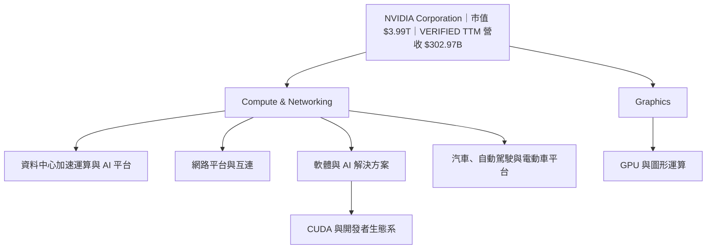
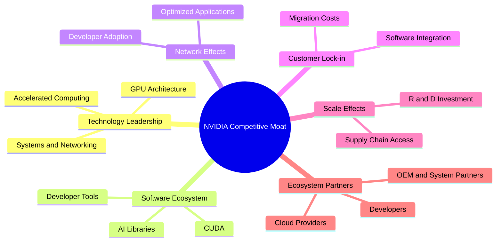
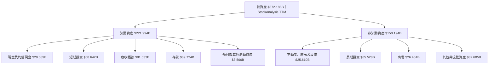
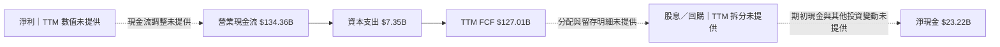
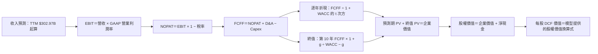
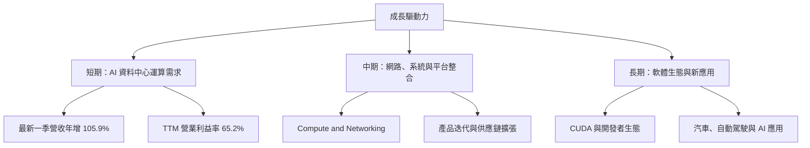
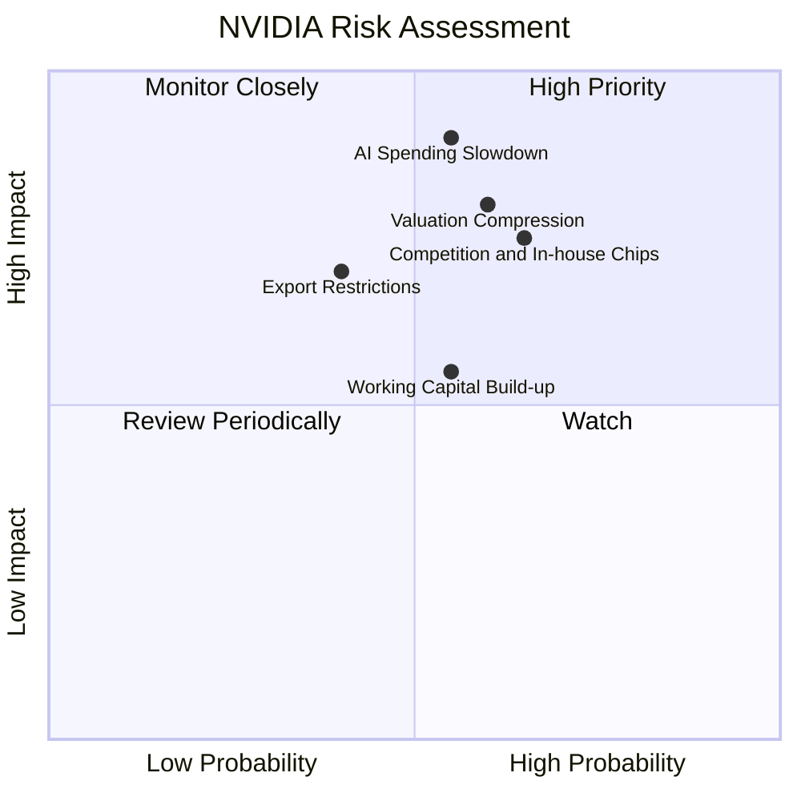
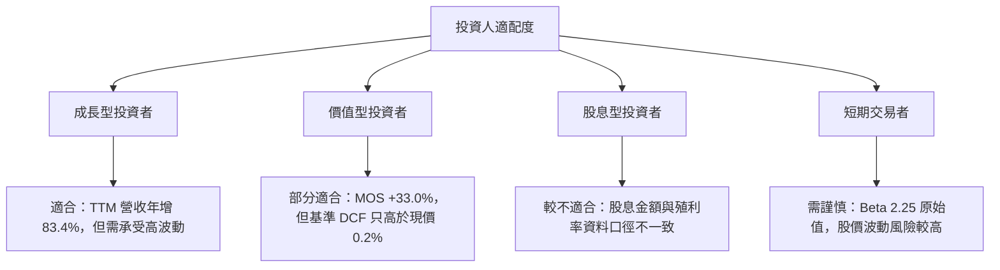

# NVDA 基本面深度分析報告
> **報告日期**：2026-11-24 ｜ **語言**：繁體中文 ｜ **數據來源**：SEC 申報資料 (XBRL)、Yahoo Finance、Finviz、StockAnalysis、Roic.ai ｜ **分析師**：CFA 級機構研究

## 目錄

| # | 章節 | 核心結論 |
|---|------|----------|
| 1 | 執行摘要 | 強烈買入；加權合理價值 $246.19；MOS +33.0% |
| 2 | 公司概覽與商業模式 | AI 加速運算平台具生態系統優勢，細分收入占比未提供 |
| 3 | 損益表深度分析 | TTM 營收 $302.97B、TTM 年增 83.4%；最新一季年增 105.9% |
| 4 | 資產負債表分析 | 淨現金 $23.22B；營運資金週期較一年前拉長 |
| 5 | 現金流量深度分析 | TTM FCF $127.01B，FCF Yield 3.19% |
| 6 | 獲利能力與資本效率 | ROIC 80.6% 高於 WACC 13.96%，價值創造幅度大 |
| 7 | 相對估值分析 | 同業倍數支持部分上行，但公司自身歷史估值偏高 |
| 8 | DCF 內在價值評估 | 基準 DCF $165.30；加權合理價值 $246.19 |
| 9 | 成長催化劑 | AI 計算需求、平台迭代與軟體生態為主要驅動 |
| 10 | 風險矩陣 | 需求／競爭、出口限制、估值與營運資金為關鍵風險 |
| 11 | 投資建議 | 強烈買入；依估值方法分散看待目標價，設定量化監控門檻 |

---

## 1. 執行摘要

截至 2026-11-23 收盤價為 **$165.05**。公司 TTM 營收 **$302.97B**、年增 **83.4%**，最新一季營收年增 **105.9%**，TTM 營業利益率 **65.2%**，TTM FCF **$127.01B**；ROIC **80.6%**，高於 WACC **13.96%**。估值模型的加權合理價值為 **$246.19**，按規定 MOS 為 **+33.0%**，因此依 MOS 門檻評級為 **🟢 強烈買入**。但基準 DCF 每股價值僅 **$165.30**，較現價低 **0.2%**；多數加權上行來自同業 Forward P/E 與分析師共識方法，投資結論對相對估值假設較敏感。

### 1.0 一頁式投資儀表板

| 項目 | 內容 |
|------|------|
| **投資論點（3 句）** | ① TTM 營收 $302.97B、年增 83.4%，最新一季年增 105.9%，反映 AI 加速運算需求仍在擴張。② TTM 營業利益率 65.2%、FCF $127.01B，營運規模已轉化為高現金創造能力。③ ROIC 80.6% 對比 WACC 13.96%，但基準 DCF $165.30 幾乎等於現價，估值上行需依賴相對估值與成長延續。 |
| **綜合評分** | **8.7/10**（引用 1.1 評分卡） |
| **財務健康** | 🟢 淨現金 $23.22B，現金與短期投資 $56.59B；但 CCC 由 105 天升至 155 天 |
| **ROIC vs WACC** | **80.6% vs 13.96%**；目前創造股東價值 |
| **FCF 趨勢** | TTM FCF $127.01B；FCF Yield **3.19%** |
| **估值** | Forward P/E **9.94x**（市場資料欄位）｜EV/EBITDA **16.12x**（市場資料欄位）｜FCF Yield **3.19%**。Peer 區塊倍數口徑另見第 7 章 |
| **DCF 內在價值（基準）** | **$165.30**｜現價相對 DCF 折價 **0.2%** |
| **安全邊際（MOS）** | **+33.0%＝($246.19 − $165.05) ÷ $246.19**；🟢 >25% 充足 |
| **預期報酬（基準情境 12M）** | **+0.2%**（基準 DCF 情境 $165.30 相對現價） |
| **關鍵風險（前二）** | AI 資本支出與需求降溫；競爭、客戶自研晶片及出口管制 |
| **評級 + 信心度** | 🟢 **強烈買入**｜信心：中（加權估值與 DCF 基準差距大） |

> **資料口徑提醒：** SEC／程式計算的 VERIFIED TTM 營收為 $302.97B、TTM 營業利益率為 65.2%；其他彙整來源列示營收 $361.81B、TTM 營業利益率 N/A。估值、成長率與本報告核心財務分析優先採用 SEC／程式計算的 VERIFIED 數值，不混用不同期間或不同口徑。

### 1.1 綜合評分卡（全報告唯一）

| 維度 | 評分（1–10） | 主要依據（引用數字與其來源章節） |
|------|--------------|----------------------------------|
| 成長性 | 9.0 | TTM 營收年增 83.4%、最新一季年增 105.9%（第 3 章）；高速成長延續性仍有風險 |
| 獲利能力 | 10.0 | TTM 營業利益率 65.2%、ROIC 80.6%、F-Score 5/9（第 3、6 章） |
| 財務健康 | 8.0 | 淨現金 $23.22B、現金及短期投資 $56.59B；CCC 增至 155 天（第 4 章） |
| 估值 | 7.0 | MOS +33.0%，但 P/E、P/S、EV/EBITDA 均高於公司五年中位數（第 7、8 章） |
| 護城河 | 9.0 | TTM 毛利率 74.9%、營業利益率 65.2%；軟體、開發者工具及平台黏著度提供差異化（第 2 章） |
| 管理層與資本配置 | 8.0 | FY2026 SBC $6.39B、稀釋股數測試通過；股息支出相對現金流小（第 3、5 章） |
| **綜合評分** | **8.5** | 六項算術平均：(9+10+8+7+9+8) ÷ 6 = 8.5 |

### 1.2 五大投資論點 + 三大核心風險

| 類型 | 項目 | 具體依據 | 信心度 |
|------|------|----------|--------|
| 🟢 **投資論點①** | AI 加速運算需求仍高 | TTM 營收 $302.97B、年增 83.4%；最新一季年增 105.9% | 🟢 高 |
| 🟢 **投資論點②** | 高營業槓桿與盈利能力 | TTM 營業利益率 65.2%，最新一季為 66.2% | 🟢 高 |
| 🟢 **投資論點③** | 現金流轉換能力強 | TTM OCF $134.36B、Capex $7.35B、FCF $127.01B | 🟢 高 |
| 🟢 **投資論點④** | 高資本報酬 | ROIC 80.6% 對比 WACC 13.96%，差距 66.64 個百分點 | 🟢 高 |
| 🟢 **投資論點⑤** | 資產負債表保有淨現金 | 淨現金 $23.22B，為新產品、供應鏈與研發提供財務彈性 | 🟢 高 |
| 🟡 **風險①** | 成長率自高基期下滑 | DCF 假設營收成長由第 1 年 30.0% 逐步降至第 10 年 3.0%；若比預期更快減速，估值下修 | 🟡 中 |
| 🔴 **風險②** | 營運資金惡化 | DSO 由 61 天升至 76 天、DIO 由 110 天升至 150 天、CCC 升至 155 天 | 🔴 中高 |
| 🔴 **風險③** | DCF 與相對估值訊號分歧 | DCF $165.30、加權合理價值 $246.19；合理價值高度依賴同業倍數及共識目標 | 🔴 高 |

### 1.3 快速統計卡片

| 指標 | 公司實際值（期間） | 同業中位數 | 狀態 |
|------|--------------------|------------|------|
| 營收成長（TTM） | **83.4%** | — | 🟢 |
| 營收成長（最新一季年增） | **105.9%** | **85.5%** | 🟢 |
| 毛利率（TTM） | **74.9%** | **56.0%**（AMD、AVGO、INTC 中位數） | 🟢 |
| 營業利益率（TTM） | **65.2%** | — | 🟢 |
| ROIC（TTM） | **80.6%** | — | 🟢 |
| Forward P/E | **9.94x**（市場資料欄位） | **25.7x**（Peer multiples 中位數） | 🟢* |
| FCF Yield（TTM） | **3.19%** | — | 🟡 |
| Piotroski F-Score | **5 / 9** | — | 🟡 |

\* Forward P/E 來源欄位口徑存在差異；第 7 章依指定 Peer multiples 對比時，NVDA 的公司 Forward P/E 欄位未在 Peer multiples 區塊列示，故不將兩種口徑直接當作完全可比。

### 1.4 投資結論

╔══════════════════════════════════════════════════════════════════╗  
║                    📊 投資結論摘要                               ║  
╠══════════════════════════════════════════════════════════════════╣  
║  評級：強烈買入（依 MOS 門檻；ROIC 80.6% 高於 WACC 13.96%）     ║  
║  價格（2026-11-23 收盤）：$165.05                                ║  
║  DCF 內在價值（基準）：$165.30（現價折價 0.2%）                 ║  
║  安全邊際 MOS：+33.0%（＝(加權合理價值−現價)÷加權合理價值）   ║  
║  加權合理價值（8.8）：$246.19                                    ║  
║  DCF 情境價值：                                                   ║  
║    悲觀情境：$75.25（−54.4%）                                    ║  
║    基準情境：$165.30（+0.2%）                                    ║  
║    樂觀情境：$340.38（+106.2%）                                  ║  
║  綜合評分：8.5/10（引用 1.1）                                    ║  
║  適合投資人：能承受高波動、相信 AI 加速運算長期需求的成長型投資人║  
╚══════════════════════════════════════════════════════════════════╝

---

## 2. 公司概覽與商業模式

### 2.1 業務結構與收入來源

NVIDIA 以 Compute & Networking 與 Graphics 兩個主要報告分部營運。現有資料沒有分部營收及占比，因此不臆估各分部金額或畫比例圖。

分部占比、軟體訂閱收入與各產品線毛利資料未提供。可確認的商業模式是以 GPU／加速運算硬體為基礎，搭配網路、系統與軟體工具提供整合式平台；若軟體生態能延長客戶使用週期，收入的持續性及轉換成本會高於單純硬體銷售。

### 2.2 市場份額

市場份額的可引用數字與年份未提供，因此不繪製市場份額圖。以營收規模觀察，NVDA TTM 營收 $302.97B、年增 83.4%，最新一季年增 105.9%；Peer multiples 資料中的 AMD 最新一季年增 44.7%、Broadcom 85.5%。這顯示 NVIDIA 的成長速度高於部分直接競爭者，但不足以單憑營收增速推導市場份額。

### 2.3 競爭護城河分析

### 2.4 護城河強度

| 護城河項目 | 強度（強／中／弱） | 證據（引用數字或事實） | 會削弱它的情況 |
|------------|--------------------|------------------------|----------------|
| 技術與產品迭代 | 強 | 最新一季營業利益率 66.2%；大量研發與系統化產品提供定價及整合能力 | 競爭者性能／能效快速追上，或新平台延遲 |
| 軟體生態系 | 強 | CUDA 與 AI 開發工具形成軟硬體協同；軟體收入金額未提供 | 開源替代工具降低遷移成本 |
| 客戶鎖定 | 中強 | 客戶轉換需重新驗證程式、模型與系統配置；轉換成本未有直接量化資料 | 大型雲端客戶發展自研晶片或採用多供應商架構 |
| 規模與研發 | 強 | FY2026 研發支出 $18.50B，為持續研發與產品迭代提供資源 | 研發投入邊際回報下降、供應鏈瓶頸 |
| 生態夥伴 | 中強 | 業務涵蓋資料中心、網路、軟體、汽車平台；合作夥伴數量未提供 | 重要供應商／雲端夥伴轉向替代方案 |

1.1 護城河評分為 **9.0/10**，主要依據是高獲利率與軟硬體平台整合；但市場份額與軟體收入占比未提供，故不評為滿分。

---

## 3. 損益表深度分析

### 3.1 年度收入成長趨勢（近 4 年）

下表採年度損益表資料，並以提供的年度營收計算年度年增率；期間與 TTM 口徑不同。

╔══════════════════════════════════════════════════════════════════╗  
║              NVIDIA 年度收入趨勢（FY2023–FY2026）                ║  
╠══════════════════════════════════════════════════════════════════╣  
║  FY2023  $26.97B   ██░░░░░░░░░░░░░░░░░░░░░░  YoY：前期資料有限 ║  
║  FY2024  $60.92B   ██████░░░░░░░░░░░░░░░░░░  YoY：+125.9% 🟢   ║  
║  FY2025  $130.50B  █████████████░░░░░░░░░░░  YoY：+114.2% 🟢   ║  
║  FY2026  $215.94B  ██████████████████████░░  YoY：+65.5% 🟢    ║  
╠══════════════════════════════════════════════════════════════════╣  
║  FY2023–FY2026 收入 CAGR：約 100.1%                               ║  
╚══════════════════════════════════════════════════════════════════╝

三年 CAGR 算式：\((215.94 ÷ 26.97)^{1/3} − 1 \approx 100.1\%\)。FY2026 年增率回落至 65.5%，仍屬高成長，但代表基期擴大後增速正常化；TTM VERIFIED 營收年增 83.4%，高於 FY2026 年增率，反映後續季度需求再度加速。

### 3.2 季度收入趨勢分析

| 季度 | 營收（$B） | QoQ | YoY | 備註 |
|------|------------:|----:|----:|------|
| FY2026 Q3 | 57.006 | +22.0% | +62.5% | 對比 FY2026 Q2 與 FY2025 Q3 |
| FY2026 Q4 | 68.127 | +19.5% | +73.2% | 對比 FY2026 Q3 與 FY2025 Q4 |
| FY2027 Q1 | 81.615 | +19.8% | +85.2% | 對比 FY2026 Q4 與 FY2026 Q1 |
| FY2027 Q2 | 96.221 | +17.9% | +105.9% | SEC 最新季度；YoY 為 VERIFIED 單季年增率 |

QoQ 增幅從約 22% 降至約 18%，但單季 YoY 擴至 105.9%，表示營收仍在高基數上增長。連續季度的營收增加可支持營業槓桿，但客戶資本支出若轉弱，季度增速仍可能迅速回落。

### 3.3 利潤率演變分析

年度毛利率、營業利益率與淨利率依年度收入與利潤計算；TTM 核心指標則採 VERIFIED 數值。

| 利潤率指標 | FY2023 | FY2024 | FY2025 | FY2026 | 趨勢 | 評估 |
|------------|-------:|-------:|-------:|-------:|------|------|
| **毛利率** | 56.9% | 72.7% | 75.0% | 71.1% | FY2025 上升，FY2026 回落 | 🟢 |
| **營業利益率** | 20.7% | 54.1% | 62.4% | 60.4% | 規模擴張後高位小幅回落 | 🟢 |
| **淨利率** | 16.2% | 48.8% | 55.8% | 55.6% | 快速擴張後趨穩 | 🟢 |

年度毛利率由 FY2024 的 72.7% 升至 FY2025 的 75.0%，顯示產品組合、定價與規模帶來改善；FY2026 回落至 71.1%，可能反映新產品爬坡與產品組合變動，但具體產品成本拆分未提供。相較年度 FY2026 營業利益率 60.4%，VERIFIED TTM 營業利益率為 65.2%，表示最近 TTM 營運槓桿較完整財年更高。兩者期間不同，不應視為同一指標的矛盾值。

### 3.4 費用結構分析

年度費用明細未提供完整銷售、管理與研發分項；已提供的 FY2026 研發支出為 **$18.50B**，營收為 **$215.94B**，研發占營收約 **8.6%**（$18.50B ÷ $215.94B）。由於其他主要費用項目及完整費用結構比例不齊全，不繪製費用結構圓餅圖，以免將缺漏項目臆估為比例。

### 3.5 季度 EPS 趨勢與盈餘品質（Quality of Earnings）

EPS 歷史表中估值欄缺失，因此無法判斷最近四季是否「超預期／不及預期」。可核對的單季 EPS 及年增率如下：

| 季度 | 實際 EPS | EPS YoY | 超預期／不及預期 |
|------|---------:|--------:|------------------|
| FY2026 Q3 | $1.30 | +66.7% | N/A（EPS 預期值未提供） |
| FY2026 Q4 | $1.77 | +95.6% | N/A（EPS 預期值未提供） |
| FY2027 Q1 | $2.40 | +214.5% | N/A（EPS 預期值未提供） |
| FY2027 Q2 | $2.47 | +127.8% | N/A（EPS 預期值未提供） |

EPS 絕對值持續上升，但年增率受比較基期與不同資料源影響。另一份季度資料列示 FY2027 Q2 EPS $2.46，與 StockAnalysis $2.47 有小幅差異；本節保留來源列示值，不將其當作預期盈餘驚喜。

| 盈餘品質項目 | 數值／佔比 | 評估 |
|--------------|-----------|------|
| 股權薪酬 SBC / 營收 | FY2026：$6.39B ÷ $215.94B = **約 3.0%** | 🟡 SBC 不低，對長期股東回報有稀釋成本；此為年度比率，非 TTM |
| SBC / 營業現金流 | FY2026：$6.39B ÷ $102.72B = **約 6.2%** | 🟢 相對 OCF 佔比可控，但 SBC 仍是股東經濟成本 |
| FCF / 淨利（現金轉換率） | FY2026：$96.68B ÷ $120.07B = **約 80.5%** | 🟡 有現金支持，但低於 100%；本數值為 FY2026 年度 |
| 一次性／非經常性損益 | 明細未提供 | N/A（無法確認是否有重大一次性項目） |
| 有效稅率異常 | **15.1%**（最新年度有效稅率） | 🟢 DCF 採用此值；缺少歷年同口徑拆分，不能判定稅率是否異常 |
| 資本化支出 vs 費用化 | TTM Capex $7.35B；FY2026 研發費用 $18.50B | 🟢 有資本支出與研發費用資料，但資本化政策細項未提供 |

**盈餘品質結論：** TTM OCF $134.36B、FCF $127.01B，且 FY2026 淨利 $120.07B、FCF $96.68B，支持盈餘有實質現金流承托。SBC 已計入 GAAP 費用，但其年度金額 $6.39B 仍代表股東被稀釋或公司需回購抵銷的經濟成本；估值時不宜把 SBC 視為免費資本。

---

## 4. 資產負債表分析

### 4.1 資產結構分解

較新的完整資產負債表彙整數據與 SEC VERIFIED 現金／債務口徑並非同一期間，以下結構圖只呈現 StockAnalysis 的 TTM 資產項目，不用於替換本報告的 VERIFIED 淨現金。

### 4.2 流動性與營運資金分析

| 指標 | 最新 TTM | 一年前 TTM | 變化 | 解讀 |
|------|---------:|-----------:|-----:|------|
| DSO 應收帳款天數 | 76 天 | 61 天 | +15 天 | 收款天數增加，應追蹤應收帳款成長是否持續快於營收 |
| DIO 存貨天數 | 150 天 | 110 天 | +40 天 | 庫存週轉放慢，可能與新品備貨、供應鏈及需求預期有關；若出貨不及預期，可能增加減值風險 |
| DPO 應付帳款天數 | 72 天 | 66 天 | +6 天 | 付款天數上升，部分抵銷應收與庫存增加造成的資金占用 |
| CCC 現金轉換週期 | 155 天 | 105 天 | +50 天 | 營運資金占用顯著增加，雖仍有高 FCF，仍是重要監控項目 |

流動性指標的歷史序列未提供；以 VERIFIED 淨現金 $23.22B、現金與短期投資 $56.59B、總債務 $33.37B 衡量，流動性緩衝充足。營運資金天數採 QUALITY FIGURES 原值，未重新推算。

### 4.3 債務結構分析

╔══════════════════════════════════════════════════════════════════╗  
║                   NVIDIA 債務健康診斷                            ║  
╠══════════════════════════════════════════════════════════════════╣  
║  總債務：        $33.37B｜SEC／程式計算 VERIFIED                 ║  
║  現金＋短期投資：$56.59B｜SEC／程式計算 VERIFIED                 ║  
║  淨現金：        $23.22B｜🟢 現金高於總債務                     ║  
║  ROIC：          80.6%｜高於 WACC 13.96%                         ║  
║  Debt/EBITDA：   N/A（未提供可一致配對的 VERIFIED EBITDA）       ║  
║  Interest Coverage：N/A（利息費用與可比 EBIT 未完整提供）       ║  
╚══════════════════════════════════════════════════════════════════╝

其他來源列示現金及約當現金 $97.73B、總債務 $38.15B；與 SEC VERIFIED 的 $56.59B 現金及短期投資、$33.37B 債務存在期間或分類差異，因此本節依規則以 VERIFIED 數字為主，不混算。

### 4.4 股東權益趨勢

╔══════════════════════════════════════════════════════════════════╗  
║                 NVIDIA 股東權益歷年變化（年度）                   ║  
╠══════════════════════════════════════════════════════════════════╣  
║  FY2023  $22.10B  ███░░░░░░░░░░░░░░░░░░░░░                      ║  
║  FY2024  $42.98B  ██████░░░░░░░░░░░░░░░░                         ║  
║  FY2025  $79.33B  ████████████░░░░░░░░░                         ║  
║  FY2026  $157.29B ████████████████████████                       ║  
╚══════════════════════════════════════════════════════════════════╝

FY2023 至 FY2026 股東權益大幅增加，與獲利累積和資產規模擴張一致；同期間股東權益成長也提高 ROE 分母，需配合獲利成長一起觀察，不能只以 ROE 高低判斷資本效率。

---

## 5. 現金流量深度分析

### 5.1 現金流量瀑布圖

TTM 淨利未在 VERIFIED 區塊提供，股息與回購的 TTM 拆分也不完整，故瀑布圖不填入未提供數值。

### 5.2 FCF 轉換率趨勢

| 財年 | OCF（$B） | Capex（$B） | FCF（$B） | 淨利（$B） | FCF／淨利 |
|------|----------:|------------:|----------:|-----------:|----------:|
| FY2023 | 5.64 | 1.83 | 3.81 | 4.37 | 87.2% |
| FY2024 | 28.09 | 1.07 | 27.02 | 29.76 | 90.8% |
| FY2025 | 64.09 | 3.24 | 60.85 | 72.88 | 83.5% |
| FY2026 | 102.72 | 6.04 | 96.68 | 120.07 | 80.5% |

年度 FCF 轉換率由 FY2024 的 90.8% 降至 FY2026 的 80.5%，仍有大量現金流生成，但獲利增長快於自由現金流的可能性值得追蹤。TTM VERIFIED FCF 為 $127.01B；不與年度比率混為一談。

### 5.3 自由現金流趨勢

╔══════════════════════════════════════════════════════════════════╗  
║                 NVIDIA 自由現金流趨勢                             ║  
╠══════════════════════════════════════════════════════════════════╣  
║  FY2023  $3.81B   █░░░░░░░░░░░░░░░░░░░░░░  FCF Yield：N/A      ║  
║  FY2024  $27.02B  ██████░░░░░░░░░░░░░░░░░░  FCF Yield：N/A      ║  
║  FY2025  $60.85B  ████████████░░░░░░░░░░░░  FCF Yield：N/A      ║  
║  FY2026  $96.68B  ██████████████████░░░░░░  FCF Yield：N/A      ║  
║  TTM     $127.01B ████████████████████████  FCF Yield：3.19%    ║  
╚══════════════════════════════════════════════════════════════════╝

年度 FCF Yield 未提供相同年度市值序列，故不自行計算。TTM FCF 由 OCF $134.36B 減 Capex $7.35B 得 $127.01B；低資本支出強度有助於現金流，但庫存和應收天數上升可能增加未來資金需求。

### 5.4 資本配置評估

FY2026 股息支付為 $0.974B、資本支出 $6.04B、SBC $6.39B；TTM Capex 為 $7.35B。回購金額、長期投資與留存現金的同期間完整分配數據未提供，因此不繪製資本配置圓餅圖。

| 項目 | 可用數據 | 評估 |
|------|----------|------|
| 資本支出 | TTM $7.35B；FY2026 $6.04B | 相對 TTM OCF $134.36B 不高，但不代表未來資料中心供應鏈投資沒有增加 |
| 股息 | FY2026 支付 $0.974B | 相對獲利與現金流規模小；分析師資料中的股息殖利率 80.0% 不合理且與其他資料不一致，不採用 |
| 股權薪酬 | FY2026 $6.39B | 佔 FY2026 營收約 3.0%，須視為股東成本 |
| 回購／其他投資 | 金額未提供 | N/A；不反推 |

---

## 6. 獲利能力與資本效率

### 6.1 ROE／ROA／ROIC 趨勢

| 指標 | 最新 TTM | 歷史趨勢資料 | 評估 |
|------|---------:|--------------|------|
| ROE | 84.2%（VERIFIED QUALITY） | VERIFIED 區塊未提供同口徑歷年序列；其他來源列示 117.4% | 🟢 高，但來源口徑不同，不混用 |
| ROA | N/A（VERIFIED 區塊未列精確值） | 其他來源列示 56.0% | 🟡 不以另一來源數值替代 VERIFIED |
| ROIC | 80.6%（VERIFIED） | 歷年同口徑序列未提供 | 🟢 顯著高於資本成本 |

行業均值未提供，故不列同業平均。ROE、ROA 的彙整來源有口徑差異，評價資本效率時以提供的 VERIFIED ROIC 為核心。

### 6.2 ROIC vs WACC 分析（核心價值創造判斷）

╔══════════════════════════════════════════════════════════════════╗  
║                ROIC vs WACC 深度分析                              ║  
╠══════════════════════════════════════════════════════════════════╣  
║  WACC（程式計算，詳見 8.2）：                                    ║  
║  ├── 無風險利率（10Y 美債）：4.92%                               ║  
║  ├── 市場風險溢酬 ERP：5.00%                                     ║  
║  ├── 調整後 Beta：1.83（原始 Beta 2.25）                         ║  
║  ├── 股權成本 Ke：14.07%                                         ║  
║  ├── 稅前債務成本：0.78%；稅後約 0.66%                           ║  
║  ├── 資本權重：股權 99.2%，債務 0.8%                             ║  
║  └── ✅ WACC：13.96%                                              ║  
║                                                                  ║  
║  ROIC（TTM）：80.6%                                               ║  
║  EVA 利差＝ROIC − WACC＝80.6% − 13.96%＝66.64 個百分點           ║  
║  ROIC／WACC＝80.6% ÷ 13.96%＝約 5.77 倍                         ║  
║                                                                  ║  
║  📊 結論：目前 ROIC 顯著高於資本成本，創造股東價值；             ║  
║  但若高利潤率與資本回報不可持續，價值創造幅度會收斂。             ║  
╚══════════════════════════════════════════════════════════════════╝

ROIC 80.6% 對比 WACC 13.96%，利差 **66.64 個百分點**。這是基於當前獲利與資本投入結構的觀察，不代表未來回報必然維持；AI 產品競爭、客戶自研與價格變化可能降低未來 ROIC。

### 6.3 杜邦三因素分解

| 因素 | 數值（TTM） | 解讀 |
|------|-------------|------|
| 淨利率 | 63.7% | 獲利能力為 ROE 的主要來源 |
| 資產週轉率 | 0.95 | 每單位資產產生的營收高；應收及庫存增加使週轉效率需留意 |
| 權益乘數 | 1.40 | 財務槓桿非主要驅動 |
| **ROE** | **84.2%** | 63.7% × 0.95 × 1.40 = 84.2% |

依 QUALITY FIGURES 原值，ROE 主要由高淨利率驅動，而非高槓桿；乘積因四捨五入可能有微小差異。

### 6.4 財務體質：Piotroski F-Score

| 測試 | 結果 | 解讀 |
|------|------|------|
| ROA > 0 | ✅ 通過 | 公司有正獲利 |
| 營業現金流 > 0 | ✅ 通過 | 營運產生正現金 |
| ROA 高於一年前 | ❌ 未通過 | 相對前期沒有改善 |
| 營業現金流 > 淨利（應計品質） | ❌ 未通過 | 營業現金流未高於淨利，應計品質測試未過 |
| 長期負債 ÷ 總資產低於一年前 | ❌ 未通過 | 此項比率未改善 |
| 流動比率高於一年前 | ✅ 通過 | 流動性指標改善 |
| 稀釋股數未增加 | ✅ 通過 | 股數變化測試通過 |
| 毛利率高於一年前 | ✅ 通過 | 毛利率相對改善 |
| 資產週轉率高於一年前 | ❌ 未通過 | 資產使用效率測試未過 |

**Piotroski F-Score：5/9。** 通過項目包括正獲利、正營業現金流、流動比率改善、稀釋股數未增加及毛利率改善；未通過項目提醒投資人，盈利增長不等於所有資產效率與應計品質指標同步改善。

---

## 7. 相對估值分析

### 7.1 同業估值比較表格

同業倍數使用 Yahoo Finance Peer multiples。NVDA 的該區塊沒有列出可直接配對的 P/E、P/S、EV/EBITDA 公司值；下表保留缺值，另列市場資料欄位的 NVDA 倍數時明確標示不同來源口徑。

| 估值指標 | **NVDA** | **AMD** | **AVGO** | **INTC** | 本公司評估 |
|----------|---------:|-------:|--------:|--------:|-----------|
| **Trailing P/E** | 13.48x（市場彙整欄位；Peer 欄未列） | 96.9x | 40.0x | N/A | 🔴 來源口徑不一致，不能直接比較 |
| **Forward P/E** | 9.94x（市場彙整欄位；Peer 欄未列） | 25.7x | 16.2x | 33.3x | 🟡 Peer 中位數為 25.7x；NVDA 數值口徑須核實 |
| **P/S（TTM）** | 11.02x（市場彙整欄位；Peer 欄未列） | 16.5x | 16.8x | 5.3x | 🟡 NVDA 彙整值低於 AMD、AVGO，高於 INTC |
| **EV/EBITDA（TTM）** | 16.12x（市場彙整欄位；Peer 欄未列） | 66.2x | 29.3x | 17.2x | 🟢 NVDA 彙整值低於同業，但口徑需注意 |
| **最新一季營收年增** | 105.9% | 44.7% | 85.5% | 20.9% | 🟢 高於列示同業 |
| **毛利率（TTM）** | 74.9%（彙整來源） | 56.0% | 75.5% | 40.2% | 🟢 接近 AVGO，明顯高於 AMD、INTC |

估值欄位間有明顯口徑差異：VERIFIED 自身歷史估值的 P/E 為 20.9x、而市場彙整欄位列 13.48x；本報告不把其中一個替換成另一個。Peer multiples 的主要用途依指定估值方法計算同業中位倍數，而非用來源不一致的現價倍數作過度精確的橫向結論。

### 7.2 歷史估值區間分析

╔══════════════════════════════════════════════════════════════════╗  
║              NVDA 五年 P/E 歷史區間（TTM）                        ║  
╠══════════════════════════════════════════════════════════════════╣  
║  低點 2.3x ───────── 中位數 11.3x ───────── 現在 20.9x ── 高點 49.3x║  
║                                         ↑ 百分位排名：71%       ║  
║  判讀：目前高於五年中位數，估值要求盈利持續增長。                 ║  
╚══════════════════════════════════════════════════════════════════╝

| 倍數 | 現在 | 五年中位數 | 五年區間 | 現在百分位 |
|------|-----:|-----------:|---------:|-----------:|
| P/E | 20.9x | 11.3x | 2.3x–49.3x | 71% |
| P/S | 13.2x | 2.7x | 1.2x–31.0x | 57% |
| EV/EBITDA | 19.8x | 8.9x | 3.4x–47.8x | 57% |

### 7.3 情境價值（Bear / Base / Bull）

| 情境 | 第 1 年營收成長 | 期末營業利潤率 | WACC | 每股價值 | 相對現價 | 機率 | 會發生的條件 |
|------|----------------:|---------------:|-----:|---------:|---------:|-----:|--------------|
| 🔴 悲觀 | 15.0% | 51.3% | 14.96% | $75.25 | −54.4% | 25% | 資料中心支出放緩、競爭壓低毛利或出口限制加劇 |
| 🟡 基準 | 30.0% | 60.4% | 13.96% | $165.30 | +0.2% | 50% | 成長逐年降至成熟期，營業利潤率緩步收斂 |
| 🟢 樂觀 | 45.0% | 66.4% | 12.96% | $340.38 | +106.2% | 25% | AI 計算需求超預期、產品迭代與生態系維持定價能力 |

機率加權 DCF 價值為 **$186.56**（+13.0%），僅作情境參考；第 8.8 節規定的加權合理價值仍以各估值方法固定權重計算。

### 7.4 相對估值隱含價格區間

╔══════════════════════════════════════════════════════════════════╗  
║                 相對估值方法與當前股價                             ║  
╠══════════════════════════════════════════════════════════════════╣  
║  悲觀 DCF $75.25 ─ 現價 $165.05 ─ EV/EBITDA $194.99               ║  
║                         ─ 分析師共識 $244.55 ─ Forward P/E $427.45║  
╚══════════════════════════════════════════════════════════════════╝

| 方法 | 每股價值 | 相對現價 | 方法依據 |
|------|---------:|---------:|----------|
| 同業 Forward P/E | $427.45 | +159.0% | AMD、AVGO、INTC Peer Forward P/E 中位數 25.7x × Forward EPS $16.61 |
| 同業 EV/EBITDA | $194.99 | +18.1% | AVGO、INTC Peer EV/EBITDA 中位數 23.3x × TTM EBITDA，加回淨現金 |
| 分析師共識目標價 | $244.55 | +48.2% | 57 位分析師平均目標價 |

同業 Forward P/E 得出的價格遠高於 DCF；它隱含市場持續給予高成長半導體公司較高估值的前提。EV/EBITDA 結果較保守，但仍高於基準 DCF。

---

## 8. DCF 內在價值評估（Discounted Cash Flow）

### 8.0 估值推理鏈（Thinking Logic）

**Step 1 — 價值由哪些變數決定？**  
模型將公司價值主要連結到現有加速運算、網路與 AI 平台產生的現金流，以及軟體與汽車等延伸業務的未來成長選擇權；各分部占比未提供，故不能量化各業務收入份額。模型中最能主導價值的變數是長期營收成長與折現率，終值現值占 EV 44.5%，因此長期成長與 WACC 假設對結果重要。

**Step 2 — 模型選擇**

| 決策點 | 本報告採用 | 理由（含數字） | 曾考慮但否決 | 否決理由 |
|--------|-----------|----------------|--------------|----------|
| 現金流定義 | FCFF | 與 WACC 折現、先算 EV 再加淨現金的邏輯一致 | FCFE | 會直接受融資與資本結構變動影響 |
| 預測期 N | 10 年 | 模型固定 10 年；用於表達高速成長逐步成熟的過渡 | 5 年 | 無法充分表達成長率由 30% 漸降至 3% 的模型設定 |
| 終值方法 | Gordon Growth | 模型提供永續成長率 3.0% 及對應終值 | 退出倍數 | DCF 模型未提供終值退出倍數，不能另建假設 |
| EBIT 基礎 | GAAP EBIT | 模型明確採 GAAP，SBC 已經費用化 | 非 GAAP EBIT | 加回 SBC 會改變程式模型假設 |

**Step 3 — 關鍵假設推導鏈**

- **營收成長路徑**：錨點＝TTM 營收年增 83.4%、最新一季年增 105.9% → 調整＝高基期、產業成熟與競爭使其逐年降速 → **採用第 1 年 30.0%、第 10 年 3.0%，線性遞減** → 否決將 83.4% 長期外推，因這會忽略高基期及產業成熟。
- **期末營業利潤率**：錨點＝TTM 營業利益率 65.2% → 調整＝模型假定利潤率向近五個財年中位數收斂 → **第 1 年 65.2%、第 10 年 60.4%** → 否決長期固定 65.2%，因競爭與產品組合可能造成利潤率正常化。
- **永續成長率 g**：錨點＝模型輸入 3.0% → 調整＝假定成熟期仍能略高於零實質成長，但需低於 WACC → **採用 3.0%** → 否決高於 3.0% 的輸入，以免把成熟企業長期增長設得過高；本值為模型假設，非管理層財測。
- **預測期 N**：錨點＝模型設定 10 年；公司過去年度營收成長高，但未提供足以估計護城河持續期限的管理層財測 → **採用 10 年** → 否決僅用短週期預測，因模型已將成長率逐年衰減至 3%。
- **Capex／營收**：錨點＝TTM Capex $7.35B ÷ TTM 營收 $302.97B，約 2.4% → 調整＝模型假設資本支出比率向 1.1 倍 D&A 收斂 → **第 1 年 2.4%、第 10 年 1.3%** → 否決固定在 2.4%，因模型預期長期資本密集度下降。
- **EBIT 與 SBC**：錨點＝模型採 GAAP EBIT，SBC 已經在 GAAP 費用內；FY2026 SBC $6.39B → **固定股數、FCFF 不再扣 SBC、年稀釋率 0%** → 否決非 GAAP 加回 SBC 後再以固定股數計算，因那會漏掉股東成本。
- **年稀釋率**：採模型的 **0%**；這不是對實際未來股數的預測，而是與 GAAP EBIT 已包含 SBC 成本的模型組合相容。若另加年稀釋率，將改變程式給定模型。
- **終值方法**：錨點＝DCF 模型提供 Gordon Growth 終值 → **採用 Gordon Growth** → 否決自行挑選退出倍數，因模型未提供該項輸入。
- **WACC**：錨點＝Cost of capital 指定 WACC 13.96% → **照用 13.96%** → 不另行估算其他 WACC，以維持與第 6.2 節及模型一致。

**Step 4 — 最脆弱環節**  
最脆弱的是第 1 年 30% 成長及其後的降速路徑；悲觀情境下，較低的第 1 年成長與期末利潤率、較高 WACC 將每股價值降至 **$75.25**，顯示估值對成長和利潤率落差敏感。

**Step 5 — 計算路徑**

### 8.1 模型假設總表（Model Inputs）

| 假設項目 | 採用值 | 依據／來源 | 敏感度 |
|----------|--------|------------|--------|
| 預測期長度 N | 10 年 | DCF MODEL 固定輸入 | 🟡 中 |
| 營收成長路徑 | 第 1 年 30.0% → 第 10 年 3.0%，線性遞減 | TTM 年增 83.4%；由高成長向成熟期收斂 | 🔴 高 |
| 營業利潤率 | 第 1 年 65.2% → 第 10 年 60.4% | TTM 營業利益率及近五財年中位數 | 🔴 高 |
| 有效稅率 | 15.1% | 最新年度有效稅率 | 🟢 低 |
| Capex／營收 | 第 1 年 2.4% → 第 10 年 1.3% | TTM Capex／收入約 2.4%；模型逐步降至 1.1×D&A | 🟡 中 |
| D&A／營收 | 1.2% | TTM 模型輸入 | 🟢 低 |
| 營運資金變動 | 不建模 | DCF MODEL 明確未建模，ΔWC 為 N/A | 🟡 中 |
| EBIT 基礎 | GAAP | DCF MODEL 指定 GAAP EBIT | 🟡 中 |
| 股權薪酬 SBC 處理 | 不另扣 SBC | GAAP EBIT 已將 SBC 當費用 | 🟡 中 |
| 年稀釋率（股數） | 0% | 固定股數，與模型組合 A 相容 | 🟡 中 |
| 永續成長率 g | 3.0% | DCF MODEL 輸入；低於 WACC | 🔴 高 |
| 終值方法 | Gordon Growth | DCF MODEL 終值假設 | 🔴 高 |
| WACC | 13.96% | Cost of capital 指定值 | 🔴 高 |
| FCFF 定義 | NOPAT + D&A − Capex | DCF MODEL 定義；不含 ΔWC | — |

**SBC 防重複計算：** 本模型採用 **(A) GAAP EBIT + 固定股數**，故 SBC 影響已計入一次；FCFF 不再扣 SBC，股數不另逐年稀釋。

### 8.2 折現率推導（WACC）

╔══════════════════════════════════════════════════════════════════╗  
║                    WACC 推導（折現率）                           ║  
╠══════════════════════════════════════════════════════════════════╣  
║  股權成本 Ke（CAPM）：                                           ║  
║  ├── 無風險利率 Rf（10Y 美債）：4.92%                            ║  
║  ├── 市場風險溢酬 ERP：5.00%（假設值，Cost of capital 輸入）    ║  
║  ├── 原始 Beta：2.25；調整後 Beta：1.83                          ║  
║  ├── Beta 調整：⅔ × 2.25 + ⅓ × 1 = 1.83                         ║  
║  ├── 規模／國別溢酬：0.00%（未另加，依指定資本成本輸入）        ║  
║  └── Ke = 4.92% + 1.83 × 5.00% = 14.07%                         ║  
║                                                                  ║  
║  債務成本 Kd：                                                   ║  
║  ├── 稅前 Kd：0.78%（利息 ÷ 債務，指定輸入）                    ║  
║  ├── 有效稅率：15.1%                                             ║  
║  └── 稅後 Kd = 0.78% × (1 − 15.1%) = 0.66%                     ║  
║                                                                  ║  
║  資本結構權重：                                                   ║  
║  ├── 股權權重 E：99.2%（市場價值權重，指定輸入）               ║  
║  ├── 債務權重 D：0.8%（指定輸入）                               ║  
║  └── ✅ WACC：13.96%                                             ║  
╚══════════════════════════════════════════════════════════════════╝

**逐步演算：**

1. **Ke（CAPM）** = Rf + β × ERP = 4.92% + 1.83 × 5.00% = **14.07%**。
2. **稅前 Kd** = **0.78%**（Cost of capital 提供利息／債務比率；利息費用與平均計息負債原始金額未提供，不能另行重建）。
3. **稅後 Kd** = 0.78% × (1 − 15.1%) = 0.78% × 0.849 = **0.66222%**，四捨五入為 0.66%。
4. **權重** = 股權 99.2%；債務 0.8%；99.2% + 0.8% = **100.0%**。市值及債務的精確配重直接採 Cost of capital 輸入；不以股東權益帳面值替代市值。
5. **WACC** = 99.2% × 14.07% + 0.8% × 0.66222% = 13.95744% + 0.00530% = **13.96274% ≈ 13.96%**。

本報告未自行重算替代 WACC；Rf 的觀察日期及 ERP 的外部來源說明未提供，故沿用程式指定輸入。第 6.2 節亦使用相同 **13.96%**。

### 8.3 逐年自由現金流預測（基準情境）

金額單位為 $B；折現因子取三位小數。DCF MODEL 的每一年度數值原樣引用；因模型指定不建模營運資金，表中不列 ΔWC。

| 年度 | FY+1 | FY+2 | FY+3 | FY+4 | FY+5 | FY+6 | FY+7 | FY+8 | FY+9 | FY+10 |
|------|-----:|-----:|-----:|-----:|-----:|-----:|-----:|-----:|-----:|------:|
| 營收 | 393.86 | 500.20 | 620.25 | 750.50 | 885.59 | 1,018.43 | 1,140.64 | 1,243.30 | 1,317.90 | 1,357.44 |
| 營收 YoY | 30.0% | 27.0% | 24.0% | 21.0% | 18.0% | 15.0% | 12.0% | 9.0% | 6.0% | 3.0% |
| 營業利潤率 | 65.2% | 64.7% | 64.1% | 63.6% | 63.1% | 62.5% | 62.0% | 61.5% | 60.9% | 60.4% |
| 營業利益 EBIT（GAAP） | 256.85 | 323.52 | 397.83 | 477.35 | 558.51 | 636.82 | 707.11 | 764.08 | 802.85 | 819.64 |
| − 稅（15.1%） | (38.83) | (48.91) | (60.14) | (72.16) | (84.43) | (96.27) | (106.89) | (115.51) | (121.37) | (123.91) |
| = NOPAT | 218.02 | 274.61 | 337.69 | 405.19 | 474.08 | 540.55 | 600.22 | 648.57 | 681.48 | 695.74 |
| + D&A | 4.79 | 6.09 | 7.55 | 9.13 | 10.78 | 12.39 | 13.88 | 15.13 | 16.04 | 16.52 |
| − Capex | (9.56) | (11.54) | (13.55) | (15.49) | (17.21) | (18.56) | (19.41) | (19.65) | (19.24) | (18.17) |
| **= FCFF** | **213.26** | **269.16** | **331.68** | **398.82** | **467.65** | **534.39** | **594.69** | **644.05** | **678.28** | **694.09** |
| 折現因子 @13.96% | 0.877 | 0.770 | 0.676 | 0.593 | 0.520 | 0.456 | 0.401 | 0.351 | 0.308 | 0.271 |
| **FCFF 現值 PV** | **187.13** | **207.24** | **224.09** | **236.44** | **243.27** | **243.93** | **238.20** | **226.36** | **209.18** | **187.83** |

預測期現值合計：  
**$187.13 + $207.24 + $224.09 + $236.44 + $243.27 + $243.93 + $238.20 + $226.36 + $209.18 + $187.83 = $2,203.67B**；DCF MODEL 原列合計 **$2,203.68B**，差額 $0.01B，為逐年四捨五入尾差，低於 1%。

**逐步演算（FY+1）：**

1. 營收 = $302.97B × (1 + 30.0%) = **$393.86B**。
2. EBIT = $393.86B × 65.2% = **$256.85B**。
3. 稅 = $256.85B × 15.1% = **$38.83B**。
4. NOPAT = $256.85B − $38.83B = **$218.02B**。
5. D&A = $393.86B × 1.2% = **$4.79B**。
6. Capex = $393.86B × 2.4% = **$9.56B**。
7. ΔWC = **N/A（DCF MODEL 未建模）**。
8. FCFF = $218.02B + $4.79B − $9.56B = **$213.26B**（依模型精度與四捨五入列示）。
9. 折現因子 = 1 ÷ (1 + 13.96%)¹ = **0.877**；PV = $213.26B × 0.877 = **$187.13B**（依模型內部未四捨五入因子）。

**合理性自檢：**
- FY+1 至 FY+10 FCFF CAGR = \((694.09 ÷ 213.26)^{1/9} − 1 \approx 14.0\%\)。FY2023–FY2026 年度 FCF CAGR 約 193.8%，但歷史 CAGR 受低基期急升影響，與成熟後模型 CAGR 不宜直接比較。
- FY+10 FCF 利潤率 = $694.09B ÷ $1,357.44B ≈ **51.1%**；目前 TTM FCF 利潤率 = $127.01B ÷ $302.97B ≈ **41.9%**。同業最佳 FCF 利潤率未提供，不做比較。
- 模型各年 FCFF 均為正；模型沒有納入 ΔWC，若實際營運資金需求上升，實際 FCFF 可能低於預測。

╔══════════════════════════════════════════════════════════════════╗  
║            自由現金流：歷史實際 vs 模型預測                       ║  
╠══════════════════════════════════════════════════════════════════╣  
║  FY2024（實）$27.02B   █░░░░░░░░░░░░░░░░░░░░░  YoY：+609.2%    ║  
║  FY2025（實）$60.85B   ██░░░░░░░░░░░░░░░░░░░░  YoY：+125.2%    ║  
║  FY2026（實）$96.68B   ███░░░░░░░░░░░░░░░░░░░  YoY：+58.9%     ║  
║  TTM（實）  $127.01B  ████░░░░░░░░░░░░░░░░░░  FCF Yield：3.19%║  
║  FY+1（預） $213.26B  ███████░░░░░░░░░░░░░░░  FCFF            ║  
║  FY+10（預）$694.09B  ████████████████████████  FCFF CAGR：14.0%║  
╠══════════════════════════════════════════════════════════════════╣  
║  ⚠️ 預測 CAGR 14.0% 低於低基期歷史 CAGR；歷史比較受基期效應影響。║  
╚══════════════════════════════════════════════════════════════════╝

### 8.4 終值計算（Terminal Value）

**適用性檢查：** WACC **13.96%** vs g **3.0%** → WACC > g？✅

| 方法 | 計算式 | 終值 TV | TV 現值 | 佔總 EV 比重 |
|------|--------|---------:|---------:|-------------:|
| Gordon Growth | 第 10 年 FCFF × (1+g) ÷ (WACC−g) | $6,520.94B | $1,764.66B | 44.5% |
| 退出倍數法 | N/A | N/A（DCF MODEL 未提供終值退出倍數，不能另建模型） | N/A | N/A |

逐步演算：
1. FY+N 的 FCFF = FY+10 **$694.09B**。
2. 分子 = $694.09B × (1 + 3.0%) = **$714.91B**。
3. 分母 = 13.96% − 3.0% = **10.96%**；TV = $714.91B ÷ 10.96% = **$6,520.94B**（模型原值；未四捨五入輸入與顯示位數造成尾差）。
4. PV(TV) = $6,520.94B × 第 10 年內部折現因子 = **$1,764.66B**。
5. 終值占比 = $1,764.66B ÷ $3,968.34B = **44.5%**。

終值未超過 EV 的 75% 警示門檻，但仍佔 44.5%，估值近半取決於預測期之後的假設。

### 8.5 企業價值 → 每股內在價值（Bridge）

╔══════════════════════════════════════════════════════════════════╗  
║              企業價值 → 每股內在價值 橋接表                      ║  
╠══════════════════════════════════════════════════════════════════╣  
║  預測期 FCF 現值合計            +$2,203.68B                       ║  
║  終值現值 PV(TV)                +$1,764.66B                       ║  
║  ─────────────────────────────────────────────                  ║  
║  = 企業價值 EV                   $3,968.34B                       ║  
║  + 淨現金                       +$23.22B                          ║  
║  = 股權價值                      $3,991.56B                       ║  
║  ★ 每股內在價值                  $165.30                          ║  
║    當前股價                      $165.05                          ║  
║    折溢價（現價÷DCF價值−1）      −0.2%（折價）                   ║  
╚══════════════════════════════════════════════════════════════════╝

逐步演算：
1. EV = $2,203.68B + $1,764.66B = **$3,968.34B**。
2. 股權價值 = EV $3,968.34B + 淨現金 $23.22B = **$3,991.56B**。
3. 每股 DCF 價值依模型公式：**股權價值 × 價格 ÷ 市值 = $165.30**。模型指定的完整精度市值與價格換算因子未另列，故採 DCF MODEL 原值，不以四捨五入市場市值反推替代。
4. 折溢價 = $165.05 ÷ $165.30 − 1 = **−0.2%**。
5. 本節不計算 MOS；MOS 僅在 8.8 以加權合理價值為分母計算。

股數採用模型固定股數設定；DCF MODEL 未提供可用於獨立復算的精確稀釋股數。現金與債務淨額依 SEC VERIFIED 數值，為淨現金 $23.22B。每股價值與股權價值的換算遵照模型提供公式，未自行改建每股模型。

### 8.6 敏感性分析（WACC × 永續成長率）

表內每股價值逐格照 DCF MODEL；括號為相對現價 $165.05 的上行／下行空間。

| g（列）／WACC（欄） | 11.96% | 12.96% | **13.96%（基準）** | 14.96% | 15.96% |
|-----------|------:|------:|------------------:|------:|------:|
| **2.0%** | $196.75（+19.2%） | $175.83（+6.5%） | $158.54（−3.9%） | $144.04（−12.7%） | $131.73（−20.2%） |
| **2.5%** | $202.26（+22.5%） | $180.01（+9.1%） | $161.78（−2.0%） | $146.58（−11.2%） | $133.74（−19.0%） |
| **3.0%** | $208.39（+26.3%） | $184.61（+11.9%） | **$165.30（+0.2%）** | $149.33（−9.5%） | $135.91（−17.7%） |
| **3.5%** | $215.24（+30.4%） | $189.70（+14.9%） | $169.17（+2.5%） | $152.32（−7.7%） | $138.26（−16.2%） |
| **4.0%** | $222.96（+35.1%） | $195.36（+18.4%） | $173.42（+5.1%） | $155.58（−5.7%） | $140.80（−14.7%） |

**逐步演算示範格：** 選格 WACC **14.96% > g 3.0% ✅**。  
模型敏感度輸出在該格給出的每股價值為 **$149.33**；該格完整折現後逐年 PV、TV 及橋接中間值未在 DCF MODEL 列示，依「敏感度矩陣原值優先」規則不另造未提供的中間數字。相對現價：($149.33 ÷ $165.05) − 1 = **−9.5%**。

**三情境 DCF**

| 情境 | 營收成長路徑 | 期末營業利潤率 | g | WACC | 每股內在價值 | 相對現價 | 機率 |
|------|--------------|---------------:|---:|-----:|--------------:|---------:|-----:|
| 🔴 悲觀 | 第 1 年 15.0% | 51.3% | DCF MODEL 未另列 | 14.96% | $75.25 | −54.4% | 25% |
| 🟡 基準 | 第 1 年 30.0% | 60.4% | 3.0% | 13.96% | $165.30 | +0.2% | 50% |
| 🟢 樂觀 | 第 1 年 45.0% | 66.4% | DCF MODEL 未另列 | 12.96% | $340.38 | +106.2% | 25% |
| **機率加權** | — | — | — | — | **$186.56** | **+13.0%** | **100%** |

DCF MODEL 未提供悲觀與樂觀情境的逐年營收、FY+10 FCFF 與各自 g，因此不能可靠外推完整的情境算式鏈。模型提供的情境總值與機率照錄；機率加權算式為 **$75.25 × 25% + $165.30 × 50% + $340.38 × 25% = $186.56**（四捨五入）。

**敏感度結論：**  
- g 從 2.0% 升至 3.0%、WACC 固定 13.96%：$158.54 → $165.30，增加 **$6.76／4.3%**。  
- WACC 從 12.96% 升至 13.96%、g 固定 3.0%：$184.61 → $165.30，減少 **$19.31／10.5%**。  
- 期末營業利潤率每 +1pp 的價值變動未提供獨立敏感度矩陣，標記 **N/A**，不自建模型。  
- 已提供的矩陣中，WACC 變動 1 個百分點的影響大於 g 變動 1 個百分點，與 8.0 所指出折現率／長期假設重要的方向一致；營收路徑仍是三情境差異的主要來源之一。

### 8.7 反推 DCF（Reverse DCF：市場在預期什麼）

固定輸入應為基準 WACC 13.96%、稅率 15.1%、D&A／營收 1.2%、Capex 路徑依基準、ΔWC 不建模、N=10 年及固定股數。DCF MODEL 只提供兩項反推結果，其他變數不具備可引用解，不另行疊代。

| 求解的變數（一次一個） | 其餘變數設定 | 市場隱含值（令 DCF = 現價） | 歷史／基準值 | 判斷 |
|------------------------|--------------|------------------------------|--------------|------|
| 第 1 年營收成長 | 其餘基準輸入固定 | 30.0% | 基準假設 30.0%；TTM 成長 83.4% | 🟡 基準假設大致能解釋現價 |
| 固定營業利潤率 | 其餘基準輸入固定 | 61.6% | 模型基準由 65.2% 降至 60.4% | 🟡 低於模型起始利潤率，接近期末值 |
| 永續成長率 g | 未提供反解 | 未計算 | 基準 3.0% | N/A（模型未列反解結果） |
| 預測期長度 N | 未提供反解 | 未計算 | 基準 10 年 | N/A（模型未列反解結果） |

模型提供的逐一反推結論是：**在其餘輸入固定時，現價約隱含第 1 年營收成長 30.0%，或固定營業利潤率 61.6%。**兩項為分開求解，不可同時視為市場預期。逐步試算軌跡未在模型輸出中提供，故不編造中間試算點。

### 8.8 估值三角驗證與安全邊際

| 估值方法 | 隱含每股價值 | 上行空間（÷現價） | 權重 | 說明 |
|----------|--------------:|------------------:|------:|------|
| DCF（基準） | $165.30 | +0.2% | 40% | 10 年 FCFF、WACC 13.96%、g 3.0% |
| 同業 Forward P/E | $427.45 | +159.0% | 25% | Peer 中位數 25.7x × Forward EPS $16.61 |
| 同業 EV/EBITDA | $194.99 | +18.1% | 25% | Peer 中位數 23.3x × TTM EBITDA，加回淨現金 |
| 分析師共識目標價 | $244.55 | +48.2% | 10% | 57 位分析師平均目標價 |
| **加權合理價值** | **$246.19** | **+49.2%** | **100%** | 公司類型：獲利型；所有方法依固定權重納入 |

**逐步演算：**  
加權合理價值 = $165.30 × 40% + $427.45 × 25% + $194.99 × 25% + $244.55 × 10%  
= $66.12 + $106.8625 + $48.7475 + $24.455  
= **$246.185 ≈ $246.19**。  
權重 = 40% + 25% + 25% + 10% = **100%**。無方法被剔除。

MOS = ($246.19 − $165.05) ÷ $246.19 = **+33.0%**。  
上行空間 = ($246.19 − $165.05) ÷ $165.05 = **+49.2%**。  
折溢價（相對 DCF 基準）= $165.05 ÷ $165.30 − 1 = **−0.2%**。

╔══════════════════════════════════════════════════════════════════╗  
║                  估值區間與安全邊際                               ║  
╠══════════════════════════════════════════════════════════════════╣  
║  $75.25 ───── $165.05 ───── [$246.19] ───── $340.38             ║  
║  悲觀DCF       現價          加權合理值       樂觀DCF             ║  
║                                                                  ║  
║  MOS = ($246.19 − $165.05) ÷ $246.19 = +33.0%                   ║  
║  MOS 評估：🟢 >25% 充足                                           ║  
║  上行空間 = ($246.19 − $165.05) ÷ $165.05 = +49.2%              ║  
║  建議買入區間：$124.50–$221.57                                   ║  
║  上限推導：$246.19 × (1 − 10%) = $221.57；下限參考 52 週低 $124.50║  
║  合理持有區間：$221.57–$340.38（上限為樂觀 DCF 情境）            ║  
║  減碼考慮：高於 $340.38，或基本面觸發失效條件                    ║  
╚══════════════════════════════════════════════════════════════════╝

> 🔎 **程式複算（Python，依本節各項自動重算）**
>
> 加權合理價值 = $165.30 × 40% + $427.45 × 25% + $194.99 × 25% + $244.55 × 10% = **$246.19**（權重合計 100%）
>
> 以價格 $165.05 計：MOS = **+33.0%**，上行空間 = **+49.2%**
>
> ✅ 與本節所寫數值一致。

### 8.9 DCF 模型的局限與失效條件

- **終值依賴度：** 終值現值占 EV **44.5%**，表示近半企業價值來自第 10 年之後的現金流。
- **最脆弱假設：** 第 1 年 30.0% 營收成長與期末 60.4% 營業利益率。悲觀情境下模型價值為 **$75.25**；若成長或利潤率低於基準，估值向下。
- **營運資金未建模：** DSO、DIO、CCC 均上升，模型未扣除 ΔWC，若營運資金占用持續上升，DCF 可能高估 FCFF。
- **模型適用性：** 公司目前 FCF 為正，DCF 可作參考；但高速成長硬體公司產品週期短、需求和供應受產業投資周期影響，宜同時看 EV/EBITDA、同業 Forward P/E 與現金流。
- **與第 10 章風險連結：** 資料中心支出放緩會下修收入成長；價格競爭會壓低營業利潤率；供應鏈或庫存變化會影響營運資金與 Capex；WACC 上升會同時壓低所有年度現值及終值。

### 8.10 複算檢核表（Audit Trail）

| # | 檢核項目 | 檢查方式 | 結果 |
|---|----------|----------|------|
| 1 | 所有高／中敏感度輸入有推導 | 對照 8.0 Step 3 與 8.1；假設有錨點與否決替代值 | ✅ |
| 2 | 每個假設有來歷 | 8.1 依據欄逐項列示 | ✅ |
| 3 | WACC 算式及權重正確 | 99.2% + 0.8% = 100%；WACC 約 13.96% | ✅ |
| 4 | Kd 分母與債務權重範圍一致 | Kd 沿用指定值；原始利息與平均計息負債未提供，無法獨立核對 | ⚠️ |
| 5 | WACC 與第 6.2 節相同 | 均為 13.96% | ✅ |
| 6 | 逐年欄數等於 N | FY+1 至 FY+10，共 10 年，無省略 | ✅ |
| 7 | FY+1 計算可複算 | 依表列公式；差異限於模型內部未四捨五入值 | ✅ |
| 8 | 預測期 PV 加總 | 顯示值加總 $2,203.67B；模型 $2,203.68B，差 $0.01B | ✅ |
| 9 | WACC > g | 13.96% > 3.0% | ✅ |
| 10 | 終值以 FY+N FCFF 為基礎並折現 N 期 | FY+10 FCFF $694.09B；模型 PV(TV) $1,764.66B | ✅ |
| 11 | EV 至每股橋接 | EV 與股權價值可核對；每股使用模型指定價格／市值換算式 | ⚠️ 精確市值換算因子未提供 |
| 12 | SBC 組合合法 | GAAP EBIT、無 −SBC 列、固定股數與 0% 稀釋率 | ✅ |
| 13 | 矩陣基準格等於 8.5 | 13.96%／3.0% 為 $165.30 | ✅ |
| 14 | 矩陣有效性 | 全部格子 WACC 高於 g；無無效格 | ✅ |
| 15 | 情境機率合計 | 25% + 50% + 25% = 100%；模型加權值 $186.56 | ✅ |
| 16 | 反推每列只放開一變數 | 僅照錄模型提供的兩項反解；反推軌跡未提供 | ⚠️ |
| 17 | MOS 與折溢價分母正確 | MOS 用 $246.19；折溢價用 DCF $165.30 | ✅ |
| 18 | 報告完整至第 11 章 | 已列出 11 章 | ✅ |
| 19 | 加權價值無事後微調 | 算術加總 $246.185，四捨五入 $246.19 | ✅ |
| 20 | 評級符合 MOS 門檻 | MOS +33.0%、ROIC > WACC；評級強烈買入 | ✅ |

⚠️ 限制說明：原始利息支出、平均計息負債及 DCF 每股換算的精確市值因子未提供，無法獨立重建；反推 DCF 也沒有中間疊代軌跡。上述項目保留模型指定結果，沒有補造數字。

---

## 9. 成長催化劑

### 9.1 催化劑時間軸

已提供資料沒有可核實的產品上市日、管理層財測日期或具體催化劑發生時間，故不以假設日期繪製 Gantt 時間表。可追蹤的方向包括平台迭代、資料中心需求、軟體生態與汽車業務，但其營收貢獻及時間點未提供。

### 9.2 TAM 市場規模分析

**N/A（TAM 數據未提供）**。不自行填入市場規模或滲透率。可量化的公司業務數據為 TTM 營收 $302.97B、年增 83.4%，最新一季年增 105.9%；成長機會能否延續，應以後續季度營收、毛利率與現金轉換驗證。

### 9.3 成長驅動力結構圖

分部營收及各驅動力的財務貢獻未提供；圖中不將質化因素轉換為收入占比。

---

## 10. 風險矩陣

### 10.1 風險評分矩陣

以下機率與衝擊位置為分析師定性評估，不是公司財務披露或程式計算數字。

### 10.2 風險清單詳細分析

| # | 風險項目 | 發生機率 | 財務衝擊 | 風險評估 | 緩解措施 |
|---|----------|----------|----------|----------|----------|
| 1 | 🔴 AI 資本支出降溫 | 中（分析師估計） | 高；收入成長低於 DCF 第 1 年 30% 假設時，模型價值下修 | 🔴 高 | 追蹤最新一季營收年增、資料中心相關財測及存貨週轉 |
| 2 | 🔴 競爭與客戶自研晶片 | 中高（分析師估計） | 高；毛利率及營業利益率可能低於 DCF 期末 60.4% | 🔴 高 | 追蹤毛利率、營業利益率及新平台轉換速度 |
| 3 | 🟡 出口管制與地緣政治 | 中（分析師估計） | 中高；可能限制特定市場銷售，金額未提供 | 🟡 中高 | 觀察地區性營收披露與供應鏈調整 |
| 4 | 🟡 庫存及應收帳款擴張 | 中高（分析師估計） | 中；DIO 150 天、DSO 76 天，CCC 155 天 | 🟡 中高 | 追蹤 CCC 是否回落、營收與庫存是否同步成長 |
| 5 | 🟡 估值壓縮 | 中高（分析師估計） | 高；P/E 20.9x 高於五年中位數 11.3x，市場倍數下修可抵銷盈利成長 | 🔴 高 | 以 DCF、同業倍數及估值歷史分層設定進場價格 |
| 6 | 🟡 供應鏈及新產品執行 | 中（分析師估計） | 中高；可能影響出貨與客戶部署時程，具體損失金額未提供 | 🟡 中 | 追蹤財測、產品交付、Capex 與存貨變化 |

---

## 11. 投資建議

### 11.1 最終評級與評分

依加權合理價值 $246.19 與 2026-11-23 收盤價 $165.05 計算，MOS 為 +33.0%；ROIC 80.6% 高於 WACC 13.96%，規則 20 對應評級為 **🟢 強烈買入**，未作質化降級。1.1 綜合評分為 **8.5/10**；六項分數依序為成長性 9.0、獲利能力 10.0、財務健康 8.0、估值 7.0、護城河 9.0、管理層與資本配置 8.0。

### 11.2 合理價值與隱含報酬率

| 方法／情境 | 每股價值 | 相對現價 | 機率／權重 |
|------------|---------:|---------:|-----------:|
| 加權合理價值 | $246.19 | +49.2% | 固定方法權重 |
| 悲觀 DCF | $75.25 | −54.4% | 25% |
| 基準 DCF | $165.30 | +0.2% | 50% |
| 樂觀 DCF | $340.38 | +106.2% | 25% |
| 機率加權 DCF | $186.56 | +13.0% | 100% |

三個 DCF 情境與加權合理價值的用途不同：情境價值反映 DCF 假設變動，加權合理價值則按固定估值方法權重得出，不應互相替代。

### 11.3 買入時機與觸發因素

╔══════════════════════════════════════════════════════════════════╗  
║                  ✅ 買入觸發因素 Checklist                       ║  
╠══════════════════════════════════════════════════════════════════╣  
║  立即／分批買入觸發條件：                                         ║  
║  ✅ 現價 $165.05 低於加權合理價值 $246.19，MOS +33.0%            ║  
║  ✅ TTM FCF $127.01B，FCF Yield 3.19%                             ║  
║  ✅ ROIC 80.6% 高於 WACC 13.96%                                   ║  
║                                                                  ║  
║  加碼觸發條件：                                                   ║  
║  ☐ 最新一季營收年增維持 ≥80%，且營業利益率不低於 60%             ║  
║  ☐ CCC 從 155 天回落，或存貨成長不再快於營收                     ║  
║  ☐ 價格回落至 $165.05 以下且核心財測未下修                       ║  
║                                                                  ║  
║  減碼／重新評估條件：                                             ║  
║  ☐ 價格高於樂觀 DCF 情境 $340.38，且營收／利潤率未同步上修      ║  
║  ☐ 營業利益率低於 60% 或連續季度明顯下滑                         ║  
║  ☐ CCC 持續升高且 FCF 轉換率明顯走弱                             ║  
╚══════════════════════════════════════════════════════════════════╝

**估值區間參考：**買入區間 **$124.50–$221.57**。上限 $221.57 由加權合理價值的 10% MOS 門檻推導；下限 $124.50 為提供的 52 週低點，屬價格參考而非內在價值保證。強烈買入評級的買入區間上限高於現價。

### 11.4 投資人適配度分析

### 11.5 每季財報監控清單（Quarterly Watch List）

| 指標 | 最新基準 | 觸發加碼 | 觸發減碼／重估 |
|------|----------|----------|----------------|
| 營收年增 | 最新一季 +105.9%；TTM +83.4% | 單季年增維持 ≥80% | 連續兩季低於 30% |
| 營業利益率 | TTM 65.2%；最新一季 66.2% | 維持 ≥60% | 低於 60%，或較最新 TTM 收縮超過 5 個百分點 |
| FCF | TTM $127.01B | 維持正值且 FCF Yield 不下滑 | TTM FCF 轉負或現金轉換急劇下降 |
| Capex | TTM $7.35B | 增加但伴隨營收與出貨成長 | Capex 上升而營收、FCF 同時下滑 |
| 存貨與 CCC | DIO 150 天、CCC 155 天 | CCC 下降、庫存成長低於營收成長 | CCC 持續上升且應收／庫存均快於營收 |
| SBC | FY2026 $6.39B；約占收入 3.0% | SBC／營收下降或股數維持穩定 | SBC／營收提高且稀釋股數持續增加 |
| 財測 | 最新管理層財測未提供 | 財測維持或上修 | 財測下修，尤其是營收或毛利率 |
| ROIC 與 WACC | 80.6% vs 13.96% | ROIC 持續高於 WACC | ROIC 跌至 WACC 以下 |

### 11.6 反面論證：什麼會證明論點錯誤（What Would Change My Mind）

╔══════════════════════════════════════════════════════════════════╗  
║              ⚠️ 論點失效條件（Disconfirming Evidence）            ║  
╠══════════════════════════════════════════════════════════════════╣  
║  本投資論點在下列情況成立時應重新檢視或退出：                    ║  
║  ☐ 最新一季營收年增連續兩季低於 30%                              ║  
║  ☐ 營業利益率低於 60%，或較 TTM 65.2% 收縮超過 5 個百分點       ║  
║  ☐ TTM FCF 轉負，或現金流持續低於淨利且差距擴大                 ║  
║  ☐ CCC 高於 155 天並持續上升，且存貨／應收增速高於營收           ║  
║  ☐ ROIC 跌破 WACC 13.96%，代表經濟利潤不再為正                  ║  
║  ☐ SBC／營收高於 FY2026 約 3.0%，且稀釋股數同步增加              ║  
║  ☐ 基準情境假設失效：收入成長顯著低於 30% 或期末利潤率低於 60.4%║  
╚══════════════════════════════════════════════════════════════════╝

> **免責聲明：**本報告為 AI 自動生成，僅供研究參考，不構成投資建議。投資有風險，入市需謹慎。

---

## 資料與來源

| 項目 | 內容 |
|------|------|
| 價格 | 165.05 USD，2026-11-23 收盤（Yahoo Finance 日線） |
| 財務報表 | SEC 10-Q filed 2026-08-26，最新季度 2026-07-26（FY2027 Q2） |
| 有回應的資料來源 | SEC 申報資料 (XBRL)、Yahoo Finance、Finviz、StockAnalysis、Roic.ai |
| 由程式計算 | TTM 數字、WACC、DCF 模型、估值方法與權重、加權合理價值、MOS、評級門檻、F-Score、杜邦分解、營運資金天數、綜合評分 |
| 撰寫模型 | openai / gpt-6-luna |

> 本區塊由產生報告的程式依實際取得的資料填寫，非模型撰寫。「由程式計算」的數字不是模型的估計；其餘判斷（評分、情境、策略）是模型的分析。
