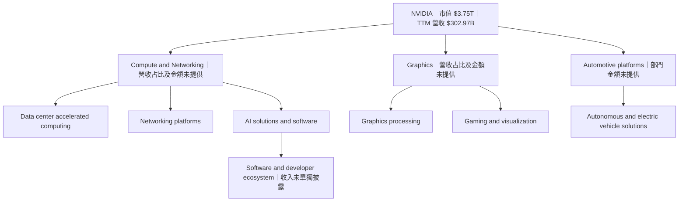
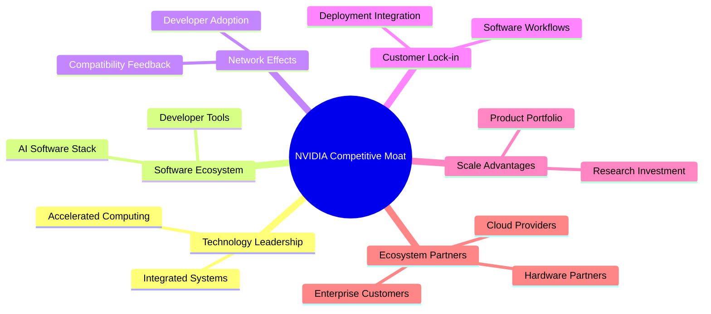
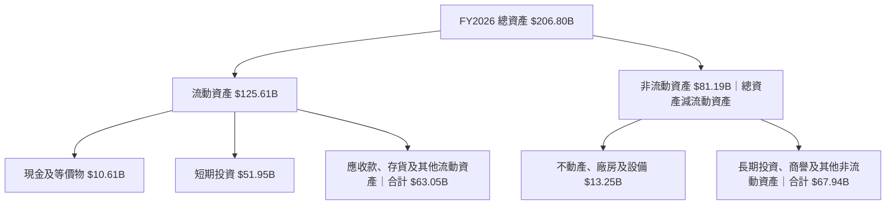
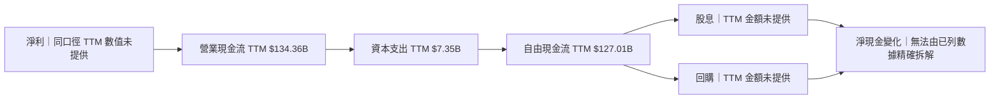
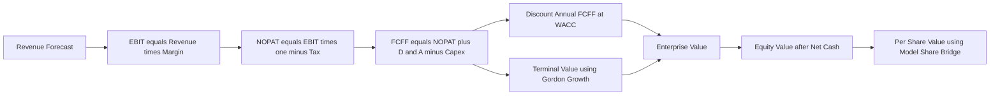
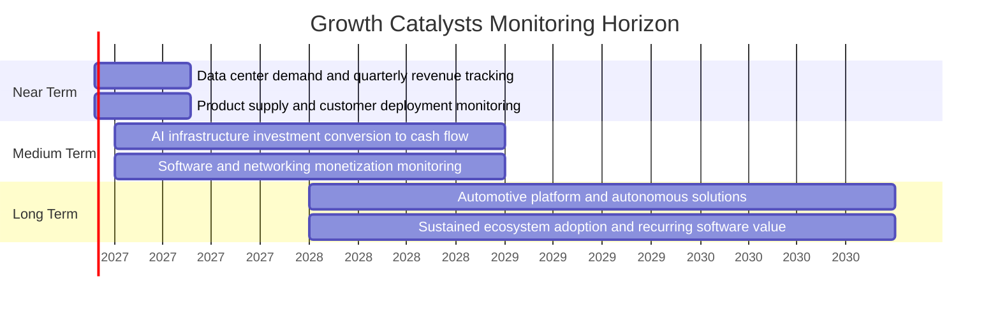
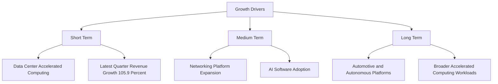
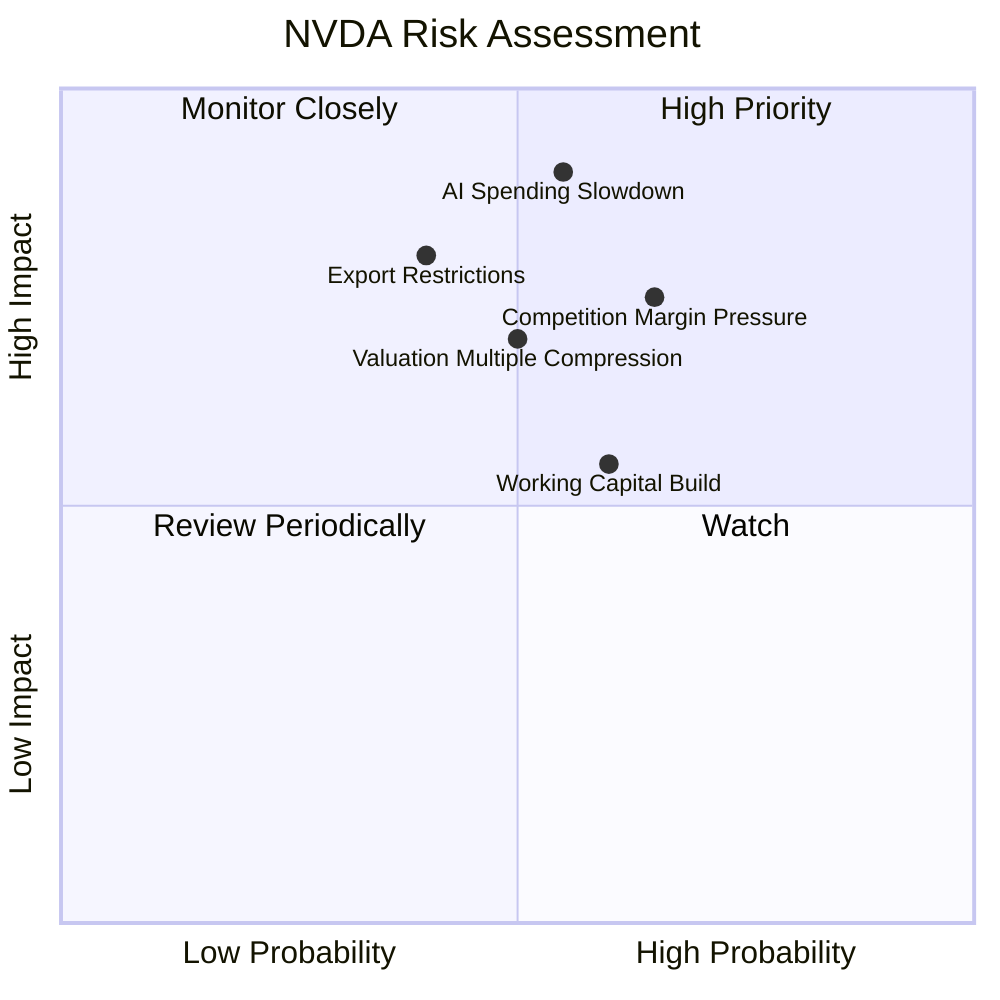
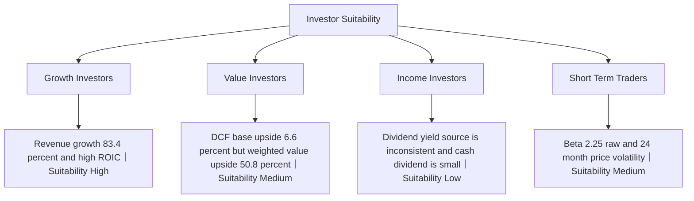

# NVDA 基本面深度分析報告
> **報告日期**：2026-11-25 ｜ **語言**：繁體中文 ｜ **資料來源**：SEC 申報資料（10-Q）、Yahoo Finance、StockAnalysis、Roic.ai、價格資料庫、程式計算 ｜ **分析師**：CFA 級機構研究

> **資料口徑提示**：來源資料存在期間與數值不一致。本報告以 SEC 申報資料計算的關鍵財務指標為優先：TTM 營收 **$302.97B**、TTM 營收成長 **83.4%**、TTM 營業利益率 **65.2%**、TTM ROIC **80.6%**。其他來源所列 TTM 營收 $361.81B、ROE 117.4% 等與此口徑不同，不混用於核心估值。股價統一採 **2026-11-24 收盤價 $155.38**。

## 目錄

| # | 章節 | 核心結論 |
|---|------|----------|
| 1 | 執行摘要 | 強烈買入；加權合理價值 $234.28；MOS 33.7% |
| 2 | 公司概覽與商業模式 | 加速運算平台與軟體生態構成主要競爭優勢 |
| 3 | 損益表深度分析 | TTM 營收 $302.97B、成長 83.4%；營業利益率 65.2% |
| 4 | 資產負債表分析 | 淨現金 $23.22B；營運資金天數增加需監控 |
| 5 | 現金流量深度分析 | TTM FCF $127.01B，FCF Yield 3.39% |
| 6 | 獲利能力與資本效率 | ROIC 80.6% 高於 WACC 13.94%，正創造股東價值 |
| 7 | 相對估值分析 | 同業估值與自有歷史差異大；估值結論須依口徑判讀 |
| 8 | DCF 內在價值評估 | 基準 DCF 每股 $165.67；加權合理價值 $234.28 |
| 9 | 成長催化劑 | AI 加速運算與資料中心需求是主要成長引擎 |
| 10 | 風險矩陣 | AI 資本支出、競爭與出口限制為主要風險 |
| 11 | 投資建議 | 強烈買入；買入區間上限約 $210.85 |

## 1. 執行摘要

NVIDIA TTM 營收為 **$302.97B**，較前一 TTM 成長 **83.4%**；最新單季年增率為 **105.9%**，TTM 營業利益率 **65.2%**、ROIC **80.6%**，均顯示需求擴張及高營業槓桿。TTM FCF 為 **$127.01B**、FCF Yield **3.39%**，資產負債表為 **$23.22B 淨現金**。以 2026-11-24 收盤價 **$155.38** 計，基準 DCF 為 **$165.67**，估值方法加權合理價值為 **$234.28**，MOS 為 **33.7%**；依規則 20 評級為 **強烈買入**。需要注意，DCF 基準價較現價上行空間僅 **6.6%**，而較高的加權合理價值受到同業 Forward P/E 法與分析師共識權重影響。

### 1.0 一頁式投資儀表板

| 項目 | 內容 |
|------|------|
| **投資論點（3 句）** | ① TTM 營收成長 **83.4%**，反映 AI 加速運算需求仍在擴張。② TTM 營業利益率 **65.2%**、ROIC **80.6%**，高毛利平台模式帶來明顯經濟利潤。③ TTM FCF **$127.01B**、淨現金 **$23.22B**，支持持續研發及資本配置。 |
| **綜合評分** | **8.3/10**（引用 1.1 評分卡） |
| **財務健康** | 🟢 淨現金 **$23.22B**；但 CCC 由 **105 天**升至 **155 天**，營運資金效率走弱 |
| **ROIC vs WACC** | **80.6% vs 13.94%**：創造股東價值 |
| **FCF 趨勢** | 上升；TTM FCF Yield **3.39%** |
| **估值** | Forward P/E **9.36x**（Yahoo Finance 估值欄位）｜EV/EBITDA **15.15x**（同一來源口徑）｜FCF Yield **3.39%** |
| **DCF 內在價值（基準）** | **$165.67**；現價相對 DCF 折價 **6.2%** |
| **安全邊際（MOS）** | **33.7%**＝($234.28 − $155.38) ÷ $234.28；🟢 >25% |
| **預期報酬（基準情境 12M）** | DCF 基準 **+6.6%**；加權合理價值上行空間 **+50.8%**，兩者方法與時間含義不同 |
| **關鍵風險（前二）** | AI 資本支出回報低於預期；競爭／出口政策改變供需及毛利 |
| **評級 + 信心度** | 🟢 **強烈買入** ｜ 信心：中（DCF 與相對估值差距大，且資料來源口徑有差異） |

### 1.1 綜合評分卡

| 維度 | 評分（1–10） | 主要依據（引用數字與其來源章節） |
|------|--------------|----------------------------------|
| 成長性 | 9.5 | TTM 營收成長 **83.4%**、最新單季年增 **105.9%**（第 3 章） |
| 獲利能力 | 9.5 | TTM 營業利益率 **65.2%**、ROIC **80.6%**、F-Score **5/9**（第 3、6 章） |
| 財務健康 | 8.5 | 淨現金 **$23.22B**；CCC **155 天**，較一年前增加 50 天（第 4 章） |
| 估值 | 6.5 | MOS **33.7%**，但 DCF 基準僅高於現價 **6.6%**，同業 Forward P/E 法結果較高（第 7、8 章） |
| 護城河 | 9.0 | 加速運算、軟體與網路平台形成互補；缺少可引用市場份額數字（第 2 章） |
| 管理層與資本配置 | 8.0 | FY2026 SBC **$6.39B**，稀釋股數測試通過；大量現金流留存，未提供完整回購數據（第 3、5 章） |
| **綜合評分** | **8.5** | 六項算術平均：(**9.5 + 9.5 + 8.5 + 6.5 + 9.0 + 8.0**) ÷ 6 = **8.5** |

### 1.2 五大投資論點 + 三大核心風險

| 類型 | 項目 | 具體依據 | 信心度 |
|------|------|----------|--------|
| 🟢 **投資論點①** | AI 加速運算需求仍高速擴張 | TTM 營收 **$302.97B**，TTM 年增 **83.4%**；最新單季年增 **105.9%** | 🟢 高 |
| 🟢 **投資論點②** | 高營業槓桿支持現金創造 | TTM 營業利益率 **65.2%**、FCF **$127.01B** | 🟢 高 |
| 🟢 **投資論點③** | 資本效率高於資本成本 | ROIC **80.6%**，WACC **13.94%**，差距 **66.66 個百分點** | 🟢 高 |
| 🟢 **投資論點④** | 資產負債表具韌性 | 現金及短期投資 **$56.59B**，總債務 **$33.37B**，淨現金 **$23.22B** | 🟢 高 |
| 🟢 **投資論點⑤** | 現價低於加權估值 | 現價 **$155.38**，加權合理價值 **$234.28**，MOS **33.7%** | 🟡 中 |
| 🟡 **風險①** | 資本支出與需求回報錯配 | DCF 假設營收由 TTM $302.97B 增至 FY+10 $1,357.44B；若 AI 投資轉化放緩，估值下修幅度可能大 | 🟡 中 |
| 🔴 **風險②** | 高估值仍依賴長期獲利 | DCF 終值現值占企業價值 **44.5%**，永續成長與折現率變動會改變價值 | 🔴 高 |
| 🟡 **風險③** | 現金轉換週期拉長 | CCC 由 **105 天**升至 **155 天**，存貨與應收款天數均增加 | 🟡 中 |

### 1.3 快速統計卡片

| 指標 | 公司實際值（期間） | 同業中位數 | 狀態 |
|------|--------------------|------------|------|
| 營收成長（TTM） | **83.4%** | — | 🟢 |
| 營收成長（最新一季年增） | **105.9%** | 44.7%（AMD）、85.5%（AVGO）、20.9%（INTC）；中位數 **44.7%** | 🟢 |
| 毛利率（TTM） | **74.9%**（交叉來源） | **56.0%**（AMD）、**75.5%**（AVGO）、**40.2%**（INTC）；中位數 **56.0%** | 🟢 |
| 營業利益率（TTM） | **65.2%** | — | 🟢 |
| ROIC（TTM） | **80.6%** | — | 🟢 |
| Forward P/E | **9.36x**（Yahoo Finance 估值欄位） | **23.5x**（AMD、AVGO、INTC 中位數） | 🟢* |
| FCF Yield（TTM） | **3.39%** | — | 🟡 |
| Piotroski F-Score | **5 / 9** | — | 🟡 |

\* Forward P/E 的資料來源口徑與 Peer multiples 區塊未完全一致，不宜單獨據此判斷便宜程度；第 7 章採規定的同業倍數資料。

### 1.4 投資結論

```text
╔══════════════════════════════════════════════════════════════════╗
║                    📊 投資結論摘要                               ║
╠══════════════════════════════════════════════════════════════════╣
║  評級：強烈買入（MOS 33.7%，ROIC 80.6% > WACC 13.94%）           ║
║  價格（2026-11-24 收盤）：$155.38                                ║
║  DCF 內在價值（基準）：$165.67（現價折價 6.2%）                  ║
║  安全邊際 MOS：33.7%（＝($234.28−$155.38)÷$234.28）             ║
║  加權合理價值（8.8）：$234.28                                    ║
║  DCF 情境價值：                                                   ║
║    悲觀情境：$75.39（-51.5%）                                    ║
║    基準情境：$165.67（+6.6%）                                    ║
║    樂觀情境：$341.24（+119.6%）                                  ║
║  綜合評分：8.5/10（引用 1.1）                                    ║
║  適合投資人：能承受高波動、重視長期成長且可分批建倉者           ║
╚══════════════════════════════════════════════════════════════════╝
```

## 2. 公司概覽與商業模式

NVIDIA 是以資料中心加速運算為核心的半導體與運算平台公司，業務分為 Compute & Networking、Graphics，並涉足汽車平台及軟體解決方案。其產品價值不只來自晶片，也包括互連、系統、軟體及開發工具的組合。最新資料列示員工 **42,000 人**；市場資料市值約 **$3.75T**。

### 2.1 業務結構與收入來源

財務資料未提供各部門營收拆分，因此不估算各板塊收入與占比。



### 2.2 市場份額

**市場份額數據未提供**，因此不呈現比例或市占圖。可確認的是公司 TTM 營收 **$302.97B**、成長 **83.4%**，且最新單季年增 **105.9%**；同業資料中 AMD 最新單季年增 **44.7%**、Broadcom **85.5%**，但各公司產品範圍不同，不能直接視為市場份額比較。

### 2.3 競爭護城河分析



### 2.4 護城河強度

| 護城河項目 | 強度（強／中／弱） | 證據（引用數字或事實） | 會削弱它的情況 |
|------------|--------------------|------------------------|----------------|
| 技術與平台 | 強 | TTM 營業利益率 **65.2%**、ROIC **80.6%**，顯示產品價值與資本效率高 | 競爭者提升效能、成本或供貨能力 |
| 軟體生態 | 強 | 業務描述涵蓋 AI solutions and software；但軟體營收未單獨披露 | 替代平台改善相容性，降低轉換成本 |
| 客戶鎖定 | 中至強 | 產品平台與軟體工具相互配合；客戶留存及轉換成本數據未提供 | 大型客戶自研晶片或多平台部署 |
| 規模效應 | 強 | TTM 營收 **$302.97B**、FCF **$127.01B**，可支持研發與生態投資 | 需求週期下行造成產能及庫存調整 |
| 生態夥伴 | 中至強 | 商業模式涉及資料中心、網路及多地市場；量化夥伴營收依賴度未提供 | 供應鏈瓶頸、出口限制或夥伴轉向替代品 |
| 網路效應 | 中 | 開發者與工具相容性可形成累積效應，但活躍開發者數未提供 | 開源與跨平台工具降低平台依賴 |

1.1「護城河」評分 **9.0/10**，依據是高 ROIC、高營業利益率與軟硬體平台互補；因缺少市場份額、客戶集中度及軟體收入拆分，未給滿分。

## 3. 損益表深度分析

### 3.1 年度收入成長趨勢（近4年）

年營收分別為 FY2023 **$26.97B**、FY2024 **$60.92B**、FY2025 **$130.50B**、FY2026 **$215.94B**。FY2024–FY2026 CAGR 約 **88.3%**，計算為 \((215.94 ÷ 26.97)^{1/3}-1\)；營收擴張與資料中心加速運算需求增長相符，但高基期意味未來成長率自然有下滑風險。

```text
╔══════════════════════════════════════════════════════════════════╗
║             NVIDIA 年度收入趨勢（FY2023-FY2026）                 ║
╠══════════════════════════════════════════════════════════════════╣
║  FY2023  $26.97B   ███░░░░░░░░░░░░░░░░░░░  YoY：—              ║
║  FY2024  $60.92B   ██████░░░░░░░░░░░░░░░░  YoY：+125.9% 🟢     ║
║  FY2025  $130.50B  █████████████░░░░░░░░░  YoY：+114.2% 🟢     ║
║  FY2026  $215.94B  ██████████████████████  YoY：+65.5% 🟢      ║
╠══════════════════════════════════════════════════════════════════╣
║  FY2023 至 FY2026 CAGR：約 +88.3%                                 ║
╚══════════════════════════════════════════════════════════════════╝
```

### 3.2 季度收入趨勢分析

季度資料採 StockAnalysis 季報序列；最新完整季度為 2026 年 10 月季。與 SEC 關鍵指標的「最新季度截至 2026-07-26」口徑不同，該季營收數值不可與 SEC TTM 指標混為同一期間。

| 季度 | 營收（$B） | QoQ | YoY | 備註 |
|------|-----------:|----:|----:|------|
| 2026-01 | 68.127 | — | 73.2% | 季度營收持續擴張 |
| 2026-04 | 81.615 | +19.8% | 85.2% | 年增加速 |
| 2026-07 | 96.221 | +17.9% | 105.9% | SEC 口徑最新一季年增 **105.9%** |
| 2026-10 | 115.844 | +20.4% | 103.2% | StockAnalysis 季度資料；不與 SEC 截止日混用 |

QoQ 計算例：\(81.615 ÷ 68.127 - 1 = 19.8\%\)。季度營收逐季增加，顯示需求仍高；然而單季資料不能替代經審核申報口徑，也需留意供應與客戶投資排程。

### 3.3 利潤率演變分析

| 利潤率指標 | FY2023 | FY2024 | FY2025 | FY2026 | 趨勢 | 評估 |
|------------|-------:|-------:|-------:|-------:|------|------|
| 毛利率 | 57.0% | 72.7% | 75.0% | 71.1% | 先快速提升、FY2026回落 | 🟢 |
| 營業利益率 | 20.7% | 54.1% | 62.4% | 60.4% | 規模效應改善後小幅回落 | 🟢 |
| 淨利率 | 16.2% | 48.9% | 55.8% | 55.6% | FY2025 後大致持平 | 🟢 |

年度比率由提供的年度收入、毛利、營業利益及淨利計算。例如 FY2026 營業利益率為 \(130.39 ÷ 215.94=60.4\%\)。SEC 口徑 TTM 營業利益率 **65.2%** 高於 FY2026 年度值，表示近期利潤率更高；產品組合、定價與營收規模可能是支持因素，但資料未提供分部毛利及單位成本，無法拆解各因素貢獻。

### 3.4 費用結構分析

FY2026 營收 **$215.94B**、毛利 **$153.46B**、營業利益 **$130.39B**。以營收減毛利計算的營業成本為 **$62.48B**；毛利與營業利益差額 **$23.07B**，代表營業費用的淨額，但提供資料不足以把此差額完整拆分為研發、銷售管理與其他項目。研發支出 FY2026 為 **$18.50B**。

```text
╔══════════════════════════════════════════════════════════════════╗
║                    FY2026 費用結構（美元）                      ║
╠══════════════════════════════════════════════════════════════════╣
║  營收 $215.94B                                                     ║
║  ├─ 營業成本 $62.48B（營收－毛利，計算值）                       ║
║  ├─ 毛利 $153.46B                                                  ║
║  │  ├─ 研發費用 $18.50B（為營業費用之一）                        ║
║  │  └─ 毛利至營業利益差額 $23.07B（營業費用淨額）                ║
║  └─ 營業利益 $130.39B                                              ║
╚══════════════════════════════════════════════════════════════════╝
```

因完整費用科目與期間拆分不足，不繪製帶有推估比例的費用圓餅圖。

### 3.5 季度 EPS 趨勢與盈餘品質（Quality of Earnings）

| 盈餘品質項目 | 數值/佔比 | 評估 |
|--------------|-----------|------|
| 股權薪酬 SBC / 營收 | FY2026：$6.39B ÷ $215.94B = **2.96%** | 🟡 有稀釋成本，但占營收比率相對有限；SBC TTM 數值未提供 |
| SBC / 營業現金流 | FY2026：$6.39B ÷ $102.72B = **6.22%** | 🟡 SBC 是非現金費用，但會透過股數稀釋影響股東 |
| FCF / 淨利（現金轉換率） | TTM 淨利未提供同一 SEC 口徑；依 StockAnalysis TTM 淨利 $226.257B 與 SEC TTM FCF 計算約 **56.1%**，期間口徑不一致 | 🟡 不宜視為精確同口徑指標；該差異可能與營運資金、資料期間有關 |
| 一次性/非經常性損益 | N/A（缺少同口徑明細） | 無法判斷非經常項目對淨利的影響 |
| 有效稅率異常 | 最新年度有效稅率 **15.1%** | 暫無證據顯示稅務利益是主要獲利來源；歷史逐期稅率拆分未提供 |
| 資本化支出 vs 費用化 | TTM Capex **$7.35B**；資本化支出明細未提供 | 無法確認資本化政策是否造成當期盈餘高估 |

近四季 EPS 實際值可由 StockAnalysis 季報列示：2026-01 **$1.76**、2026-04 **$2.39**、2026-07 **$2.46**、2026-10 **$2.70**；但 EPS 預估值均為 N/A，因此**無法可靠判定四季各自是否超預期或不及預期**。四季實際 EPS 上升，與營收、獲利擴張一致。

**盈餘品質結論**：營運現金流與 FCF 絕對值高，資本支出相對營收不高；FY2026 SBC 約占營收 2.96%，仍應視為股東經濟成本。由於 TTM 淨利、一次性項目、資本化支出明細及 EPS 預期缺失，不能斷言 GAAP 淨利被高估或低估；估值上應繼續跟蹤 FCF 對淨利轉換及稀釋股數。

## 4. 資產負債表分析

### 4.1 資產結構分解

以下採 FY2026 年報列示資產 **$206.80B**。流動資產 **$125.61B**；非流動資產為總資產減流動資產的計算值 **$81.19B**。



### 4.2 流動性與營運資金分析

FY2026 流動比率由流動資產 **$125.61B** 除以流動負債 **$32.16B**，約 **3.90x**；另一來源列示 TTM Current Ratio **4.084x**，兩者期間口徑不同。依 QUALITY FIGURES 的營運資金天數如下：

| 指標 | 最新 TTM | 一年前 TTM | 變化 | 解讀 |
|------|----------:|----------:|------:|------|
| DSO 應收帳款天數 | 76 天 | 61 天 | +15 天 | 收款天數增加，可能反映收入規模、交付或付款條件變化；需觀察應收款增速是否持續快於營收 |
| DIO 存貨天數 | 150 天 | 110 天 | +40 天 | 存貨占用資金增加，可能是供應鏈備貨或需求預期；若需求低於預期，存在存貨調整風險 |
| DPO 應付帳款天數 | 72 天 | 66 天 | +6 天 | 付款天數延長，可部分抵消應收與存貨資金需求；未足以抵消 CCC 上升 |
| CCC 現金轉換週期 | 155 天 | 105 天 | +50 天 | 現金轉回速度變慢，需追蹤存貨周轉及應收款回收 |

### 4.3 債務結構分析

```text
╔══════════════════════════════════════════════════════════════════╗
║                   NVIDIA 債務健康診斷                           ║
╠══════════════════════════════════════════════════════════════════╣
║  總債務：          $33.37B                                      ║
║  現金+短期投資：   $56.59B                                      ║
║  淨現金：          $23.22B  🟢                                  ║
║  Debt/EBITDA：     N/A（同一口徑 EBITDA 未提供）                ║
║  Interest Coverage：N/A（同一期間利息費用未提供）               ║
║  判斷：正淨現金降低融資風險；仍須監控營運資金與資本配置         ║
╚══════════════════════════════════════════════════════════════════╝
```

### 4.4 股東權益趨勢

FY2023 至 FY2026 股東權益分別為 **$22.10B、$42.98B、$79.33B、$157.29B**。累積增長與留存獲利及資產擴張相符；但股東權益帳面值不是市值，也不直接代表新增資本的回報。

```text
╔══════════════════════════════════════════════════════════════════╗
║               股東權益趨勢（年度，美元）                        ║
╠══════════════════════════════════════════════════════════════════╣
║  FY2023  $22.10B  ███                                             ║
║  FY2024  $42.98B  ██████                                          ║
║  FY2025  $79.33B  ███████████                                     ║
║  FY2026  $157.29B ██████████████████████                          ║
╚══════════════════════════════════════════════════════════════════╝
```

## 5. 現金流量深度分析

### 5.1 現金流量瀑布圖

TTM 營業現金流 **$134.36B**、資本支出 **$7.35B**，依定義 TTM FCF **$127.01B**。同期間淨利及股息／回購總額未提供一致口徑，故不填造完整瀑布數字。



### 5.2 FCF 轉換率趨勢

| 財年 | FCF（$B） | 淨利（$B） | FCF / 淨利 |
|------|----------:|----------:|-----------:|
| FY2023 | 3.81 | 4.37 | 87.2% |
| FY2024 | 27.02 | 29.76 | 90.8% |
| FY2025 | 60.85 | 72.88 | 83.5% |
| FY2026 | 96.68 | 120.07 | 80.5% |

現金轉換率近年仍高但略降。FY2026 FCF 成長至 **$96.68B**，而淨利為 **$120.07B**；差距可能涉及營運資金、資本支出與非現金項目。TTM FCF 按嚴格定義為 **$127.01B**。

### 5.3 自由現金流趨勢

| 年度 | FCF（$B） | 同年營業現金流（$B） | FCF Yield |
|------|----------:|---------------------:|----------:|
| FY2023 | 3.81 | 5.64 | 未提供 |
| FY2024 | 27.02 | 28.09 | 未提供 |
| FY2025 | 60.85 | 64.09 | 未提供 |
| FY2026 | 96.68 | 102.72 | 未提供 |
| TTM | **127.01** | **134.36** | **3.39%** |

FCF 持續增加，支持研發及資產負債表累積；但 FCF Yield 3.39% 意味現價已反映相當程度的未來增長預期。

### 5.4 資本配置評估

資料可確認 FY2026 Capex **$6.04B**、股息支付 **$0.974B**、SBC **$6.39B**；回購及投資支出完整金額未提供。故不畫會暗示比例完整的資本配置圓餅圖。

| 配置項目 | 可得數據 | 評估 |
|----------|----------|------|
| 資本支出 | FY2026 $6.04B；TTM $7.35B | 相較 TTM FCF $127.01B 占比低，資產較輕的商業模式提高現金轉換 |
| 股息 | FY2026 $0.974B | 對總現金流影響有限；提供的 Dividend Yield 61.0% 與公司現金股息數據明顯不一致，不採用 |
| 回購 | 數值未提供 | 無法評估回購價格與股數抵銷效果 |
| 研發 | FY2026 $18.50B | 研發維持平台競爭力；占營收約 8.6% |
| 留存現金 | 現金及短期投資 $56.59B | 提供營運與投資緩衝 |

## 6. 獲利能力與資本效率

### 6.1 ROE / ROA / ROIC 趨勢

| 指標 | 最新 TTM | 歷史序列 | 評估 |
|------|---------:|----------|------|
| ROE | **84.2%**（QUALITY FIGURES） | 同一口徑歷史值未提供；另一來源列 117.4%，不混用 | 高回報，但由高淨利率與資產效率共同推動 |
| ROA | N/A（同一 QUALITY FIGURES 序列未提供數值） | 年度序列口徑不足 | 不補算 |
| ROIC | **80.6%** | 近年逐年同口徑序列未提供 | 顯著高於資本成本 |
| WACC | **13.94%** | 財務數據計算 | 作為資本成本基準 |

缺乏可比的行業均值與同一口徑歷史 ROIC 序列，不列行業均值欄。核心結論以 TTM ROIC 與 WACC 比較。

### 6.2 ROIC vs WACC 分析（核心價值創造判斷）

ROIC **80.6%** 高於 WACC **13.94%**，差距 **66.66 個百分點**，代表公司目前投入資本所創造的稅後營業回報明顯高於資本成本。此結果支持正經濟利潤，但不保證該差距能長期維持；競爭、供應鏈投資與客戶自研均可能使 ROIC 回落。

```text
╔══════════════════════════════════════════════════════════════════╗
║                ROIC vs WACC 深度分析                            ║
╠══════════════════════════════════════════════════════════════════╣
║  WACC（依資本成本數據）：13.94%                                  ║
║  ├── 無風險利率（10Y 美債）：4.90%                               ║
║  ├── 股權風險溢酬：5.00%                                         ║
║  ├── 原始 Beta：2.25；調整後 Beta：1.83                         ║
║  ├── 股權成本：14.06%                                            ║
║  ├── 稅前債務成本：0.78%；有效稅率：15.1%                       ║
║  ├── 股權／債務權重：99.1%／0.9%                                ║
║  └── ✅ 採用 WACC：13.94%（照資本成本計算資料）                  ║
║                                                                  ║
║  ROIC（TTM）：80.6%                                               ║
║  經濟利潤差：80.6% − 13.94% = 66.66 個百分點                    ║
║  結論：目前顯著創造股東價值；延續性取決於競爭與需求             ║
╚══════════════════════════════════════════════════════════════════╝
```

債務成本及資本權重採資料計算值，不另以不完整的利息費用、租賃負債或市值資料重建 WACC；原始 Beta 2.25 高於 1.5，採調整後 Beta **1.83**。

### 6.3 杜邦三因素分解

| 因素 | 數值（TTM） | 解讀 |
|------|-------------|------|
| 淨利率 | **63.7%** | 高獲利率為 ROE 的主要貢獻來源 |
| 資產週轉率 | **0.95** | 每單位資產帶來較高營收周轉 |
| 權益乘數 | **1.40** | 槓桿程度有限，不是 ROE 的主要來源 |
| **ROE** | **84.2%** | 63.7% × 0.95 × 1.40 = 84.2%（品質指標原值） |

### 6.4 財務體質：Piotroski F-Score

**Piotroski F-Score：5 / 9**。資料對九項測試均列出結果；未通過項目顯示部分資產效率及應計品質指標相對走弱。

| 測試 | 結果 | 解讀 |
|------|------|------|
| ROA > 0 | ✅ 通過 | 公司具正向獲利 |
| 營業現金流 > 0 | ✅ 通過 | TTM 營業現金流為正 |
| ROA 高於一年前 | ❌ 未通過 | 相較去年未提升，可能反映資產擴張速度 |
| 營業現金流 > 淨利（應計品質） | ❌ 未通過 | 淨利高於營業現金流，需觀察營運資金變化 |
| 長期負債 ÷ 總資產低於一年前 | ❌ 未通過 | 該比率未改善 |
| 流動比率高於一年前 | ✅ 通過 | 短期流動性指標改善 |
| 稀釋股數未增加 | ✅ 通過 | 股數變化測試通過 |
| 毛利率高於一年前 | ✅ 通過 | 毛利率相對去年改善 |
| 資產週轉率高於一年前 | ❌ 未通過 | 資產成長未完全轉化為較高周轉 |

## 7. 相對估值分析

### 7.1 同業估值比較表格

下表嚴格採 Yahoo Finance Peer multiples。NVDA 同業表內的本公司數值採市場估值區塊與 Peer 區塊可直接比較的項目；資料來源存在不同時點／口徑差異，另行標註。

| 估值指標 | **NVDA** | **AMD** | **AVGO** | **INTC** | 本公司評估 |
|----------|---------:|--------:|--------:|--------:|-----------|
| **Trailing P/E** | 19.6x（歷史估值區塊） | 88.3x | 38.5x | N/A | 🟢 低於兩家有數值同業，但估值口徑需核對 |
| **Forward P/E** | 9.36x（Yahoo 估值欄位） | 23.5x | 15.6x | 30.6x | 🟢 表面低於同業；但本公司與 Peer multiples 時點口徑不一致 |
| **P/S Ratio** | 12.5x（歷史估值區塊） | 15.1x | 16.1x | 4.9x | 🟡 高於 INTC，低於 AMD、AVGO |
| **EV/EBITDA** | 18.6x（歷史估值區塊） | 60.2x | 28.2x | 15.9x | 🟢 低於 AMD、AVGO；略高於 INTC |
| **最新一季營收年增** | 105.9% | 44.7% | 85.5% | 20.9% | 🟢 NVDA 成長率最高 |
| **TTM 毛利率** | 74.9%（交叉來源） | 56.0% | 75.5% | 40.2% | 🟢 接近 AVGO，明顯高於 AMD、INTC |

公司當前估值欄位與歷史估值區塊出現差異，例如 P/E 16.69x 對比 19.6x、P/S 10.37x 對比 12.5x、EV/EBITDA 15.15x 對比 18.6x。估值分析以規則指定區塊分工使用，不將不同來源混成單一倍數。

### 7.2 歷史估值區間分析

```text
╔══════════════════════════════════════════════════════════════════╗
║                  NVDA 五年估值區間（TTM）                       ║
╠══════════════════════════════════════════════════════════════════╣
║  P/E：        2.3x ───── 中位數 11.3x ───── 現值 19.6x ── 49.3x ║
║                                       百分位：71%                ║
║  P/S：        1.2x ───── 中位數  2.7x ───── 現值 12.5x ── 31.0x ║
║                                       百分位：57%                ║
║  EV/EBITDA：  3.4x ───── 中位數  8.9x ───── 現值 18.6x ── 47.8x ║
║                                       百分位：57%                ║
╚══════════════════════════════════════════════════════════════════╝
```

按五年區間，P/E 現值位於第 **71 百分位**，高於中位數；P/S 與 EV/EBITDA 均位於第 **57 百分位**。這表示估值較自身歷史中位數偏高，但仍低於歷史高點；歷史倍數區間極寬，受盈利週期與股價變動影響，不能單獨推斷未來回報。

### 7.3 情境價值（Bear / Base / Bull）

情境數據照 DCF MODEL 列示。條件欄是對各假設可能對應的業務情境解讀，並非額外模型輸入。

| 情境 | 第 1 年營收成長 | 期末營業利潤率 | WACC | 每股價值 | 相對現價 | 機率 | 會發生的條件 |
|------|----------------:|----------------:|-----:|----------:|----------:|-----:|--------------|
| 🔴 悲觀 | 15.0% | 51.3% | 14.94% | $75.39 | -51.5% | 25% | AI 資本支出放緩、競爭或產品組合壓低利潤率，且風險溢酬升高 |
| 🟡 基準 | 30.0% | 60.4% | 13.94% | $165.67 | +6.6% | 50% | 成長按模型逐年降至 3%，利潤率收斂至 60.4% |
| 🟢 樂觀 | 45.0% | 66.4% | 12.94% | $341.24 | +119.6% | 25% | 新產品與 AI 投資回報高於基準，平台優勢持續且折現率下降 |

### 7.4 相對估值隱含價格區間

```text
╔══════════════════════════════════════════════════════════════════╗
║          相對估值隱含價格與現價位置（美元／股）                 ║
╠══════════════════════════════════════════════════════════════════╣
║  $155.38 現價 ─ $165.67 DCF ─ $184.62 EV/EBITDA                 ║
║                       ─ $244.71 分析師共識 ─ $389.56 Forward P/E║
╚══════════════════════════════════════════════════════════════════╝
```

| 方法 | 每股價值 | 依據 |
|------|---------:|------|
| 同業 Forward P/E | **$389.56** | AMD、AVGO、INTC 同業中位數 **23.5x** × Forward EPS **$16.61** |
| 同業 EV/EBITDA | **$184.62** | AVGO、INTC 同業中位數 **22.0x** × TTM EBITDA，再加淨現金 |
| DCF 基準 | **$165.67** | 10 年 FCFF、WACC **13.94%**、永續成長率 **3.0%** |
| 分析師共識 | **$244.71** | 58 位分析師平均目標價 |

## 8. DCF 內在價值評估（Discounted Cash Flow）

### 8.0 估值推理鏈（Thinking Logic）

**Step 1 — 價值來源與主導變數**

本模型以資料中心加速運算及相關平台現金流作為主要價值來源；Graphics、汽車與軟體的獨立營收占比未提供，不能將其假設為額外成長曲線或另行加總。模型主導變數是**營收增長路徑與持續的高營業利潤率**：基準收入由 TTM **$302.97B** 增至 FY+10 **$1,357.44B**，FY+10 利潤率為 **60.4%**。敏感性矩陣顯示 WACC、永續成長率也會顯著影響價值。

**Step 2 — 模型選擇**

| 決策點 | 本報告採用 | 理由（含數字） | 曾考慮但否決 | 否決理由 |
|--------|-----------|----------------|--------------|----------|
| 現金流定義 | FCFF | 以營業現金流能力及企業融資結構評估，使用 WACC 折現 | FCFE | 直接把股權現金流與 WACC 混用會不一致 |
| 預測期 N | 10 年 | 模型提供 10 年逐年現金流及逐步衰減的成長假設 | 5 年 | 無法呈現模型所設的長期成長收斂路徑 |
| 終值方法 | Gordon Growth | 模型已給定永續成長率 **3.0%**，且低於 WACC **13.94%** | 退出倍數作主估值 | DCF MODEL 未提供退出倍數與計算結果，不能自行補建 |
| EBIT 基礎 | GAAP | 模型採 GAAP EBIT | 非 GAAP | 會改變 SBC 處理方式，與現有模型不符 |

**Step 3 — 關鍵假設推導鏈**

- **營收增長**：錨點＝TTM 營收成長 **83.4%** → 調整＝考慮高基期及成長逐年淡化 → 採用 FY+1 **30.0%**，線性降至 FY+10 **3.0%** → 否決以 83.4% 延續十年，因會忽略基數效應與競爭。
- **營業利潤率**：錨點＝TTM **65.2%** → 調整＝以五年財年中位水準作收斂錨 → 採用 FY+1 **65.2%**、FY+10 **60.4%** → 否決十年維持 65.2%，因模型假設已納入長期競爭與組合變化。
- **預測期 N**：錨點＝模型指定 **10 年**，並逐年提供成長與利潤率 → 採用 10 年 → 否決縮短期間，因無法按同一模型呈現逐年衰減至成熟期的路徑。
- **Capex/營收**：錨點＝TTM **2.4%** → 模型假設逐年淡化至 FY+10 **1.3%**，並以 D&A 的 1.1 倍作下限條件 → 採用 FY+1 2.4%、FY+10 1.3% → 否決固定在 2.4%，因模型預設資本支出率隨成熟度下降。
- **永續成長率 g**：錨點＝長期成熟型企業成長假設應低於折現率；模型指定 **3.0%** → 採用 3.0%，低於 WACC 13.94% → 不採高於 3.0% 的基準值，以避免終值過度放大。
- **D&A/營收**：錨點＝TTM **1.2%** → 採用固定 **1.2%**；沒有更細的折舊資產明細可支持偏離。
- **ΔWC**：模型未建模營運資金變動；因此不在 FCFF 再扣 ΔWC。這是模型簡化，與 CCC 上升風險相關。
- **SBC 與股數**：模型採 **組合 (A)：GAAP EBIT + 固定股數**。GAAP EBIT 已含 SBC 費用，不再額外扣 SBC；股數不再逐年稀釋，模型聲明 SBC 影響計入一次。這是估值模型規則，不代表未來實際稀釋為零。
- **WACC**：錨點＝資本成本計算值 **13.94%** → 直接採用，遵守指定折現率 → 不另行重估，以免與 ROIC 比較及 DCF 模型失配。
- **終值方法**：採 Gordon Growth，因模型提供明確終值與敏感度矩陣；退出倍數法因缺少模型輸出而不自建。

**Step 4 — 最脆弱一環**

最脆弱假設是營收與高利潤率能同時維持：若年 1 成長只達悲觀情境的 **15.0%**、期末營業利潤率降至 **51.3%** 且 WACC 升至 **14.94%**，情境價值降至 **$75.39**。

**Step 5 — 計算路徑圖**



### 8.1 模型假設總表（Model Inputs）

| 假設項目 | 採用值 | 依據 / 來源 | 敏感度 |
|----------|--------|-------------|--------|
| 預測期長度 **N** | 10 年 | DCF MODEL 明列預測 10 年 | 🟡 中 |
| 營收增長路徑 | FY+1 30.0% → FY+10 3.0% | TTM 增長 83.4%；模型限制年 1 成長在 0%–30%，其後線性淡化 | 🔴 高 |
| 營業利潤率 | FY+1 65.2% → FY+10 60.4% | TTM 65.2%，逐步淡化至近五年財年中位數 | 🔴 高 |
| 有效稅率 | 15.1% | 最新年度有效稅率 | 🟢 低 |
| Capex / 營收 | FY+1 2.4% → FY+10 1.3% | TTM 2.4%；模型逐步降至 1.1×D&A 附近 | 🟡 中 |
| D&A / 營收 | 1.2% | TTM 比率，固定採用 | 🟢 低 |
| 營運資金變動 | 未建模 | DCF MODEL 明確未納入營運資金 | 🟡 中 |
| EBIT 基礎 | GAAP | DCF MODEL 採 GAAP EBIT | 🟡 中 |
| 股權薪酬 SBC 處理 | 已含於 GAAP EBIT，不另扣 | 模型組合 A | 🟡 中 |
| 年稀釋率 | 0%（模型固定股數） | 組合 A；模型明示股數不再稀釋 | 🟡 中 |
| 永續成長率 g | 3.0% | 模型指定；低於 WACC | 🔴 高 |
| 終值方法 | Gordon Growth | DCF MODEL 提供終值 | 🔴 高 |
| WACC | 13.94% | Cost of capital 計算值 | 🔴 高 |

**FCFF 定義**：採用 FCFF＝NOPAT + D&A − Capex；模型未納入 ΔWC。**SBC 防重複扣除**：本模型採用 **(A)**，故 SBC 已在 GAAP EBIT 中扣除，不另加扣 SBC，且固定股數。

### 8.2 折現率推導（WACC）

```text
╔══════════════════════════════════════════════════════════════════╗
║                    WACC 推導（折現率）                           ║
╠══════════════════════════════════════════════════════════════════╣
║  股權成本 Ke（CAPM）：                                           ║
║  ├── 無風險利率 Rf（10Y 美債）：      4.90%                      ║
║  ├── 市場風險溢酬 ERP：               5.00%                      ║
║  ├── 原始 Beta：                      2.25                       ║
║  ├── 調整後 Beta：                    1.83                       ║
║  ├── 規模／國別溢酬：                  0.00%（模型未另加）        ║
║  └── Ke = 4.90% + 1.83 × 5.00% = 14.06%                         ║
║                                                                  ║
║  債務成本：                                                       ║
║  ├── 稅前 Kd：                        0.78%                      ║
║  ├── 有效稅率：                      15.1%                       ║
║  └── 稅後 Kd = 0.78% × (1−15.1%) = 0.66%（四捨五入）            ║
║                                                                  ║
║  資本結構權重：                                                   ║
║  ├── 股權權重：                       99.1%                      ║
║  ├── 債務權重：                        0.9%                      ║
║  └── WACC = 13.94%（直接採用計算資料原值）                      ║
╚══════════════════════════════════════════════════════════════════╝
```

五步演算與資料可追溯性：

1. **Ke**：\(4.90\% + 1.83 × 5.00\% = 14.05\%\)，資料計算欄列 **14.06%**；差異為中間數精度／四捨五入，本報告採用原列 **14.06%**。
2. **稅前 Kd**：資料列為 **0.78%**，但利息費用與平均計息負債的明細未提供，不能獨立重建分子、分母。
3. **稅後 Kd**：\(0.78\% × (1-15.1\%) = 0.66222\% ≈ 0.66\%\)。
4. **權重**：股權 **99.1%**、債務 **0.9%**，合計 **100.0%**；股權市值及計息債務範圍的完整重建輸入未提供，因此照採原計算權重。
5. **WACC**：資料指定 **13.94%**。因權重、Ke 與 Kd 均已四捨五入，無法由顯示位數精確重現最後兩位；遵守規則使用原始 WACC，不另算替代值。

### 8.3 逐年自由現金流預測（基準情境）

金額單位為 **$B**；財務數字取模型原值，顯示金額取一位小數、比率取一位小數、折現因子取三位小數。表格內模型原始數值保留兩位小數以便核對。ΔWC 未建模，不另列計算數值。

| 年度 | FY+1 | FY+2 | FY+3 | FY+4 | FY+5 | FY+6 | FY+7 | FY+8 | FY+9 | FY+10 |
|------|-----:|-----:|-----:|-----:|-----:|-----:|-----:|-----:|-----:|------:|
| 營收 | 393.86 | 500.20 | 620.25 | 750.50 | 885.59 | 1,018.43 | 1,140.64 | 1,243.30 | 1,317.90 | 1,357.44 |
| 營收 YoY | 30.0% | 27.0% | 24.0% | 21.0% | 18.0% | 15.0% | 12.0% | 9.0% | 6.0% | 3.0% |
| 營業利潤率 | 65.2% | 64.7% | 64.1% | 63.6% | 63.1% | 62.5% | 62.0% | 61.5% | 60.9% | 60.4% |
| 營業利益 EBIT（GAAP） | 256.85 | 323.52 | 397.83 | 477.35 | 558.51 | 636.82 | 707.11 | 764.08 | 802.85 | 819.64 |
| − 稅 | (38.83) | (48.91) | (60.14) | (72.16) | (84.43) | (96.27) | (106.89) | (115.51) | (121.37) | (123.91) |
| = NOPAT | 218.02 | 274.61 | 337.69 | 405.19 | 474.08 | 540.55 | 600.22 | 648.57 | 681.48 | 695.74 |
| + D&A | 4.79 | 6.09 | 7.55 | 9.13 | 10.78 | 12.39 | 13.88 | 15.13 | 16.04 | 16.52 |
| − Capex | (9.56) | (11.54) | (13.55) | (15.49) | (17.21) | (18.56) | (19.41) | (19.65) | (19.24) | (18.17) |
| **= FCFF** | **213.26** | **269.16** | **331.68** | **398.82** | **467.65** | **534.39** | **594.69** | **644.05** | **678.28** | **694.09** |
| 折現因子 @13.94% | 0.878 | 0.770 | 0.676 | 0.593 | 0.521 | 0.457 | 0.401 | 0.352 | 0.309 | 0.271 |
| **FCFF 現值 PV** | **187.16** | **207.32** | **224.22** | **236.61** | **243.49** | **244.20** | **238.50** | **226.69** | **209.53** | **188.17** |

**預測期現值合計**：  
\(187.16 + 207.32 + 224.22 + 236.61 + 243.49 + 244.20 + 238.50 + 226.69 + 209.53 + 188.17 = \mathbf{2,205.89B}\)。

**FY+1 逐步演算示範**：

1. 營收：\(302.97 × (1+30.0\%) = 393.861 ≈ \mathbf{393.86B}\)。
2. EBIT：\(393.86 × 65.2\% = 256.79672\)，模型列 **$256.85B**；差異源於模型使用未顯示的內部精度／利潤率精度，照抄模型值。
3. 稅：\(256.85 × 15.1\% = 38.78435\)，模型列 **$38.83B**；差異同樣可能來自未四捨五入輸入，採模型原值。
4. NOPAT：模型列示 \(256.85 - 38.83 = \mathbf{218.02B}\)。
5. D&A：\(393.86 × 1.2\% = 4.72632B\)，模型列 **$4.79B**，差異反映隱藏精度／取值口徑。
6. Capex：模型 FY+1 列為 **$9.56B**。
7. FCFF：模型列 **$213.26B**；按已顯示 NOPAT、D&A、Capex 計算為 \(218.02+4.79-9.56=213.25B\)，與模型相差 **$0.01B**，屬四捨五入尾差。
8. 折現因子：模型列 **0.878**。
9. PV：模型列 \(213.26 × 0.878 = 187.24B\)，但模型 PV 為 **$187.16B**；因折現因子顯示三位小數，模型內部使用未四捨五入因子。本報告保留原始模型 PV，未用顯示因子重建。

以上可見部分逐年列值無法只靠已顯示精度逐分複算；為遵守不得改動 DCF MODEL 數字，保留模型原值並披露精度差異，而非以自行重算值替換。

**合理性自檢**：歷史可比 FCF CAGR 因不同年度口徑與 TTM 基期不一致，不能可靠計算同口徑預測 FCF CAGR。FY+10 FCF 利潤率為 \(694.09 ÷ 1,357.44 = 51.1\%\)，高於目前 TTM FCF／營收 \(127.01 ÷ 302.97 = 41.9\%\)；同業最佳 FCF 利潤率未提供。各年 FCFF 均為正。

```text
╔══════════════════════════════════════════════════════════════════╗
║            自由現金流：歷史實際 vs 模型預測                      ║
╠══════════════════════════════════════════════════════════════════╣
║  FY2024（實） $27.02B  ████░░░░░░░░░░░░░░░░░░                  ║
║  FY2025（實） $60.85B  █████████░░░░░░░░░░░░░                  ║
║  FY2026（實） $96.68B  ██████████████░░░░░░░                  ║
║  FY+1（預）  $213.26B  ██████████████████████████████          ║
║  FY+10（預） $694.09B  ███████████████████████████████████████ ║
╠══════════════════════════════════════════════════════════════════╣
║  ⚠️ FY+1 高於 FY2026 實際 FCF，主要依賴營收增長與高利潤率假設 ║
╚══════════════════════════════════════════════════════════════════╝
```

### 8.4 終值計算（Terminal Value）

**適用性檢查**：\(WACC 13.94\% > g 3.0\%\) → ✅

| 方法 | 計算式 | 終值 TV | TV 現值 | 佔總 EV 比重 |
|------|--------|--------:|--------:|-------------:|
| Gordon Growth | \(694.09 × (1+3.0\%) ÷ (13.94\%-3.0\%)\) | $6,533.30B | $1,771.22B | 44.5% |
| 退出倍數法 | N/A（DCF MODEL 未提供 EBITDA 終值倍數與計算結果；不另建模型） | N/A | N/A | N/A |

逐步演算：

1. FY+N FCFF＝**$694.09B**。
2. 分子：\(694.09 × (1+3.0\%) = 714.9127B\)。
3. 分母：\(13.94\%-3.0\%=10.94\%\)；模型終值 \(6,533.30B\)。
4. PV(TV)：模型列示 \(6,533.30 × 0.271 = 1,771.22B\)；折現因子取三位小數會造成顯示乘積差異，採模型原值。
5. 終值占比：\(1,771.22 ÷ 3,977.12 = 44.5\%\)。

終值占 EV **44.5%**，未超過 75% 警示門檻，但仍對長期成長及折現率敏感。

### 8.5 企業價值 → 每股內在價值（Bridge）

```text
╔══════════════════════════════════════════════════════════════════╗
║              企業價值 → 每股內在價值 橋接表                      ║
╠══════════════════════════════════════════════════════════════════╣
║  預測期 FCF 現值合計             +$2,205.89B                     ║
║  終值現值 PV(TV)                 +$1,771.22B                     ║
║  = 企業價值 EV                    $3,977.12B                     ║
║  + 淨現金                         +$23.22B                       ║
║  = 股權價值                       $4,000.34B                     ║
║  每股價值（模型橋接）             $165.67                        ║
║  2026-11-24 收盤價                $155.38                        ║
║  現價相對 DCF 折溢價              -6.2%（折價）                  ║
╚══════════════════════════════════════════════════════════════════╝
```

1. EV：\(2,205.89 + 1,771.22 = 3,977.11B\)，模型列 **$3,977.12B**，差異 **$0.01B** 為列示精度尾差。
2. 股權價值：\(3,977.12 + 23.22 = \mathbf{4,000.34B}\)。
3. 每股內在價值：模型使用 \(股權價值 × 價格 ÷ 市值\)，列示 **$165.67**。模型未提供另行獨立股數橋接值；不得以其他來源股數替換此原值。
4. 折溢價：\($155.38 ÷ $165.67 - 1 = -6.2\%\)，即現價較 DCF 基準價折價約 6.2%。
5. 本節不計算 MOS；MOS 僅於 8.8 以加權合理價值為分母計算。

現金及債務橋接採 DCF 模型所列淨現金 **$23.22B**。該數值與其他資料來源列示的現金、債務不同，依模型基準原值使用。

### 8.6 敏感性分析（WACC × 永續成長率）

下表估值取 DCF MODEL 原值；括號為相對現價 **$155.38** 的上行空間，按顯示值計算並四捨五入至一位小數。

| g（列）／WACC（欄） | 11.94% | 12.94% | **13.94%（基準）** | 14.94% | 15.94% |
|-----------|------:|------:|------------------:|------:|------:|
| **2.0%** | $197.23 (+26.9%) | $176.22 (+13.4%) | $158.87 (+2.2%) | $144.32 (-7.1%) | $131.96 (-15.1%) |
| **2.5%** | $202.78 (+30.5%) | $180.43 (+16.1%) | $162.12 (+4.3%) | $146.87 (-5.5%) | $133.99 (-13.8%) |
| **3.0%（基準）** | $208.94 (+34.5%) | $185.06 (+19.1%) | **$165.67 (+6.6%)** | $149.63 (-3.7%) | $136.17 (-12.4%) |
| **3.5%** | $215.84 (+38.9%) | $190.18 (+22.4%) | $169.55 (+9.1%) | $152.63 (-1.8%) | $138.53 (-10.9%) |
| **4.0%** | $223.60 (+43.9%) | $195.87 (+26.0%) | $173.83 (+11.9%) | $155.91 (+0.3%) | $141.08 (-9.2%) |

**複算限制**：模型只提供敏感性結果矩陣，未提供各替代 WACC 下的逐年折現 PV、終值及橋接中間值；為遵守不得另建 DCF，不能可靠重建非基準格的完整演算鏈。所有矩陣值照抄原始模型，未以自行計算取代。

**三情境 DCF**：

| 情境 | 年 1 成長 | 期末營業利潤率 | WACC | 每股價值 | 相對現價 | 機率 |
|------|---------:|---------------:|-----:|---------:|---------:|-----:|
| 🔴 悲觀 | 15.0% | 51.3% | 14.94% | $75.39 | -51.5% | 25% |
| 🟡 基準 | 30.0% | 60.4% | 13.94% | $165.67 | +6.6% | 50% |
| 🟢 樂觀 | 45.0% | 66.4% | 12.94% | $341.24 | +119.6% | 25% |
| **機率加權** | — | — | — | **$186.99** | **+20.3%** | **100%** |

模型未提供悲觀及樂觀情境逐年營收、FY+10 FCFF、終值等中間表格，因此不得補造完整情境算式。加權檢核：\(75.39×25\%+165.67×50\%+341.24×25\%=186.99\)。

**敏感度結論**：基準格 WACC 13.94%、g 3.0% 為 **$165.67**；g 由 2.0% 升至 4.0%，價值由 **$158.87** 升至 **$173.83**，增加 **$14.96**；WACC 由 12.94% 升至 14.94%，基準 g 下價值由 **$185.06** 降至 **$149.63**，減少 **$35.43**。就已提供矩陣而言，WACC 變動影響更大；營業利潤率每變動 1 個百分點的獨立敏感度未提供，不能定量捏造。這與 8.0 所指的營收／利潤率長期持續性重要並不矛盾：矩陣只隔離 WACC 與 g，沒有展示營運假設變動。

### 8.7 反推 DCF（Reverse DCF）

模型反推資料只提供兩個變數的一次一變數解；其餘變數反推及逐級試算軌跡未提供，不自行補解。

| 求解的變數（一次一個） | 固定條件 | 市場隱含值 | 對照基準 | 判斷 |
|------------------------|----------|------------:|----------|------|
| 年 1 營收成長 | 其他變數維持基準 | **28.2%** | 基準假設 30.0% | 🟡 現價隱含成長略低於基準 |
| 固定營業利潤率 | 其他變數維持基準 | **57.9%** | 基準路徑 65.2% 至 60.4% | 🟡 市場可接受低於基準路徑的固定利潤率 |
| 永續成長率 g | N/A（未提供求解值） | 未計算 | — | 不補算 |
| 預測期長度 N | N/A（未提供求解值） | 未計算 | — | 不補算 |

反推結果表示，按模型其餘基準輸入不變，現價所隱含的年 1 成長 **28.2%** 略低於基準 **30.0%**；但該結論對 WACC、長期利潤率與營運資金簡化假設高度敏感。

### 8.8 估值三角驗證與安全邊際

| 估值方法 | 隱含每股價值 | 上行空間（÷現價） | 權重 | 說明 |
|----------|--------------:|------------------:|-----:|------|
| DCF（基準） | $165.67 | +6.6% | 40% | 10 年 FCFF、WACC 13.94%、終值成長 3.0% |
| 同業 Forward P/E | $389.56 | +150.7% | 25% | 同業中位數 23.5x × Forward EPS 16.61 |
| 同業 EV/EBITDA | $184.62 | +18.8% | 25% | 同業中位數 22.0x × TTM EBITDA，加淨現金 |
| 分析師共識目標價 | $244.71 | +57.5% | 10% | 58 位分析師平均目標價 |
| **加權合理價值** | **$234.28** | **+50.8%** | **100%** | — |

完整加權算式：  
\($165.67×40\%)+($389.56×25\%)+($184.62×25\%)+($244.71×10\%)\)  
\(=66.268+97.390+46.155+24.471=\mathbf{234.284}\)，四捨五入為 **$234.28**。公司類型為獲利公司；四種方法皆列入，沒有因無法計算而剔除的方法。

- **MOS**：\((234.28-155.38)÷234.28=78.90÷234.28=\mathbf{33.7\%}\)。
- **上行空間**：\((234.28-155.38)÷155.38=78.90÷155.38=\mathbf{50.8\%}\)。
- **DCF 折溢價**：\(155.38÷165.67-1=\mathbf{-6.2\%}\)，即現價相對 DCF 基準折價。

```text
╔══════════════════════════════════════════════════════════════════╗
║                  估值區間與安全邊際                              ║
╠══════════════════════════════════════════════════════════════════╣
║  $75.39 ─ $155.38 ─ [$234.28] ─ $341.24 ─ $389.56              ║
║  悲觀DCF   現價       加權合理值   樂觀DCF   Forward P/E法        ║
║                                                                  ║
║  MOS = (加權合理價值−現價)÷加權合理價值 = 33.7%                 ║
║  上行空間 = (合理價值−現價)÷現價 = 50.8%                        ║
║  MOS 評估：🟢 大於 25%                                          ║
║  建議買入區間：現價 $155.38 至約 $210.85                         ║
║  合理持有區間：約 $210.85 至 $257.71                            ║
║  減碼考慮區間：高於 $341.24，需重新檢視樂觀情境是否已反映       ║
╚══════════════════════════════════════════════════════════════════╝
```

買入上限依 MOS 至少 10% 推導：\(價格≤加權合理價值×(1-10\%)=234.28×0.90=$210.85\)。合理持有區間以 MOS 在 -10% 至 +10% 換算，約為 \(0.9×234.28\) 至 \(1.1×234.28\)。

> 🔎 **程式複算（Python，依本節各項自動重算）**
>
> 加權合理價值 = $165.67 × 40% + $389.56 × 25% + $184.62 × 25% + $244.71 × 10% = **$234.28**（權重合計 100%）
>
> 以價格 $155.38 計：MOS = **+33.7%**，上行空間 = **+50.8%**
>
> ✅ 與本節所寫數值一致。

### 8.9 DCF 模型的局限與失效條件

- **終值依賴度**：終值現值占 EV **44.5%**，仍有相當部分價值取決於 FY+10 之後的假設。
- **最脆弱假設**：營收成長與利潤率。模型情境顯示，悲觀條件價值 **$75.39**，遠低於基準 **$165.67**；不能把單一基準值視為精確目標價。
- **ΔWC 未建模**：實際 CCC 從 **105 天**升至 **155 天**，若營運資金持續吸收現金，DCF 可能高估 FCFF。
- **資料精度與口徑**：模型表格顯示數字與部分以顯示值反算的結果存在小額差異；每股價值採模型原值。報告亦有 TTM 營收多來源差異，未混合。
- **不適用情境**：若 AI 投資需求快速收縮、FCF 大幅轉弱或利潤率劇烈變化，DCF 可靠度下降，應增加情境分析與相對估值權重。
- **風險連結**：出口限制可能壓低營收增長；競爭可能壓低營業利潤率；資本支出擴張與存貨累積可能使 Capex／ΔWC 高於模型假設；利率上升會提高 WACC。

### 8.10 複算檢核表（Audit Trail）

| # | 檢核項目 | 檢查方式 | 結果 |
|---|----------|----------|------|
| 1 | 所有高／中敏感度輸入都有推導說明 | 對照 8.0 與 8.1；部分採模型既定假設並披露替代值 | ✅ |
| 2 | 每個假設都有來歷 | 8.1 逐列列出模型或財務數據來源 | ✅ |
| 3 | WACC 五步算式與權重 | 已列數據原值；部分精確重建輸入缺失，採原 WACC | ⚠️ |
| 4 | Kd 分母與 D 權重範圍一致 | 詳細利息及計息負債拆分未提供，未自行重建 | ⚠️ |
| 5 | WACC 與第 6.2 節同值 | 均採 **13.94%** | ✅ |
| 6 | 逐年欄位等於 N，且無省略 | FY+1 至 FY+10，共 10 年 | ✅ |
| 7 | FY+1 算式可複算 | 顯示值有未四捨五入精度尾差，已披露 | ⚠️ |
| 8 | 預測期 PV 加總 | 十年逐項加總 **$2,205.89B** | ✅ |
| 9 | WACC > g | 13.94% > 3.0% | ✅ |
| 10 | 終值以 FY+N FCFF 為基礎、折現 N 期 | 採模型 FY+10 FCFF 與 PV 終值原值 | ✅ |
| 11 | 橋接 EV 至每股價值 | 加總尾差 $0.01B；模型每股值照抄 | ⚠️ |
| 12 | SBC 三要素組合相容 | GAAP EBIT、無額外 SBC 扣除、固定股數 | ✅ |
| 13 | 敏感性矩陣基準格等於 DCF 基準 | 基準格 **$165.67** | ✅ |
| 14 | 矩陣有效性 | 所有 WACC 均高於 g | ✅ |
| 15 | 三情境機率加總 | 25%+50%+25%=100%；加權值 $186.99 | ✅ |
| 16 | 反推每列只放開一變數 | 僅報告模型提供的兩個單變數解；未編造迭代表 | ⚠️ |
| 17 | MOS、折溢價基準一致 | MOS 用 $234.28；DCF 折溢價用 $165.67 | ✅ |
| 18 | 完整輸出至第 11 章 | 章節完整 | ✅ |
| 19 | 加權合理價值算式核對 | 加權總和 $234.284，列示 $234.28 | ✅ |
| 20 | 評級與 MOS 門檻一致 | MOS 33.7%、ROIC>WACC，強烈買入 | ✅ |

**核對說明**：DCF 表中部分顯示值由於隱藏精度及折現因子只列三位小數，無法由展示值完全重建；未改動模型輸出。WACC 的原始組成資料與逐年預測已照原值使用，缺少的中間輸入沒有自行推測。

## 9. 成長催化劑

### 9.1 催化劑時間軸

因資料未提供各催化劑具體落地日期，以下以研究觀察期分類，不把日期解讀為管理層承諾。



### 9.2 TAM 市場規模分析

**N/A（TAM 數據未提供）**。可量化的成長基礎是 TTM 營收 **$302.97B**、TTM 成長 **83.4%**；但缺乏可引用的 AI 加速運算市場總額與公司滲透率，故不推估 TAM 或市占。

### 9.3 成長驅動力結構圖



## 10. 風險矩陣

### 10.1 風險評分矩陣

下圖為質化風險定位，不代表精確統計機率；各項機率為分析判斷，非公司財務數據。



### 10.2 風險清單詳細分析

| # | 風險項目 | 發生機率 | 財務衝擊 | 風險評分 | 緩解措施 |
|---|----------|----------|----------|----------|----------|
| 1 | 🔴 **AI 資本支出放緩** | 中（分析判斷） | 高；若營收增長低於基準，DCF 悲觀情境價值為 **$75.39** | 🔴 高 | 追蹤主要客戶資本支出、訂單轉營收及資料中心營收成長 |
| 2 | 🔴 **競爭與產品組合造成利潤率收縮** | 中高（分析判斷） | 高；悲觀情境期末營業利潤率為 **51.3%**，低於基準 **60.4%** | 🔴 高 | 每季監控營業利益率、毛利率及產品交付組合 |
| 3 | 🟠 **出口與地緣政策限制** | 中（分析判斷） | 中高；可能限制部分市場可服務營收，相關收入暴露金額未提供 | 🟠 中高 | 追蹤法規變動、區域銷售與產品合規調整 |
| 4 | 🟡 **營運資金惡化** | 中高 | 中；CCC 由 **105 天**增加至 **155 天**，可能拖累現金轉換 | 🟡 中 | 監控 DSO、DIO 與應收款相對營收增速 |
| 5 | 🟡 **估值倍數收縮** | 中 | 中高；DCF WACC 由 12.94% 升至 14.94%、g 3.0% 時價值由 **$185.06** 降至 **$149.63** | 🟡 中高 | 分批投入，要求營運成果支撐估值，不以倍數擴張作為唯一回報來源 |

## 11. 投資建議

### 11.1 最終評級與評分

依加權合理價值 **$234.28**、現價 **$155.38** 計算，MOS 為 **33.7%**，且 ROIC **80.6%** 高於 WACC **13.94%**，規則 20 評級為 **強烈買入**；未作質化降級。綜合評分引用 1.1 的 **8.5/10**，六項分數依序為成長性 **9.5**、獲利能力 **9.5**、財務健康 **8.5**、估值 **6.5**、護城河 **9.0**、管理層與資本配置 **8.0**。

### 11.2 合理價值與隱含報酬率

| 方法／情境 | 每股價值 | 相對現價 | 機率 |
|------------|---------:|---------:|-----:|
| 加權合理價值 | **$234.28** | **+50.8%** | — |
| 悲觀 DCF | $75.39 | -51.5% | 25% |
| 基準 DCF | $165.67 | +6.6% | 50% |
| 樂觀 DCF | $341.24 | +119.6% | 25% |
| DCF 情境機率加權（僅供參考） | $186.99 | +20.3% | 100% |

加權合理價值與 DCF 情境機率加權值屬不同估值方法，前者是 8.8 的 MOS 基準，後者不替代規定評級。

### 11.3 買入時機與觸發因素

```text
╔══════════════════════════════════════════════════════════════════╗
║                  ✅ 買入觸發因素 Checklist                      ║
╠══════════════════════════════════════════════════════════════════╣
║  分批買入考量：                                                   ║
║  ✅ 現價 $155.38 低於 DCF 基準 $165.67                            ║
║  ✅ 現價低於加權合理價值 $234.28                                  ║
║  ✅ ROIC 80.6% 高於 WACC 13.94%                                   ║
║                                                                  ║
║  加碼觸發條件（需同時驗證需求與現金流）：                         ║
║  ☐ 最新季度營收年增維持高於 50%，且營業利益率維持在 60% 以上     ║
║  ☐ FCF 持續為正，營運現金流可覆蓋資本支出                       ║
║  ☐ CCC 不再持續擴大，DIO 或 DSO 開始改善                         ║
║                                                                  ║
║  減碼／重新評估觸發條件：                                         ║
║  ☐ 營收連續兩季年增低於 30%                                      ║
║  ☐ 營業利益率較 TTM 65.2% 收縮超過 10 個百分點                  ║
║  ☐ ROIC 降至 WACC 13.94% 以下                                    ║
║  ☐ FCF 轉負或存貨天數持續上升且需求放緩                          ║
╚══════════════════════════════════════════════════════════════════╝
```

### 11.4 投資人適配度分析



| 投資人類型 | 適配度 | 原因 |
|------------|--------|------|
| 成長型 | 高 | TTM 營收年增 **83.4%**，最新單季年增 **105.9%** |
| 價值型 | 中 | 加權估值有折價，但 DCF 基準相對現價上行僅 **6.6%**；估值結果對方法權重敏感 |
| 股息型 | 低 | FY2026 現金股息支付 **$0.974B**；資料列示的股息殖利率 61.0% 與其他數據明顯不一致，不採信 |
| 短期交易者 | 中 | 原始 Beta **2.25**，價格波動可能較大；不適合以低波動為目標者 |

### 11.5 每季財報監控清單（Quarterly Watch List）

| 指標 | 最新參考值 | 加碼觀察門檻 | 減碼／重新評估門檻 |
|------|------------|--------------|--------------------|
| 營收成長 | TTM **83.4%**；最新季年增 **105.9%** | 單季年增維持 >50%，且 QoQ 營收不轉負 | 連續兩季年增 <30% |
| 營業利益率 | TTM **65.2%**；最新季度 **66.2%** | 維持 >60% | 低於 55% 或連續數季下滑 |
| 毛利率 | TTM **74.9%**（交叉來源） | 維持在目前附近且產品組合未惡化 | 連續兩季明顯下滑；精確門檻需以 SEC 同口徑季度數據校準 |
| FCF | TTM **$127.01B** | FCF 維持正值且 OCF 覆蓋 Capex | FCF 轉負或現金轉換持續弱化 |
| Capex | TTM **$7.35B** | 增加同時伴隨營收及現金流增長 | Capex 增速長期高於營收與現金流增速 |
| DSO／DIO／CCC | **76／150／155 天** | DIO 或 CCC 開始下降 | CCC 持續高於 155 天且存貨同步增加 |
| 研發支出 | FY2026 **$18.50B** | 維持技術投入且營收轉化可見 | 研發增加但營收、毛利與現金流無相應改善 |
| 股權薪酬 | FY2026 **$6.39B** | SBC 占營收持平或下降 | SBC 快於營收增長、稀釋股數轉為增加 |
| 財測 | 模型基準 FY+1 成長 **30.0%** | 管理層展望支持模型增長假設 | 指引顯著低於基準且未由新產品／供應改善補回 |

### 11.6 反面論證：什麼會證明論點錯誤（What Would Change My Mind）

```text
╔══════════════════════════════════════════════════════════════════╗
║              ⚠️ 論點失效條件（Disconfirming Evidence）           ║
╠══════════════════════════════════════════════════════════════════╣
║  本投資論點在下列情況成立時應重新檢視或退出：                    ║
║  ☐ 核心營收連續兩季年增低於 30%                                  ║
║  ☐ 營業利益率由 TTM 65.2% 下滑至 55% 以下                        ║
║  ☐ TTM FCF 轉負，或營業現金流無法覆蓋資本支出                   ║
║  ☐ ROIC 跌至 WACC 13.94% 以下                                    ║
║  ☐ CCC 持續高於 155 天且存貨天數明顯增加                         ║
║  ☐ AI 投資需求下降，使基準年 1 營收成長 30% 明顯無法達成         ║
╚══════════════════════════════════════════════════════════════════╝
```

> **免責聲明**：本報告為 AI 自動生成，僅供研究參考，不構成投資建議。投資有風險，入市需謹慎。

---

## 資料與來源

| 項目 | 內容 |
|------|------|
| 價格 | 155.38 USD，2026-11-24 收盤（Yahoo Finance 日線） |
| 財務報表 | SEC 10-Q filed 2026-08-26，最新季度 2026-07-26（FY2027 Q2） |
| 有回應的資料來源 | SEC 申報資料 (XBRL)、Yahoo Finance、Finviz、StockAnalysis、Roic.ai |
| 由程式計算 | TTM 數字、WACC、DCF 模型、估值方法與權重、加權合理價值、MOS、評級門檻、F-Score、杜邦分解、營運資金天數、綜合評分 |
| 撰寫模型 | openai / gpt-6-luna |

> 本區塊由產生報告的程式依實際取得的資料填寫，非模型撰寫。「由程式計算」的數字不是模型的估計；其餘判斷（評分、情境、策略）是模型的分析。
