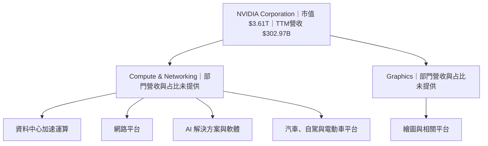
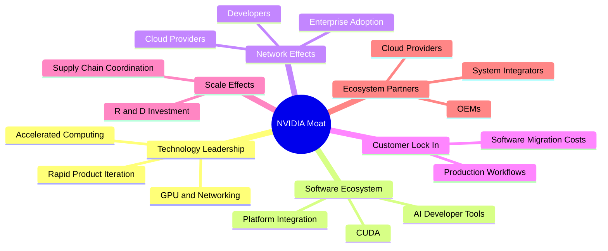
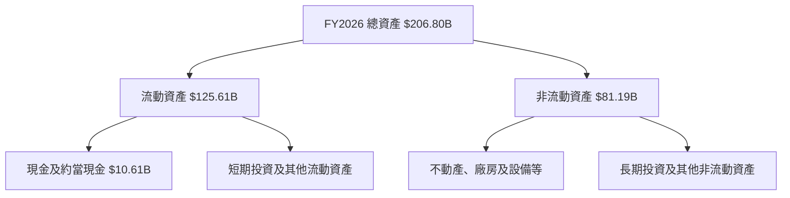
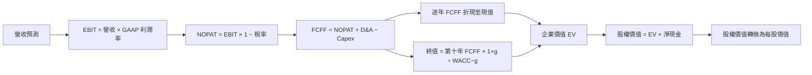
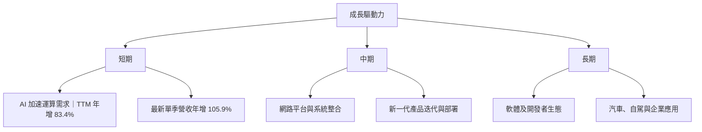
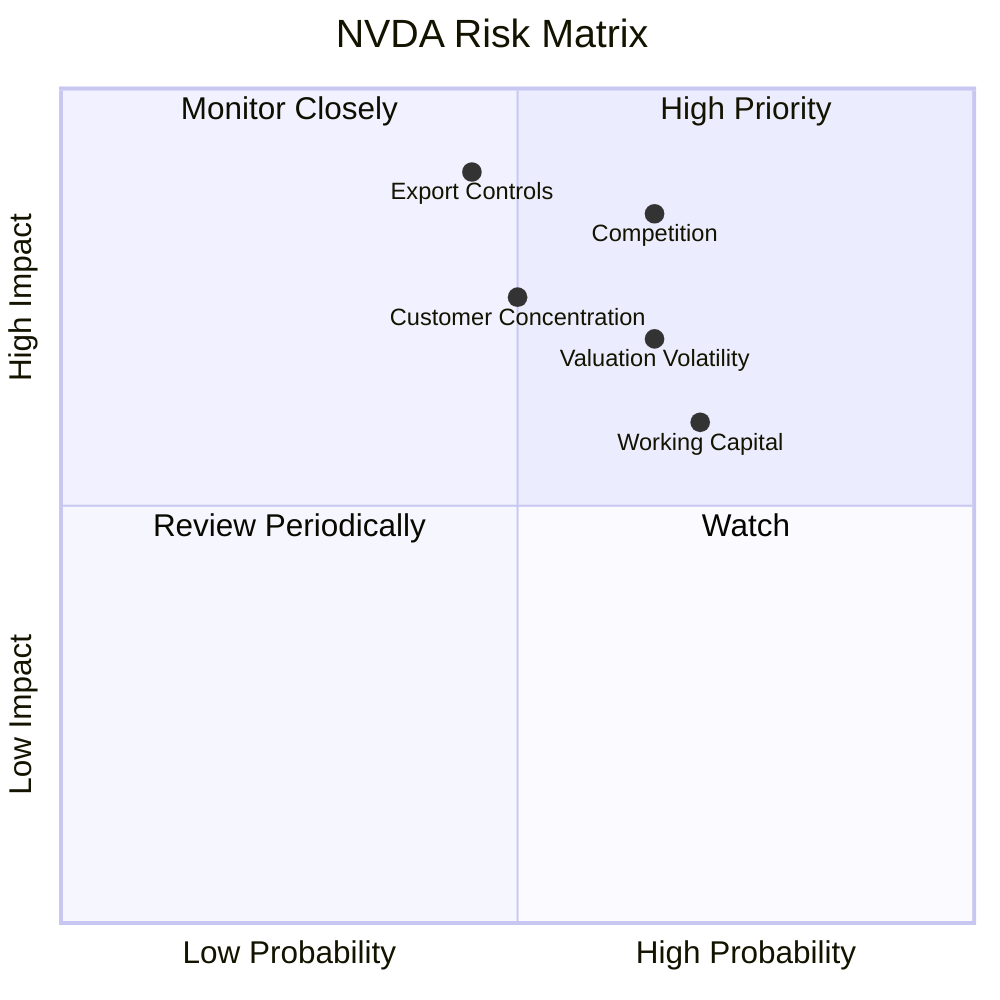
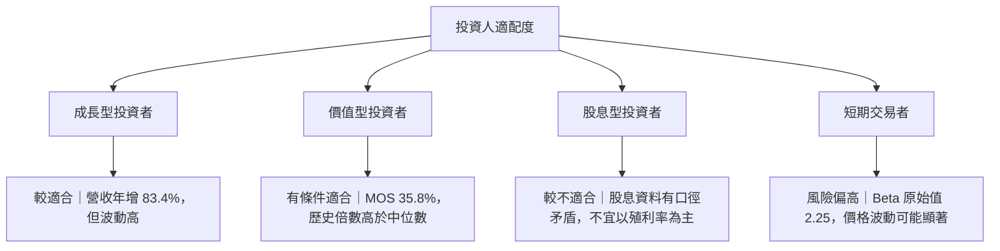

# NVDA 基本面深度分析報告
> **報告日期**：2026-11-26 ｜ **語言**：繁體中文 ｜ **數據來源**：SEC 申報資料 (XBRL)、Yahoo Finance、Finviz、StockAnalysis、Roic.ai ｜ **分析師**：CFA 級機構研究

## 目錄

| # | 章節 | 核心結論 |
|---|------|----------|
| 1 | 執行摘要 | 強烈買入；加權合理價值 $232.52；MOS 35.8% |
| 2 | 公司概覽與商業模式 | 加速運算、軟體與系統整合構成核心競爭優勢 |
| 3 | 損益表深度分析 | TTM 營收 $302.97B、年增 83.4%；TTM 營業利益率 65.2% |
| 4 | 資產負債表分析 | 淨現金 $23.22B；營運資金週期較一年前延長 |
| 5 | 現金流量深度分析 | TTM FCF $127.01B；FCF Yield 3.52% |
| 6 | 獲利能力與資本效率 | ROIC 80.6% 高於 WACC 13.88%，價值創造差距顯著 |
| 7 | 相對估值分析 | 相對同業估值具競爭力；相對自身歷史倍數仍偏高 |
| 8 | DCF 內在價值評估 | 基準 DCF 每股 $166.73；加權合理價值 $232.52 |
| 9 | 成長催化劑 | AI 基礎設施需求與產品迭代是主要成長來源 |
| 10 | 風險矩陣 | 競爭、出口限制、資本支出及客戶集中是主要風險 |
| 11 | 投資建議 | 強烈買入；建議以估值區間和營運指標分批執行 |

## 1. 執行摘要

NVDA 的 TTM 營收為 **$302.97B**，按 SEC 財報計算的 TTM 年增率為 **83.4%**；最新可用單季年增率為 **105.9%**，TTM 營業利益率達 **65.2%**。TTM FCF 為 **$127.01B**、FCF Yield 為 **3.52%**，ROIC **80.6%** 明顯高於 WACC **13.88%**。以這些營運與資本效率數據，搭配估值方法加權後的每股合理價值 **$232.52**，較 **2026-11-25 收盤價 $149.30** 高；MOS 為 **35.8%**，故依評級規則給予 **強烈買入**。評級不是單純由成長率推導：估值仍須留意產品週期、競爭及資本投入回報能否維持。

> **資料口徑提醒：**資料源的其他彙整欄位另列 TTM 營收 $361.81B、淨現金 $59.58B 等數值，與 SEC 申報資料計算的 Verified Figures 不一致。本報告涉及核心 TTM 成長、營業利益率、現金、債務、ROIC、WACC 與估值時，依規定採用 SEC／程式計算值；不同口徑不混算。市場資料中的股息殖利率 64.0% 亦與其他股息欄位及公司情況不相容，不納入判斷。

### 1.0 一頁式投資儀表板（Portfolio Manager 30 秒速讀）

| 項目 | 內容 |
|------|------|
| **投資論點（3 句）** | ① TTM 營收年增 **83.4%**，最新一季年增 **105.9%**，需求仍有動能。② TTM 營業利益率 **65.2%**、ROIC **80.6%**，顯示高獲利與資本效率。③ TTM FCF **$127.01B**，但 CCC 由 **105 天**增至 **155 天**，須追蹤應收與庫存。 |
| **綜合評分** | **8.5/10**（引用 1.1） |
| **財務健康** | 🟢 現金與短期投資 **$56.59B**、總債務 **$33.37B**，淨現金 **$23.22B**；營運資金天數轉差是主要觀察點。 |
| **ROIC vs WACC** | **80.6% vs 13.88%**；目前創造股東價值。 |
| **FCF 趨勢** | TTM FCF **$127.01B**；FCF Yield **3.52%**。 |
| **估值** | Forward P/E **8.99x**（彙整市場欄位；同業比較見 7.1）｜EV/EBITDA **14.55x**（同一彙整欄位）｜FCF Yield **3.52%**。 |
| **DCF 內在價值（基準）** | **$166.73**｜現價相對 DCF 折價 **10.4%**（以 DCF 基準值計）。 |
| **安全邊際（MOS）** | **+35.8%**＝($232.52 − $149.30) ÷ $232.52；🟢 >25% 充足。 |
| **預期報酬（基準情境 12M）** | 加權合理價值隱含上行空間 **+55.7%**；此為估值差距，非保證或年化報酬。 |
| **關鍵風險（前二）** | AI 加速器競爭與客戶自研；出口限制及地緣政治。 |
| **評級 + 信心度** | 🟢 **強烈買入**｜信心：中。模型情境跨度大，且部分輸入缺漏。 |

### 1.1 綜合評分卡（全報告唯一）

| 維度 | 評分（1–10） | 主要依據（引用數字與其來源章節） |
|------|--------------|----------------------------------|
| 成長性 | 9.0 | TTM 營收年增 83.4%、最新一季年增 105.9%（第 3 章）；但成長率能否延續仍有週期風險。 |
| 獲利能力 | 10.0 | TTM 營業利益率 65.2%、ROIC 80.6% 對 WACC 13.88%（第 6 章）。 |
| 財務健康 | 8.0 | 淨現金 $23.22B；CCC 155 天，較一年前增加 50 天（第 4 章）。 |
| 估值 | 7.0 | MOS 35.8%，但自身 P/E 18.9x 高於五年中位數 11.3x（第 7–8 章）。 |
| 護城河 | 9.0 | 營業利益率與資本回報、平台軟體及系統整合支持競爭優勢；市場份額數據未提供（第 2 章）。 |
| 管理層與資本配置 | 8.0 | FY2026 SBC $6.39B、約佔營收 3.0%；稀釋股數測試通過，但完整回購明細未提供（第 3、5 章）。 |
| **綜合評分** | **8.5** | 六項算術平均：(9+10+8+7+9+8) ÷ 6 = **8.5**。 |

### 1.2 五大投資論點 + 三大核心風險

| 類型 | 項目 | 具體依據 | 信心度 |
|------|------|----------|--------|
| 🟢 **投資論點①** | AI 加速運算需求推動成長 | TTM 營收 $302.97B，年增 83.4%；最新一季年增 105.9%。 | 🟢 高 |
| 🟢 **投資論點②** | 高營業槓桿與定價能力 | TTM 營業利益率 65.2%，最新一季 66.2%。 | 🟢 高 |
| 🟢 **投資論點③** | 現金流支撐再投資 | TTM OCF $134.36B、資本支出 $7.35B、FCF $127.01B。 | 🟢 高 |
| 🟢 **投資論點④** | 資本回報遠超資金成本 | ROIC 80.6%，WACC 13.88%，差距 66.72 個百分點。 | 🟢 高 |
| 🟢 **投資論點⑤** | 財務彈性高 | 淨現金 $23.22B；現金與短期投資 $56.59B。 | 🟢 高 |
| 🟡 **風險①** | 應收與庫存吸收現金增加 | DSO 76 天、DIO 150 天；CCC 由 105 天升至 155 天。 | 🟡 中 |
| 🔴 **風險②** | 競爭及客戶自研 | AMD、Broadcom 等均為重要競爭者；若大型客戶轉向自研，定價與成長可能下修。 | 🔴 高衝擊 |
| 🔴 **風險③** | 出口與供應鏈政策風險 | 財報與新聞資料反映監管環境存在不確定性；無法由現有資料量化其收入影響。 | 🟡 中 |

### 1.3 快速統計卡片

| 指標 | 公司實際值（期間） | 同業中位數 | 狀態 |
|------|--------------------|------------|------|
| 營收成長（TTM） | **83.4%** | — | 🟢 |
| 營收成長（最新一季年增） | **105.9%** | **44.7%**（AMD、AVGO、INTC 中位數） | 🟢 |
| 毛利率（TTM） | **74.9%**（彙整市場欄位） | **56.0%**（三家中位數） | 🟢 |
| 營業利益率（TTM） | **65.2%** | — | 🟢 |
| ROIC（TTM） | **80.6%** | — | 🟢 |
| Forward P/E | **8.99x**（彙整市場欄位） | **23.0x**（三家中位數） | 🟢* |
| FCF Yield（TTM） | **3.52%** | — | 🟡 |
| Piotroski F-Score | **5 / 9** | — | 🟡 |

\* Forward P/E 來自市場彙整資料，與估值方法所用 Forward EPS 口徑可能不同，不能直接視為完全同口徑的折價證據。

### 1.4 投資結論

╔══════════════════════════════════════════════════════════════════╗  
║                    📊 投資結論摘要                               ║  
╠══════════════════════════════════════════════════════════════════╣  
║ 評級：強烈買入（MOS 35.8%，且 ROIC 80.6% > WACC 13.88%）         ║  
║ 價格（2026-11-25 收盤）：$149.30                                 ║  
║ DCF 內在價值（基準）：$166.73（現價折價 10.4%）                  ║  
║ 安全邊際 MOS：+35.8%（以加權合理價值 $232.52 為分母）            ║  
║ 加權合理價值（8.8）：$232.52                                     ║  
║ DCF 情境價值：悲觀 $75.79（-49.2%）                              ║  
║               基準 $166.73（+11.7%）                              ║  
║               樂觀 $343.78（+130.3%）                             ║  
║ 綜合評分：8.5/10（引用 1.1）                                     ║  
║ 適合投資人：可承受高波動的成長型及長期投資人                     ║  
╚══════════════════════════════════════════════════════════════════╝

## 2. 公司概覽與商業模式

### 2.1 業務結構與收入來源

公司資料描述 NVDA 透過 Compute & Networking 與 Graphics 兩大部門營運；前者涵蓋資料中心加速運算、網路、AI 軟體及汽車平台，後者涵蓋繪圖相關產品。各部門營收與占比未提供，因此不拆分比例或金額。

**資料口徑說明：**不同財務彙整來源列出 TTM 營收 $361.81B，但 SEC／程式計算的指定 TTM 值為 $302.97B；本報告的主要分析遵循後者。因部門資料未附可比期間與數字，不由總額反推部門營收。

### 2.2 市場份額

市場份額數據未提供，故不繪製份額圖。NVDA 的 TTM 營收 $302.97B、年增 83.4%，高於 AMD 最新一季年增 44.7%、AVGO 85.5%及 INTC 20.9%中的 AMD 與 INTC；與 AVGO 相比，成長率略低。各公司產品組合不同，成長率並非市場份額的替代指標。

### 2.3 競爭護城河分析

### 2.4 護城河強度

| 護城河項目 | 強度（強／中／弱） | 證據（引用數字或事實） | 會削弱它的情況 |
|------------|--------------------|------------------------|----------------|
| 技術與產品整合 | 強 | TTM 營業利益率 65.2%、ROIC 80.6%，與高附加價值平台相符。 | 競爭者效能追近、供應受限或產品迭代失誤。 |
| 軟體生態系 | 強 | 公司業務包含 AI 解決方案與軟體；CUDA 等工具鏈帶來開發者遷移成本。 | 開放軟體替代、客戶改採多供應商及自研架構。 |
| 規模與供應鏈協作 | 中至強 | TTM FCF $127.01B，具備研發與供應鏈投入能力。 | 先進封裝、記憶體或晶圓供應成為瓶頸。 |
| 客戶鎖定 | 中至強 | 平台工具、軟體與工作流程整合提升轉換成本；未提供客戶留存率數據。 | 大型客戶降低單一供應商依賴。 |
| 生態夥伴 | 中 | 公司跨資料中心、網路及系統合作；未提供夥伴收入占比。 | 雲端業者建立內部方案，或夥伴轉向競品。 |
| 網路效應 | 中 | 使用者、開發者及服務提供者互相增強採用；缺少可量化網路效應指標。 | 開發者工具跨平台化、競爭平台形成規模。 |

**1.1「護城河」評分 9.0/10**，主要依據為高 ROIC、65.2% TTM 營業利益率及軟體／硬體平台整合；市場份額與客戶集中度數據缺漏，因此未將護城河視為無條件持久。

## 3. 損益表深度分析

### 3.1 年度收入成長趨勢（近 4 年）

╔══════════════════════════════════════════════════════════════════╗  
║              NVIDIA 年度收入趨勢（FY2023–FY2026）               ║  
╠══════════════════════════════════════════════════════════════════╣  
║ FY2023  $26.97B   ██░░░░░░░░░░░░░░░░░░░░░░  基準年             ║  
║ FY2024  $60.92B   ██████░░░░░░░░░░░░░░░░░░  YoY +125.9% 🟢     ║  
║ FY2025 $130.50B   █████████████░░░░░░░░░░░  YoY +114.2% 🟢     ║  
║ FY2026 $215.94B   ██████████████████████░░  YoY +65.5%  🟢     ║  
╠══════════════════════════════════════════════════════════════════╣  
║ FY2023–FY2026 營收 CAGR：約 100.1%                                ║  
╚══════════════════════════════════════════════════════════════════╝

FY2026 年增率由 FY2025 的 114.2% 放緩至 65.5%，但營收仍增加 $85.44B。FY2023–FY2026 的高 CAGR 反映 AI 加速運算需求由較低基期快速擴大；基期上升後，不能把歷史三年成長直接外推為長期成長率。

### 3.2 季度收入趨勢分析

| 季度 | 營收 | QoQ | YoY | 備註 |
|------|------:|----:|----:|------|
| FY2026 Q4（2026-01） | $68.13B | — | +73.2% | 年增率來自 StockAnalysis 季報序列。 |
| FY2027 Q1（2026-04） | $81.62B | +19.8% | +85.2% | QoQ 為 $81.615B ÷ $68.127B − 1。 |
| FY2027 Q2（2026-07） | $96.22B | +17.9% | **+105.9%** | 105.9% 為指定最新一季年增率；單季數字，不是 TTM。 |
| FY2027 Q3（2026-10，彙整資料） | $115.84B | +20.4% | +103.2% | StockAnalysis 序列；與 SEC 指定最新季期不同，分開標示。 |

季度營收連續上升，反映需求及交付擴張；不過跨來源季度的期間截止日與財報口徑不同，應以正式 SEC 季報核對實際申報數字。

### 3.3 利潤率演變分析

| 利潤率指標 | FY2023 | FY2024 | FY2025 | FY2026 | 趨勢 | 評估 |
|------------|-------:|-------:|-------:|-------:|------|------|
| 毛利率（年度計算） | 56.9% | 72.7% | 75.0% | 71.1% | 先升後回落 | 🟢 |
| 營業利益率（年度計算） | 20.7% | 54.1% | 62.4% | 60.4% | 規模效應推升，FY2026 稍降 | 🟢 |
| 淨利率（年度計算） | 16.2% | 48.8% | 55.8% | 55.6% | 大幅上升後趨穩 | 🟢 |
| TTM 營業利益率（指定口徑） | — | — | — | **65.2%** | TTM／單季口徑 | 🟢 |

年度利潤率由 FY2023 至 FY2025 大幅提高，與高價值加速運算產品收入增加、固定成本攤薄及強勢產品組合相符。FY2026 年度毛利率與營業利益率較 FY2025 低，可能反映產品組合、供應與新平台爬坡成本；所提供資料不足以拆解各項原因。TTM 營業利益率 65.2%與年度值不同，期間口徑不可混用。

### 3.4 費用結構分析

費用結構的完整數字未提供，不能製作有數字依據的費用圓餅圖。已知 FY2026 研發支出 **$18.50B**，佔年度營收 $215.94B 約 **8.6%**；FY2026 營業利益為 $130.39B。其他營業費用分項不足，無法完整拆分費用結構。

### 3.5 季度 EPS 趨勢與盈餘品質（Quality of Earnings）

| 季度 | EPS 實際值 | EPS 年增 | 超預期／不及預期 |
|------|-----------:|---------:|----------------|
| 2026-10-31（彙整季） | $2.70 | +107.7% | 預期值缺漏，無法判斷 |
| 2026-07-31（彙整季） | $2.46 | +127.8% | 預期值缺漏，無法判斷 |
| 2026-04-30 | $2.39 | +214.5% | 預期值缺漏，無法判斷 |
| 2026-01-31 | $1.76 | +95.6% | 預期值缺漏，無法判斷 |

資料庫的最近四季 EPS 預估欄皆為 NaN，因此不能宣稱超預期或不及預期。EPS 實際值及年增率顯示盈餘快速擴張，但驅動因素應以收入、產品組合與成本變化核對，不能用缺失的市場預估作結論。

| 盈餘品質項目 | 數值／佔比 | 評估 |
|--------------|-----------|------|
| 股權薪酬 SBC／營收 | FY2026：$6.39B ÷ $215.94B = **2.96%** | 🟡 SBC 是實質股東成本；若持續以股權支付，需關注稀釋。 |
| SBC／營業現金流 | FY2026：$6.39B ÷ $102.72B = **6.22%** | 🟡 SBC 佔 OCF 不高，但不應忽略。 |
| FCF／淨利（現金轉換率） | FY2026：$96.68B ÷ $120.07B = **80.5%** | 🟢 現金轉換健康；低於 100% 顯示淨利未完全轉為當年 FCF。 |
| 一次性／非經常性損益 | N/A（資料未提供可分拆項目） | 不據此判斷盈餘被一次性項目美化。 |
| 有效稅率 | **15.1%**（最新年度） | 🟢 DCF 採用指定有效稅率；未提供足夠多年資料測試異常性。 |
| 資本化支出 vs 費用化 | TTM Capex $7.35B；資本化細項未提供 | 不能判定是否有成本資本化造成盈餘遞延。 |

**盈餘品質結論：**FCF 對 FY2026 淨利轉換率為 80.5%，且 SBC 約佔營收 3.0%；整體現金流含金量具支持，但不能將 SBC 當作沒有成本的非現金項目。估值上應保留 GAAP 費用，避免以加回 SBC 的盈餘高估可分配現金。

## 4. 資產負債表分析

### 4.1 資產結構分解

以下為 FY2026 年度資產負債表數字，與 TTM 口徑分開呈現；流動資產內部細項採 StockAnalysis 年度表。

非流動資產為總資產減流動資產：$206.80B − $125.61B = $81.19B。流動資產其餘細分數字未在同一口徑資料中完整提供，故不反推填入。

### 4.2 流動性與營運資金分析

| 指標 | 最新 TTM | 一年前 TTM | 變化 | 解讀 |
|------|----------:|----------:|-----:|------|
| DSO 應收帳款天數 | 76 天 | 61 天 | +15 天 | 收款週期延長；可能與客戶組合、出貨及付款條款有關，需觀察逾期與回款。 |
| DIO 存貨天數 | 150 天 | 110 天 | +40 天 | 存貨持有時間拉長，可能反映新產品備貨或供應鏈提前配置；若需求減速，存在存貨風險。 |
| DPO 應付帳款天數 | 72 天 | 66 天 | +6 天 | 付款週期略延長，部分抵銷現金流壓力，但不足以抵銷 DSO、DIO 增幅。 |
| CCC 現金轉換週期 | 155 天 | 105 天 | +50 天 | 營運資金占用加大；須監控庫存消化與應收回款。 |

流動性補充資料：目前比率 **4.084**、速動比率 **3.288**（市場彙整資料）；指定口徑現金及短期投資 $56.59B、總債務 $33.37B。由於比率資料來源與最新季報日期未完全對齊，作為旁證而非與 TTM 現金數字混合計算。

### 4.3 債務結構分析

╔══════════════════════════════════════════════════════════════════╗  
║                    NVIDIA 債務健康診斷                           ║  
╠══════════════════════════════════════════════════════════════════╣  
║ 總債務：              $33.37B                                    ║  
║ 現金＋短期投資：      $56.59B                                    ║  
║ 淨現金：              $23.22B  🟢                                ║  
║ Debt/EBITDA：         N/A（未提供可比口徑 EBITDA）               ║  
║ Interest Coverage：  N/A（未提供利息費用及一致口徑 EBIT）       ║  
║ 資本結構判斷：        淨現金提供財務緩衝；營運資金天數需監控     ║  
╚══════════════════════════════════════════════════════════════════╝

### 4.4 股東權益趨勢

╔══════════════════════════════════════════════════════════════════╗  
║                 FY2023–FY2026 股東權益變化                       ║  
╠══════════════════════════════════════════════════════════════════╣  
║ FY2023  $22.10B   ████░░░░░░░░░░░░░░░░░░░░░                      ║  
║ FY2024  $42.98B   ████████░░░░░░░░░░░░░░░░░                      ║  
║ FY2025  $79.33B   ███████████████░░░░░░░░░                      ║  
║ FY2026 $157.29B   █████████████████████████                      ║  
╚══════════════════════════════════════════════════════════════════╝

FY2023 至 FY2026 權益增加，與獲利累積相符；但未提供同期完整回購、股息、其他綜合損益拆分，不能把權益變化全部歸因於留存盈餘。

## 5. 現金流量深度分析

### 5.1 現金流量瀑布圖

淨利和股息／回購數據若屬不同報表期間，不宜拼成同一筆現金流橋接。下圖僅呈現有指定 TTM 數字的營業現金流、Capex 與 FCF；股息及回購金額採年度資料，未併入 TTM 瀑布。

### 5.2 FCF 轉換率趨勢

| 財年 | OCF | Capex | FCF | 淨利 | FCF／淨利 |
|------|----:|------:|----:|-----:|----------:|
| FY2023 | $5.64B | $1.83B | $3.81B | $4.37B | 87.2% |
| FY2024 | $28.09B | $1.07B | $27.02B | $29.76B | 90.8% |
| FY2025 | $64.09B | $3.24B | $60.85B | $72.88B | 83.5% |
| FY2026 | $102.72B | $6.04B | $96.68B | $120.07B | 80.5% |
| 最新 TTM | $134.36B | $7.35B | $127.01B | N/A（同口徑淨利未提供） | N/A |

FY2024–FY2026 FCF 持續擴張；轉換率由 90.8%降至 80.5%，代表淨利增長快於可用現金流，可能與營運資金、應收與存貨占用有關，需以後續季度數據確認。

### 5.3 自由現金流趨勢

╔══════════════════════════════════════════════════════════════════╗  
║                 NVIDIA 自由現金流趨勢                           ║  
╠══════════════════════════════════════════════════════════════════╣  
║ FY2023    $3.81B   █░░░░░░░░░░░░░░░░░░░░░░░                      ║  
║ FY2024   $27.02B   ██████░░░░░░░░░░░░░░░░░                      ║  
║ FY2025   $60.85B   █████████████░░░░░░░░░░                      ║  
║ FY2026   $96.68B   ████████████████████░░░                      ║  
║ TTM     $127.01B   FCF Yield 3.52%                                ║  
╚══════════════════════════════════════════════════════════════════╝

### 5.4 資本配置評估

FY2026 可量化配置項目包括 Capex **$6.04B**、現金股息支付 **$0.974B**、SBC **$6.39B**。回購及留存盈餘的完整同期現金配置數據未提供，故不繪製以不完整數據推估的資本配置圓餅圖。

| 項目 | FY2026 數值 | 解讀 |
|------|------------:|------|
| 資本支出 | $6.04B | 相對 FCF $96.68B 約 6.2%；低資產密集度支持高現金轉換，但仍可能隨基礎設施投入變化。 |
| 現金股息 | $0.974B | 相對 FCF 約 1.0%；目前股東回報以股息以外用途為主。 |
| SBC | $6.39B | 約為營收 2.96%；屬薪酬成本與潛在稀釋來源。 |
| 股票回購 | N/A | 未提供可核對的 FY2026 回購金額。 |
| 留存／投資 | N/A | 未提供完整用途拆分。 |

## 6. 獲利能力與資本效率

### 6.1 ROE／ROA／ROIC 趨勢

| 指標 | 可用期間數值 | 解讀 | 評估 |
|------|--------------|------|------|
| ROE | TTM **84.2%**（品質指標口徑）；另一市場彙整值 117.4% | 資料口徑不同，採指定 TTM 品質指標值；高回報部分來自高利潤率。 | 🟢 |
| ROA | Piotroski 測試顯示 ROA > 0；精確 TTM 值未在品質區塊列示 | 無法以不一致來源補填精確值。 | 🟡 |
| ROIC | TTM **80.6%** | 大幅高於 WACC 13.88%。 | 🟢 |

沒有可直接比較的行業平均 ROIC／ROE／ROA 數字，故不列行業均值。

### 6.2 ROIC vs WACC 分析（核心價值創造判斷）

╔══════════════════════════════════════════════════════════════════╗  
║                ROIC vs WACC 深度分析                            ║  
╠══════════════════════════════════════════════════════════════════╣  
║ WACC（採用指定資金成本輸入）：13.88%                             ║  
║ ├── 無風險利率：4.85%                                            ║  
║ ├── ERP：5.00%                                                   ║  
║ ├── Beta 原始值：2.25；調整後採用值：1.83                       ║  
║ ├── Ke：4.85% + 1.83 × 5.00% = 14.00%                           ║  
║ ├── 稅前 Kd：0.78%；稅後約 0.66%                                ║  
║ ├── 股權／債務權重：99.1%／0.9%                                 ║  
║ └── WACC：13.88%                                                 ║  
║                                                                  ║  
║ ROIC（TTM）：80.6%                                               ║  
║ EVA spread：80.6% − 13.88% = +66.72 個百分點                    ║  
║ ROIC／WACC：約 5.81 倍                                           ║  
║                                                                  ║  
║ 結論：目前投入資本回報顯著高於資金成本，創造股東價值。          ║  
╚══════════════════════════════════════════════════════════════════╝

Beta 調整採指定公式：⅔ × 原始 Beta 2.25 + ⅓ = 約 1.83。稅前 Kd 及資本權重直接沿用資金成本資料，不另以不同債務範圍重新建模。WACC 僅使用提供的 **13.88%**，第 8 章保持一致。

### 6.3 杜邦三因素分解

| 因素 | 數值（TTM） | 解讀 |
|------|-------------|------|
| 淨利率 | 63.7% | 高淨利率是 ROE 的主要來源。 |
| 資產週轉率 | 0.95 | 資產每年周轉約 0.95 次。 |
| 權益乘數 | 1.40 | 槓桿倍數適中，ROE 並非主要靠財務槓桿撐起。 |
| **ROE** | **84.2%** | 63.7% × 0.95 × 1.40 = 約 84.7%；指定品質數據列示 ROE 84.2%，差異來自未四捨五入底層數值。 |

### 6.4 財務體質：Piotroski F-Score

**Piotroski F-Score：5 / 9**（照錄品質指標）。

| 測試 | 結果 | 解讀 |
|------|------|------|
| ROA > 0 | ✅ 通過 | 公司獲利為正。 |
| 營業現金流 > 0 | ✅ 通過 | 營運產生正現金。 |
| ROA 高於一年前 | ❌ 未通過 | 盈利資產效率未高於去年。 |
| 營業現金流 > 淨利 | ❌ 未通過 | 應計品質測試未過，與 FCF 轉換率低於 100%相呼應。 |
| 長期負債／總資產低於一年前 | ❌ 未通過 | 槓桿相對資產的改善測試未通過。 |
| 流動比率高於一年前 | ✅ 通過 | 短期流動性改善。 |
| 稀釋股數未增加 | ✅ 通過 | 股數稀釋測試通過。 |
| 毛利率高於一年前 | ✅ 通過 | 毛利率趨勢測試通過。 |
| 資產週轉率高於一年前 | ❌ 未通過 | 資產使用效率未較去年提升。 |

5/9 顯示獲利與流動性有正面訊號，但應計品質、資產週轉及負債比例測試未過；不宜僅憑高 ROIC 忽略營運資金變化。

## 7. 相對估值分析

### 7.1 同業估值比較表格

NVDA 倍數取市場彙整資料；同業倍數取 Yahoo Finance Peer multiples。因公司自身數據與 TTM 營收口徑存在來源差異，表格僅作市場倍數比較，不視為完全同口徑估值測算。

| 估值指標 | **NVDA** | **AMD** | **AVGO** | **INTC** | NVDA 評估 |
|----------|---------:|-------:|-------:|-------:|-----------|
| **Trailing P/E** | 16.04x（彙整市場欄位） | 86.8x | 38.4x | N/A | 🟢 表面低於同業；來源及盈利口徑需核對。 |
| **Forward P/E** | 8.99x（彙整市場欄位） | 23.0x | 15.5x | 30.4x | 🟢 表面折價，但可能受前瞻 EPS 口徑影響。 |
| **P/S Ratio** | 9.96x（彙整市場欄位） | 14.8x | 16.1x | 4.8x | 🟡 介於同業區間；INTC 商業組合不同。 |
| **EV/EBITDA** | 14.55x（彙整市場欄位） | 59.2x | 28.1x | 15.8x | 🟢 相對同業較低，但須考慮不同增長及利潤結構。 |
| 最新一季營收年增 | 105.9%（指定最新季） | 44.7% | 85.5% | 20.9% | 🟢 NVDA 指定單季成長高於三家。 |
| TTM 毛利率 | 74.9%（彙整市場欄位） | 56.0% | 75.5% | 40.2% | 🟢 接近 AVGO，顯著高於 AMD、INTC。 |

同業最新一季營收年增中位數為 **44.7%**，同業 P/E 與 P/S 中位數分別約 **38.4x**、**14.8x**；EV/EBITDA 可計算的 AVGO、INTC 中位數為 **22.0x**。這些倍數與 NVDA 彙整市場倍數相比，指向相對估值尚有支撐，但數據口徑差異是重要限制。

### 7.2 歷史估值區間分析

╔══════════════════════════════════════════════════════════════════╗  
║            NVDA 五年歷史估值位置（指定 TTM 倍數）                ║  
╠══════════════════════════════════════════════════════════════════╣  
║ P/E        範圍 2.3x ───────── 現值 18.9x ───────── 49.3x        ║  
║            五年中位數 11.3x｜現值百分位 71%                      ║  
║ P/S        範圍 1.2x ─────── 現值 12.0x ─────────── 31.0x        ║  
║            五年中位數 2.7x｜現值百分位 57%                      ║  
║ EV/EBITDA  範圍 3.4x ─────── 現值 17.9x ────────── 47.8x        ║  
║            五年中位數 8.9x｜現值百分位 57%                       ║  
╚══════════════════════════════════════════════════════════════════╝

以自身歷史比較，三項 TTM 倍數均高於五年中位數；P/E 位於第 71 百分位，估值並非歷史低位。此結果與市場彙整欄位所列倍數不同，應把指定歷史序列與其他估值快照分開看待。

### 7.3 情境價值（Bear / Base / Bull）

| 情境 | 第 1 年營收成長 | 期末營業利潤率 | WACC | 每股價值 | 相對現價 | 機率 | 會發生的條件 |
|------|----------------:|----------------:|-----:|----------:|---------:|-----:|--------------|
| 🔴 悲觀 | 15.0% | 51.3% | 14.88% | $75.79 | -49.2% | 25% | AI 投資放慢、競爭或出口限制壓低成長與利潤率，風險溢酬上升。 |
| 🟡 基準 | 30.0% | 60.4% | 13.88% | $166.73 | +11.7% | 50% | 高需求延續，但十年內成長與利潤率逐步回歸較成熟水準。 |
| 🟢 樂觀 | 45.0% | 66.4% | 12.88% | $343.78 | +130.3% | 25% | 新產品與平台需求超預期，利潤率維持高位，資金成本下降。 |

機率加權 DCF 為 **$188.26**（相對現價 +26.1%），但第 8.8 節規定的估值方法採用基準 DCF 價值，不以機率加權情境值替換。

### 7.4 相對估值隱含價格區間

╔══════════════════════════════════════════════════════════════════╗  
║                  估值方法隱含每股價值                            ║  
╠══════════════════════════════════════════════════════════════════╣  
║ $149.30 現價 ─ $166.73 DCF ─ $184.08 EV/EBITDA ─ $232.52 加權值 ║  
║                                  $382.25 Forward P/E              ║  
╚══════════════════════════════════════════════════════════════════╝

| 方法 | 每股價值 | 依據 |
|------|---------:|------|
| DCF 基準 | $166.73 | 十年 FCFF、WACC 13.88%、永續成長率 3.0%。 |
| 同業 Forward P/E | $382.25 | 同業中位數 23.0x × Forward EPS $16.61。 |
| 同業 EV/EBITDA | $184.08 | AVGO、INTC 中位數 22.0x，乘 TTM EBITDA 並加回淨現金。 |
| 分析師共識 | $242.43 | 59 位分析師平均目標價；屬參考值。 |

## 8. DCF 內在價值評估（Discounted Cash Flow）

### 8.0 估值推理鏈（Thinking Logic）

**Step 1 — 價值由哪些變數決定？**  
模型以整體公司 FCFF 評估，不將 Compute & Networking、Graphics 或軟體收入拆成獨立估值，因分部收入與占比未提供。主要價值來源為目前營收基礎 **$302.97B**、TTM 營業利益率 **65.2%** 所形成的現金流，以及未來十年成長遞減路徑。主導估值的變數是長期營收成長與終值折現率；敏感度表顯示 WACC、永續成長率均會顯著改變價值。

**Step 2 — 模型選擇**

| 決策點 | 本報告採用 | 理由 | 曾考慮但否決 | 否決理由 |
|--------|-----------|------|--------------|----------|
| 現金流定義 | FCFF | 以 WACC 折現，先求 EV，再加淨現金得股權價值。 | FCFE | 資本結構影響可由橋接呈現，不直接預測融資現金流。 |
| 預測期 N | 10 年 | DCF 模型指定十年，逐年將 30% 成長淡化至 3%。 | 5 年 | 無法完整表達模型指定的成長淡化路徑。 |
| 終值方法 | Gordon Growth | 模型提供永續成長率 3.0%，且 WACC 13.88% 高於 g。 | 退出倍數 | DCF 輸入未提供可獨立驗算的退出倍數終值。 |
| EBIT 基礎 | GAAP EBIT | 模型指定採 GAAP EBIT，並說明已含 SBC。 | 非 GAAP EBIT | 會改變 SBC 處理方式，且模型未提供非 GAAP 預測。 |

**Step 3 — 關鍵假設推導鏈**

- **營收成長路徑（高敏感度）**：錨點＝TTM 年增 **83.4%**、最新單季年增 **105.9%** → 調整＝避免將異常高增速永久外推，因基期擴大且資料未提供可量化 TAM → **採用第 1 年 30.0%，逐年線性降至第 10 年 3.0%** → 曾考慮持續採用 83.4%，但會忽略基期墊高及成熟化，不採用。
- **期末營業利益率（高敏感度）**：錨點＝TTM 營業利益率 **65.2%** → 調整＝模型指定漸降至近五年財年中位數（含 TTM）→ **第 10 年採 60.4%** → 曾考慮維持 65.2%，但不能把當前高利潤率視為十年不變。
- **WACC（高敏感度）**：錨點＝資金成本資料所列 WACC **13.88%** → 採用原因＝Beta 2.25 的高波動與高股權資本權重已反映於計算 → **採 13.88%** → 否決另行下調折現率，避免與指定資金成本輸入不一致。
- **永續成長率 g（高敏感度）**：錨點＝模型指定 **3.0%**，長期假設低於 WACC **13.88%** → 調整理由＝十年高成長後回歸成熟企業長期名目成長 → **採 3.0%** → 否決高於 3.0%的假設，因缺乏永續市場規模依據；且 g 越高終值越敏感。
- **預測期 N（中敏感度）**：錨點＝模型指定十年逐年預測 → **採 N=10** → 曾考慮較短期間，但會更早進入終值、令估值更依賴終值，且違反指定模型輸入。
- **Capex／營收（中敏感度）**：錨點＝TTM Capex $7.35B ÷ TTM 營收 $302.97B 約 **2.4%** → 模型令其淡化至第十年 **1.3%** → **採用逐年 2.4% 至 1.3% 的模型路徑** → 不採用全期維持 2.4%，因模型設計預設資本支出比率下降。
- **GAAP EBIT 與 SBC（中敏感度）**：錨點＝FY2026 SBC $6.39B；模型明列 GAAP EBIT 已含 SBC → **採組合 (A)：GAAP EBIT、FCFF 不再扣 SBC、股數不額外稀釋** → 否決 GAAP EBIT 再扣 SBC 或非 GAAP EBIT 卻不扣 SBC，前者重複計成本、後者漏計成本。
- **年稀釋率（中敏感度）**：模型採固定股數 → **採 0% 額外年度稀釋**，因採組合 (A)，避免與 GAAP 費用重複計算；不是對未來實際稀釋的預測。
- **稅率（低敏感度）**：錨點＝最新年度有效稅率 **15.1%** → 採模型指定 **15.1%**。
- **D&A／營收（低敏感度）**：錨點＝TTM **1.2%** → 採模型指定全期固定 **1.2%**。
- **營運資金變動**：現有資料顯示 CCC 上升，但 DCF 模型明示未建模營運資金變動 → **模型中不另列 ΔWC**；這會令模型無法完整反映營運資金占用上升的風險。
- **終值方法（高敏感度）**：採 Gordon Growth，因模型提供 g=3.0% 且 WACC>g → 不以缺乏退出倍數輸入的倍數法替代。
- **期末估值與股數**：模型採股權價值乘價格除市值轉成每股價值，詳見 8.5；底層精確稀釋股數未明列，未自行重建。

**Step 4 — 最脆弱一環**  
最脆弱的是高成長期及高營業利潤率能否同時維持；若成長、利潤率及 WACC 一併轉向悲觀，模型情境價值可降至 **$75.79**，較現價低 49.2%。

**Step 5 — 計算路徑圖**

### 8.1 模型假設總表（Model Inputs）

| 假設項目 | 採用值 | 依據／來源 | 敏感度 |
|----------|--------|-------------|--------|
| 預測期長度 N | 10 年 | DCF 模型指定；逐年成長淡化。 | 🟡 中 |
| 營收成長路徑 | FY+1 30.0% → FY+10 3.0% | TTM 年增 83.4%為歷史錨點，模型限制並淡化成長。 | 🔴 高 |
| 營業利潤率 | 65.2% → 60.4% | TTM 起點，終點為模型所用近五年財年中位數。 | 🔴 高 |
| 有效稅率 | 15.1% | 最新年度有效稅率。 | 🟢 低 |
| Capex／營收 | 2.4% → 1.3% | TTM 比率起點，模型向 1.1×D&A 附近淡化。 | 🟡 中 |
| D&A／營收 | 1.2% | TTM 比率，模型固定。 | 🟢 低 |
| 營運資金變動 | 未建模 | DCF 模型明示 working capital is not modelled。 | 🟡 中 |
| EBIT 基礎 | GAAP | 模型指定 GAAP EBIT。 | 🟡 中 |
| SBC 處理 | 組合 (A)：不再扣 SBC | SBC 已在 GAAP EBIT 費用化；固定股數。 | 🟡 中 |
| 年稀釋率 | 0% 額外稀釋 | 組合 (A) 的模型設定，非未來股數預測。 | 🟡 中 |
| 永續成長率 g | 3.0% | DCF 模型指定，低於 WACC。 | 🔴 高 |
| 終值方法 | Gordon Growth | 模型所列公式及參數。 | 🔴 高 |
| WACC | 13.88% | 資金成本指定值；第 6.2 節同值。 | 🔴 高 |

**SBC 防重複扣除：本模型採用 (A)，GAAP EBIT 已含 SBC，FCFF 不再扣 SBC，股數不額外稀釋；SBC 影響在模型中計入一次。**  
FCFF 定義採模型版本：**NOPAT + D&A − Capex**，不含營運資金變動列。

### 8.2 折現率推導（WACC）

╔══════════════════════════════════════════════════════════════════╗  
║                    WACC 推導（折現率）                           ║  
╠══════════════════════════════════════════════════════════════════╣  
║ 股權成本 Ke（CAPM）：                                            ║  
║ ├── Rf：4.85%（資金成本資料所列 10Y Treasury；觀測日未提供）      ║  
║ ├── ERP：5.00%（指定假設）                                       ║  
║ ├── 原始 Beta：2.25；調整後 Beta：1.83                           ║  
║ └── Ke = 4.85% + 1.83 × 5.00% = 14.00%                           ║  
║                                                                  ║  
║ 債務成本：稅前 Kd 0.78%                                           ║  
║ ├── 有效稅率：15.1%                                               ║  
║ └── 稅後 Kd = 0.78% × (1 − 15.1%) = 0.66222%                     ║  
║                                                                  ║  
║ 資本結構：股權權重 99.1%；債務權重 0.9%                          ║  
║ WACC = 99.1% × 14.00% + 0.9% × 0.66222% = 13.88096% ≈ 13.88%   ║  
╚══════════════════════════════════════════════════════════════════╝

Beta 調整依指定公式：⅔ × 2.25 + ⅓ × 1 = 1.8333，採用值 1.83。ERP 為指定假設；未提供獨立來源日期或額外規模、國別溢酬，故不自行加計。指定的資金成本資料給出稅前 Kd、資本權重與 WACC，本節不另建不同口徑的 WACC。

1. **Ke** = 4.85% + 1.83 × 5.00% = **14.00%**。  
2. **稅前 Kd** = 直接採用資金成本資料所列 **0.78%**；利息費用及平均計息負債明細未提供，不能另行重算。  
3. **稅後 Kd** = 0.78% × (1 − 15.1%) = **0.66222%**。  
4. **權重**：股權 99.1%，債務 0.9%，合計 **100.0%**；指定市值與債務權重未提供足以重建其未四捨五入底層數值的完整資料。  
5. **WACC** = 99.1% × 14.00% + 0.9% × 0.66222% = 13.874% + 0.00596% = **13.87996% ≈ 13.88%**。  

### 8.3 逐年自由現金流預測（基準情境）

金額單位：$B；折現因子採模型列值。所有年度、現金流及折現數字照錄 DCF MODEL。由於表內金額及比例均經四捨五入，逐格驗算可能有極小尾差；不以四捨五入後的列值替換模型原值。

| 年度 | FY+1 | FY+2 | FY+3 | FY+4 | FY+5 | FY+6 | FY+7 | FY+8 | FY+9 | FY+10 |
|------|-----:|-----:|-----:|-----:|-----:|-----:|-----:|-----:|-----:|------:|
| 營收 | 393.86 | 500.20 | 620.25 | 750.50 | 885.59 | 1,018.43 | 1,140.64 | 1,243.30 | 1,317.90 | 1,357.44 |
| 營收 YoY | 30.0% | 27.0% | 24.0% | 21.0% | 18.0% | 15.0% | 12.0% | 9.0% | 6.0% | 3.0% |
| 營業利潤率 | 65.2% | 64.7% | 64.1% | 63.6% | 63.1% | 62.5% | 62.0% | 61.5% | 60.9% | 60.4% |
| EBIT | 256.85 | 323.52 | 397.83 | 477.35 | 558.51 | 636.82 | 707.11 | 764.08 | 802.85 | 819.64 |
| − 稅 | (38.83) | (48.91) | (60.14) | (72.16) | (84.43) | (96.27) | (106.89) | (115.51) | (121.37) | (123.91) |
| NOPAT | 218.02 | 274.61 | 337.69 | 405.19 | 474.08 | 540.55 | 600.22 | 648.57 | 681.48 | 695.74 |
| + D&A | 4.79 | 6.09 | 7.55 | 9.13 | 10.78 | 12.39 | 13.88 | 15.13 | 16.04 | 16.52 |
| − Capex | (9.56) | (11.54) | (13.55) | (15.49) | (17.21) | (18.56) | (19.41) | (19.65) | (19.24) | (18.17) |
| **FCFF** | **213.26** | **269.16** | **331.68** | **398.82** | **467.65** | **534.39** | **594.69** | **644.05** | **678.28** | **694.09** |
| 折現因子 | 0.878 | 0.771 | 0.677 | 0.595 | 0.522 | 0.458 | 0.403 | 0.353 | 0.310 | 0.273 |
| **FCFF 現值 PV** | **187.26** | **207.54** | **224.57** | **237.11** | **244.14** | **244.97** | **239.39** | **227.65** | **210.53** | **189.17** |

DCF 模型列示的預測期 PV 合計為 **$2,212.33B**。逐年 PV 表列值相加與合計有小幅尾差，故以模型指定合計值為準；這是四捨五入後數字的限制，詳見 8.10。

**FY+1 代表年度逐步演算：**

1. 營收：$302.97B × (1 + 30.0%) = $393.861B，模型列示 **$393.86B**。  
2. EBIT：收入 × GAAP 營業利潤率；模型列示 **$256.85B**。比例與金額均為四捨五入列值，底層未四捨五入假設未提供。  
3. 稅：模型列示 **$38.83B**，採用稅率 15.1%。  
4. NOPAT：模型列示 **$218.02B**。  
5. D&A：模型列示 **$4.79B**，D&A／營收假設 1.2%。  
6. Capex：模型列示 **$9.56B**，第 1 年 Capex／營收假設 2.4%。  
7. ΔWC：不建模，按模型定義不列入。  
8. FCFF：NOPAT + D&A − Capex，照錄模型 **$213.26B**；以列示四捨五入數計算為 $213.25B，差額 $0.01B。  
9. 折現：模型列示因子 **0.878**、PV **$187.26B**；以列示四捨五入數相乘會有小額尾差，模型使用未四捨五入因子。

預測期 PV 合計（採模型列示值）：

**$187.26 + $207.54 + $224.57 + $237.11 + $244.14 + $244.97 + $239.39 + $227.65 + $210.53 + $189.17 = $2,212.33B**（分項四捨五入總和可能產生少量尾差，模型合計採未四捨五入值）。

**合理性自檢：**

- 預測 FCF 成長在前期快速擴張、後期放緩；可用歷史年度 FCF（FY2023 $3.81B、FY2026 $96.68B）作方向性錨點，但期間與模型十年預測不同，不能直接視為同期間 CAGR。
- FY+10 FCFF 利潤率 = $694.09B ÷ $1,357.44B，約 **51.1%**；目前 TTM FCF／營收 = $127.01B ÷ $302.97B，約 **41.9%**。同業最佳 FCFF 利潤率未提供，不能作數值比較。
- 模型各年 FCFF 為正；但未建模 ΔWC，若 CCC 持續上升，實際 FCF 可能低於模型。

╔══════════════════════════════════════════════════════════════════╗  
║            自由現金流：歷史實際 vs 模型預測                      ║  
╠══════════════════════════════════════════════════════════════════╣  
║ FY2024（實） $27.02B  █████░░░░░░░░░░░░░░░░                      ║  
║ FY2025（實） $60.85B  ██████████░░░░░░░░░░                      ║  
║ FY2026（實） $96.68B  ███████████████░░░░░                      ║  
║ FY+1（預）  $213.26B  ██████████████████░░                      ║  
║ FY+10（預） $694.09B  ████████████████████                      ║  
╠══════════════════════════════════════════════════════════════════╣  
║ 模型預測依賴營收成長與高利潤率延續；營運資金變動未建模。        ║  
╚══════════════════════════════════════════════════════════════════╝

### 8.4 終值計算（Terminal Value）

**適用性檢查：WACC 13.88% vs g 3.0% → WACC > g？✅**

| 方法 | 計算式 | 終值 TV | TV 現值 | 佔總 EV 比重 |
|------|--------|---------:|--------:|-------------:|
| Gordon Growth | FCFF(FY+10) × (1+g) ÷ (WACC−g) | $6,569.47B | $1,790.48B | 44.7% |
| 退出倍數法 | N/A | N/A | N/A | N/A |

退出倍數所需的 FY+10 EBITDA 倍數假設未列於 DCF MODEL，因此不自行建立第二種終值估值。

**終值逐步演算（照錄模型數字）：**

1. FY+10 FCFF = **$694.09B**。  
2. 分子：FCFF × (1+g)，模型使用未四捨五入輸入。  
3. 分母：WACC − g = 13.88% − 3.0% = **10.88%**。  
4. 模型列示 TV **$6,569.47B**，PV(TV) **$1,790.48B**；依模型未四捨五入輸入計算。  
5. 終值占比：$1,790.48B ÷ $4,002.81B = **44.7%**。  

終值占 EV 未超過 75%，但仍佔約 44.7%，估值對長期假設具重要敏感度。

### 8.5 企業價值 → 每股內在價值（Bridge）

╔══════════════════════════════════════════════════════════════════╗  
║              企業價值 → 每股內在價值 橋接表                      ║  
╠══════════════════════════════════════════════════════════════════╣  
║ 預測期 FCF 現值合計             +$2,212.33B                      ║  
║ 終值現值 PV(TV)                 +$1,790.48B                      ║  
║ = 企業價值 EV                    $4,002.81B                      ║  
║ + 淨現金                         +$23.22B                         ║  
║ = 股權價值                       $4,026.03B                       ║  
║ 每股基準 DCF 價值                $166.73                          ║  
║ 2026-11-25 收盤價                $149.30                          ║  
║ 現價相對 DCF 折價                10.4%                            ║  
╚══════════════════════════════════════════════════════════════════╝

1. **EV** = $2,212.33B + $1,790.48B = **$4,002.81B**。  
2. **股權價值** = $4,002.81B + $23.22B = **$4,026.03B**。  
3. **每股內在價值**：模型提供的換算方式為股權價值 × 價格 ÷ 市值，結果照錄 **$166.73**；市值及價格未四捨五入底層數據未完整提供，不能以展示值重建到完全相同小數。  
4. **折溢價** = ($149.30 ÷ $166.73) − 1 ≈ **−10.4%**，即現價相對 DCF 基準值折價。  
5. 本節不計算 MOS；MOS 僅於 8.8 以加權合理價值為分母。

淨現金採指定財報口徑 **$23.22B**。由於模型使用固定股數設定、但未獨立列示可稽核的精確稀釋股數，依指定每股換算式照錄價值，不自行反推股數。

### 8.6 敏感性分析（WACC × 永續成長率）

格內價值照錄 DCF MODEL；括號為相對 $149.30 現價的上行空間（由列示價值計算）。

| g（列）／WACC（欄） | 11.88% | 12.88% | **13.88%（基準）** | 14.88% | 15.88% |
|-----------|-------:|-------:|--------------------:|-------:|-------:|
| 2.0% | $198.64（+33.1%） | $177.37（+18.8%） | $159.83（+7.1%） | $145.13（-2.8%） | $132.65（-11.2%） |
| 2.5% | $204.28（+36.8%） | $181.65（+21.7%） | $163.13（+9.3%） | $147.72（-1.1%） | $134.71（-9.8%） |
| 3.0% | $210.56（+41.0%） | $186.36（+24.8%） | **$166.73（+11.7%）** | $150.52（+0.8%） | $136.92（-8.3%） |
| 3.5% | $217.59（+45.7%） | $191.56（+28.3%） | $170.68（+14.3%） | $153.57（+2.9%） | $139.31（-6.7%） |
| 4.0% | $225.50（+51.0%） | $197.36（+32.2%） | $175.03（+17.2%） | $156.90（+5.1%） | $141.90（-5.0%） |

**矩陣示範格：WACC = 14.88% > g = 3.0% ✅**。指定模型已提供此格價值 **$150.52**；逐年現金流在新 WACC 下的 PV 與終值折現中間值未另行列出，不能自行改建模型。以矩陣比較，WACC 由 13.88% 增至 14.88%，基準 g 下價值由 **$166.73** 降至 **$150.52**，減少 **$16.21／9.7%**。

**三情境 DCF（營運假設與折現率均變動）**

| 情境 | 第 1 年營收成長 | 期末營業利潤率 | WACC | 每股價值 | 相對現價 | 機率 |
|------|----------------:|----------------:|-----:|----------:|---------:|-----:|
| 🔴 悲觀 | 15.0% | 51.3% | 14.88% | $75.79 | -49.2% | 25% |
| 🟡 基準 | 30.0% | 60.4% | 13.88% | $166.73 | +11.7% | 50% |
| 🟢 樂觀 | 45.0% | 66.4% | 12.88% | $343.78 | +130.3% | 25% |
| **機率加權** | — | — | — | **$188.26** | **+26.1%** | **100%** |

模型未提供各情境逐年營收、FY+10 FCFF 及終值明細，因此不得自行補造完整的情境推導鏈。可核對的加權算式為：**$75.79 × 25% + $166.73 × 50% + $343.78 × 25% = $188.26**（按未四捨五入情境值計算）。

**敏感度可量化觀察：**

- g 每增加 1 個百分點（2.0% 至 3.0%，WACC 13.88%）：價值由 **$159.83** 升至 **$166.73**，增加 **$6.90／4.3%**。
- WACC 每增加 1 個百分點（13.88% 至 14.88%，g 3.0%）：價值由 **$166.73** 降至 **$150.52**，減少 **$16.21／9.7%**。
- 期末營業利潤率每增加 1 個百分點的獨立敏感度：N/A，矩陣未提供此單變數分析。
- 已提供的矩陣顯示 WACC 變動的估值影響大於上述 1 個百分點 g 變動，與 8.0 所述估值對折現與長期現金流高度敏感的判斷一致。

### 8.7 反推 DCF（Reverse DCF）

反推 DCF 只採用模型已求出的兩個結果。其他變數未提供解，不補造迭代結果。

| 求解的變數（一次一個） | 其餘變數設定 | 市場隱含值（令 DCF = 現價） | 公司歷史實際 | 判斷 |
|------------------------|--------------|------------------------------:|--------------|------|
| 第 1 年營收成長率 | 其他基準假設固定 | **26.8%** | TTM 年增 83.4%；最新單季年增 105.9% | 🟡 低於基準 DCF 的 30.0%，但仍為高成長。 |
| 固定營業利潤率 | 其他基準假設固定 | **55.2%** | TTM 營業利益率 65.2% | 🟢 市場價格可容忍較低利潤率。 |
| 永續成長率 g | N/A | 未計算 | — | N/A（未提供求解結果）。 |
| 高成長持續年數 N | N/A | 未計算 | — | N/A（未提供求解結果）。 |

資料未附 0.5 個百分點級距的反推試算軌跡，因此不偽造逐次迭代數字。模型反推指出，要使 DCF 等於現價，採基準其他假設時，第一年營收成長約 26.8%，或固定營業利潤率約 55.2%。這表明現價並未要求基準模型的全部高成長及高利潤假設同時成立，但仍須以後續季度營收與利潤率驗證。

### 8.8 估值三角驗證與安全邊際

| 估值方法 | 隱含每股價值 | 上行空間（÷現價） | 權重 | 說明 |
|----------|--------------:|-------------------:|-----:|------|
| DCF（基準） | $166.73 | +11.7% | 40% | 十年 FCFF，WACC 13.88%、g 3.0%。 |
| 同業 Forward P/E | $382.25 | +156.0% | 25% | 同業中位數 23.0x × Forward EPS $16.61。 |
| 同業 EV/EBITDA | $184.08 | +23.3% | 25% | 同業中位數 22.0x × TTM EBITDA，再加淨現金。 |
| 分析師共識目標價 | $242.43 | +62.4% | 10% | 59 位分析師平均目標價。 |
| **加權合理價值** | **$232.52** | **+55.7%** | **100%** | 四種方法按獲利型公司固定權重加權。 |

**逐步演算：**

$166.73 × 40% + $382.25 × 25% + $184.08 × 25% + $242.43 × 10%  
= $66.692 + $95.5625 + $46.020 + $24.243  
= **$232.5175 ≈ $232.52**。

權重合計 40% + 25% + 25% + 10% = **100%**。加權合理價值依模型列值四捨五入至美分；不同方法未作事後調整。MOS 嚴格以此加權合理價值為基準：

- **MOS** = ($232.52 − $149.30) ÷ $232.52 = **35.8%**。
- **上行空間** = ($232.52 − $149.30) ÷ $149.30 = **55.7%**。
- **折溢價**（以 DCF 基準價值 $166.73 為基準）= $149.30 ÷ $166.73 − 1 = **−10.4%**，即折價。

╔══════════════════════════════════════════════════════════════════╗  
║                  估值區間與安全邊際                              ║  
╠══════════════════════════════════════════════════════════════════╣  
║ $75.79 悲觀DCF ─ $149.30 現價 ─ $166.73 基準DCF ─ $232.52 加權值║  
║                                       $343.78 樂觀DCF             ║  
║ MOS = ($232.52 − $149.30) ÷ $232.52 = 35.8%                      ║  
║ 上行空間 = ($232.52 − $149.30) ÷ $149.30 = 55.7%                 ║  
║ MOS 評估：🟢 >25% 充足                                            ║  
║ 建議買入區間：$149.30–$209.27（價格不高於加權價值的 90%）       ║  
║ 合理持有區間：$209.27–$232.52                                    ║  
║ 減碼考慮區間：高於 $343.78 樂觀情境價值                           ║  
╚══════════════════════════════════════════════════════════════════╝

買入區間上限按 10% MOS 門檻計算：$232.52 × (1 − 10%) = **$209.27**；評級為強烈買入，區間上限高於現價。

> 🔎 **程式複算（Python，依本節各項自動重算）**
>
> 加權合理價值 = $166.73 × 40% + $382.25 × 25% + $184.08 × 25% + $242.43 × 10% = **$232.52**（權重合計 100%）
>
> 以價格 $149.30 計：MOS = **+35.8%**，上行空間 = **+55.7%**
>
> ✅ 與本節所寫數值一致。

### 8.9 DCF 模型的局限與失效條件

- **終值依賴度：**PV(TV) 佔 EV **44.7%**；接近一半企業價值取決於第十年之後的現金流假設。
- **最脆弱假設：**成長率淡化路徑、終值利潤率及 WACC。提供的情境價值從悲觀 **$75.79** 到樂觀 **$343.78**，跨度顯示模型風險不小。
- **營運資金限制：**DCF 未建模 ΔWC，而 CCC 已由 105 天增加至 155 天；若營運資金持續占用現金，基準 DCF 可能高估價值。
- **資料口徑限制：**DCF 的每股換算所需精確市值／股數及未四捨五入計算底稿未提供，故只能照錄模型價值，不能獨立重建至最後小數。
- **適用性：**公司目前 FCF 為正且快速增長，DCF 可作參考；但高成長公司遠期現金流不確定，宜與同業倍數及情境分析交叉檢驗。
- **與第 10 章連結：**出口限制及競爭會影響營收成長、利潤率；供應鏈與庫存風險會影響 Capex 及未建模營運資金；利率與風險溢酬變化會影響 WACC。

### 8.10 複算檢核表（Audit Trail）

| # | 檢核項目 | 檢查方式 | 結果 |
|---|----------|----------|------|
| 1 | 高／中敏感度輸入均有四段式推導 | 對照 8.0 Step 3 | ✅ |
| 2 | 每項假設有來歷 | 8.1 依據欄 | ✅ |
| 3 | WACC 組成及權重 | 權重 99.1% + 0.9%=100%；依指定值重算約 13.88% | ✅ |
| 4 | Kd 分母與債務權重口徑一致 | 利息費用及平均計息負債明細缺漏，直接採指定 Kd／權重，無法獨立檢驗 | ⚠️ |
| 5 | WACC 與第 6.2 節相同 | 均為 13.88% | ✅ |
| 6 | 預測年度數 = N，無省略年度 | FY+1 至 FY+10 共十年 | ✅ |
| 7 | FY+1 FCFF 與 PV 逐項複算 | 列值四捨五入後有約 $0.01B 尾差 | ⚠️ |
| 8 | 預測期 PV 加總 | 模型合計 $2,212.33B；列示年度 PV 受四捨五入有小額尾差 | ⚠️ |
| 9 | WACC > g | 13.88% > 3.0% | ✅ |
| 10 | 終值基於 FY+N、折現 N 期 | 模型列示 FY+10 及 10 年折現因子 | ✅ |
| 11 | EV 與股權價值橋接 | $2,212.33B + $1,790.48B = $4,002.81B；加淨現金 = $4,026.03B | ✅ |
| 12 | SBC 組合經濟相容 | GAAP EBIT、無 −SBC、固定股數（組合 A） | ✅ |
| 13 | 矩陣基準格等於基準 DCF | 13.88%、g 3.0% 格為 $166.73 | ✅ |
| 14 | 敏感性矩陣有效格 | 所列 WACC 均高於 g | ✅ |
| 15 | 情境機率及加權值 | 25% + 50% + 25%=100%；加權值 $188.26 | ✅ |
| 16 | 反推 DCF 僅解一個變數 | 只引用模型已提供的兩項單變數結果；未提供迭代軌跡 | ⚠️ |
| 17 | MOS 與折溢價基準正確 | MOS 以 $232.52；折溢價以 DCF $166.73 | ✅ |
| 18 | 報告到第 11 章完整 | 章節齊全 | ✅ |
| 19 | 加權合理價值無事後調整 | 四項加權和 $232.5175，四捨五入 $232.52 | ✅ |
| 20 | 評級符合 MOS 規則 | MOS 35.8%、ROIC 80.6% > WACC 13.88%，強烈買入 | ✅ |

**需注意的未完全複算項目：**底層未四捨五入現金流、折現因子、平均計息負債、市值及股數未完整提供，故年度小數尾差、Kd 分母以及每股轉換無法完全獨立重建；本報告保留指定模型原值，不自行改寫。

## 9. 成長催化劑

### 9.1 催化劑時間軸

未提供可引用的具體產品上市日期、管理層財測或客戶部署時程，因此不以虛構日期繪製 gantt。可追蹤的時間框架如下：

| 時間範圍 | 催化劑 | 可觀察指標 |
|----------|--------|------------|
| 短期：未來數季 | AI 基礎設施持續出貨及產品組合 | 營收年增、單季營業利益率、庫存與應收天數。 |
| 中期：未來 1–3 年 | 加速運算與網路平台擴大部署 | Compute & Networking 業務收入、毛利率及客戶集中度；分部資料待補。 |
| 長期：3 年以上 | 軟體生態與汽車、企業等新應用 | 軟體收入占比、汽車業務成長與現金流貢獻；目前未提供分項數字。 |

### 9.2 TAM 市場規模分析

**N/A（TAM 數據未提供）**。不以未經來源支持的市場規模或滲透率填表。公司 TTM 營收 $302.97B、TTM 年增 83.4%，表示現有業務仍處於高速擴張；但由於未提供 TAM，不能據此推估長期市場占比或可持續成長年限。

### 9.3 成長驅動力結構圖

## 10. 風險矩陣

### 10.1 風險評分矩陣

機率與衝擊座標為定性研究評估，不是財務資料中的統計機率；不將其誤認為量化預測。

### 10.2 風險清單詳細分析

| # | 風險項目 | 發生機率 | 財務衝擊 | 風險評分 | 緩解措施 |
|---|----------|----------|----------|----------|----------|
| 1 | 🔴 競爭與客戶自研 | 中高（定性） | 高；收入增速或利潤率可能下修，幅度無法由資料量化 | 🔴 高 | 追蹤各季營收增速、營業利益率、產品組合及客戶自研進度。 |
| 2 | 🔴 出口管制與地緣政治 | 中（定性） | 高；可能限制特定市場可服務收入，未提供可計量曝險 | 🔴 高 | 追蹤公司對受限制市場曝險、出貨限制與正式監管公告。 |
| 3 | 🟡 營運資金惡化 | 中高 | CCC 已增加 **50 天**至 **155 天**，可能增加資金占用 | 🟡 中高 | 追蹤 DSO、DIO；若 CCC 持續上升而營收減速，重新評估現金流。 |
| 4 | 🟡 高估值與波動 | 中高 | 悲觀 DCF **$75.79**，低於現價 49.2%；Beta 2.25 原始值 | 🟡 高 | 分批建倉、控制單一持股比重，以營收和利潤率而非短期股價作檢核。 |
| 5 | 🟡 供應鏈與資本投入 | 中 | Capex TTM $7.35B；供應限制可影響交付及產品爬坡 | 🟡 中 | 追蹤交付、庫存、資本支出及供應鏈集中度。 |

## 11. 投資建議

### 11.1 最終評級與評分

**評級為強烈買入**：加權合理價值 $232.52、MOS 35.8%，且 ROIC 80.6% 高於 WACC 13.88%，不作一級調整。綜合評分 **8.5/10**，引用 1.1 的六項分數：成長性 9.0、獲利能力 10.0、財務健康 8.0、估值 7.0、護城河 9.0、管理層與資本配置 8.0。

### 11.2 合理價值與隱含報酬率

| 價值參考 | 每股價值 | 相對現價 | 機率／權重 |
|----------|---------:|---------:|-----------:|
| 加權合理價值 | **$232.52** | **+55.7%** | 估值方法加權 100% |
| DCF 悲觀情境 | $75.79 | -49.2% | 25% |
| DCF 基準情境 | $166.73 | +11.7% | 50% |
| DCF 樂觀情境 | $343.78 | +130.3% | 25% |
| DCF 機率加權（情境參考） | $188.26 | +26.1% | 100% |

加權合理價值採 8.8 四種估值方法的固定權重；DCF 情境僅呈現模型提供的情境值，不替代加權合理價值。

### 11.3 買入時機與觸發因素

╔══════════════════════════════════════════════════════════════════╗  
║                  ✅ 買入觸發因素 Checklist                      ║  
╠══════════════════════════════════════════════════════════════════╣  
║ 立即／分批建倉參考：                                             ║  
║ ✅ 股價不高於 $209.27：對 $232.52 加權價值至少保有 10% MOS      ║  
║ ✅ 營收成長維持正值，且營業利益率接近或高於 60%                 ║  
║ ✅ DSO、DIO 不再惡化，CCC 開始回落                              ║  
║                                                                  ║  
║ 加碼觸發條件：                                                   ║  
║ ☐ 股價回到或低於 $149.30，且基本面未出現論點失效               ║  
║ ☐ 最新季營收年增仍達 30%以上，利潤率未明顯收縮                  ║  
║ ☐ FCF 持續為正，營運資金占用改善                               ║  
║                                                                  ║  
║ 減碼／重新評估觸發條件：                                         ║  
║ ☐ 連續兩季營收成長低於 30%，並伴隨利潤率下行                   ║  
║ ☐ CCC 繼續高於 155 天，或 DIO 持續增加                           ║  
║ ☐ ROIC 接近或跌破 WACC 13.88%                                    ║  
║ ☐ 競爭、法規或供應鏈事件改變可服務市場                           ║  
╚══════════════════════════════════════════════════════════════════╝

### 11.4 投資人適配度分析

### 11.5 每季財報監控清單（Quarterly Watch List）

| 監控指標 | 目前參考值 | 觸發加碼觀察 | 觸發減碼／重估 |
|----------|-----------:|--------------|----------------|
| TTM 營收成長 | 83.4% | 最新季度年增保持 30%以上 | 連續兩季低於 30%且趨勢下滑 |
| 最新一季營收年增 | 105.9% | 營收持續季增、年增顯著高於 30% | 連續兩季低於 30% |
| TTM 營業利益率 | 65.2% | 維持 60%以上 | 跌破 55%或快速收縮 |
| TTM OCF／FCF | $134.36B／$127.01B | FCF 持續為正並增長 | FCF 轉負或現金轉換明顯下降 |
| DSO／DIO／CCC | 76／150／155 天 | CCC 連續下降 | CCC 高於 155 天且繼續惡化 |
| 資本支出 | TTM $7.35B | 投入增加但現金流仍能覆蓋 | Capex 上升而 FCF 下滑或轉負 |
| ROIC 與 WACC | 80.6%／13.88% | ROIC 維持顯著高於 WACC | ROIC 跌破 WACC |
| 股權薪酬 | FY2026 $6.39B；約營收 2.96% | SBC／營收保持穩定或下降 | SBC 比率上升且稀釋股數增加 |
| 財測與產品交付 | 財測未提供 | 實際結果達到或超過公司財測 | 財測下修、交付延後或需求預期轉弱 |

### 11.6 反面論證：什麼會證明論點錯誤（What Would Change My Mind）

╔══════════════════════════════════════════════════════════════════╗  
║              ⚠️ 論點失效條件（Disconfirming Evidence）           ║  
╠══════════════════════════════════════════════════════════════════╣  
║ 本投資論點在以下情況成立時，應重新檢視或退出：                  ║  
║ ☐ 核心營收年增連續兩季低於 30%，且管理層下修需求展望            ║  
║ ☐ TTM 營業利益率由 65.2%降至 55%以下，且無短期回復跡象          ║  
║ ☐ FCF 轉負，或 FCF／淨利長期低於 70%                             ║  
║ ☐ CCC 高於 155 天並連續兩季惡化，顯示存貨與應收占用擴大          ║  
║ ☐ ROIC 跌破 WACC 13.88%，顯示新增資本不再創造超額價值            ║  
║ ☐ SBC／營收持續高於 FY2026 約 3.0%，且稀釋股數重新增加           ║  
║ ☐ 競爭、出口限制或供應鏈變化使基準 DCF 假設不再可達              ║  
╚══════════════════════════════════════════════════════════════════╝

> **免責聲明：**本報告為 AI 自動生成，僅供研究參考，不構成投資建議。投資有風險，入市需謹慎。

---

## 資料與來源

| 項目 | 內容 |
|------|------|
| 價格 | 149.30 USD，2026-11-25 收盤（Yahoo Finance 日線） |
| 財務報表 | SEC 10-Q filed 2026-08-26，最新季度 2026-07-26（FY2027 Q2） |
| 有回應的資料來源 | SEC 申報資料 (XBRL)、Yahoo Finance、Finviz、StockAnalysis、Roic.ai |
| 由程式計算 | TTM 數字、WACC、DCF 模型、估值方法與權重、加權合理價值、MOS、評級門檻、F-Score、杜邦分解、營運資金天數、綜合評分 |
| 撰寫模型 | openai / gpt-6-luna |

> 本區塊由產生報告的程式依實際取得的資料填寫，非模型撰寫。「由程式計算」的數字不是模型的估計；其餘判斷（評分、情境、策略）是模型的分析。
