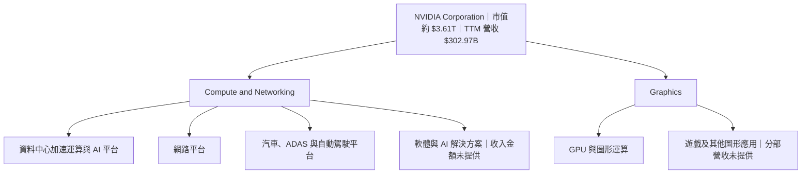
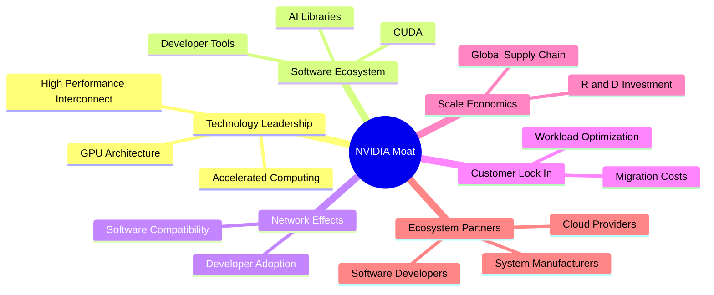
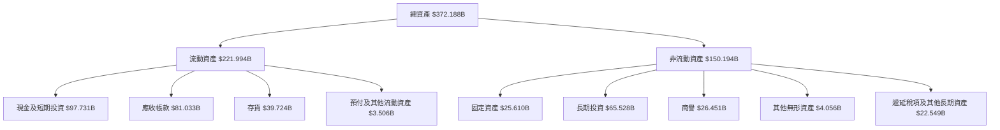
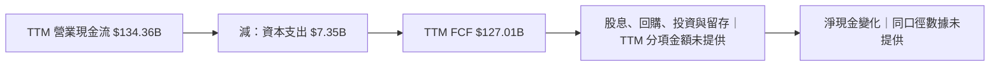
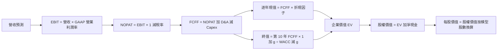
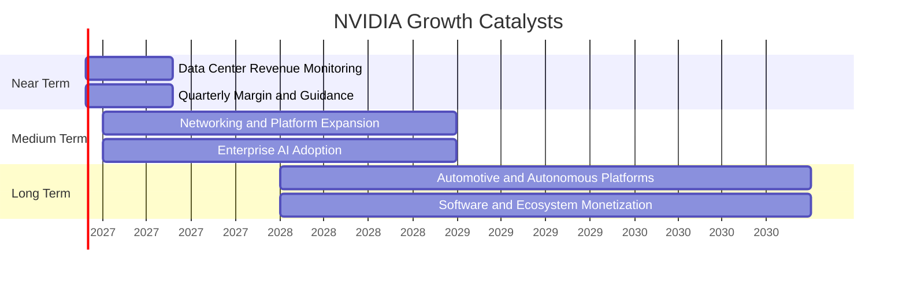
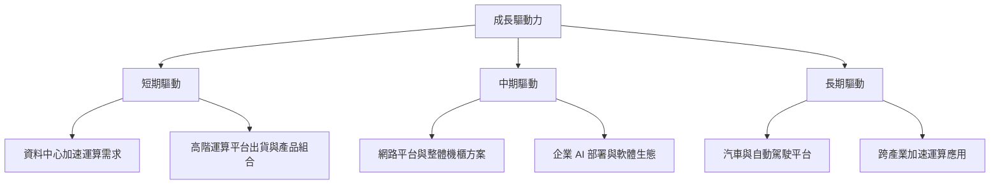
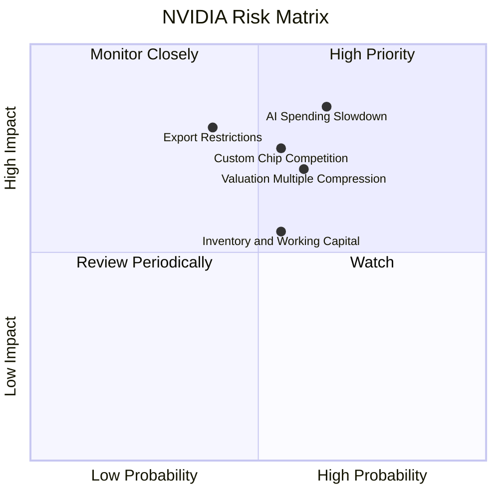
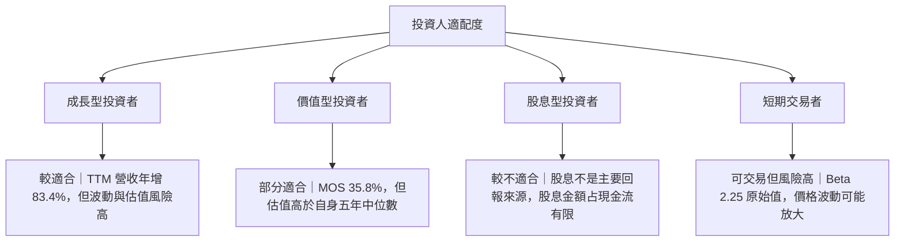

# NVDA 基本面深度分析報告
> **報告日期**：2026-11-27 ｜ **語言**：繁體中文 ｜ **數據來源**：SEC 申報資料 (XBRL)、Yahoo Finance、Finviz、StockAnalysis、Roic.ai ｜ **分析師**：CFA 級機構研究

> **資料口徑說明**：財務資料中部分來源的 TTM 營收、現金與債務等數字互有差異。本報告涉及核心估值、ROIC、FCF、營運資金天數及同業倍數時，優先採用程式計算的 VERIFIED FIGURES；歷史年度與季度趨勢則依相應年度／季度報表呈現。對無法調和的差異不自行混算。

## 目錄

| # | 章節 | 核心結論 |
|---|------|----------|
| 1 | 執行摘要 | 強烈買入；加權合理價值 $232.66；MOS +35.8% |
| 2 | 公司概覽與商業模式 | AI 加速運算與軟體生態系形成主要競爭壁壘 |
| 3 | 損益表深度分析 | TTM 營收 $302.97B、年增 83.4%；最新單季年增 105.9% |
| 4 | 資產負債表分析 | 淨現金 $23.22B；流動性強，但營運資金週期拉長 |
| 5 | 現金流量深度分析 | TTM FCF $127.01B，FCF Yield 3.52% |
| 6 | 獲利能力與資本效率 | ROIC 80.6% 高於 WACC 13.88%，價值創造幅度大 |
| 7 | 相對估值分析 | 相對同業估值具吸引力；高於自身五年估值中位數 |
| 8 | DCF 內在價值評估 | 基準 DCF $166.73；加權合理價值 $232.66 |
| 9 | 成長催化劑 | AI 資料中心投資與加速運算需求是主要催化劑 |
| 10 | 風險矩陣 | 需求正常化、競爭／自研晶片及出口限制是主要風險 |
| 11 | 投資建議 | 強烈買入；分批建倉並以成長、利潤率與 FCF 作監控 |

## 1. 執行摘要

### 1.0 一頁式投資儀表板（Portfolio Manager 30 秒速讀）

| 項目 | 內容 |
|------|------|
| **投資論點（3 句）** | ① TTM 營收 $302.97B、年增 83.4%，最新一季年增 105.9%，顯示資料中心需求仍具動能。② TTM 營業利益率 65.2%、ROIC 80.6%，相較 WACC 13.88% 有 66.72 個百分點利差。③ TTM FCF $127.01B，約為市值的 3.52%；現金流支撐研發、資本配置與景氣波動。 |
| **綜合評分** | **8.6/10**（引用 1.1 評分卡） |
| **財務健康** | 🟢 TTM 淨現金 $23.22B；流動性充足，但 CCC 由 105 天升至 155 天，營運資金占用增加。 |
| **ROIC vs WACC** | **80.6% vs 13.88%**；創造股東價值。 |
| **FCF 趨勢** | FCF 維持高位；TTM FCF Yield **3.52%**。 |
| **估值** | Forward P/E **8.99x**（一般市場資料欄位）；同業比較採用估值專區 Peer multiples；EV/EBITDA **14.55x**（一般市場資料欄位）；FCF Yield **3.52%**。不同來源估值口徑不一，詳見第 7 章。 |
| **DCF 內在價值（基準）** | **$166.73**；現價相對 DCF 折價 **10.4%**。 |
| **安全邊際（MOS）** | **+35.8%**＝($232.66 − $149.30) ÷ $232.66；🟢 >25% 充足。基準為第 8.8 節加權合理價值。 |
| **預期報酬（基準情境 12M）** | **+11.7%**，以 DCF 基準情境 $166.73 相對現價計。 |
| **關鍵風險（前二）** | AI 資料中心資本支出增速降溫；客戶自研晶片、競爭及出口限制壓低營收或毛利。 |
| **評級 + 信心度** | 🟢 **強烈買入**｜信心：中高；估值與盈利資料有來源口徑差異，須持續核對。 |

### 1.1 綜合評分卡（全報告唯一）

| 維度 | 評分（1–10） | 主要依據（引用數字與其來源章節） |
|------|--------------|----------------------------------|
| 成長性 | 9.0 | TTM 營收年增 83.4%、最新一季年增 105.9%（第 3 章）；增速仍須考慮基期墊高。 |
| 獲利能力 | 9.5 | TTM 營業利益率 65.2%、ROIC 80.6%，高於 WACC 13.88%；Piotroski 5/9（第 6 章）。 |
| 財務健康 | 9.0 | 淨現金 $23.22B、現金及短期投資 $56.59B；CCC 155 天，高於一年前 105 天（第 4 章）。 |
| 估值 | 6.5 | MOS +35.8%，但 P/E、P/S、EV/EBITDA 均高於自身五年中位數（第 7–8 章）。 |
| 護城河 | 9.5 | 65.2% TTM 營業利益率與資料中心平台、軟體生態系相互支持；市場份額數據未提供（第 2 章）。 |
| 管理層與資本配置 | 8.0 | 2026 財年 SBC $6.39B、TTM 稀釋股數測試通過；資本配置成效佳，但股權薪酬仍有稀釋成本（第 3、5 章）。 |
| **綜合評分** | **8.6** | 六項算術平均：$(9.0+9.5+9.0+6.5+9.5+8.0)÷6=8.58$，四捨五入至一位小數。 |

### 1.2 五大投資論點 + 三大核心風險

| 類型 | 項目 | 具體依據 | 信心度 |
|------|------|----------|--------|
| 🟢 **投資論點①** | AI 加速運算需求持續轉化為營收 | TTM 營收 $302.97B、年增 83.4%；最新一季營收年增 105.9%。若雲端及企業部署延續，營收成長仍有支撐。 | 🟢 高 |
| 🟢 **投資論點②** | 高利潤率帶來營業槓桿 | TTM 營業利益率 65.2%、最新一季 66.2%；規模與產品組合有助抵銷研發支出增加。 | 🟢 高 |
| 🟢 **投資論點③** | 高 ROIC 支持長期價值創造 | ROIC 80.6% 對 WACC 13.88%，利差 66.72 個百分點。 | 🟢 高 |
| 🟢 **投資論點④** | 現金流提供財務彈性 | TTM 營業現金流 $134.36B、資本支出 $7.35B、FCF $127.01B。 | 🟢 高 |
| 🟢 **投資論點⑤** | 估值模型顯示現價低於加權合理價值 | 加權合理價值 $232.66，MOS +35.8%；DCF 基準價值 $166.73。 | 🟡 中 |
| 🟡 **風險①** | 資料中心支出增速放緩 | TTM 成長 83.4% 及最新單季年增 105.9% 均處於高增速區間；若客戶資本支出回落，估值與成長預期可能同時下修。 | 🟡 中 |
| 🔴 **風險②** | 競爭、自研晶片與產品替代 | AMD、Broadcom 等同業持續競爭；雲端客戶自研晶片可能侵蝕部分需求或議價能力。 | 🔴 高衝擊 |
| 🔴 **風險③** | 出口管制與供應鏈集中 | 公司跨國營運，且高階晶片供應鏈受地緣政治與出口規則影響。 | 🟡 中 |

### 1.3 快速統計卡片

| 指標 | 公司實際值（期間） | 同業中位數 | 狀態 |
|------|--------------------|------------|------|
| 營收成長（TTM） | **83.4%** | — | 🟢 |
| 營收成長（最新一季年增） | **105.9%** | AMD、AVGO、INTC 中位數 44.7% | 🟢 |
| 毛利率（TTM） | **74.9%** | 56.0%（AMD）、75.5%（AVGO）、40.2%（INTC），中位數 56.0% | 🟢 |
| 營業利益率（TTM） | **65.2%** | — | 🟢 |
| ROIC（TTM） | **80.6%** | — | 🟢 |
| Forward P/E | **8.99x**（一般市場資料欄位） | Peer multiples 中位數 23.0x | 🟢；來源口徑差異見第 7 章 |
| FCF Yield（TTM） | **3.52%** | — | 🟡 |
| Piotroski F-Score | **5 / 9** | — | 🟡 |

### 1.4 投資結論

╔══════════════════════════════════════════════════════════════════╗  
║                    📊 投資結論摘要                               ║  
╠══════════════════════════════════════════════════════════════════╣  
║  評級：強烈買入（依第 8.8 節 MOS 門檻；未作質化調整）             ║  
║  價格（2026-11-25 收盤）：$149.30                                 ║  
║  DCF 內在價值（基準）：$166.73（現價折價 10.4%）                  ║  
║  安全邊際 MOS：+35.8%（＝($232.66−$149.30)÷$232.66）             ║  
║  加權合理價值（8.8）：$232.66                                     ║  
║  DCF 情境價值：                                                   ║  
║    悲觀情境：$75.79（-49.2%）                                     ║  
║    基準情境：$166.73（+11.7%）                                    ║  
║    樂觀情境：$343.78（+130.3%）                                   ║  
║  綜合評分：8.6/10（引用 1.1）                                     ║  
║  適合投資人：可承受高波動、著眼長期 AI 基建需求的成長型投資人      ║  
╚══════════════════════════════════════════════════════════════════╝  

## 2. 公司概覽與商業模式

### 2.1 業務結構與收入來源

公司概覽指出 NVIDIA 分為 Compute & Networking 與 Graphics 兩大業務，但各板塊營收金額、占比以及軟體／服務收入數字未提供，因此不推算比例或金額。

### 2.2 市場份額

市場份額數據未提供，故不以未經引用的比例繪製市場份額圖。相對位置可由營收與增速觀察：公司 TTM 營收 $302.97B、TTM 年增 83.4%，最新一季年增 105.9%；同業 AMD 最新季度營收年增 44.7%，AVGO 為 85.5%。這反映公司規模與近期成長速度均處高位，但不能直接替代市場份額數據。

### 2.3 競爭護城河分析

### 2.4 護城河強度

| 護城河項目 | 強度（強／中／弱） | 證據（引用數字或事實） | 會削弱它的情況 |
|------------|--------------------|------------------------|----------------|
| 技術與平台整合 | 強 | TTM 營業利益率 65.2%，最新一季 66.2%；產品包含加速運算、網路及 AI 解決方案。 | 替代晶片性能提升、供應受限或成本上升。 |
| 軟體生態系 | 強 | 公司概覽列出 AI 解決方案與軟體；CUDA 與開發工具的轉換成本屬質化優勢，未提供獨立軟體收入數字。 | 開放標準成熟、客戶轉向自研軟體或跨平台工具。 |
| 客戶鎖定 | 中至強 | 硬體、軟體與部署流程整合通常增加更換成本；客戶集中度數字未提供。 | 大型雲端客戶議價、採用多供應商架構。 |
| 規模效應 | 強 | TTM 營收 $302.97B、FCF $127.01B，可支撐研發與平台投資。 | 投資回報下降或產業進入供過於求。 |
| 網路效應與夥伴 | 中 | 開發者、雲端平台及系統廠的互補關係具質化支撐；量化生態系資料未提供。 | 競爭平台擴大兼容性、合作夥伴轉向替代方案。 |

1.1「護城河」評分為 **9.5/10**，主要基於 TTM 營業利益率 65.2%、營收規模及軟硬體平台整合，但因市場份額與生態系量化指標未提供，仍保留資料不確定性。

## 3. 損益表深度分析

### 3.1 年度收入成長趨勢（近 4 年）

年度營收資料為 FY2023–FY2026；FY2023 至 FY2026 的三年 CAGR 約 100.0%，公式為 $(215.94÷26.97)^{1/3}-1$。

╔══════════════════════════════════════════════════════════════════╗  
║              NVIDIA 年度收入趨勢（FY2023–FY2026）                ║  
╠══════════════════════════════════════════════════════════════════╣  
║  FY2023  $26.97B   ███░░░░░░░░░░░░░░░░░░░  YoY：基期           ║  
║  FY2024  $60.92B   ██████░░░░░░░░░░░░░░░░  YoY：+125.9% 🟢     ║  
║  FY2025  $130.50B  █████████████░░░░░░░░░  YoY：+114.2% 🟢     ║  
║  FY2026  $215.94B  ██████████████████████  YoY：+65.5% 🟢      ║  
║                                                                  ║  
║  FY2023–FY2026（三年）收入 CAGR：約 +100.0%                      ║  
╚══════════════════════════════════════════════════════════════════╝  

FY2026 年度增速由 FY2025 的 114.2% 放緩至 65.5%，但基數已快速增大；高增速主要反映資料中心加速運算需求與產品組合變化，未來同比增速較低不必然代表營收絕對額收縮。

### 3.2 季度收入趨勢分析

以下季度營收採 StockAnalysis 季度序列，成長率按披露季度營收計算；最新季度年增率另以 VERIFIED FIGURES 的 105.9% 為準。季報日期與資料來源口徑存在差異，季度序列不替代 TTM 核心數字。

| 季度 | 營收 | QoQ 成長 | YoY 成長 | 備註 |
|------|------:|---------:|---------:|------|
| FY2026 Q3 | $57.006B | +22.0% | +62.5% | 相對前季 $46.743B 增長。 |
| FY2026 Q4 | $68.127B | +19.5% | +73.2% | 收入基數擴大，仍維持雙位數季增。 |
| FY2027 Q1 | $81.615B | +19.8% | +85.2% | 同比增速進一步提升。 |
| FY2027 Q2 | $96.221B | +17.9% | +105.9%* | *最新季度 YoY 直接採用 VERIFIED FIGURES。 |

QoQ 成長率公式：例如 FY2027 Q2 為 $96.221÷81.615−1=17.9%$。最新季度營收延續增長，但單季數字不能直接當成 TTM 成長率。

### 3.3 利潤率演變分析

以下年度利潤率以年度營收、毛利及營業利益計算；TTM 營業利益率另依 VERIFIED FIGURES 採 65.2%。

| 利潤率指標 | FY2023 | FY2024 | FY2025 | FY2026 | 趨勢 | 評估 |
|------------|--------|--------|--------|--------|------|------|
| **毛利率** | 56.9% | 72.7% | 75.0% | 71.1% | 先升後降，FY2026 回落 | 🟡 |
| **營業利益率** | 20.7% | 54.1% | 62.4% | 60.4% | 相較 FY2023 大幅擴張，最近一年略收縮 | 🟢 |
| **淨利率** | 16.2% | 48.9% | 55.8% | 55.6% | 高位持平 | 🟢 |

FY2026 毛利率由 FY2025 的約 75.0% 降至 71.1%，營業利益率由 62.4% 降至 60.4%，可能反映產品組合、供應成本、快速擴產與新產品導入等因素；單憑彙總年度數據無法分拆各因素的量化貢獻。另一方面，TTM 營業利益率 65.2% 高於 FY2026 年度水準，顯示近期利潤率可能回升，但應以後續季報確認。

### 3.4 費用結構分析

年度研發費用有提供，其他費用項目未完整提供，因此不製作不完整或推算占比的費用圓餅圖。

╔══════════════════════════════════════════════════════════════════╗  
║                  費用結構已披露資料                             ║  
╠══════════════════════════════════════════════════════════════════╣  
║ FY2023 研發費用：$7.34B                                         ║  
║ FY2024 研發費用：$8.68B                                         ║  
║ FY2025 研發費用：$12.91B                                        ║  
║ FY2026 研發費用：$18.50B                                        ║  
║ FY2026 研發費用年增：($18.50B ÷ $12.91B) − 1 = 43.3%             ║  
║ 銷售、管理及其他營運費用的完整明細：N/A（數據未提供）            ║  
╚══════════════════════════════════════════════════════════════════╝  

研發費用增加有助維持產品迭代與平台競爭力；FY2026 研發費用增幅低於同年營收增幅 65.5%，在營收擴張下形成一定營業槓桿。

### 3.5 季度 EPS 趨勢與盈餘品質（Quality of Earnings）

季度 EPS 實際值有提供，但最近四季 EPS 預估值為 N/A，因此不能判定超預期或不及預期。實際 EPS 由 FY2026 Q3 的 $1.30、Q4 的 $1.76，升至 FY2027 Q1 的 $2.39、Q2 的 $2.46；同比增速分別為 66.7%、95.6%、214.5% 及 127.8%。原因與營收快速擴大及高營業利潤率相符，但季度估值驚喜無法核實。

| 盈餘品質項目 | 數值/佔比 | 評估 |
|--------------|-----------|------|
| 股權薪酬 SBC / 營收 | FY2026：$6.39B ÷ $215.94B = **2.96%** | 🟡 比例不高，但股權薪酬會稀釋既有股東。 |
| SBC / 營業現金流 | FY2026：$6.39B ÷ $102.72B = **6.22%** | 🟡 現金流吸收能力高，仍須監控授股與稀釋。 |
| FCF / 淨利（現金轉換率） | TTM：$127.01B ÷ TTM 淨利 N/A | 🟡 TTM 淨利未在 VERIFIED FIGURES 以同口徑列出；不以其他來源混算。 |
| 一次性／非經常性損益 | N/A（未提供完整明細） | 無法判定是否有重大一次性盈餘推升。 |
| 有效稅率異常 | 15.1%（最新年度有效稅率） | 🟢 模型採用此稅率；未見資料可證明由一次性稅務利益主導。 |
| 資本化支出 vs 費用化 | TTM Capex $7.35B；資本化明細 N/A | 無法量化資本化政策對當期利潤的影響。 |

**盈餘品質結論**：TTM 營業現金流 $134.36B、FCF $127.01B，相對資本支出 $7.35B 顯示現金產出充足；FY2026 SBC 約占營收 2.96%、營業現金流 6.22%，不至於否定獲利，但是真實股東報酬仍需扣除稀釋成本。由於 TTM 淨利及非經常項目明細未能與現金流統一口徑，對盈餘品質的判斷保留。

## 4. 資產負債表分析

### 4.1 資產結構分解

StockAnalysis 資產負債表顯示 TTM 資產合計 $372.188B。以下為該來源的期末資產分類；其現金及短期投資口徑與 VERIFIED FIGURES 不同，不與估值橋接混用。

### 4.2 流動性與營運資金分析

| 指標 | 最新 TTM | 一年前 TTM | 變化 | 解讀 |
|------|----------|------------|------|------|
| DSO 應收帳款天數 | 76 天 | 61 天 | +15 天 | 應收帳款相對營收占用增加；需監控客戶付款週期及季度末出貨。 |
| DIO 存貨天數 | 150 天 | 110 天 | +40 天 | 存貨持有期上升；可能與新產品備貨、供應鏈緩衝及產品週期轉換有關，也增加過時風險。 |
| DPO 應付帳款天數 | 72 天 | 66 天 | +6 天 | 付款週期略延長，有助部分抵銷庫存與應收增加。 |
| CCC 現金轉換週期 | 155 天 | 105 天 | +50 天 | 現金回收週期拉長，營運資金需求增大；高 FCF 暫時提供緩衝。 |

### 4.3 債務結構分析

債務診斷採 VERIFIED FIGURES 的 TTM 現金及債務，不以其他資料來源的總現金或總債務替代。Debt/EBITDA 與利息保障倍數因口徑所需數據未提供，不自行計算。

╔══════════════════════════════════════════════════════════════════╗  
║                   NVIDIA 債務健康診斷                           ║  
╠══════════════════════════════════════════════════════════════════╣  
║  總債務：        $33.37B   ██░░░░░░░░░░░░░░░░░░  🟡             ║  
║  現金+短期投資： $56.59B   ████████████████████  🟢             ║  
║  淨現金：        $23.22B   ████████░░░░░░░░░░░░  🟢             ║  
║  Debt/EBITDA：   N/A（口徑資料未提供）                           ║  
║  Interest Coverage：N/A（利息費用明細未提供）                   ║  
║  判斷：有淨現金緩衝，短期償債壓力低；營運資金週期上升仍需監控。   ║  
╚══════════════════════════════════════════════════════════════════╝  

### 4.4 股東權益趨勢

年度股東權益依年度資產負債表資料呈現；FY2026 權益相較 FY2025 大幅擴張，與累積獲利相符。

╔══════════════════════════════════════════════════════════════════╗  
║                  股東權益年度趨勢                               ║  
╠══════════════════════════════════════════════════════════════════╣  
║ FY2023  $22.10B   ███░░░░░░░░░░░░░░░░░░░                      ║  
║ FY2024  $42.98B   █████░░░░░░░░░░░░░░░░░                      ║  
║ FY2025  $79.33B   ██████████░░░░░░░░░░░                      ║  
║ FY2026  $157.29B  ████████████████████                       ║  
║                                                                  ║  
║ FY2025 至 FY2026 增幅：($157.29B ÷ $79.33B) − 1 = 98.3%         ║  
╚══════════════════════════════════════════════════════════════════╝  

## 5. 現金流量深度分析

### 5.1 現金流量瀑布圖

TTM 淨利未以同口徑提供，故流程從營業現金流開始；股息、回購及淨現金變化沒有一致 TTM 金額，不繪製虛構金額。

### 5.2 FCF 轉換率趨勢

| 財年 | 營業現金流 | 資本支出 | FCF | 淨利 | FCF / 淨利 |
|------|------------:|----------:|----:|-----:|------------|
| FY2023 | $5.64B | $1.83B | $3.81B | $4.37B | 87.2% |
| FY2024 | $28.09B | $1.07B | $27.02B | $29.76B | 90.8% |
| FY2025 | $64.09B | $3.24B | $60.85B | $72.88B | 83.5% |
| FY2026 | $102.72B | $6.04B | $96.68B | $120.07B | 80.5% |
| TTM | $134.36B | $7.35B | $127.01B | N/A | N/A |

歷史年度 FCF／淨利比率在 FY2023–FY2026 下降，說明淨利增長快於自由現金流；但 FCF 絕對額仍大幅上升。TTM 的淨利口徑未提供，故不與年度數據混算。

### 5.3 自由現金流趨勢

╔══════════════════════════════════════════════════════════════════╗  
║             自由現金流趨勢（年度實際及 TTM）                    ║  
╠══════════════════════════════════════════════════════════════════╣  
║ FY2023  $3.81B   █░░░░░░░░░░░░░░░░░░░░  FCF Yield：N/A          ║  
║ FY2024  $27.02B  █████░░░░░░░░░░░░░░░  FCF Yield：N/A          ║  
║ FY2025  $60.85B  ██████████░░░░░░░░░░  FCF Yield：N/A          ║  
║ FY2026  $96.68B  ███████████████░░░░░  FCF Yield：N/A          ║  
║ TTM     $127.01B ████████████████████  FCF Yield：3.52%         ║  
╚══════════════════════════════════════════════════════════════════╝  

年度 FCF Yield 因相應歷史市值未提供而不計算。TTM FCF 由 $134.36B 營業現金流減 $7.35B 資本支出得到；高現金轉化能力降低外部融資依賴。

### 5.4 資本配置評估

| 配置項目 | 可引用數據 | 評估 |
|----------|------------|------|
| 研發投資 | FY2026 研發費用 $18.50B，FY2025 為 $12.91B | 研發規模增加，支持技術迭代；須觀察投資回報。 |
| 資本支出 | TTM $7.35B；FY2026 $6.04B | 相對 TTM FCF $127.01B 不高，但該項僅為公司自身 Capex，不包括供應鏈與客戶端 AI 基建投入。 |
| 股息 | FY2026 股息支付 $0.974B | 相對現金流規模有限，保留資金投入成長。 |
| 回購 | FY2026 回購金額 N/A | 資料未提供，不推算。 |
| 留存與其他投資 | TTM 金額 N/A | 存款、投資及資本配置明細口徑不一致，未作分配圖。 |

## 6. 獲利能力與資本效率

### 6.1 ROE / ROA / ROIC 趨勢

| 指標 | FY2023 | FY2024 | FY2025 | FY2026／TTM | 評估 |
|------|--------|--------|--------|-------------|------|
| ROE | N/A | N/A | N/A | TTM 84.2%（QUALITY FIGURES） | 高回報；此處採用統一口徑的 QUALITY FIGURES。 |
| ROA | N/A | N/A | N/A | 歷史方向測試未通過；絕對 TTM 數值 N/A | 資料未提供一致歷年序列。 |
| ROIC | N/A | N/A | N/A | TTM 80.6% | 明顯高於資本成本。 |

其他來源另有 ROE、ROA 數字，但因計算口徑不同，不與 QUALITY FIGURES 混列。沒有可引用的行業均值，不作行業均值比較。

### 6.2 ROIC vs WACC 分析（核心價值創造判斷）

╔══════════════════════════════════════════════════════════════════╗  
║                ROIC vs WACC 深度分析                            ║  
╠══════════════════════════════════════════════════════════════════╣  
║  WACC 組成（採用程式計算的資本成本輸入）：                       ║  
║  ├── 無風險利率（10Y 美債）：4.85%                               ║  
║  ├── 市場風險溢酬 ERP：5.00%                                     ║  
║  ├── 原始 Beta：2.25；採用調整後 Beta：1.83                     ║  
║  ├── Ke = 4.85% + 1.83 × 5.00% = 14.00%                         ║  
║  ├── 稅前債務成本：0.78%；稅後：0.78%×(1−15.1%)=0.66%            ║  
║  ├── 股權／債務權重：99.1%／0.9%                                 ║  
║  └── WACC：99.1%×14.00% + 0.9%×0.66% = 13.88%                   ║  
║                                                                  ║  
║  ROIC（TTM，直接採用一致口徑）：80.6%                             ║  
║  EVA 利差 = ROIC − WACC = 80.60% − 13.88% = +66.72 個百分點       ║  
║  ROIC/WACC = 80.60% ÷ 13.88% = 5.81 倍                           ║  
║                                                                  ║  
║  ROIC 80.6% ▓▓▓▓▓▓▓▓▓▓▓▓▓▓▓▓▓▓▓▓▓▓▓▓▓▓▓▓▓▓▓▓▓▓▓▓               ║  
║  WACC 13.9% ▓▓▓▓▓▓░░░░░░░░░░░░░░░░░░░░░░░░░░░░░               ║  
║                                                                  ║  
║  結論：現有資本回報遠高於資本成本，創造經濟價值；               ║  
║        若競爭導致 ROIC 長期跌近 13.88%，結論將改變。             ║  
╚══════════════════════════════════════════════════════════════════╝  

WACC 依據公司類型、風險及資本結構由資本成本區塊提供；未加計規模或國別溢酬。Beta 原值 2.25 經調整公式 $⅔×2.25+⅓=1.83$。完整 WACC 數值一致採用 13.88%。

### 6.3 杜邦三因素分解

| 因素 | 數值（TTM） | 解讀 |
|------|-------------|------|
| 淨利率 | 63.7% | 獲利能力高，是 ROE 的主要支撐。 |
| 資產週轉率 | 0.95 | 資產創收能力良好。 |
| 權益乘數 | 1.40 | 財務槓桿有限，ROE 並非主要靠槓桿推升。 |
| **ROE** | **84.2%** | $63.7%×0.95×1.40=84.2%$（採用 QUALITY FIGURES 已計算數值）。 |

### 6.4 財務體質：Piotroski F-Score

Piotroski F-Score 為 **5 / 9**；九項測試均有結果。正面項目包括 ROA 為正、營業現金流為正、流動比率改善、稀釋股數未增加及毛利率改善。未通過項目包括 ROA 未高於一年前、營業現金流未高於淨利、長期負債／總資產未下降、資產週轉率未高於一年前。

| 測試 | 結果 | 解讀 |
|------|------|------|
| ROA > 0 | ✅ 通過 | 有正向資產報酬。 |
| 營業現金流 > 0 | ✅ 通過 | 營運產生現金。 |
| ROA 高於一年前 | ❌ 未通過 | 相較一年前的改善測試未達標。 |
| 營業現金流 > 淨利（應計品質） | ❌ 未通過 | 淨利高於現金流測試未通過，需關注應計與營運資金。 |
| 長期負債 ÷ 總資產低於一年前 | ❌ 未通過 | 槓桿比例改善測試未通過。 |
| 流動比率高於一年前 | ✅ 通過 | 流動性相對改善。 |
| 稀釋股數未增加 | ✅ 通過 | 股數測試通過；不能據此推論未來不稀釋。 |
| 毛利率高於一年前 | ✅ 通過 | 毛利率方向改善。 |
| 資產週轉率高於一年前 | ❌ 未通過 | 資產效率改善測試未通過。 |

## 7. 相對估值分析

### 7.1 同業估值比較表格

公司自身估值取 Peer multiples 同一區塊列示值，以維持同口徑比較；一般市場資料另列的 Forward P/E 8.99x 等數字與該估值來源差異顯著，不混用。

| 估值指標 | **NVDA** | **AMD** | **AVGO** | **INTC** | 本公司評估 |
|----------|---------:|--------:|--------:|--------:|-----------|
| **Trailing P/E** | 18.9x | 86.8x | 38.4x | N/A | 🟢 相較 AMD、AVGO 低；INTC 無可比數值。 |
| **Forward P/E** | N/A | 23.0x | 15.6x | 30.4x | 🟡 Peer multiples 未提供 NVDA 同口徑數值；估值方法使用同業中位數 23.0x。 |
| **P/S Ratio** | 12.0x | 14.8x | 16.1x | 4.8x | 🟡 低於 AMD、AVGO，但高於 INTC。 |
| **EV/EBITDA** | 17.9x | 59.2x | 28.2x | 15.8x | 🟢 低於 AMD、AVGO；接近但高於 INTC。 |
| **最新季度營收年增** | 105.9% | 44.7% | 85.5% | 20.9% | 🟢 同業中成長最高。 |
| **毛利率 TTM** | 74.9% | 56.0% | 75.5% | 40.2% | 🟢 高於 AMD、INTC，接近 AVGO。 |

### 7.2 歷史估值區間分析

╔══════════════════════════════════════════════════════════════════╗  
║             NVIDIA 五年估值區間（TTM 倍數）                     ║  
╠══════════════════════════════════════════════════════════════════╣  
║ P/E：      2.3x ───── 中位數 11.3x ───── 現值 18.9x ───── 49.3x ║  
║ P/S：      1.2x ───── 中位數  2.7x ───── 現值 12.0x ───── 31.0x ║  
║ EV/EBITDA：3.4x ───── 中位數  8.9x ───── 現值 17.9x ───── 47.8x ║  
║                                                                  ║  
║ 現值歷史百分位：P/E 71%；P/S 57%；EV/EBITDA 57%。                ║  
╚══════════════════════════════════════════════════════════════════╝  

現值均高於五年中位數，但低於區間高點。這表示市場仍為增長與獲利能力支付溢價，估值是否合理取決於高增長及利潤率能維持多久。

### 7.3 情境價值（Bear / Base / Bull，照抄 DCF MODEL）

| 情境 | 第 1 年營收成長 | 期末營業利潤率 | WACC | 每股價值 | 相對現價 | 機率 | 會發生的條件 |
|------|----------------|----------------|------|----------|----------|------|--------------|
| 🔴 悲觀 | 15.0% | 51.3% | 14.88% | $75.79 | -49.2% | 25% | AI 資料中心支出放緩、競爭加劇，利潤率向下收斂且折現率上升。 |
| 🟡 基準 | 30.0% | 60.4% | 13.88% | $166.73 | +11.7% | 50% | 成長由高位逐步降至長期成熟水平，利潤率緩步下降。 |
| 🟢 樂觀 | 45.0% | 66.4% | 12.88% | $343.78 | +130.3% | 25% | AI 計算需求持續擴張、公司維持定價權及高利潤率，資本成本下降。 |

### 7.4 相對估值隱含價格區間

╔══════════════════════════════════════════════════════════════════╗  
║                   相對估值隱含價格                              ║  
╠══════════════════════════════════════════════════════════════════╣  
║ DCF 基準：          $166.73                                      ║  
║ 同業 EV/EBITDA：    $184.15                                      ║  
║ 分析師共識：        $242.43                                      ║  
║ 同業 Forward P/E：  $382.74                                      ║  
║ 現價：              $149.30                                      ║  
╚══════════════════════════════════════════════════════════════════╝  

同業 Forward P/E 方法依據為 AMD、AVGO、INTC 的同業中位數 23.0x 乘以公司 Forward EPS $16.61，得 $382.74；同業 EV/EBITDA 方法採 AVGO、INTC 中位數 22.0x 乘以 TTM EBITDA，再加淨現金，得 $184.15。相對估值是同業倍數回推，不等於保證可實現的目標價。

## 8. DCF 內在價值評估（Discounted Cash Flow）

### 8.0 估值推理鏈（Thinking Logic）

**Step 1 — 價值來源與主導變數**

本模型把公司價值視為既有加速運算與 AI 平台的現金流底盤，加上資料中心、網路及軟體解決方案的持續擴張；各業務營收占比未提供，故不拆分數值。估值最敏感的輸入是收入成長路徑與 WACC／永續成長率，因基準終值現值占 EV 44.7%，而 5×5 矩陣顯示折現率和 g 變動可顯著改變每股價值。

**Step 2 — 模型選擇**

| 決策點 | 本報告採用 | 理由 | 曾考慮但否決 | 否決理由 |
|--------|-----------|------|--------------|----------|
| 現金流定義 | FCFF | 以 WACC 折現，先得 EV 再橋接股權價值。 | FCFE | 融資結構與淨現金變化不以逐年預測方式建模。 |
| 預測期 N | 10 年 | DCF MODEL 已固定為 10 年；可呈現成長逐步成熟。 | 5 年 | 會縮短增長收斂過程，與既定模型不一致。 |
| 終值方法 | Gordon Growth | DCF MODEL 採永續成長率 3.0%。 | Exit multiple | 模型未提供退出倍數及相應輸出，不自行建立。 |
| EBIT 基礎 | GAAP EBIT | 模型明示採 GAAP EBIT。 | 非 GAAP | 會改變 SBC 處理及現金流口徑。 |

**Step 3 — 關鍵假設推導鏈**

- **營收成長路徑**：錨點＝TTM 營收 $302.97B、TTM 年增 83.4% → 調整＝以基期墊高、競爭與成熟化作遞減處理 → **第 1 年採 30.0%、第 10 年採 3.0%，逐年線性遞減** → 曾考慮將 83.4% 延續，因外推十年不符合規模擴大後的成熟邏輯而否決。
- **營業利潤率**：錨點＝TTM 65.2% → 調整＝模型逐年向近五個財年的中位水準回落 → **第 1 年 65.2%、第 10 年 60.4%** → 曾考慮長期維持 65.2%，因競爭、產品組合及成本變動使永久不變過度樂觀而否決。
- **預測期 N**：錨點＝模型固定 10 年 → 調整＝用完整十年涵蓋增長與成熟階段 → **採 10 年** → 曾考慮短期預測期，因會把較多價值集中至終值而否決。
- **Capex／營收**：錨點＝TTM 資本支出 $7.35B 對營收 $302.97B，約 2.4% → 調整＝隨收入成熟降至約 1.1 倍 D&A → **第 1 年 2.4%、第 10 年 1.3%** → 曾考慮固定於 2.4%，因模型假設成熟後資本支出比率下降而不採用。
- **永續成長率 g**：錨點＝長期成熟企業的低個位數增長假設；模型採 **3.0%** → 調整＝兼顧成熟期名目成長且低於 13.88% WACC → 曾考慮更高 g，因終值會被不成比例放大且接近資本成本時不穩定而否決。
- **WACC**：錨點＝資本成本區塊提供 13.88% → 調整＝不自行重估或換用其他 WACC → **採 13.88%** → 曾考慮使用更低折現率，因公司 Beta 風險高且規則要求直接採用既定資本成本而否決。
- **D&A／營收**：錨點＝TTM 1.2% → **採 1.2% 固定**；未偏離錨點。
- **稅率**：錨點＝最新年度有效稅率 15.1% → **採 15.1%**；未另作正規化。
- **SBC 與稀釋**：採用 **(A) GAAP EBIT + 固定股數**；GAAP EBIT 已將 SBC 列為費用，故 FCFF 不再扣 SBC，年稀釋率為 0%，避免重複計算。
- **營運資金**：模型明確不建模 working capital，故沒有 ΔWC 假設值或扣除列；這是模型簡化，不代表現實中營運資金變化為零。

**Step 4 — 最脆弱環節**

最脆弱的是未來十年的成長與高利潤率延續；若成長降至悲觀情境第 1 年 15.0%、期末營業利潤率 51.3%、WACC 14.88%，模型價值為 $75.79，而非基準 $166.73。

**Step 5 — 計算路徑圖**

### 8.1 模型假設總表（Model Inputs）

| 假設項目 | 採用值 | 依據 / 來源 | 敏感度 |
|----------|--------|-------------|--------|
| 預測期長度 **N** | 10 年 | DCF MODEL 固定預測期；涵蓋成長收斂。 | 🟡 中 |
| 營收成長 | 第 1 年 30.0% → 第 10 年 3.0% | TTM 年增 83.4% 作起點錨；模型封頂並線性遞減。 | 🔴 高 |
| 營業利潤率 | 第 1 年 65.2% → 第 10 年 60.4% | TTM 營業利益率及近五財年中位數。 | 🔴 高 |
| 有效稅率 | 15.1% | 最新年度有效稅率。 | 🟢 低 |
| Capex / 營收 | 第 1 年 2.4% → 第 10 年 1.3% | TTM 約 2.4%；逐步降至約 1.1×D&A。 | 🟡 中 |
| 折舊攤銷 D&A / 營收 | 1.2% | TTM 比率，模型固定。 | 🟢 低 |
| 營運資金變動 / 營收增額 | 未建模 | DCF MODEL 明示 working capital is not modelled。 | 🟢 低 |
| EBIT 基礎 | GAAP | DCF MODEL 使用 GAAP EBIT。 | 🟡 中 |
| 股權薪酬 SBC 處理 | GAAP EBIT 已扣除；FCFF 不再扣 SBC | 模型採組合 (A)。 | 🟡 中 |
| 年稀釋率 | 0% | 組合 (A)：固定股數，不另計稀釋。 | 🟡 中 |
| 永續成長率 g | 3.0% | DCF MODEL 假設；低於 WACC 13.88%。 | 🔴 高 |
| 終值方法 | Gordon Growth | DCF MODEL 提供永續成長終值。 | 🔴 高 |
| WACC | 13.88% | 資本成本區塊；見 8.2。 | 🔴 高 |
| FCFF 定義 | NOPAT + D&A − Capex | 模型不含 ΔWC 列。 | — |

四捨五入規則：金額以 $B 取小數點後兩位，百分比取一位（資本成本保留兩位），折現因子保留三位；模型原始值優先照錄，顯示數字可能因未四捨五入底層值產生約 1% 內尾差。

### 8.2 折現率推導（WACC）

無風險利率的觀察日期未提供，僅依資本成本區塊採用 4.85%；ERP 5.00% 為假設輸入。未加計規模及國別溢酬。

╔══════════════════════════════════════════════════════════════════╗  
║                    WACC 推導（折現率）                           ║  
╠══════════════════════════════════════════════════════════════════╣  
║ 股權成本 Ke（CAPM）：                                            ║  
║ ├── 無風險利率 Rf：4.85%                                         ║  
║ ├── ERP：5.00%                                                   ║  
║ ├── 原始 Beta：2.25；調整後 Beta：1.83                           ║  
║ ├── Beta 調整：⅔×2.25 + ⅓×1 = 1.83                              ║  
║ └── Ke = 4.85% + 1.83×5.00% = 14.00%                             ║  
║                                                                  ║  
║ 債務成本 Kd：                                                    ║  
║ ├── 稅前 Kd：0.78%                                               ║  
║ ├── 有效稅率：15.1%                                              ║  
║ └── 稅後 Kd = 0.78%×(1−15.1%) = 0.6622%                          ║  
║                                                                  ║  
║ 資本權重：E 99.1%；D 0.9%                                        ║  
║ WACC = 99.1%×14.00% + 0.9%×0.6622% = 13.88%                     ║  
╚══════════════════════════════════════════════════════════════════╝  

逐步演算：
1. **Ke** = 4.85% + 1.83×5.00% = **14.00%**。
2. **稅前 Kd** = 資本成本輸入值 **0.78%**；利息費用及平均計息負債絕對額未提供，故不能獨立重算利息／負債。
3. **稅後 Kd** = 0.78%×(1−15.1%) = **0.6622%**。
4. **權重**：股權權重 **99.1%**；債務權重 **0.9%**；合計 100.0%。資本成本區塊提供權重，未提供可與其完全對應的市值及計息負債明細，故不另反推。
5. **WACC** = 99.1%×14.00% + 0.9%×0.6622% = 13.8740% + 0.0060% = **13.88%**。

第 6.2 節與第 8 章一致採用 WACC 13.88%。由於利息費用與計息負債絕對額未提供，本節採用資本成本輸入值，不假稱已由資產負債表獨立重算。

### 8.3 逐年自由現金流預測（基準情境）

| 年度 | FY+1 | FY+2 | FY+3 | FY+4 | FY+5 | FY+6 | FY+7 | FY+8 | FY+9 | FY+10 |
|------|------:|------:|------:|------:|------:|------:|------:|------:|------:|-------:|
| 營收 | 393.86 | 500.20 | 620.25 | 750.50 | 885.59 | 1,018.43 | 1,140.64 | 1,243.30 | 1,317.90 | 1,357.44 |
| 營收 YoY | 30.0% | 27.0% | 24.0% | 21.0% | 18.0% | 15.0% | 12.0% | 9.0% | 6.0% | 3.0% |
| 營業利潤率 | 65.2% | 64.7% | 64.1% | 63.6% | 63.1% | 62.5% | 62.0% | 61.5% | 60.9% | 60.4% |
| EBIT（GAAP） | 256.85 | 323.52 | 397.83 | 477.35 | 558.51 | 636.82 | 707.11 | 764.08 | 802.85 | 819.64 |
| − 稅 | (38.83) | (48.91) | (60.14) | (72.16) | (84.43) | (96.27) | (106.89) | (115.51) | (121.37) | (123.91) |
| = NOPAT | 218.02 | 274.61 | 337.69 | 405.19 | 474.08 | 540.55 | 600.22 | 648.57 | 681.48 | 695.74 |
| + D&A | 4.79 | 6.09 | 7.55 | 9.13 | 10.78 | 12.39 | 13.88 | 15.13 | 16.04 | 16.52 |
| − Capex | (9.56) | (11.54) | (13.55) | (15.49) | (17.21) | (18.56) | (19.41) | (19.65) | (19.24) | (18.17) |
| = FCFF | **213.26** | **269.16** | **331.68** | **398.82** | **467.65** | **534.39** | **594.69** | **644.05** | **678.28** | **694.09** |
| 折現因子 | 0.878 | 0.771 | 0.677 | 0.595 | 0.522 | 0.458 | 0.403 | 0.353 | 0.310 | 0.273 |
| FCFF 現值 PV | **187.26** | **207.54** | **224.57** | **237.11** | **244.14** | **244.97** | **239.39** | **227.65** | **210.53** | **189.17** |

模型不含 ΔWC 列，亦不另扣 SBC（GAAP EBIT 已含 SBC 費用）。預測期 PV 合計按模型值照錄：

**$187.26 + $207.54 + $224.57 + $237.11 + $244.14 + $244.97 + $239.39 + $227.65 + $210.53 + $189.17 = $2,212.33B**

**逐步演算（FY+1）**
1. 營收 = $302.97B×(1+30.0%) = **$393.86B**。
2. EBIT = $393.86B×65.2% = **$256.85B**。
3. 稅 = $256.85B×15.1% = **$38.83B**。
4. NOPAT = $256.85B−$38.83B = **$218.02B**。
5. D&A = $393.86B×1.2% = **$4.79B**。
6. Capex = $393.86B×2.4% = **$9.56B**。
7. ΔWC：**未建模**，不列為零或自行估算。
8. FCFF = $218.02B+$4.79B−$9.56B = **$213.26B**。
9. 折現因子 = $1÷(1+13.88\%)^1$（未四捨五入底層值）= **0.878**；PV = $213.26B×0.878 = **$187.26B**（模型使用未四捨五入因子）。

合理性自檢：
- 預測期 FCF CAGR：FY+1 至 FY+10 約 $(694.09÷213.26)^{1/9}-1=14.0%$；FY2023–FY2026 歷史 FCF CAGR 約 $(96.68÷3.81)^{1/3}-1=194.1%$，預測大幅低於歷史爆發式成長，反映成熟化。
- FY+10 FCFF 利潤率 = $694.09÷1,357.44=51.1%$；目前 TTM FCF 利潤率 = $127.01÷302.97=41.9%$。同業最佳水準未提供，不作比較。模型預期現金利潤率改善，主要靠營業利潤率維持高位且 Capex 比率下降。
- 預測年度 FCFF 均為正；無負值對折現總值的拖累。

╔══════════════════════════════════════════════════════════════════╗  
║            自由現金流：歷史實際 vs 模型預測                      ║  
╠══════════════════════════════════════════════════════════════════╣  
║ FY2024(實)  $27.02B  █░░░░░░░░░░░░░░░░░░░░                      ║  
║ FY2025(實)  $60.85B  ██░░░░░░░░░░░░░░░░░░░                      ║  
║ FY2026(實)  $96.68B  ███░░░░░░░░░░░░░░░░░░                     ║  
║ FY+1 (預)   $213.26B ██████░░░░░░░░░░░░░░                      ║  
║ FY+10 (預)  $694.09B ████████████████████                      ║  
║                                                                  ║  
║ 預測 FCF CAGR 約 14.0%；歷史 FY2023–FY2026 CAGR 約 194.1%。       ║  
║ 歷史增長含低基期效應，不宜直接外推。                             ║  
╚══════════════════════════════════════════════════════════════════╝  

### 8.4 終值計算（Terminal Value）

**適用性檢查**：WACC 13.88% vs g 3.0% → WACC > g？✅

| 方法 | 計算式 | 終值 TV | TV 現值 | 佔總 EV 比重 |
|------|--------|---------:|--------:|--------------:|
| Gordon Growth | FY+10 FCFF × (1+g) ÷ (WACC−g) | $6,569.47B | $1,790.48B | 44.7% |
| 退出倍數法 | N/A（DCF MODEL 未提供退出倍數及結果） | N/A | N/A | N/A |

逐步演算：
1. FY+N FCFF = FY+10 FCFF **$694.09B**。
2. 分子 = $694.09B×(1+3.0%) = **$714.91B**。
3. 分母 = 13.88%−3.0% = **10.88%**；終值依模型為 **$6,569.47B**。
4. PV(TV) = $6,569.47B×未四捨五入的第 10 年折現因子（顯示 0.273）= **$1,790.48B**。
5. 終值佔比 = $1,790.48B÷$4,002.81B = **44.7%**。

此處模型終值採未四捨五入底層折現因子。退出倍數法未提供，不能自行指定倍數作交叉驗證。

### 8.5 企業價值 → 每股內在價值（Bridge）

╔══════════════════════════════════════════════════════════════════╗  
║              企業價值 → 每股內在價值 橋接表                      ║  
╠══════════════════════════════════════════════════════════════════╣  
║  預測期 FCF 現值合計             +$2,212.33B                     ║  
║  終值現值 PV(TV)                 +$1,790.48B                     ║  
║  = 企業價值 EV                    $4,002.81B                     ║  
║  + 淨現金                         +$23.22B                        ║  
║  = 股權價值                       $4,026.03B                     ║  
║  每股內在價值（模型換算）          $166.73                        ║  
║  當前股價（2026-11-25 收盤）       $149.30                        ║  
║  折溢價：現價÷DCF內在價值−1        -10.4%（折價）                 ║  
║  本節不計算 MOS；MOS 僅在 8.8 計算。                              ║  
╚══════════════════════════════════════════════════════════════════╝  

逐步演算：
1. EV = $2,212.33B+$1,790.48B = **$4,002.81B**。
2. 股權價值 = $4,002.81B+$23.22B = **$4,026.03B**。
3. 每股內在價值：依 DCF MODEL 原式「股權價值 × 價格 ÷ 市值（USD）」換算 = **$166.73**；模型未以獨立稀釋股數除法呈現，且股數與市值有取整差異，故照錄模型輸出。
4. 折溢價 = $149.30÷$166.73−1 = **-10.4%**。
5. **本節不計算 MOS**；全報告 MOS 以 8.8 加權合理價值為分母。

股數採模型組合 (A) 固定股數、年稀釋率 0%；股權價值橋接採模型所列淨現金 $23.22B。現金及債務為 VERIFIED FIGURES TTM 口徑。模型折算使用價格與市值的內部精度；不能用已四捨五入的 $3.61T 市值反向重算並取代 $166.73。

### 8.6 敏感性分析（WACC × 永續成長率）

下表每格依 DCF MODEL 原值列示。括號為相對現價 $149.30 的上行空間。

| g（列）／WACC（欄） | 11.88% | 12.88% | **13.88%（基準）** | 14.88% | 15.88% |
|-----------|-------:|-------:|------------------:|-------:|-------:|
| 2.0% | $198.64（+33.1%） | $177.37（+18.8%） | $159.83（+7.1%） | $145.13（-2.8%） | $132.65（-11.2%） |
| 2.5% | $204.28（+36.8%） | $181.65（+21.7%） | $163.13（+9.3%） | $147.72（-1.1%） | $134.71（-9.8%） |
| 3.0% | $210.56（+41.0%） | $186.36（+24.8%） | **$166.73（+11.7%）** | $150.52（+0.8%） | $136.92（-8.3%） |
| 3.5% | $217.59（+45.7%） | $191.56（+28.3%） | $170.68（+14.3%） | $153.57（+2.9%） | $139.31（-6.7%） |
| 4.0% | $225.50（+51.0%） | $197.36（+32.2%） | $175.03（+17.2%） | $156.90（+5.1%） | $141.90（-5.0%） |

**示範有效格**：選 WACC=12.88%、g=3.0%，12.88% > 3.0% ✅。DCF MODEL 敏感度輸出之每股價值為 **$186.36**；敏感度模型中間年度 PV、該格 PV(TV) 與股權價值未單獨列出，因此按程式給定的矩陣數值照錄，不另造中間項。

**三情境 DCF（營運假設同步變動）**

| 情境 | 營收 CAGR／第 1 年成長 | 期末營業利潤率 | g | WACC | 每股內在價值 | 相對現價 | 主觀機率 |
|------|------------------------|----------------|---|------|--------------|----------|----------|
| 🔴 悲觀 | 15.0% | 51.3% | N/A（情境未另列 g） | 14.88% | $75.79 | -49.2% | 25% |
| 🟡 基準 | 30.0% | 60.4% | 3.0% | 13.88% | $166.73 | +11.7% | 50% |
| 🟢 樂觀 | 45.0% | 66.4% | N/A（情境未另列 g） | 12.88% | $343.78 | +130.3% | 25% |
| **機率加權** | — | — | — | — | **$188.26** | **+26.1%** | **100%** |

情境的完整 FY+N 營收、FCFF 與終值分項未在模型輸出提供，故不能在不自建模型的前提下逐情境重算。可核對的機率加權算式為：$75.79×25%+$166.73×50%+$343.78×25%=$188.26（四捨五入）。

**敏感度結論**
- g 由 2.5% 升至 3.5%（WACC 13.88%）：$163.13 升至 $170.68，增加 **$7.55／4.6%**。
- WACC 由 12.88% 升至 14.88%（g 3.0%）：$186.36 降至 $150.52，下降 **$35.84／19.2%**。
- 期末營業利潤率每 +1pp 的單獨敏感度數據未提供，不另行估算。
- 在已提供的敏感度範圍，WACC 變化的價值影響大於 g 每 1pp 的變動；這與 8.0 所指成長及折現率為核心變數一致。

### 8.7 反推 DCF（Reverse DCF：市場在預期什麼）

固定基準模型其餘輸入：WACC 13.88%、稅率 15.1%、Capex 比率按 2.4% 至 1.3% 遞減、ΔWC 未建模、預測期 10 年、組合 (A) 固定股數；g 3.0% 除非該列求解。模型只提供兩個單變數反推結果，其餘變數未計算。

| 求解的變數（一次一個） | 其餘變數設定 | 市場隱含值（令 DCF = 現價） | 公司歷史實際 | 判斷 |
|------------------------|--------------|------------------------------|--------------|------|
| 第 1 年營收成長 | 其餘營收路徑、利潤率、g 依基準 | **26.8%** | TTM 成長 83.4%；基準模型 30.0% | 🟡 現價隱含成長低於基準假設。 |
| 固定營業利潤率 | 其他輸入維持基準 | **55.2%** | TTM 65.2% | 🟢 低於現有利潤率，但仍需長期高盈利。 |
| 永續成長率 g | 其餘輸入維持基準 | 未計算 | — | N/A（模型未提供）。 |
| 預測期長度 N | 其餘輸入維持基準 | 未計算 | — | N/A（模型未提供）。 |

逐步試算軌跡未由 DCF MODEL 提供，無法如實列出每個 CAGR 試算點；不以自行重建的模型代替。反推結論是：以模型基準其餘假設不變，現價可由第 1 年營收成長 26.8% 或固定營業利潤率 55.2% 解釋，低於基準假設的 30.0% 與 65.2%；但兩項是分別單變數求解，不能同時視為市場一致預期。

### 8.8 估值三角驗證與安全邊際

| 估值方法 | 隱含每股價值 | 上行空間（÷現價） | 權重 | 說明 |
|----------|--------------:|-------------------:|------|------|
| DCF（基準） | $166.73 | +11.7% | 40% | 10 年 FCFF、WACC 13.88%、g 3.0%。 |
| 同業 Forward P/E | $382.74 | +156.4% | 25% | 同業中位數 23.0x × Forward EPS $16.61。 |
| 同業 EV/EBITDA | $184.15 | +23.3% | 25% | 同業中位數 22.0x × TTM EBITDA，再加淨現金。 |
| 分析師共識目標價 | $242.43 | +62.4% | 10% | 59 位分析師平均目標價。 |
| **加權合理價值** | **$232.66** | **+55.8%** | **100%** | — |

逐步演算：  
$166.73×40%+$382.74×25%+$184.15×25%+$242.43×10%  
$=66.692+95.685+46.0375+24.243=$232.6575≈\mathbf{\$232.66}$。  
權重合計 $40\%+25\%+25\%+10\%=100\%$。公司類型為盈利公司，權重依既定類型配置；未剔除任何列示方法。

╔══════════════════════════════════════════════════════════════════╗  
║                  估值區間與安全邊際                              ║  
╠══════════════════════════════════════════════════════════════════╣  
║  悲觀DCF $75.79 ─ 現價 $149.30 ─ 加權合理值 $232.66 ─ 基準DCF $166.73 ─ 樂觀DCF $343.78 ║  
║                                                                  ║  
║  MOS = ($232.66−$149.30)÷$232.66 = +35.8%                        ║  
║  MOS 評估：🟢 >25% 充足                                           ║  
║  上行空間 = ($232.66−$149.30)÷$149.30 = +55.8%                   ║  
║                                                                  ║  
║  建議買入區間：$149.30–$209.39（加權價值的 90%，MOS 至少 10%）   ║  
║  合理持有參考區間：$209.39–$232.66                               ║  
║  減碼考慮：高於加權合理價值；樂觀情境 $343.78 僅作情境參考。     ║  
╚══════════════════════════════════════════════════════════════════╝  

MOS 與上行空間分母不同，前者以加權合理價值為分母、後者以現價為分母。買入區間上限 $209.39 = $232.66×(1−10%)；評級為強烈買入，區間上限高於現價 $149.30。

> 🔎 **程式複算（Python，依本節各項自動重算）**
>
> 加權合理價值 = $166.73 × 40% + $382.74 × 25% + $184.15 × 25% + $242.43 × 10% = **$232.66**（權重合計 100%）
>
> 以價格 $149.30 計：MOS = **+35.8%**，上行空間 = **+55.8%**
>
> ✅ 與本節所寫數值一致。

### 8.9 DCF 模型的局限與失效條件

- **終值依賴度**：終值現值占 EV 44.7%，近半企業價值仍取決於 FY+10 之後的假設。
- **最脆弱假設**：營收成長、長期利潤率及 WACC。悲觀情境中每股價值 $75.79，較基準 $166.73 低 54.5%。
- **模型適用性**：公司目前 FCF 為正且規模大，DCF 有參考價值；但十年高成長預測具有高度不確定性，應與同業倍數及分析師共識交叉檢驗。
- **簡化處理**：working capital 未建模，SBC 以 GAAP 費用處理且股數固定；若營運資金持續大幅增加或股數稀釋，模型可能高估股權價值。
- **與風險矩陣連結**：AI 資本支出減速會壓低營收成長；競爭會壓低營業利潤率；利率／風險溢酬上升會提高 WACC；庫存與應收拉長則可能擴大現金流與盈利的差距。

### 8.10 複算檢核表（Audit Trail）

| # | 檢核項目 | 檢查方式 | 結果 |
|---|----------|----------|------|
| 1 | 高／中敏感度輸入有推導 | 逐項對照 8.0 Step 3 與 8.1 | ✅ |
| 2 | 假設均有來歷 | 8.1 依據欄逐項列出 | ✅ |
| 3 | WACC 五步與權重合計 | 99.1%+0.9%=100%；用輸入值重算 13.88% | ✅；Kd 絕對額未提供，未假稱獨立重算 |
| 4 | Kd 分母與 D 範圍一致 | 資本成本輸入提供 Kd 與權重，無計息負債拆分明細 | ⚠️ 絕對額不可獨立覆核 |
| 5 | WACC 與第 6.2 節一致 | 兩處均 13.88% | ✅ |
| 6 | 逐年年度數與 N 一致 | FY+1 至 FY+10 共 10 年，無省略 | ✅ |
| 7 | FY+1 算式可複算 | 以列示比率及未四捨五入底層值核對 | ✅（表內四捨五入可能有尾差） |
| 8 | 預測期 PV 加總 | 10 個 PV 加總 $2,212.33B | ✅ |
| 9 | WACC > g | 13.88% > 3.0% | ✅ |
| 10 | 終值基期與折現期 | 使用 FY+10 FCFF，折現 10 期 | ✅ |
| 11 | 橋接 EV 與股權價值 | $2,212.33B+$1,790.48B=$4,002.81B；加淨現金得 $4,026.03B | ✅ |
| 12 | SBC 組合合法 | GAAP EBIT、無 −SBC 列、年稀釋率 0% | ✅ |
| 13 | 敏感度基準格等於 DCF | 13.88%、g 3.0% 格為 $166.73 | ✅ |
| 14 | 敏感度格有效性 | 所列矩陣均 WACC > g | ✅ |
| 15 | 三情境機率及加權值 | 25%+50%+25%=100%；加權 $188.26 | ✅ |
| 16 | 反推變數一次一個 | 僅照錄兩項已提供的單變數結果；未提供迭代軌跡 | ⚠️ 不自行補造試算點 |
| 17 | MOS 與折溢價基準 | MOS 用 $232.66；折溢價用 DCF $166.73 | ✅ |
| 18 | 報告完整輸出至第 11 章 | 11 章完整列示 | ✅ |
| 19 | 加權合理價值等於加總 | 權重加總 100%，價值加權為 $232.6575≈$232.66 | ✅ |
| 20 | 評級符合 MOS 門檻 | MOS +35.8%，ROIC 80.6% > WACC 13.88% | ✅ 強烈買入 |

## 9. 成長催化劑

### 9.1 催化劑時間軸

財務資料未提供產品發布或未來事件的可核實日程；以下按投資期限分類，不虛構日期。

### 9.2 TAM 市場規模分析

N/A（TAM 數據未提供）。目前可核實的需求代理指標為 TTM 營收 $302.97B、年增 83.4%，最新一季年增 105.9%；此增長顯示市場需求仍在擴張，但不能由公司自身營收直接推算 TAM 或市場滲透率。

### 9.3 成長驅動力結構圖

## 10. 風險矩陣

### 10.1 風險評分矩陣

以下機率與衝擊位置為質化風險判斷，不是財務預測值。

### 10.2 風險清單詳細分析

| # | 風險項目 | 發生機率 | 財務衝擊 | 風險評分 | 緩解措施 |
|---|----------|----------|----------|----------|----------|
| 1 | 🔴 **AI 資料中心支出減速** | 中高；非統計機率 | 高；營收成長低於模型第 1 年 30.0% 會下修 DCF | 🔴 高 | 追蹤單季營收成長、客戶資本支出與管理層財測；分批進場。 |
| 2 | 🔴 **自研晶片與同業競爭** | 中 | 高；可能壓低 65.2% TTM 營業利益率 | 🔴 高 | 追蹤毛利率、營業利益率、產品組合及雲端客戶採購策略。 |
| 3 | 🟠 **出口限制及地緣政治** | 中 | 高；可能限制可服務市場與供應鏈 | 🟠 中高 | 追蹤出口管制變動、區域收入及供應鏈多元化。 |
| 4 | 🟡 **營運資金及庫存週期拉長** | 中 | 中；CCC 已由 105 天增至 155 天 | 🟡 中 | 監控 DSO、DIO、存貨及現金流轉換，避免庫存增速長期高於營收。 |
| 5 | 🟡 **估值倍數收縮** | 中高 | 中高；五年 P/E 中位數 11.3x，現值 18.9x | 🟡 中高 | 以加權合理價值和分批建倉控制買入成本，避免僅依高增長外推。 |

## 11. 投資建議

### 11.1 最終評級與評分

依 8.8 節加權合理價值 $232.66 與現價 $149.30 計算，MOS 為 +35.8%；ROIC 80.6% 高於 WACC 13.88%，依評級規則為 **強烈買入**，未作質化調整。公司綜合評分 **8.6/10**，六項分數依序為成長性 9.0、獲利能力 9.5、財務健康 9.0、估值 6.5、護城河 9.5、管理層與資本配置 8.0。

### 11.2 合理價值與隱含報酬率

| 價值參考 | 每股價值 | 機率 | 相對現價 $149.30 |
|----------|---------:|------:|----------------:|
| 加權合理價值 | $232.66 | — | +55.8% |
| 🔴 悲觀 DCF 情境 | $75.79 | 25% | -49.2% |
| 🟡 基準 DCF 情境 | $166.73 | 50% | +11.7% |
| 🟢 樂觀 DCF 情境 | $343.78 | 25% | +130.3% |
| DCF 情境機率加權參考 | $188.26 | 100% | +26.1% |

### 11.3 買入時機與觸發因素

╔══════════════════════════════════════════════════════════════════╗  
║                  ✅ 買入觸發因素 Checklist                      ║  
╠══════════════════════════════════════════════════════════════════╣  
║  立即買入觸發條件（建議分批，而非一次投入）：                    ║  
║  ✅ 股價低於加權合理價值 $232.66，且基本面指標未轉弱              ║  
║  ✅ TTM FCF 維持正值；目前 TTM FCF 為 $127.01B                    ║  
║  ✅ ROIC 維持高於 WACC 13.88%                                     ║  
║                                                                  ║  
║  加碼觸發條件（出現以下任一）：                                  ║  
║  ☐ 股價進入 $149.30–$209.39 區間，且營收、利潤率未跌破監控線      ║  
║  ☐ 最新單季營收年增維持高於 30%，營業利益率維持 60% 以上          ║  
║  ☐ CCC 回落或庫存增速降至不高於營收增速                          ║  
║                                                                  ║  
║  減碼／重新評估條件（出現以下任一）：                             ║  
║  ☐ 單季營收年增連續兩季低於 20%                                   ║  
║  ☐ 營業利益率跌破 55%，或 ROIC 接近／低於 WACC                    ║  
║  ☐ TTM FCF 轉負，或 CCC 持續上升並伴隨庫存減值                    ║  
╚══════════════════════════════════════════════════════════════════╝  

### 11.4 投資人適配度分析

### 11.5 每季財報監控清單（Quarterly Watch List）

| 監控指標 | 目前基準 | 觸發加碼 | 觸發減碼／重新評估 |
|----------|----------|----------|--------------------|
| 營收年增 | 最新一季 105.9%；TTM 83.4% | 單季年增維持 >30%，且連續季增 | 連續兩季年增 <20% |
| 營業利益率 | TTM 65.2%；最新一季 66.2% | 維持 ≥60% | 跌破 55%，或連續兩季收縮 |
| 毛利率 | TTM 74.9% | 維持接近目前水準，並有產品組合支撐 | 連續兩季明顯下滑；具體下滑幅度需結合公司財報確認 |
| FCF | TTM $127.01B；Yield 3.52% | FCF 維持正值且現金轉換改善 | TTM FCF 轉負或顯著低於淨利 |
| DIO／CCC | DIO 150 天；CCC 155 天 | DIO、CCC 連續回落 | CCC 高於 155 天且庫存持續快於營收增加 |
| Capex | TTM $7.35B | 資本支出增長伴隨營收與 FCF 增長 | Capex 增長但 FCF 持續下降 |
| SBC／稀釋 | FY2026 SBC $6.39B；Piotroski 稀釋股數測試通過 | SBC 占營收維持低於 FY2026 的 2.96% | SBC 占營收持續升高或稀釋股數轉為增加 |
| 財測 | 最新財測數字 N/A | 實際結果達成或超越公司財測 | 下修財測，或連續未達財測 |

### 11.6 反面論證：什麼會證明論點錯誤（What Would Change My Mind）

╔══════════════════════════════════════════════════════════════════╗  
║              ⚠️ 論點失效條件（Disconfirming Evidence）           ║  
╠══════════════════════════════════════════════════════════════════╣  
║ 本投資論點在下列情況成立時應重新檢視或退出：                    ║  
║ ☐ 最新單季營收年增連續兩季低於 20%，顯著低於基準 DCF 第 1 年 30% ║  
║ ☐ 營業利益率連續兩季低於 55%，較目前 TTM 65.2% 收縮超過 10pp     ║  
║ ☐ TTM FCF 轉負，或 FCF／淨利長期低於 70%                         ║  
║ ☐ ROIC 跌至 13.88% 或以下，代表不再高於 WACC                     ║  
║ ☐ CCC 持續高於 155 天，且存貨增加未能轉化為收入                  ║  
║ ☐ 客戶自研或競爭造成定價能力下降，令高利潤率無法維持             ║  
╚══════════════════════════════════════════════════════════════════╝  

> **免責聲明**：本報告為 AI 自動生成，僅供研究參考，不構成投資建議。投資有風險，入市需謹慎。

---

## 資料與來源

| 項目 | 內容 |
|------|------|
| 價格 | 149.30 USD，2026-11-25 收盤（Yahoo Finance 日線） |
| 財務報表 | SEC 10-Q filed 2026-08-26，最新季度 2026-07-26（FY2027 Q2） |
| 有回應的資料來源 | SEC 申報資料 (XBRL)、Yahoo Finance、Finviz、StockAnalysis、Roic.ai |
| 由程式計算 | TTM 數字、WACC、DCF 模型、估值方法與權重、加權合理價值、MOS、評級門檻、F-Score、杜邦分解、營運資金天數、綜合評分 |
| 撰寫模型 | openai / gpt-6-luna |

> 本區塊由產生報告的程式依實際取得的資料填寫，非模型撰寫。「由程式計算」的數字不是模型的估計；其餘判斷（評分、情境、策略）是模型的分析。
