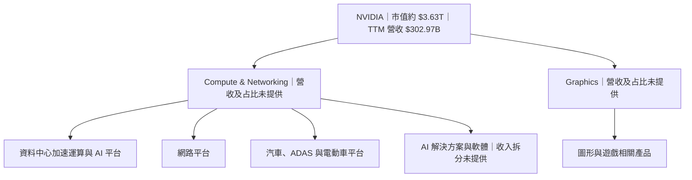
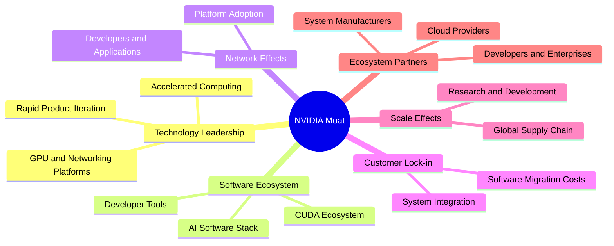
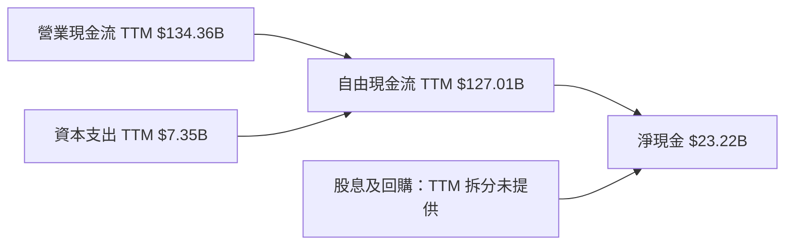
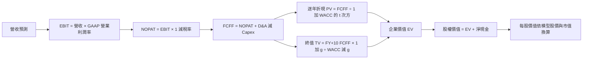
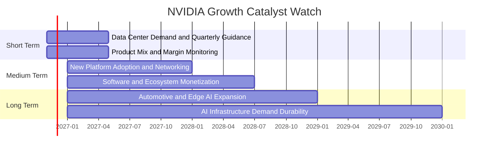
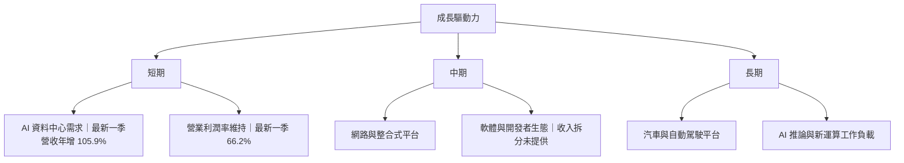
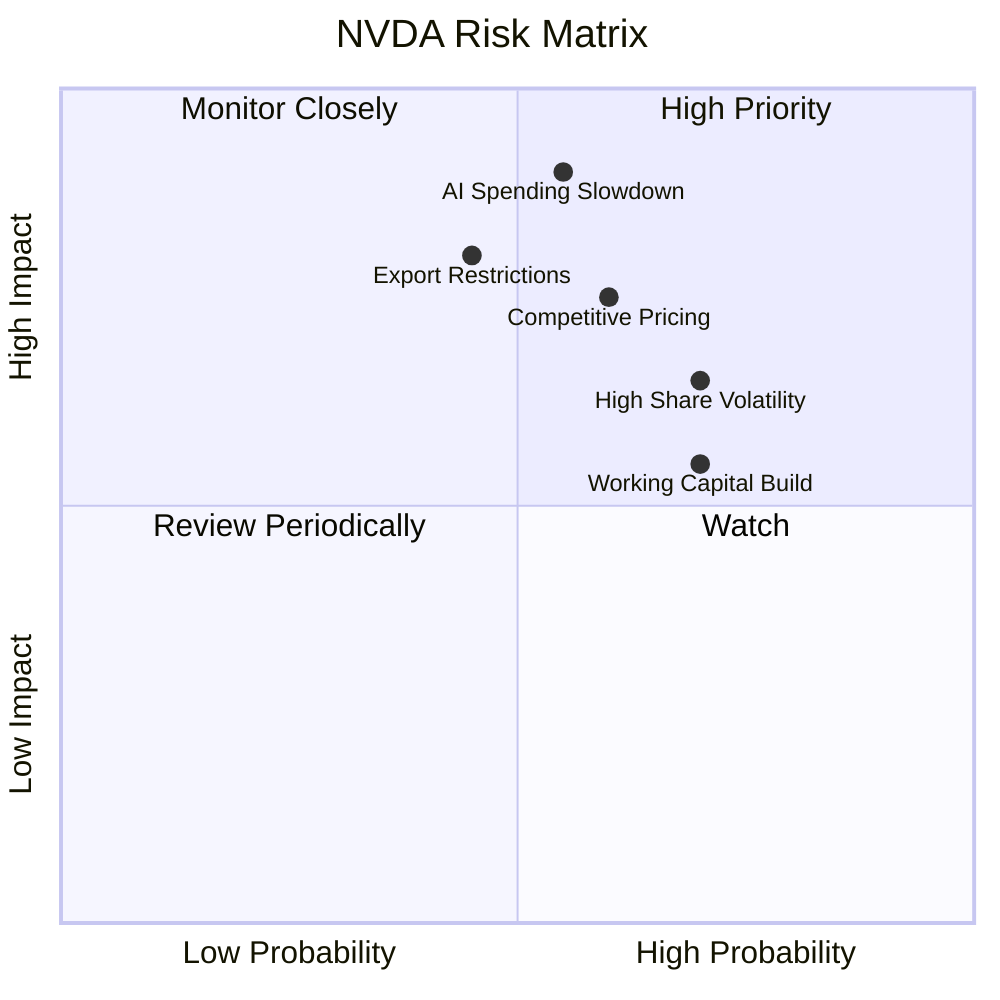
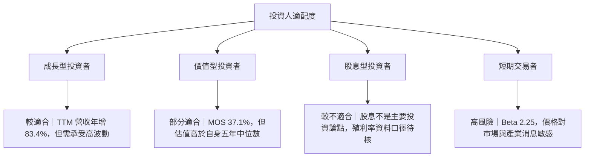

# NVDA 基本面深度分析報告
> **報告日期**：2026-11-28 ｜ **語言**：繁體中文 ｜ **數據來源**：SEC 申報資料 (XBRL)、Yahoo Finance、Finviz、StockAnalysis、Roic.ai ｜ **分析師**：CFA 級機構研究

## 目錄

| # | 章節 | 核心結論 |
|---|------|----------|
| 1 | 執行摘要 | 強烈買入；加權合理價值 $237.49；MOS +37.1% |
| 2 | 公司概覽與商業模式 | AI 加速運算、軟體生態與資料中心平台構成主要護城河；分部營收占比未提供 |
| 3 | 損益表深度分析 | TTM 營收 $302.97B、年增 83.4%；TTM 營業利益率 65.2% |
| 4 | 資產負債表分析 | 淨現金 $23.22B；營運資金天數上升，需關注庫存與收款週期 |
| 5 | 現金流量深度分析 | TTM FCF $127.01B，FCF Yield 3.50%；現金轉換良好但年度數據口徑有差異 |
| 6 | 獲利能力與資本效率 | ROIC 80.6% 高於 WACC 13.97%，價值創造差距大 |
| 7 | 相對估值分析 | 相對同業估值有吸引力；自身估值高於五年中位數 |
| 8 | DCF 內在價值評估 | 基準 DCF $163.87；加權合理價值 $237.49，兩種估值基準需區分 |
| 9 | 成長催化劑 | AI 基礎設施需求、產品迭代與軟體生態是主要推力；TAM 數字未提供 |
| 10 | 風險矩陣 | 主要風險為資本支出循環、競爭加劇、出口管制與高波動性 |
| 11 | 投資建議 | 依 MOS 評級為強烈買入；買入區間與季度監控門檻明確列示 |

---

## 1. 執行摘要

截至 2026-11-25 收盤，NVDA 股價為 **$149.30**。SEC 申報資料計算的 TTM 營收為 **$302.97B**、TTM 年增 **83.4%**，最新一季年增 **105.9%**，TTM 營業利益率 **65.2%**，TTM FCF **$127.01B**。ROIC **80.6%** 明顯高於 WACC **13.97%**；估值模型加權合理價值 **$237.49**，按規定以加權合理價值為分母計算的 MOS 為 **+37.1%**。因此，依 MOS 評級門檻為 **🟢 強烈買入**；此結論主要受高資本報酬率、快速成長與加權估值折價支持，但同時須留意 DCF 基準價值較加權合理價值低得多，以及資料來源間存在口徑衝突。

### 1.0 一頁式投資儀表板（Portfolio Manager 30 秒速讀）

| 項目 | 內容 |
|------|------|
| **投資論點（3 句）** | ① TTM 營收 $302.97B、年增 83.4%，反映 AI 計算需求仍在擴張。② TTM 營業利益率 65.2%、ROIC 80.6%，顯示高利潤率與資本效率。③ TTM FCF $127.01B、淨現金 $23.22B，提供研發與資本配置彈性。 |
| **綜合評分** | **8.3/10**（引用 1.1 評分卡） |
| **財務健康** | 🟢 淨現金 $23.22B、TTM 營業現金流 $134.36B；但 CCC 從 105 天升至 155 天。 |
| **ROIC vs WACC** | **80.6% vs 13.97%**，目前創造股東價值。 |
| **FCF 趨勢** | TTM FCF $127.01B；FCF Yield **3.50%**。 |
| **估值** | Forward P/E **9.06278x**（市場資料欄位）｜EV/EBITDA **14.696x**（市場資料欄位）｜FCF Yield **3.50%**。同業對照以 Peer multiples 區塊為準，兩組估值資料來源存在口徑差異，詳見第 7 章。 |
| **DCF 內在價值（基準）** | **$163.87**；現價相對 DCF 折價 **8.9%**（折溢價定義：現價 ÷ DCF 價值 − 1）。 |
| **安全邊際（MOS）** | **+37.1%＝($237.49 − $149.30) ÷ $237.49**（加權合理價值為分母）｜🟢 >25% 充足。 |
| **預期報酬（基準情境 12M）** | 加權合理價值相對現價上行空間 **+59.1%**；此為估值差額，不是保證的一年期報酬。 |
| **關鍵風險（前二）** | AI 資本支出循環放緩；自研晶片、競品及出口限制壓低需求或定價。 |
| **評級 + 信心度** | 🟢 **強烈買入** ｜ 信心：中（估值計算完整，但來源資料有明顯口徑衝突）。 |

### 1.1 綜合評分卡（全報告唯一）

| 維度 | 評分（1–10） | 主要依據（引用數字與其來源章節） |
|------|--------------|----------------------------------|
| 成長性 | 9.0 | TTM 營收年增 83.4%、最新一季年增 105.9%（第 3 章）；但不能假設高增長永久延續。 |
| 獲利能力 | 9.5 | TTM 營業利益率 65.2%、ROIC 80.6%、Piotroski F-Score 5/9（第 3、6 章）。 |
| 財務健康 | 8.5 | 淨現金 $23.22B，FCF $127.01B；CCC 從 105 天增至 155 天（第 4、5 章）。 |
| 估值 | 6.0 | MOS +37.1%，但 P/E、P/S、EV/EBITDA 均高於公司自身五年中位數（第 7、8 章）。 |
| 護城河 | 9.5 | 軟體生態、整合式平台與高毛利能力具支持證據，但未提供市場份額及分部營收占比（第 2 章）。 |
| 管理層與資本配置 | 7.5 | FCF 能力高、稀釋股數測試通過；但回購、投資回報與 TTM SBC 明細不足（第 5 章）。 |
| **綜合評分** | **8.3** | 六項算術平均：$(9.0+9.5+8.5+6.0+9.5+7.5)÷6=8.333…$，四捨五入至一位小數。 |

### 1.2 五大投資論點 + 三大核心風險

| 類型 | 項目 | 具體依據 | 信心度 |
|------|------|----------|--------|
| 🟢 **投資論點①** | AI 運算平台需求仍高速成長 | TTM 營收 $302.97B、年增 83.4%；最新一季年增 105.9%。若需求維持，規模擴大可支撐研發投入與營業槓桿。 | 🟢 高 |
| 🟢 **投資論點②** | 高利潤率與定價能力 | TTM 營業利益率 65.2%，最新一季 66.2%；顯示平台與產品組合仍具獲利能力。 | 🟢 高 |
| 🟢 **投資論點③** | 資本報酬率遠超資金成本 | ROIC 80.6%，WACC 13.97%，差距 66.63 個百分點。 | 🟢 高 |
| 🟢 **投資論點④** | 現金流支撐再投資 | TTM 營業現金流 $134.36B、Capex $7.35B、FCF $127.01B。 | 🟢 高 |
| 🟢 **投資論點⑤** | 淨現金提供財務韌性 | 現金及短期投資 $56.59B、總債務 $33.37B、淨現金 $23.22B。 | 🟢 高 |
| 🟡 **風險①** | 營運資金占用擴大 | CCC 由 105 天升至 155 天；DSO 及 DIO 同時增加，可能反映收款或供應鏈備貨壓力。 | 🟡 中 |
| 🔴 **風險②** | AI 投資循環反轉 | 若客戶降低資料中心支出，營收成長、利用率與毛利率可能同時承壓。 | 🔴 高衝擊 |
| 🔴 **風險③** | 競爭及地緣政治限制 | 自研晶片、AMD/AVGO 競爭與對中國出口限制可能壓縮可服務市場或產品價格。 | 🟡 中高 |

### 1.3 快速統計卡片

同業中位數以 AMD、AVGO、INTC 的 Peer multiples 計算；Peer 區塊未提供本公司相同口徑的 TTM P/E 等項目時，不混用其他估值來源。

| 指標 | 公司實際值（期間） | 同業中位數 | 狀態 |
|------|--------------------|------------|------|
| 營收成長（TTM） | **83.4%** | — | 🟢 |
| 營收成長（最新一季年增） | **105.9%** | **44.7%**（三家中位數） | 🟢 |
| 毛利率（TTM） | **未提供於 Verified Figures** | **56.0%**（三家中位數） | 🟡 |
| 營業利益率（TTM） | **65.2%** | — | 🟢 |
| ROIC（TTM） | **80.6%** | — | 🟢 |
| Forward P/E | **N/A（Peer 區塊未提供 NVDA 倍數）** | **24.1x** | — |
| FCF Yield（TTM） | **3.50%** | — | 🟡 |
| Piotroski F-Score | **5 / 9** | — | 🟡 |

### 1.4 投資結論

```text
╔══════════════════════════════════════════════════════════════════╗
║                    📊 投資結論摘要                               ║
╠══════════════════════════════════════════════════════════════════╣
║  評級：🟢 強烈買入（依 8.8 MOS +37.1%、ROIC 80.6% > WACC 13.97%）║
║  價格（2026-11-25 收盤）：$149.30                                ║
║  DCF 內在價值（基準）：$163.87（現價折價 8.9%）                  ║
║  安全邊際 MOS：+37.1%（＝($237.49−$149.30)÷$237.49）             ║
║  加權合理價值（8.8）：$237.49                                    ║
║  DCF 情境價值：                                                  ║
║    悲觀情境：$74.61（−50.0%）                                    ║
║    基準情境：$163.87（+9.8%）                                    ║
║    樂觀情境：$337.39（+126.0%）                                  ║
║  綜合評分：8.3/10（引用 1.1）                                    ║
║  適合投資人：能承受高波動的成長型、長線持有者；不宜當作低波動股 ║
╚══════════════════════════════════════════════════════════════════╝
```

---

## 2. 公司概覽與商業模式

NVIDIA Corporation 為美國半導體與計算平台公司，主要透過 **Compute & Networking** 及 **Graphics** 兩個業務板塊營運。業務涵蓋資料中心加速運算、網路、AI 解決方案、遊戲與圖形處理，以及汽車平台與軟體。公司總市值約 **$3.63T** 為市場資料欄位；本報告採用 Verified Figures 的 TTM 營收 **$302.97B**。可用資料未提供兩個業務板塊的營收、占比或軟體服務收入拆分，以下不填入推估比例。

### 2.1 業務結構與收入來源



### 2.2 市場份額

市場份額數據未提供，因此不以圖表或自估百分比呈現。相對規模方面，NVDA 的 TTM 營收為 **$302.97B**、年增 **83.4%**，最新一季年增 **105.9%**，高於 Peer 區塊中 AMD 的 **44.7%**、AVGO 的 **85.5%** 與 INTC 的 **20.9%**。這說明公司當前成長速度突出，但營收成長率本身不能替代市場份額，也不能證明成長可持續。

### 2.3 競爭護城河分析



### 2.4 護城河強度

| 護城河項目 | 強度（強／中／弱） | 證據（引用數字或事實） | 會削弱它的情況 |
|------------|--------------------|------------------------|----------------|
| 技術與系統整合 | 強 | 最新一季營業利益率 66.2%；公司提供加速運算與網路平台，而非單一晶片。 | 競品性能、供貨與總持有成本形成可替代方案。 |
| 軟體生態系統 | 強 | 公司業務包含 AI 解決方案與軟體；可用財務資料未拆分軟體收入。 | 開放軟體、客戶轉向自研平台或工具鏈兼容性提升。 |
| 客戶鎖定 | 中至強 | 系統與軟體整合可能提高遷移成本；具體客戶留存率未提供。 | 大型雲端客戶掌握議價權，並可分散採購或自研。 |
| 規模效應 | 強 | TTM 營收 $302.97B、研發支出資料顯示 FY2026 為 $18.50B（非同一 TTM 口徑）。 | 供應鏈瓶頸、先進封裝或客戶集中限制規模優勢。 |
| 生態夥伴 | 中至強 | 公司業務覆蓋雲端、系統與開發工具生態；夥伴營收貢獻未提供。 | 主要客戶自行設計晶片或供應商多元化。 |

1.1 評分卡中的「護城河」分數為 **9.5/10**，依據是整合平台、軟體生態與高營業利益率；因缺少市場份額、分部營收與客戶集中度資料，仍保留一定不確定性。

---

## 3. 損益表深度分析

### 3.1 年度收入成長趨勢（近 4 年）

年度資料表列 FY2023 至 FY2026 營收；這些為年度報表數字，與 Verified Figures 的 TTM 營收口徑不同。

```text
╔══════════════════════════════════════════════════════════════════╗
║              NVIDIA 年度收入趨勢（FY2023-FY2026）               ║
╠══════════════════════════════════════════════════════════════════╣
║  FY2023  $26.97B   ██░░░░░░░░░░░░░░░░░░░░░░  YoY：—            ║
║  FY2024  $60.92B   ██████░░░░░░░░░░░░░░░░░░  YoY：+125.9%       ║
║  FY2025  $130.50B  █████████████░░░░░░░░░░░  YoY：+114.2%       ║
║  FY2026  $215.94B  ██████████████████████░░  YoY：+65.5%        ║
║                                                                  ║
║  FY2023–FY2026 營收 CAGR：+100.1%                               ║
║  註：FY2026 / FY2023 的三年 CAGR；此年度序列與 TTM 資料有口徑差異║
╚══════════════════════════════════════════════════════════════════╝
```

FY2024、FY2025 營收分別為 **$60.92B** 與 **$130.50B**，年度年增約 **125.9%** 與 **114.2%**；FY2026 增至 **$215.94B**，年增降至 **65.5%**。營收仍快速增加，但成長率由高峰放緩，符合基期墊高及大型資料中心專案逐步擴張的情況。由於公司提供的年度及 Verified TTM 數據不完全一致，CAGR 僅作為年度表內趨勢參考。

### 3.2 季度收入趨勢分析

以下採用可對照的季度報表序列，並把 Verified Figures 的最新季單季年增率作為權威指標。季度收入表將 FY2027 Q2 列為 $96.221B；QoQ 以相鄰季度值計算，未把單季成長稱為 TTM。

| 季度 | 營收 | QoQ | YoY | 備註 |
|------|------:|----:|----:|------|
| FY2026 Q4 | $68.127B | +19.8% | +73.2% | 相較 FY2026 Q3；季度明細來源資料。 |
| FY2027 Q1 | $81.615B | +19.8% | +85.2% | YoY 按季度明細計算。 |
| FY2027 Q2 | $96.221B | +17.9% | **+105.9%** | YoY 採 Verified Figures 的最新一季年增率。 |
| FY2027 Q3 | $115.844B | +20.4% | +103.2% | StockAnalysis 顯示的較新季度資料，與「最新 SEC 季度為 FY2027 Q2」不一致，故不納入主估值口徑。 |

FY2027 Q2 的 **105.9% 單季年增率**顯示收入擴張速度仍高；QoQ 成長由約 19.8% 降至 17.9%，仍是正成長，但顯示不能僅憑年增率推斷季度動能持續加速。FY2027 Q3 的額外資料與 SEC 10-Q 標示不一致，後續應以正式申報文件核實。

### 3.3 利潤率演變分析

| 利潤率指標 | FY2023 | FY2024 | FY2025 | FY2026 | 趨勢 | 評估 |
|------------|--------:|--------:|--------:|--------:|------|------|
| **毛利率** | 56.9% | 72.7% | 75.0% | 71.1% | 由 FY2023 顯著提升；FY2026 回落 | 🟢 |
| **營業利益率** | 20.7% | 54.1% | 62.4% | 60.4% | 大幅擴張後略回落 | 🟢 |
| **淨利率** | 16.2% | 48.9% | 55.8% | 55.6% | 高位大致持平 | 🟢 |

計算依年度報表收入與利潤：毛利率＝毛利÷營收；營業利益率＝營業利益÷營收；淨利率＝淨利÷營收。Verified TTM 營業利益率另為 **65.2%**，不可與 FY2026 年度比例混為一談。

毛利率由 FY2023 的 **56.9%**升至 FY2025 的 **75.0%**，反映產品組合向高價值運算平台轉移及規模擴張；FY2026 回落至 **71.1%**，可能受到產品組合、供應成本及系統產品比重改變影響，但現有資料不足以精確分解。營業利益率由 **20.7%**升至 FY2025 **62.4%**，反映收入規模擴大後研發及營運費用的營業槓桿；FY2026 略回落至 **60.4%**，但 Verified TTM 仍達 **65.2%**，表示最新期間獲利表現可能高於年度平均。

### 3.4 費用結構分析

可用資料未提供同一期間完整、可核對的費用分項，故不繪製費用占比圓餅圖。年度資料顯示 FY2026 研發費用 **$18.50B**、營業利益 **$130.39B**；研發投入是重要費用，但資料期間與 TTM 營收不同，不以該數字推估 TTM 費用率。

### 3.5 季度 EPS 趨勢與盈餘品質（Quality of Earnings）

EPS 歷史資料包含實際 EPS，但 EPS 預估值在提供的 Beat/Miss 表格中為 NaN，故不能判定是否超預期或不及預期。

| 季度 | EPS 實際 | EPS 預估 | 超預期／不及預期 | 同季營收年增（季度資料） |
|------|---------:|---------:|------------------|------------------------:|
| FY2026 Q4 | $1.76 | N/A | N/A（預估值缺漏） | 73.22% |
| FY2027 Q1 | $2.39（StockAnalysis） | N/A | N/A（預估值缺漏） | 85.23% |
| FY2027 Q2 | $2.46（StockAnalysis） | N/A | N/A（預估值缺漏） | 105.85% |
| FY2027 Q3 | $2.70（StockAnalysis） | N/A | N/A（預估值缺漏） | 103.21% |

季度 EPS 實際值逐季上升；但由於每季 EPS 預估均缺漏，不能把資料中的「❌」當作未達標的證據。Q3 季度資料較 SEC 10-Q 標示期間更新，需待正式財報核對。

| 盈餘品質項目 | 數值／佔比 | 評估 |
|--------------|-----------|------|
| 股權薪酬 SBC / 營收 | TTM SBC：N/A；FY2026 SBC $6.39B ÷ FY2026 營收 $215.94B＝**2.96%**（年度代理值） | 🟡 年度代理值顯示股權薪酬成本不可忽略，但不代表 TTM 比率。 |
| SBC / 營業現金流 | TTM SBC：N/A；FY2026 $6.39B ÷ FY2026 OCF $102.72B＝**6.22%**（年度代理值） | 🟡 仍有稀釋成本；模型須避免將 SBC 重複扣除。 |
| FCF / 淨利（現金轉換率） | TTM 淨利：N/A；FY2026 $96.68B ÷ $120.07B＝**80.5%**（年度代理值） | 🟡 年度 FCF 低於淨利，代表資本支出與營運資金仍影響現金轉換。 |
| 一次性／非經常性損益 | N/A（未提供可核對明細） | 無法量化是否美化當期盈餘。 |
| 有效稅率異常 | 最新年度有效稅率 **15.1%** | 🟢 DCF 依此採用；缺少多年稅務調節表，不能判定是否有一次性稅務利益。 |
| 資本化支出 vs 費用化 | TTM Capex $7.35B；資本化與費用化明細 N/A | 無法檢驗是否有成本遞延。 |

**盈餘品質結論**：TTM FCF $127.01B 與營業現金流 $134.36B 顯示現金創造能力高；但 TTM 淨利與 TTM SBC 缺漏，無法精確計算 TTM 現金轉換率及 SBC 稀釋。FY2026 年度代理值顯示 FCF 約為淨利的 80.5%，宜以現金流而非單看 GAAP 盈餘評估。

---

## 4. 資產負債表分析

### 4.1 資產結構分解

可用資料沒有與 Verified Figures 同期間、可勾稽的完整資產負債表資產細項，因此不以其他來源的不同期餘額拼接最新資產結構。Verified Figures 提供現金及短期投資 **$56.59B**、總債務 **$33.37B**；總資產與應收、存貨的同一期明細未提供。

### 4.2 流動性與營運資金分析

| 指標 | 數值／期間 | 評估 |
|------|-----------|------|
| 現金及短期投資 | $56.59B | 🟢 可提供流動性緩衝。 |
| 總債務 | $33.37B | 相較可用流動資產仍有淨現金。 |
| 淨現金 | $23.22B | 🟢 財務彈性良好。 |
| 流動比率 | 最新一致口徑 N/A；其他資料列有 4.084，但期間口徑不一致 | 不採用混合來源作主指標。 |

**營運資金天數（照錄品質指標）**

| 指標 | 最新 TTM | 一年前 TTM | 變化 | 解讀 |
|------|----------:|----------:|-----:|------|
| DSO 應收帳款天數 | 76 天 | 61 天 | +15 天 | 應收回收時間拉長，需觀察客戶付款條件及季度末收款。 |
| DIO 存貨天數 | 150 天 | 110 天 | +40 天 | 存貨占用增加；可能與備貨、產品轉換或供應鏈節奏有關，不能單憑天數判定滯銷。 |
| DPO 應付帳款天數 | 72 天 | 66 天 | +6 天 | 付款天數略升，可能減緩資金占用，但幅度不足以抵銷 DSO/DIO 上升。 |
| CCC 現金轉換週期 | 155 天 | 105 天 | +50 天 | 現金轉換週期明顯延長，是資產負債表監控重點。 |

CCC 由 DSO + DIO − DPO 得出，品質指標已按指定口徑計算；本節照錄數值，不自行重算。若庫存天數持續增加且營收增速同步放緩，需提高對存貨跌價與現金轉換的關注。

### 4.3 債務結構分析

```text
╔══════════════════════════════════════════════════════════════════╗
║                   NVIDIA 債務健康診斷                            ║
╠══════════════════════════════════════════════════════════════════╣
║  總債務：        $33.37B   ███████░░░░░░░░░░░░░  🟡             ║
║  現金+短期投資： $56.59B   ████████████░░░░░░░░  🟢             ║
║  淨現金：        $23.22B   █████░░░░░░░░░░░░░░░  🟢             ║
║                                                                  ║
║  Debt/EBITDA：N/A（同期間 TTM EBITDA 未提供於 Verified Figures）║
║  利息保障倍數：N/A（利息費用與一致期間 EBIT 未提供）             ║
╚══════════════════════════════════════════════════════════════════╝
```

### 4.4 股東權益趨勢

年度資料顯示股東權益 FY2023 **$22.10B**、FY2024 **$42.98B**、FY2025 **$79.33B**、FY2026 **$157.29B**，四年均向上。由於此年度數列與最新 TTM／季度資產資料不是同一口徑，本節不以其推算最新每股淨資產，也不外推未來權益增長。

---

## 5. 現金流量深度分析

### 5.1 現金流量瀑布圖

現金流瀑布所需的 TTM 淨利與回購金額未提供，因此不以虛構淨利或回購金額填圖。已核實的 TTM 現金流路徑如下：



### 5.2 FCF 轉換率趨勢

| 財政年度 | FCF | 淨利 | FCF / 淨利 | 解讀 |
|---------|----:|----:|-----------:|------|
| FY2023 | $3.81B | $4.37B | 87.2% | 現金轉換低於 100%。 |
| FY2024 | $27.02B | $29.76B | 90.8% | 現金轉換略改善。 |
| FY2025 | $60.85B | $72.88B | 83.5% | 利潤成長快於 FCF。 |
| FY2026 | $96.68B | $120.07B | 80.5% | FCF 持續增加，但比率下降。 |

年度數字顯示 FCF 絕對額快速增加，但 FCF/淨利由 FY2024 的 90.8% 降至 FY2026 的 80.5%。這提示營運資金與投資需求不能忽略；TTM FCF 仍依 Verified Figures 採 **$127.01B**，但缺少同口徑 TTM 淨利，故不計算 TTM 轉換率。

### 5.3 自由現金流趨勢

```text
╔══════════════════════════════════════════════════════════════════╗
║                  自由現金流趨勢                                  ║
╠══════════════════════════════════════════════════════════════════╣
║  FY2023  $3.81B   █░░░░░░░░░░░░░░░░░░░░░  年度 FCF              ║
║  FY2024  $27.02B  █████░░░░░░░░░░░░░░░░░  年度 FCF              ║
║  FY2025  $60.85B  ██████████░░░░░░░░░░░░  年度 FCF              ║
║  FY2026  $96.68B  ████████████████░░░░░░  年度 FCF              ║
║  TTM     $127.01B █████████████████████░  FCF Yield 3.50%       ║
║                                                                  ║
║  註：年度 FCF 與 Verified TTM 為不同期間，不能當作連續財年值。 ║
╚══════════════════════════════════════════════════════════════════╝
```

### 5.4 資本配置評估

| 資本配置項目 | 可核對資料 | 評估 |
|--------------|------------|------|
| 資本支出 | TTM $7.35B；FY2026 $6.04B | TTM Capex 約為 TTM OCF 的 5.5%，資產較輕的模式支持高 FCF。 |
| 股息 | FY2026 現金股息 $0.974B | 相較 FY2026 FCF $96.68B，股息不是主要現金用途。 |
| 股票回購 | TTM／FY2026 可核對金額 N/A | 無法評估回購價格與股東回報。 |
| 研發 | FY2026 $18.50B | 研發是維持產品與平台競爭力的核心支出；金額是年度口徑。 |
| 留存現金 | 淨現金 $23.22B | 🟢 留有資產負債表彈性。 |

回購、投資性收購及留存現金變動未提供一致期間數字，故不繪製資本配置比例圓餅圖。

---

## 6. 獲利能力與資本效率

### 6.1 ROE / ROA / ROIC 趨勢

| 指標 | 最新 TTM | 歷史趨勢 | 評估 |
|------|---------:|----------|------|
| ROE | 84.2% | Verified TTM 值；年度序列無一致口徑比較 | 🟢 高，但須結合權益乘數判讀。 |
| ROA | N/A（Verified Figures 未提供 TTM ROA） | 品質指標指出 ROA 未高於一年前 | 🟡 |
| ROIC | 80.6% | Verified TTM 值；歷史可比序列未提供 | 🟢 明顯高於資金成本。 |

### 6.2 ROIC vs WACC 分析（核心價值創造判斷）

```text
╔══════════════════════════════════════════════════════════════════╗
║                ROIC vs WACC 深度分析                            ║
╠══════════════════════════════════════════════════════════════════╣
║  WACC 輸入（直接採用成本資本資料）：                             ║
║  ├── 無風險利率（10Y 美債）：       4.94%                       ║
║  ├── 股權風險溢酬 ERP：             5.00%                       ║
║  ├── 原始 Beta：                    2.25                        ║
║  ├── 採用調整後 Beta：              1.83                        ║
║  ├── Ke = 4.94% + 1.83 × 5.00%：   14.09%                      ║
║  ├── 稅前債務成本：                 0.78%                       ║
║  ├── 有效稅率：                     15.1%                       ║
║  ├── 股權／債務權重：               99.1%／0.9%                 ║
║  └── WACC：                         13.97%                      ║
║                                                                  ║
║  ROIC（TTM）：                      80.6%                       ║
║  ROIC − WACC：                      66.63 個百分點               ║
║  ROIC / WACC：                      約 5.77 倍                  ║
║                                                                  ║
║  ROIC 80.6%  ▓▓▓▓▓▓▓▓▓▓▓▓▓▓▓▓▓▓▓▓▓▓▓▓▓▓▓▓▓░░░                 ║
║  WACC 13.97% ▓▓▓▓▓░░░░░░░░░░░░░░░░░░░░░░░░░░                 ║
║                                                                  ║
║  結論：ROIC 高於 WACC，現階段創造而非摧毀股東價值。             ║
╚══════════════════════════════════════════════════════════════════╝
```

β 調整方式：**⅔ × 原始 Beta 2.25 + ⅓ × 1 = 1.83**。原始 Beta 高於 1.5，故採用調整後 Beta。股權成本計算為 **4.94% + 1.83 × 5.00% = 14.09%**。債務稅後成本為 **0.78% × (1−15.1%) = 0.66222%**；權重代入為 **99.1% × 14.09% + 0.9% × 0.66222% = 13.96915% ≈ 13.97%**。

ROIC 80.6% 減 WACC 13.97% 得 **66.63 個百分點**的利差。這表示公司目前每單位投入資本創造的營運報酬遠高於資本成本；但若競爭使毛利及資本效率下降，該利差可能收斂。WACC 各組成直接採成本資本資料，未另行重算債務範圍。

### 6.3 杜邦三因素分解

| 因素 | 數值（TTM） | 解讀 |
|------|-------------|------|
| 淨利率 | 63.7% | 高淨利率是 ROE 的主要來源。 |
| 資產週轉率 | 0.95 | 資產每年周轉約 0.95 次。 |
| 權益乘數 | 1.40 | 槓桿相對有限，不是 ROE 的主要驅動。 |
| **ROE** | **84.2%** | 63.7% × 0.95 × 1.40 = 84.2%（照錄品質指標）。 |

ROE 高主要由 **63.7% 淨利率**支撐，權益乘數 1.40 並未顯示依賴高財務槓桿。

### 6.4 財務體質：Piotroski F-Score

Piotroski F-Score **5 / 9**。九項測試逐項照錄如下：

| 測試 | 結果 | 解讀 |
|------|------|------|
| ROA > 0 | ✅ 通過 | 公司仍有正獲利。 |
| 營業現金流 > 0 | ✅ 通過 | 現金流為正。 |
| ROA 高於一年前 | ❌ 未通過 | 最新 TTM ROA 未較一年前提高。 |
| 營業現金流 > 淨利（應計品質） | ❌ 未通過 | 可能代表利潤轉現金速度不及淨利增長。 |
| 長期負債 ÷ 總資產低於一年前 | ❌ 未通過 | 該比率未改善。 |
| 流動比率高於一年前 | ✅ 通過 | 短期償債能力相較前期改善。 |
| 稀釋股數未增加 | ✅ 通過 | 股數測試通過，顯示未見淨稀釋增加。 |
| 毛利率高於一年前 | ✅ 通過 | 定價或產品組合維持支持。 |
| 資產週轉率高於一年前 | ❌ 未通過 | 資產增長未轉化為更高週轉效率。 |

5/9 代表盈利、現金流及毛利率等項目有支持，但應計品質、ROA、負債比與資產週轉率未通過；不能只以高 ROIC 掩蓋資產周轉與營運資金變化。

---

## 7. 相對估值分析

### 7.1 同業估值比較表格

本公司 Peer multiples 專用欄位未提供 NVDA 的倍數，因此不以其他資料來源的不同口徑替代；同業倍數照錄 Peer multiples。

| 估值指標 | **NVDA** | **AMD** | **AVGO** | **INTC** | 本公司評估 |
|----------|----------|---------|---------|---------|-----------|
| **Trailing P/E** | N/A（Peer 區塊未提供） | 90.7x | 39.9x | N/A | 同業數值差異大；NVDA 同口徑缺值。 |
| **Forward P/E** | N/A（Peer 區塊未提供） | 24.1x | 16.2x | 32.1x | 同業中位數 **24.1x**；不能直接比較 NVDA。 |
| **P/S Ratio** | N/A（Peer 區塊未提供） | 15.5x | 16.7x | 5.1x | AVGO/AMD 高於 INTC，商業結構不同。 |
| **EV / EBITDA** | N/A（Peer 區塊未提供） | 61.9x | 29.2x | 16.6x | 可用同業中位數以 AVGO、INTC 計為 22.9x。 |
| **最新一季營收年增** | **105.9%** | 44.7% | 85.5% | 20.9% | 🟢 NVDA 成長率高於三家。 |
| **毛利率（TTM）** | N/A（Verified Figures 未提供） | 56.0% | 75.5% | 40.2% | NVDA 本表不做同口徑比較。 |

Peer multiples 顯示 AMD、AVGO、INTC 的估值倍數及成長結構差異顯著。VALUTION METHODS 使用同業中位數回推 NVDA 價值，並非使用 NVDA 自身目前倍數；不應將該估值回推與此處不同來源的市場倍數欄位混為一談。

### 7.2 歷史估值區間分析

```text
╔══════════════════════════════════════════════════════════════════╗
║             NVDA 五年 TTM P/E 歷史區間                           ║
╠══════════════════════════════════════════════════════════════════╣
║  五年區間： 2.3x ├──────────────────────────────────┤ 49.3x     ║
║  五年中位數：11.3x                                               ║
║  當前 P/E：18.9x      ├────────●────────────────────┤            ║
║  當前百分位：71%                                               ║
║                                                                  ║
║  判讀：當前估值高於自身五年中位數，但仍低於歷史區間上緣。       ║
╚══════════════════════════════════════════════════════════════════╝
```

| 倍數 | 當前 | 五年中位數 | 五年區間 | 當前百分位 |
|------|-----:|-----------:|---------:|-----------:|
| P/E | 18.9x | 11.3x | 2.3x–49.3x | 71% |
| P/S | 12.0x | 2.7x | 1.2x–31.0x | 57% |
| EV/EBITDA | 17.9x | 8.9x | 3.4x–47.8x | 57% |

### 7.3 情境價值（Bear / Base / Bull，照抄 DCF MODEL）

| 情境 | 第 1 年營收成長 | 期末營業利潤率 | WACC | 每股價值 | 相對現價 | 機率 | 會發生的條件 |
|------|----------------:|----------------:|-----:|----------:|----------:|-----:|--------------|
| 🔴 悲觀 | 15.0% | 51.3% | 14.97% | $74.61 | −50.0% | 25% | AI 資本支出快速降溫、價格與產品組合轉差，使成長與利潤率同時受壓。 |
| 🟡 基準 | 30.0% | 60.4% | 13.97% | $163.87 | +9.8% | 50% | 成長由高位逐年回落，長期利潤率仍維持高於成熟硬體公司的水準。 |
| 🟢 樂觀 | 45.0% | 66.4% | 12.97% | $337.39 | +126.0% | 25% | 新產品與資料中心需求延續高增長，規模效應抵銷競爭及成本壓力。 |

機率加權 DCF 情境價值為 **$184.93（+23.9%）**，僅作情境參考；第 8.8 節依規則使用的是基準 DCF 與其他估值方法加權，不以機率加權情境值替代。

### 7.4 相對估值隱含價格區間

```text
╔══════════════════════════════════════════════════════════════════╗
║               估值方法隱含每股價值                                ║
╠══════════════════════════════════════════════════════════════════╣
║  $149.30 現價 ── $163.87 DCF ── $190.40 EV/EBITDA               ║
║                            ── $242.43 分析師共識                  ║
║                            ── $400.39 Forward P/E                ║
╚══════════════════════════════════════════════════════════════════╝
```

| 方法 | 每股價值 | 相對現價 | 依據 |
|------|---------:|---------:|------|
| 同業 Forward P/E | $400.39 | +168.2% | AMD、AVGO、INTC 同業中位數 24.1x × NVDA Forward EPS $16.61。 |
| 同業 EV/EBITDA | $190.40 | +27.5% | AVGO、INTC 同業中位數 22.9x × TTM EBITDA，並加回淨現金。 |
| 分析師共識目標價 | $242.43 | +62.4% | 59 位分析師平均目標價。 |

同業 Forward P/E 對應的價值遠高於其他方法，對可比公司選取與遠期 EPS 假設非常敏感，故不能單獨視為公平價值。

---

## 8. DCF 內在價值評估（Discounted Cash Flow）

### 8.0 估值推理鏈（Thinking Logic）

**Step 1 — 價值來源與主導變數**

NVDA 的價值主要由現有資料中心加速運算與網路平台現金流、Graphics 等其他業務、以及 AI 軟體生態的延伸價值構成。現有資料未提供各業務營收占比，無法量化各部分；模型因此以公司整體 TTM 營收 **$302.97B** 起算。對估值影響最大的變數是未來營收增長路徑，其次是長期營業利潤率及折現率；這與 8.6 中 WACC、永續成長率敏感度矩陣相符。

**Step 2 — 模型選擇**

| 決策點 | 本報告採用 | 理由（含數字） | 曾考慮但否決 | 否決理由 |
|--------|-----------|----------------|--------------|----------|
| 現金流定義 | FCFF | 以 WACC 折現並推導 EV；TTM FCF $127.01B。 | FCFE | 與指定模型的企業價值橋接不一致。 |
| 預測期 N | 10 年 | DCF MODEL 固定為 10 年；收入成長由 30% 線性降至 3%。 | 其他年數 | 不改動已提供模型。 |
| 終值方法 | Gordon Growth | 模型以 g=3.0% 和 WACC=13.97% 計算終值。 | 退出倍數 | DCF MODEL 未提供退出倍數終值，故不自建。 |
| EBIT 基礎 | GAAP EBIT | 模型明確使用 GAAP EBIT。 | 非 GAAP EBIT | 避免把 SBC 加回後又漏計股東成本。 |

**Step 3 — 關鍵假設推導鏈**

- **營收成長路徑**：錨點＝TTM 成長率 **83.4%**；調整＝基期已大幅擴張，且需考慮成長逐步正常化；採用年 1 **30.0%**、年 10 **3.0%**、逐年線性淡化；否決「長期維持 83.4%」，因 10 年維持該增速會遠超模型設定及長期成熟企業常態。
- **期末營業利潤率**：錨點＝TTM **65.2%**；調整＝模型逐步回歸近五個財年的中位數；採用 FY+10 **60.4%**；否決永久維持 65.2%，因模型明確採歷史中位數淡化。
- **終值成長率 g**：錨點＝模型設為 **3.0%**；採用 3.0%，低於 WACC 13.97%；否決更高長期成長率，因永續成長必須受長期經濟規模限制且小於折現率。
- **預測期 N**：錨點＝模型設定 10 年；採用 10 年；其他年限未提供可核對模型結果，故不替換。
- **Capex／營收**：錨點＝TTM Capex $7.35B、TTM 營收 $302.97B，模型採年 1 **2.4%**，淡化至年 10 **1.3%**；選擇逐步淡化是模型假設，不代表已知未來資本支出承諾。
- **EBIT 與 SBC**：錨點＝模型採 GAAP EBIT；採用組合 **(A) GAAP EBIT + 固定股數**；因 GAAP EBIT 已含 SBC 費用，不另扣 SBC，年稀釋率 0%。曾考慮加回 SBC，但會與費用列或股數稀釋不相容。
- **WACC**：錨點＝成本資本資料提供 **13.97%**；採用 13.97%；不另調整，因指定模型要求直接引用該數值。
- **有效稅率及 D&A**：有效稅率採 15.1%；D&A／營收採 1.2%，兩者均照模型輸入。ΔWC 未建模，不補填或倒推。

**Step 4 — 最脆弱的一環**

最脆弱的是未來十年仍可維持接近 60% 的營業利益率；若競爭或系統成本令利潤率快速收斂，估值將顯著下降，悲觀情境的模型值為 **$74.61**。

**Step 5 — 計算路徑圖**



### 8.1 模型假設總表（Model Inputs）

| 假設項目 | 採用值 | 依據／來源 | 敏感度 |
|----------|--------|-------------|--------|
| 預測期長度 **N** | 10 年 | DCF MODEL 預設期間；收入增速逐年淡化。 | 🟡 中 |
| 營收成長路徑 | FY+1 30.0% → FY+10 3.0% | TTM 成長率 83.4%；模型將其限制在 0%–30%，之後線性淡化。 | 🔴 高 |
| 營業利潤率 | FY+1 65.2% → FY+10 60.4% | 起點為 TTM 65.2%；期末回歸近五個財年的中位數。 | 🔴 高 |
| 有效稅率 | 15.1% | 最新年度有效稅率。 | 🟢 低 |
| Capex / 營收 | 2.4% → 1.3% | TTM 比例起點，逐步淡化；模型設定。 | 🟡 中 |
| D&A / 營收 | 1.2% | TTM 比例，模型持平。 | 🟢 低 |
| ΔWC / 營收增額 | 未建模 | DCF MODEL 明確不建模營運資金。 | 🟢 低 |
| EBIT 基礎 | GAAP EBIT | DCF MODEL 使用 GAAP EBIT。 | 🟡 中 |
| SBC 處理 | **組合 (A)**：GAAP EBIT、不再扣 SBC、固定股數 | SBC 已包含於 GAAP 費用；股數不額外稀釋。 | 🟡 中 |
| 年稀釋率 | 0% | 與組合 (A) 相容；DCF MODEL 固定股數。 | 🟡 中 |
| 永續成長率 g | 3.0% | DCF MODEL 終值假設，且低於 WACC。 | 🔴 高 |
| 終值方法 | Gordon Growth | DCF MODEL 的終值公式。 | 🔴 高 |
| WACC | 13.97% | 成本資本資料；詳見 8.2。 | 🔴 高 |

本模型採 **(A) GAAP EBIT + 固定股數**，故 SBC 影響已計入一次。FCFF 定義為 **NOPAT + D&A − Capex**；模型沒有 ΔWC 列，故不自行加減營運資金。

### 8.2 折現率推導（WACC）

```text
╔══════════════════════════════════════════════════════════════════╗
║                    WACC 推導（折現率）                           ║
╠══════════════════════════════════════════════════════════════════╣
║  股權成本 Ke（CAPM）：                                           ║
║  ├── 無風險利率 Rf：                 4.94%                      ║
║  ├── 市場風險溢酬 ERP：              5.00%                      ║
║  ├── 原始 Beta：                     2.25                       ║
║  ├── 採用調整後 Beta：               1.83                       ║
║  ├── 調整方式：2/3×2.25 + 1/3×1：    1.83                       ║
║  └── Ke = 4.94% + 1.83×5.00%：       14.09%                     ║
║                                                                  ║
║  債務成本：                                                      ║
║  ├── 稅前 Kd：                       0.78%                      ║
║  ├── 有效稅率：                      15.1%                      ║
║  └── 稅後 Kd = 0.78%×(1−15.1%)：     0.66222%                   ║
║                                                                  ║
║  資本結構（市場價值權重）：                                      ║
║  ├── 股權權重 E：                    99.1%                      ║
║  ├── 債務權重 D：                     0.9%                      ║
║  └── WACC = 99.1%×14.09% + 0.9%×0.66222% = 13.97%              ║
╚══════════════════════════════════════════════════════════════════╝
```

逐步演算：

1. **Ke（CAPM）**＝4.94%＋1.83×5.00%＝**14.09%**。
2. **稅前 Kd**＝成本資本資料提供 **0.78%**。利息費用與平均計息負債明細未提供，不能另行反推。
3. **稅後 Kd**＝0.78%×(1−15.1%)＝**0.66222%**。
4. **資本權重**＝股權 99.1%、債務 0.9%；兩者合計 **100.0%**。市值與計息負債明細未提供足以重新驗算的同口徑數字，故直接採用成本資本資料權重。
5. **WACC**＝99.1%×14.09%＋0.9%×0.66222%＝13.96319%＋0.00596%＝**13.96915% ≈ 13.97%**。

Rf 日期未提供，故不另指定日期；ERP 5.00% 為成本資本資料採用值。WACC 與第 6.2 節相同。

### 8.3 逐年自由現金流預測（基準情境）

金額單位為 **$B**。折現因子保留三位小數，其他金額保留兩位小數；以 DCF MODEL 數字為準。

| 年度 | FY+1 | FY+2 | FY+3 | FY+4 | FY+5 | FY+6 | FY+7 | FY+8 | FY+9 | FY+10 |
|------|-----:|-----:|-----:|-----:|-----:|-----:|-----:|-----:|-----:|------:|
| 營收 | 393.86 | 500.20 | 620.25 | 750.50 | 885.59 | 1,018.43 | 1,140.64 | 1,243.30 | 1,317.90 | 1,357.44 |
| 營收 YoY | 30.0% | 27.0% | 24.0% | 21.0% | 18.0% | 15.0% | 12.0% | 9.0% | 6.0% | 3.0% |
| 營業利潤率 | 65.2% | 64.7% | 64.1% | 63.6% | 63.1% | 62.5% | 62.0% | 61.5% | 60.9% | 60.4% |
| GAAP EBIT | 256.85 | 323.52 | 397.83 | 477.35 | 558.51 | 636.82 | 707.11 | 764.08 | 802.85 | 819.64 |
| − 稅 | (38.83) | (48.91) | (60.14) | (72.16) | (84.43) | (96.27) | (106.89) | (115.51) | (121.37) | (123.91) |
| = NOPAT | 218.02 | 274.61 | 337.69 | 405.19 | 474.08 | 540.55 | 600.22 | 648.57 | 681.48 | 695.74 |
| + D&A | 4.79 | 6.09 | 7.55 | 9.13 | 10.78 | 12.39 | 13.88 | 15.13 | 16.04 | 16.52 |
| − Capex | (9.56) | (11.54) | (13.55) | (15.49) | (17.21) | (18.56) | (19.41) | (19.65) | (19.24) | (18.17) |
| **= FCFF** | **213.26** | **269.16** | **331.68** | **398.82** | **467.65** | **534.39** | **594.69** | **644.05** | **678.28** | **694.09** |
| 折現因子 @13.97% | 0.877 | 0.770 | 0.675 | 0.593 | 0.520 | 0.456 | 0.400 | 0.351 | 0.308 | 0.270 |
| **FCFF 現值 PV** | **187.12** | **207.22** | **224.05** | **236.38** | **243.20** | **243.84** | **238.09** | **226.25** | **209.06** | **187.71** |

**預測期 FCF 現值合計：**

$187.12+$207.22+$224.05+$236.38+$243.20+$243.84+$238.09+$226.25+$209.06+$187.71＝**$2,202.92B**

**FY+1 逐步演算：**

1. **營收**＝$302.97B×(1+30.0%)＝$393.861B ≈ **$393.86B**。
2. **EBIT**＝$393.86B×65.2%＝$256.79672B；模型列值 **$256.85B**。此差異反映原模型底層未四捨五入數值，報告照錄 DCF MODEL 列值。
3. **稅**＝模型列值 **$38.83B**，稅率採 15.1%。
4. **NOPAT**＝$256.85B−$38.83B＝**$218.02B**。
5. **D&A**＝模型列值 **$4.79B**。
6. **Capex**＝模型列值 **$9.56B**。
7. **ΔWC**＝模型未建模，沒有該項扣減。
8. **FCFF**＝$218.02B+$4.79B−$9.56B＝**$213.25B**；模型列值 **$213.26B**，為底層未四捨五入造成的尾差。
9. **折現因子與 PV**＝模型列值因子 0.877；$213.26B×0.877＝$187.13B，模型列值 **$187.12B**，差異為因子及底層精度四捨五入。

上述模型列值因顯示精度而有小額尾差；以模型給定未四捨五入底層計算結果為準，不自行改動任何模型格數。

**合理性自檢**

- 預測 FCFF FY+1 $213.26B 至 FY+10 $694.09B；十年 CAGR 約 **12.5%**，以 $(694.09÷213.26)^{1/9}−1$ 計算。年度歷史 FCF CAGR 受起始年度基數影響極大，且 TTM/財年口徑不完全一致，不宜直接作可比單一基準。
- FY+10 FCF 利潤率＝$694.09B÷$1,357.44B＝**51.1%**；目前 TTM FCF 利潤率＝$127.01B÷$302.97B＝**41.9%**。Peer 區塊未提供同業 FCF 利潤率，無法比較同業最佳值。
- 模型各年 FCFF 均為正；ΔWC 未建模，若營運資金占用持續上升，實際現金流可能低於模型。

```text
╔══════════════════════════════════════════════════════════════════╗
║            自由現金流：年度歷史實際 vs 模型預測                  ║
╠══════════════════════════════════════════════════════════════════╣
║  FY2024（實） $27.02B  █░░░░░░░░░░░░░░░░░░░░░░░░              ║
║  FY2025（實） $60.85B  ██░░░░░░░░░░░░░░░░░░░░░░              ║
║  FY2026（實） $96.68B  ████░░░░░░░░░░░░░░░░░░░░              ║
║  FY+1（預）   $213.26B █████████░░░░░░░░░░░░░░              ║
║  FY+10（預）  $694.09B ██████████████████████████             ║
╠══════════════════════════════════════════════════════════════════╣
║  模型反映收入擴張；但 ΔWC 未建模且 CCC 已升至 155 天，需審慎。 ║
╚══════════════════════════════════════════════════════════════════╝
```

### 8.4 終值計算（Terminal Value）

適用性檢查：**WACC 13.97% vs g 3.0% → WACC > g？✅**

| 方法 | 計算式 | 終值 TV | TV 現值 | 佔總 EV 比重 |
|------|--------|--------:|--------:|-------------:|
| Gordon Growth | $694.09×(1+3.0%)÷(13.97%−3.0%) | $6,516.68B | $1,762.40B | 44.4% |
| 退出倍數法 | N/A（DCF MODEL 未提供退出倍數終值） | N/A | N/A | N/A |

**逐步演算：**

1. **FY+N FCFF**＝FY+10 FCFF＝**$694.09B**。
2. **分子**＝$694.09B×(1+3.0%)＝**$714.9127B**。
3. **分母**＝13.97%−3.0%＝**10.97%**；TV＝模型底層未四捨五入數據計算，列示 **$6,516.68B**。
4. **PV(TV)**＝$6,516.68B×模型 FY+10 折現因子 0.270＝**$1,762.40B**（依模型底層未四捨五入折現因子）。
5. **終值佔比**＝$1,762.40B÷$3,965.32B＝**44.4%**。

終值現值占 EV **44.4%**，估值仍相當依賴長期假設，但未超過 75% 警示門檻。模型未提供退出倍數交叉驗證，不能自行補建。

### 8.5 企業價值 → 每股內在價值（Bridge）

```text
╔══════════════════════════════════════════════════════════════════╗
║              企業價值 → 每股內在價值 橋接表                      ║
╠══════════════════════════════════════════════════════════════════╣
║  預測期 FCF 現值合計            +$2,202.92B                      ║
║  終值現值 PV(TV)                +$1,762.40B                      ║
║  ─────────────────────────────────────────────                  ║
║  = 企業價值 EV                   $3,965.32B                      ║
║  + 現金及短期投資               +$56.59B                         ║
║  − 總債務                       −$33.37B                         ║
║  ─────────────────────────────────────────────                  ║
║  = 股權價值                      $3,988.54B                      ║
║  每股換算                        依模型價格×股數÷市值換算         ║
║  ─────────────────────────────────────────────                  ║
║  ★ 每股內在價值                  $163.87                         ║
║    2026-11-25 收盤價             $149.30                         ║
║    折溢價（現價÷內在價值−1）     −8.9%（折價）                  ║
╚══════════════════════════════════════════════════════════════════╝
```

1. **EV**＝$2,202.92B+$1,762.40B＝**$3,965.32B**。
2. **股權價值**＝$3,965.32B+$56.59B−$33.37B＝**$3,988.54B**。
3. **每股內在價值**＝模型依「股權價值 × 價格 ÷ 市值」換算＝**$163.87**。稀釋股數在模型來源未以絕對數提供，不能自行代入股數。
4. **折溢價**＝$149.30÷$163.87−1＝**−8.9%**。
5. **本節不計算 MOS**；MOS 固定以 8.8 加權合理價值為分母。

現金與債務採 Verified Figures：現金及短期投資 **$56.59B**、總債務 **$33.37B**，淨現金 **$23.22B**。每股換算與股數處理照 DCF MODEL；模型採組合 (A)，固定股數、不再加稀釋率。

### 8.6 敏感性分析（WACC × 永續成長率）

括號內上行空間按 $(每股價值÷149.30)−1$ 計算；矩陣值照 DCF MODEL。

| g（列）／WACC（欄） | 11.97% | 12.97% | **13.97%（基準）** | 14.97% | 15.97% |
|-----------|------:|------:|------------------:|------:|------:|
| **2.0%** | $195.03（+30.6%） | $174.30（+16.7%） | $157.18（+5.3%） | $142.81（−4.3%） | $130.60（−12.5%） |
| **2.5%** | $200.49（+34.3%） | $178.45（+19.5%） | $160.38（+7.4%） | $145.32（−2.7%） | $132.60（−11.2%） |
| **3.0%** | $206.56（+38.4%） | $183.00（+22.6%） | **$163.87（+9.8%）** | $148.04（−0.8%） | $134.75（−9.7%） |
| **3.5%** | $213.34（+42.9%） | $188.04（+26.0%） | $167.70（+12.3%） | $151.00（+1.1%） | $137.08（−8.2%） |
| **4.0%** | $220.97（+48.0%） | $193.64（+29.7%） | $171.91（+15.2%） | $154.23（+3.3%） | $139.59（−6.5%） |

矩陣非基準格逐項重算所需的重新折現現金流中間數未提供；依規則只引用模型矩陣，不自行另建模型。矩陣顯示，在 g=3.0% 下，WACC 由 12.97% 升至 13.97%，每股值由 $183.00 降至 $163.87，減少 **$19.13**；由 13.97% 升至 14.97%，每股值降至 $148.04，減少 **$15.83**。基準 WACC 下，g 由 2.0% 升至 3.0%，價值由 $157.18 升至 $163.87，增加 **$6.69**；由 3.0% 升至 4.0%，增加 **$8.04**。

**三情境 DCF（照錄模型結果）**

| 情境 | 營收成長假設 | 期末營業利潤率 | WACC | 每股價值 | 相對現價 | 主觀機率 |
|------|--------------|----------------:|-----:|----------:|----------:|----------:|
| 🔴 悲觀 | 年 1 15.0% | 51.3% | 14.97% | $74.61 | −50.0% | 25% |
| 🟡 基準 | 年 1 30.0% | 60.4% | 13.97% | $163.87 | +9.8% | 50% |
| 🟢 樂觀 | 年 1 45.0% | 66.4% | 12.97% | $337.39 | +126.0% | 25% |
| **機率加權** | — | — | — | **$184.93** | **+23.9%** | **100%** |

DCF MODEL 未提供三個情境各自 FY+10 營收、FCFF 與終值的中間值，故不能補造完整情境演算鏈。其加權式為 **$74.61×25%+$163.87×50%+$337.39×25%=$184.935≈$184.93**（採模型列示值）。

### 8.7 反推 DCF（Reverse DCF：市場在預期什麼）

Reverse DCF 以現價 **$149.30** 為目標值；模型只提供兩項單變數反推結果，其他變數不自行求解。

| 求解的變數（一次一個） | 固定條件 | 市場隱含值 | 基準模型／現況對照 | 判斷 |
|------------------------|----------|-----------:|--------------------|------|
| 年 1 營收成長 | 其餘基準假設固定 | **27.3%** | 基準年 1 為 30.0% | 市場隱含成長略低於基準。 |
| 固定營業利潤率 | 其餘基準假設固定 | **56.2%** | 基準路徑為 65.2%→60.4% | 市場隱含利潤率低於基準路徑。 |
| 永續成長率 g | 未提供解 | 未計算 | — | N/A（模型未提供）。 |
| 預測期長度 N | 未提供解 | 未計算 | 基準 N=10 年 | N/A（模型未提供）。 |

模型未提供反推迭代軌跡或各試算點，因此不虛構收斂表。現價若按基準模型推導，反映市場不需要完全接受 30% 年 1 成長與 60.4% 期末營業利益率，才可支持現價；但若成長落至悲觀情境，模型價值為 $74.61，風險仍然顯著。

### 8.8 估值三角驗證與安全邊際

| 估值方法 | 隱含每股價值 | 上行空間（÷現價） | 權重 | 說明 |
|----------|--------------:|-------------------:|-----:|------|
| DCF（基準） | $163.87 | +9.8% | 40% | 10 年 FCFF、WACC 13.97%、終值成長 3.0%。 |
| 同業 Forward P/E | $400.39 | +168.2% | 25% | 同業中位數 24.1x × Forward EPS $16.61。 |
| 同業 EV/EBITDA | $190.40 | +27.5% | 25% | 同業中位數 22.9x × TTM EBITDA，加回淨現金。 |
| 分析師共識目標價 | $242.43 | +62.4% | 10% | 59 位分析師平均目標價。 |
| **加權合理價值** | **$237.49** | **+59.1%** | **100%** | 公司類型為 profitable；使用固定權重。 |

加權計算：

**$163.87×40%+$400.39×25%+$190.40×25%+$242.43×10%  
=$65.548+$100.0975+$47.600+$24.243=$237.4885≈$237.49。**

權重合計 **40%+25%+25%+10%=100%**。各估值方法均依指定估值方法清單列示，未新增或刪除方法。

```text
╔══════════════════════════════════════════════════════════════════╗
║                  估值區間與安全邊際                              ║
╠══════════════════════════════════════════════════════════════════╣
║  $74.61 ───── $149.30 ───── [$237.49] ───── $163.87 ───── $337.39║
║  悲觀DCF       現價          加權合理值       基準DCF       樂觀DCF║
║                                                                  ║
║  MOS = ($237.49−$149.30)÷$237.49 = +37.1%                       ║
║  MOS 評估：🟢 >25% 充足                                          ║
║  上行空間 = ($237.49−$149.30)÷$149.30 = +59.1%                  ║
║                                                                  ║
║  建議買入區間：$149.30–$213.74（對應 MOS ≥10%）                 ║
║  合理持有區間：$213.74–$237.49                                   ║
║  減碼考慮區間：高於 $337.39，須重新評估成長與估值假設            ║
╚══════════════════════════════════════════════════════════════════╝
```

買入區間上限按 **$237.49×(1−10%)=$213.741≈$213.74** 計算；強烈買入評級下上限高於現價，符合規則。

> 🔎 **程式複算（Python，依本節各項自動重算）**
>
> 加權合理價值 = $163.87 × 40% + $400.39 × 25% + $190.40 × 25% + $242.43 × 10% = **$237.49**（權重合計 100%）
>
> 以價格 $149.30 計：MOS = **+37.1%**，上行空間 = **+59.1%**
>
> ✅ 與本節所寫數值一致。

### 8.9 DCF 模型的局限與失效條件

- **終值依賴度**：終值現值占 EV **44.4%**，約四成企業價值取決於 FY+10 之後的長期現金流。
- **最脆弱假設**：營業利潤率能否由 65.2% 緩慢降至 60.4%；若衰退更快，悲觀情境價值為 **$74.61**。第二項是營收成長是否由年 1 30% 持續淡化，而非急速跌至低成長。
- **ΔWC 未建模**：CCC 已由 105 天升至 155 天。若 DSO、DIO 持續上升，DCF 可能高估 FCFF。
- **適用性**：公司目前 FCF 為正、TTM FCF $127.01B，DCF 可使用；但高成長半導體的產品週期、出口限制與客戶資本支出變化會令遠期預測誤差放大。應與同業估值、情境分析並用。
- **與第 10 章連結**：AI 支出放緩直接影響營收成長；競爭及定價壓力影響營業利潤率；供應鏈或庫存風險影響 Capex 與未建模的營運資金；利率上升則推高 WACC。

### 8.10 複算檢核表（Audit Trail）

| # | 檢核項目 | 檢查方式 | 結果 |
|---|----------|----------|------|
| 1 | 高／中敏感度輸入均有推導 | 對照 8.0、8.1 | ⚠️ 已列推導鏈；替代值未另造數字。 |
| 2 | 每個假設有來歷 | 對照 8.1 依據欄 | ✅ |
| 3 | WACC 五步算式及權重 | 99.1%+0.9%=100%；代入成本資本資料 | ✅ |
| 4 | Kd 分母與債務權重範圍可核對 | 利息費用、平均計息負債明細未提供；直接採用資料庫 WACC 組成 | ⚠️ 無法從原始報表獨立複算。 |
| 5 | WACC 與 6.2 一致 | 兩處均為 13.97% | ✅ |
| 6 | 逐年表格年度數等於 N | 10 年、FY+1 至 FY+10 | ✅ |
| 7 | FY+1 代表年度算式 | 模型底層未四捨五入值不可見，列示值有尾差 | ⚠️ 已標示精度差異，照錄原模型。 |
| 8 | 預測期 PV 加總 | 十項加總＝$2,202.92B | ✅ |
| 9 | WACC > g | 13.97% > 3.0% | ✅ |
| 10 | 終值以 FY+10 FCFF 為基礎 | FCFF $694.09B，折現因子 0.270 | ✅ |
| 11 | EV 至股權價值橋接 | $2,202.92B+$1,762.40B=$3,965.32B；加淨現金=$3,988.54B | ✅ |
| 12 | SBC 三要素組合相容 | GAAP EBIT、無 SBC 扣減列、年稀釋率 0% | ✅ |
| 13 | 敏感度基準格等於 DCF 基準 | 13.97%、g=3.0% 為 $163.87 | ✅ |
| 14 | 敏感度格有效性 | 全部 WACC 均高於 g | ✅ |
| 15 | 情境機率合計 | 25%+50%+25%=100% | ✅ |
| 16 | Reverse DCF 一列一變數 | 只列模型已提供的兩項解 | ⚠️ 未提供迭代軌跡，未虛構。 |
| 17 | MOS 與折溢價分母一致 | MOS 用 $237.49；折溢價用 $163.87 | ✅ |
| 18 | 報告完整至第 11 章 | 已列 1–11 章 | ✅ |
| 19 | 加權合理價值可重算 | 四方法加權合計 $237.49 | ✅ |
| 20 | 評級符合 MOS 門檻 | MOS +37.1%、ROIC>WACC | ✅ |

未能獨立驗算的項目，原因是輸入資料未提供未四捨五入中間值、利息費用與完整反推迭代軌跡；已保留模型原值並明示限制，未自行更改模型數字。

---

## 9. 成長催化劑

### 9.1 催化劑時間軸

新聞與財務資料未提供可核對的產品上市日期或催化劑具體季度，故時間段只表示研究追蹤框架，不視為公司已公告時程。



### 9.2 TAM 市場規模分析

**N/A（TAM 數據未提供）**。公司 TTM 營收 **$302.97B**、年增 **83.4%**，最新一季年增 **105.9%**，且覆蓋資料中心、網路、圖形及汽車等業務；但沒有可引用的 TAM 金額、年份或市場滲透率，故不估算市場規模。

### 9.3 成長驅動力結構圖



---

## 10. 風險矩陣

### 10.1 風險評分矩陣

以下座標為研究分析的定性相對排序，並非公司揭露的發生機率或財務數據。



### 10.2 風險清單詳細分析

| # | 風險項目 | 發生機率 | 財務衝擊 | 風險等級 | 緩解措施／監控方式 |
|---|----------|----------|----------|----------|--------------------|
| 1 | 🔴 **AI 資本支出循環下行** | 中 | 高；可能使高增長轉為低增長並壓低終值 | 🔴 高 | 追蹤雲端客戶支出、訂單與營收成長；若核心營收連續兩季低於 30% 年增，重估基準。 |
| 2 | 🔴 **競爭與定價壓力** | 中高 | 高；可能推低目前 65.2% TTM 營業利益率 | 🔴 高 | 追蹤毛利、營業利益率及客戶自研替代進度。 |
| 3 | 🔴 **出口管制與地緣政治** | 中 | 高；可能限制可服務市場與產品供應 | 🔴 高 | 關注出口規則、地區營收及供應鏈調整；相關地區拆分未提供。 |
| 4 | 🟡 **營運資金與庫存上升** | 中高 | 中；CCC 升至 155 天、DIO 升至 150 天 | 🟡 中高 | 追蹤 DSO、DIO、存貨減值及營業現金流轉換。 |
| 5 | 🟡 **估值與股價波動** | 高 | 中高；Beta 2.25、近 24 個月月末價格變動大 | 🟡 中高 | 控制部位與分批進場；以加權價值和情境下檔設定風險承受度。 |

---

## 11. 投資建議

### 11.1 最終評級與評分

MOS 為 **+37.1%**，且 ROIC **80.6%** 高於 WACC **13.97%**，按評級門檻為 **🟢 強烈買入**；未作質化調整。1.1 評分卡的六項分數為成長性 9.0、獲利能力 9.5、財務健康 8.5、估值 6.0、護城河 9.5、管理層與資本配置 7.5，綜合評分 **8.3/10**。估值信心度為中，因資料來源存在期間及口徑衝突。

### 11.2 合理價值與隱含報酬率

| 估值基準 | 每股價值 | 相對現價 | 機率／權重 |
|---------|---------:|---------:|-----------:|
| 加權合理價值（8.8） | **$237.49** | **+59.1% 上行空間** | 估值方法權重合計 100% |
| 悲觀 DCF 情境 | $74.61 | −50.0% | 25% |
| 基準 DCF 情境 | $163.87 | +9.8% | 50% |
| 樂觀 DCF 情境 | $337.39 | +126.0% | 25% |
| DCF 情境機率加權 | $184.93 | +23.9% | 100% 情境機率 |

加權合理價值與 DCF 基準價值是不同估值概念：前者是四種方法加權結果，後者為十年 FCFF DCF 基準值。MOS 只按加權合理價值計算。

### 11.3 買入時機與觸發因素

```text
╔══════════════════════════════════════════════════════════════════╗
║                  ✅ 買入觸發因素 Checklist                       ║
╠══════════════════════════════════════════════════════════════════╣
║  立即買入／分批建倉條件：                                       ║
║  ✅ 現價 $149.30 低於加權合理價值 $237.49                       ║
║  ✅ 現價低於基準 DCF $163.87，但 DCF 上行空間僅 +9.8%           ║
║  ✅ TTM FCF $127.01B、淨現金 $23.22B                            ║
║                                                                  ║
║  加碼觸發條件：                                                 ║
║  ☐ 最新一季營收年增維持 30% 以上，且營業利益率不低於 60%       ║
║  ☐ CCC 由 155 天回落，或 DIO、DSO 至少停止惡化                  ║
║  ☐ 股價低於 $134.75（矩陣中 WACC 13.97%、g 3.0% 高壓情境值）    ║
║                                                                  ║
║  減碼／重新評估觸發條件：                                       ║
║  ☐ 營業利益率跌破 55%，或連續兩季快速收縮                       ║
║  ☐ 核心營收年增連續兩季低於 30%                                  ║
║  ☐ TTM FCF 轉負或淨現金轉為淨負債                               ║
║  ☐ 價格大幅超過樂觀 DCF $337.39，且成長假設未同步上修           ║
╚══════════════════════════════════════════════════════════════════╝
```

### 11.4 投資人適配度分析



### 11.5 每季財報監控清單（Quarterly Watch List）

| 追蹤指標 | 最新基準 | 觸發加碼 | 觸發減碼／重新評估 |
|----------|---------:|----------|--------------------|
| 最新一季營收年增 | 105.9% | 維持 30% 以上且財測未下修 | 連續兩季低於 30% |
| 營業利益率 | TTM 65.2%；最新季 66.2% | 維持 60% 以上 | 低於 55% 或兩季連續收縮 |
| 營業現金流 | TTM $134.36B | 維持正成長、未低於淨利趨勢 | 明顯低於淨利且應計品質惡化 |
| FCF | TTM $127.01B | 維持正值並逐年增長 | 轉負或大幅落後淨利 |
| Capex | TTM $7.35B | 增加投資同時營收／FCF同步擴張 | Capex 上升但需求及現金流下滑 |
| DSO／DIO／CCC | 76／150／155 天 | CCC 停止上升或回落 | CCC 再升且存貨週轉惡化 |
| 現金與債務 | 淨現金 $23.22B | 維持淨現金 | 淨現金快速下降或轉淨負債 |
| 產品／客戶指引 | 數值未提供 | 供應與訂單支持成長 | 交期、訂單或客戶支出明顯下滑 |
| 研發與 SBC | FY2026 研發 $18.50B；TTM SBC N/A | 研發投入能維持平台競爭力 | SBC 稀釋上升而增長回報下降 |

### 11.6 反面論證：什麼會證明論點錯誤（What Would Change My Mind）

```text
╔══════════════════════════════════════════════════════════════════╗
║              ⚠️ 論點失效條件（Disconfirming Evidence）           ║
╠══════════════════════════════════════════════════════════════════╣
║  本投資論點在下列情況成立時應重新檢視或退出：                    ║
║  ☐ 最新一季營收年增連續兩季低於 30%                              ║
║  ☐ TTM 營業利益率由 65.2% 下滑至 55% 以下                       ║
║  ☐ TTM FCF 轉負，或營業現金流持續低於淨利                       ║
║  ☐ ROIC 跌破 WACC 13.97%                                         ║
║  ☐ CCC 長期高於 155 天且 DIO 繼續上升                            ║
║  ☐ 淨現金 $23.22B 快速消耗並轉為淨負債                          ║
║  ☐ 自研晶片與競品導致客戶轉移，且公司無法維持 60% 左右營業利潤率║
╚══════════════════════════════════════════════════════════════════╝
```

若以上條件出現，尤其是營收成長跌破 30%、營業利益率低於 55% 或 ROIC 低於 WACC，則本報告的基準成長與價值創造論點需要重新估值；若同時伴隨 FCF 轉負，應降低對加權合理價值的信任度。

> **免責聲明**：本報告為 AI 自動生成，僅供研究參考，不構成投資建議。投資有風險，入市需謹慎。

---

## 資料與來源

| 項目 | 內容 |
|------|------|
| 價格 | 149.30 USD，2026-11-25 收盤（Yahoo Finance 日線） |
| 財務報表 | SEC 10-Q filed 2026-08-26，最新季度 2026-07-26（FY2027 Q2） |
| 有回應的資料來源 | SEC 申報資料 (XBRL)、Yahoo Finance、Finviz、StockAnalysis、Roic.ai |
| 由程式計算 | TTM 數字、WACC、DCF 模型、估值方法與權重、加權合理價值、MOS、評級門檻、F-Score、杜邦分解、營運資金天數、綜合評分 |
| 撰寫模型 | openai / gpt-6-luna |

> 本區塊由產生報告的程式依實際取得的資料填寫，非模型撰寫。「由程式計算」的數字不是模型的估計；其餘判斷（評分、情境、策略）是模型的分析。
