# ONDS 基本面深度分析報告
> **報告日期**：2026-11-14 ｜ **語言**：繁體中文 ｜ **數據來源**：SEC 申報資料 (XBRL)、Yahoo Finance、Finviz、StockAnalysis、Roic.ai ｜ **分析師**：CFA 級機構研究

## 目錄

| # | 章節 | 核心結論 |
|---|------|----------|
| 1 | 執行摘要 | 賣出；加權合理價值 $3.65；MOS -41.4% |
| 2 | 公司概覽與商業模式 | 無可量化市占資料；競爭優勢仍需以客戶續約及交付證明 |
| 3 | 損益表深度分析 | TTM 營收 $331.49M，TTM 成長 1,239.4%，但 TTM 營業利益率 -126.2% |
| 4 | 資產負債表分析 | 現金及短期投資 $788.87M；QUALITY FIGURES 的淨現金 $788.87M |
| 5 | 現金流量深度分析 | TTM FCF -$311.55M，現金消耗仍高 |
| 6 | 獲利能力與資本效率 | ROIC -20.9% 對 WACC 14.00%，目前摧毀股東價值 |
| 7 | 相對估值分析 | 同業 P/S 中位數 3.9x；自身歷史 P/S 現為 9.6x |
| 8 | DCF 內在價值評估 | DCF N/A；TTM 營業利益為負，依規定不建立 DCF |
| 9 | 成長催化劑 | 交付 backlog 與自主無人系統商業化是主要觀察項目 |
| 10 | 風險矩陣 | 虧損、現金消耗、股權稀釋為主要風險 |
| 11 | 投資建議 | 評級賣出；加權合理價值低於 2026-11-13 收盤價 |

---

## 1. 執行摘要

### 1.0 一頁式投資儀表板（Portfolio Manager 30 秒速讀）

| 項目 | 內容 |
|------|------|
| **投資論點（3 句）** | ① TTM 營收達 **$331.49M**、TTM 年增 **1,239.4%**，反映併購整合或業務放量帶來快速擴張，但未必已形成可持續有機成長。② TTM 營業利益率 **-126.2%**、ROIC **-20.9%**，顯示目前增長尚未轉成資本回報。③ TTM FCF **-$311.55M**，雖持有現金及短期投資 **$788.87M**，仍須追蹤現金消耗與融資稀釋。 |
| **綜合評分** | **4.4/10**（引用 1.1 評分卡） |
| **財務健康** | 🟡 現金及短期投資 $788.87M 可提供緩衝，但 TTM FCF 為 -$311.55M；流動性比率來源口徑不一，應以季報核實。 |
| **ROIC vs WACC** | **-20.9% vs 14.00%**：差距 -34.9 個百分點，現階段摧毀股東價值。 |
| **FCF 趨勢** | TTM 現金流仍為負；FCF Yield **-10.21%**。 |
| **估值** | Forward P/E **-33.29032x**（虧損下無意義）｜EV/EBITDA **-8.006x**（虧損下無意義）｜FCF Yield **-10.21%**。 |
| **DCF 內在價值（基準）** | **N/A**；TTM 營業利益為負，不適合以虧損現金流建立此模型。 |
| **安全邊際（MOS）** | **-41.4%**＝($3.65 − $5.16) ÷ $3.65；基準為 8.8 加權合理價值 $3.65。🔴 <10%：無安全邊際。 |
| **預期報酬（基準情境 12M）** | DCF 基準情境 N/A；相對加權合理價值的上行空間 **-29.3%**，不等同於預測報酬。 |
| **關鍵風險（前二）** | 高額現金消耗（TTM FCF -$311.55M）；稀釋股數增加（Piotroski 測試未通過）。 |
| **評級 + 信心度** | 🔴 **賣出** ｜ 信心：中（估值與現金流數據顯示下行風險，但近期併購整合、合約交付與現金流仍具不確定性）。 |

### 1.1 綜合評分卡（全報告唯一）

| 維度 | 評分（1–10） | 主要依據（引用數字與其來源章節） |
|------|--------------|----------------------------------|
| 成長性 | 9.0 | TTM 營收成長 1,239.4%，最新一季年增 1,558.6%；高成長可能含併購及低基期效應（第 3 章）。 |
| 獲利能力 | 1.5 | TTM 營業利益率 -126.2%、ROIC -20.9%，低於 WACC 14.00%；F-Score 3/8（第 6 章）。 |
| 財務健康 | 7.0 | 現金及短期投資 $788.87M、QUALITY FIGURES 淨現金 $788.87M；但 TTM FCF -$311.55M、營運資金天數 N/A（第 4–5 章）。 |
| 估值 | 2.0 | MOS -41.4%；P/S 9.6x，高於同業 P/S 中位數 3.9x（第 7–8 章）。 |
| 護城河 | 4.0 | 具無線網路、無人機與反無人機產品組合，但未提供市占、續約率或經常性軟體收入占比（第 2 章）。 |
| 管理層與資本配置 | 3.0 | FY2025 SBC $16.02M，約為當年營收 31.6%；Piotroski 稀釋股數測試未通過，且未見回購或股息紀錄（第 3、5 章）。 |
| **綜合評分** | **4.4** | 六項算術平均：(9.0 + 1.5 + 7.0 + 2.0 + 4.0 + 3.0) ÷ 6 = 4.4167，四捨五入為 4.4。 |

### 1.2 五大投資論點 + 三大核心風險

| 類型 | 項目 | 具體依據 | 信心度 |
|------|------|----------|--------|
| 🟢 **投資論點①** | 營收快速放大 | TTM 營收 $331.49M、TTM 成長 1,239.4%；最新一季年增 1,558.6%。擴張幅度大，但營收認列與收購貢獻需分拆追蹤。 | 🟡 中 |
| 🟢 **投資論點②** | 現金資源提供緩衝 | 現金及短期投資 $788.87M；短期可支應產品開發、整合與交付，但不代表現金消耗可持續。 | 🟢 高 |
| 🟢 **投資論點③** | 國防與反無人機產品定位 | 公司涵蓋私有無線、無人系統及 CUAS；若系統通過部署驗證，可轉化為後續訂單與維護收入。 | 🟡 中 |
| 🟢 **投資論點④** | backlog 帶來營收可見度 | 近期公司相關新聞提及 backlog **$835M**；金額是新聞摘要所述，須驗證可取消條款、交付期及收入認列節奏。 | 🟡 中 |
| 🟢 **投資論點⑤** | 分析師共識仍偏多 | 10 位分析師平均目標價 $16.98；但 8.8 相對估值權重僅 10%，共識目標價不是實現價值保證。 | 🟡 中 |
| 🟡 **風險①** | 高額現金消耗 | TTM FCF -$311.55M；若消耗速度不下降，現金餘額將逐步縮減，且可能需要外部融資。 | 🔴 高衝擊 |
| 🔴 **風險②** | 營收成長未轉化為盈利 | TTM 營業利益率 -126.2%、最新一季 -113.1%；若規模擴大仍無法改善毛利與費用率，營收成長可能降低而非提升股東價值。 | 🔴 高衝擊 |
| 🔴 **風險③** | 稀釋與估值過高 | 稀釋股數未增加測試未通過；P/S 9.6x 對比同業中位數 3.9x，市場須承擔成長預期落空的估值風險。 | 🔴 高衝擊 |

### 1.3 快速統計卡片

| 指標 | 公司實際值（期間） | 同業中位數 | 狀態 |
|------|--------------------|------------|------|
| 營收成長（TTM） | **1,239.4%** | — | 🟢 高成長；需辨別併購與有機成長 |
| 營收成長（最新一季年增） | **1,558.6%** | **35.7%** | 🟢 顯著高於同業，但低基期及併購可能放大 |
| 毛利率（TTM） | **36.4%** | **23.0%** | 🟢 高於同業中位數 |
| 營業利益率（TTM） | **-126.2%** | — | 🔴 大幅虧損 |
| ROIC（TTM） | **-20.9%** | — | 🔴 低於 14.00% WACC |
| Forward P/E | **-33.29032x** | **26.7x** | 🔴 本公司預估 EPS 為負，倍數不可直接比較 |
| FCF Yield（TTM） | **-10.21%** | — | 🔴 現金消耗 |

### 1.4 投資結論

```text
╔══════════════════════════════════════════════════════════════════╗
║                    📊 投資結論摘要                               ║
╠══════════════════════════════════════════════════════════════════╣
║  評級：賣出（MOS -41.4%，符合規則 20）                           ║
║  價格（2026-11-13 收盤）：$5.16                                  ║
║  DCF 內在價值（基準）：N/A（TTM 營業利益為負）                   ║
║  安全邊際 MOS：-41.4%（($3.65-$5.16)÷$3.65）                     ║
║  加權合理價值（8.8）：$3.65                                      ║
║  綜合評分：4.4/10（引用 1.1）                                    ║
║  適合投資人：能承受高波動、重視國防科技成長選擇權者；             ║
║              不適合以盈利、現金流或低估值為核心的投資人。         ║
╚══════════════════════════════════════════════════════════════════╝
```

---

## 2. 公司概覽與商業模式

### 2.1 業務結構與收入來源

Ondas Inc. 由 Ondas Networks 與 Ondas Autonomous Systems 兩個部門構成，涵蓋私有無線網路、無人機系統、自主資料解決方案及 CUAS。資料未提供最新年度各部門營收金額，因此不推算部門占比；可確認的是 TTM 合併營收為 $331.49M。

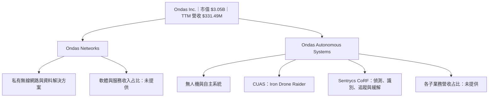

### 2.2 市場份額

市場份額數據未提供，近期新聞摘要亦未列出可查核的公司市占率。以 TTM 營收 $331.49M 與最新一季年增 1,558.6% 觀察，公司規模仍小於成熟國防科技同業，但增長速度高於 AVAV、KTOS；其中是否由併購、低基期或有機訂單推動，現有資料無法完整拆分。

### 2.3 競爭護城河分析

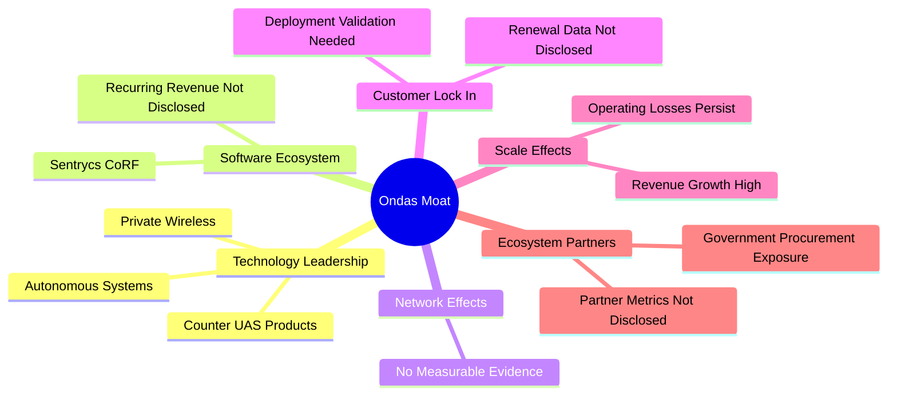

### 2.4 護城河強度

| 護城河項目 | 強度（強／中／弱） | 證據（引用數字或事實） | 會削弱它的情況 |
|------------|--------------------|------------------------|----------------|
| 技術與產品 | 中 | 產品涵蓋私有無線、Iron Drone Raider、Sentrycs CoRF；但未提供單一產品營收、部署數或效能對比。 | 測試、部署或採購未達標；競品以更低成本替代。 |
| 軟體與服務 | 弱至中 | 公司提供資料解決方案，但軟體/服務經常性營收比例未提供。 | 收入主要依賴一次性硬體交付，續約與維護收入不足。 |
| 網路效應 | 弱 | 未提供網路規模、使用者互通或數據累積形成正回饋的量化證據。 | 客戶可在不同供應商間切換，且系統互通性普遍。 |
| 客戶鎖定 | 弱至中 | 國防及基礎設施系統可能有整合成本，但客戶留存與續約率未提供。 | 採購延後、替換供應商或訂單集中度過高。 |
| 規模效應 | 弱 | TTM 營收成長 1,239.4%，但營業利益率仍 -126.2%，尚未證明規模帶來營業槓桿。 | 成長仰賴併購，費用與交付成本同步上升。 |
| 生態夥伴 | N/A | 夥伴與通路貢獻金額未提供。 | 重要供應商或整合夥伴中斷，影響交付。 |

護城河評分 **4.0/10** 的理由：公司已有多種產品與快速擴張的營收，但尚缺市占、續約率、軟體收入占比及規模經濟的可驗證資料。

---

## 3. 損益表深度分析

### 3.1 年度收入成長趨勢（近4年）

年度營收依序為 FY2022 $2.13M、FY2023 $15.69M、FY2024 $7.19M、FY2025 $50.73M。FY2024 下滑後 FY2025 快速反彈，顯示業務組合與營收基期高度波動。

```text
╔══════════════════════════════════════════════════════════════════╗
║              Ondas 年度收入趨勢（FY2022-FY2025）                 ║
╠══════════════════════════════════════════════════════════════════╣
║ FY2022  $2.13M   █░░░░░░░░░░░░░░░░░░░░░░░░  YoY：—             ║
║ FY2023 $15.69M   ████████░░░░░░░░░░░░░░░░░░  YoY：+636.6%       ║
║ FY2024  $7.19M   ████░░░░░░░░░░░░░░░░░░░░░░  YoY：-54.2%        ║
║ FY2025 $50.73M   ██████████████████████████  YoY：+605.3%       ║
╠══════════════════════════════════════════════════════════════════╣
║ FY2022-FY2025 CAGR：(50.73 ÷ 2.13)^(1/3)-1 ≈ 188.0%            ║
║ 注意：高 CAGR 受到低基期及年度營收劇烈波動影響。                  ║
╚══════════════════════════════════════════════════════════════════╝
```

### 3.2 季度收入趨勢分析

StockAnalysis 列示最近四季營收，其中 2026 Q3 為 $167.49M；SEC 敘述資料的季度表將該季列為缺值。以下引用 StockAnalysis 的補充季度數據，並保留來源口徑差異。

| 季度 | 營收 | QoQ 成長 | YoY 成長 | 備註 |
|------|------:|---------:|---------:|------|
| 2025 Q4 | $30.11M | 607.9% | 629.2% | 相較 2025 Q3 $4.13M；低基期影響明顯。 |
| 2026 Q1 | $50.12M | 66.5% | 1,079.9% | 相較 2025 Q1 $4.25M；增幅可能受併購及基期影響。 |
| 2026 Q2 | $83.77M | 67.2% | 1,235.4% | 相較 2025 Q2 $6.27M。 |
| 2026 Q3 | $167.49M | 99.9% | **1,558.6%** | YoY 採 VERIFIED FIGURES 單季數值；公司財報資料表缺值，補充數據來自 StockAnalysis。 |

最新一季接近翻倍 QoQ，若代表可持續訂單交付，可支持高營收成長；但單季收入跳升也提高收入認列、併購併表與季度交付集中度的核查重要性。

### 3.3 利潤率演變分析

| 利潤率指標 | FY2022 | FY2023 | FY2024 | FY2025 | 趨勢 | 評估 |
|------------|-------:|-------:|-------:|-------:|------|------|
| **毛利率** | 52.1% | 40.7% | 4.8% | 39.7% | 2024 大幅下滑，2025 回升 | 🟡 年度波動大 |
| **營業利益率** | -2,347.4% | -243.7% | -481.3% | -115.1% | 2025 相對改善，但仍大幅虧損 | 🔴 尚未接近盈虧平衡 |
| **淨利率** | -3,439.9% | -285.7% | -528.6% | -260.3% | 均為負值；年度口徑與 TTM 非同一期間 | 🔴 盈利不穩定 |

年度毛利率以年度毛利除以年度營收計算；TTM 毛利率 36.4% 是另一個期間口徑。FY2025 毛利率回升至 39.7%，可能反映產品組合、併購後收入結構或交付規模改變，但營業利益仍為 -$58.38M，代表營業費用與整合成本尚未被毛利吸收。TTM 營業利益率 -126.2%，進一步顯示目前營收增長並未建立穩定營業槓桿。

### 3.4 費用結構分析

FY2025 營收 $50.73M、毛利 $20.16M、營業損失 $58.38M。以營收減毛利推算銷貨成本為 $30.57M；以毛利減營業利益推算營業費用為 $78.54M。這是基於年度損益表項目的算術推導，並非公司公布的逐項費用明細。

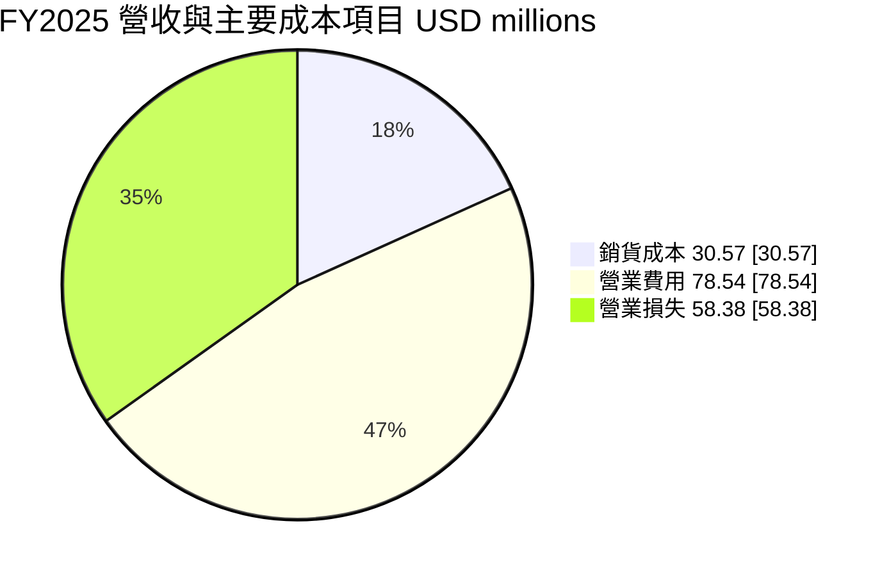

```text
╔══════════════════════════════════════════════════════════════════╗
║                     FY2025 費用結構                               ║
╠══════════════════════════════════════════════════════════════════╣
║ 營收           $50.73M   █████████████████████████              ║
║ 毛利           $20.16M   ██████████                             ║
║ 銷貨成本       $30.57M   ███████████████                        ║
║ 營業費用       $78.54M   ██████████████████████████████████████ ║
║ 營業損失       $58.38M   █████████████████████████████          ║
╚══════════════════════════════════════════════════════════════════╝
```

### 3.5 季度 EPS 趨勢與盈餘品質（Quality of Earnings）

| 盈餘品質項目 | 數值/佔比 | 評估 |
|--------------|-----------|------|
| 股權薪酬 SBC / 營收 | FY2025：$16.02M ÷ $50.73M = **31.6%** | 🔴 SBC 占年度營收比重高，代表股東經濟成本不可忽略。 |
| SBC / 營業現金流 | FY2025：$16.02M ÷ -$38.75M；以絕對值計 **41.3%** | 🔴 分母為負，比例僅表示 SBC 規模相對於現金消耗，不是正向覆蓋率。 |
| FCF / 淨利（現金轉換率） | FY2025：-$40.88M ÷ -$132.02M = **31.0%** | 🔴 淨利與 FCF 均為負，比例沒有一般現金轉換率意義。 |
| 一次性/非經常性損益 | 2026 Q1 淨利 **+$362.95M**，而 Q2 **-$88.25M**、Q4 2025 **-$99.66M** | 🔴 季度淨利波動極端；未提供調節表，無法將 Q1 盈利判定為可重複經營收益。 |
| 有效稅率異常 | N/A（逐季所得稅費用明細未提供） | 不以淨利倒推有效稅率。 |
| 資本化支出 vs 費用化 | FY2025 資本支出 $2.14M；資本化政策明細未提供 | 無法判定是否有成本由費用化轉為資本化。 |

最近四季 EPS 預估值、實際值及 surprise% 均為缺值；因此無法可靠判定 2025 Q4 至 2026 Q3 的逐季超預期或不及預期。新聞摘要稱 Q3 營收高於預期，但未提供預估數字，不把它當作 EPS beat 證據。

**盈餘品質結論**：營收增長有實際財務數據支持，但盈利可持續性低。FY2025 SBC 占營收 31.6%，2026 Q1 淨利大幅為正但其他季仍虧損；TTM FCF -$311.55M。估值不宜依據單季淨利或分析師共識直接推算，應優先檢視 GAAP 營業獲利、現金流與稀釋後每股經濟價值。

---

## 4. 資產負債表分析

### 4.1 資產結構分解

下圖採 StockAnalysis 2026-09-30 資產資料（$M）；資料表所列資產細項加總與總資產有小幅差異，視為來源四捨五入或分類差異，不據此重算淨資產。

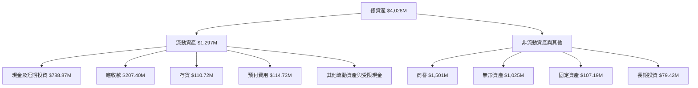

### 4.2 流動性與營運資金分析

| 指標 | 最新值 | 歷史值 | 變化 | 解讀 |
|------|-------:|-------:|------|------|
| 現金及短期投資 | $788.87M | FY2025 $572.49M | 增加 $216.38M | 仍有較大流動性緩衝，但現金增加不代表營運現金流改善。 |
| 流動比率 | 3.389x（合併市場資料） | N/A | N/A | 另一資料來源有不同期間資產負債表數值，需以 SEC 10-Q 同口徑核實。 |
| 速動比率 | 2.604x（合併市場資料） | N/A | N/A | 具一定流動性，但應收款回收與現金消耗同樣重要。 |
| DSO 應收帳款天數 | N/A | N/A | N/A | QUALITY FIGURES 未提供季度資產負債表期間計算所需數據。 |
| DIO 存貨天數 | N/A | N/A | N/A | 同上。 |
| DPO 應付帳款天數 | N/A | N/A | N/A | 同上。 |
| CCC 現金轉換週期 | N/A | N/A | N/A | 同上。 |

### 4.3 債務結構分析

不同數據來源對債務口徑不一致：QUALITY FIGURES 的總債務為 N/A、淨現金列示 $788.87M；市場資料另列總債務 $62.81M、淨現金 $726.06M。本報告在要求原值引用的指標上以 VERIFIED FIGURES 為準，不把兩者混為同一口徑。

```text
╔══════════════════════════════════════════════════════════════════╗
║                   Ondas 債務健康診斷                             ║
╠══════════════════════════════════════════════════════════════════╣
║ 總債務：          N/A（VERIFIED FIGURES 未提供）                 ║
║ 現金及短期投資：  $788.87M  ████████████████████                ║
║ 淨現金：          $788.87M（依 QUALITY FIGURES 原值）            ║
║ Debt/EBITDA：     N/A；且 EBITDA 為負，倍數不具經濟意義           ║
║ Interest Coverage：N/A；營業利益為負，無法以營業利益覆蓋利息     ║
╠══════════════════════════════════════════════════════════════════╣
║ 判讀：流動性存量提供緩衝；高額負 FCF 使現金跑道成為核心監控項目。║
╚══════════════════════════════════════════════════════════════════╝
```

### 4.4 股東權益趨勢

| 年度 | 股東權益 | 變化 |
|------|---------:|------|
| 2022 | $58.22M | — |
| 2023 | $33.14M | YoY -43.1% |
| 2024 | $16.58M | YoY -50.0% |
| 2025 | $437.81M | YoY +2,541.8% |

FY2025 股東權益顯著增加，與現金、資產規模及股數增加同時發生；其成因可能包括融資及併購相關會計變動，但現有摘要資料不足以完整拆解。股東權益增加不能單獨視作每股價值增加，須同時檢視稀釋與資產收購品質。

```text
╔══════════════════════════════════════════════════════════════════╗
║                    股東權益年度變化                               ║
╠══════════════════════════════════════════════════════════════════╣
║ 2022  $58.22M  ███░░░░░░░░░░░░░░░░░░░░░░                       ║
║ 2023  $33.14M  ██░░░░░░░░░░░░░░░░░░░░░░                        ║
║ 2024  $16.58M  █░░░░░░░░░░░░░░░░░░░░░░░                        ║
║ 2025 $437.81M  █████████████████████████                        ║
╚══════════════════════════════════════════════════════════════════╝
```

---

## 5. 現金流量深度分析

### 5.1 現金流量瀑布圖

淨利與營業現金流不同期間口徑不宜直接相減；圖中使用 TTM 淨利來源未統一的限制，並呈現可確認的 TTM 現金流鏈。

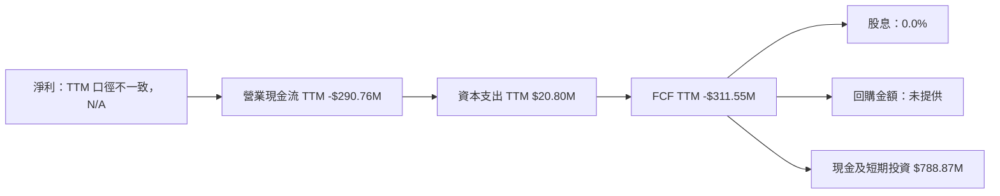

### 5.2 FCF 轉換率趨勢

| 年度 | FCF | 淨利 | FCF / 淨利 | 解讀 |
|------|----:|-----:|-----------:|------|
| 2022 | -$40.89M | -$73.24M | 55.8% | 兩者均為負，比例不代表良好現金轉換。 |
| 2023 | -$34.30M | -$44.84M | 76.5% | 同上，現金消耗仍為負。 |
| 2024 | -$35.20M | -$38.01M | 92.6% | FCF 接近淨損但仍未轉正。 |
| 2025 | -$40.88M | -$132.02M | 31.0% | 存在非現金項目或營運資金影響的可能，需看現金流調節表。 |
| TTM | **-$311.55M** | N/A | N/A | TTM 口徑依 VERIFIED FIGURES；不得與年度表混算。 |

### 5.3 自由現金流趨勢

年度現金流表列示的歷史 FCF 與 TTM VERIFIED FIGURES 為不同期間資料；兩者均顯示負 FCF，且最新 TTM 消耗加劇。

```text
╔══════════════════════════════════════════════════════════════════╗
║                    自由現金流趨勢                                 ║
╠══════════════════════════════════════════════════════════════════╣
║ FY2022  -$40.89M  ████████████████████  FCF Yield：N/A           ║
║ FY2023  -$34.30M  █████████████████     FCF Yield：N/A           ║
║ FY2024  -$35.20M  █████████████████     FCF Yield：N/A           ║
║ FY2025  -$40.88M  ████████████████████  FCF Yield：N/A           ║
║ TTM    -$311.55M  █████████████████████████████  Yield：-10.21%  ║
╠══════════════════════════════════════════════════════════════════╣
║ TTM FCF = TTM OCF - TTM Capex = -$290.76M - $20.80M = -$311.55M ║
╚══════════════════════════════════════════════════════════════════╝
```

### 5.4 資本配置評估

FY2025 股息殖利率 0.0%，沒有股息支付；FY2025 SBC $16.02M。資本配置 pie 僅呈現有數字且同期間可比的項目，未提供回購金額，不能把剩餘現金流任意分配至各用途。

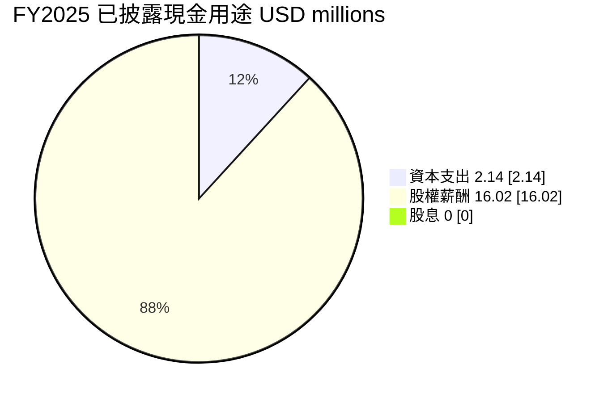

| 資本配置項目 | 已披露數字 | 評估 |
|--------------|-----------:|------|
| 資本支出 | FY2025 $2.14M；TTM $20.80M | TTM 投資增加，但未提供各項投資回報與產能效益。 |
| 股權薪酬 | FY2025 $16.02M | 占 FY2025 營收 31.6%，對股東有明顯稀釋成本。 |
| 股息 | 殖利率 0.0% | 暫無現金股息回報。 |
| 股票回購 | N/A | 未提供可引用金額。 |
| 併購與其他投資 | 近期業務與資產規模擴張，但詳細現金支付明細 N/A | 需追蹤收購後營收、毛利、商譽減損及整合費用。 |

---

## 6. 獲利能力與資本效率

### 6.1 ROE / ROA / ROIC 趨勢

| 指標 | 最新值 | 歷史值 | 評估 |
|------|-------:|-------:|------|
| ROE（QUALITY FIGURES，TTM） | 4.6% | 歷史品質區塊未提供同口徑序列 | 正值與淨利率資料受非經常項目及資料口徑影響，不能單獨視為穩定盈利。 |
| ROA | TTM ROA 測試為正；另一合併資料列 -9.7% | 不同來源口徑衝突 | 不以衝突數據自行重算。 |
| ROIC（TTM） | **-20.9%** | 同口徑歷史序列未提供 | 低於 14.00% WACC，資本回報未覆蓋資本成本。 |
| ROIC − WACC | **-34.9 個百分點** | N/A | 🔴 價值創造尚未成立。 |

行業均值未提供，因此不填列非來源數字。ROE、ROA 的來源存在口徑差異，價值判斷以明確的 TTM ROIC 與成本資本比較為主。

### 6.2 ROIC vs WACC 分析（核心價值創造判斷）

WACC 採成本資本資料中的 **14.00%**；其程式計算值為 15.02%，因限定在 7%–14% 區間而採用上限 14.00%。此處不另行重算替代 WACC。

```text
╔══════════════════════════════════════════════════════════════════╗
║                ROIC vs WACC 深度分析                            ║
╠══════════════════════════════════════════════════════════════════╣
║ WACC 估算（採用成本資本數據）：                                   ║
║ ├── 無風險利率（10Y 美債）：       5.15%                         ║
║ ├── 市場風險溢酬 ERP：              5.00%                         ║
║ ├── 原始 Beta（Yahoo）：            3.08                          ║
║ ├── 調整後 Beta：                   2.00                          ║
║ ├── Beta 調整：2/3×3.08+1/3=2.39，限制於 0.6–2.0，採用 2.00      ║
║ ├── 股權成本：5.15% + 2.00×5.00% = 15.15%                       ║
║ ├── 稅前債務成本：                  10.47%                        ║
║ ├── 稅率：                          21.0%                         ║
║ ├── 股權/債務權重：                 98.0% / 2.0%                  ║
║ ├── 程式計算 WACC：                 15.02%                        ║
║ └── 限定後採用 WACC：               14.00%                        ║
║                                                                  ║
║ ROIC（TTM）：                       -20.9%                        ║
║ EVA spread：-20.9% - 14.00% =       -34.9pp                       ║
║                                                                  ║
║ ROIC  -20.9%  🔴 低於資本成本                                      ║
║ WACC   14.00%  ──                                                  ║
╠══════════════════════════════════════════════════════════════════╣
║ 結論：ROIC 尚未覆蓋 WACC；公司目前摧毀而非創造股東經濟價值。     ║
╚══════════════════════════════════════════════════════════════════╝
```

成本資本區塊的 WACC、Beta 及權重為本節採用值。由於 VERIFIED FIGURES 的總債務為 N/A，無法獨立核對 2% 債務權重及 10.47% 債務成本的計息負債分母；依規則不以另一來源債務數字改寫該模型輸入。公司業務並非金融業，ROIC/WACC 比較適用。

### 6.3 杜邦三因素分解

| 因素 | 數值（TTM） | 解讀 |
|------|-------------|------|
| 淨利率 | 33.1% | QUALITY FIGURES 原值；季度與 TTM 淨利受到波動項目影響，須審慎解讀。 |
| 資產週轉率 | 0.08 | 資產基數大，收入相對資產規模仍低。 |
| 權益乘數 | 1.70 | 財務槓桿不是主要 ROE 驅動因子。 |
| **ROE** | **4.6%** | 33.1% × 0.08 × 1.70 ≈ 4.6%；主要由淨利率與低資產週轉率的乘積決定。 |

### 6.4 財務體質：Piotroski F-Score

Piotroski F-Score **3/8**；八項可判定測試中通過三項，一項長期負債測試因缺少輸入無法判定。

| 測試 | 結果 | 解讀 |
|------|------|------|
| ROA > 0 | ✅ 通過 | 依品質測試期間口徑為正。 |
| 營業現金流 > 0 | ❌ 未通過 | 與 TTM 負 OCF 相符，顯示內部造血不足。 |
| ROA 高於一年前 | ✅ 通過 | 改善方向為正，但不代表已達正向資本回報。 |
| 營業現金流 > 淨利（應計品質） | ❌ 未通過 | 現金流無法支持盈餘品質判斷。 |
| 長期負債 ÷ 總資產低於一年前 | — 無法判定 | 缺少測試所需資料。 |
| 流動比率高於一年前 | ❌ 未通過 | 表示相對一年前未改善；不代表目前流動比率低於 1。 |
| 稀釋股數未增加 | ❌ 未通過 | 股數增加削弱每股價值與既有股東持股比例。 |
| 毛利率高於一年前 | ❌ 未通過 | 依該測試採用的年度對比口徑未通過。 |
| 資產週轉率高於一年前 | ✅ 通過 | 資產使用效率相對改善。 |

---

## 7. 相對估值分析

### 7.1 同業估值比較表格

| 估值指標 | **ONDS** | **AVAV** | **KTOS** | **RCAT** | 本公司評估 |
|----------|---------:|---------:|---------:|---------:|-----------|
| **Trailing P/E** | N/A | N/A | 282.6x | N/A | 🔴 可比數據不足；本公司虧損，P/E 不適用 |
| **Forward P/E** | -33.29032x | 26.7x | 30.3x | -8.6x | 🔴 ONDS 預估 EPS 為負；負倍數不能作便宜判斷 |
| **P/S Ratio** | 9.206328x | 3.0x | 3.9x | 8.1x | 🔴 高於同業中位數 3.9x |
| **EV/EBITDA** | -8.006x | 28.4x | 58.1x | -2.6x | 🔴 ONDS EBITDA 為負，倍數失去正向估值意義 |
| **最新一季營收 YoY** | 1,558.6% | 5.7% | 35.7% | 527.2% | 🟢 最高，但增長品質與持續性仍待驗證 |
| **毛利率（TTM）** | 36.4% | 26.5% | 23.0% | 9.8% | 🟢 高於三家同業中位數 23.0% |

Peer multiples 依 Yahoo Finance 提供的數值；中位數僅在確有可比較值時引用。ONDS P/S 與 8.8 同業估值方法採用的倍數基礎並非同一計算時點；相對估值方法的同業 P/S 中位數及每股價值則以指定方法區塊為準。

### 7.2 歷史估值區間分析

歷史資料提供 P/S，非 P/E；按自身歷史估值規則引用 P/S。

```text
╔══════════════════════════════════════════════════════════════════╗
║             ONDS 自身 5 年歷史估值：TTM P/S                      ║
╠══════════════════════════════════════════════════════════════════╣
║ 歷史低點：2.9x  ├────────●──────────────┤ 歷史高點：140.6x     ║
║ 中位數：17.9x              現值：9.6x                           ║
║ 現值百分位：32%                                                    ║
╠══════════════════════════════════════════════════════════════════╣
║ 現值低於歷史中位數，但歷史區間極寬，百分位低不等於絕對低估。      ║
╚══════════════════════════════════════════════════════════════════╝
```

### 7.3 情境價值（Bear / Base / Bull）

**N/A（DCF 無法計算：TTM 營業利益為負，依 DCF MODEL 規則不建立 DCF，故無 DCF Scenarios）。**本報告不另行設定情境目標價或機率。

### 7.4 相對估值隱含價格區間

```text
╔══════════════════════════════════════════════════════════════════╗
║             相對估值每股價格與現價位置                            ║
╠══════════════════════════════════════════════════════════════════╣
║ 同業 P/S：$2.17  ───── 現價 $5.16 ───────── 分析師共識：$16.98  ║
║             90% 權重                         10% 權重            ║
╠══════════════════════════════════════════════════════════════════╣
║ 同業 P/S 依據：同業中位數 3.9x × TTM 營收，方法區塊每股價值 $2.17║
║ 共識目標價：10 位分析師平均目標價 $16.98                         ║
║ 加權合理價值：$3.65                                              ║
╚══════════════════════════════════════════════════════════════════╝
```

同業 P/S 回推值低於現價，分析師共識值則明顯高於現價；共識值僅占 10% 權重，因此整體合理價值仍為 $3.65，而非直接採用平均目標價。

---

## 8. DCF 內在價值評估（Discounted Cash Flow）

**DCF MODEL：N/A。**原因是 TTM 營業利益不為正；以負營業利益作為現金流折現起點會產生不具經濟解釋力的估值。因此第 8.1–8.7 節依規定不自建現金流模型、不給 DCF 內在價值、敏感度矩陣、情境價值或反推 DCF。相對估值與加權合理價值仍按指定估值方法呈現於 8.8。

### 8.0 估值推理鏈（Thinking Logic）

#### Step 1 — 公司價值的主要變數

Ondas 價值主要取決於：① 現有私有無線及自主系統能否由 TTM 營收 $331.49M 擴大並改善毛利；② CUAS 與自主無人系統能否轉化為持續採購與維護收入；③ 高額現金消耗能否在現金資源耗盡前下降。各業務營收占比未提供，故無法量化各項對總營收的貢獻。現階段主導估值的不是短期營收增速，而是營收增長轉為正營業利益與正 FCF 的速度。

#### Step 2 — 模型選擇

| 決策點 | 本報告採用 | 理由（含數字） | 曾考慮但否決 | 否決理由 |
|--------|-----------|----------------|--------------|----------|
| 現金流定義 | 不適用 | TTM 營業利益為負，模型標示 N/A。 | FCFF / FCFE | 以虧損作折現起點不具經濟解釋力。 |
| 預測期 N | N/A | DCF MODEL 未建立預測期。 | 5–10 年模型 | 不自行建立替代模型。 |
| 終值方法 | N/A | 無可用預測 FCFF。 | Gordon Growth、退出倍數 | 缺少有效預測現金流基礎。 |
| EBIT 基礎 | N/A | DCF 未計算。 | GAAP 或非 GAAP EBIT | 不以假設數字替代缺失模型。 |

#### Step 3 — 關鍵假設推導鏈

**N/A**：未提供可用 DCF 模型假設；依規則不得自行設定營收 CAGR、利潤率、永續成長率或退出倍數。

#### Step 4 — 推理鏈最脆弱環節

目前最脆弱的假設不是可量化的 DCF 輸入，而是市場能否把 backlog 與近期營收跳升轉為正向營業現金流；若不能，$788.87M 現金與短期投資可能被持續負 FCF 消耗，現金消耗風險見第 10 章。

#### Step 5 — 計算路徑圖

以下為一般估值關係圖，不代表 ONDS 已建立 DCF 數值：

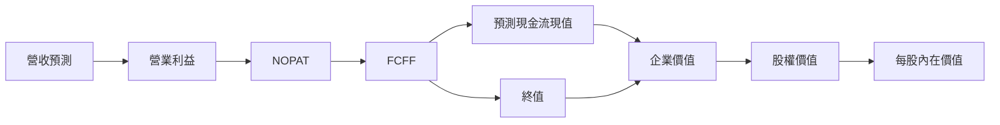

### 8.1 模型假設總表（Model Inputs）

**N/A（DCF MODEL 未建立：TTM 營業利益為負）。**因此預測期、CAGR、營業利潤率、稅率、Capex/營收、D&A/營收、營運資金、EBIT 基礎、SBC 處理、稀釋率、永續成長率及終值方法均不填假設值。

### 8.2 折現率推導（WACC）

WACC 用於第 6.2 節資本效率分析；不代表本報告建立了 DCF。

```text
╔══════════════════════════════════════════════════════════════════╗
║                    WACC 推導（折現率）                           ║
╠══════════════════════════════════════════════════════════════════╣
║ 股權成本 Ke（成本資本資料原值）：                                 ║
║ ├── 無風險利率 Rf：5.15%                                         ║
║ ├── ERP：5.00%                                                   ║
║ ├── 原始 Beta：3.08；調整 Beta：2.00                             ║
║ ├── 調整式：2/3×3.08 + 1/3 = 2.39，超過上限後採 2.00            ║
║ └── Ke：5.15% + 2.00×5.00% = 15.15%                            ║
║                                                                  ║
║ 債務成本與資本權重（區塊原值）：                                   ║
║ ├── 稅前 Kd：10.47%                                              ║
║ ├── 稅率：21.0%                                                  ║
║ ├── 權重：股權 98.0% / 債務 2.0%                                 ║
║ ├── 程式計算 WACC：15.02%                                        ║
║ └── 受 7%–14% 限制後採用：14.00%                                 ║
╚══════════════════════════════════════════════════════════════════╝
```

計算值與採用值須區分：成本資本來源列示程式計算 WACC 15.02%，並依指定 7%–14% 區間上限採用 **14.00%**。來源未提供可與債務成本核對的完整利息及平均計息負債金額；VERIFIED FIGURES 的總債務亦為 N/A，故不另行重算 WACC。

### 8.3 逐年自由現金流預測（基準情境）

**N/A（DCF MODEL 未建立）。**無預測期、年度 FCFF、折現因子或預測現金流現值，故不列逐年模型表，也不把歷史 FCF 假裝成預測值。

### 8.4 終值計算（Terminal Value）

**N/A（無預測期 FCFF，無法計算 Gordon Growth 或退出倍數終值）。**

### 8.5 企業價值 → 每股內在價值（Bridge）

**N/A（DCF 企業價值、股權價值及每股內在價值均未計算）。**本報告另列 2026-11-13 收盤價 $5.16；依規則，DCF 折溢價不可在 DCF 未計算時假設或反推。

### 8.6 敏感性分析（WACC × 永續成長率）

**N/A（沒有 DCF 基準現金流、終值或基準格，不能建立敏感度矩陣或三情境模型）。**

### 8.7 反推 DCF（Reverse DCF：市場在預期什麼）

**N/A（沒有可供反推的 DCF 模型）。**單一股價無法在沒有固定現金流模型輸入的情況下解出市場隱含營收 CAGR、利潤率、永續成長率或預測期。

### 8.8 估值三角驗證與安全邊際

估值方法及權重依不盈利公司類型採用指定固定配置；同業 Forward P/E 因不可計算而剔除，其權重按模型規則由其餘方法分配。

| 估值方法 | 隱含每股價值 | 上行空間（÷現價） | 權重 | 說明 |
|----------|--------------:|-------------------:|------:|------|
| 同業 P/S | $2.17 | -57.9% | 90% | 同業中位數 3.9x（AVAV、KTOS、RCAT）× TTM 營收，依估值方法區塊回推每股價值。 |
| 分析師共識目標價 | $16.98 | +229.1% | 10% | 10 位分析師平均目標價；參考指標，不代表模型內在價值。 |
| **加權合理價值** | **$3.65** | **-29.3%** | **100%** | 不盈利公司類型固定權重；同業 Forward P/E 不可計算，未納入。 |

**逐步演算（權重外顯）**：

- 加權合理價值＝$2.17 × 90% + $16.98 × 10%
- ＝$1.953 + $1.698
- ＝**$3.651，來源指定加權合理價值原值為 $3.65**
- 使用原值計算 MOS：($3.65 − $5.16) ÷ $3.65 = **-41.4%**
- 上行空間：($3.65 − $5.16) ÷ $5.16 = **-29.3%**

```text
╔══════════════════════════════════════════════════════════════════╗
║                  估值區間與安全邊際                              ║
╠══════════════════════════════════════════════════════════════════╣
║ 同業 P/S $2.17 ── 加權合理價值 $3.65 ── 現價 $5.16 ── 共識 $16.98║
║                                                                  ║
║ 安全邊際 MOS = (加權合理價值 - 現價) ÷ 加權合理價值 = -41.4%    ║
║ 上行空間 = (加權合理價值 - 現價) ÷ 現價 = -29.3%                ║
║ MOS 評估：🔴 低於 10%，無安全邊際                                ║
║                                                                  ║
║ 參考價格條件：若以 MOS ≥ 10% 作為安全邊際門檻，                  ║
║ 股價需 ≤ $3.65 × (1 - 10%) = $3.285，約 $3.29。                 ║
║ 該數值是機械式門檻，不改變目前「賣出」評級。                     ║
╚══════════════════════════════════════════════════════════════════╝
```

> 🔎 **程式複算（Python，依本節各項自動重算）**
>
> 加權合理價值 = $2.17 × 90% + $16.98 × 10% = **$3.65**（權重合計 100%）
>
> 以價格 $5.16 計：MOS = **-41.4%**，上行空間 = **-29.3%**
>
> ✅ 與本節所寫數值一致。

### 8.9 DCF 模型的局限與失效條件

- **終值依賴度**：N/A，沒有 DCF 終值或企業價值可供計算。
- **最脆弱的投資假設**：營收高速成長能否轉化為正營業利潤與正 FCF。若營收增長延續但 TTM FCF 仍為 -$311.55M，營收倍數估值也可能下修。
- **不適用情境說明**：公司 TTM 營業利益率 -126.2%、ROIC -20.9%，獲利與現金流仍為負，DCF 可靠度不足。現階段以同業 EV/Sales 或 P/S、訂單轉收入能力、毛利率及現金消耗分析較合適。
- **與第 10 章風險矩陣的連結**：交付延遲影響營收成長與應收款；成本上升影響毛利率；融資或股權發行影響稀釋股數與每股估值。

### 8.10 複算檢核表（Audit Trail）

| # | 檢核項目 | 檢查方式 | 結果 |
|---|----------|----------|------|
| 1 | 高/中敏感度 DCF 假設均有推導 | DCF 模型未建立 | N/A |
| 2 | 每個 DCF 假設有來歷 | 不提供未授權假設 | N/A |
| 3 | WACC 計算與採用值 | 引用來源計算值 15.02%、採用上限 14.00% | ✅ |
| 4 | Kd 分母與債務權重範圍一致 | 債務餘額資料不完整，不能獨立核對 | N/A（已揭露限制） |
| 5 | WACC 與第 6.2 節相同 | 均採用 14.00% | ✅ |
| 6 | 預測年度數與 N 一致 | DCF 無 N | N/A |
| 7 | FY+1 九步算式可複算 | 無 FY+1 預測值 | N/A |
| 8 | 預測期 PV 合計 | 無預測 PV | N/A |
| 9 | WACC > g | 無 g | N/A |
| 10 | 終值以 FY+N 現金流折現 | 無終值 | N/A |
| 11 | EV 至每股價值橋接 | 未建立 DCF | N/A |
| 12 | SBC 組合符合模型規則 | 無 DCF SBC 假設 | N/A |
| 13 | 敏感度矩陣基準格 | 無矩陣 | N/A |
| 14 | 敏感度格符合 WACC > g | 無矩陣 | N/A |
| 15 | 三情境機率加總 | DCF Scenarios 未提供 | N/A |
| 16 | 反推每列只放開一個變數 | 未建立反推模型 | N/A |
| 17 | MOS 分母與折溢價基準正確 | MOS 以 $3.65；DCF 折溢價 N/A | ✅ |
| 18 | 報告完整至第 11 章 | 已輸出完整十一章 | ✅ |
| 19 | 加權合理價值等於方法加權和 | $2.17×90%+$16.98×10%=$3.651，指定原值 $3.65 | ✅（來源原值四捨五入） |
| 20 | 評級符合 MOS 門檻 | MOS -41.4%，賣出 | ✅ |

未執行的 DCF 檢查項目均因 DCF MODEL 為 N/A 而非因模型數值未通過；本報告因此不提供 DCF 基準內在價值或情境目標價。

---

## 9. 成長催化劑

### 9.1 催化劑時間軸

財務數據未提供可核實的具體商業化時間表，下圖以觀察區段而非預測日期呈現；不可視為公司指引。

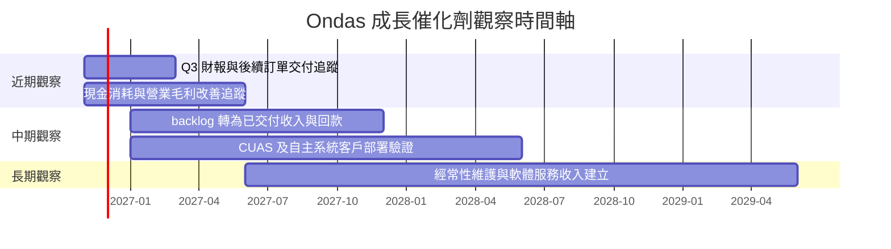

### 9.2 TAM 市場規模分析

**N/A（TAM 數據未提供）。**近期新聞摘要沒有可引用的 TAM 金額、來源與年份，因此不估算市場規模。TTM 營收 $331.49M、最新一季年增 1,558.6% 顯示業務放量，但公司營收規模與市場滲透率無法由現有資料推算。

### 9.3 成長驅動力結構圖

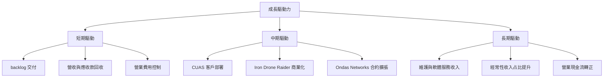

---

## 10. 風險矩陣

### 10.1 風險評分矩陣

下圖位置為分析師對風險機率與衝擊的定性判斷，不代表財務數據中的歷史發生率；量化財務依據列於 10.2。

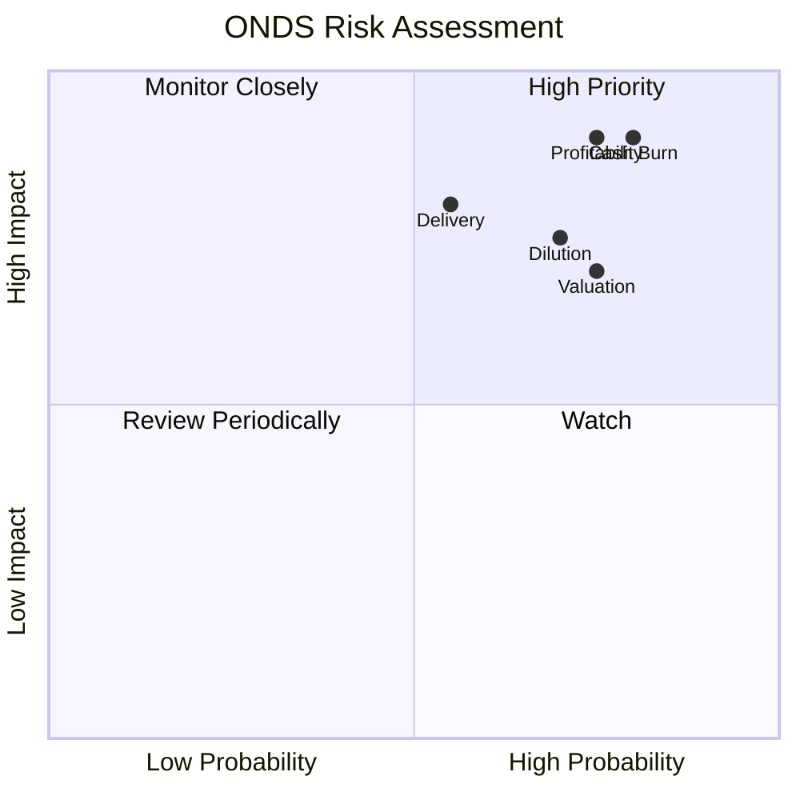

### 10.2 風險清單詳細分析

機率區間為分析師定性評估，不是公司披露的統計機率；財務衝擊以已披露指標作警示，不假裝成精確收入預測。

| # | 風險項目 | 發生機率 | 財務衝擊 | 風險評分 | 緩解措施 |
|---|----------|----------|----------|----------|----------|
| 1 | 🔴 **現金消耗持續** | 高（分析師評估 60%–80%） | TTM FCF -$311.55M；若趨勢延續將消耗 $788.87M 現金及短期投資 | 🔴 高 | 逐季追蹤 OCF、Capex、應收款與剩餘現金；要求管理層提供現金跑道及盈虧平衡時間表。 |
| 2 | 🔴 **營收增長不轉獲利** | 高（60%–80%） | TTM 營業利益率 -126.2%；營收擴張若仍伴隨高費用，股東價值可能不增反減 | 🔴 高 | 追蹤毛利率、營業費用率及分部貢獻，設定連續改善門檻。 |
| 3 | 🔴 **股權稀釋** | 中高（50%–70%） | Piotroski 稀釋股數測試未通過；FY2025 SBC $16.02M、占營收 31.6% | 🔴 高 | 監控基本及稀釋股數、SBC/營收、融資用途與每股營收成長。 |
| 4 | 🟠 **backlog 交付或認列延後** | 中（40%–60%） | 新聞提及 backlog $835M，但可取消性、交付時程與收入認列條件未提供 | 🟠 中高 | 對照每季 backlog、實際交付、應收款、客戶集中度及收款狀況。 |
| 5 | 🟠 **估值下修** | 中高（50%–70%） | P/S 9.6x，高於 peer P/S 中位數 3.9x；同業 P/S 方法每股值 $2.17 | 🔴 高 | 以營收品質、毛利與現金流改善作為估值支撐，不以高增長率單一指標買入。 |

---

## 11. 投資建議

### 11.1 最終評級與評分

依 8.8 加權合理價值 $3.65 與 2026-11-13 收盤價 $5.16 計算，MOS 為 -41.4%，按規則 20 評級為 **賣出**，不作一級調整。公司綜合評分為 **4.4/10**；其六項評分分別為成長性 9.0、獲利能力 1.5、財務健康 7.0、估值 2.0、護城河 4.0、管理層與資本配置 3.0。

### 11.2 合理價值與隱含報酬率

| 價值參考 | 每股價值 | 相對 $5.16 現價 | 機率 | 說明 |
|----------|---------:|----------------:|------|------|
| 同業 P/S 方法 | $2.17 | -57.9% | 不適用 | 8.8 估值方法之一，不是獨立的情境目標價。 |
| **加權合理價值** | **$3.65** | **上行空間 -29.3%；MOS -41.4%** | 不適用 | 90% 同業 P/S、10% 分析師共識目標價。 |
| DCF 悲觀情境 | N/A | N/A | N/A | DCF MODEL 未提供。 |
| DCF 基準情境 | N/A | N/A | N/A | DCF MODEL 未提供。 |
| DCF 樂觀情境 | N/A | N/A | N/A | DCF MODEL 未提供。 |

### 11.3 買入時機與觸發因素

```text
╔══════════════════════════════════════════════════════════════════╗
║                  ✅ 買入觸發因素 Checklist                      ║
╠══════════════════════════════════════════════════════════════════╣
║  目前評級為賣出；以下為重新評估條件，不構成現時買入訊號。        ║
║                                                                  ║
║  重新評估條件（多數符合後再考慮）：                              ║
║  ☐ TTM FCF 連續改善，且虧損幅度顯著低於 -$311.55M               ║
║  ☐ 營業利益率連續改善，並有清楚的費用率下降證據                  ║
║  ☐ backlog 轉化為已交付收入與現金回款，且披露交付時程            ║
║  ☐ 稀釋股數增幅放緩，SBC/營收低於 FY2025 的 31.6%                ║
║                                                                  ║
║  價格與估值觀察：                                                ║
║  ☐ 若以 MOS ≥ 10% 作門檻，股價需約 ≤ $3.29（基於 $3.65 合理價值）║
║                                                                  ║
║  減碼／退出重新檢視條件：                                        ║
║  ☐ 現金及短期投資大幅下降且 FCF 未改善                           ║
║  ☐ 收入成長放緩，同時毛利率或營業利益率收縮                      ║
║  ☐ 稀釋股數持續上升，或需以新股融資支應常態營運                  ║
╚══════════════════════════════════════════════════════════════════╝
```

### 11.4 投資人適配度分析

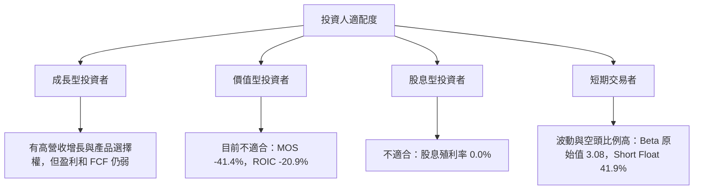

### 11.5 每季財報監控清單（Quarterly Watch List）

| 監控指標 | 最新參考值 | 加碼／正面觸發 | 減碼／負面觸發 |
|----------|-----------:|----------------|----------------|
| 營收年增率 | 最新一季 YoY 1,558.6% | 以同口徑看，增長持續且非單靠併購或單季交付 | 連續兩季大幅放緩且 backlog 未補充 |
| 毛利率 | TTM 36.4% | 毛利率持續維持或提高，並披露產品組合改善 | 毛利率連續下滑 |
| 營業利益率 | TTM -126.2%；最新一季 -113.1% | 虧損幅度連續收斂並有費用率改善佐證 | 虧損幅度擴大或收入增長仍無營業槓桿 |
| 營業現金流 | TTM -$290.76M | 連續改善且營收增長帶動營運現金流回升 | 現金流惡化或應收款增長快於營收 |
| FCF | TTM -$311.55M | 虧損幅度持續下降，向損益兩平靠近 | FCF 繼續惡化或持續以融資支應營運 |
| 資本支出 | TTM $20.80M | Capex 伴隨可驗證的產能與訂單回報 | Capex 上升但交付、毛利及回款未改善 |
| 股權薪酬及稀釋 | FY2025 SBC $16.02M；Piotroski 稀釋測試未通過 | SBC/營收下降、稀釋股數增幅放緩 | 股數持續增加或融資稀釋加劇 |
| backlog 與交付 | 新聞摘要稱 backlog $835M | 披露 backlog 口徑、交付進度與收款 | 訂單取消、延遲或收入認列低於預期 |
| EPS surprise | 最近四季 EPS 預估與實際值缺失 | 公司披露可核實 EPS 與盈餘調節 | 連續重大虧損且缺乏可追蹤的改善指標 |

### 11.6 反面論證：什麼會證明論點錯誤（What Would Change My Mind）

```text
╔══════════════════════════════════════════════════════════════════╗
║              ⚠️ 論點失效條件（Disconfirming Evidence）           ║
╠══════════════════════════════════════════════════════════════════╣
║ 本報告對 ONDS 的審慎判斷若出現下列證據，應重新評估：             ║
║                                                                  ║
║ ☐ TTM 營收增長由高基期下仍快速降至低於 35.7% 同業最高增長參照，  ║
║   且公司未披露足以支持未來訂單的 backlog。                       ║
║ ☐ 營業利益率連續數季惡化，或即使營收擴張仍遠低於盈虧平衡。       ║
║ ☐ TTM FCF 不但未由 -$311.55M 改善，反而進一步惡化。              ║
║ ☐ 現金及短期投資由 $788.87M 持續下降，但營業現金流沒有改善。     ║
║ ☐ 稀釋股數持續上升，且 SBC/營收未低於 FY2025 的 31.6%。          ║
║ ☐ ROIC 持續低於 14.00% WACC，或無法在收入成長中建立資本回報。   ║
║ ☐ backlog $835M 無法轉化為已交付收入、現金回款或持續性服務收入。║
╚══════════════════════════════════════════════════════════════════╝
```

> **免責聲明**：本報告為 AI 自動生成，僅供研究參考，不構成投資建議。投資有風險，入市需謹慎。

---

## 資料與來源

| 項目 | 內容 |
|------|------|
| 價格 | 5.16 USD，2026-11-13 收盤（Yahoo Finance 日線） |
| 財務報表 | SEC 10-Q filed 2026-11-12，最新季度 2026-09-30（FY2026 Q3） |
| 有回應的資料來源 | SEC 申報資料 (XBRL)、Yahoo Finance、Finviz、StockAnalysis、Roic.ai |
| 由程式計算 | TTM 數字、WACC、DCF 模型、估值方法與權重、加權合理價值、MOS、評級門檻、F-Score、杜邦分解、營運資金天數、綜合評分 |
| 撰寫模型 | openai / gpt-6-luna |

> 本區塊由產生報告的程式依實際取得的資料填寫，非模型撰寫。「由程式計算」的數字不是模型的估計；其餘判斷（評分、情境、策略）是模型的分析。
