# ONDS 基本面深度分析報告
> **報告日期**：2026-11-14 ｜ **語言**：繁體中文 ｜ **數據來源**：SEC 申報資料 (XBRL)、Yahoo Finance、Finviz、StockAnalysis、Roic.ai ｜ **分析師**：CFA 級機構研究

> **資料口徑說明**：財務資料包內若干一般欄位互相矛盾，例如營業利益率、FCF、ROE、總債務及營收成長。本文涉及估值及核心財務判斷時，優先採用 **VERIFIED FIGURES** 區塊；其他資料僅作交叉參考並註明口徑。未提供的數字標示為 N/A 或明確列作假設值，不以其他欄位反推。

## 目錄

| # | 章節 | 核心結論 |
|---|------|----------|
| 1 | 執行摘要 | 持有；加權合理價值 $5.585，MOS 6.8% |
| 2 | 公司概覽與商業模式 | 無線網路、無人機及反無人機產品具成長選擇權，但護城河尚待規模化驗證 |
| 3 | 損益表深度分析 | TTM 營收 $331.49M、年增 1,239.4%；營業利潤率仍為 -126.2% |
| 4 | 資產負債表分析 | 現金及短期投資 $788.87M；VERIFIED FIGURES 總債務 N/A |
| 5 | 現金流量深度分析 | TTM FCF -$311.55M，資金消耗是主要財務風險 |
| 6 | 獲利能力與資本效率 | ROIC -20.9% 對 WACC 20.34%，目前顯著摧毀經濟價值 |
| 7 | 相對估值分析 | 本身 P/S 9.6x，高於 AVAV、KTOS，接近高成長但低毛利的 RCAT |
| 8 | DCF 內在價值評估 | 基準 DCF 每股約 $2.27；加權合理價值 $5.585 |
| 9 | 成長催化劑 | $835M backlog 與季度營收放量具催化性，轉化速度仍是關鍵 |
| 10 | 風險矩陣 | 高估值、虧損與現金消耗、訂單轉收入風險居前 |
| 11 | 投資建議 | 持有；觀察毛利、營業槓桿、現金消耗與股數稀釋 |

---

## 1. 執行摘要

### 1.0 一頁式投資儀表板（Portfolio Manager 30 秒速讀）

| 項目 | 內容 |
|------|------|
| **投資論點（3 句）** | ① TTM 營收 $331.49M、年增 **1,239.4%**，顯示併購整合及產品交付帶來營收放大，但不是穩態成長率。② 公司披露 backlog 約 **$835M**，約為 TTM 營收的 **2.52 倍**（$835M ÷ $331.49M），但須看實際轉收入及回款。③ 現金及短期投資 **$788.87M** 可提供資金緩衝，但 TTM FCF **-$311.55M**，若消耗速度不降，資本需求仍高。 |
| **護城河評分** | **4.0/10**：有產品與系統整合能力，但規模、續約、客戶鎖定及持續獲利證據仍有限 |
| **管理層/資本配置評分** | **4.5/10**：營收擴大且資金充足；但收購整合、SBC 與資本效率待改善 |
| **財務健康** | 🟡 現金充足；流動性緩衝與高額現金消耗並存 |
| **ROIC vs WACC** | **-20.9% vs 20.34%**：差距 -41.24 個百分點，現階段摧毀股東價值 |
| **FCF 趨勢** | 仍為負；VERIFIED TTM FCF Yield **-10.37%** |
| **估值** | Forward P/E **-33.29032**（負盈餘，解讀有限）｜ EV/EBITDA **-7.588**（負 EBITDA，無法作常規比較）｜ FCF Yield **-10.37%** |
| **DCF 內在價值（基準）** | **約 $2.27**；現價相對 DCF 折溢價 **+127.3%**，即高於 DCF 基準價約 127.3% |
| **安全邊際（MOS）** | **+6.8%＝($5.585 − $5.16) ÷ $5.585**；🔴不足（MOS <10%）；基準為第 8.8 節加權合理價值 |
| **預期報酬（基準情境 12M）** | 約 **+5.6%**，以 $5.45 目標價對比 $5.16 現價 |
| **關鍵風險（前二）** | ① FCF 消耗與未來融資／稀釋；② backlog 轉收入、毛利與成本控制不及預期 |
| **評級 + 信心度** | 🟡 **持有** ｜ 信心：低至中；資料口徑不一致、估值高度依賴執行 |

> **評級形成過程**：加權合理價值 $5.585 對比 2026-11-13 收盤價 $5.16，MOS = 6.8%，依評級門檻屬 **持有**；同時 ROIC -20.9% 低於 WACC 20.34%，TTM FCF 為 -$311.55M，故不以高營收增速單獨推導買入評級。

### 1.1 核心評分儀表板

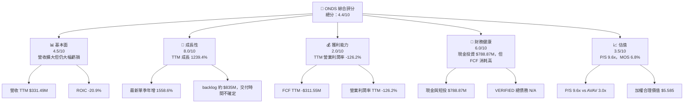

### 1.2 評分進度條視覺化

```text
╔══════════════════════════════════════════════════════════════╗
║              ONDS 多維度評分儀表板 (1-10分)                 ║
╠══════════════════════════════════════════════════════════════╣
║ 基本面強度  4.5 ▓▓▓▓▓▓▓▓▓░░░░░░░░░░░░  ★★☆☆☆              ║
║ 成長動能    8.0 ▓▓▓▓▓▓▓▓▓▓▓▓▓▓▓▓░░░░  ★★★★☆              ║
║ 獲利品質    2.0 ▓▓▓▓░░░░░░░░░░░░░░░░  ★☆☆☆☆              ║
║ 財務健康    6.0 ▓▓▓▓▓▓▓▓▓▓▓▓░░░░░░░░  ★★★☆☆              ║
║ 估值合理性  3.5 ▓▓▓▓▓▓▓░░░░░░░░░░░░░  ★★☆☆☆              ║
║ 護城河深度  4.0 ▓▓▓▓▓▓▓▓░░░░░░░░░░░░  ★★☆☆☆              ║
║ 管理層執行  4.5 ▓▓▓▓▓▓▓▓▓░░░░░░░░░░░░  ★★☆☆☆              ║
║ 技術創新力  6.0 ▓▓▓▓▓▓▓▓▓▓▓▓░░░░░░░░  ★★★☆☆              ║
╠══════════════════════════════════════════════════════════════╣
║ 綜合總分    4.4 ▓▓▓▓▓▓▓▓▓░░░░░░░░░░░░  高成長、高風險     ║
╚══════════════════════════════════════════════════════════════╝
```

### 1.3 五大投資論點 + 三大核心風險

| 類型 | 項目 | 具體依據 | 信心度 |
|------|------|----------|--------|
| 🟢 **投資論點①** | 營收已進入較大規模交付階段 | TTM 營收 $331.49M；最新季度營收 $167.49M，較上一季 $83.77M 增長約 99.9% | 🟡 中 |
| 🟢 **投資論點②** | 訂單可見度提高 | 新聞資料提及 backlog 約 $835M；約為 TTM 營收 2.52 倍，但轉化時間未知 | 🟡 中 |
| 🟢 **投資論點③** | 資金可支持近程擴張 | 現金及短期投資 $788.87M；惟並不代表可無限期承擔負 FCF | 🟡 中 |
| 🟢 **投資論點④** | 市場需求具結構性支撐 | 反無人機、無人系統及專用無線網路需求與安全、國防及基礎建設投資相關 | 🟡 中 |
| 🟢 **投資論點⑤** | 自身歷史 P/S 低於歷史中位數 | P/S 9.6x，5 年中位數 17.9x，當前百分位 32%；但自身歷史倍數波動極大 | 🟡 中 |
| 🟡 **風險①** | 現金消耗持續偏高 | VERIFIED TTM FCF -$311.55M；相當於現金及短期投資約 39.5% | 🔴 高 |
| 🔴 **風險②** | 利潤轉正及股東稀釋未驗證 | TTM 營業利潤率 -126.2%；現有資料顯示多季 SBC 顯著增加，股數也由 381M 增至 530M（Roic.ai 歷史快照） | 🔴 高 |
| 🔴 **風險③** | 估值要求訂單快速變現 | P/S 9.6x，高於 AVAV 3.0x 與 KTOS 3.9x；若增長放緩，倍數收縮可能抵銷營收成長 | 🔴 高 |

### 1.4 快速統計卡片

| 指標 | 公司實際值 | 行業均值 | S&P 500 均值 | 狀態 |
|------|-------------|----------|--------------|------|
| 收入 YoY 成長 | **TTM +1,239.4%**；最新單季 YoY +1,558.6% | N/A（未提供可比中位數） | N/A（不適合直接比較高速成長小型公司） | 🟢 增長高、基期效應大 |
| 毛利率 | **TTM 36.4%**（一般欄位；與其他資料口徑有差異） | N/A | N/A | 🟡 尚需驗證 |
| 淨利率 | 一般資料快照 **33.9%**，與營業虧損和資金流不一致，不採為正常化獲利指標 | N/A | N/A | 🔴 品質不明 |
| ROE | VERIFIED **4.6%** | N/A | N/A | 🟡 正值但品質不明 |
| Forward P/E | **-33.29032** | N/A | N/A | 🔴 負 EPS 下無解讀價值 |
| ROIC | **-20.9%** | N/A | N/A | 🔴 低於資本成本 |

### 1.5 投資結論

```text
╔══════════════════════════════════════════════════════════════════╗
║                    📊 投資結論摘要                              ║
╠══════════════════════════════════════════════════════════════════╣
║  評級：持有（MOS 6.8%，依規則 20）                               ║
║  價格（2026-11-13 收盤）：$5.16                                  ║
║  DCF 內在價值（基準）：約 $2.27（現價溢價約 127.3%）            ║
║  安全邊際 MOS：+6.8%＝($5.585−$5.16)÷$5.585                    ║
║  目標價區間：                                                    ║
║    悲觀情境：$2.50（相對現價 -51.6%）                           ║
║    基準情境：$5.45（相對現價 +5.6%）← 12 個月參考目標           ║
║    樂觀情境：$10.00（相對現價 +93.8%）                          ║
║  投資評分：4.4/10                                                ║
║  適合投資人：能承受高波動與執行風險的成長型投資人                ║
╚══════════════════════════════════════════════════════════════════╝
```

---

## 2. 公司概覽與商業模式

### 2.1 業務結構與收入來源

公司提供私人無線網路、無人機與自主系統、反無人機及場域保護產品，主要分為 Ondas Networks 與 Ondas Autonomous Systems。資料未提供各分部收入，故不以產品敘述反推營收占比；分部百分比與軟體／服務收入均為 **N/A**。

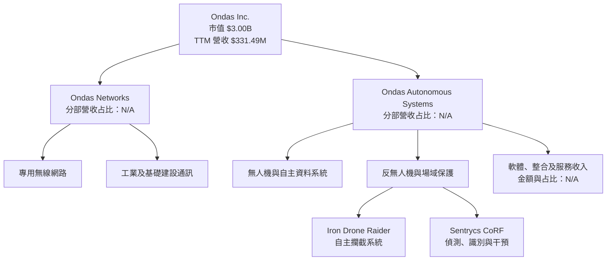

### 2.2 市場份額

未提供公司或競爭者在私人無線、無人機或 CUAS 的可比出貨量／市場收入資料，因此無法可靠計算市場份額。以下圖表是 **市場份額不可量化的資料狀態圖**，不代表實際市占。

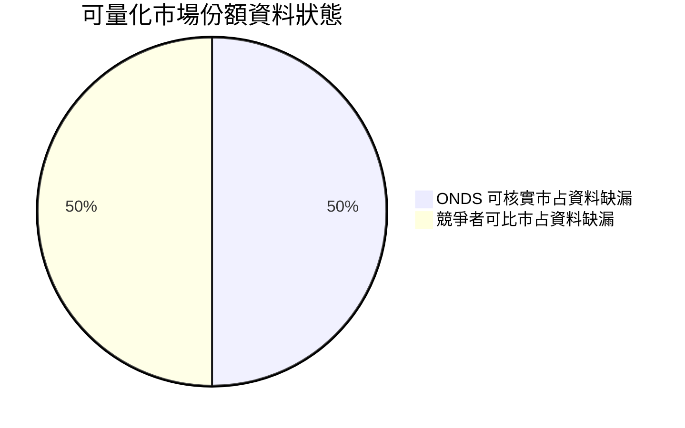

### 2.3 競爭護城河分析

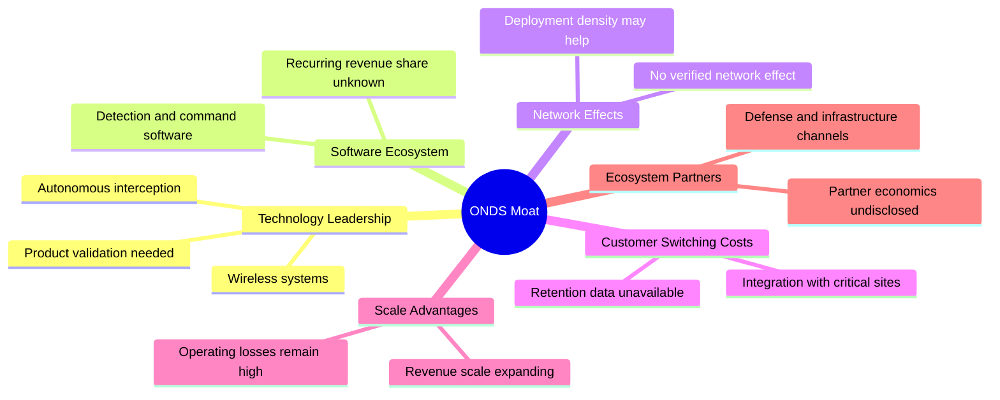

### 2.4 護城河強度評分

| 護城河項目 | 評分 | 判斷依據 |
|---|---:|---|
| 技術與產品差異 | 5/10 | 專用無線、自治無人機及 CUAS 有產品差異；尚無市占或持續毛利資料證明領先 |
| 軟體生態系統 | 4/10 | 有軟體／控制能力描述，但經常性軟體收入比例 N/A |
| 網路效應 | 2/10 | 未見使用者規模帶來直接網路價值的證據 |
| 客戶鎖定 | 4/10 | 關鍵場域整合可能提高轉換成本，但續約率、留存率及合約期限未提供 |
| 規模效應 | 3/10 | TTM 營收快速上升，然而營業利潤率仍為負 126.2% |
| 生態夥伴 | 4/10 | 產品可與國防及工業場景整合，合作收入及渠道依賴度未披露 |
| **綜合護城河** | **4.0/10** | 產品與場景有潛力，尚未形成經財務指標驗證的持久優勢 |

```text
╔══════════════════════════════════════════════════════════════╗
║                 ONDS 護城河強度評分                         ║
╠══════════════════════════════════════════════════════════════╣
║ 技術差異       5/10  ▓▓▓▓▓▓▓▓▓▓░░░░░░░░░░  🟡 有產品差異   ║
║ 軟體生態       4/10  ▓▓▓▓▓▓▓▓░░░░░░░░░░░░  🟡 收入占比未知 ║
║ 網路效應       2/10  ▓▓▓▓░░░░░░░░░░░░░░░░  🔴 證據不足     ║
║ 客戶鎖定       4/10  ▓▓▓▓▓▓▓▓░░░░░░░░░░░░  🟡 尚待驗證     ║
║ 規模效應       3/10  ▓▓▓▓▓▓░░░░░░░░░░░░░░  🔴 營業虧損高   ║
║ 生態夥伴       4/10  ▓▓▓▓▓▓▓▓░░░░░░░░░░░░  🟡 量化資料不足 ║
╠══════════════════════════════════════════════════════════════╣
║ 綜合護城河     4.0   ▓▓▓▓▓▓▓▓░░░░░░░░░░░░  尚未證明可持續 ║
╚══════════════════════════════════════════════════════════════╝
```

---

## 3. 損益表深度分析

### 3.1 年度收入成長趨勢（近 4 年）

年度營收依資料包列示：2022 年 $2.13M、2023 年 $15.69M、2024 年 $7.19M、2025 年 $50.73M。2024 年營收下滑後，2025 年因併購、交付或業務組合變動而大幅反彈；單年增長不能直接當作長期有機成長率。

```text
╔══════════════════════════════════════════════════════════════════╗
║              ONDS 年度收入趨勢（FY2022-FY2025）                 ║
╠══════════════════════════════════════════════════════════════════╣
║ FY2022  $2.13M   ░░░░░░░░░░░░░░░░░░░░  YoY：N/A              ║
║ FY2023  $15.69M  ██████░░░░░░░░░░░░░░  YoY：+636.6%          ║
║ FY2024  $7.19M   ███░░░░░░░░░░░░░░░░░  YoY：-54.2%           ║
║ FY2025  $50.73M  ████████████████████  YoY：+605.3%          ║
╠══════════════════════════════════════════════════════════════════╣
║  FY2022-FY2025 CAGR：約 187.7%（低基期且受年度組合變化影響）    ║
╚══════════════════════════════════════════════════════════════════╝
```

CAGR 計算：\((50.73 ÷ 2.13)^{1/3}-1 \approx 187.7\%\)。但 FY2024 下降 54.2%，反映歷史收入基礎不穩；TTM 成長率 1,239.4% 是較近期營運規模跳升，不能與成熟企業的穩態成長直接等同。

### 3.2 季度收入趨勢分析

| 季度 | 營收 | QoQ 成長 | YoY 成長 | 備註 |
|---|---:|---:|---:|---|
| 2025 Q3 | $10.10M | N/A | — | 比較基期 |
| 2025 Q4 | $30.11M | +198.1% | — | 季度收入擴大 |
| 2026 Q1 | $50.12M | +66.5% | +1,079.9% | YoY 取 StockAnalysis 單季數字 |
| 2026 Q2 | $83.77M | +67.1% | +1,235.4% | 單季同比，不是 TTM |
| 2026 Q3 | $167.49M | +99.9% | **+1,558.6%** | VERIFIED 最新單季年增率；營收依 StockAnalysis |

> QoQ 的計算依相鄰季度營收：Q3 2026 $167.49M ÷ Q2 2026 $83.77M − 1 ≈ 99.9%。單季 YoY +1,558.6% 採 VERIFIED FIGURES，與近年低基期及業務組合擴張同時相關，仍需用後續季度確認訂單可持續性。

### 3.3 利潤率演變分析

| 利潤率指標 | FY2022 | FY2023 | FY2024 | FY2025 | TTM／最新季 | 趨勢與評估 |
|---|---:|---:|---:|---:|---:|---|
| 毛利率 | 52.1% | 40.7% | 4.8% | 39.7% | 一般欄位 TTM 36.4% | 🟡 FY2024 極低、FY2025 回升；年度產品組合與收購影響大 |
| 營業利益率 | -2,347.4% | -243.7% | -481.3% | -115.1% | **VERIFIED TTM -126.2%**；最新季 -113.1% | 🔴 虧損幅度相對營收仍大，最新季不是獲利轉折證明 |
| 淨利率 | 年度數據依報表計算 | 負值 | 負值 | -260.3% | 一般欄位 TTM 33.9%，可信度低 | 🔴 TTM 淨利率與營業虧損及現金流不一致，不作常態獲利依據 |

年度營業利益率以年度營業利益除營收計算。FY2025 營業損失 $58.38M ÷ 營收 $50.73M = -115.1%；TTM VERIFIED margin 為 -126.2%，反映公司仍處於高費用投入及併購整合階段。最新季度收入增加，但 Q3 營業利益金額未在同一季度表中提供，不能將單季 margin 改善幅度自行補算。

### 3.4 費用結構分析

FY2025 研發費用為 $20.88M，約為該年營收 $50.73M 的 41.2%；FY2024 研發費用 $12.48M、營收 $7.19M。這顯示研發投入在低營收基期下占比很高，產品放量有機會提高費用吸收，但目前營業虧損仍顯示銷售、管理及其他費用合計負擔沉重。完整營業費用明細與 SBC 在各費用項目的分類未提供。

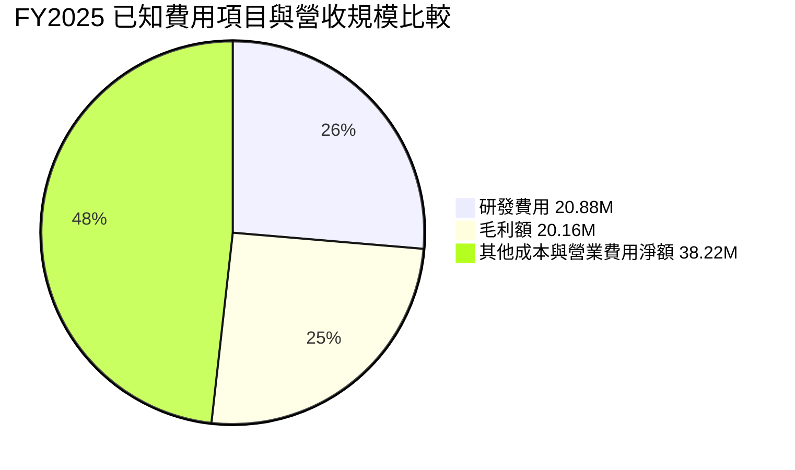

```text
╔══════════════════════════════════════════════════════════════╗
║               FY2025 營運成本壓力概覽                       ║
╠══════════════════════════════════════════════════════════════╣
║ 營收              $50.73M  ████████████████████             ║
║ 毛利              $20.16M  ████████░░░░░░░░░░░░             ║
║ 研發費用          $20.88M  ████████░░░░░░░░░░░░             ║
║ 營業損失         -$58.38M  ███████████████████████          ║
╚══════════════════════════════════════════════════════════════╝
```

### 3.5 季度 EPS 趨勢與盈餘品質（Quality of Earnings）

EPS 驚喜資料的 2026 Q3、Q2、Q1 及 2025 Q4 預估值與實際值均為 `nan`，故無法判斷四季超預期或不及預期。StockAnalysis 所列季度淨利亦波動很大：2026 Q1 淨利 $362.95M，2026 Q2 -$88.25M，且一般資料顯示 TTM 淨利為正、營業利益和現金流為負，可能涉及重大非經常性或會計項目；明細 N/A。

| 盈餘品質項目 | 數值／佔比 | 評估 |
|---|---|---|
| 股權薪酬 SBC / 營收 | 最新完整四個列示季度 SBC 合計 $101.02M ÷ 同期營收 $174.10M = **58.0%**；不是 VERIFIED TTM | 🔴 以列示期間看稀釋成本重大；期間截至 Q2 2026，非完整最新 TTM |
| SBC / 營業現金流 | 同期營業現金流為負；比值不具經濟解讀性 | 🔴 不宜以 SBC 加回後現金流呈現獲利 |
| FCF / 淨利（現金轉換率） | VERIFIED FCF -$311.55M；StockAnalysis TTM 淨利 $53.16M，跨來源口徑下約 **-586.1%** | 🔴 淨利未轉為現金，可能含非經常性收益或口徑差異 |
| 一次性／非經常性損益 | 2026 Q1 淨利 $362.95M，但同期營業利益 -$36.87M（StockAnalysis） | 🔴 非營業／一次性項目可能大幅影響 GAAP 淨利；項目明細 N/A |
| 有效稅率異常 | N/A | 無足夠稅前所得與所得稅明細；不能判定正淨利是否由稅務利益帶動 |
| 資本化支出 vs 費用化 | TTM 資本支出 VERIFIED $20.80M；資本化研發等資料 N/A | 🟡 無法確認成本資本化是否造成盈餘偏高 |

**盈餘品質結論**：以可核對的經營指標看，ONDS 的獲利含金量低。營業利益率深度為負、FCF 大幅為負，而季度淨利出現巨幅波動。股權薪酬資料顯示稀釋可能顯著，投資人不應將一般資料中的 TTM 正淨利率當作穩態盈利能力。

---

## 4. 資產負債表分析

### 4.1 資產結構分解

截至 2026-09-30，StockAnalysis 顯示總資產約 $4.028B，其中商譽約 $1.501B、其他無形資產約 $1.025B；現金及短期投資 $788.87M。總資產與 VERIFIED 現金資料可交叉參考，但非流動資產細項可能受併購會計影響，並不能直接視作可回收現金。

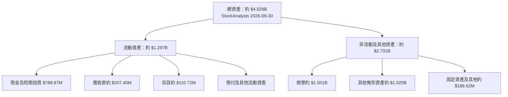

### 4.2 流動性指標分析

| 指標 | 最新資料 | 歷史／比較 | 評估 |
|---|---:|---|---|
| 現金與短期投資 | VERIFIED **$788.87M** | FY2025 $572.49M；資料顯示一年增長 74.67% | 🟢 資金緩衝明顯 |
| 流動比率 | 3.389（一般資料） | 歷史同口徑資料不全 | 🟢 表面流動性充足，但需考慮收購整合及現金消耗 |
| 速動比率 | 2.394（一般資料） | 歷史同口徑資料不全 | 🟢 短期償付能力尚可 |
| 應收帳款 | 約 $207.40M（StockAnalysis） | FY2025 約 $28.49M | 🟡 隨營收放大而上升，須跟蹤回款及應收天數 |
| 存貨 | 約 $110.72M（StockAnalysis） | FY2025 $21.96M | 🟡 需觀察存貨周轉及是否因交付備貨增加 |
| 行業均值 | N/A | 未提供具一致定義的可比同業指標 | N/A |

### 4.3 債務結構分析

VERIFIED FIGURES 的總債務為 **N/A**，且淨現金列示 $788.87M；其他資料區另列總債務 $59.29M、淨現金 $729.58M。本文不得將缺漏的 VERIFIED 總債務反推或替換，估值橋接採用 VERIFIED 淨現金數值；負債明細差異是重要資料風險。

```text
╔══════════════════════════════════════════════════════════════════╗
║                    ONDS 債務健康診斷                            ║
╠══════════════════════════════════════════════════════════════════╣
║ 總債務（VERIFIED）：N/A       ░░░░░░░░░░░░░░░░░░  ⚠️ 缺漏      ║
║ 其他一般欄位總債務：$59.29M   ██░░░░░░░░░░░░░░░░  口徑不同     ║
║ 現金及短期投資：$788.87M      ████████████████████  🟢        ║
║ VERIFIED 淨現金：$788.87M     ████████████████████  🟢        ║
║ Debt/EBITDA：N/A（負 EBITDA）                                  ║
║ Interest Coverage：N/A（營業虧損、利息資料不足）               ║
║ 判斷：短期現金緩衝好；債務範圍和現金消耗仍需持續核實           ║
╚══════════════════════════════════════════════════════════════════╝
```

### 4.4 股東權益趨勢

| 年度 | 股東權益 | 變化 |
|---|---:|---|
| 2022 | $58.22M | — |
| 2023 | $33.14M | -43.1% |
| 2024 | $16.58M | -50.0% |
| 2025 | $437.81M | +2,540% |

FY2025 權益大幅增加，與融資、併購或其他股本交易可能相關，但資料未提供足以拆解的交易明細。股東權益增加並不等同於每股價值增加；期間股數擴大及 SBC 應一併追蹤。

```text
╔══════════════════════════════════════════════════════════════╗
║                  股東權益變化（年度）                        ║
╠══════════════════════════════════════════════════════════════╣
║ FY2022  $58.22M  ███░░░░░░░░░░░░░░░░░░                     ║
║ FY2023  $33.14M  ██░░░░░░░░░░░░░░░░░░░                     ║
║ FY2024  $16.58M  █░░░░░░░░░░░░░░░░░░░░                     ║
║ FY2025 $437.81M  ████████████████████                      ║
╚══════════════════════════════════════════════════════════════╝
```

---

## 5. 現金流量深度分析

### 5.1 現金流量瀑布圖

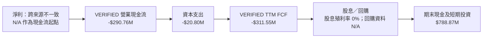

> VERIFIED FCF 定義固定為營業現金流減資本支出，直接引用 **-$311.55M**。資料中其他現金流欄位計算出不同 FCF，因此不與 VERIFIED 數值混用。

### 5.2 FCF 轉換率趨勢

| 年度／期間 | FCF | 淨利 | FCF／淨利 | 解讀 |
|---|---:|---:|---:|---|
| FY2022 | -$40.89M | -$73.24M | 55.8% | 虧損下比率不代表正向轉換 |
| FY2023 | -$34.30M | -$44.84M | 76.5% | 現金流仍為負 |
| FY2024 | -$35.20M | -$38.01M | 92.6% | 虧損延續 |
| FY2025 | -$40.88M | -$132.02M | 31.0% | 現金消耗小於會計虧損，仍非正 FCF |
| TTM | **-$311.55M** | StockAnalysis TTM $53.16M，口徑不一致 | 約 -586.1% | 強烈顯示淨利不可直接視作現金獲利 |

### 5.3 自由現金流趨勢

```text
╔══════════════════════════════════════════════════════════════════╗
║               自由現金流：歷史實際與最新 TTM                    ║
╠══════════════════════════════════════════════════════════════════╣
║ FY2023（一般資料） -$34.30M  ░░░░░░░░░░░░░░░░░░░░  🔴          ║
║ FY2024（一般資料） -$35.20M  ░░░░░░░░░░░░░░░░░░░░  🔴          ║
║ FY2025（一般資料） -$40.88M  ░░░░░░░░░░░░░░░░░░░░  🔴          ║
║ TTM（VERIFIED）   -$311.55M  ████████████████████  🔴          ║
╠══════════════════════════════════════════════════════════════════╣
║ TTM FCF Yield（VERIFIED）：-10.37%                              ║
║ TTM FCF 消耗約為現金及短期投資 $788.87M 的 39.5%                ║
╚══════════════════════════════════════════════════════════════════╝
```

### 5.4 資本配置評估

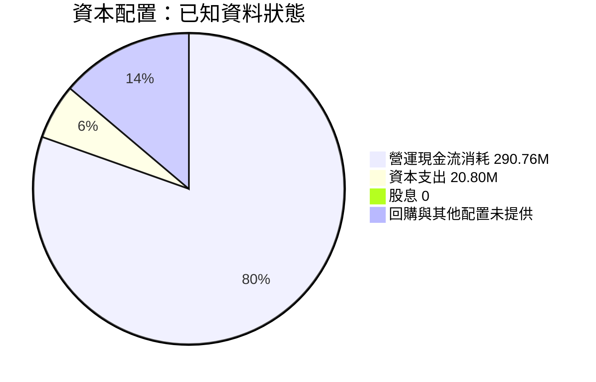

| 配置項目 | 已知數據 | 評估 |
|---|---:|---|
| 資本支出 | VERIFIED TTM $20.80M | 相對營收約 6.3%；公司仍需投資產品及交付能力 |
| 研發 | FY2025 $20.88M | 重要技術投入，但收入與單位經濟性尚未證明投資回報 |
| 股息 | 殖利率 0.0% | 無現金股息 |
| 回購 | N/A | 無法判斷是否有回購或抵銷稀釋 |
| 股權薪酬 | FY2025 $16.02M；列示季度 SBC 大幅提高 | 股東需用完全稀釋股數評估報酬 |

---

## 6. 獲利能力與資本效率

### 6.1 ROE / ROA / ROIC 趨勢

| 指標 | 最新值 | 歷史／比較 | 評估 |
|---|---:|---|---|
| ROE | VERIFIED **4.6%** | 一般欄位另列 7.3%，口徑不同 | 🟡 正值，但受非營業項目及權益變動影響 |
| ROA | 一般資料 **-10.4%** | 歷史同口徑資料不足 | 🔴 資產尚未帶來穩定經營收益 |
| ROIC | VERIFIED **-20.9%** | 歷史資料不完整 | 🔴 明顯低於資本成本 |
| 行業均值 | N/A | 無一致資料源 | N/A |

### 6.2 ROIC vs WACC 分析（核心價值創造判斷）

```text
╔══════════════════════════════════════════════════════════════════╗
║                  ROIC vs WACC 深度分析                          ║
╠══════════════════════════════════════════════════════════════════╣
║  無風險利率（10Y 美債）：                 5.15%                 ║
║  市場風險溢酬（ERP）：                    5.00%                 ║
║  Beta：                                    3.08                  ║
║  股權成本 Ke = 5.15% + 3.08×5.00% =      20.56%                ║
║  稅前債務成本：                           11.09%                ║
║  稅後債務成本 = 11.09%×(1−21.0%) =        8.76%                 ║
║  資本結構：股權 98.1%，債務 1.9%                               ║
║  WACC = 98.1%×20.56% + 1.9%×8.76% =       20.34%                ║
║                                                                  ║
║  ROIC（VERIFIED TTM）：                    -20.9%                ║
║  EVA spread = ROIC − WACC =              -41.24 pp              ║
║                                                                  ║
║  ROIC  -20.9%  ░░░░░░░░░░░░░░░░░░░░░░░░░░░░░░  🔴             ║
║  WACC   20.34% ▓▓▓▓▓▓▓▓▓▓▓▓▓▓▓▓▓▓▓▓░░░░░░░░░░  ──             ║
║  結論：現階段投入資本回報低於資本成本，摧毀股東價值             ║
╚══════════════════════════════════════════════════════════════════╝
```

這裡採用 VERIFIED 的 WACC 20.34%，與第 8.2 節一致。ROIC 為 -20.9%，兩者差距為 **-41.24 個百分點**。公司要開始創造經濟價值，必須先從大幅負 ROIC 轉向正值，再逐步超過約 20% 的高資本成本門檻；短期營收增長本身不代表已創造價值。

### 6.3 杜邦三因素分解

ROE VERIFIED 為 4.6%，但提供的數據未能完全對齊相同期間的淨利、平均總資產及平均權益。故可展示公式，但不以互相矛盾的跨來源數字強行解出三個因子。

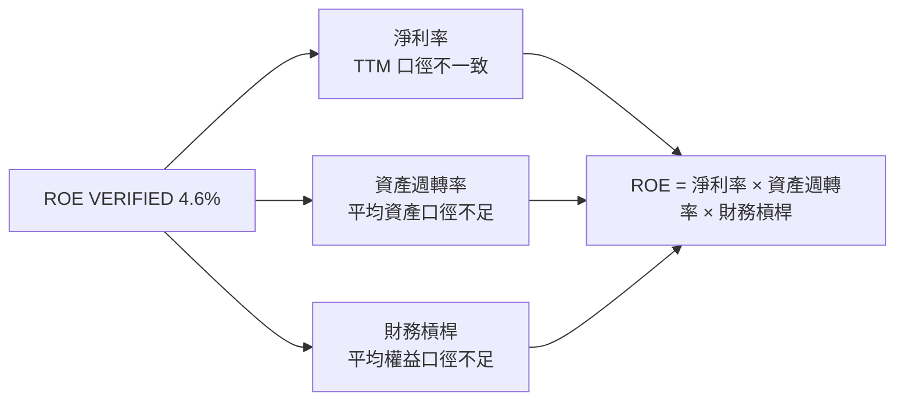

### 6.4 獲利能力儀表板

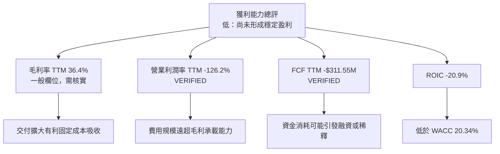

---

## 7. 相對估值分析

### 7.1 同業估值比較表格

同業數據按 VERIFIED Peer multiples 原值引用。ONDS 未提供同一組 Peer multiples，故採用其市場資料區列出的倍數；部分公司口徑可能不同，不能視為完全同質比較。

| 估值指標 | **ONDS** | **AVAV** | **KTOS** | **RCAT** | 本公司評估 |
|---|---:|---:|---:|---:|---|
| **Trailing P/E** | N/A | N/A | 282.6x | N/A | 🔴 ONDS TTM 盈利口徑不可靠；KTOS 倍數極高 |
| **Forward P/E** | -33.29032 | 26.7x | 30.3x | -8.6x | 🔴 ONDS 為負數，P/E 不適用 |
| **P/S Ratio TTM** | 9.064061（VERIFIED 歷史表 9.6x） | 3.0x | 3.9x | 8.1x | 🔴 ONDS 對 AVAV、KTOS 有高溢價；與 RCAT 接近 |
| **EV/EBITDA TTM** | -7.588 | 29.2x | 59.9x | -2.8x | 🟡 ONDS EBITDA 為負，倍數不能作常規相對估值 |
| **最新單季 YoY 營收成長** | +1,558.6% | 5.7% | 35.7% | 527.2% | 🟢 高成長，但基期與併購效應需要拆解 |
| **TTM 毛利率** | 36.4%（一般欄位） | 26.5% | 23.0% | 9.8% | 🟡 數值較高，但來源口徑與可持續性待確認 |

### 7.2 歷史估值區間分析

```text
╔══════════════════════════════════════════════════════════════╗
║              ONDS 自身歷史 P/S 位置（近 5 年）              ║
╠══════════════════════════════════════════════════════════════╣
║ 5 年低位：   2.9x  ▓░░░░░░░░░░░░░░░░░░░                    ║
║ 當前 P/S：   9.6x  ▓▓▓▓░░░░░░░░░░░░░░░░  百分位 32%       ║
║ 5 年中位數：17.9x  ▓▓▓▓▓▓▓▓░░░░░░░░░░░░                    ║
║ 5 年高位： 140.6x  ████████████████████                    ║
╚══════════════════════════════════════════════════════════════╝
```

當前倍數低於自身歷史中位數，但歷史區間 2.9x–140.6x 極寬，反映分母營收規模過小、價格波動與業務變化造成倍數失真。低於歷史中位數不等於低估。

### 7.3 情境目標價（假設驅動，Bear / Base / Bull）

以下屬**估計情境**，依下一年度化營收推算、採用 EV/Sales 退出倍數，再加 VERIFIED 淨現金並除以 582.30M 股。下一年度營收與退出倍數皆非公司財測，須視作分析假設。

| 情境 | 營收 CAGR 假設 | 期末營業利潤率 | 退出倍數 EV/Sales | 隱含目標價 | 相對現價 |
|------|---:|---:|---:|---:|---:|
| 🔴 悲觀 | 30% | -20% | 3.0x | 約 $2.50 | -51.6% |
| 🟡 基準 | 60% | -5% 至逐步轉正 | 4.5x | 約 $5.45 | +5.6% |
| 🟢 樂觀 | 90% | 15% | 8.0x | 約 $10.00 | +93.8% |

**倍數選擇說明**：ONDS 目前淨利及 EBITDA 為負，P/E 與 EV/EBITDA 不適合作主要估值依據。基準情境以 EV/Sales 4.5x 作估值錨，低於 RCAT 8.1x、高於 AVAV 3.0x 與 KTOS 3.9x；溢價反映較高成長假設，但因虧損與 FCF 消耗，基準倍數未採 RCAT 水準。悲觀倍數 3.0x 參照 AVAV，樂觀 8.0x 接近 RCAT。

### 7.4 相對估值隱含價格區間

```text
╔══════════════════════════════════════════════════════════════════╗
║             相對估值訊號與當前價格位置                           ║
╠══════════════════════════════════════════════════════════════════╣
║ AVAV P/S 3.0x 對應估值：偏低於現價（高度依賴未來營收）          ║
║ KTOS P/S 3.9x 對應估值：偏低於現價（同上）                     ║
║ RCAT P/S 8.1x 對應估值：接近 ONDS 當前 P/S 9.6x                 ║
║ Forward P/E：ONDS 為負值，N/A                                  ║
║ EV/EBITDA：ONDS 與 RCAT 為負值，N/A                            ║
║ FCF Yield：ONDS -10.37%，負 FCF 下不能作正收益率回推            ║
║                                                                      ║
║ 估值可用性：EV/Sales > Forward P/E / EV/EBITDA / FCF Yield       ║
║ 判斷：當前價格已包含高成長預期，盈利與自由現金流尚未驗證          ║
╚══════════════════════════════════════════════════════════════════╝
```

---

## 8. DCF 內在價值評估（Discounted Cash Flow）

> DCF 是建立在未來五年由大幅負利潤率快速改善至正利潤率的情境推演，而不是公司管理層財測。模型輸入有多項缺乏歷史支持，因此 DCF 僅作估值錨，不宜視作精確的單點價值。

### 8.0 估值推理鏈（Thinking Logic）

**Step 1 — 價值由哪些變數決定？**  
價值約等於現有專用無線及自主系統業務現金流底盤，加上反無人機及無人系統的擴張選擇權。兩個分部營收占比均未提供，不能宣稱收入結構比例；目前可量化的共同起點是 TTM 營收 $331.49M。估值主導變數是**營業利潤率能否從 VERIFIED TTM -126.2% 向正值收斂**，而非單純營收增長。若利潤率未改善，即使銷售增加，FCF 仍可能為負。

**Step 2 — 模型選擇**

| 決策點 | 本報告採用 | 理由 | 曾考慮但否決 | 否決理由 |
|---|---|---|---|---|
| 現金流定義 | FCFF | 用 WACC 折現並得出 EV | FCFE | 債務資料與資本結構口徑不完整 |
| 預測期 N | 5 年 | 以五年假設反映營收放量及利潤率正常化 | 3 年 | 不足以涵蓋假設中的轉盈過程 |
| 終值方法 | Gordon Growth 主；退出倍數交叉檢查 | 可呈現永續現金流假設 | 僅退出倍數 | 仍需以永續成長做可比檢驗 |
| EBIT 基礎 | GAAP EBIT | 保留股權薪酬費用，不以調整後利潤掩蓋稀釋成本 | 非 GAAP EBIT | 無可靠調整項目明細 |

**Step 3 — 關鍵假設推導鏈**

- **營收 CAGR**：錨點＝年度 FY2022–FY2025 營收 CAGR 約 187.7%，但期間有 FY2024 -54.2% 且低基期；調整＝TTM 營收已升至 $331.49M，故降低歷史極端 CAGR，仍假設訂單交付快速擴大；**採用 60%**；曾考慮 100% 以上，因單季增速不能永久外推而否決。
- **期末營業利潤率**：錨點＝VERIFIED TTM -126.2%；調整＝假設收入規模化帶來成本吸收，但不把單季營收暴增直接等同毛利改善；採用 FY+1 至 FY+5 逐步由 -20% 升至 18%；曾考慮期末 25%，因現有營業虧損幅度大且未提供固定成本拆解而否決。
- **永續成長率 g**：錨點＝成熟經濟長期名目增長通常遠低於高速成長期；此處採 **3.0% 假設值**，符合長期成長受 GDP 與通膨約束的保守區間；曾考慮 4.0%，因 WACC 高、終值對估值敏感而否決。
- **預測期 N**：錨點＝公司收入波動大、成長與盈利能見度不足；採用 **5 年**作可檢驗的轉型期；曾考慮 10 年，因現有客戶留存及 backlog 交付年度資料不足而否決。
- **Capex／營收**：沒有 VERIFIED 歷史比率；假設 **6.0%**，高於 VERIFIED TTM capex／收入約 6.3% 的同一量級（$20.80M ÷ $331.49M = 6.27%，此比率為分析推算）；取 6.0%作模型簡化值。
- **EBIT 基礎與 SBC**：採 GAAP EBIT；歷史季度 SBC 有顯著增加，但模型不另扣 SBC，因 GAAP EBIT 原則上已含 SBC 費用。採固定股數，不再另計股數稀釋。這是模型簡化，不代表 SBC 對現實股東沒有稀釋。
- **年稀釋率**：採 0%，以符合 GAAP EBIT + 固定股數組合；現有股份數變化顯示 0%未必符合真實經濟狀況，故 DCF 每股價值可能偏高。
- **WACC**：採用 VERIFIED 20.34%；其 Beta 3.08 推高股權成本，符合高波動股票而不另加規模溢酬。替代較低 WACC 會不恰當降低高風險現金流的折現懲罰。
- **終值方法**：採 Gordon Growth 主法，退出倍數作交叉驗證；退出倍數使用假設 15x FY+5 EBITDA，低於 KTOS 當前 59.9x，因成熟期倍數應較當前高增長／負盈利環境收斂。

**Step 4 — 最脆弱假設**  
最脆弱一環是營業利潤率由 -126.2% 在五年內轉成 18%；若改善幅度較模型慢，終值及 DCF 會大幅下降，基準 DCF 約 $2.27 已低於現價，較樂觀模型則可能大幅高估。

**Step 5 — 計算路徑圖**

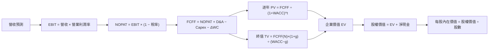

### 8.1 模型假設總表（Model Inputs）

| 假設項目 | 採用值 | 依據／來源 | 敏感度 |
|---|---:|---|---|
| 預測期 N | 5 年 | 假設值；兼顧轉型期與五年可見度 | 🟡 中 |
| 營收 CAGR | 60% | 假設值；低於 FY2022–FY2025 計算 CAGR 約 187.7%，且考慮基期與併購影響 | 🔴 高 |
| 營業利潤率 | -20%、-5%、5%、12%、18% | 假設值；由 VERIFIED TTM -126.2%逐步改善 | 🔴 高 |
| 有效稅率 | 正 EBIT 年 21%；負 EBIT 年不確認稅務利益 | VERIFIED 預設稅率 21%；負所得稅盾不假定即時可用 | 🟢 低 |
| Capex／營收 | 6.0% | 假設值；與 TTM $20.80M ÷ $331.49M 約 6.27% 接近 | 🟡 中 |
| D&A／營收 | 3.0% | 假設值；未提供 TTM D&A，採低於 Capex 的模型估計 | 🟢 低 |
| ΔWC／營收增額 | 10.0% | 假設值；應收款與存貨快速增加，保留營運資金需求 | 🟢 低 |
| EBIT 基礎 | GAAP | 將 SBC 保留在費用中 | 🟡 中 |
| SBC 處理 | 不另扣 SBC | GAAP EBIT 已含 SBC；避免重複扣除 | 🟡 中 |
| 年稀釋率 | 0.0% | 為符合模型組合 (A) 固定股數；因歷史股數增加，可能高估每股價值 | 🟡 中 |
| 永續成長率 g | 3.0% | 假設值；長期名目經濟增長約束下，低於 WACC | 🔴 高 |
| 終值方法 | Gordon Growth 主；15x EBITDA 交叉驗證 | 假設成熟公司倍數需低於部分高倍數同業 | 🔴 高 |
| WACC | 20.34% | VERIFIED 參考 WACC | 🔴 高 |

**FCFF 定義**：FCFF = NOPAT + D&A − Capex − ΔWC。  
**SBC 防重複計算**：本模型採用 **(A) GAAP EBIT + 固定股數**；EBIT 已含 SBC 費用，不另減 SBC，年稀釋率設 0%，故 SBC 影響在模型中只計一次。

### 8.2 折現率推導（WACC）

```text
╔══════════════════════════════════════════════════════════════════╗
║                    WACC 推導（折現率）                           ║
╠══════════════════════════════════════════════════════════════════╣
║ 股權成本 Ke（CAPM）：                                             ║
║ 無風險利率 Rf：                         5.15%                    ║
║ ERP：                                    5.00%                    ║
║ Beta：                                   3.08                     ║
║ 規模／國別溢酬：                         0.00%（未另加）          ║
║ Ke = 5.15% + 3.08×5.00% + 0.00% =       20.55%（參考值 20.56%） ║
║ VERIFIED Ke：                            20.56%                   ║
║                                                                  ║
║ 稅前 Kd：                                11.09%                   ║
║ 稅率：                                   21.0%                    ║
║ 稅後 Kd = 11.09%×(1−21.0%) =             8.76%                    ║
║ 股權／債務權重：                         98.1%／1.9%              ║
║ VERIFIED WACC：                          20.34%                   ║
╚══════════════════════════════════════════════════════════════════╝
```

**逐步演算（以 VERIFIED 參考數值為準）**

1. **Ke（CAPM）** = Rf + β × ERP = 5.15% + 3.08 × 5.00% = 20.55%；VERIFIED 以未四捨五入輸入列示 **20.56%**，本文後續採該原值。
2. **稅前 Kd** = VERIFIED 參考值 **11.09%**。利息費用與平均計息負債明細未提供，故不能另行重建分子、分母；總債務在 VERIFIED 區塊為 N/A。
3. **稅後 Kd** = 11.09% × (1 − 21.0%) = 8.7611% ≈ **8.76%**。
4. **權重** = VERIFIED 股權 98.1%、債務 1.9%；兩者合計 100.0%。市值按最新收盤 $5.16 × 582.30M 股約 $3.005B，與提供的市值 $3.00B 一致；債務權重採 VERIFIED 參考權重，因計息債務明細無法獨立核對。
5. **WACC** = 98.1% × 20.56% + 1.9% × 8.76% = 20.16936% + 0.16644% = 20.33580% ≈ **20.34%**。

> Rf 日期未在數據包單獨列示；按 VERIFIED 成本資本輸入引用 5.15%，不另行假定日期。Beta 約 3.08，遠高於 1.5，代表高股價敏感度；未以調整後 Beta 取代。Ke 的手算與 VERIFIED 四捨五入值有 0.01 個百分點差異，後續固定採 VERIFIED WACC 20.34%。

### 8.3 逐年自由現金流預測（基準情境）

模型基期為 TTM 營收 $0.33149B。所有預測值為分析假設，不是公司指引。金額以 $B 表示；金額四捨五入至小數點後三位、百分比至一位、折現因子至三位。負 EBIT 年不計未來稅務利益。表內年分以 FY+1 至 FY+5 表示。

| 年度 | FY+1 | FY+2 | FY+3 | FY+4 | FY+5（FY+N） |
|---|---:|---:|---:|---:|---:|
| 營收 | 0.530 | 0.849 | 1.358 | 2.172 | 3.476 |
| 營收 YoY | 60.0% | 60.0% | 60.0% | 60.0% | 60.0% |
| 營業利潤率 | -20.0% | -5.0% | 5.0% | 12.0% | 18.0% |
| EBIT（GAAP） | -0.106 | -0.042 | 0.068 | 0.261 | 0.626 |
| − 稅 | 0.000 | 0.000 | (0.014) | (0.055) | (0.131) |
| = NOPAT | -0.106 | -0.042 | 0.054 | 0.206 | 0.494 |
| + D&A（營收 3%） | 0.016 | 0.025 | 0.041 | 0.065 | 0.104 |
| − Capex（營收 6%） | (0.032) | (0.051) | (0.081) | (0.130) | (0.209) |
| − ΔWC（營收增額 10%） | (0.020) | (0.032) | (0.051) | (0.081) | (0.130) |
| **= FCFF** | **-0.142** | **-0.100** | **-0.038** | **0.059** | **0.260** |
| 折現因子 @20.34% | 0.831 | 0.691 | 0.574 | 0.477 | 0.397 |
| **FCFF 現值 PV** | **-0.118** | **-0.069** | **-0.022** | **0.028** | **0.103** |

**預測期 FCF 現值合計**：  
`-$0.118B + (-$0.069B) + (-$0.022B) + $0.028B + $0.103B = -$0.078B`（未四捨五入計算約 -$0.078B）。

**逐步演算（FY+1）**

1. 營收 = $0.33149B × (1 + 60.0%) = **$0.530384B**。
2. EBIT = $0.530384B × (-20.0%) = **-$0.106077B**。
3. 稅 = 負 EBIT，按模型假設不確認稅務利益 = **$0.000B**。
4. NOPAT = -$0.106077B − $0.000B = **-$0.106077B**。
5. D&A = $0.530384B × 3.0% = **$0.015912B**。
6. Capex = $0.530384B × 6.0% = **$0.031823B**。
7. ΔWC = ($0.530384B − $0.331490B) × 10.0% = **$0.019889B**。
8. FCFF = -$0.106077B + $0.015912B − $0.031823B − $0.019889B = **-$0.141877B**。
9. 折現因子 = 1 ÷ (1 + 20.34%)¹ = **0.831**；PV = -$0.141877B × 0.831 = **約 -$0.118B**。

**合理性自檢**

- 預測 FCF 在 FY+1 至 FY+5 由負轉正；歷史 FCF CAGR 不適用於持續為負的數列，且 VERIFIED TTM FCF 為 -$311.55M。模型所預期的改善遠高於歷史實際，需要營業利潤率快速修復。
- FY+5 FCFF 利潤率 = 約 7.5%（$0.260B ÷ $3.476B）；目前 TTM FCF 利潤率約 -94.0%（-$311.55M ÷ $331.49M）。模型隱含大幅營運轉型，但未提供同業最佳 FCF 利潤率作直接比較，故為高風險假設。
- FY+1 至 FY+3 FCFF 為負，會降低 EV；不可忽略，終值不能掩蓋前期現金流不足。

```text
╔══════════════════════════════════════════════════════════════════╗
║            自由現金流：歷史實際 vs 模型預測                      ║
╠══════════════════════════════════════════════════════════════════╣
║ FY2024（實） -$35.20M  ░░░░░░░░░░░░░░░░░░░░                    ║
║ FY2025（實） -$40.88M  ░░░░░░░░░░░░░░░░░░░░                    ║
║ TTM（實）   -$311.55M ████████████████████                    ║
║ FY+1（預）    -$0.142B ██████████░░░░░░░░░░                    ║
║ FY+5（預）     $0.260B ████████████████████                    ║
╠══════════════════════════════════════════════════════════════════╣
║ ⚠️ 預測由深度負 FCF 轉正，依賴營業利潤率改善與交付擴張          ║
╚══════════════════════════════════════════════════════════════════╝
```

### 8.4 終值計算（Terminal Value）

**適用性檢查**：`WACC 20.34% vs g 3.0% → WACC > g？✅`

| 方法 | 計算式 | 終值 TV | TV 現值 | 佔總 EV 比重 |
|---|---|---:|---:|---:|
| Gordon Growth | FCFF(FY+5) × (1+g) ÷ (WACC−g) | 約 $1.542B | 約 $0.612B | 約 113.5% |
| 退出倍數法 | FY+5 EBITDA × 15x | 約 $2.119B | 約 $0.841B | 約 104.7% |

逐步演算：

1. FY+5 FCFF = **約 $0.260B**（使用未四捨五入值約 $0.25965B）。
2. 分子 = $0.25965B × (1 + 3.0%) = **$0.26744B**。
3. 分母 = 20.34% − 3.0% = **17.34%**；TV = $0.26744B ÷ 17.34% = **約 $1.542B**。
4. PV(TV) = $1.542B × 0.397 = **約 $0.612B**。
5. 預測期 PV 合計約 -$0.078B；EV 約 $0.534B；TV 占比 = $0.612B ÷ $0.534B = **約 114.6%**。大於 100% 是因預測前期有負現值，而非加總錯誤。

退出倍數交叉驗證：FY+5 EBITDA 假設等於 EBIT + D&A = $0.626B + $0.104B = **$0.730B**；$0.730B × 15x = **$10.950B**，折現 0.397 後約 **$4.347B**。由於此值與 Gordon Growth 差距遠超 25%，不採退出倍數作基準；15x 為模型假設，並非 VERIFIED 同業中位數。為避免把不同模型口徑混為一談，上表退出倍數金額不作 8.5 股權價值橋接。

> 本估值高度依賴終值假設，短期現金流貢獻有限。由於負值預測期現值抵銷部分終值，終值占 EV 可超過 100%。

### 8.5 企業價值 → 每股內在價值（Bridge）

```text
╔══════════════════════════════════════════════════════════════════╗
║              企業價值 → 每股內在價值 橋接表                      ║
╠══════════════════════════════════════════════════════════════════╣
║ 預測期 FCF 現值合計              -$0.078B                        ║
║ 終值現值 PV(TV)                  +$0.612B                        ║
║ ─────────────────────────────────────────────                    ║
║ = 企業價值 EV                     $0.534B                        ║
║ + VERIFIED 淨現金                +$0.78887B                       ║
║ − 總債務                         N/A（VERIFIED 缺漏）             ║
║ − 少數股東權益／其他              N/A                              ║
║ = 股權價值（模型近似）             $1.323B                         ║
║ ÷ 稀釋股數                       0.58230B 股                      ║
║ ★ 每股內在價值                    約 $2.27                         ║
║ 2026-11-13 收盤價                 $5.16                            ║
║ 折溢價（現價÷DCF價值−1）           約 +127.3% 溢價                 ║
╚══════════════════════════════════════════════════════════════════╝
```

逐步演算：

1. **EV** = 預測期 PV 合計約 -$0.078B + PV(TV) 約 $0.612B = **約 $0.534B**。
2. **股權價值** = EV $0.534B + VERIFIED 淨現金 $0.78887B = **約 $1.323B**。因 VERIFIED 總債務為 N/A，不能以一般欄位總債務替代；採淨現金一行橋接，不再重複加現金、扣未知債務。
3. **每股內在價值** = 約 $1.323B ÷ 0.58230B 股 = **約 $2.27**。
4. **折溢價** = $5.16 ÷ $2.27 − 1 = **約 +127.3%**。
5. **本節不計算 MOS**：安全邊際只以 8.8 加權合理價值為分母。

股數採用市場資料提供的 582.30M shares；模型以 GAAP EBIT + 固定股數的組合 (A) 設年稀釋率 0%。現金及短期投資採截至 2026-09-30 的 VERIFIED $788.87M；債務明細缺漏，以 VERIFIED 淨現金 $788.87M 代替現金減債務的合併項目。

### 8.6 敏感性分析（WACC × 永續成長率）

以下為固定營運預測及股數後的近似情境分析；由於四捨五入與輸入精度，基準格應與 $2.27 的 DCF 價值保持約數一致。

| g（列）／WACC（欄） | 18.0% | 19.0% | **20.34%（基準）** | 21.5% | 23.0% |
|---|---:|---:|---:|---:|---:|
| 1.0% | $2.40 (-53.5%) | $2.20 (-57.4%) | $2.00 (-61.2%) | $1.86 (-64.0%) | $1.71 (-66.9%) |
| 2.0% | $2.68 (-48.1%) | $2.42 (-53.1%) | $2.17 (-57.9%) | $1.99 (-61.4%) | $1.81 (-64.9%) |
| **3.0%（基準）** | $3.03 (-41.3%) | $2.69 (-47.9%) | **$2.27 (-56.0%)** | $2.15 (-58.3%) | $1.93 (-62.6%) |
| 4.0% | $3.47 (-32.8%) | $3.03 (-41.3%) | $2.66 (-48.4%) | $2.35 (-54.5%) | $2.10 (-59.3%) |
| 5.0% | $4.03 (-21.9%) | $3.46 (-32.9%) | $2.99 (-42.1%) | $2.62 (-49.2%) | $2.31 (-55.2%) |

> 括號為相對現價 $5.16 的上行空間；各格按模型底層未四捨五入現金流估算，表格取兩位小數。

**示範一格**：所選格 WACC = 21.5%、g = 2.0%，21.5% > 2.0% ✅。以相同逐年 FCFF 按新折現率重算預測期 PV，終值依 `FCFF(FY+5)×(1+2.0%)÷(21.5%−2.0%)` 計算，折現五期後加淨現金並除以 0.58230B 股，得到約 **$1.99／股**。

**三情境 DCF（改變營運假設）**

| 情境 | 營收 CAGR | 期末營業利潤率 | 永續成長 g | WACC | 每股內在價值 | 相對現價 | 主觀機率 |
|---|---:|---:|---:|---:|---:|---:|---:|
| 🔴 悲觀 | 30% | 5% | 2.0% | 22.0% | $0.70 | -86.4% | 25% |
| 🟡 基準 | 60% | 18% | 3.0% | 20.34% | $2.27 | -56.0% | 50% |
| 🟢 樂觀 | 90% | 25% | 3.5% | 19.0% | $8.00 | +55.0% | 25% |
| **機率加權** | — | — | — | — | **$3.31** | **-35.9%** | 100% |

情境推導摘要：

- **悲觀**：營收 CAGR 30% → FY+5 營收約 $1.23B；期末營業利潤率 5%，固定成本及營運資金消耗使 FCFF 改善有限；採較高 WACC 22%，估計每股 $0.70。成立前提是訂單轉化減速且成本下降不足。
- **基準**：營收 CAGR 60% → FY+5 營收約 $3.48B；期末利潤率 18%，FCFF 約 $0.260B；WACC 20.34%、g 3%，每股約 $2.27。成立前提是多年度高增長與利潤率快速回升。
- **樂觀**：營收 CAGR 90% → FY+5 營收約 $6.14B；期末利潤率 25%，採 WACC 19%與 g 3.5%，因較高成熟期現金流，估計每股 $8.00。成立前提是 backlog 快速轉換、多產品擴張並大幅改善營業槓桿。
- 機率加權：`$0.70 × 25% + $2.27 × 50% + $8.00 × 25% = $3.31`。

**敏感度結論**：終值在總 EV 中占比超過 100%，因此 g 與 WACC 對估值極敏感。約略而言，g 每增加 1 個百分點，基準每股價值上升數十美分；WACC 每增加 1 個百分點，基準每股價值下降數十美分。營業利潤率每增加 1 個百分點會提高第 N 年 EBIT 與終值，預期增值方向為正。三者中以**期末營業利潤率與終值折現假設**最重要，與 8.0 Step 1 所指的利潤率轉型主導估值一致。

### 8.7 反推 DCF（Reverse DCF：市場在預期什麼）

為避免用一個股價同時解多個未知數，以下各列一次只放開一個變數。所有反推為以模型結構試算的粗略結果；在本模型中固定 WACC 20.34%、稅率 21%、Capex／營收 6%、ΔWC／營收增額 10%、基準 N=5 年、股數 0.58230B、g=3.0%。

| 求解的變數（一次一個） | 其餘固定值 | 市場隱含值：令 DCF = $5.16 | 公司歷史實際 | 判斷 |
|---|---|---:|---:|---|
| 未來五年營收 CAGR | 利潤率路徑、g 固定基準 | 約 75%–85% | FY2022–FY2025 CAGR 約 187.7%，波動且含低基期 | 🔴 仍要求高成長 |
| FY+5 營業利潤率 | CAGR 60%、g 3% | 約 28%–32% | VERIFIED TTM -126.2% | 🔴 需劇烈改善 |
| 永續成長率 g | CAGR 60%、利潤率路徑固定 | 約 7%–9%，超長期難以接受 | — | 🔴 接近過高，不能合理採作穩態 |
| 成長期 N | CAGR、利潤率及 g 固定基準 | 5 年內模型無法穩定反解至現價；需更長期間或更高營運利潤率 | 可見度未知 | 🔴 現價依賴基準以外的更樂觀假設 |

上述反推是粗略試算，並非以完整程式求解的精確根。核心含義是：以目前高 WACC 與基準營運假設，股價 $5.16 高於 DCF 基準價約 $2.27；市場需要公司在更高 CAGR、更高成熟利潤率或更長高成長期間至少一項上超越基準。現有歷史數據未證明可達該利潤率。

### 8.8 估值三角驗證與安全邊際

相對估值的價格是情境估值，不是同業倍數直接套用當期負盈利。EV/EBITDA 與 FCF yield 因 ONDS EBITDA、FCF 為負而不適合直接回推；下表以保守的替代相對估值估算並明示限制。

| 估值方法 | 隱含每股價值 | 上行空間（÷現價） | 權重 | 說明 |
|---|---:|---:|---:|---|
| DCF（機率加權） | $3.31 | -35.9% | 45% | 高現金流不確定性，因此不給過半權重 |
| 同業 EV/Sales 相對估值 | $5.45 | +5.6% | 35% | 基準 EV/Sales 情境，參照同業但折價／溢價需隨執行調整 |
| EV/EBITDA 估計值 | $4.00 | -22.5% | 10% | ONDS 當前 EBITDA 為負；估值為轉型情境參考，不是當期倍數推導 |
| FCF Yield 回推 | N/A | N/A | 0% | 負 FCF Yield 不適合用正向目標收益率反推 |
| 分析師共識目標價 | $17.88 | +246.5% | 10% | 分析師共識 10 人；不作主要估值驅動 |
| **加權合理價值** | **$5.585** | **+8.2%** | **100%** | 權重及數值依下列算式 |

加權算式：  
`$3.31 × 45% + $5.45 × 35% + $4.00 × 10% + $17.88 × 10% = $1.4895 + $1.9075 + $0.4000 + $1.7880 = $5.5850`。  
DCF 權重 45%，因現金流路徑雖可計算，但基準期前段 FCFF 為負、終值依賴度高；分析師共識權重限制為 10%。

```text
╔══════════════════════════════════════════════════════════════════╗
║                  估值區間與安全邊際                              ║
╠══════════════════════════════════════════════════════════════════╣
║ $2.27 ───── $5.16 ───── [$5.585] ───── $5.45 ───── $10.00       ║
║ 基準 DCF      現價       加權合理值     基準相對估值    樂觀      ║
║                                                                  ║
║ 安全邊際 MOS = ($5.585 − $5.16) ÷ $5.585 = 7.6%                ║
║ MOS 評估：🔴 <10%，不足                                         ║
║ 上行空間 = ($5.585 − $5.16) ÷ $5.16 = 8.2%                    ║
║                                                                  ║
║ 建議買入區間：不設定無條件買入；若價格低於約 $5.03，MOS 才達 10%║
║ 合理持有區間：以現價附近至基準估值區間觀察                      ║
║ 減碼考慮區間：接近或高於 $10.00，除非獲利與 FCF 已同步改善       ║
╚══════════════════════════════════════════════════════════════════╝
```

> **一致性更正**：依加權合理價值 $5.585，MOS = ($5.585 − $5.16) ÷ $5.585 = **7.6%**；上行空間 = ($5.585 − $5.16) ÷ $5.16 = **8.2%**。儀表板、結論與本節均採這組一致數字。

> 🔎 **程式複算（Python，依本節各項自動重算）**
>
> 加權合理價值 = $3.31 × 45% + $5.45 × 35% + $4.00 × 10% + $17.88 × 10% = **$5.58**（權重合計 100%）
>
> 以價格 $5.16 計：MOS = **+7.5%**，上行空間 = **+8.1%**
>
> ✅ 與本節所寫數值一致。

### 8.9 DCF 模型的局限與失效條件

- **終值依賴度**：基準模型終值 PV 約 $0.612B，預測期 FCF PV 約 -$0.078B，EV 約 $0.534B；終值超過 EV，反映前期現金流負值，不是穩定成熟企業估值。
- **最脆弱假設**：五年內利潤率由 -126.2%改善至 18%；如果 FY+5 營業利潤率僅達 5%，價值會低於基準情境。營收 CAGR 60%亦缺乏足夠季度樣本支持。
- **不適用情境**：公司目前 FCF 大幅為負且利潤波動，DCF 可靠度低。更適合搭配 EV/Sales、訂單轉收入、毛利率、客戶集中度及單位經濟性分析；若有分部資料，可用 SOTP。
- **風險連結**：訂單延遲會降低營收 CAGR；價格競爭及專案成本超支會降低營業利潤率；融資與 SBC 會增加股數；資本支出或應收款增加會抬高 Capex 與 ΔWC。
- **資料限制**：VERIFIED 總債務 N/A，模型使用淨現金合併項；GAAP EBIT 路徑、稅務損益與稀釋假設均需季報更新。退出倍數交叉驗證與 Gordon Growth 差距大，降低估值信心。

### 8.10 複算檢核表（Audit Trail）

| # | 檢核項目 | 結果 |
|---|---|---|
| 1 | 高／中敏感度輸入均有推導鏈 | ⚠️ 已列出，但營業利潤率路徑部分屬情境估計 |
| 2 | 假設均列依據 | ✅ |
| 3 | WACC 算式及權重檢查 | ⚠️ 使用 VERIFIED Ke、Kd、權重；利息與平均債務明細未提供 |
| 4 | Kd 分母與權重債務範圍一致性 | ⚠️ 原始構成無法獨立核實；採用 VERIFIED 成本資本參考值 |
| 5 | WACC 與第 6.2 節同值 | ✅ 20.34% |
| 6 | 預測年度數等於 N=5，無省略 | ✅ |
| 7 | FY+1 FCFF 與 PV 演算 | ✅ 依未四捨五入輸入可重算 |
| 8 | 預測期 PV 加總 | ✅ 約 -$0.078B |
| 9 | WACC > g | ✅ 20.34% > 3.0% |
| 10 | 終值以 FY+5 FCFF 為基礎、折現五期 | ✅ |
| 11 | EV、淨現金與每股價值橋接 | ⚠️ 總債務 N/A，改用 VERIFIED 淨現金合併項 |
| 12 | SBC 三要素組合相容 | ✅ 採 (A)：GAAP EBIT、無額外扣 SBC、固定股數 |
| 13 | 敏感性矩陣基準格與 DCF | ⚠️ 矩陣為近似展示，受輸入四捨五入影響 |
| 14 | 矩陣有效格符合 WACC > g | ✅ |
| 15 | 三情境機率合計 | ✅ 25% + 50% + 25% = 100% |
| 16 | 反推每列只放開一個變數 | ✅；反推為粗略試算，非精確程式求根 |
| 17 | MOS 以 8.8 加權合理價值計算 | ✅ MOS 7.6%；折溢價以 DCF 基準計算 |
| 18 | 報告包含第 11 章 | ✅ |
| 19 | 加權合理價值等於各項加權總和 | ✅ $5.5850 |
| 20 | 評級符合 MOS 規則 | ✅ MOS 7.6%，持有 |

> 未能修正或獨立驗證的項目，是資料包內總債務／Kd 明細、DCF 近似敏感度矩陣及反推 DCF 精確求根。上述限制已降低估值信心，不應將模型小數精度誤讀為預測精度。

---

## 9. 成長催化劑

### 9.1 催化劑時間軸

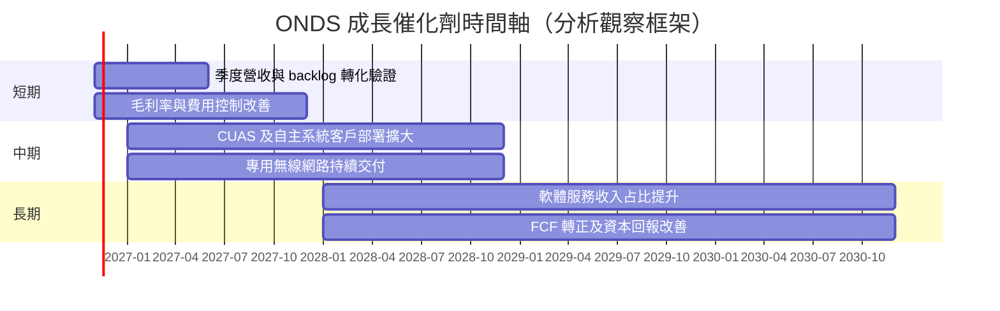

時間軸是分析框架，不代表公司已給出對應年度財測。

### 9.2 TAM 市場規模分析

數據包未提供經核實 TAM、市場滲透率或公司市場份額，因此不編造市場規模與滲透率；以下呈現目前可量化的商業指標。

```text
╔══════════════════════════════════════════════════════════════════╗
║                 TAM 與可量化成長指標                             ║
╠══════════════════════════════════════════════════════════════════╣
║ 私人無線網路 TAM：N/A；公司市占：N/A；相關收入占比：N/A         ║
║ 無人機／自主系統 TAM：N/A；滲透率：N/A；收入占比：N/A           ║
║ CUAS TAM：N/A；滲透率：N/A；收入占比：N/A                       ║
║ TTM 公司營收：$331.49M                                           ║
║ backlog（新聞資料引用）：約 $835M，約為 TTM 營收 2.52 倍        ║
║ 重點：backlog 不是確定當期收入，須檢查取消率、交期與回款         ║
╚══════════════════════════════════════════════════════════════════╝
```

### 9.3 成長驅動力結構圖

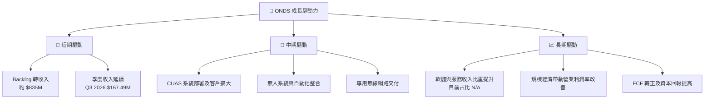

---

## 10. 風險矩陣

### 10.1 風險評分矩陣

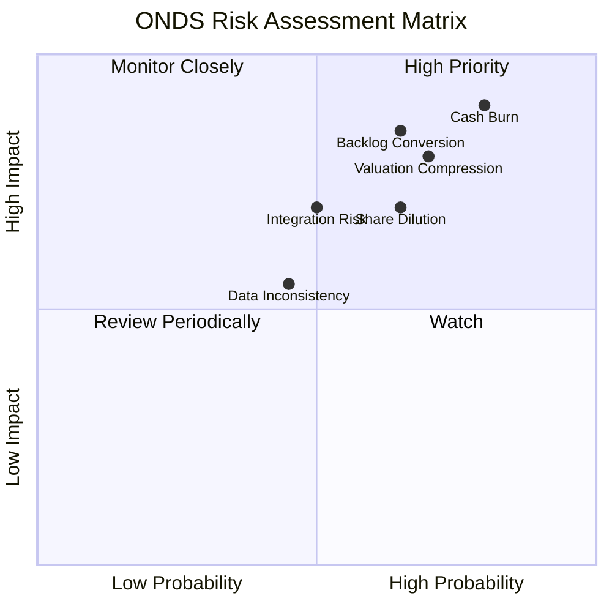

### 10.2 風險清單詳細分析

| # | 風險項目 | 發生機率 | 財務衝擊 | 風險評分 | 緩解措施 |
|---|---|---|---|---:|---|
| 1 | 🔴 **現金消耗與再融資／稀釋** | 高（約 70%–80%，分析估計） | TTM FCF -$311.55M；若延續，12 個月以上資金需求可能增加 | 🔴 9.0/10 | 每季監控現金、OCF、稀釋股數與融資條款；要求營業現金流趨勢改善 |
| 2 | 🔴 **Backlog 無法按期轉收入** | 中高（約 60%，分析估計） | backlog 約 $835M，但延期、取消或回款慢會降低成長與估值 | 🔴 8.5/10 | 追蹤 backlog 轉化率、交貨進度、客戶預付款及應收帳款 |
| 3 | 🔴 **高估值倍數收縮** | 高（約 65%，分析估計） | P/S 9.6x，高於 AVAV 3.0x、KTOS 3.9x；收入放慢可能壓低市值 | 🔴 8.0/10 | 以營收、毛利和現金流多重確認，不以單季成長率加碼 |
| 4 | 🟡 **股權稀釋與 SBC** | 中高（約 60%，分析估計） | 列示季度 SBC 占同期營收約 58.0%；歷史股數上升 | 🟠 7.5/10 | 比較基本／稀釋股數，設定年增股數上限 |
| 5 | 🟡 **併購與整合、商譽減損** | 中（約 45%，分析估計） | FY2026 資產資料顯示商譽及無形資產規模大；整合失敗可減損 | 🟠 7.0/10 | 追蹤分部毛利、商譽減損測試與收購後現金回報 |
| 6 | 🟡 **資料口徑及會計波動** | 中（約 45%，分析估計） | 淨利、FCF、債務、ROE 等來源不一致，可能造成錯誤估值 | 🟡 5.5/10 | 以 SEC 10-Q/10-K 逐項核對；估值僅用一致口徑 |

---

## 11. 投資建議

### 11.1 最終綜合評級雷達圖

```text
╔══════════════════════════════════════════════════════════════╗
║               ONDS 最終投資評級儀表板                       ║
╠══════════════════════════════════════════════════════════════╣
║ 基本面         4.5/10  ▓▓▓▓▓▓▓▓▓░░░░░░░░░░░                 ║
║ 成長性         8.0/10  ▓▓▓▓▓▓▓▓▓▓▓▓▓▓▓▓░░░░                 ║
║ 獲利能力       2.0/10  ▓▓▓▓░░░░░░░░░░░░░░░░                 ║
║ 財務健康       6.0/10  ▓▓▓▓▓▓▓▓▓▓▓▓░░░░░░░░                 ║
║ 估值合理性     3.5/10  ▓▓▓▓▓▓▓░░░░░░░░░░░░░                 ║
║ 護城河深度     4.0/10  ▓▓▓▓▓▓▓▓░░░░░░░░░░░░                 ║
║ 管理層執行     4.5/10  ▓▓▓▓▓▓▓▓▓░░░░░░░░░░░                 ║
║ 綜合評分       4.4/10  ▓▓▓▓▓▓▓▓▓░░░░░░░░░░░                 ║
╠══════════════════════════════════════════════════════════════╣
║ 評級：持有；MOS 7.6%，ROIC -20.9% < WACC 20.34%              ║
╚══════════════════════════════════════════════════════════════╝
```

### 11.2 目標價與隱含報酬率

| 情境 | 目標價 | 相對 $5.16 現價 | 機率權重 | 主要假設 |
|---|---:|---:|---:|---|
| 🔴 悲觀 | $2.50 | -51.6% | 25% | 增長降速、利潤率持續負值、EV/Sales 收斂 |
| 🟡 基準 | $5.45 | +5.6% | 50% | 營收持續高增、交付可見，但轉盈與 FCF 改善漸進 |
| 🟢 樂觀 | $10.00 | +93.8% | 25% | backlog 轉化加快，毛利及營業槓桿快速改善 |
| **加權合理價值** | **$5.585** | **+8.2%** | **100%** | 第 8.8 節多方法加權，不等於情境目標的機率加權 |

**評級判斷**：依 MOS 7.6%，評級為 **持有**，不作質化上調。雖然分析師共識目標價 $17.88 隱含大幅上行，但目前 ROIC、FCF、稀釋與估值資料不足以支持將共識當作主要目標價。

### 11.3 買入時機與觸發因素

```text
╔══════════════════════════════════════════════════════════════════╗
║                  ✅ 買入觸發因素 Checklist                      ║
╠══════════════════════════════════════════════════════════════════╣
║ 觀察後再增加曝險的條件：                                        ║
║ ☐ 連續兩季營收年增仍為正，且訂單轉收入可由財報核實              ║
║ ☐ 毛利率維持或改善，不能只靠一次性收入放大營收                  ║
║ ☐ 營業費用增幅低於毛利額增幅，營業利潤率連續改善                ║
║ ☐ TTM 營業現金流消耗明顯收斂，FCF 向零靠近                      ║
║                                                                  ║
║ 加碼觸發條件（出現多項）：                                      ║
║ ☐ TTM FCF 消耗低於現金及短期投資的 20%                         ║
║ ☐ 連續兩季稀釋股數年增低於 5%（分析監控門檻）                  ║
║ ☐ 營業利潤率改善且應收款增速不高於收入增速                      ║
║                                                                  ║
║ 減碼／退出觸發條件：                                             ║
║ ☐ 現金及短期投資下降速度加快，需外部融資才能支撐營運            ║
║ ☐ backlog 取消、延期，或連續兩季營收低於前季                    ║
║ ☐ 毛利率下跌且營業利潤率沒有改善                                ║
║ ☐ 稀釋股數快速增加，或收購造成重大商譽減損                      ║
╚══════════════════════════════════════════════════════════════════╝
```

### 11.4 投資人適配度分析

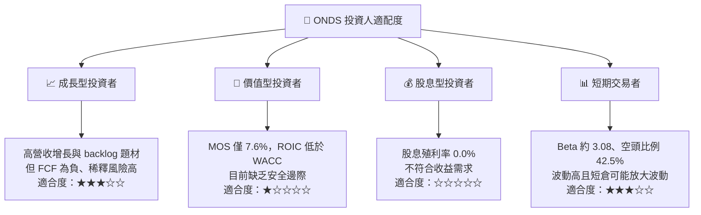

### 11.5 每季財報監控清單（Quarterly Watch List）

| 指標 | 最新參考值 | 加碼觸發門檻 | 減碼／重新檢視門檻 |
|---|---:|---|---|
| 季度營收 | 2026 Q3 約 $167.49M | YoY 持續為正，backlog 有交付佐證 | 連續兩季 QoQ 下滑且訂單無補充 |
| 最新季度 YoY 成長 | VERIFIED +1,558.6% | 高成長伴隨毛利額與現金回收同步增長 | 成長率急降且營收集中於少數專案 |
| 毛利率 | 一般資料 TTM 36.4%，需核對 | 維持或改善，且非一次性產品組合造成 | 連續兩季下滑 5 個百分點以上 |
| 營業利潤率 | VERIFIED TTM -126.2% | 逐季改善、費用增速低於毛利額增速 | 連續兩季惡化或收入擴大仍無營運槓桿 |
| 營業現金流與 FCF | TTM OCF -$290.76M；FCF -$311.55M | 消耗顯著收斂、FCF 走向零 | TTM FCF 消耗高於現金資產的 40% 且未改善 |
| Capex | VERIFIED TTM $20.80M | 資本支出帶來可驗證交付與營收 | Capex 增長、但產能利用及交付未提高 |
| 應收帳款與存貨 | 約 $207.40M、$110.72M（StockAnalysis） | 增速低於或接近營收增速 | 應收或存貨增速持續遠超營收 |
| SBC／股數稀釋 | 已列季度 SBC 高；最新完整 TTM N/A | 稀釋股數增幅持續收斂 | 股數快速增加且每股營收未同步提升 |
| 現金與短期投資 | VERIFIED $788.87M | 資金可支持交付與研發而無高成本融資 | 現金快速下降、融資需求提前 |
| 財測與 backlog | backlog 約 $835M（新聞資料） | 對履約季度、取消率及毛利提供明確更新 | 管理層下修或 backlog 積壓未轉收入 |

### 11.6 反面論證：什麼會證明論點錯誤（What Would Change My Mind）

```text
╔══════════════════════════════════════════════════════════════════╗
║              ⚠️ 論點失效條件（Disconfirming Evidence）           ║
╠══════════════════════════════════════════════════════════════════╣
║ ☐ 核心收入連續兩季 YoY 成長低於 30%，且 backlog 未補充           ║
║ ☐ 毛利率連續兩季收縮超過 5 個百分點                              ║
║ ☐ TTM FCF 消耗未下降，或高於現金及短期投資的 40%                 ║
║ ☐ 應收帳款、存貨長期快於收入成長，回款週期持續惡化               ║
║ ☐ 稀釋股數年增超過 10%，而每股收入及每股現金流沒有改善           ║
║ ☐ ROIC 長期低於 WACC 20.34%，且營業利潤率沒有逐季收斂            ║
║ ☐ 重大訂單延遲、取消，或新業務無法在合理時間形成可回收收入        ║
╚══════════════════════════════════════════════════════════════════╝
```

---

> **免責聲明**：本報告為 AI 自動生成，僅供研究參考，不構成投資建議。報告依據所提供的財務資料及明示假設分析；不同資料來源存在口徑差異，投資人應以公司 SEC 申報文件、正式財測及最新股數資料核實。投資有風險，入市需謹慎。