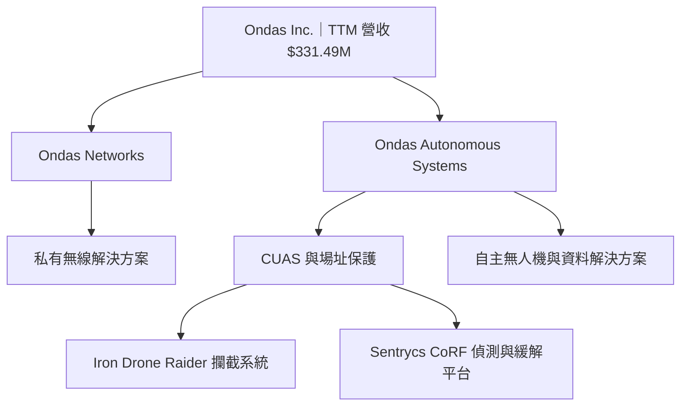
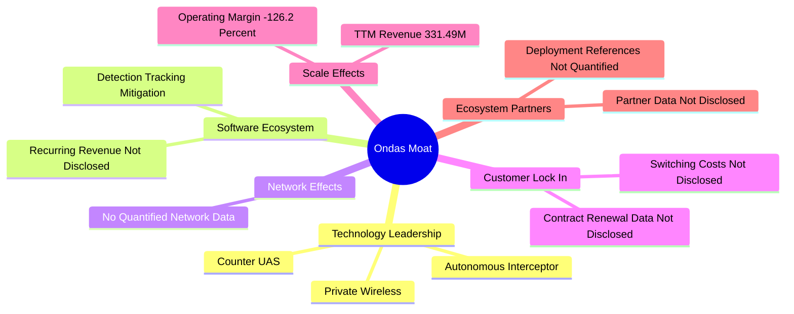
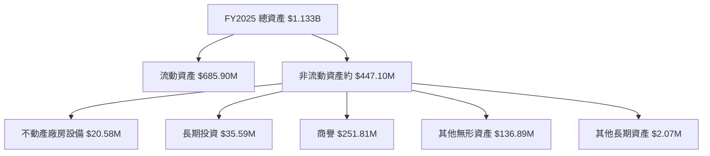
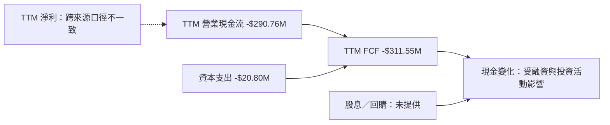
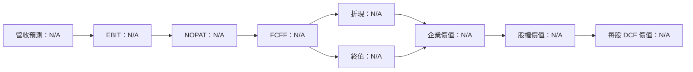
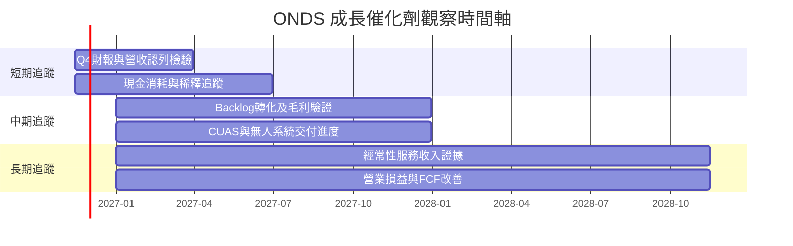
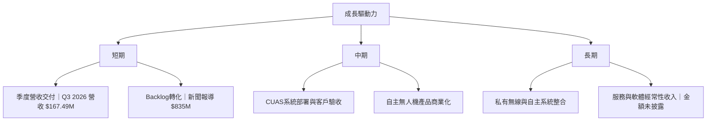
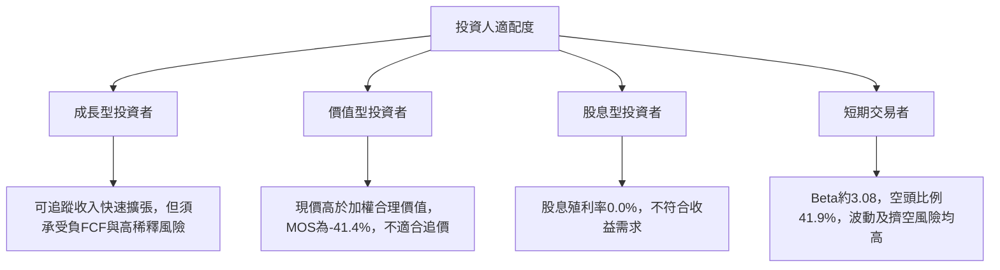

# ONDS 基本面深度分析報告
> **報告日期**：2026-11-15 ｜ **語言**：繁體中文 ｜ **數據來源**：SEC 申報資料 (XBRL)、Yahoo Finance、Finviz、StockAnalysis、Roic.ai ｜ **分析師**：CFA 級機構研究

## 目錄

| # | 章節 | 核心結論 |
|---|------|----------|
| 1 | 執行摘要 | 賣出；加權合理價值 $3.65，MOS -41.4% |
| 2 | 公司概覽與商業模式 | 無法由財務資料量化市場份額；護城河證據仍有限 |
| 3 | 損益表深度分析 | TTM 營收 $331.49M、成長 1,239.4%，但營業利益率 -126.2% |
| 4 | 資產負債表分析 | 現金與短期投資 $788.87M；總債務在指定財務欄位為 N/A |
| 5 | 現金流量深度分析 | TTM FCF -$311.55M，現金消耗與股權稀釋是主要監控項目 |
| 6 | 獲利能力與資本效率 | ROIC -20.9% 對 WACC 14.00%，目前摧毀股東價值 |
| 7 | 相對估值分析 | 自身 P/S 低於五年中位數，但仍高於同業中位數 |
| 8 | DCF 內在價值評估 | DCF N/A；TTM 營業利益為負，不建立現金流模型 |
| 9 | 成長催化劑 | backlog 報導達 $835M，但轉化率、時間表與毛利貢獻未提供 |
| 10 | 風險矩陣 | 主要風險為現金消耗、稀釋與 backlog 轉化不確定性 |
| 11 | 投資建議 | 依 MOS 為賣出；等待估值回落並檢驗營運轉化 |

## 1. 執行摘要

截至 **2026-11-13 收盤價 $5.16**，ONDS 的 TTM 營收為 $331.49M、TTM 營收年增 1,239.4%，但 TTM 營業利益率為 -126.2%、TTM FCF 為 -$311.55M、ROIC 為 -20.9%。相對估值方法給出的加權合理價值為 $3.65，對應 MOS -41.4%。因此，本報告依 MOS 評級門檻判定為**賣出**：目前營收擴張尚未轉化為可持續獲利或現金流，且股價高於加權合理價值。

### 1.0 一頁式投資儀表板（Portfolio Manager 30 秒速讀）

| 項目 | 內容 |
|------|------|
| **投資論點（3 句）** | ① TTM 營收年增 1,239.4%，顯示收購整合或業務擴張帶來規模變化，但不代表有機成長。② TTM 營業利益率 -126.2%、TTM FCF -$311.55M，增長尚未轉化為營運自給。③ 加權合理價值 $3.65，較 $5.16 現價低 29.3%（上行空間為負）。 |
| **綜合評分** | **4.2/10**（引用 1.1 評分卡） |
| **財務健康** | 🟡 現金與短期投資 $788.87M，但 TTM FCF 為 -$311.55M；指定財務欄位的總債務為 N/A。 |
| **ROIC vs WACC** | **-20.9% vs 14.00%**；ROIC 低於資本成本 34.9 個百分點，摧毀價值。 |
| **FCF 趨勢** | 🔴 TTM FCF 為 -$311.55M；FCF Yield -10.21%。 |
| **估值** | Forward P/E **-33.29032x** ｜ EV/EBITDA **-8.006x** ｜ FCF Yield **-10.21%**。 |
| **DCF 內在價值（基準）** | **N/A**；TTM 營業利益為負，資料模型未建立 DCF，故不計算 DCF 折溢價。 |
| **安全邊際（MOS）** | **-41.4%＝($3.65 − $5.16) ÷ $3.65**；基準為 8.8 節加權合理價值。🔴 無安全邊際。 |
| **預期報酬（基準情境 12M）** | DCF 情境 N/A；以加權合理價值衡量的上行空間為 **-29.3%**，不是 DCF 預期報酬。 |
| **關鍵風險（前二）** | TTM 現金消耗 $311.55M；股數在 2026 年 3 月至 9 月由 469M 增至 590M。 |
| **評級 + 信心度** | 🔴 **賣出** ｜ 信心：中（估值結論明確，營運與資料來源存在不一致）。 |

### 1.1 綜合評分卡（全報告唯一）

| 維度 | 評分（1–10） | 主要依據（引用數字與其來源章節） |
|------|--------------|----------------------------------|
| 成長性 | 8.0 | TTM 營收成長 1,239.4%、最新一季年增 1,558.6%；但高成長基期與收購影響需拆分（第 3 章）。 |
| 獲利能力 | 1.0 | TTM 營業利益率 -126.2%、ROIC -20.9%、Piotroski F-Score 3/8（第 3、6 章）。 |
| 財務健康 | 7.0 | 現金與短期投資 $788.87M、流動比率 3.389；但 TTM FCF -$311.55M，且總債務欄位 N/A（第 4、5 章）。 |
| 估值 | 2.0 | MOS -41.4%；P/S 9.6x 高於同業中位數 3.9x，但低於自身五年中位數 17.9x（第 7、8 章）。 |
| 護城河 | 4.0 | 私有無線、無人系統與 CUAS 產品組合具差異化可能，但缺市場份額、續約率、客戶集中度及分部營收資料（第 2 章）。 |
| 管理層與資本配置 | 3.0 | 股數由 2026 年 3 月 469M 升至 9 月 590M，約增加 25.8%；FY2025 SBC $16.02M，占營收約 31.6%（第 3、5 章）。 |
| **綜合評分** | **4.2** | 六項算術平均：(8.0 + 1.0 + 7.0 + 2.0 + 4.0 + 3.0) ÷ 6 = 4.1667，四捨五入至一位小數為 4.2。 |

### 1.2 五大投資論點 + 三大核心風險

| 類型 | 項目 | 具體依據 | 信心度 |
|------|------|----------|--------|
| 🟢 **投資論點①** | 收入規模快速擴大 | TTM 營收 $331.49M、TTM 年增 1,239.4%；若增量營收逐步帶來正毛利與固定成本槓桿，未來可能改善虧損。 | 🟡 中 |
| 🟢 **投資論點②** | 現金儲備提供轉型時間 | 現金與短期投資 $788.87M，短期流動性較單看營業虧損更具緩衝。 | 🟡 中 |
| 🟢 **投資論點③** | 產品涵蓋私有無線及自主系統 | 公司介紹包括 CUAS、攔截無人機及私有無線解決方案；軍事與關鍵設施應用可能形成需求來源。 | 🟡 中 |
| 🟢 **投資論點④** | 報導中的 backlog 提供潛在收入能見度 | 新聞提及 $835M backlog；但尚缺交付期限、可取消條款、毛利及認列節奏，不能直接視為已實現收入。 | 🟡 中 |
| 🟢 **投資論點⑤** | P/S 低於自身歷史中位數 | 現值 9.6x，低於五年中位數 17.9x；惟自身歷史區間極寬，且仍高於同業 P/S 中位數 3.9x。 | 🟡 中 |
| 🟡 **風險①** | 現金消耗與營業虧損 | TTM FCF -$311.55M、營業利益率 -126.2%；若現金消耗未收斂，融資或增發壓力可能上升。 | 🔴 高衝擊 |
| 🔴 **風險②** | 股權稀釋及盈餘品質 | 2026 年 3 月至 9 月股數由 469M 升至 590M；FY2025 SBC $16.02M，占當年營收 31.6%。 | 🔴 高衝擊 |
| 🟡 **風險③** | backlog 不等於可確認營收 | $835M backlog 報導缺少訂單轉化、取消率與毛利資料；收入能否持續、盈利能否改善仍待驗證。 | 🔴 高衝擊 |

### 1.3 快速統計卡片

| 指標 | 公司實際值（期間） | 同業中位數 | 狀態 |
|------|--------------------|------------|------|
| 營收成長（TTM） | **1,239.4%** | — | 🟢 高成長；須辨識收購與低基期影響 |
| 營收成長（最新一季年增） | **1,558.6%** | 35.7% | 🟢 明顯高於同業中位數 |
| 毛利率（TTM） | **36.4%** | 23.0% | 🟢 高於同業中位數 |
| 營業利益率（TTM） | **-126.2%** | — | 🔴 大幅虧損 |
| ROIC（TTM） | **-20.9%** | — | 🔴 低於 WACC 14.00% |
| Forward P/E | **-33.29032x** | 26.7x | 🔴 公司預期仍為虧損，倍數不可直接作一般獲利公司比較 |
| FCF Yield（TTM） | **-10.21%** | — | 🔴 現金消耗 |
| Piotroski F-Score | **3 / 8** | — | 🔴 財務品質訊號偏弱 |

### 1.4 投資結論

```text
╔══════════════════════════════════════════════════════════════════╗
║                    📊 投資結論摘要                               ║
╠══════════════════════════════════════════════════════════════════╣
║  評級：賣出（依 8.8 MOS 門檻）                                   ║
║  價格（2026-11-13 收盤）：$5.16                                 ║
║  DCF 內在價值（基準）：N/A（TTM 營業利益為負）                  ║
║  安全邊際 MOS：-41.4%＝($3.65−$5.16)÷$3.65                      ║
║  加權合理價值（8.8）：$3.65                                     ║
║  DCF 情境價值：N/A（DCF MODEL 未建立）                           ║
║  綜合評分：4.2/10（引用 1.1）                                    ║
║  適合投資人：能承受高波動、以小部位追蹤商業化進程的成長型投資人  ║
╚══════════════════════════════════════════════════════════════════╝
```

## 2. 公司概覽與商業模式

### 2.1 業務結構與收入來源

公司有 Ondas Networks 與 Ondas Autonomous Systems 兩個業務板塊，產品涵蓋私有無線、無人機、自主資料解決方案、CUAS 及場址保護。2026 年 9 月止 TTM 營收為 $331.49M；各板塊營收、占比及軟體／服務收入未提供，因此不以推估比例畫收入拆分圖。



目前收入規模已上升，但可用資料不足以分辨有機成長、收購併表、產品交付與經常性服務各自的貢獻。這使得營收增速不能直接等同於長期可重複的成長率。

### 2.2 市場份額

市場份額數據未提供，亦無法由公司營收直接推算滲透率。ONDS TTM 營收 $331.49M，明顯低於大型國防承包商規模，但最新一季營收年增 1,558.6%，高於 AVAV、KTOS、RCAT 的最新季年增率；其增幅可能受低基期與收購影響，仍需以連續季度出貨及毛利率驗證。

### 2.3 競爭護城河分析



### 2.4 護城河強度

| 護城河項目 | 強度（強／中／弱） | 證據（引用數字或事實） | 會削弱它的情況 |
|------------|--------------------|------------------------|----------------|
| 技術與產品組合 | 中 | 公司涵蓋 CUAS、攔截無人機、私有無線；但研發成果轉化與產品別營收未提供。 | 競品性能接近、採購延後或單位經濟性不成立。 |
| 軟體生態系統 | 弱至中 | Sentrycs CoRF 描述包含偵測、識別、追蹤與緩解功能；軟體訂閱與續約收入未披露。 | 收入主要依賴一次性硬體，後續維護收入有限。 |
| 網路效應 | 弱 | 未提供用戶數、部署節點或資料網路規模。 | 沒有累積資料或跨客戶使用帶來的邊際價值。 |
| 客戶鎖定 | 弱至中 | 國防、關鍵設施系統可能涉及整合與認證，但客戶留存率、合約期及切換成本未提供。 | 專案取消或客戶能以較低成本更換供應商。 |
| 規模效應 | 弱 | TTM 營收 $331.49M，但 TTM 營業利益率 -126.2%，尚未顯示規模帶來獲利槓桿。 | 營收擴大仍伴隨等比例或更快的費用增長。 |
| 生態夥伴 | 弱 | 未提供可量化的合作夥伴或通路貢獻。 | 依賴少數渠道或合作方，部署與交付受制於第三方。 |

1.1 護城河評分為 **4.0/10**，理由是產品涵蓋多個可能具差異化的應用場景，但客戶留存、軟體經常性收入、部署基數與分部獲利資料不足，且目前營業利潤率仍為負。

## 3. 損益表深度分析

### 3.1 年度收入成長趨勢（近4年）

以下收入採年度損益表所列數字。年度變化率按表列收入計算，因四捨五入可能與 StockAnalysis 的未四捨五入成長率略有差異。

```text
╔══════════════════════════════════════════════════════════════════╗
║              Ondas Inc. 年度收入趨勢（FY2022-FY2025）            ║
╠══════════════════════════════════════════════════════════════════╣
║  FY2022  $2.13M   █                         YoY：基期             ║
║  FY2023  $15.69M  ███████                   YoY：約 +636.6%       ║
║  FY2024  $7.19M   ███                       YoY：約 -54.2%        ║
║  FY2025  $50.73M  █████████████████████████ YoY：約 +605.3%      ║
║                                                                  ║
║  FY2022-FY2025 收入 CAGR：約 187.8%                              ║
║  注意：年度收入波動大，近期 TTM 收入包含大幅擴張，不宜線性外推。║
╚══════════════════════════════════════════════════════════════════╝
```

公式：CAGR = \((50.73 ÷ 2.13)^{1/3} - 1\) ≈ **187.8%**。此計算反映低基期與高波動，並不表示未來可維持同一增速。

### 3.2 季度收入趨勢分析

| 季度 | 營收 | QoQ | YoY | 備註 |
|------|------:|----:|----:|------|
| 2025 Q4 | $30.11M | 約 +198.1% | +629.2% | QoQ 以 2025 Q3 $10.1M 計算；低基期影響明顯。 |
| 2026 Q1 | $50.12M | 約 +66.4% | +1,079.9% | 較 2025 Q4 增加，仍不能單獨確認有機成長。 |
| 2026 Q2 | $83.77M | 約 +67.1% | +1,235.4% | 營收延續擴張；同季營業虧損擴大。 |
| 2026 Q3 | $167.49M | 約 +99.9% | **+1,558.6%** | 最新季年增率為單季數字，不是 TTM；收入來源以 StockAnalysis 季度資料為準。 |

QoQ 公式分別為當季營收 ÷ 前季營收 − 1。Q3 營收約為 Q2 的兩倍，但同季營業利益為 -$160.29M，表示增量收入尚未帶來正向營業槓桿。

### 3.3 利潤率演變分析

| 利潤率指標 | FY2022 | FY2023 | FY2024 | FY2025 | 趨勢 | 評估 |
|------------|-------:|-------:|-------:|-------:|------|------|
| **毛利率** | 約 52.1% | 約 40.7% | 約 4.8% | 約 39.7% | 大幅波動，FY2024 低谷後回升 | 🟡 |
| **營業利益率** | 約 -2,347.9% | 約 -243.7% | 約 -481.4% | 約 -115.1% | 仍為負，年度基期波動使比率失真 | 🔴 |
| **淨利率** | 約 -3,438.0% | 約 -285.7% | 約 -528.6% | 約 -260.2% | 仍為虧損，受收入低基期放大 | 🔴 |

計算採年度損益表的營收、毛利、營業利益及淨利相除。毛利率 FY2024 僅約 4.8%，FY2025 回升至約 39.7%，可能反映產品組合、交易併表與交付內容變動；資料不足以拆解定價、成本或併購因素。FY2026 Q3 單季毛利率依 StockAnalysis 為 48.51 ÷ 167.49，約 **29.0%**，低於 TTM 毛利率 36.4%；季度產品組合或成本變化可能造成差異，需後續季報確認。

### 3.4 費用結構分析

資料未提供完整 TTM 營業費用分項，無法可靠繪製費用結構圓餅圖。可確認 FY2025 研發支出為 $20.88M、營業虧損為 $58.38M；研發投入占當年營收約 41.2%，但其他營業費用及收購相關費用未提供，不能據此推算總費用結構。

### 3.5 季度 EPS 趨勢與盈餘品質（Quality of Earnings）

| 季度 | EPS 實際值 | EPS 預估／意外幅度 | 評估 |
|------|-----------:|-------------------|------|
| 2025 Q4 | -$0.27 | N/A | 估計值與 surprise 缺漏，無法判定超預期或不及預期。 |
| 2026 Q1 | $0.59 | N/A | EPS 正值與其他期間虧損資料存在波動，須核對一次性項目；無法判定 surprise。 |
| 2026 Q2 | -$0.15 | N/A | EPS 預估缺漏；季度淨利為 -$88.25M。 |
| 2026 Q3 | -$0.10 | N/A | EPS 預估與 actual beat/miss 欄位均缺漏；無法判定超預期或不及預期。 |

| 盈餘品質項目 | 數值／佔比 | 評估 |
|--------------|-----------|------|
| 股權薪酬 SBC / 營收 | FY2025：$16.02M ÷ $50.73M = **31.6%** | 🔴 比率偏高；若以增發結算，股東承受稀釋。非 TTM 數字。 |
| SBC / 營業現金流 | FY2025 營業現金流為 -$38.75M；兩者方向相反，傳統比率不具經濟解讀性 | 🔴 SBC 是非現金費用，但不能因此忽略股東稀釋成本。 |
| FCF / 淨利（現金轉換率） | TTM FCF -$311.55M；StockAnalysis TTM 淨利 $53.16M，依兩來源計算約 -586% | 🔴 來源期間與口徑可能不一致，且淨利可能含非經常性因素；不宜當作穩定轉換率。 |
| 一次性／非經常性損益 | Q1 2026 淨利 $362.95M（季度資料）；細項 N/A | 🔴 單季淨利與相鄰季度虧損差異極大，應視為待查核的非經常性或資料口徑訊號。 |
| 有效稅率異常 | N/A | 稅前利益與所得稅費用明細未提供，無法計算有效稅率。 |
| 資本化支出 vs 費用化 | TTM 資本支出 $20.80M；資本化政策與無形資產攤銷明細 N/A | 🔴 有收購及無形資產增長背景，需追蹤攤銷、減值及資本化政策。 |

**盈餘品質結論：**現有資料呈現 TTM FCF 大幅為負、SBC 占 FY2025 營收 31.6%，且單季淨利異常波動。即使某些聚合資料顯示 TTM 正淨利，也不足以證明經常性獲利已形成；估值應優先觀察現金流、調整後營業表現與稀釋後每股經濟價值。

## 4. 資產負債表分析

### 4.1 資產結構分解

下圖採 FY2025 資產負債表。流動資產 $685.90M、非流動資產約 $447.10M，合計約 $1.133B。非流動資產細項合計可能因四捨五入略有差異。



FY2025 商譽與無形資產合計約 $388.70M，占總資產約 34.3%。若相關收購資產未能產生預期現金流，減值風險可能影響未來損益與權益。

### 4.2 流動性與營運資金分析

| 指標 | 最新 TTM | 一年前 TTM | 變化 | 解讀 |
|------|----------|------------|------|------|
| DSO 應收帳款天數 | N/A | N/A | N/A | QUALITY FIGURES 指出期間缺少季度資產負債表，無法計算。 |
| DIO 存貨天數 | N/A | N/A | N/A | 同上，不能以年度或混合期間資料替代。 |
| DPO 應付帳款天數 | N/A | N/A | N/A | 同上。 |
| CCC 現金轉換週期 | N/A | N/A | N/A | 同上。 |

流動比率為 3.389、速動比率為 2.604；以現有指標看，短期流動性有緩衝。不過 TTM FCF -$311.55M，表示流動性評估須與現金消耗速度一起看；現金與短期投資為 $788.87M，不等於全部可自由使用現金。

### 4.3 債務結構分析

指定 SEC 申報計算欄位將總債務列為 N/A、淨現金列為 $788.87M；其他資料來源另報總債務 $62.81M、淨現金 $726.06M。以下保留來源差異，不自行以其中一組替換另一組；利息保障倍數也因營業虧損及債務口徑差異而不適合標示為有利。

```text
╔══════════════════════════════════════════════════════════════════╗
║                   Ondas Inc. 債務健康診斷                       ║
╠══════════════════════════════════════════════════════════════════╣
║  總債務（指定計算欄位）：N/A                                     ║
║  總債務（其他資料來源）：$62.81M                                 ║
║  現金+短期投資：$788.87M                                         ║
║  淨現金（其他來源口徑）：$726.06M                                ║
║  指定欄位淨現金：$788.87M（債務資料不可得，照原值引用）           ║
║  Debt/EBITDA：不宜解讀；TTM EBITDA Margin -87.8%，EBITDA 為負    ║
║  利息保障倍數：N/A（利息費用與可比債務口徑不足）                 ║
║  評估：🟡 現金儲備較高，但現金流消耗及債務數據差異需持續核對     ║
╚══════════════════════════════════════════════════════════════════╝
```

### 4.4 股東權益趨勢

| 年度 | 股東權益 | 變化與解讀 |
|------|---------:|------------|
| 2022 | $58.22M | 歷史基準。 |
| 2023 | $33.14M | 較前一年下降，與持續淨虧損相符。 |
| 2024 | $16.58M | 再度下降，權益緩衝較薄。 |
| 2025 | $437.81M | 大幅增加，伴隨資產、現金及流通股數擴張；需區分融資、發股與併購的各自貢獻。 |

```text
╔══════════════════════════════════════════════════════════════════╗
║                股東權益趨勢（年度，USD）                         ║
╠══════════════════════════════════════════════════════════════════╣
║  2022  $58.22M   █████                                         ║
║  2023  $33.14M   ███                                           ║
║  2024  $16.58M   █                                             ║
║  2025  $437.81M  ████████████████████████████████████████████  ║
║  註：2025 大幅變化不宜視為內生獲利累積；需核對增資及併購項目。   ║
╚══════════════════════════════════════════════════════════════════╝
```

## 5. 現金流量深度分析

### 5.1 現金流量瀑布圖

可用的完整 TTM 淨利、營業現金流與資本支出來源並不完全一致；下圖使用指定 TTM 現金流數字。股息與回購金額未提供，不畫成比例項目。



因數字四捨五入，直接以列示 OCF 與資本支出相減為 -$311.56M，與指定 TTM FCF -$311.55M 相差 $0.01M；報告採用指定 FCF 原值，不調整該值。

### 5.2 FCF 轉換率趨勢

| 年度／期間 | FCF | 淨利 | FCF / 淨利 | 解讀 |
|------------|----:|-----:|-----------:|------|
| FY2022 | -$40.89M | -$73.24M | 約 55.8% | 分子、分母皆為負，比例不代表正向現金轉換。 |
| FY2023 | -$34.30M | -$44.84M | 約 76.5% | 同上，仍為現金消耗。 |
| FY2024 | -$35.20M | -$38.01M | 約 92.6% | 虧損與負 FCF 同時存在。 |
| FY2025 | -$40.88M | -$132.02M | 約 31.0% | 大額會計虧損與現金流差異較大，須檢視非現金及一次性項目。 |
| TTM | **-$311.55M** | 淨利口徑跨來源不一致 | 不宜比較 | 優先以現金消耗作為資金需求指標。 |

### 5.3 自由現金流趨勢

| 期間 | FCF | 說明 |
|------|----:|------|
| FY2022 | -$40.89M | 年度現金流持續為負。 |
| FY2023 | -$34.30M | 仍未達現金流平衡。 |
| FY2024 | -$35.20M | 現金消耗延續。 |
| FY2025 | -$40.88M | 負 FCF 略擴大。 |
| TTM | **-$311.55M** | 明顯高於上述年度歷史值；反映最新期間現金需求快速上升。 |

```text
╔══════════════════════════════════════════════════════════════════╗
║                  自由現金流趨勢（USD）                           ║
╠══════════════════════════════════════════════════════════════════╣
║  FY2022  -$40.89M  ◀████                                         ║
║  FY2023  -$34.30M  ◀███                                          ║
║  FY2024  -$35.20M  ◀███                                          ║
║  FY2025  -$40.88M  ◀████                                         ║
║  TTM     -$311.55M ◀██████████████████████████████               ║
║  TTM FCF Yield：-10.21%；負值代表現金消耗，不是現金收益率。      ║
╚══════════════════════════════════════════════════════════════════╝
```

### 5.4 資本配置評估

完整 TTM 投資、併購、回購與股息配置金額未提供，不能以估算比例繪製資本配置圓餅圖。已知 FY2025 資本支出為 $2.14M（現金流表以負值列示）、SBC 為 $16.02M；股息殖利率為 0.0%。在 FCF 為負且股數增加的背景下，資本配置重點應放在投資回報、現金使用效率及每股價值稀釋。

## 6. 獲利能力與資本效率

### 6.1 ROE / ROA / ROIC 趨勢

| 指標 | 最新 TTM | 歷史資料 | 評估 |
|------|---------:|----------|------|
| ROE | 4.6%（QUALITY FIGURES） | 另一聚合來源報 7.3%，口徑不一致 | 需注意 DuPont 三因素口徑；不是穩定獲利證據。 |
| ROA | N/A（QUALITY FIGURES 未給最新數值） | 另一來源報 -9.7% | 來源差異；不以後者取代品質指標欄位。 |
| ROIC | -20.9% | 歷史序列 N/A | 低於 WACC，股東價值為負向增值。 |

無同口徑行業平均資料，不列行業均值比較。ROE／ROA 等不同聚合來源數值有差異，後續追蹤應以 SEC 申報表內一致期間的平均資產與平均權益重算。

### 6.2 ROIC vs WACC 分析（核心價值創造判斷）

WACC 依資本成本資料採用 **14.00%**；資料另顯示計算值 15.02%，因上限規則限制於 7%–14% 而採用 14.00%。ROIC 採指定 TTM 值 -20.9%。

```text
╔══════════════════════════════════════════════════════════════════╗
║                ROIC vs WACC 深度分析                            ║
╠══════════════════════════════════════════════════════════════════╣
║  WACC 推導輸入：                                                 ║
║  ├── 無風險利率（10Y 美債）：       5.15%                        ║
║  ├── 股權風險溢酬 ERP：             5.00%                        ║
║  ├── Beta 原始值：                  3.08                         ║
║  ├── 採用調整後 Beta：              2.00                         ║
║  ├── 股權成本：5.15%+2.00×5.00% = 15.15%                        ║
║  ├── 稅前債務成本：                 10.47%                       ║
║  ├── 稅後債務成本：10.47%×(1−21%) = 8.27%                        ║
║  ├── E/D 權重：                     98.0% / 2.0%                 ║
║  ├── 計算 WACC：                    15.02%                       ║
║  └── 區間上限限制後採用 WACC：      14.00%                       ║
║                                                                  ║
║  ROIC（TTM）：                   -20.9%                          ║
║  WACC：                           14.00%                         ║
║  ROIC − WACC：                   -34.9 個百分點                  ║
║                                                                  ║
║  ROIC  -20.9%  ◀ 負值，低於資本成本                             ║
║  WACC   14.0%  ━━━━━━━━━━━━━━━                                  ║
║                                                                  ║
║  結論：ROIC 低於 WACC，現階段營運回報不足以補償資本成本；         ║
║  若成長持續伴隨虧損與稀釋，營收擴張反而可能加深價值消耗。         ║
╚══════════════════════════════════════════════════════════════════╝
```

股權成本 CAPM：\(5.15\% + 2.00 \times 5.00\% = 15.15\%\)。調整 Beta 的原始計算為 \(\frac{2}{3}\times3.08+\frac{1}{3}=2.3867\)，但資料規則將 Beta 限制於 0.6–2.0，因此採用 2.00。稅後債務成本：\(10.47\%\times(1-21.0\%)=8.2713\%\)，約 8.27%。資本結構加權值以列示權重計算約 15.02%，採用值依指定上限為 14.00%。ROIC 與 WACC 的差距為 \(-20.9\%-14.0\%=-34.9\) 個百分點。

### 6.3 杜邦三因素分解

| 因素 | 數值（TTM） | 解讀 |
|------|-------------|------|
| 淨利率 | 33.1% | 正淨利率與負 ROIC、負營業利益率並存，顯示非營業項目或期間口徑可能影響淨利；不能將其視為核心營業利潤率。 |
| 資產週轉率 | 0.08 | 資產基數大、營收相對資產規模低，對 ROE 形成限制。 |
| 權益乘數 | 1.70 | 財務槓桿並非 ROE 的唯一驅動因子。 |
| **ROE** | **4.6%** | QUALITY FIGURES 原值：33.1% × 0.08 × 1.70 約等於 4.6%。 |

### 6.4 財務體質：Piotroski F-Score

Piotroski F-Score：**3 / 8**。一項測試因資料缺漏而排除，分母依品質指標原值列示。

| 測試 | 結果 | 解讀 |
|------|------|------|
| ROA > 0 | ✅ 通過 | 相對改善訊號，但不代表營業獲利已穩定。 |
| 營業現金流 > 0 | ❌ 未通過 | 與 TTM 負營業現金流一致。 |
| ROA 高於一年前 | ✅ 通過 | 年度比較改善。 |
| 營業現金流 > 淨利（應計品質） | ❌ 未通過 | 現金流未能支持帳面盈餘。 |
| 長期負債 ÷ 總資產低於一年前 | — 無法判定 | 缺少測試所需資料。 |
| 流動比率高於一年前 | ❌ 未通過 | 該項比較指標惡化。 |
| 稀釋股數未增加 | ❌ 未通過 | 資料顯示股數擴張，稀釋風險需監控。 |
| 毛利率高於一年前 | ❌ 未通過 | 未達測試標準。 |
| 資產週轉率高於一年前 | ✅ 通過 | 資產效率相較前期改善。 |

## 7. 相對估值分析

### 7.1 同業估值比較表格

公司估值數字取自 Yahoo Finance／Finviz 合併資料；同業倍數依 Peer multiples。公司自身 P/S 與歷史分析的 9.6x 有口徑差異，本表採市場估值欄位的 9.206328x。

| 估值指標 | **ONDS** | **AVAV** | **KTOS** | **RCAT** | 本公司評估 |
|----------|---------:|---------:|---------:|---------:|-----------|
| **Trailing P/E** | N/A | N/A | 282.6x | N/A | 🔴 公司虧損，P/E 不適用。 |
| **Forward P/E** | -33.29032x | 26.7x | 30.3x | -8.6x | 🔴 公司預期虧損；不可按盈利公司方式解讀。 |
| **P/S Ratio** | 9.206328x | 3.0x | 3.9x | 8.1x | 🔴 高於同業中位數 3.9x；市場已計入較高增長預期。 |
| **EV/EBITDA** | -8.006x | 28.4x | 58.1x | -2.6x | 🔴 公司 EBITDA 為負，倍數比較失去一般經濟意義。 |
| **最新一季營收 YoY** | 1,558.6% | 5.7% | 35.7% | 527.2% | 🟢 增速高，但基期與收購效應尚未拆分。 |
| **毛利率 TTM** | 36.4% | 26.5% | 23.0% | 9.8% | 🟢 高於同業中位數 23.0%，但仍未轉為營業獲利。 |

同業毛利率與營收成長率中位數分別為 23.0% 與 35.7%；同業 P/S 中位數為 3.9x。以 3.9x 對比公司 9.206328x，ONDS 的高估值要求其高速增長能持續並改善利潤率。

### 7.2 歷史估值區間分析

歷史估值數據提供的是 **P/S**，非 P/E；以下依自有歷史 P/S 區間呈現。

```text
╔══════════════════════════════════════════════════════════════════╗
║             P/S 五年歷史區間與目前位置                           ║
╠══════════════════════════════════════════════════════════════════╣
║  五年低點：2.9x                                                 ║
║  五年中位數：17.9x                                               ║
║  目前：9.6x                                                     ║
║  五年高點：140.6x                                                ║
║                                                                  ║
║  2.9x ├──────────● 9.6x ───────┼ 17.9x ───────────────── 140.6x ║
║       低點       現值           中位數                    高點  ║
║  目前百分位：32%                                                 ║
║  解讀：低於自身中位數，但歷史高點極端，百分位不等於低估證明。   ║
╚══════════════════════════════════════════════════════════════════╝
```

### 7.3 情境價值（Bear / Base / Bull）

N/A（DCF 無法計算：TTM 營業利益不為正；DCF MODEL 未建立。依規則不給悲觀、基準、樂觀 DCF 情境價值。）

### 7.4 相對估值隱含價格區間

```text
╔══════════════════════════════════════════════════════════════════╗
║                  相對估值方法與股價位置                          ║
╠══════════════════════════════════════════════════════════════════╣
║  同業 P/S：$2.17 ─────── 現價 $5.16 ───────── 分析師共識 $16.98  ║
║  同業 P/S 隱含價：$2.17/股，較現價低 57.9%                       ║
║  分析師共識：$16.98/股，較現價高 229.1%                         ║
╚══════════════════════════════════════════════════════════════════╝
```

- **同業 P/S：$2.17/股，權重 90%。** 依同業中位數 P/S 3.9x（AVAV、KTOS、RCAT）乘以公司 TTM 營收，再按指定估值方法換算每股價值。
- **分析師共識：$16.98/股，權重 10%。** 10 位分析師平均目標價；高低區間為 $13.00–$25.00。分析師目標價是參考，不等同於可驗證內在價值。
- **同業 Forward P/E：**不可計算，權重依固定估值規則分配至其餘方法；不另增加方法。

## 8. DCF 內在價值評估（Discounted Cash Flow）

> **DCF MODEL：N/A。** SEC 申報計算的 TTM 營業利益為負，指定模型規則不以虧損現金流折現形成股權價值。本章不自行建立 DCF，也不提供基準 DCF 每股價值、敏感度矩陣或 DCF 情境價格。

### 8.0 估值推理鏈（Thinking Logic）

**Step 1 — 價值變數：**ONDS 的價值取決於私有無線與自主系統營收的可持續性、營業利潤率能否由目前 TTM -126.2% 改善，以及負 FCF 能否收斂。分部營收占比未提供，無法把 $331.49M TTM 營收拆成各業務來源；目前最重要的驗證點不是延伸營收成長率，而是增長能否轉成正毛利現金流。

**Step 2 — 模型選擇：**DCF 不適用，原因是 TTM 營業利益為負且 FCF 顯著為負；以負營業獲利為基礎外推會放大遠期利潤率假設，得到不可稽核的估值。未採用 FCFF 或 FCFE 預測、未設定預測期與終值，亦不提供反推 DCF。

**Step 3 — 假設推導鏈：**營收 CAGR、期末營業利潤率、永續成長率、Capex 比率、營運資金、稀釋及終值均不建立數字假設；這些輸入在指定 DCF MODEL 中為 N/A，若自行填值會違反模型資料優先規則。

**Step 4 — 最脆弱環節：**任何自行假設的長期正營業利潤率都可能主導估值，而公司當前 TTM 營業利益為負；因此不產生假精確度的 DCF 價格。

**Step 5 — 計算路徑圖：**模型未建立，以下僅示意會計關係，不含預測值。



### 8.1 模型假設總表（Model Inputs）

N/A（資料所列 DCF MODEL 因 TTM 營業利益為負而未建立；預測期、營收 CAGR、利潤率、稅率、Capex、D&A、營運資金、稀釋率、永續成長率與終值方法均未提供，不自行補值。）

### 8.2 折現率推導（WACC）

WACC 依資本成本輸入採用 **14.00%**，與第 6.2 節一致。10Y 美債無風險利率 5.15%、ERP 5.00%、原始 Beta 3.08、調整後 Beta 2.00。資料列示調整後 Beta 計算為 \(\frac{2}{3}\times3.08+\frac{1}{3}=2.3867\)，並受 0.6–2.0 區間限制，故使用 2.00。資本成本資料未提供無風險利率觀察日期以外的日級時間序列，因此不另行指定日期。

```text
╔══════════════════════════════════════════════════════════════════╗
║                    WACC 推導（折現率）                           ║
╠══════════════════════════════════════════════════════════════════╣
║  股權成本 Ke（CAPM）：                                           ║
║  ├── 無風險利率 Rf：                  5.15%                      ║
║  ├── 市場風險溢酬 ERP：               5.00%                      ║
║  ├── 原始 Beta：                      3.08                       ║
║  ├── 調整後 Beta：                    2.00                       ║
║  └── Ke = 5.15% + 2.00×5.00% = 15.15%                           ║
║                                                                  ║
║  債務成本：                                                      ║
║  ├── 稅前 Kd：                        10.47%                     ║
║  ├── 稅率：                           21.0%                      ║
║  └── 稅後 Kd = 10.47%×(1−21.0%) = 8.27%                         ║
║                                                                  ║
║  資本結構權重：股權 98.0%；債務 2.0%                            ║
║  資料列示計算 WACC：15.02%；限制於 7%-14% 後採用：14.00%        ║
╚══════════════════════════════════════════════════════════════════╝
```

逐步算式：
1. **Ke** = 5.15% + 2.00 × 5.00% = **15.15%**。
2. **稅前 Kd** = **10.47%**（直接採用資本成本資料；利息費用及平均計息負債絕對金額未提供，不另行反推）。
3. **稅後 Kd** = 10.47% × (1 − 21.0%) = **8.2713% ≈ 8.27%**。
4. **權重** = 股權 98.0%；債務 2.0%；合計 **100.0%**。市值、債務期末明細與同口徑平均計息負債未提供，故不重算權重。
5. **加權 WACC** = 98.0% × 15.15% + 2.0% × 8.2713% = 14.847% + 0.165426% = **15.012426%**。資料列示計算值為 15.02%，可能包含未四捨五入輸入；依指定上限採用 **14.00%**，不另改成自算值。

### 8.3 逐年自由現金流預測（基準情境）

N/A（DCF MODEL 未建立，因此沒有 FY+1 至 FY+N 營收、利潤率、稅率、資本支出、折舊、營運資金或 FCFF 預測；不自行建立模型。）

### 8.4 終值計算（Terminal Value）

N/A（沒有預測期最後一年 FCFF、永續成長率或終值倍數；不計算 Gordon Growth 或退出倍數終值。）

### 8.5 企業價值 → 每股內在價值（Bridge）

N/A（沒有 DCF 企業價值、DCF 股權價值與預測股數橋接。指定財務資料中現金及短期投資為 $788.87M；總債務欄位 N/A；不以此單獨推算每股 DCF 價值。）

### 8.6 敏感性分析（WACC × 永續成長率）

N/A（DCF 未建立，沒有基準 FCFF 與終值，無法計算 WACC × g 敏感性矩陣、情境價值或機率加權價值。）

### 8.7 反推 DCF（Reverse DCF：市場在預期什麼）

N/A（沒有可供反推的 DCF 模型；單靠現價 $5.16 無法唯一解出營收 CAGR、利潤率、永續成長率或預測期。）

### 8.8 估值三角驗證與安全邊際

本節僅使用估值方法資料中可計算的方法，權重與每股價值依既定公司類型（未獲利公司）原值引用。DCF 與同業 Forward P/E 未納入，後者因不可計算而依既定規則重新分配權重。

| 估值方法 | 隱含每股價值 | 上行空間（÷現價） | 權重 | 說明 |
|----------|--------------:|------------------:|-----:|------|
| 同業 P/S | $2.17 | -57.9% | 90% | 同業中位數 P/S 3.9x × TTM 營收換算。 |
| 分析師共識目標價 | $16.98 | +229.1% | 10% | 10 位分析師平均目標價。 |
| **加權合理價值** | **$3.65** | **-29.3%** | **100%** | 依未獲利公司固定權重計算。 |

**逐步演算：**  
\(2.17\times90\% + 16.98\times10\%=1.953+1.698=3.651\)，按每股價格取兩位小數為 **$3.65**。兩項權重合計 \(90\%+10\%=100\%\)。公司類型為未獲利公司；同業 Forward P/E 不可計算，其權重依固定方法配置至可用方法。

MOS 與上行空間：

- **MOS** = \((3.65-5.16) ÷ 3.65 = -1.51 ÷ 3.65 = -41.3699\% \approx \mathbf{-41.4\%}\)。
- **上行空間** = \((3.65-5.16) ÷ 5.16 = -1.51 ÷ 5.16 = -29.2636\% \approx \mathbf{-29.3\%}\)。
- **折溢價**相對 DCF 基準內在價值：N/A，因 DCF 基準價值不存在。

```text
╔══════════════════════════════════════════════════════════════════╗
║                  估值區間與安全邊際                              ║
╠══════════════════════════════════════════════════════════════════╣
║  同業 P/S $2.17 ── [$3.65 加權合理價值] ── 現價 $5.16 ── $16.98 ║
║                                                                  ║
║  安全邊際 MOS = ($3.65−$5.16)÷$3.65 = -41.4%                    ║
║  MOS 評估：🔴 <10%，無安全邊際                                   ║
║  上行空間 = ($3.65−$5.16)÷$5.16 = -29.3%                        ║
║  建議買入區間：不建議現價買入；重新評估價約 $3.29 以下           ║
║  合理持有區間：無法以 DCF 定義；關注 $3.65 加權價值附近           ║
║  減碼考慮區間：現價 $5.16 已高於加權合理價值 $3.65               ║
╚══════════════════════════════════════════════════════════════════╝
```

條件式重新評估價的算式：\(3.65\times(1-10\%)=3.285\)，約 **$3.29**，對應相對 $3.65 加權合理價值至少 10% 的 MOS；此為估值門檻，不是 DCF 目標價。

> 🔎 **程式複算（Python，依本節各項自動重算）**
>
> 加權合理價值 = $2.17 × 90% + $16.98 × 10% = **$3.65**（權重合計 100%）
>
> 以價格 $5.16 計：MOS = **-41.4%**，上行空間 = **-29.3%**
>
> ✅ 與本節所寫數值一致。

### 8.9 DCF 模型的局限與失效條件

- **終值依賴度：**N/A；模型未建立，沒有終值現值與企業價值可供計算。
- **最脆弱假設：**無可披露的基準 DCF 假設；營業利潤率回升速度與 backlog 實際轉化，是未來建立 DCF 前最需驗證的變數。
- **不適用情境：**公司 TTM 營業利益為負、TTM FCF -$311.55M，且收入與季度淨利波動大，DCF 可靠度低。短期宜觀察同業 EV/Sales、每季毛利率、現金消耗與 backlog 認列；等獲利趨勢可驗證後再建立 DCF。
- **與第 10 章風險連結：**backlog 未轉收入會下修營收成長假設；毛利率與費用率惡化會推遲營業損益兩平；現金消耗加大可能增加融資與股數稀釋，降低每股價值。

### 8.10 複算檢核表（Audit Trail）

| # | 檢核項目 | 檢查方式 | 結果 |
|---|----------|----------|------|
| 1 | 高／中敏感度輸入均有四段式推導 | DCF 未建立，無模型輸入可推導 | N/A |
| 2 | 每個 DCF 假設都有來歷 | 未填入模型假設，避免自行補值 | ✅ |
| 3 | WACC 五步算式與權重 | 列出 CAPM、稅後 Kd、權重與上限處理 | ✅（權重原值採用；原始金額不可重算） |
| 4 | Kd 分母與權重的 D 範圍一致 | 平均計息負債金額及期末同口徑債務未提供 | N/A |
| 5 | WACC 與第 6.2 節同值 | 兩處均採 14.00% | ✅ |
| 6 | 逐年表格年度數等於 N | 預測期不存在 | N/A |
| 7 | FY+1 FCFF 與 PV 可複算 | 沒有 FY+1 預測值 | N/A |
| 8 | 預測期 PV 加總 | 沒有預測期現值 | N/A |
| 9 | WACC > g | 沒有 g | N/A |
| 10 | 終值以 FY+N 現金流為基礎 | 沒有預測期現金流 | N/A |
| 11 | EV 至每股價值橋接 | DCF 企業價值未計算 | N/A |
| 12 | SBC 與股數處理相容 | DCF 未建立，不設定 SBC 組合 | N/A |
| 13 | 敏感性基準格等於 DCF 基準值 | 無敏感性矩陣 | N/A |
| 14 | 敏感性有效格及 WACC > g | 無敏感性矩陣 | N/A |
| 15 | 三情境機率合計 100% | DCF 情境未計算 | N/A |
| 16 | 反推 DCF 一次只解一變數並有軌跡 | 無 DCF 反推 | N/A |
| 17 | MOS、折溢價採正確分母 | MOS 使用 8.8 加權價值；DCF 折溢價 N/A | ✅ |
| 18 | 報告完整至第 11 章 | 各章均列出 | ✅ |
| 19 | 加權合理價值為各項加權和 | 2.17×90% + 16.98×10% = 3.651 ≈ $3.65 | ✅ |
| 20 | 評級符合 MOS 門檻 | MOS -41.4% 小於 -25%，評級賣出 | ✅ |

## 9. 成長催化劑

### 9.1 催化劑時間軸

以下為投資研究追蹤期間，不代表公司已公告交付日期。



### 9.2 TAM 市場規模分析

N/A（TAM 數據未提供）。公司 TTM 營收 $331.49M、最新一季營收年增 1,558.6%，顯示收入基礎擴張，但沒有可引用的市場規模、滲透率或公司市占數字。評估成長空間時應以合約轉收入、季度毛利及現金流為主，而非自行假設 TAM。

### 9.3 成長驅動力結構圖



## 10. 風險矩陣

### 10.1 風險評分矩陣

可引用資料未提供經驗統計形式的風險發生機率，因此不以主觀機率繪製含數值座標的風險矩陣。以下改以已觀察到的財務曝險與質化衝擊排序。

### 10.2 風險清單詳細分析

| # | 風險項目 | 發生機率 | 財務衝擊 | 風險評估 | 緩解措施 |
|---|----------|----------|----------|----------|----------|
| 1 | 🔴 **現金消耗與融資需求** | 高：已觀察到 TTM FCF 為負 | 高：TTM FCF -$311.55M；可能加速消耗 $788.87M 現金與短期投資 | 🔴 高 | 每季追蹤 OCF、Capex、受限現金與現金餘額；要求現金消耗率逐季下降。 |
| 2 | 🔴 **股權稀釋** | 高：股數已由 469M 增至 590M | 高：六個月增幅約 25.8%；稀釋會降低每股營收及未來每股價值 | 🔴 高 | 追蹤稀釋後股數、SBC、ATM 或增發計畫及每股營收變化。 |
| 3 | 🔴 **Backlog 轉化與交付風險** | 中至高：報導有 $835M backlog，但缺少履約資料 | 高：若交付延誤或取消，營收預期及估值支撐下降 | 🔴 高 | 追蹤訂單轉收入、延期／取消、客戶驗收及預收款。 |
| 4 | 🟡 **毛利率與營運槓桿未驗證** | 高：TTM 營業利益率 -126.2% | 高：營收高速增長仍未彌補營業費用 | 🔴 高 | 監控毛利率、營業費用增速及分部營業損益。 |
| 5 | 🟡 **收購整合與商譽減值** | 中：FY2025 商譽 $251.81M、無形資產 $136.89M | 中至高：減值會壓低帳面獲利與權益 | 🟡 中高 | 檢視收購資產的收入、利潤貢獻、減值測試與整合成本。 |
| 6 | 🟡 **資料口徑差異** | 已觀察到來源間差異 | 中：例如 TTM FCF、債務與 ROE 等欄位存在不同來源值，影響判斷 | 🟡 中 | 以 SEC 10-Q／10-K 逐項核對，統一期間及現金流定義。 |

## 11. 投資建議

### 11.1 最終評級與評分

依加權合理價值 $3.65 與 2026-11-13 收盤價 $5.16 計算，MOS 為 -41.4%，依評級規則為**賣出**；沒有進行一級質化調整。公司綜合評分為 **4.2/10**，六項分數分別為成長性 8.0、獲利能力 1.0、財務健康 7.0、估值 2.0、護城河 4.0、管理層與資本配置 3.0。

### 11.2 合理價值與隱含報酬率

| 方法 | 每股價值 | 相對現價報酬／上行空間 | 權重 |
|------|---------:|----------------------:|-----:|
| 同業 P/S | $2.17 | -57.9% | 90% |
| 分析師共識目標價 | $16.98 | +229.1% | 10% |
| **加權合理價值** | **$3.65** | **-29.3%** | **100%** |
| DCF 悲觀／基準／樂觀情境 | N/A | N/A | N/A |

分析師共識與同業 P/S 隱含價差距甚大，反映分析師目標價假設可能建立在高增長與商業化加速上；本報告遵守固定權重計算，不以較高共識價替代加權合理價值。

### 11.3 買入時機與觸發因素

```text
╔══════════════════════════════════════════════════════════════════╗
║                  ✅ 買入觸發因素 Checklist                      ║
╠══════════════════════════════════════════════════════════════════╣
║  立即買入觸發條件（多數符合後才重新評估）：                      ║
║  ☐ TTM FCF 明顯改善，且營業現金流連續多季收斂                   ║
║  ☐ 營收增長同時帶動毛利及營業利潤率改善                         ║
║  ☐ Backlog 轉化、交付期與毛利貢獻有 SEC 申報或公司資料佐證       ║
║                                                                  ║
║  加碼／重新評估觸發條件：                                        ║
║  ☐ 股價回至約 $3.29 以下，對 $3.65 加權價值具至少 10% MOS        ║
║  ☐ 稀釋股數增速下降，且 SBC 占營收比重趨降                      ║
║  ☐ 總債務及可動用現金口徑在 SEC 申報中能清楚核對                 ║
║                                                                  ║
║  減碼／退出觸發條件：                                            ║
║  ☐ Backlog 延遲、取消或未能如期轉成收入                          ║
║  ☐ TTM FCF 持續惡化，或現金消耗要求進一步大幅融資                ║
║  ☐ 股數持續快速增加，但每股營收與每股現金流沒有改善              ║
║  ☐ 營業利潤率在收入擴張後仍無改善跡象                            ║
╚══════════════════════════════════════════════════════════════════╝
```

### 11.4 投資人適配度分析



### 11.5 每季財報監控清單（Quarterly Watch List）

| 指標 | 最新基準 | 觸發加碼／改善訊號 | 觸發減碼／惡化訊號 |
|------|----------|-------------------|-------------------|
| 營收與年增率 | TTM $331.49M；最新季年增 1,558.6% | 連續季度收入成長，且能披露有機與收購貢獻 | 收入增速下降且訂單轉化未跟上 |
| 毛利率 | TTM 36.4%；最新季依季度資料約 29.0% | 毛利率穩定回升並支持營業費用槓桿 | 毛利率持續下滑或低毛利收入占比上升 |
| 營業利潤率 | TTM -126.2%；最新季 -113.1% | 營業虧損率連續收斂 | 收入增長而營業虧損率惡化 |
| 營業現金流與 FCF | TTM OCF -$290.76M；FCF -$311.55M | 現金消耗明顯下降，且趨勢持續 | TTM FCF 進一步惡化或流動性下降 |
| 現金與短期投資 | $788.87M | 現金變化與營運改善相符 | 現金下降速度快於營收改善 |
| SBC 與稀釋股數 | FY2025 SBC $16.02M；2026 年 3–9 月股數 469M 至 590M | SBC／營收及股數增速同步下降 | 股數持續快速增加而每股營收未提升 |
| Backlog 與交付 | 新聞報導 backlog $835M | 公布交付週期、認列與毛利可追蹤 | 訂單延期、取消或收入認列落後 |
| 債務與流動性口徑 | 指定總債務 N/A；其他來源 $62.81M | 10-Q 清楚披露債務、限制現金及流動性 | 負債上升或可動用現金低於報表現金 |
| 管理層財測 | 具體數字未提供 | 財測有季度交付與利潤率佐證 | 財測下修或反覆未達成 |

### 11.6 反面論證：什麼會證明論點錯誤（What Would Change My Mind）

```text
╔══════════════════════════════════════════════════════════════════╗
║              ⚠️ 論點失效條件（Disconfirming Evidence）           ║
╠══════════════════════════════════════════════════════════════════╣
║  ☐ Backlog 無法按公司披露節奏轉化，或出現重大取消與延期         ║
║  ☐ 營收連續兩季下降，或最新一季年增率由高基期快速轉負           ║
║  ☐ 收入持續擴張，但營業利益率及毛利率連續多季惡化               ║
║  ☐ TTM FCF 未收斂且現金餘額快速下降，必須依賴新增股權融資       ║
║  ☐ 股數持續大幅增加，而每股營收、每股毛利與每股現金流不改善     ║
║  ☐ ROIC 持續低於 WACC 14.00%，且沒有可驗證的改善路徑            ║
║  ☐ 收購資產出現重大減值，或商譽與無形資產無法由現金流支撐       ║
╚══════════════════════════════════════════════════════════════════╝
```

> **免責聲明**：本報告為 AI 自動生成，僅供研究參考，不構成投資建議。投資有風險，入市需謹慎。

---

## 資料與來源

| 項目 | 內容 |
|------|------|
| 價格 | 5.16 USD，2026-11-13 收盤（Yahoo Finance 日線） |
| 財務報表 | SEC 10-Q filed 2026-11-12，最新季度 2026-09-30（FY2026 Q3） |
| 有回應的資料來源 | SEC 申報資料 (XBRL)、Yahoo Finance、Finviz、StockAnalysis、Roic.ai |
| 由程式計算 | TTM 數字、WACC、DCF 模型、估值方法與權重、加權合理價值、MOS、評級門檻、F-Score、杜邦分解、營運資金天數、綜合評分 |
| 撰寫模型 | openai / gpt-6-luna |

> 本區塊由產生報告的程式依實際取得的資料填寫，非模型撰寫。「由程式計算」的數字不是模型的估計；其餘判斷（評分、情境、策略）是模型的分析。
