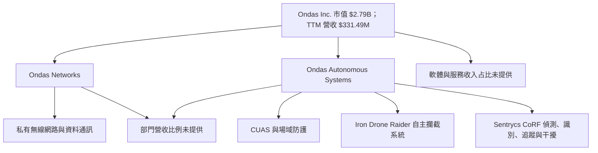
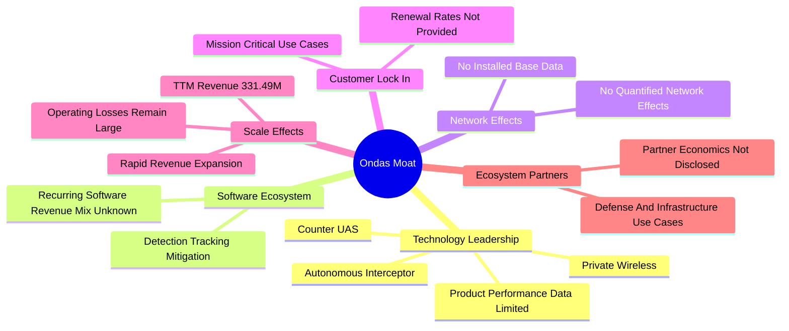
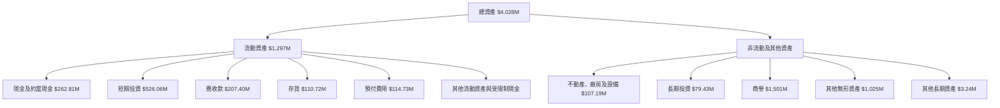
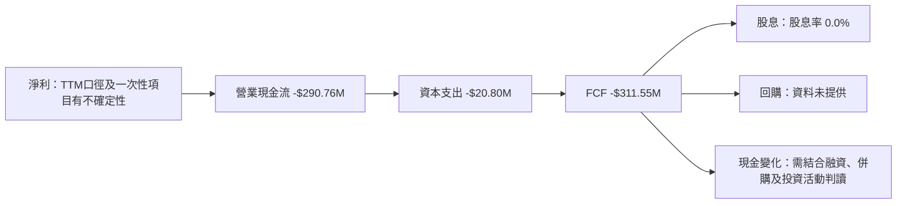
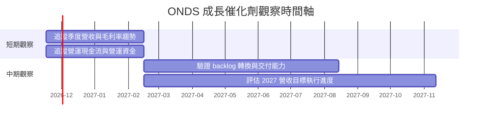
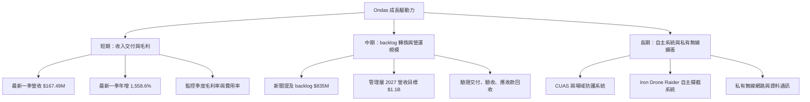
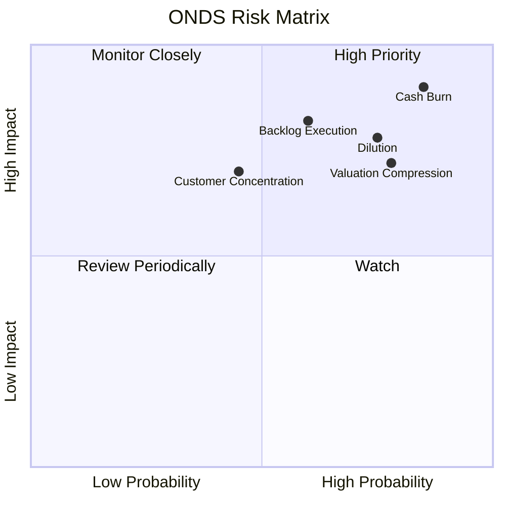
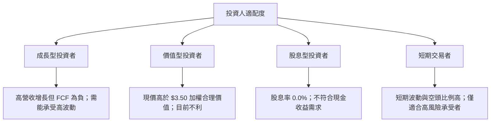

# ONDS 基本面深度分析報告
> **報告日期**：2026-11-17 ｜ **語言**：繁體中文 ｜ **數據來源**：SEC 申報資料 (XBRL)、Yahoo Finance、Finviz、StockAnalysis、Roic.ai ｜ **分析師**：CFA 級機構研究

## 目錄

| # | 章節 | 核心結論 |
|---|------|----------|
| 1 | 執行摘要 | 賣出；加權合理價值 $3.50，MOS -34.6% |
| 2 | 公司概覽與商業模式 | 無線與自主系統跨入無人機防禦市場，但可量化護城河證據有限 |
| 3 | 損益表深度分析 | TTM 營收 $331.49M、年增 1,239.4%；營業利益率仍為 -126.2% |
| 4 | 資產負債表分析 | 現金與短期投資 $788.87M；債務資料存在來源差異 |
| 5 | 現金流量深度分析 | TTM FCF -$311.55M，現金消耗及股權薪酬稀釋需密切監控 |
| 6 | 獲利能力與資本效率 | ROIC -20.9% 低於 WACC 14.0%，目前摧毀股東價值 |
| 7 | 相對估值分析 | P/S 高於 AVAV、KTOS，且市場價高於相對估值推算值 |
| 8 | DCF 內在價值評估 | DCF 不適用；TTM 營業利益為負，依規定不建立現金流模型 |
| 9 | 成長催化劑 | 產品放量與 $835M backlog 是催化劑，但轉換速度和毛利品質未獲驗證 |
| 10 | 風險矩陣 | 現金消耗、執行風險與估值回落為主要風險 |
| 11 | 投資建議 | 賣出；等待營業槓桿、現金流和稀釋數據改善後再重新評估 |

---

## 1. 執行摘要

ONDS 2026-11-16 收盤價為 **$4.71**。TTM 營收達 **$331.49M**，TTM 年增 **1,239.4%**，最新一季營收年增 **1,558.6%**；但 TTM 營業利益率為 **-126.2%**、ROIC 為 **-20.9%**，TTM 營業現金流 **-$290.76M**、FCF **-$311.55M**，顯示收入快速擴張尚未轉化為可持續獲利或現金流。依同業 P/S 與分析師共識兩種估值方法加權後，合理價值為 **$3.50**；相對現價的 **MOS 為 -34.6%**，依規則 20 評級為 **賣出**。這項評級不是基於營收成長不足，而是估值已高於加權合理價值、現金消耗大且資本報酬率顯著低於資本成本。

### 1.0 一頁式投資儀表板（Portfolio Manager 30 秒速讀）

| 項目 | 內容 |
|------|------|
| **投資論點（3 句）** | ① TTM 營收 **$331.49M、年增 1,239.4%**，反映業務快速放量，但營收分部與訂單轉收入明細不足。② TTM 營業利益率 **-126.2%**、FCF **-$311.55M**，擴張仍高度依賴外部資本。③ 加權合理價值 **$3.50**，低於 2026-11-16 收盤價 **$4.71**，估值缺乏安全邊際。 |
| **綜合評分** | **4.2/10**（引用 1.1 評分卡） |
| **財務健康** | 🔴 現金與短期投資 **$788.87M** 提供緩衝，但 TTM FCF **-$311.55M**、稀釋股數增加，現金消耗不能忽略。 |
| **ROIC vs WACC** | **-20.9% vs 14.0%**；差距 **-34.9 個百分點**，目前摧毀經濟價值。 |
| **FCF 趨勢** | 惡化；TTM FCF **-$311.55M**，FCF Yield **-11.18%**。 |
| **估值** | Forward P/E **-30.387x** ｜ EV/EBITDA **-7.091x** ｜ FCF Yield **-11.18%**。獲利為負，P/E 與 EV/EBITDA 不具一般正向獲利公司的解讀力。 |
| **DCF 內在價值（基準）** | **N/A**；TTM 營業利益為負，依本報告規則不建立 DCF，故現價相對 DCF 折溢價亦為 N/A。 |
| **安全邊際（MOS）** | **-34.6%＝($3.50 − $4.71) ÷ $3.50**（加權合理價值基準）｜ 🔴 無安全邊際。 |
| **預期報酬（基準情境 12M）** | DCF 情境未計算；加權合理價值相對現價隱含 **-25.7%**，此為估值差距而非 12 個月報酬預測。 |
| **關鍵風險（前二）** | ① FCF 持續為負且消耗速度快；② 股權薪酬及增發稀釋股東權益。 |
| **評級 + 信心度** | 🔴 **賣出** ｜ 信心：中。估值與現金流證據清楚，但業務仍處高速擴張期，未來營收及 backlog 轉化的不確定性高。 |

### 1.1 綜合評分卡（全報告唯一）

| 維度 | 評分（1–10） | 主要依據（引用數字與其來源章節） |
|------|--------------|----------------------------------|
| 成長性 | 8.0 | TTM 營收年增 **1,239.4%**、最新一季年增 **1,558.6%**；惟併購與低基期可能放大增速（第 3 章）。 |
| 獲利能力 | 2.0 | TTM 營業利益率 **-126.2%**、ROIC **-20.9%**，且 Piotroski F-Score **3/8**（第 3、6 章）。 |
| 財務健康 | 6.0 | 現金與短期投資 **$788.87M**，但 TTM FCF **-$311.55M**、CCC **181 天**（第 4、5 章）。 |
| 估值 | 2.0 | 加權合理價值 **$3.50** 對比現價 **$4.71**，MOS **-34.6%**；P/S 高於 AVAV、KTOS（第 7、8 章）。 |
| 護城河 | 4.0 | 產品涵蓋私有無線與自主無人系統，但市場份額、續約率、軟體收入占比和客戶集中度未提供（第 2 章）。 |
| 管理層與資本配置 | 3.0 | 最新四季 SBC 合計約 **$155.41M**，稀釋股數未通過 Piotroski 測試；回購、股息資料顯示股息率 **0%**（第 3、5、6 章）。 |
| **綜合評分** | **4.2** | 六項算術平均：**(8.0 + 2.0 + 6.0 + 2.0 + 4.0 + 3.0) ÷ 6 = 4.17，四捨五入為 4.2**。 |

### 1.2 五大投資論點 + 三大核心風險

| 類型 | 項目 | 具體依據 | 信心度 |
|------|------|----------|--------|
| 🟢 **投資論點①** | 業務收入快速放量 | TTM 營收 **$331.49M**，年增 **1,239.4%**；最新一季營收 **$167.49M**，季增約 **99.9%**。收入規模擴張為產品商業化提供了初步證據，但尚不能等同於獲利能力。 | 🟢 高 |
| 🟢 **投資論點②** | 無人機及自主系統需求可能提供成長空間 | 公司涵蓋 CUAS、攔截無人機、私有無線與自主資料系統；新聞資料提到 backlog **$835M**，若可按時交付，將形成收入能見度。backlog 轉化時間與取消條款未提供。 | 🟡 中 |
| 🟢 **投資論點③** | 短期資金緩衝較大 | 現金與短期投資 **$788.87M**，高於單季營收 **$167.49M**。若現金流消耗降速，資金可支持交付與研發。 | 🟡 中 |
| 🟢 **投資論點④** | 毛利率仍有改善空間 | TTM 毛利率 **36.4%**，高於 RCAT 的 **9.8%**；但低於 AVAV 的 **26.5%** 數據表面比較需注意期間與商業模式差異。Q3 公司毛利率按財務報表金額約 **21.8%**，顯示近期產品組合或交付成本有壓力。 | 🟡 中 |
| 🟢 **投資論點⑤** | 近期分析師仍偏多 | 10 位分析師平均目標價 **$16.68**，高於現價；但該數字僅以 10% 權重進入規定估值，且目標價不保證能實現。 | 🟡 中 |
| 🟡 **風險①** | 現金消耗及融資風險 | TTM OCF **-$290.76M**、FCF **-$311.55M**，FCF Yield **-11.18%**；若營運現金流惡化，可能需要再融資或發股。 | 🔴 高衝擊 |
| 🔴 **風險②** | 營業槓桿尚未出現 | TTM 營業利益率 **-126.2%**，最新一季 **-113.1%**；收入增加仍伴隨巨額營業虧損。 | 🔴 高衝擊 |
| 🔴 **風險③** | 股權稀釋與高估值 | Piotroski 稀釋股數測試未通過；近四季 SBC 合計約 **$155.41M**。同業 P/S 估值推算 **$2.03/股**，低於現價 **$4.71**。 | 🔴 高 |

### 1.3 快速統計卡片

| 指標 | 公司實際值（期間） | 同業中位數 | 狀態 |
|------|--------------------|------------|------|
| 營收成長（TTM） | **1,239.4%** | — | 🟢 增速高，惟低基期與併購因素需分辨 |
| 營收成長（最新一季年增） | **1,558.6%** | **35.7%**（AVAV、KTOS、RCAT 中位數） | 🟢 遠高於同業，但可持續性尚待驗證 |
| 毛利率（TTM） | **36.4%** | **23.0%**（同業中位數） | 🟢 高於同業中位數；近期單季有所回落 |
| 營業利益率（TTM） | **-126.2%** | — | 🔴 大幅虧損 |
| ROIC（TTM） | **-20.9%** | — | 🔴 低於資本成本 |
| Forward P/E | **-30.387x** | **24.8x**（三家同業中位數） | 🔴 公司預測 EPS 為負，倍數不可直接比較 |
| FCF Yield（TTM） | **-11.18%** | — | 🔴 以現金消耗而非現金收益呈現 |
| Piotroski F-Score | **3 / 8** | — | 🔴 財務趨勢訊號偏弱 |

### 1.4 投資結論

```text
╔══════════════════════════════════════════════════════════════════╗
║                    📊 投資結論摘要                               ║
╠══════════════════════════════════════════════════════════════════╣
║  評級：賣出（MOS -34.6%，依規則 20）                            ║
║  價格（2026-11-16 收盤）：$4.71                                  ║
║  DCF 內在價值（基準）：N/A（TTM 營業利益為負）                   ║
║  安全邊際 MOS：-34.6%（＝($3.50−$4.71)÷$3.50）                  ║
║  加權合理價值（8.8）：$3.50                                      ║
║  DCF 情境價值：N/A（DCF 模型不適用，未提供情境值）               ║
║  綜合評分：4.2/10（引用 1.1）                                    ║
║  適合投資人：能承受高波動、願意追蹤交付與現金消耗的投資人；       ║
║              不適合作為低波動價值或股息型核心持倉               ║
╚══════════════════════════════════════════════════════════════════╝
```

---

## 2. 公司概覽與商業模式

### 2.1 業務結構與收入來源

Ondas Inc. 以 **Ondas Networks** 和 **Ondas Autonomous Systems** 兩個部門營運。公司提供私有無線、無人機與自動化資料解決方案；自主系統產品涉及反無人機（CUAS）、場域防護及自主攔截系統。部門營收明細、各子產品營收及軟體／服務收入占比未提供，故不拆分營收比例。



公司提供的產品敘述涵蓋硬體、網路與系統整合，但目前數據不足以判斷收入中硬體銷售、維護服務、軟體授權各自的占比。若經常性軟體收入增加，理論上可提升收入能見度與毛利品質；目前不能假設其已形成重要收入來源。

### 2.2 市場份額

市場份額數據未提供，因此不繪製市占率圖表。公司 TTM 營收 **$331.49M**、年增 **1,239.4%**，規模低於大型防務承包商，但增長率高於 AVAV、KTOS、RCAT 的最新單季年增率中位數 **35.7%**；快速增長仍需與併購影響、低基期和營收確認時點區分。

### 2.3 競爭護城河分析



### 2.4 護城河強度

| 護城河項目 | 強度（強／中／弱） | 證據（引用數字或事實） | 會削弱它的情況 |
|------------|--------------------|------------------------|----------------|
| 技術與產品 | 中 | 產品涵蓋私有無線、CUAS、雷達／射頻系統與自主攔截；目前未提供專利、命中率、實戰部署數及相對競品測試數據。 | 技術被大型防務廠商複製、產品效能未達採購要求或交付延期。 |
| 軟體與資料生態 | 弱至中 | Sentrycs CoRF 涉及偵測、識別、追蹤與緩解，但軟體收入占比、訂閱續約率及客戶留存率均未提供。 | 收入主要是一次性硬體交付，服務收入不能形成高毛利續約。 |
| 網路效應 | 弱 | 未提供設備數、互聯網路規模或使用者增加能提高服務價值的數據。 | 客戶各自部署、系統互通性有限，使用者規模無法形成正回饋。 |
| 客戶鎖定 | 中 | CUAS 與關鍵設施防護可能涉及整合、認證及任務流程；實際合約年限、續約率和轉換成本未披露。 | 客戶採購分散、競標頻繁或改用替代供應商的成本低。 |
| 規模效應 | 弱至中 | TTM 營收 **$331.49M**，但 TTM 營業利益率 **-126.2%**，規模尚未帶來可見營業槓桿。 | 收入增長同時帶動研發、交付及銷售費用等幅增加。 |
| 生態夥伴 | 弱至中 | 公司面向國防及基礎設施等使用情境；合作夥伴的收入貢獻、渠道比例與合作期限未提供。 | 夥伴渠道無法轉成正式採購，或主要客戶／供應商集中度過高。 |

護城河評分沿用 1.1 的 **4.0/10**：產品與應用場景具差異化可能性，但缺少市占、經常性收入、客戶留存及單位經濟性等可量化證據。

---

## 3. 損益表深度分析

### 3.1 年度收入成長趨勢（近 4 年）

收入年度資料（單位：美元）如下。FY2022 的 YoY 以 FY2021 營收 **$2.91M** 為比較基期。

```text
╔══════════════════════════════════════════════════════════════════╗
║            Ondas 年度收入趨勢（FY2022-FY2025）                  ║
╠══════════════════════════════════════════════════════════════════╣
║  FY2022  $2.13M    █                              YoY: -26.8% 🔴 ║
║  FY2023  $15.69M   ███████                        YoY:+636.6% 🟢 ║
║  FY2024  $7.19M    ███                            YoY: -54.2% 🔴 ║
║  FY2025  $50.73M   █████████████████████████      YoY:+605.3% 🟢 ║
║                                                                  ║
║  FY2022-FY2025 CAGR：+187.8%                                     ║
║  計算：($50.73M ÷ $2.13M)^(1/3) − 1 ≈ 187.8%                    ║
╚══════════════════════════════════════════════════════════════════╝
```

年度營收波動極大：FY2023 比較 FY2022 增長 **636.6%**，FY2024 回落 **54.2%**，FY2025 再增 **605.3%**。FY2025 增長的絕對金額不小，但過去的年度起伏說明單年 CAGR 不足以證明穩定需求；應進一步觀察有機成長、併購貢獻、交付節奏及 backlog 轉換。

### 3.2 季度收入趨勢分析

| 季度 | 營收 | QoQ 成長率 | YoY 成長率 | 備註 |
|------|------:|------------:|------------:|------|
| 2025 Q4 | $30.11M | — | 629.2% | 相較 2024 Q4 的低基期快速成長。 |
| 2026 Q1 | $50.12M | 66.5% | 1,079.9% | 營收連續放大；單季淨利受異常正值影響，見 3.5。 |
| 2026 Q2 | $83.77M | 67.1% | 1,235.4% | 營收繼續增加，營業損失仍為 **-$143.71M**。 |
| 2026 Q3 | $167.49M | 99.9% | 1,558.6% | 單季營收接近 Q2 的兩倍，但營業利益仍為 **-$186.42M**。 |

QoQ 計算例：**($167.49M ÷ $83.77M) − 1 = 99.9%**。最新季度的增長代表交付規模快速增加；然而營業虧損同步放大，意味目前的營收增量尚未形成足夠毛利覆蓋研發、銷售、整合與行政費用。

### 3.3 利潤率演變分析

| 利潤率指標 | FY2022 | FY2023 | FY2024 | FY2025 | 趨勢 | 評估 |
|------------|-------:|-------:|-------:|-------:|------|------|
| **毛利率** | 52.1% | 40.7% | 4.8% | 39.7% | 大幅波動；FY2025 回升 | 🔴 業務組合與年度基期使毛利率不穩定 |
| **營業利益率** | -2,347.4% | -243.7% | -481.4% | -115.1% | 仍為負，但比率受小營收基期影響 | 🔴 尚未達損益兩平 |
| **淨利率** | -3,438.5% | -285.7% | -528.2% | -260.2% | 年度均為負值 | 🔴 FY2026 TTM 淨利指標受非經常性項目影響 |
| **TTM 營業利益率** | — | — | — | — | **-126.2%** | 🔴 依驗證數值 |

年度毛利率以年度毛利除以年度收入計算。FY2024 毛利率降至 **4.8%**，FY2025 回升至 **39.7%**，顯示產品組合、交易／併購構成或交付成本可能造成顯著年度差異。最新一季毛利 **$36.50M**、營收 **$167.49M**，按單季金額計算毛利率約 **21.8%**；低於 TTM **36.4%**，若非短期產品組合波動，可能表示近期低毛利硬體或系統交付比重提高。營業端更重要的問題是：即使 TTM 毛利率為正，營業利益率仍為 **-126.2%**，反映營業費用基礎遠高於現有毛利承載能力。

### 3.4 費用結構分析

完整成本與營業費用結構的分項資料不足，不繪製費用占比圓餅圖。可確認的費用項目包括 FY2025 研發支出 **$20.88M**、FY2025 SBC **$16.02M**；最新四個季度 SBC 合計約 **$155.41M**。由於未提供與這些項目同期間、同口徑的完整費用分拆，不以部分項目推算全公司費用占比。

```text
╔══════════════════════════════════════════════════════════════════╗
║                    可觀察費用項目                               ║
╠══════════════════════════════════════════════════════════════════╣
║  FY2025 研發支出：       $20.88M                                 ║
║  FY2025 股權薪酬 SBC：   $16.02M                                 ║
║  最近四季 SBC 合計：     $155.41M                                ║
║  TTM 營業利益率：        -126.2%                                 ║
║  完整費用率拆分：        N/A（分項資料不足）                     ║
╚══════════════════════════════════════════════════════════════════╝
```

### 3.5 季度 EPS 趨勢與盈餘品質（Quality of Earnings）

最近四季 EPS 預估與實際值均未提供有效數字，來源欄顯示 `nan`，因此無法判斷超預期或不及預期。可確認的季度淨利則大幅波動：2026 Q1 淨利 **$362.95M**，2026 Q2 淨損 **-$88.25M**，2026 Q3 淨損 **-$62.57M**，FY2025 Q4 淨損 **-$99.66M**。Q1 的正淨利與同期營業損失 **-$42.67M** 方向相反，表明淨利不能代表經常性營運獲利；一次性項目明細需回查 SEC 10-Q。

| 盈餘品質項目 | 數值／佔比 | 評估 |
|--------------|-----------|------|
| 股權薪酬 SBC / 營收 | 最近四季 SBC 約 **$155.41M ÷ TTM 營收 $331.49M = 46.9%** | 🔴 高。SBC 不是當期現金支出，但稀釋股數與股東持有比例；不能視作沒有成本。 |
| SBC / 營業現金流 | **$155.41M ÷ -$290.76M = -53.5%**；相對 OCF 絕對值為 **53.5%** | 🔴 OCF 為負，符號比率不宜解讀為現金覆蓋率；SBC 規模相當於 OCF 消耗額的一半以上。 |
| FCF / 淨利（現金轉換率） | 以 StockAnalysis TTM 淨利 **$53.16M** 計：**-$311.55M ÷ $53.16M = -586.1%** | 🔴 現金轉換為負。淨利口徑可能受非經常性項目影響，該比率只作警示，不視為穩態轉換率。 |
| 一次性／非經常性損益 | Q1 2026 淨利 **$362.95M**，同期營業損失 **-$42.67M**；項目明細 N/A | 🔴 淨利被非營業或非經常性因素顯著影響的可能性高，需核對 10-Q 明細，不能將單季淨利年化。 |
| 有效稅率異常 | N/A（未提供可核對的 TTM 所得稅費用及稅前利潤） | 不將稅務利益或費用推定為經常性。 |
| 資本化支出 vs 費用化 | TTM Capex **$20.80M**；資本化研發等資料 N/A | 不足以判斷成本是否被資本化遞延；須檢查併購無形資產、設備及研發會計政策。 |

**盈餘品質結論**：TTM FCF **-$311.55M**，而 SBC 約占 TTM 營收 **46.9%**，加上季度淨利劇烈波動，現有淨利不宜直接作為估值基礎。對股東而言，現金消耗和稀釋是主要經濟成本；估值較應參考收入、訂單轉換及未來現金流，而非單季 GAAP 淨利。

---

## 4. 資產負債表分析

### 4.1 資產結構分解

以下餘額來自截至 2026-09-30 的 StockAnalysis 資產負債表資料，單位為美元。分類項目與總資產存在約 **$15.14M** 差額，可能來自未列示項目及四捨五入，不以單項反推補足。



資產中商譽 **$1.501B** 與其他無形資產 **$1.025B** 合計占有相當比重，反映收購及無形資產認列的重要性。若被收購業務未達預期，可能面臨減損風險；此外，流動資產中應收款與存貨增加，應配合收入確認及收款週期追蹤。

### 4.2 流動性與營運資金分析

流動比率、速動比率為彙整財務資料所列數值；營運資金天數依品質指標照抄。天數增加不一定單獨代表管理惡化，也可能受併購、季度末交付或業務規模變動影響，但與負 FCF 合併觀察值得警戒。

| 指標 | 最新 TTM | 一年前 TTM | 變化 | 解讀 |
|------|----------:|------------:|------:|------|
| 流動比率 | **3.389** | N/A | N/A | 表面短期資產覆蓋充足，但資產組成包含應收款、存貨及其他項目，不能只看比率。 |
| 速動比率 | **2.604** | N/A | N/A | 現金與可快速變現資產緩衝較好；仍需關注營業現金流負值。 |
| DSO 應收帳款天數 | **140 天** | **77 天** | **+63 天** | 收款時間拉長，可能反映客戶付款條件、交付／驗收時點或併購後應收款上升；需看逾期與壞帳資料。 |
| DIO 存貨天數 | **182 天** | **278 天** | **-96 天** | 存貨週轉天數下降，方向改善；但 182 天仍代表大量資金可能停留在未售商品或在製品。 |
| DPO 應付帳款天數 | **141 天** | **186 天** | **-45 天** | 付款天數下降，可能代表供應商付款加快或採購結構變化；不宜僅以此判定議價力。 |
| CCC 現金轉換週期 | **181 天** | **169 天** | **+12 天** | 現金被營運週期占用時間拉長，與負 FCF 共同指向營運資金需求增加。 |

### 4.3 債務結構分析

```text
╔══════════════════════════════════════════════════════════════════╗
║                   Ondas 債務健康診斷                             ║
╠══════════════════════════════════════════════════════════════════╣
║  現金＋短期投資： $788.87M  ████████████████████  資金緩衝       ║
║  總債務：        N/A        數據不可用；不反推補值               ║
║  淨現金：        $788.87M   依驗證指標列示                       ║
║                                                                  ║
║  其他彙整來源顯示總債務 $62.81M、淨現金 $726.06M；               ║
║  與主要驗證指標的債務口徑不一致，本文不混合計算。                ║
║  Debt/EBITDA：   N/A（EBITDA 為負且債務口徑有差異）              ║
║  利息保障倍數：  N/A（缺少一致口徑利息費用與計息負債）            ║
╚══════════════════════════════════════════════════════════════════╝
```

主要驗證數值將總債務列為 N/A，淨現金列為 **$788.87M**；另一份彙整市場資料則列示總債務 **$62.81M**、淨現金 **$726.06M**。為避免將不同來源／口徑拼接成貌似精確的債務比率，本報告以主要驗證數值呈現並保留差異說明。若後續申報確認計息負債，需更新利息保障與淨現金分析。

### 4.4 股東權益趨勢

| 財報年度 | 股東權益 | 年度變化 |
|----------|---------:|---------:|
| 2022-12-31 | $58.22M | — |
| 2023-12-31 | $33.14M | -43.1% |
| 2024-12-31 | $16.58M | -50.0% |
| 2025-12-31 | $437.81M | +2,540.5% |

```text
╔══════════════════════════════════════════════════════════════════╗
║                 股東權益變化（年度）                            ║
╠══════════════════════════════════════════════════════════════════╣
║  2022  $58.22M  ███                                               ║
║  2023  $33.14M  ██                                                ║
║  2024  $16.58M  █                                                 ║
║  2025 $437.81M  █████████████████████████                         ║
╚══════════════════════════════════════════════════════════════════╝
```

FY2025 股東權益大幅增加，和現金及資產規模同步擴大；但資料未提供資本募集、併購對價及增發股數的完整拆分，因此不能把權益增加視為留存獲利。FY2026 資產與股數又顯著增加，更凸顯需追蹤股東權益增加背後的融資及收購來源。

---

## 5. 現金流量深度分析

### 5.1 現金流量瀑布圖



瀑布圖中 FCF 依統一定義為 **營業現金流減資本支出**。公司沒有支付股息；回購及融資活動明細未提供，故不能把現金餘額變動單獨歸因於營運。

### 5.2 FCF 轉換率趨勢

| 期間 | FCF | 淨利 | FCF / 淨利 | 解讀 |
|------|----:|----:|-----------:|------|
| FY2022 | -$40.89M | -$73.24M | 55.8% | FCF 與淨利皆為負；比率為正不代表具備現金獲利。 |
| FY2023 | -$34.30M | -$44.84M | 76.5% | 現金消耗較淨損小，但仍未轉正。 |
| FY2024 | -$35.20M | -$38.01M | 92.6% | FCF 消耗接近淨損規模。 |
| FY2025 | -$40.88M | -$132.02M | 31.0% | 淨損大幅擴大，FCF 與淨利間差異反映非現金項目或營運資金影響。 |
| TTM 至 2026-09-30 | **-$311.55M** | TTM 淨利來源口徑有差異 | N/A | 不以不一致的淨利分母製造可比轉換率。 |

FY2022–FY2025 的年度 FCF 均為負；TTM FCF 消耗擴大至 **-$311.55M**。這比單看會計淨利更能反映當前資金需求。季度 OCF 由 2025 Q4 **-$12.73M** 惡化至 2026 Q3 **-$140.65M**，須確認是否主要來自營運規模成長帶來的應收款與存貨，或結構性費用擴張。

### 5.3 自由現金流趨勢

```text
╔══════════════════════════════════════════════════════════════════╗
║                 自由現金流：歷史實際                            ║
╠══════════════════════════════════════════════════════════════════╣
║  FY2022  -$40.89M  ◀█████████████████████████                   ║
║  FY2023  -$34.30M  ◀█████████████████████                       ║
║  FY2024  -$35.20M  ◀██████████████████████                      ║
║  FY2025  -$40.88M  ◀█████████████████████████                   ║
║  TTM     -$311.55M ◀███████████████████████████████████████████ ║
╠══════════════════════════════════════════════════════════════════╣
║  TTM FCF Yield：-11.18%                                          ║
║  TTM FCF 定義：OCF -$290.76M − Capex $20.80M = -$311.55M        ║
╚══════════════════════════════════════════════════════════════════╝
```

年度與 TTM FCF 期間長度不同，不能將圖中柱長直接視為同期間趨勢倍率。TTM 現金消耗遠高於 FY2025，代表營運擴張伴隨顯著額外資金需求；其中原因需從收購、營運資金與 SBC 等項目分拆。

### 5.4 資本配置評估

股息率為 **0.0%**；FY2025 Capex **$2.14M**，TTM Capex **$20.80M**。近期四季 SBC 約 **$155.41M**，為股東需承擔的稀釋成本。公司層級的回購、收購對價與融資流向未提供完整明細，故不繪製比例圓餅圖。

| 項目 | 可用資料 | 評估 |
|------|----------|------|
| 資本支出 | FY2025 **$2.14M**；TTM **$20.80M** | TTM 資本支出增高，但收入擴張是否需要持續同等投資，需觀察後續季度。 |
| 股息 | 股息率 **0.0%** | 現金用於營運及投資而非股東現金回饋。 |
| 回購 | N/A | 未提供可核對的回購金額與股數變化。 |
| SBC | 最近四季合計約 **$155.41M** | 金額重大；需把員工薪酬與股東稀釋成本一併看待。 |
| 留存／融資／併購 | 完整明細 N/A | 現金及權益增加不能直接推定為內部獲利累積。 |

---

## 6. 獲利能力與資本效率

### 6.1 ROE / ROA / ROIC 趨勢

| 指標 | 最新可用數值 | 歷史趨勢 | 評估 |
|------|--------------:|----------|------|
| ROE | **4.6%**（品質指標、TTM） | 年度同口徑歷史序列 N/A；市場資料另列 7.3%，與品質指標有差異 | 🟡 需注意非常態淨利及資產／股本變動。 |
| ROA | **-9.7%**（彙整市場資料） | 同口徑多年序列 N/A | 🔴 資產尚未產生正向營運回報。 |
| ROIC | **-20.9%**（TTM） | 同口徑多年序列 N/A | 🔴 顯著低於資本成本，當前為價值摧毀。 |

「行業均值」未提供，故不列比較欄。ROE 的資料來源口徑存在差異；依品質指標固定採用 ROE **4.6%**，不以另列的 **7.3%** 取代。

### 6.2 ROIC vs WACC 分析（核心價值創造判斷）

```text
╔══════════════════════════════════════════════════════════════════╗
║                ROIC vs WACC 深度分析                            ║
╠══════════════════════════════════════════════════════════════════╣
║  資本成本輸入：                                                  ║
║  ├── 無風險利率（10Y 美債）：             5.12%                  ║
║  ├── 市場風險溢酬 ERP：                   5.00%                  ║
║  ├── 原始 Beta：                          3.08                   ║
║  ├── 調整後 Beta：                        2.00                   ║
║  ├── 股權成本 Ke：                        15.12%                 ║
║  ├── 稅前債務成本：                       10.47%                 ║
║  ├── E / D 權重：                         97.8% / 2.2%           ║
║  └── 採用 WACC：                          14.00%                 ║
║      計算值 14.97%，按 7%-14% 區間上限截取                    ║
║                                                                  ║
║  ROIC：                                   -20.9%                 ║
║  WACC：                                    14.0%                 ║
║  EVA 差距（ROIC - WACC）：                 -34.9 個百分點        ║
║                                                                  ║
║  ROIC -20.9%   ◀███████████░░░░░░░░░░░░░░░░░  🔴               ║
║  WACC  14.0%     ▓▓▓▓▓▓▓▓▓▓▓▓▓▓▓▓▓▓▓▓░░░░░░░  ──               ║
║                                                                  ║
║  結論：ROIC 低於 WACC，投入資本尚未覆蓋資金機會成本；           ║
║        每增加一單位營收，若無利潤率改善，可能繼續消耗價值。     ║
╚══════════════════════════════════════════════════════════════════╝
```

Beta 調整方式為 **⅔ × 原始 Beta 3.08 + ⅓ = 2.39**，再依資料所列 **0.6–2.0** 區間限制，採用調整後 Beta **2.00**。因此 **Ke = 5.12% + 2.00 × 5.00% = 15.12%**。資本成本資料給出的 WACC 未限制值為 **14.97%**，因模型設定上限為 **14.00%**，此報告統一採用 **14.00%**。WACC 組成來自資本成本資料；債務餘額的其他來源口徑不一致，不在此重新估算 WACC。

ROIC **-20.9%** 低於 WACC **14.0%**，差距 **-34.9 個百分點**。因此，公司尚未證明收入擴張會提高股東經濟價值；後續需要看到營業虧損率收斂、現金流轉正，並提高投資資本回報。

### 6.3 杜邦三因素分解

依品質指標所列 TTM 數據照抄：

| 因素 | 數值（TTM） | 解讀 |
|------|-------------|------|
| 淨利率 | **33.1%** | 可能受到非營業或非經常性項目影響，與負營業利益率並存，需審慎解讀。 |
| 資產週轉率 | **0.08** | 資產規模大幅增加但收入週轉仍低，資產利用效率偏弱。 |
| 權益乘數 | **1.70** | 槓桿乘數不高，ROE 不是主要靠高槓桿撐起。 |
| **ROE** | **4.6%** | 品質指標列式：**33.1% × 0.08 × 1.70 = 4.6%**（乘積四捨五入）。 |

### 6.4 財務體質：Piotroski F-Score

品質指標列示 **3 / 8**。九項測試中，長期負債測試因缺資料不納入判定，因此有效分母為八項。

| 測試 | 結果 | 解讀 |
|------|------|------|
| ROA > 0 | ✅ 通過 | 該測試口徑的 TTM ROA 為正，但不等同於營業獲利已轉正。 |
| 營業現金流 > 0 | ❌ 未通過 | 營業現金流持續為負，需仰賴資金緩衝。 |
| ROA 高於一年前 | ✅ 通過 | 指標相較一年前改善，但持續性仍待後續資料確認。 |
| 營業現金流 > 淨利（應計品質） | ❌ 未通過 | 現金流未能支持會計獲利，且淨利存在非常態波動。 |
| 長期負債 ÷ 總資產低於一年前 | — 無法判定 | 缺少一致口徑的負債資料；不推算。 |
| 流動比率高於一年前 | ❌ 未通過 | 即使目前流動比率為 3.389，年度比較測試仍未通過。 |
| 稀釋股數未增加 | ❌ 未通過 | 稀釋股數增加，股東持有比例可能被攤薄。 |
| 毛利率高於一年前 | ❌ 未通過 | 最新年度比較未通過；季度毛利率也有波動。 |
| 資產週轉率高於一年前 | ✅ 通過 | 資產使用效率相較一年前改善，但目前 TTM 資產週轉率仍僅 0.08。 |

F-Score **3/8** 指出現金流、稀釋及毛利率趨勢尚弱。該分數不宜單獨作買賣訊號，但與負 FCF、負 ROIC 的方向一致。

---

## 7. 相對估值分析

### 7.1 同業估值比較表格

估值倍數及同業資料取自 Yahoo Finance 指定同業數據。公司 P/S 與 Forward P/E 為市場資料彙整值；同業 P/S、P/E 與 EV/EBITDA 不同行業商業模式及獲利階段不同，應視為參考，而非直接的精確可比估值。

| 估值指標 | **ONDS** | **AVAV** | **KTOS** | **RCAT** | 本公司評估 |
|----------|---------:|---------:|---------:|---------:|-----------|
| **Trailing P/E** | N/A | N/A | 263.8x | N/A | 🔴 ONDS 無可用正向 TTM P/E；KTOS 的高倍數亦反映盈利基礎較小。 |
| **Forward P/E** | -30.387x | 24.8x | 28.3x | -8.0x | 🔴 公司 Forward EPS 為負，倍數不可用作正向盈利估值。 |
| **P/S Ratio** | 8.403x | 2.8x | 3.6x | 7.5x | 🔴 ONDS 高於三家同業中位數 **3.6x**；高增長需有較高持續性才能支持溢價。 |
| **EV/EBITDA（TTM）** | -7.091x | 26.6x | 53.4x | -2.2x | 🔴 ONDS EBITDA 為負，倍數無一般經濟解讀力。 |
| **最新一季營收年增** | 1,558.6% | 5.7% | 35.7% | 527.2% | 🟢 增長率最高，但必須伴隨毛利及現金流改善。 |
| **毛利率（TTM）** | 36.4% | 26.5% | 23.0% | 9.8% | 🟢 高於同業；近期單季按毛利與營收約 21.8%，提醒近期可能有產品組合壓力。 |

P/S 倍數與市場資料其他欄位有所差異：歷史估值計算採用 P/S **8.8x**，Yahoo／Finviz 彙整快照列 **8.403x**。第 7.4 節使用程式固定給出的相對估值每股價值 **$2.03**，不以其他口徑替代。

### 7.2 歷史估值區間分析

下列 P/S 歷史值依估值歷史資料列示；不是 P/E 區間，因 ONDS TTM EPS 為 **-$0.14**，無可用正向本益比。

```text
╔══════════════════════════════════════════════════════════════════╗
║                ONDS 歷史 P/S 估值位置                            ║
╠══════════════════════════════════════════════════════════════════╣
║  五年最低       2.9x                                             ║
║  歷史中位數    17.9x                                             ║
║  五年最高     140.6x                                             ║
║  目前           8.8x                                             ║
║  目前百分位       32%                                             ║
║                                                                  ║
║  2.9x ├──────● 8.8x ───────── 17.9x ───────────────── 140.6x    ║
║       區間低端   目前           中位數              區間高端     ║
╚══════════════════════════════════════════════════════════════════╝
```

目前 P/S **8.8x** 低於自身五年中位數 **17.9x**，但歷史區間由 **2.9x 至 140.6x**，極端波動使中位數比較的參考性有限。現價仍高於同業 P/S 中位數 **3.6x**；公司需要證明營收高增長可轉為穩定毛利與現金流，才可能維持相對同業溢價。

### 7.3 情境價值（Bear / Base / Bull）

N/A（DCF 無法計算：TTM 營業利益為負，程式未提供 DCF 模型及 Scenarios；不自行建立情境價格或目標價。）

### 7.4 相對估值隱含價格區間

```text
╔══════════════════════════════════════════════════════════════════╗
║                 相對估值每股價格比較                            ║
╠══════════════════════════════════════════════════════════════════╣
║  $2.03 ───────────────────────── $4.71 ─────────────── $16.68    ║
║  同業 P/S 推算                    現價                 分析師共識 ║
║                                                                  ║
║  同業 P/S：$2.03/股；AVAV、KTOS、RCAT 的同業中位數 P/S 3.6x，   ║
║             乘上 ONDS TTM 營收並按指定方法回推。                 ║
║  分析師共識：$16.68/股；10 位分析師平均目標價。                  ║
╚══════════════════════════════════════════════════════════════════╝
```

同業 P/S 方法給出的每股價值 **$2.03**，低於現價 **$4.71**；分析師平均目標價 **$16.68** 高於現價，但這是預測共識而非可直接驗證的營運現金流價值。兩者以 90% 與 10% 權重納入第 8.8 節。

---

## 8. DCF 內在價值評估（Discounted Cash Flow）

> **結論先行但有數據依據**：TTM 營業利益率為 **-126.2%**，TTM 營業現金流 **-$290.76M**，TTM FCF **-$311.55M**。在營業利益為負、現金消耗高且淨利受非經常性項目影響的情況下，DCF 模型標示為 N/A。本章依規定不自建模型，不自行填入 WACC 以外的預測假設、終值、敏感性矩陣或目標價。

### 8.0 估值推理鏈（Thinking Logic）

ONDS 的企業價值理論上由私有無線、CUAS 與自主系統的收入成長，以及這些收入最終可轉化的營業利潤和自由現金流決定；但分部收入占比未提供，無法量化各業務的價值權重。現有已知數字是 TTM 營收 **$331.49M**、TTM 營業利益率 **-126.2%**、FCF **-$311.55M**，故當前數據不能支持有意義的正值 FCFF 預測。

| 決策點 | 本報告採用 | 理由（含數字） | 曾考慮但否決 | 否決理由 |
|--------|-----------|----------------|--------------|----------|
| 現金流定義 | 不建立 DCF | TTM 營業利益為負，FCF 為 **-$311.55M** | FCFF 預測模型 | 沒有程式提供的模型，且依嚴格規則不得自建。 |
| 預測期 N | N/A | 模型為 N/A，未提供年度預測 | 任意設定 5–10 年 | 缺少可核對的預測錨點，設定年數會變成自造假設。 |
| 終值方法 | N/A | 沒有有效預測期 FCFF | Gordon Growth／退出倍數 | 無 FY+N 現金流及程式終值結果。 |
| EBIT 基礎 | N/A | 不進入 DCF 計算 | GAAP／非 GAAP EBIT | 依規則不得自建模型或推估獲利轉正年度。 |
| SBC 處理 | N/A | 不建立現金流模型 | 加回或稀釋處理 | 不適用；避免虛構股數與 SBC 對估值的處理。 |

**Step 3 假設推導鏈**：8.1 模型假設總表、8.3 逐年現金流、8.4 終值、8.5 橋接、8.6 敏感性與三情境、8.7 反推 DCF 均為 **N/A**，因程式提供的 DCF MODEL 明確標示「TTM operating income is not positive; a loss discounted forward is not a value」。本報告不另造營收 CAGR、利潤率或永續成長率。

**最脆弱的一環**是未來營業利益率能否快速轉正；若未能轉正，收入高增長也無法支撐正向現金流估值。因模型沒有可引用的敏感度矩陣，不能量化該假設變動對每股價值的幅度。


### 8.1 模型假設總表（Model Inputs）

N/A（DCF MODEL 未提供：TTM 營業利益為負，故未提供預測期、營收成長率、利潤率、稅率、資本支出率、折舊攤銷、營運資金變動、SBC、稀釋股數、永續成長率或終值方法。）

### 8.2 折現率推導（WACC）

```text
╔══════════════════════════════════════════════════════════════════╗
║                    WACC 資料列示                                 ║
╠══════════════════════════════════════════════════════════════════╣
║  無風險利率（10Y 美債）：             5.12%                      ║
║  市場風險溢酬 ERP：                   5.00%                      ║
║  原始 Beta（Yahoo）：                 3.08                       ║
║  調整 Beta：                          ⅔×3.08＋⅓＝2.39；          ║
║                                        按區間限制採 2.00         ║
║  股權成本：                           5.12%＋2.00×5.00%＝15.12%  ║
║  稅前債務成本：                       10.47%                     ║
║  稅率：                               21.0%                      ║
║  股權／債務權重：                     97.8%／2.2%                ║
║  未限制計算 WACC：                    14.97%                     ║
║  區間上限限制後 WACC：                14.00%                     ║
╚══════════════════════════════════════════════════════════════════╝
```

WACC 的 10 年期美債利率觀察日期及 ERP 的市場來源細節未提供；本報告依資本成本數據列示值。資料中的 Beta 調整與區間限制已明確標示；計算 WACC 為 **14.97%**，因資本成本資料將其限制在 **7%–14%**，故採用值 **14.00%**。由於 DCF MODEL 為 N/A，這個 WACC 不用來折現本報告另行建立的現金流。

### 8.3 逐年自由現金流預測（基準情境）

N/A（DCF MODEL 未提供：沒有預測年度、逐年營收、EBIT、稅、D&A、Capex、營運資金變動、FCFF 或折現因子。本報告不自行建立 DCF。）

### 8.4 終值計算（Terminal Value）

N/A（沒有 FY+N FCFF、預測期 N 或終值假設，不能計算 Gordon Growth 或退出倍數終值。）

### 8.5 企業價值 → 每股內在價值（Bridge）

N/A（無 DCF 企業價值、預測期 FCF 現值與終值，不能推導股權價值或 DCF 每股內在價值。）因此 DCF 折溢價亦為 N/A；本報告的安全邊際只使用第 8.8 節加權合理價值。

### 8.6 敏感性分析（WACC × 永續成長率）

N/A（DCF MODEL 未提供敏感性矩陣，且不得自行建立。）

### 8.7 反推 DCF（Reverse DCF：市場在預期什麼）

N/A（DCF MODEL 未提供反推結果；現價只有一個方程式，缺乏程式提供的其他固定模型輸入，本報告不自行反解營收成長率、利潤率或預測期。）

### 8.8 估值三角驗證與安全邊際

估值方法及權重依公司類型「不獲利」固定設定，列示的同業 P/S 價值與分析師共識目標價均照資料原值使用。

| 估值方法 | 隱含每股價值 | 上行空間（÷現價） | 權重 | 說明 |
|----------|--------------:|------------------:|------:|------|
| 同業 P/S | **$2.03** | **-56.9%** | **90%** | AVAV、KTOS、RCAT 同業 P/S 中位數 **3.6x** 乘上公司 TTM 營收後回推。 |
| 分析師共識目標價 | **$16.68** | **+254.1%** | **10%** | 10 位分析師平均目標價；屬預測參考，非現金流估值。 |
| **加權合理價值** | **$3.50** | **-25.7%** | **100%** | 「不獲利」公司固定權重；同業 Forward P/E 因不可計算而剔除，其權重依規則由其餘方法分配。 |

逐步演算（權重合計 100%）：

**$2.03 × 90% + $16.68 × 10% = $1.827 + $1.668 = $3.495 ≈ $3.50**。

以上總和以每股美元計，**$3.495 四捨五入至美分為 $3.50**；全報告 MOS 與加權合理價值均採用規定列示值 **$3.50**。

```text
╔══════════════════════════════════════════════════════════════════╗
║                  估值區間與安全邊際                              ║
╠══════════════════════════════════════════════════════════════════╣
║  $2.03 ───────── $3.50 ───────── $4.71 ───────────── $16.68     ║
║  同業 P/S       加權合理值          現價             分析師共識   ║
║                                                                  ║
║  安全邊際 MOS = ($3.50 − $4.71) ÷ $3.50 = -34.6%               ║
║  MOS 評估：🔴 <10% 無安全邊際；目前合理價值低於現價             ║
║  上行空間 = ($3.50 − $4.71) ÷ $4.71 = -25.7%                   ║
║                                                                  ║
║  DCF 基準價：N/A（DCF 模型不適用）                               ║
║  買入區間：不建議依目前估值買入；低於 $3.15 可重新評估估值      ║
║  （$3.15 為 $3.50×90%，僅作 MOS 10% 價格參考，不是評級目標價）  ║
║  合理持有區間／減碼區間：無 DCF 情境支撐，不提供任意價格界線。   ║
╚══════════════════════════════════════════════════════════════════╝
```

依 MOS **-34.6%**，規則 20 評級為 **賣出**。買入參考價 **$3.15** 是以加權合理價值折讓 10% 的算術門檻，並不代表股價到達該價位就必然轉為買入；公司仍須改善 ROIC、FCF 及稀釋趨勢。

> 🔎 **程式複算（Python，依本節各項自動重算）**
>
> 加權合理價值 = $2.03 × 90% + $16.68 × 10% = **$3.50**（權重合計 100%）
>
> 以價格 $4.71 計：MOS = **-34.6%**，上行空間 = **-25.7%**
>
> ✅ 與本節所寫數值一致。

### 8.9 DCF 模型的局限與失效條件

- **終值依賴度**：N/A；沒有 DCF，不能計算終值占企業價值比例。
- **最脆弱的假設**：本報告沒有虛構預測假設；實際估值最關鍵的不確定性是 backlog 轉為收入及營業利潤的速度。
- **不適用情境說明**：公司 TTM 營業利益為負、FCF 為 **-$311.55M**，以負值現金流外推可能造成模型失真。現階段宜以同業 EV/Sales 或 P/S、backlog 轉收入能力、毛利率及單位經濟性作主要檢核；待營業現金流與營業利潤改善後，再考慮 DCF。
- **與第 10 章風險矩陣的連結**：訂單交付延遲會影響收入成長；產品組合或成本壓力會影響毛利率；應收款與庫存增加會加大營運資金及 FCFF 壓力；融資需求及增發則會稀釋每股價值。

### 8.10 複算檢核表（Audit Trail）

| # | 檢核項目 | 檢查方式 | 結果 |
|---|----------|----------|------|
| 1 | 所有高／中敏感度輸入都有四段式推導 | DCF MODEL 為 N/A，沒有假設輸入可推導 | N/A |
| 2 | 每個假設都有來歷 | 未建立模型假設 | N/A |
| 3 | WACC 五步算式可重算 | 採用資本成本資料 WACC **14.00%**；未另建 DCF | N/A |
| 4 | Kd 分母與債務權重 D 範圍一致 | DCF 不採用自行計算 WACC；債務來源口徑有差異 | N/A |
| 5 | WACC 與第 6.2 節同值 | 兩處均列 **14.00%** | ✅ |
| 6 | 逐年表格年度數等於 N | 預測期 N 未提供 | N/A |
| 7 | FY+1 FCFF 與 PV 可複算 | 無 FY+1 預測值 | N/A |
| 8 | 預測期 PV 逐項加總 | 無預測期 PV | N/A |
| 9 | WACC > g | g 未提供 | N/A |
| 10 | 終值以 FY+N 現金流折現 | 無 FY+N 現金流 | N/A |
| 11 | EV 至每股價值橋接可複算 | 無 DCF EV 與橋接項目 | N/A |
| 12 | SBC 組合與稀釋假設一致 | 未建立 DCF，不設定組合 A/B/C | N/A |
| 13 | 矩陣基準格等於 DCF 每股價值 | 無矩陣 | N/A |
| 14 | 矩陣有效格及無效格處理正確 | 無矩陣 | N/A |
| 15 | 三情境機率加總 100% | 無 DCF 情境 | N/A |
| 16 | 反推 DCF 一次只放開一個變數 | 無反推模型 | N/A |
| 17 | MOS 與 1.0 一致；折溢價以 DCF 值為基準 | MOS 均為 **-34.6%**；DCF 折溢價 N/A | ✅ |
| 18 | 報告完整輸出至第 11 章 | 已列出 11 章 | ✅ |
| 19 | 8.8 加權價值等於各方法加權合計 | $2.03×90% + $16.68×10% = $3.495，列示四捨五入 **$3.50** | ✅（依美分四捨五入） |
| 20 | 評級符合 MOS 門檻 | MOS **-34.6%** 對應賣出 | ✅ |

---

## 9. 成長催化劑

### 9.1 催化劑時間軸

具體產品訂單交付與財報日期未提供，以下以觀察順序而非臆測日曆日期呈現。新聞提到 backlog **$835M** 及管理層 **2027 年營收目標 $1.1B**，均為需後續驗證的前瞻資訊，不應視為已實現營收。



### 9.2 TAM 市場規模分析

N/A（TAM 數據未提供）。目前可用的公司規模指標是 TTM 營收 **$331.49M**，最新一季營收年增 **1,558.6%**；市場成長空間不能僅以高增長率代替 TAM。應補充 CUAS、私有無線及自主系統各自的市場規模、可服務市場與公司可取得訂單比例，才能估算滲透率。

### 9.3 成長驅動力結構圖



$835M backlog 與 2027 年 **$1.1B** 營收目標均來自新聞摘要所述，並非本報告對其可實現性的背書。要讓長期催化劑轉化為股東價值，營收增長須伴隨毛利率穩定、應收款回收及 FCF 消耗下降。

---

## 10. 風險矩陣

### 10.1 風險評分矩陣

座標為分析師對相對發生機率與衝擊的定性排序，不是財務數據預測；具體風險條件見 10.2 與 11.6。



### 10.2 風險清單詳細分析

| # | 風險項目 | 發生機率 | 財務衝擊 | 風險評分 | 緩解措施 |
|---|----------|----------|----------|----------|----------|
| 1 | 🔴 **現金消耗持續** | 高；TTM OCF **-$290.76M** | 高；TTM FCF **-$311.55M**，若延續將消耗 **$788.87M** 現金與短期投資緩衝 | 🔴 高 | 每季追蹤 OCF、Capex、現金餘額及營運資金；若現金消耗連續上升，重新估算融資需求。 |
| 2 | 🔴 **營收成長未轉為利潤** | 高；TTM 營業利益率 **-126.2%** | 高；營收擴張若不帶來毛利與費用槓桿改善，企業價值可能持續依賴未來融資 | 🔴 高 | 觀察毛利率、營業費用增速及營業利益率，要求連續季度向損益兩平方向收斂。 |
| 3 | 🔴 **股權稀釋及 SBC** | 高；Piotroski 稀釋股數測試未通過，近四季 SBC 約 **$155.41M** | 高；稀釋會降低每股營收與未來每股現金流 | 🔴 高 | 披露 fully diluted shares、SBC 占營收及增發用途；若股數增速高於營收增速，調降每股估值。 |
| 4 | 🟡 **Backlog 不能如期交付／驗收** | 中至高；新聞稱 backlog **$835M**，但轉換細節未提供 | 高；交付延遲會降低收入能見度並可能造成庫存、應收款增加 | 🟠 中高 | 檢查 backlog 取消條款、交付季度、驗收進度及實際收入轉換率。 |
| 5 | 🟡 **估值壓縮** | 高；現價 **$4.71**，同業 P/S 推算 **$2.03** | 中至高；估值回歸同業倍數可能造成顯著跌幅 | 🔴 高 | 以同業估值與實際毛利、FCF改善交叉追蹤，不以分析師目標價單獨支撐持倉。 |
| 6 | 🟡 **營運資金週期拉長** | 中；DSO **140 天**、CCC **181 天** | 中至高；應收款和存貨吸收現金，可能令營收成長伴隨 FCF 惡化 | 🟠 中高 | 追蹤 DSO、DIO、逾期應收款及存貨減值；對異常增加要求 10-Q 解釋。 |
| 7 | 🟡 **收購商譽與無形資產減損** | 中；商譽 **$1.501B**、無形資產 **$1.025B** | 中至高；若收購業務表現不佳，可能產生非現金減損並降低帳面權益 | 🟠 中高 | 追蹤收購業務的收入、毛利與現金流，檢查減損測試假設及併購後整合成本。 |

---

## 11. 投資建議

### 11.1 最終評級與評分

依 **MOS -34.6%**，規則 20 對應 **賣出**，本報告未作質化調整；現價 **$4.71** 高於加權合理價值 **$3.50**，且 TTM ROIC **-20.9%**、FCF **-$311.55M**，支持謹慎立場。公司品質與估值的綜合評分沿用 1.1 的 **4.2/10**；其六項分數為成長性 **8.0**、獲利能力 **2.0**、財務健康 **6.0**、估值 **2.0**、護城河 **4.0**、管理層與資本配置 **3.0**。

### 11.2 合理價值與隱含報酬率

| 方法 | 每股價值 | 相對現價 $4.71 | 權重／機率 | 解讀 |
|------|---------:|----------------:|-----------:|------|
| 加權合理價值 | **$3.50** | **-25.7%** | 估值方法加權 | 同業 P/S 權重 90%，分析師共識權重 10%。 |
| 悲觀 DCF 情境 | N/A | N/A | N/A | DCF MODEL 未提供情境值。 |
| 基準 DCF 情境 | N/A | N/A | N/A | DCF MODEL 未提供情境值。 |
| 樂觀 DCF 情境 | N/A | N/A | N/A | DCF MODEL 未提供情境值。 |

加權合理價值的相對現價差距為 **($3.50 − $4.71) ÷ $4.71 = -25.7%**；這是估值差距，不是 12 個月確定報酬預測。

### 11.3 買入時機與觸發因素

```text
╔══════════════════════════════════════════════════════════════════╗
║                  ✅ 買入觸發因素 Checklist                      ║
╠══════════════════════════════════════════════════════════════════╣
║  目前結論：不建議依現價買入；等待多項基本面觸發條件改善。        ║
║                                                                  ║
║  重新評估條件（多數符合後再考慮）：                              ║
║  ☐ 營收增長維持正值，且不只依賴單季或併購基期                   ║
║  ☐ 毛利率穩定並向 TTM 36.4% 靠攏，而非延續單季約 21.8% 水準    ║
║  ☐ 營業利益率連續改善，並呈現可解釋的費用槓桿                   ║
║  ☐ OCF 消耗明顯下降，FCF 不再持續惡化                           ║
║  ☐ DSO 從 140 天下降，CCC 從 181 天縮短                          ║
║                                                                  ║
║  加碼觸發條件：                                                  ║
║  ☐ backlog 實際轉為已交付、已驗收收入，且現金按期回收           ║
║  ☐ 稀釋股數增速低於營收增速，SBC 占營收比下降                   ║
║                                                                  ║
║  減碼／退出觸發條件：                                            ║
║  ☐ TTM FCF 消耗持續擴大，現金餘額快速下降                       ║
║  ☐ 營收增長放緩而營業利益率仍低於 -100%                         ║
║  ☐ backlog 取消、延期或驗收失敗，應收款與存貨同步上升           ║
║  ☐ 股數持續快速增加，且未帶來同等營收與毛利提升                 ║
╚══════════════════════════════════════════════════════════════════╝
```

加權合理價值 **$3.50** 的 90% MOS 價格參考約為 **$3.15**（$3.50 × 90%）。這只是折價參考，不構成買入建議；若公司基本面持續惡化，即使價格低於該水準也需重新評估合理價值。

### 11.4 投資人適配度分析



成長型投資人需能承受收入預測與資金需求不確定性；價值型投資人應留意 **-34.6% MOS**；股息型投資人因股息率 **0.0%** 不適合將其作為收益資產。短期交易者面臨 Beta **3.082**、空頭占流通股 **41.9%** 及 Short Ratio **5.07** 所代表的高波動與擠壓風險，但空頭資料本身並非基本面買入理由。

### 11.5 每季財報監控清單（Quarterly Watch List）

| 指標 | 目前參考值 | 觸發加碼／重新評估 | 觸發減碼／重新檢視 |
|------|-----------:|-------------------|-------------------|
| 營收成長 | TTM **1,239.4%**；最新一季 YoY **1,558.6%** | 確認訂單轉收入且有機收入可持續；追蹤各業務分部披露 | 連續兩季 YoY 成長顯著放緩，且 backlog 未補足 |
| 毛利率 | TTM **36.4%**；Q3 按季報金額約 **21.8%** | 單季毛利率回升並持續改善 | 毛利率持續低於近期水準或出現負毛利產品／合約 |
| 營業利益率 | TTM **-126.2%**；最新一季 **-113.1%** | 虧損率逐季收斂，費用增速低於毛利增速 | 營業利益率未改善，或收入增加伴隨虧損更快擴大 |
| 營業現金流 | TTM **-$290.76M** | OCF 消耗逐季下降，改善可由應收與存貨資料驗證 | TTM OCF 消耗進一步擴大 |
| FCF | TTM **-$311.55M**；Yield **-11.18%** | FCF 消耗下降，並逐步接近損益兩平 | FCF 持續加速為負或現金緩衝大幅縮小 |
| Capex | TTM **$20.80M** | 資本支出增長有可量化產能回報 | Capex 增加但收入、毛利與交付沒有相應提升 |
| 應收款與庫存 | DSO **140 天**；DIO **182 天** | DSO、DIO 同步下降且收款改善 | DSO 再上升、庫存累積或出現減值 |
| 現金與短期投資 | **$788.87M** | 餘額穩定且現金消耗下降 | 現金下降速度高於收入增長可解釋範圍 |
| SBC 與稀釋股數 | 最近四季 SBC 約 **$155.41M**；稀釋股數測試未通過 | SBC 占營收比例下降、股數增長受控 | 股數增速持續高於營收增速 |
| Backlog／財測 | 新聞提及 backlog **$835M**、2027 營收目標 **$1.1B** | 按期轉換成已交付、已驗收營收及現金 | 交付延期、取消增加或實際收入遠低於財測 |

### 11.6 反面論證：什麼會證明論點錯誤（What Would Change My Mind）

```text
╔══════════════════════════════════════════════════════════════════╗
║              ⚠️ 論點失效條件（Disconfirming Evidence）           ║
╠══════════════════════════════════════════════════════════════════╣
║  以下情況成立時，應重新檢視或退出投資論點：                      ║
║                                                                  ║
║  ☐ 最新一季營收年增連續兩季低於 35.7% 同業中位數，且 backlog 未補足 ║
║  ☐ 單季毛利率連續兩季低於約 21.8%，或毛利額下降而費用未收縮      ║
║  ☐ TTM 營業利益率持續低於 -100%，未能呈現逐季收斂                ║
║  ☐ TTM FCF 消耗超過目前 -$311.55M，且現金與短期投資明顯下降      ║
║  ☐ DSO 高於 140 天並繼續上升，或 CCC 高於 181 天                  ║
║  ☐ SBC 持續接近或超過 TTM 營收的 46.9%，且稀釋股數繼續增加      ║
║  ☐ Backlog $835M 無法在財報中轉為已確認收入、交付與現金回收      ║
║  ☐ ROIC 持續低於 WACC 14.0%，代表公司仍未創造經濟價值           ║
╚══════════════════════════════════════════════════════════════════╝
```

上述量化門檻是投資監控條件，不是管理層承諾。若反面條件出現，即使市場仍維持高分析師目標價，也應優先以實際交付、現金流和股數變化重新評估。

> **免責聲明**：本報告為 AI 自動生成，僅供研究參考，不構成投資建議。投資有風險，入市需謹慎。

---

## 資料與來源

| 項目 | 內容 |
|------|------|
| 價格 | 4.71 USD，2026-11-16 收盤（Yahoo Finance 即時報價（該交易日已收盤）） |
| 財務報表 | SEC 10-Q filed 2026-11-12，最新季度 2026-09-30（FY2026 Q3） |
| 有回應的資料來源 | SEC 申報資料 (XBRL)、Yahoo Finance、Finviz、StockAnalysis、Roic.ai |
| 由程式計算 | TTM 數字、WACC、DCF 模型、估值方法與權重、加權合理價值、MOS、評級門檻、F-Score、杜邦分解、營運資金天數、綜合評分 |
| 撰寫模型 | openai / gpt-6-luna |

> 本區塊由產生報告的程式依實際取得的資料填寫，非模型撰寫。「由程式計算」的數字不是模型的估計；其餘判斷（評分、情境、策略）是模型的分析。
