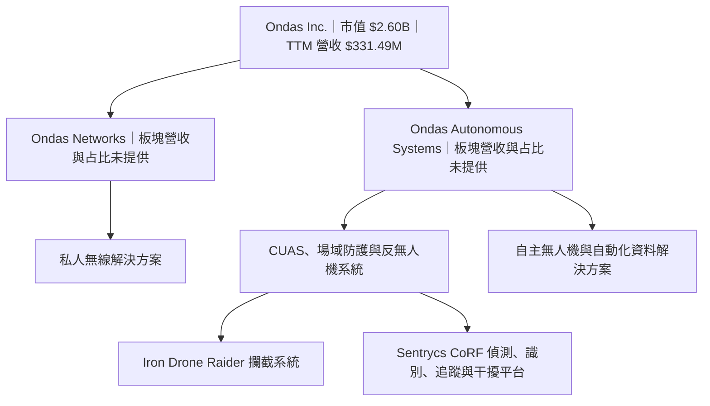
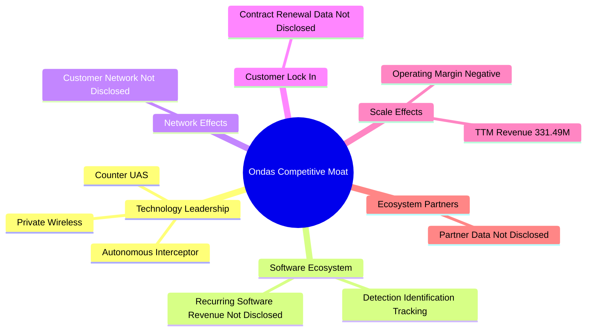
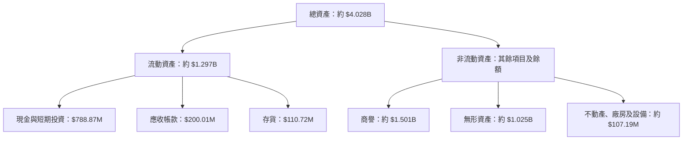
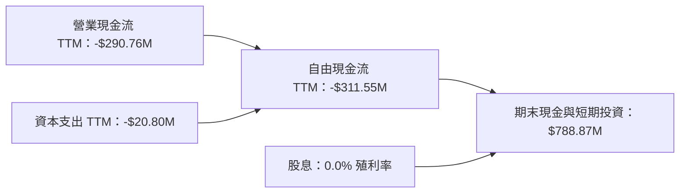
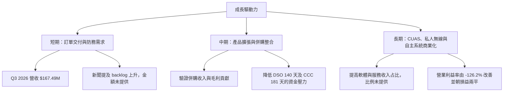
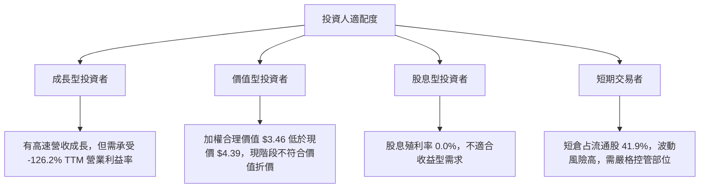

# ONDS 基本面深度分析報告
> **報告日期**：2026-11-18 ｜ **語言**：繁體中文 ｜ **數據來源**：SEC 申報資料 (XBRL)、Yahoo Finance、Finviz、StockAnalysis、Roic.ai ｜ **分析師**：CFA 級機構研究

## 目錄

| # | 章節 | 核心結論 |
|---|------|----------|
| 1 | 執行摘要 | 賣出；加權合理價值 $3.46，MOS -26.9% |
| 2 | 公司概覽與商業模式 | 涉足私人無線、無人機與自主系統；產品差異化有待商業化驗證 |
| 3 | 損益表深度分析 | TTM 營收 $331.49M，TTM 成長 1,239.4%；營業利益率 -126.2% |
| 4 | 資產負債表分析 | 現金與短期投資 $788.87M；應收、存貨及商譽快速增加 |
| 5 | 現金流量深度分析 | TTM FCF -$311.55M，現金消耗仍高 |
| 6 | 獲利能力與資本效率 | ROIC -20.9% 對 WACC 14.0%，目前摧毀股東價值 |
| 7 | 相對估值分析 | P/S 高於同業中位數；自身歷史 P/S 位於第 32 百分位 |
| 8 | DCF 內在價值評估 | N/A：TTM 營業利益為負，程式模型不適用 |
| 9 | 成長催化劑 | 防務需求、訂單與併購整合可能推動成長，但缺少可核驗的量化資料 |
| 10 | 風險矩陣 | 營運虧損、現金消耗、稀釋與執行風險居前 |
| 11 | 投資建議 | 依 MOS 評級為賣出；追蹤毛利、現金流與股數變化 |

---

## 1. 執行摘要

Ondas（ONDS）最新收盤價為 **2026-11-17 的 $4.39**。TTM 營收 **$331.49M**、TTM 營收成長 **1,239.4%**，最新一季營收年增 **1,558.6%**；然而 TTM 營業利益率 **-126.2%**、ROIC **-20.9%**，低於 **14.0% WACC**，TTM FCF **-$311.55M**。依估值方法加權後合理價值為 **$3.46**，MOS 為 **-26.9%**，依 MOS 評級門檻為 **賣出**。快速擴張尚未轉化成營運獲利與正現金流，是本報告不採納分析師共識目標價作為主要結論的原因。

### 1.0 一頁式投資儀表板（Portfolio Manager 30 秒速讀）

| 項目 | 內容 |
|------|------|
| **投資論點（3 句）** | ① TTM 營收成長 **1,239.4%**，業務規模快速放大；② TTM 營業利益率 **-126.2%**、FCF **-$311.55M**，成長尚未轉化成現金獲利；③ 加權合理價值 **$3.46**，低於 $4.39 現價，MOS **-26.9%**。 |
| **綜合評分** | **4.3/10**（引用 1.1 評分卡） |
| **財務健康** | 🔴 現金與短期投資 $788.87M，但 TTM FCF 為 -$311.55M，現金消耗速度高 |
| **ROIC vs WACC** | **-20.9% vs 14.0%**；ROIC 低於資本成本，現階段摧毀價值 |
| **FCF 趨勢** | 仍為負；TTM FCF Yield **-12.00%** |
| **估值** | Forward P/E **-28.3x** ｜ EV/EBITDA **-6.45x** ｜ FCF Yield **-12.00%** |
| **DCF 內在價值（基準）** | **N/A**；TTM 營業利益為負，模型不適用，故無法計算 DCF 折溢價 |
| **安全邊際（MOS）** | **-26.9%＝($3.46 − $4.39) ÷ $3.46**（加權合理價值基準，8.8）｜ 🔴 <10% 無 |
| **預期報酬（基準情境 12M）** | DCF 基準情境 N/A；加權合理價值相對現價隱含上行空間 **-21.2%** |
| **關鍵風險（前二）** | 營業虧損與負 FCF 延續；併購整合、股權薪酬與股數稀釋 |
| **評級 + 信心度** | 🔴 **賣出** ｜ 信心：中（財務數據存在跨來源差異，估值高度依賴未來改善） |

### 1.1 綜合評分卡（全報告唯一）

| 維度 | 評分（1–10） | 主要依據（引用數字與其來源章節） |
|------|--------------|----------------------------------|
| 成長性 | 8.5 | TTM 營收成長 1,239.4%、最新一季年增 1,558.6%（第 3 章）；高增速但受併購與低基期影響 |
| 獲利能力 | 1.5 | TTM 營業利益率 -126.2%、ROIC -20.9%、F-Score 3/8（第 3、6 章） |
| 財務健康 | 6.5 | 現金與短期投資 $788.87M；TTM FCF -$311.55M；CCC 181 天（第 4、5 章） |
| 估值 | 2.0 | MOS -26.9%；公司 P/S 7.83x，高於同業中位數 3.6x（第 7、8 章） |
| 護城河 | 4.0 | 有反無人機、無線網路與自主系統產品，但未提供市場份額、續約率或客戶集中度（第 2 章） |
| 管理層與資本配置 | 3.5 | FY2025 SBC $16.02M，2026 年前三季季度 SBC 大幅增加；股數由 469M 增至 590M（Roic.ai，詳第 3、5 章） |
| **綜合評分** | **4.3** | 六項算術平均：\((8.5+1.5+6.5+2.0+4.0+3.5)÷6=4.33\)，四捨五入為 4.3 |

### 1.2 五大投資論點 + 三大核心風險

| 類型 | 項目 | 具體依據 | 信心度 |
|------|------|----------|--------|
| 🟢 **投資論點①** | 營收快速放大 | TTM 營收 $331.49M，TTM 年增 1,239.4%；Q3 2026 單季營收 $167.49M，單季年增 1,558.6%。若增長來自可持續訂單交付，可能改善固定成本吸收。 | 🟡 中 |
| 🟢 **投資論點②** | 現金提供轉型緩衝 | 現金與短期投資 $788.87M，可支持產品投入與整合；但仍須與 -$311.55M TTM FCF 一併看待。 | 🟡 中 |
| 🟢 **投資論點③** | 毛利率高於所列同業中位數 | 公司 TTM 毛利率 36.4%，AVAV、KTOS、RCAT 中位數 23.0%；若數據口徑一致，產品組合可能提供改善營業槓桿的基礎。 | 🟡 中 |
| 🟢 **投資論點④** | 無人機防務需求帶來市場機會 | 公司產品涵蓋 CUAS、攔截無人機與自主系統；新聞標題提到 backlog 與防務需求增加，但尚無可核驗的 backlog 金額。 | 🟡 中 |
| 🟢 **投資論點⑤** | 自身歷史估值非高位區間 | P/S 8.2x，低於自身五年中位數 17.9x，位於第 32 百分位；但仍高於同業中位數 3.6x。 | 🟡 中 |
| 🟡 **風險①** | 虧損與現金消耗 | TTM 營業利益率 -126.2%、OCF -$290.76M、FCF -$311.55M。若現金消耗不降，融資或稀釋壓力將上升。 | 🔴 高 |
| 🔴 **風險②** | 併購整合與資產質量 | TTM 資產負債資料顯示商譽約 $1.501B、無形資產約 $1.025B；收入快速成長未能避免營業虧損，需驗證併購資產的回報。 | 🔴 高 |
| 🔴 **風險③** | 股權稀釋與高波動 | 流通股數資料由 2026 年 3 月 469M 增至 9 月 590M；短倉占流通股 41.9%，可能放大股價波動。 | 🔴 高 |

### 1.3 快速統計卡片

| 指標 | 公司實際值（期間） | 同業中位數 | 狀態 |
|------|--------------------|------------|------|
| 營收成長（TTM） | **1,239.4%** | — | 🟢 |
| 營收成長（最新一季年增） | **1,558.6%** | 35.7% | 🟢 |
| 毛利率（TTM） | **36.4%** | 23.0% | 🟢 |
| 營業利益率（TTM） | **-126.2%** | — | 🔴 |
| ROIC（TTM） | **-20.9%** | — | 🔴 |
| Forward P/E | **-28.32x** | 23.7x* | 🔴 |
| FCF Yield（TTM） | **-12.00%** | — | 🔴 |
| Piotroski F-Score | **3 / 8** | — | 🔴 |

\*同業 Forward P/E 中位數以可用的 AVAV、KTOS、RCAT 數字計算；RCAT 為 -3.8x，該倍數因負盈餘而不具一般盈利估值意義。

### 1.4 投資結論

╔══════════════════════════════════════════════════════════════════╗  
║                    📊 投資結論摘要                               ║  
╠══════════════════════════════════════════════════════════════════╣  
║  評級：🔴 賣出（MOS -26.9%，依規則 20）                          ║  
║  價格（2026-11-17 收盤）：$4.39                                  ║  
║  DCF 內在價值（基準）：N/A（TTM 營業利益為負）                   ║  
║  安全邊際 MOS：-26.9%＝($3.46−$4.39)÷$3.46                      ║  
║  加權合理價值（8.8）：$3.46                                      ║  
║  綜合評分：4.3/10（引用 1.1）                                    ║  
║  適合投資人：高風險承受度、能接受大幅波動並持續監控財報者        ║  
╚══════════════════════════════════════════════════════════════════╝

---

## 2. 公司概覽與商業模式

### 2.1 業務結構與收入來源

Ondas Inc. 為美國科技公司，員工 459 人，市值約 $2.60B，TTM 營收 $331.49M。業務分為 Ondas Networks 與 Ondas Autonomous Systems；公司摘要另提及私人無線、CUAS、攔截無人機與自主資料解決方案。各板塊營收與占比未提供，故不推算。

公司提供的資料沒有分部收入、訂閱收入或軟體服務收入數字，因此無法判斷收入是以硬體交付、軟體授權或服務合約為主。這會影響毛利率穩定性與收入可預測性。

### 2.2 市場份額

市場份額數據未提供，故不呈現份額圖或滲透率。以已知數據看，ONDS TTM 營收 $331.49M，低於 AVAV、KTOS 等成熟防務科技公司可能具有的規模，但其最新一季年增率 1,558.6% 高於所列同業。這個差距反映高速擴張，也反映公司目前基數、併購與交付節奏對成長率的影響。

### 2.3 競爭護城河分析

### 2.4 護城河強度

| 護城河項目 | 強度（強／中／弱） | 證據（引用數字或事實） | 會削弱它的情況 |
|------------|--------------------|------------------------|----------------|
| 技術與產品 | 中 | 產品涵蓋 CoRF CUAS、Iron Drone Raider 與私人無線；未提供研發成果轉化率或競標勝率 | 競品性能追上、採購測試不通過或產品交付延遲 |
| 軟體生態系統 | 弱至中 | 平台具偵測、識別、追蹤與緩解功能，但未揭露軟體收入占比、客戶留存或續約率 | 收入主要依賴一次性硬體銷售，軟體無法形成持續收入 |
| 網路效應 | 弱 | 沒有用戶數、設備連網規模或平台資料累積數據 | 客戶彼此沒有連結價值，轉換成本有限 |
| 客戶鎖定 | 未證實 | 未提供客戶集中度、續約率或合約期限 | 客戶可多來源採購、合約以短期專案為主 |
| 規模效應 | 弱至中 | TTM 營收 $331.49M，但營業利益率 -126.2%，仍未顯示規模帶來獲利 | 成長主要由併購帶動，整合成本持續高於新增毛利 |
| 生態夥伴 | 未證實 | 現有數據未披露合作夥伴貢獻或通路占比 | 夥伴關係未轉為可持續訂單或交付能力 |

**1.1 護城河評分為 4.0/10**，理由是產品覆蓋具體防務應用，但缺乏市場份額、經常性收入、續約率及客戶鎖定等可量化證據。

---

## 3. 損益表深度分析

### 3.1 年度收入成長趨勢（近 4 年）

FY2022–FY2025 收入來自 StockAnalysis 與歷史損益表，金額為美元。同比成長由年度收入計算。

╔══════════════════════════════════════════════════════════════════╗  
║              Ondas 年度收入趨勢（FY2022–FY2025）                ║  
╠══════════════════════════════════════════════════════════════════╣  
║  FY2022  $2.13M   █                         YoY：基期             ║  
║  FY2023  $15.69M  ███████                   YoY：+636.6% 🟢       ║  
║  FY2024  $7.19M   ███                       YoY：-54.2% 🔴        ║  
║  FY2025  $50.73M  █████████████████████████ YoY：+605.3% 🟢      ║  
╠══════════════════════════════════════════════════════════════════╣  
║  FY2022–FY2025 收入 CAGR：約 +188.0%                             ║  
╚══════════════════════════════════════════════════════════════════╝

年度收入波動顯著，FY2024 下滑後 FY2025 大幅反彈。過去三年 CAGR 高，不能直接外推為有機成長率；併購、交付時點與低基期均可能影響年度比較。

### 3.2 季度收入趨勢分析

| 季度 | 營收 | QoQ 成長 | YoY 成長 | 備註 |
|------|------:|---------:|---------:|------|
| 2025 Q4 | $30.11M | — | — | 作為最近四季序列起點；前一季及前一年同期數據未在同一列提供 |
| 2026 Q1 | $50.12M | +66.5% | N/A | QoQ = $50.12M ÷ $30.11M − 1 |
| 2026 Q2 | $83.77M | +67.1% | N/A | QoQ = $83.77M ÷ $50.12M − 1 |
| 2026 Q3 | $167.49M | +99.9% | **+1,558.6%** | 單季年增率，非 TTM；公司資料呈現季度交付加速 |

三季連續環比放大，Q3 2026 營收約為 Q2 的兩倍。但最新一季成長可能受到併購併表、專案交付集中或低比較基期影響；在缺少有機成長拆分與訂單轉收入資料下，不應將單季增速視為穩態。

### 3.3 利潤率演變分析

| 利潤率指標 | FY2022 | FY2023 | FY2024 | FY2025 | TTM／最新季 | 趨勢與評估 |
|------------|--------:|--------:|--------:|--------:|-------------:|------------|
| **毛利率** | 52.1% | 40.7% | 4.8% | 39.7% | TTM 36.4% | 年度波動大；FY2024 低毛利可能反映產品組合或收入規模，🟡 |
| **營業利益率** | -2,347.4% | -243.7% | -481.4% | -115.1% | TTM **-126.2%**；最新季 **-113.1%** | 相對早期虧損率有所收斂，但仍遠未損益兩平，🔴 |
| **EBITDA 利潤率** | — | — | — | — | TTM -87.8% | EBITDA 仍大幅為負，🔴 |
| **淨利率** | — | — | — | — | TTM 報表來源有矛盾 | 見 3.5 盈餘品質，不採用單一淨利率推論 |

FY2025 毛利率按 $20.16M 毛利 ÷ $50.73M 收入計算約 39.7%。TTM 毛利率為 36.4%，略低於 FY2025；相較之下，營業利益仍極度負值，顯示毛利尚不足以覆蓋研發、銷售管理費、併購整合或其他營業費用。年度財報與最新季度所列營業利益率口徑也有差異，故以 VERIFIED FIGURES 的 TTM -126.2% 與最新季 -113.1% 作主要觀察。

### 3.4 費用結構分析

完整營業費用細項及各項占收入比例未提供，不能繪製完整費用結構圓餅圖。已知 FY2025 研發費用為 **$20.88M**，約占當年營收 $50.73M 的 **41.2%**；研發投入支持產品開發，但在營業利益率仍為負的情況下，也顯示盈利轉正需依賴收入規模與費用效率共同改善。

### 3.5 季度 EPS 趨勢與盈餘品質（Quality of Earnings）

| 季度 | EPS 實際值／資料 | 預估與驚喜 | 解讀 |
|------|------------------|------------|------|
| 2025 Q4 | EPS 預估及實際值 N/A | N/A | 盈餘歷史資料未提供可用預估 |
| 2026 Q1 | StockAnalysis 列示 EPS $0.59；季度淨利 $362.95M | 預估 N/A | 正淨利與其餘季度虧損反差極大，可能受非經常性項目影響，需查 SEC 附註 |
| 2026 Q2 | StockAnalysis 列示 EPS -$0.18；季度淨利 -$88.25M | 預估 N/A | 回到虧損 |
| 2026 Q3 | StockAnalysis 列示 EPS -$0.10；季度淨利 -$62.57M | 預估 N/A | 仍為虧損，EPS 預估與驚喜資料缺漏 |

| 盈餘品質項目 | 數值／佔比 | 評估 |
|--------------|-----------|------|
| 股權薪酬 SBC / 營收 | 最近四季 SBC 約 $155.41M ÷ TTM 營收 $331.49M = **46.9%** | 🔴 高；SBC 是非現金會計費用，但會透過稀釋降低每股經濟利益 |
| SBC / 營業現金流 | $155.41M ÷ \|-$290.76M\| = **53.5%** | 🔴 以營業現金流絕對值衡量；OCF 為負，SBC 無法使現金轉換改善 |
| FCF / 淨利（現金轉換率） | **N/A** | TTM 淨利數據口徑矛盾，不能可靠計算 |
| 一次性／非經常性損益 | 2026 Q1 淨利 $362.95M，而同列營業利益 -$42.67M | 🔴 有異常大的非營業或一次性影響疑慮；具體性質須以 SEC 附註核實 |
| 有效稅率異常 | N/A | 無法由可用資料可靠分離稅前損益與稅項 |
| 資本化支出 vs 費用化 | TTM Capex $20.80M；其他資本化開發支出細項 N/A | 尚不能確認研發或取得成本的資本化政策是否改變 |

**盈餘品質結論：** 公司存在淨利資料與營業損失不一致的情形，且最近四季 SBC 約為 TTM 營收的 46.9%，TTM FCF 為 -$311.55M。現階段不宜以報表淨利作為正常化獲利基礎；估值應更重視可持續毛利、費用率、現金消耗及每股稀釋。

---

## 4. 資產負債表分析

### 4.1 資產結構分解

最新季度為 2026-09-30。StockAnalysis 列示總資產約 $4.028B，其中流動資產約 $1.297B；商譽與無形資產合計約 $2.526B。財務資料不同來源間可能存在口徑差異，以下只呈現所列數字，不由細項反推未提供項目。

商譽與無形資產規模大，與併購後整合能力及資產減損風險直接相關；若收購業務無法達到預期現金流，未來可能出現減損。

### 4.2 流動性與營運資金分析

| 指標 | 最新 TTM | 一年前 TTM | 變化 | 解讀 |
|------|----------|------------|------|------|
| DSO 應收帳款天數 | 140 天 | 77 天 | +63 天 | 回款時間延長；須觀察政府／企業客戶驗收和收款條款 |
| DIO 存貨天數 | 182 天 | 278 天 | -96 天 | 存貨周轉改善，但仍有約半年庫存天數 |
| DPO 應付帳款天數 | 141 天 | 186 天 | -45 天 | 對供應商付款天數縮短，可能減少營運資金融資 |
| CCC 現金轉換週期 | 181 天 | 169 天 | +12 天 | DSO 上升抵銷 DIO 改善，資金占用週期變長 |

目前流動比率 3.389、速動比率 2.604；現金及短期投資 $788.87M 提供短期緩衝。然而 DSO 增加 63 天且 CCC 增加 12 天，營收成長同時擴大應收與資金需求，須特別監控合約資產、應收帳款回收與存貨轉出。

### 4.3 債務結構分析

Verified Figures 的總債務為 **N/A**，因此不能以其他資料補算為同一口徑。另有市場資料列示總債務 $62.81M、淨現金 $726.06M，但與 VERIFIED FIGURES 所列淨現金 $788.87M 不一致；本報告依優先規則採用後者，並保留差異說明。

╔══════════════════════════════════════════════════════════════════╗  
║                   Ondas 債務健康診斷                             ║  
╠══════════════════════════════════════════════════════════════════╣  
║  總債務（優先口徑）：N/A；其他市場資料列示 $62.81M               ║  
║  現金與短期投資：$788.87M                                        ║  
║  Verified net cash：$788.87M（債務欄位 N/A，應謹慎解讀）        ║  
║  Debt/EBITDA：N/A（債務與 EBITDA 口徑不適合直接比較）            ║  
║  利息保障倍數：N/A（營業利益為負，且利息明細未提供）             ║  
║  流動比率：3.389x；速動比率：2.604x                              ║  
╚══════════════════════════════════════════════════════════════════╝

### 4.4 股東權益趨勢

╔══════════════════════════════════════════════════════════════════╗  
║                 Ondas 歷年股東權益                               ║  
╠══════════════════════════════════════════════════════════════════╣  
║  FY2022  $58.22M  █████████████████████████████                  ║  
║  FY2023  $33.14M  █████████████████                              ║  
║  FY2024  $16.58M  ████████                                       ║  
║  FY2025  $437.81M █████████████████████████████████████████████ ║  
╚══════════════════════════════════════════════════════════════════╝

FY2025 權益大幅上升，與融資及公司資產規模變化相呼應；同時流通股數增加，意味資本補充可能伴隨股東稀釋。帳面權益增加本身不代表投入資本報酬改善，ROIC 仍為 -20.9%。

---

## 5. 現金流量深度分析

### 5.1 現金流量瀑布圖

以下以 TTM 的 OCF 與 Capex 定義 FCF；淨利和股息／回購資料口徑不足，不用圖表假設填補。

### 5.2 FCF 轉換率趨勢

| 期間 | FCF | 淨利 | FCF／淨利 | 評估 |
|------|----:|-----:|----------|------|
| FY2022 | -$40.89M | -$73.24M | 約 55.8% | 兩者均為負，比例不代表正向現金轉換 |
| FY2023 | -$34.30M | -$44.84M | 約 76.5% | 仍為負 FCF |
| FY2024 | -$35.20M | -$38.01M | 約 92.6% | 虧損規模接近，但現金流仍為負 |
| FY2025 | -$40.88M | -$132.02M | 約 31.0% | 負淨利擴大，比例解讀有限 |
| TTM | -$311.55M | N/A（數據口徑矛盾） | N/A | 無法可靠計算 |

### 5.3 自由現金流趨勢

╔══════════════════════════════════════════════════════════════════╗  
║                自由現金流（FCF）歷史                             ║  
╠══════════════════════════════════════════════════════════════════╣  
║  FY2022  -$40.89M  ◀██████████                                  ║  
║  FY2023  -$34.30M  ◀████████                                    ║  
║  FY2024  -$35.20M  ◀████████                                    ║  
║  FY2025  -$40.88M  ◀██████████                                  ║  
║  TTM      -$311.55M ◀████████████████████████████████████████  ║  
║  TTM FCF Yield：-12.00%                                         ║  
╚══════════════════════════════════════════════════════════════════╝

TTM FCF 顯著差於 FY2025，主要可確認的是 TTM OCF 達 -$290.76M；季度現金流資料亦顯示 2026 Q3 單季 OCF -$140.65M。這意味增長需要大量營運資金或營運費用投入。以現有現金與短期投資除以 TTM FCF 絕對值估算，靜態現金覆蓋約 **2.53 年**（$788.87M ÷ $311.55M）；這只是維持現有消耗速度的算術參考，不是現金跑道預測。

### 5.4 資本配置評估

公司股息殖利率為 0.0%，未提供回購金額或完整投資配置明細，因此不製作資本配置圓餅圖。

| 配置項目 | 可用數據 | 評估 |
|----------|----------|------|
| 資本支出 | TTM $20.80M | 相對營收約 6.3%；但資本支出不是唯一現金消耗來源 |
| 股權薪酬 | FY2025 $16.02M；近四季約 $155.41M | 最近季度數值上升幅度大，應核對收購相關股權獎酬與經常性 SBC |
| 股息 | 殖利率 0.0% | 現金優先用於營運與成長 |
| 回購 | N/A | 未提供資料 |
| 併購／策略投資 | 有併購擴張的新聞與資產變化，但金額拆分 N/A | 必須追蹤收購後收入、毛利及現金流貢獻 |

---

## 6. 獲利能力與資本效率

### 6.1 ROE / ROA / ROIC 趨勢

| 指標 | FY／TTM 最新值 | 歷史可用資料 | 評估 |
|------|---------------:|---------------|------|
| ROE | TTM 4.6%（品質指標口徑） | 市場資料另列 7.3%，有口徑差異 | 不採單一 ROE 認定獲利品質 |
| ROA | TTM 相關來源不一致 | QUALITY FIGURES 的 F-Score 顯示 ROA 正且高於一年前；市場資料列 -9.7% | 口徑矛盾，須以 SEC 報表附註核實 |
| ROIC | **-20.9%** | TTM | 低於 WACC 14.0%，資本效率不合格 |

不列行業均值：資料未提供可比的同口徑 ROIC／ROA／ROE。公司 ROIC 為負且遠低於資本成本，表示新增資本目前沒有產生足夠的稅後營業回報。

### 6.2 ROIC vs WACC 分析（核心價值創造判斷）

╔══════════════════════════════════════════════════════════════════╗  
║                ROIC vs WACC 深度分析                             ║  
╠══════════════════════════════════════════════════════════════════╣  
║  資本成本輸入：                                                   ║  
║  ├── 無風險利率（10Y 美債）：5.10%                                ║  
║  ├── 市場風險溢酬 ERP：5.00%                                     ║  
║  ├── 原始 Beta：3.08；調整後 Beta：2.00                           ║  
║  ├── 股權成本：15.10%                                             ║  
║  ├── 稅前債務成本：10.47%；稅率假設：21.0%                       ║  
║  ├── 股權／債務權重：97.6%／2.4%                                 ║  
║  └── WACC：14.00%（計算值 14.94%，按 14% 上限採用）              ║  
║                                                                  ║  
║  ROIC（TTM）：-20.9%                                              ║  
║  EVA spread = ROIC − WACC = -20.9% − 14.0% = -34.9 個百分點       ║  
║  結論：目前資本回報低於資本成本，摧毀股東價值                    ║  
╚══════════════════════════════════════════════════════════════════╝

Beta 調整方式為 \(⅔×3.08+⅓=2.39\)，再受 0.6–2.0 區間限制而採用 2.00。資本成本系統計算值 14.94% 被限制在 7%–14% 區間內，因此報告採用 **14.00%**，與 DCF 應使用的折現率口徑一致。

ROIC 與 WACC 差額計算為 **-34.9 個百分點**。若公司能將營業虧損大幅收窄並改善營運資金，ROIC 有機會回升；目前仍無證據支持已進入價值創造階段。

### 6.3 杜邦三因素分解

| 因素 | 數值（TTM） | 解讀 |
|------|-------------|------|
| 淨利率 | 33.1% | QUALITY FIGURES 的指定口徑；但與負營業利益率、其他淨利資料存在矛盾，不能視為穩態利潤率 |
| 資產週轉率 | 0.08 | 營收相對資產基數偏低，資產利用效率低 |
| 權益乘數 | 1.70 | 有一定槓桿，但不是 ROE 的唯一驅動因素 |
| **ROE** | **4.6%** | \(33.1\%×0.08×1.70≈4.6\%\)；低資產週轉率抵銷帳面淨利率 |

### 6.4 財務體質：Piotroski F-Score

**Piotroski F-Score：3 / 8**。缺少一項測試輸入，因此以 8 項可判定測試為分母。

| 測試 | 結果 | 解讀 |
|------|------|------|
| ROA > 0 | ✅ 通過 | 指定品質指標口徑為正，但與其他來源 ROA 資料有差異 |
| 營業現金流 > 0 | ❌ 未通過 | TTM OCF -$290.76M |
| ROA 高於一年前 | ✅ 通過 | 品質指標比較結果通過，仍應留意來源口徑差異 |
| 營業現金流 > 淨利（應計品質） | ❌ 未通過 | 現金流低於淨利的測試未通過，盈餘品質弱 |
| 長期負債 ÷ 總資產低於一年前 | — 無法判定 | 缺少該項可比資料 |
| 流動比率高於一年前 | ❌ 未通過 | 流動比率比較未通過；營運資金狀況需持續監控 |
| 稀釋股數未增加 | ❌ 未通過 | 股數增加，股東每股權益面臨稀釋 |
| 毛利率高於一年前 | ❌ 未通過 | 毛利率同比測試未通過 |
| 資產週轉率高於一年前 | ✅ 通過 | 指定品質指標比較結果通過 |

---

## 7. 相對估值分析

### 7.1 同業估值比較表格

公司估值倍數取市場資料；同業倍數取 Yahoo Finance 的 Peer multiples。P/E 與 EV/EBITDA 在負獲利或 N/A 情況下，解讀價值有限。

| 估值指標 | **ONDS** | **AVAV** | **KTOS** | **RCAT** | ONDS 評估 |
|----------|---------:|---------:|---------:|--------:|-----------|
| **Trailing P/E** | N/A | N/A | 258.8x | N/A | 🔴 公司無可用正向 trailing P/E |
| **Forward P/E** | -28.32x | 23.7x | 27.8x | -3.8x | 🔴 負 EPS 下倍數不具常規可比性 |
| **P/S Ratio** | 7.83x | 2.6x | 3.6x | 5.1x | 🔴 ONDS 高於同業中位數 3.6x |
| **EV/EBITDA** | -6.45x | 25.4x | 52.1x | -2.2x | 🔴 公司 EBITDA 為負，倍數不可直接解讀 |
| **最新一季營收 YoY** | 1,558.6% | 5.7% | 35.7% | 527.2% | 🟢 增速最高，但需核實併購及基期效應 |
| **毛利率（TTM）** | 36.4% | 26.5% | 23.0% | 9.8% | 🟢 高於三家同業中位數 23.0% |

ONDS 的高營收增速和毛利率並未反映在獲利上；同業 P/S 中位數低於公司目前 P/S，意味市場仍對未來成長與利潤改善給予溢價。若公司無法把毛利轉化為營業利潤與現金流，該溢價有收斂風險。

### 7.2 歷史估值區間分析

╔══════════════════════════════════════════════════════════════════╗  
║                P/S 歷史估值位置（TTM）                           ║  
╠══════════════════════════════════════════════════════════════════╣  
║  五年最低：2.9x ── 當前：8.2x ── 中位數：17.9x ── 最高：140.6x  ║  
║  當前百分位：第 32 百分位                                        ║  
╚══════════════════════════════════════════════════════════════════╝

自身歷史 P/S 現在低於中位數，但歷史最高值達 140.6x，顯示歷史區間受小基數或估值極端值影響。因而歷史百分位只能作為輔助，不足以證明現價便宜；與同業 P/S 中位數 3.6x 對照，現價仍偏高。

### 7.3 情境價值（Bear / Base / Bull）

**N/A（DCF 無法計算：TTM 營業利益不為正，程式未提供 DCF Scenarios）**。依估值規則不另行建立情境目標價。

### 7.4 相對估值隱含價格區間

╔══════════════════════════════════════════════════════════════════╗  
║                   相對估值方法與股價位置                         ║  
╠══════════════════════════════════════════════════════════════════╣  
║  $1.99 同業 P/S  ─────── $3.46 加權合理價值 ─────── $4.39 現價   ║  
║  分析師共識目標價：$16.68（僅作參考，不代表基本面合理價值）      ║  
╚══════════════════════════════════════════════════════════════════╝

| 方法 | 每股價值 | 依據 | 相對現價 |
|------|---------:|------|---------:|
| 同業 P/S | $1.99 | AVAV、KTOS、RCAT 同業 P/S 中位數 3.6x × TTM 營收，依程式估值結果 | -54.7% |
| 分析師共識目標價 | $16.68 | 10 位分析師平均目標價 | +280.0% |

相對估值方法不採用公司自身現有倍數回推。共識目標價遠高於同業 P/S 法，顯示分析師預期與當前盈利、現金流風險之間存在很大落差。

---

## 8. DCF 內在價值評估（Discounted Cash Flow）

### 8.0 估值推理鏈（Thinking Logic）

#### Step 1 — 價值由哪些變數決定？

ONDS 的長期價值主要取決於：**現有無線及自主系統收入能否持續交付、CUAS 等新產品能否形成有利毛利，以及高投入能否轉化為正向現金流**。目前只有總 TTM 營收 $331.49M，分部營收占比未提供，無法量化各項收入貢獻。最關鍵的估值變數應是營業利潤率與現金流轉正時間，但公司目前 TTM 營業利益率 -126.2%、FCF -$311.55M。

#### Step 2 — 模型選擇與限制

| 決策點 | 本報告採用 | 理由（含數字） | 曾考慮但否決 | 否決理由 |
|--------|-----------|----------------|--------------|----------|
| 現金流定義 | DCF N/A | TTM 營業利益為負，程式模型明確不輸出 DCF | 自行用 FCFF 預測轉正 | 預測期、利潤率、稀釋等缺少可核驗輸入，不能另建模型 |
| 預測期 N | N/A | DCF 模型未提供 | 自行設定 5–10 年 | 不以未披露的假設數值替代模型 |
| 終值方法 | N/A | 無逐年 FCFF 與終值輸入 | Gordon Growth／退出倍數 | 無基準現金流可供計算 |
| EBIT 基礎 | N/A | 模型未提供 | GAAP／非 GAAP 推估 | 不自行建立 DCF |

#### Step 3 — 關鍵假設推導鏈

DCF MODEL 為 N/A，故營收 CAGR、期末營業利潤率、永續成長率、預測期、Capex、D&A、營運資金、SBC、稀釋率及終值等假設均不設定；若自行補值會構成未經財務數據支持的模型。

#### Step 4 — 最脆弱的一環

最脆弱之處是把極高營收成長轉化為正常化營業利潤與正 FCF；若營業虧損持續，任何以遠期盈利推估的價值都可能高估。

#### Step 5 — 計算路徑圖

### 8.1 模型假設總表（Model Inputs）

**N/A（數據未提供／模型未計算）**：程式未生成 DCF 模型，且 TTM 營業利益不為正。依規則不自建 DCF，亦不自行填入預測期、營收 CAGR、期末營業利潤率、有效稅率、D&A、營運資金、稀釋率或永續成長率。

### 8.2 折現率推導（WACC）

DCF 不適用，但資本成本仍可用於 ROIC 比較。採用 WACC **14.00%**；計算值 14.94% 被 7%–14% 區間上限限制。

| 輸入 | 數值 | 推導／來源 |
|------|------:|------------|
| 無風險利率 Rf | 5.10% | 10 年期美債輸入；觀察日期未提供 |
| ERP | 5.00% | 假設值，程式資本成本資料 |
| 原始 Beta | 3.08 | Yahoo Finance |
| 調整後 Beta | 2.00 | \(⅔×3.08+⅓=2.39\)，上限限制為 2.00 |
| 股權成本 Ke | 15.10% | \(5.10\%+2.00×5.00\%=15.10\%\) |
| 稅前債務成本 | 10.47% | 資本成本資料 |
| 稅率 | 21.0% | 預設稅率 |
| 股權／債務權重 | 97.6%／2.4% | 資本成本資料 |
| WACC | **14.00%** | 原計算值 14.94%，按上限限制為 14.00% |

### 8.3 逐年自由現金流預測（基準情境）

**N/A（DCF 模型未提供）**。無逐年預測數據，故不提供 FY+1 至 FY+N 現金流表、折現值或自建算式。

### 8.4 終值計算（Terminal Value）

**N/A（DCF 模型未提供）**。預測期現金流、永續成長率及退出倍數皆未提供，無法進行終值計算。

### 8.5 企業價值 → 每股內在價值（Bridge）

**N/A（DCF 模型未提供）**。因此基準 DCF 每股內在價值與 DCF 折溢價均不計算。現金、債務與稀釋股數雖有部分資料，但缺少企業價值及模型預測，不能據此自行產生 DCF 目標價。

### 8.6 敏感性分析（WACC × 永續成長率）

**N/A（DCF 模型未提供）**。沒有基準 FCFF、g 或矩陣輸出，不生成敏感性矩陣或三情境 DCF。

### 8.7 反推 DCF（Reverse DCF）

**N/A（DCF 模型未提供）**。現價 $4.39 無法在未提供基準營收、利潤率、預測期與終值等條件下回推單一市場隱含變數。

### 8.8 估值三角驗證與安全邊際

估值方法及權重依不盈利公司類型採固定設定。Forward P/E 方法因不可計算而未列入，其權重依模型規則分配給可用方法。

| 估值方法 | 隱含每股價值 | 上行空間（÷現價） | 權重 | 說明 |
|----------|--------------:|-------------------:|------:|------|
| 同業 P/S | $1.99 | -54.7% | 90% | 同業 P/S 中位數 3.6x × TTM 營收，估值結果照列 |
| 分析師共識目標價 | $16.68 | +280.0% | 10% | 10 位分析師平均目標價，作為參考 |
| **加權合理價值** | **$3.46** | **-21.2%** | **100%** | 不盈利公司固定權重 |

**逐步演算：**

\[
\$1.99×90\%+\$16.68×10\%
=\$1.791+\$1.668
=\$3.459
\approx \$3.46
\]

**MOS（全報告唯一計算）：**

\[
MOS=(\$3.46-\$4.39)÷\$3.46
=-\$0.93÷\$3.46
=-26.9\%
\]

**上行空間：**

\[
(\$3.46-\$4.39)÷\$4.39
=-\$0.93÷\$4.39
=-21.2\%
\]

折溢價以 DCF 基準價為分母，本報告 DCF 為 N/A，故不計算。MOS 評級依規則 20 為 **賣出**；未作質化調整。

╔══════════════════════════════════════════════════════════════════╗  
║                  估值區間與安全邊際                              ║  
╠══════════════════════════════════════════════════════════════════╣  
║  同業 P/S $1.99 ── 加權合理價值 $3.46 ── 現價 $4.39             ║  
║                                                                  ║  
║  MOS = ($3.46 − $4.39) ÷ $3.46 = -26.9%                         ║  
║  上行空間 = ($3.46 − $4.39) ÷ $4.39 = -21.2%                    ║  
║  MOS 評估：🔴 負 MOS 超過 25%，現價高於加權合理價值              ║  
║  DCF 基準、悲觀及樂觀價值：N/A                                   ║  
║  MOS ≥10% 對應價格上限：$3.11（$3.46×90%，僅為門檻推導）         ║  
╚══════════════════════════════════════════════════════════════════╝

> 🔎 **程式複算（Python，依本節各項自動重算）**
>
> 加權合理價值 = $1.99 × 90% + $16.68 × 10% = **$3.46**（權重合計 100%）
>
> 以價格 $4.39 計：MOS = **-26.9%**，上行空間 = **-21.2%**
>
> ✅ 與本節所寫數值一致。

### 8.9 DCF 模型的局限與失效條件

- **終值依賴度**：N/A；沒有 DCF 終值數據。
- **最脆弱的估值假設**：相對估值中同業 P/S 3.6x 是否適用，以及分析師共識目標價 $16.68 能否由實際盈利與現金流支撐。
- **DCF 不適用情境**：TTM 營業利益率 -126.2%、FCF -$311.55M，且季與年淨利資料有明顯差異，DCF 現階段可靠度低。較適合觀察 EV/Sales、收購後分部收入、單位經濟性及現金轉化。
- **與第 10 章風險矩陣連結**：收購整合不順會壓低收入成長與毛利；應收款回收延遲會擴大營運資金需求；SBC 與增發會壓低每股價值。

### 8.10 複算檢核表（Audit Trail）

| # | 檢核項目 | 檢查方式 | 結果 |
|---|----------|----------|------|
| 1 | DCF 高／中敏感度輸入皆有四段式推導 | DCF 模型為 N/A，未設定假設 | N/A |
| 2 | 每個 DCF 假設都有來歷 | 未建立自建模型 | N/A |
| 3 | WACC 算式及權重 | 引用資本成本數據；權重 97.6% + 2.4% = 100% | ✅ |
| 4 | Kd 分母與債務權重一致 | 採用程式提供的 WACC 及各組成；DCF 未另行重算債務口徑 | N/A |
| 5 | WACC 與第 6.2 節一致 | 兩處均採 14.00% | ✅ |
| 6 | 逐年預測欄位數與 N 一致 | DCF MODEL N/A | N/A |
| 7 | FY+1 FCFF 與 PV 可複算 | 無逐年預測 | N/A |
| 8 | 預測期 PV 加總 | 無預測期 PV | N/A |
| 9 | WACC > g | g 未提供 | N/A |
| 10 | 終值基於 FY+N 並折現 N 期 | 無終值模型 | N/A |
| 11 | EV 至每股橋接 | DCF 模型 N/A | N/A |
| 12 | SBC 模型組合相容 | 未建立 DCF 股數或 SBC 假設 | N/A |
| 13 | 敏感性矩陣基準格與 DCF 一致 | 無矩陣 | N/A |
| 14 | 矩陣只在 WACC > g 時計算 | 無矩陣 | N/A |
| 15 | 三情境機率加總 | 無 DCF Scenarios | N/A |
| 16 | 反推 DCF 一次只解一個變數 | 無反推模型 | N/A |
| 17 | MOS 使用 8.8 加權合理價值，並一致引用 | $3.46 作價值基準；MOS -26.9% | ✅ |
| 18 | 報告完整至第 11 章 | 章節已列至第 11 章 | ✅ |
| 19 | 加權合理價值等於加權總和 | $1.99×90% + $16.68×10% = $3.459 ≈ $3.46 | ✅ |
| 20 | 評級符合 MOS 門檻 | MOS -26.9% 對應賣出，未調整 | ✅ |

---

## 9. 成長催化劑

### 9.1 催化劑時間軸

具體催化劑日期與量化交付里程碑未提供，因此不使用帶有虛構日期的甘特圖。近期可追蹤的事項包括：2026 年公司展望上修新聞、backlog 與防務需求、Q3 交付，以及併購整合結果；上述資訊需以公司公告和 SEC 申報核實。

### 9.2 TAM 市場規模分析

**N/A（TAM 數據未提供）**。公司涉及 CUAS、無人機、私人無線與自動化資料市場，但缺少附來源與年份的市場規模數字。已知 TTM 營收為 $331.49M、TTM 成長 1,239.4%，成長空間看似大，但仍須區分內生需求、併購併表與專案交付。

### 9.3 成長驅動力結構圖

---

## 10. 風險矩陣

### 10.1 風險評分矩陣

發生機率與衝擊的量化概率沒有可靠來源，故不以自訂機率坐標製作 quadrantChart；下表以高、中、低做定性排序。

### 10.2 風險清單詳細分析

| # | 風險項目 | 發生機率 | 財務衝擊 | 風險評估 | 緩解措施 |
|---|----------|----------|----------|----------|----------|
| 1 | 🔴 現金消耗與持續虧損 | 高 | TTM FCF -$311.55M；FCF Yield -12.00% | 🔴 高 | 每季追蹤 OCF、FCF、現金與短期投資；若現金消耗沒有下降，重新評估融資需求 |
| 2 | 🔴 併購整合及商譽減損 | 中至高 | 商譽約 $1.501B、無形資產約 $1.025B；營業利益率 -126.2% | 🔴 高 | 要求收購標的分部收入、毛利與現金流披露，關注減損測試 |
| 3 | 🔴 股權稀釋與 SBC | 高 | 近四季 SBC 約 $155.41M，約為 TTM 營收 46.9%；股數資料由 469M 增至 590M | 🔴 高 | 按季追蹤稀釋股數、SBC/營收與收購對價股數 |
| 4 | 🟡 應收帳款與營運資金 | 中至高 | DSO 140 天，較一年前增加 63 天；CCC 181 天 | 🟠 中高 | 追蹤應收帳款回收、合約驗收、存貨周轉與客戶付款條件 |
| 5 | 🟡 估值與波動 | 高 | 現價 $4.39；52 週高低 $15.28／$4.31；短倉占流通股 41.9% | 🟠 中高 | 分段交易並以財報里程碑而非短期股價波動決策 |
| 6 | 🟡 訂單轉收入與交付風險 | 中 | Q3 2026 單季營收 $167.49M，但 backlog 金額及取消率未提供 | 🟠 中 | 追蹤訂單轉化率、交付週期、合約變更與收入集中度 |

---

## 11. 投資建議

### 11.1 最終評級與評分

依加權合理價值 $3.46、2026-11-17 收盤價 $4.39 計算，MOS 為 -26.9%，對應規則 20 的 **賣出**，未作一級調整。綜合評分為 **4.3/10**；六項分數依次為成長性 8.5、獲利能力 1.5、財務健康 6.5、估值 2.0、護城河 4.0、管理層與資本配置 3.5。

### 11.2 合理價值與隱含報酬率

| 方法／情境 | 每股價值 | 相對現價 | 機率 |
|------------|---------:|---------:|------|
| 加權合理價值 | **$3.46** | **-21.2%** | 不適用 |
| DCF 悲觀情境 | N/A | N/A | N/A |
| DCF 基準情境 | N/A | N/A | N/A |
| DCF 樂觀情境 | N/A | N/A | N/A |

### 11.3 買入時機與觸發因素

╔══════════════════════════════════════════════════════════════════╗  
║                  ✅ 買入觸發因素 Checklist                       ║  
╠══════════════════════════════════════════════════════════════════╣  
║  立即買入觸發條件（現階段未達）：                                ║  
║  ☐ TTM 營業利益率連續改善，且虧損率明顯收斂                     ║  
║  ☐ TTM FCF 由 -$311.55M 持續改善，現金消耗趨勢反轉              ║  
║  ☐ 應收帳款天數由 140 天下降，CCC 由 181 天縮短                  ║  
║                                                                  ║  
║  重新評估／加碼觸發條件：                                        ║  
║  ☐ 加權合理價值方法有實際盈利與現金流改善支持                   ║  
║  ☐ 股數增速放緩，SBC／營收明顯低於近四季 46.9%                   ║  
║  ☐ 收購或新產品貢獻可由分部收入、毛利及現金流數據驗證           ║  
║                                                                  ║  
║  減碼／退出觸發條件：                                             ║  
║  ☐ TTM 現金流消耗持續惡化或現金與短期投資快速下降               ║  
║  ☐ DSO、存貨天數與 CCC 同時惡化                                 ║  
║  ☐ 股數持續增加而每股營收、毛利及現金流沒有同步改善             ║  
╚══════════════════════════════════════════════════════════════════╝

### 11.4 投資人適配度分析

### 11.5 每季財報監控清單（Quarterly Watch List）

| 監控指標 | 最新基準 | 觸發加碼／改善訊號 | 觸發減碼／惡化訊號 |
|----------|----------|------------------|------------------|
| 營收與有機成長 | TTM $331.49M；TTM 成長 1,239.4% | 分部與有機成長可拆分，收入持續增長 | 營收成長主要由併購併表支撐，或單季收入下滑 |
| 毛利率 | TTM 36.4% | 毛利率穩定或上升且披露產品組合 | 毛利率連續兩季下降 |
| 營業利益率 | TTM -126.2%；最新季 -113.1% | 連續改善並使營業虧損率收斂 | 虧損率擴大或收入增長未帶動費用率改善 |
| 營業現金流與 FCF | TTM OCF -$290.76M；FCF -$311.55M | OCF／FCF 持續改善，且現金消耗下降 | 現金流進一步惡化、需依賴融資維持營運 |
| DSO／存貨／CCC | 140／182／181 天 | DSO 與 CCC 下降，存貨轉出加快 | DSO 或 CCC 持續上升 |
| SBC 與稀釋股數 | 近四季 SBC 約 $155.41M；流通股數約 590M | SBC 占營收比例下降、股數增速放緩 | 以股權薪酬或增發持續填補現金需求 |
| 併購與資產質量 | 商譽約 $1.501B、無形資產約 $1.025B | 收購業務披露收入、毛利及現金流貢獻 | 減損、整合成本升高或收購標的未達營運目標 |
| 現金與短期投資 | $788.87M | 現金下降速度顯著放緩 | 現金快速減少且仍維持負 FCF |

### 11.6 反面論證：什麼會證明論點錯誤（What Would Change My Mind）

╔══════════════════════════════════════════════════════════════════╗  
║              ⚠️ 論點失效條件（Disconfirming Evidence）            ║  
╠══════════════════════════════════════════════════════════════════╣  
║  本報告的風險判斷若出現以下情況，應重新評估：                    ║  
║  ☐ TTM 營收成長快速降至低雙位數，且無訂單轉收入佐證             ║  
║  ☐ 營業利益率連續兩季惡化，未顯示規模經濟                      ║  
║  ☐ FCF 持續低於目前 -$311.55M 的基準，現金消耗進一步加速       ║  
║  ☐ DSO 高於目前 140 天、CCC 高於 181 天並持續惡化               ║  
║  ☐ 流通股數持續增加，SBC／營收未低於近四季約 46.9%              ║  
║  ☐ ROIC 長期低於 WACC 14.0%，且營業虧損無法收斂                 ║  
║  ☐ 併購資產未能產生營業現金流，或發生重大商譽／無形資產減損    ║  
╚══════════════════════════════════════════════════════════════════╝

---

> **免責聲明**：本報告為 AI 自動生成，僅供研究參考，不構成投資建議。投資有風險，入市需謹慎。

---

## 資料與來源

| 項目 | 內容 |
|------|------|
| 價格 | 4.39 USD，2026-11-17 收盤（Yahoo Finance 即時報價（該交易日已收盤）） |
| 財務報表 | SEC 10-Q filed 2026-11-12，最新季度 2026-09-30（FY2026 Q3） |
| 有回應的資料來源 | SEC 申報資料 (XBRL)、Yahoo Finance、Finviz、StockAnalysis、Roic.ai |
| 由程式計算 | TTM 數字、WACC、DCF 模型、估值方法與權重、加權合理價值、MOS、評級門檻、F-Score、杜邦分解、營運資金天數、綜合評分 |
| 撰寫模型 | openai / gpt-6-luna |

> 本區塊由產生報告的程式依實際取得的資料填寫，非模型撰寫。「由程式計算」的數字不是模型的估計；其餘判斷（評分、情境、策略）是模型的分析。
