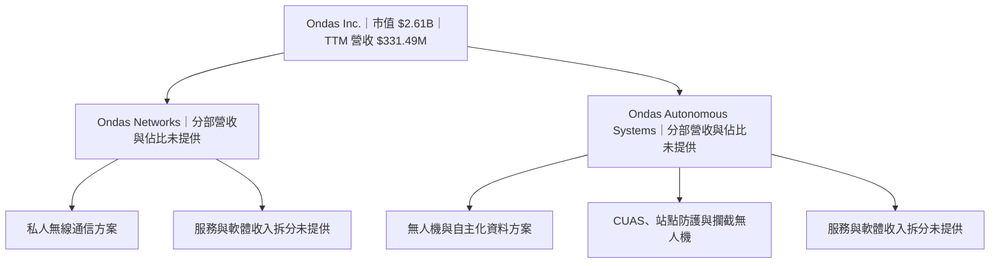
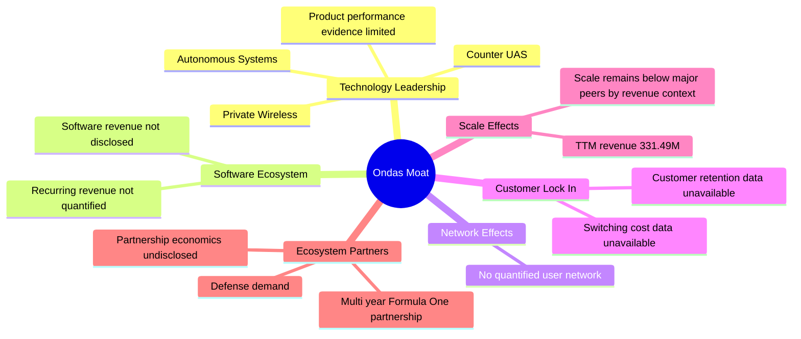
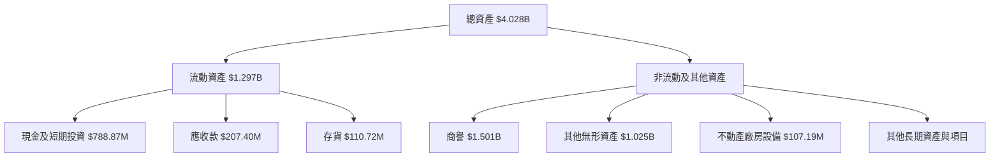
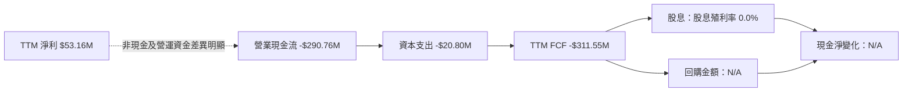
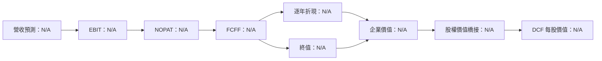
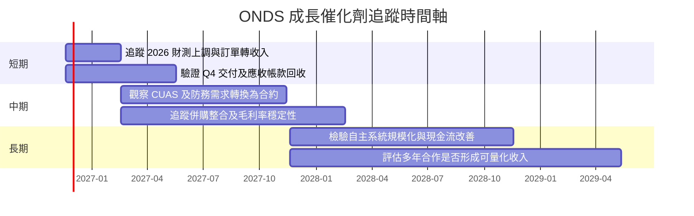
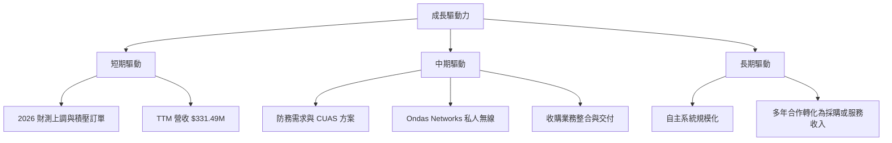
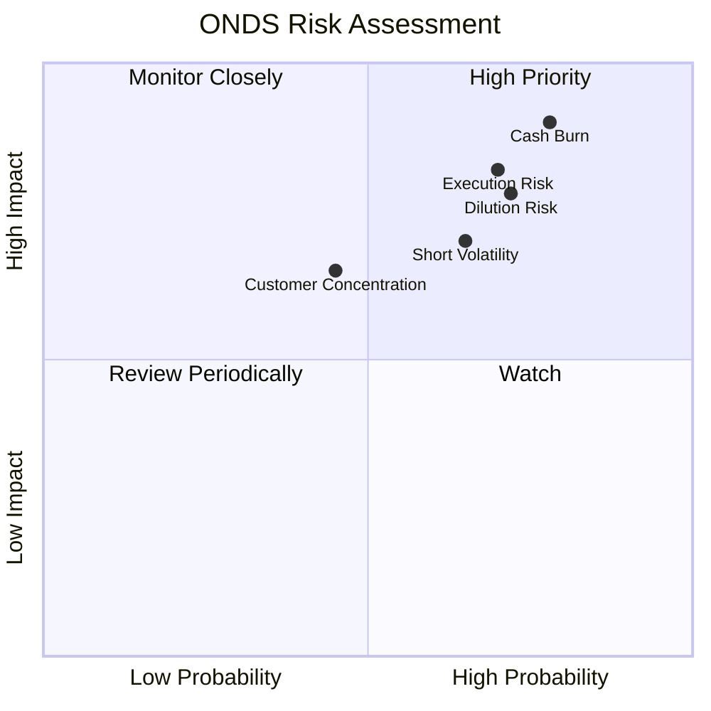
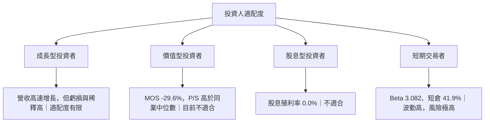

# ONDS 基本面深度分析報告
> **報告日期**：2026-11-19 ｜ **語言**：繁體中文 ｜ **數據來源**：SEC 申報資料 (XBRL)、Yahoo Finance、Finviz、StockAnalysis、Roic.ai ｜ **分析師**：CFA 級機構研究

## 目錄

| # | 章節 | 核心結論 |
|---|------|----------|
| 1 | 執行摘要 | 賣出；加權合理價值 $3.41，MOS -29.6% |
| 2 | 公司概覽與商業模式 | 私人無線、無人機與自主系統並行；護城河證據仍有限 |
| 3 | 損益表深度分析 | TTM 營收 $331.49M、TTM 成長 1,239.4%，但營業利益率 -126.2% |
| 4 | 資產負債表分析 | 現金及短期投資 $788.87M；債務口徑資料有差異，需留意營運資金 |
| 5 | 現金流量深度分析 | TTM FCF -$311.55M、FCF Yield -11.92%，現金消耗高 |
| 6 | 獲利能力與資本效率 | ROIC -20.9% 對 WACC 14.0%，現階段摧毀股東價值 |
| 7 | 相對估值分析 | 公司 P/S 8.2x，高於同業中位數 3.5x |
| 8 | DCF 內在價值評估 | DCF 不適用；TTM 營業利益為負，不建立現金流模型 |
| 9 | 成長催化劑 | 2026 財測上調、積壓訂單與防務需求是主要催化劑，量化資料有限 |
| 10 | 風險矩陣 | 高現金消耗、執行與併購風險、股價波動為前三大風險 |
| 11 | 投資建議 | 依 MOS 為賣出；等待估值與營運里程碑改善 |

---

## 1. 執行摘要

Ondas 的 TTM 營收為 **$331.49M**，TTM 年增 **1,239.4%**，最新一季年增 **1,558.6%**，顯示併購與業務擴張已迅速拉高營收基數；但 TTM 營業利益率為 **-126.2%**、ROIC 為 **-20.9%**、TTM FCF 為 **-$311.55M**，目前營收擴張尚未轉化為經濟獲利。以同業 P/S 與分析師共識計算的加權合理價值為 **$3.41**，低於 **2026-11-18 收盤價 $4.42**，MOS 為 **-29.6%**，依評級規則為 **賣出**；不因質化因素調整評級。

### 1.0 一頁式投資儀表板（Portfolio Manager 30 秒速讀）

| 項目 | 內容 |
|------|------|
| **投資論點（3 句）** | ① TTM 營收年增 **1,239.4%**，但併購後的持續性與有機成長未能由現有資料拆分。② TTM FCF **-$311.55M**、FCF Yield **-11.92%**，擴張需要大量資金。③ 加權合理價值 **$3.41**，低於 2026-11-18 收盤價 **$4.42**，MOS **-29.6%**。 |
| **綜合評分** | **4.2/10**（引用 1.1；六項算術平均） |
| **財務健康** | 🔴 高燒錢風險；雖有 **$788.87M** 現金及短期投資，TTM FCF 仍為 **-$311.55M** |
| **ROIC vs WACC** | **-20.9% vs 14.00%**；負利差表示目前摧毀股東價值 |
| **FCF 趨勢** | TTM 現金流消耗；FCF Yield **-11.92%** |
| **估值** | Forward P/E **-28.516x** ｜ EV/EBITDA **-6.502x** ｜ FCF Yield **-11.92%** |
| **DCF 內在價值（基準）** | **N/A**；TTM 營業利益為負，DCF MODEL 未計算，故現價對 DCF 折溢價亦為 N/A |
| **安全邊際（MOS）** | **-29.6%＝($3.41 − $4.42) ÷ $3.41**；🔴 相對加權合理價值為溢價 |
| **預期報酬（基準情境 12M）** | DCF 情境 N/A；若僅以加權合理價值作估值參考，隱含上行空間 **-22.9%**，不是分析師或公司指引 |
| **關鍵風險（前二）** | TTM FCF **-$311.55M**；短倉佔流通股 **41.9%**，波動與擠空風險皆高 |
| **評級 + 信心度** | 🔴 **賣出** ｜ 信心：中；估值與現金流方向清楚，併購後業務拆分及未來現金消耗仍有不確定性 |

### 1.1 綜合評分卡（全報告唯一）

| 維度 | 評分（1–10） | 主要依據（引用數字與其來源章節） |
|------|--------------|----------------------------------|
| 成長性 | 8.0 | TTM 營收年增 **1,239.4%**、最新一季年增 **1,558.6%**；但有機與併購貢獻未拆分（第 3 章） |
| 獲利能力 | 1.5 | TTM 營業利益率 **-126.2%**、ROIC **-20.9%**、F-Score **3/8**（第 3、6 章） |
| 財務健康 | 6.5 | 現金與短期投資 **$788.87M**、流動比率 **3.389**，但 TTM FCF **-$311.55M**（第 4、5 章） |
| 估值 | 2.0 | MOS **-29.6%**；P/S **8.2x**，高於同業中位數 **3.5x**（第 7、8 章） |
| 護城河 | 4.0 | 涵蓋私人無線、無人機和反無人機系統，但缺少市場份額、分部營收與客戶留存量化證據（第 2 章） |
| 管理層與資本配置 | 3.0 | 最新季度 SBC **$59.85M**，稀釋股數測試未通過；併購擴張尚未體現正 FCF（第 3、5 章） |
| **綜合評分** | **4.2** | 六項算術平均：**(8.0 + 1.5 + 6.5 + 2.0 + 4.0 + 3.0) ÷ 6 = 4.2** |

### 1.2 五大投資論點 + 三大核心風險

| 類型 | 項目 | 具體依據 | 信心度 |
|------|------|----------|--------|
| 🟢 **投資論點①** | 營收基數快速擴張 | TTM 營收 **$331.49M**、TTM 成長 **1,239.4%**；代表收購與業務推進已擴大公司規模，但不能等同有機成長 | 🟡 中 |
| 🟢 **投資論點②** | 防務及反無人機需求可能帶來訂單 | 公司提供 CUAS、攔截無人機與站點防護方案；近期新聞提及防務需求及積壓訂單加速，惟訂單金額未提供 | 🟡 中 |
| 🟢 **投資論點③** | 短期資金緩衝較大 | 現金及短期投資 **$788.87M**，有助支應擴張；但以目前 TTM FCF 消耗率不能視為長期安全保證 | 🟡 中 |
| 🟢 **投資論點④** | 產品跨越無線與自主系統 | Ondas Networks 與 Ondas Autonomous Systems 的組合，理論上能服務通信與自主機器人需求；分部貢獻數據未提供 | 🟡 中 |
| 🟢 **投資論點⑤** | 分析師仍有明顯樂觀預期 | 10 位分析師平均目標價 **$16.68**，但與加權合理價值 **$3.41** 差距大，需以實際獲利及現金流驗證 | 🟡 低 |
| 🟡 **風險①** | 極高現金消耗 | TTM OCF **-$290.76M**、FCF **-$311.55M**；若消耗率不降，可能需融資或削減投資 | 🔴 高衝擊 |
| 🔴 **風險②** | 獲利與整合執行風險 | TTM 營業利益率 **-126.2%**，Piotroski **3/8**；快速併購可能增加整合與成本負擔 | 🔴 高 |
| 🔴 **風險③** | 高波動與股權稀釋 | Beta **3.082**、短倉佔流通股 **41.9%**，近期股價由 2026-05 的 **$13.22** 降至 2026-11 的 **$4.42**；稀釋股數測試未通過 | 🔴 高 |

### 1.3 快速統計卡片

| 指標 | 公司實際值（期間） | 同業中位數 | 狀態 |
|------|--------------------|------------|------|
| 營收成長（TTM） | **1,239.4%** | — | 🟢 高增長；但併購貢獻未拆分 |
| 營收成長（最新一季年增） | **1,558.6%** | **22.0%** | 🟢 大幅高於同業；須辨別併購與有機成長 |
| 毛利率（TTM） | **36.4%** | **23.0%** | 🟢 高於同業中位數 |
| 營業利益率（TTM） | **-126.2%** | — | 🔴 巨額營業虧損 |
| ROIC（TTM） | **-20.9%** | — | 🔴 低於 WACC |
| Forward P/E | **-28.516x** | **22.9x** | 🔴 公司預估仍虧損，倍數不具直接可比性 |
| FCF Yield（TTM） | **-11.92%** | — | 🔴 現金消耗 |
| Piotroski F-Score | **3 / 8** | — | 🔴 財務動能偏弱 |

### 1.4 投資結論

```text
╔══════════════════════════════════════════════════════════════════╗
║                    📊 投資結論摘要                               ║
╠══════════════════════════════════════════════════════════════════╣
║  評級：賣出（MOS -29.6%，依規則 20；未作質化調整）                ║
║  價格（2026-11-18 收盤）：$4.42                                  ║
║  DCF 內在價值（基準）：N/A（TTM 營業利益為負，DCF 未計算）        ║
║  安全邊際 MOS：-29.6%＝($3.41−$4.42)÷$3.41                       ║
║  加權合理價值（8.8）：$3.41                                       ║
║  DCF 情境價值：N/A（DCF MODEL 未計算）                            ║
║  綜合評分：4.2/10（引用 1.1）                                     ║
║  適合投資人：可承受極高波動與現金流風險、能承受資本損失者；        ║
║              不適合以穩定獲利、低波動或股息為主要目標的投資人      ║
╚══════════════════════════════════════════════════════════════════╝
```

---

## 2. 公司概覽與商業模式

### 2.1 業務結構與收入來源

公司由 Ondas Networks 與 Ondas Autonomous Systems 兩個主要板塊組成，產品涵蓋私人無線、無人機、自主化資料方案及反無人機系統。提供的財務資料沒有分部營收、分部佔比、軟體與服務收入拆分，因此不推算各板塊比例。



### 2.2 市場份額

市場份額數據未提供，近期新聞也未提供可引用的市場份額或市場規模數字，因此不製作份額圖。Ondas TTM 營收 **$331.49M**、最新一季年增 **1,558.6%**，顯示公司規模快速擴大；但與 AVAV、KTOS、RCAT 相比，增長幅度可能受到較小基期與併購影響，不能單憑成長率推斷其市場地位。

### 2.3 競爭護城河分析



### 2.4 護城河強度

| 護城河項目 | 強度（強／中／弱） | 證據（引用數字或事實） | 會削弱它的情況 |
|------------|--------------------|------------------------|----------------|
| 技術與產品 | 中 | 公司產品涵蓋私人無線、CUAS、攔截無人機及自主系統；具體性能、專利收入及客戶部署數未提供 | 產品實戰效果、可靠度或法規認證不如競品 |
| 軟體生態系統 | 弱 | 軟體收入、訂閱收入及續約率均未提供 | 收入主要來自一次性硬體，缺乏持續服務收入 |
| 網路效應 | 弱 | 用戶、設備或資料網路規模未提供 | 缺乏跨客戶資料或使用者規模效應 |
| 客戶鎖定 | 弱 | 客戶集中度、續約率、轉換成本未提供 | 客戶可多供應商採購或容易更換系統 |
| 規模效應 | 弱至中 | TTM 營收 **$331.49M**，但 TTM 營業利益率 **-126.2%**，尚未證明規模帶來營業槓桿 | 收購後成本與整合費用持續快於營收成長 |
| 生態夥伴 | 中 | 與 Aston Martin Aramco Formula One Team 的多年合作消息；合同金額與營收貢獻未提供 | 合作僅為品牌宣傳，未轉為採購或可衡量收入 |

**1.1 護城河評分 4.0/10**：產品涉足多個具技術門檻的領域，但客戶留存、 recurring revenue、分部盈利與市佔率資料不足，現有證據尚不能證明持久護城河。

---

## 3. 損益表深度分析

### 3.1 年度收入成長趨勢（近 4 年）

以下收入以百萬美元呈現；成長率依年度財報收入計算，FY2022–FY2025 的增長基期波動很大。

```text
╔══════════════════════════════════════════════════════════════════╗
║              Ondas 年度收入趨勢（FY2022-FY2025）                ║
╠══════════════════════════════════════════════════════════════════╣
║  FY2022   $2.13M   █░░░░░░░░░░░░░░░░░░░░░░   起始年度           ║
║  FY2023  $15.69M   ███████░░░░░░░░░░░░░░░   YoY +636.6%         ║
║  FY2024   $7.19M   ███░░░░░░░░░░░░░░░░░░░   YoY -54.2%          ║
║  FY2025  $50.73M   ███████████████████████   YoY +605.3%        ║
╠══════════════════════════════════════════════════════════════════╣
║  FY2022-FY2025 CAGR：約 +187.8%                                   ║
╚══════════════════════════════════════════════════════════════════╝
```

計算：FY2022–FY2025 CAGR = \((50.73 ÷ 2.13)^{1/3} - 1\) ≈ **187.8%**。FY2024 收入回落後，FY2025 大幅增長，顯示以小基期計算的 CAGR 容易放大；應以未來有機增長、收購貢獻與收入轉換為現金的能力驗證增長品質。

### 3.2 季度收入趨勢分析

| 季度 | 營收 | QoQ 成長 | YoY 成長 | 備註 |
|------|------:|---------:|---------:|------|
| 2025 Q4 | $30.11M | 約 **+198.1%** | **+629.20%** | Q3 2025 營收 $10.1M；季度基期較低 |
| 2026 Q1 | $50.12M | **+66.5%** | **+1,079.90%** | 營收延續增加；YoY 受到小基期影響 |
| 2026 Q2 | $83.77M | **+67.1%** | **+1,235.44%** | QoQ 成長仍高，需觀察收購及交付節奏 |
| 2026 Q3 | $167.49M | **+99.9%** | **+1,558.6%** | 最新一季年增率採 VERIFIED FIGURES；營收約為 Q2 的兩倍 |

QoQ 計算例：2026 Q3 = \((167.49 ÷ 83.77)-1\) = **99.9%**。近四季收入連續上升，但季度成長同時可能反映併購並表、交付時點及小基期；現有資料無法分離各因素。

### 3.3 利潤率演變分析

| 利潤率指標 | FY2022 | FY2023 | FY2024 | FY2025 | 趨勢 | 評估 |
|------------|-------:|-------:|-------:|-------:|------|------|
| **毛利率** | 52.1% | 40.7% | 4.8% | 39.7% | 大幅波動 | 🟡 收入基數小且產品／併購組合變動 |
| **營業利益率** | -2,347.4% | -243.7% | -481.4% | -115.1% | FY2025 相對改善 | 🔴 仍有重大營業虧損 |
| **淨利率** | -3,438.0% | -285.7% | -528.5% | -260.3% | 年度大幅波動 | 🔴 費用及非營業項目影響大 |

FY2025 毛利率回升至約 **39.7%**，高於 FY2024 約 **4.8%**，與收入規模及產品組合變化相符；但年度毛利金額仍只有 **$20.16M**，營業虧損 **-$58.38M**，代表毛利改善尚不足以覆蓋營運與整合費用。另據標準化 TTM 指標，毛利率 **36.4%**、營業利益率 **-126.2%**；資料來源中的合併欄位另有不同口徑，本文在指標儀表板採用 VERIFIED FIGURES 的值。

### 3.4 費用結構分析

各年度研發費用有披露，例如 FY2025 **$20.88M**、FY2024 **$12.48M**；但完整營業費用細項、銷售管理費及收購相關費用未提供，故不以局部數據繪製費用圓餅圖，避免把未披露項目誤當作完整費用結構。FY2025 研發費用約佔收入 **41.2%**（$20.88M ÷ $50.73M），反映公司仍處於投入期；但此比例不能單獨代表全公司總費用率。

### 3.5 季度 EPS 趨勢與盈餘品質（Quality of Earnings）

| 季度 | EPS 實際值（資料來源列示） | 盈餘表現 | 說明 |
|------|---------------------------:|----------|------|
| 2025 Q4 | -$0.27 | EPS 預估值 N/A，無法判斷超預期或不及預期 | 實際 EPS 資料來自 StockAnalysis；預估欄缺失 |
| 2026 Q1 | +$0.59 | EPS 預估值 N/A，無法判斷超預期或不及預期 | 季度淨利 **$362.95M**，與其他季度虧損反差很大；一次性或非營業來源需查 SEC 明細 |
| 2026 Q2 | -$0.15 | EPS 預估值 N/A，無法判斷超預期或不及預期 | 季度淨虧損 **-$88.25M** |
| 2026 Q3 | -$0.10 | EPS 預估值 N/A，無法判斷超預期或不及預期 | 季度淨虧損 **-$62.57M** |

EPS Beat/Miss 資料中四季的預估與實際值均為 NaN，因此不把資料缺漏誤寫成超預期或不及預期。季度 EPS 的不同來源在 2026 Q1 有差異；使用季度損益表的淨利數據作為經濟實質參考，不以單一 EPS 數值推論持續獲利。

| 盈餘品質項目 | 數值/佔比 | 評估 |
|--------------|-----------|------|
| 股權薪酬 SBC / 營收 | 最新四季 SBC 合計 **$155.41M** ÷ TTM 營收 **$331.49M** = **46.9%** | 🔴 高稀釋成本；經濟上降低現有股東每股權益 |
| SBC / 營業現金流 | **$155.41M ÷ -$290.76M**，以現金消耗絕對值計約 **53.5%** | 🔴 SBC 金額龐大；營業現金流仍為負，不能解讀為現金流被 SBC「覆蓋」 |
| FCF / 淨利（現金轉換率） | TTM FCF **-$311.55M** ÷ StockAnalysis TTM 淨利 **$53.16M** = 約 **-586.1%** | 🔴 正淨利未轉成現金；季度與 TTM 淨利波動大 |
| 一次性/非經常性損益 | 2026 Q1 淨利 **$362.95M**，其他三季均虧損；具體一次性項目 N/A | 🔴 盈利來源需回查 SEC 申報；不宜外推 Q1 |
| 有效稅率異常 | N/A（缺少可可靠推導的 TTM 稅前利益與所得稅明細） | 不把單季大額淨利直接視為營運獲利 |
| 資本化支出 vs 費用化 | TTM Capex **$20.80M**；資本化政策細節 N/A | 無法判斷是否存在成本遞延；折舊、無形資產攤銷與併購配置需追蹤 |

**盈餘品質結論**：TTM 正淨利與負營業現金流、負 FCF 並存，且 Q1 淨利異常高、SBC 佔 TTM 營收約 **46.9%**。因此，現階段 GAAP 淨利的可持續性與每股含金量偏低；估值應重視現金流、稀釋與非經常項目，而非單看淨利或分析師共識。

---

## 4. 資產負債表分析

### 4.1 資產結構分解

依 StockAnalysis 最新季度資產負債表列示，總資產 **$4.028B**、流動資產 **$1.297B**，另有商譽 **$1.501B**、其他無形資產 **$1.025B**、PP&E **$107.19M**。下列為已披露項目，因部分資產細項及合併口徑不同，圖表不宣稱所有節點完全加總至總資產。



商譽與其他無形資產合計 **$2.526B**，在收購後資產結構中占有重要位置；若被收購業務未達預期，未來可能面臨減損風險。現有資料未提供完整資產減損測試假設，不能量化潛在減損。

### 4.2 流動性與營運資金分析

流動比率 **3.389**、速動比率 **2.604**（合併市場資料），表面流動性充足；但應收款及存貨天數拉長，短期流動比率並不等同現金可迅速回收。

| 指標 | 最新 TTM | 一年前 TTM | 變化 | 解讀 |
|------|----------:|----------:|------:|------|
| DSO 應收帳款天數 | 140 天 | 77 天 | **+63 天** | 收款週期顯著拉長；可能與合約交付、客戶付款時程及併購後應收組成改變有關，需追蹤逾期帳款 |
| DIO 存貨天數 | 182 天 | 278 天 | **-96 天** | 存貨周轉改善；但 182 天仍代表大量資金占用，需確認庫存能否轉為交付收入 |
| DPO 應付帳款天數 | 141 天 | 186 天 | **-45 天** | 付款天數縮短，對現金轉換不利；可能反映付款節奏或供應商結構變化 |
| CCC 現金轉換週期 | 181 天 | 169 天 | **+12 天** | 現金由投入至回收的週期變長，主要由 DSO 上升抵銷存貨天數改善 |

計算依品質指標原列值；例如 CCC 最新值為 **140 + 182 − 141 = 181 天**。應收款增至 **$200.01M**（StockAnalysis 最新 TTM 資產負債表）亦使收款品質成為關鍵監控項目。

### 4.3 債務結構分析

VERIFIED FIGURES 的總債務欄為 **N/A**，且列示淨現金 **$788.87M**；另一市場合併欄位另列總債務 **$62.81M**、淨現金 **$726.06M**。因債務口徑不一致，本報告不以較低或較高數字替代 VERIFIED FIGURES，也不據此計算 Debt/EBITDA 或利息保障倍數。

```text
╔══════════════════════════════════════════════════════════════════╗
║                   Ondas 債務健康診斷                             ║
╠══════════════════════════════════════════════════════════════════╣
║  總債務：        N/A（已披露來源間口徑不一致）                    ║
║  現金+短期投資： $788.87M  ████████████████████  🟢 資金緩衝     ║
║  淨現金：        $788.87M（VERIFIED FIGURES 原值）               ║
║                                                                  ║
║  Debt/EBITDA：   N/A（債務口徑及 EBITDA 為負，不宜作倍數解讀）    ║
║  Interest Coverage：N/A（利息費用明細不足）                       ║
║  主要觀察：TTM FCF -$311.55M；資金緩衝須與燒錢速度一併判斷       ║
╚══════════════════════════════════════════════════════════════════╝
```

### 4.4 股東權益趨勢

| 年度 | 股東權益 | 年增／變動 | 解讀 |
|------|---------:|------------|------|
| 2022 | $58.22M | — | 資本規模較小 |
| 2023 | $33.14M | 減少 $25.08M | 累積虧損及融資結構影響 |
| 2024 | $16.58M | 減少 $16.56M | 權益進一步下降 |
| 2025 | $437.81M | 增加 $421.23M | 大幅增加；需結合發股及併購交易判讀，不能單純視為內生獲利累積 |

---

## 5. 現金流量深度分析

### 5.1 現金流量瀑布圖

TTM 口徑採用 VERIFIED FIGURES；資本支出按現金流出呈現。由於 TTM 淨利和營業現金流來自不同呈現欄位且出現重大差異，圖示表達流量關係，不將淨利與營業現金流視作可加總項。



### 5.2 FCF 轉換率趨勢

| 年度 | FCF | 淨利 | FCF / 淨利 | 解讀 |
|------|----:|-----:|-----------:|------|
| 2022 | -$40.89M | -$73.24M | 約 **55.8%** | 虧損伴隨現金消耗 |
| 2023 | -$34.30M | -$44.84M | 約 **76.5%** | FCF 虧損仍持續 |
| 2024 | -$35.20M | -$38.01M | 約 **92.6%** | 現金虧損接近會計虧損規模 |
| 2025 | -$40.88M | -$132.02M | 約 **31.0%** | 淨虧損擴大，現金流與淨利並不同步 |
| TTM | -$311.55M | $53.16M（StockAnalysis TTM） | 約 **-586.1%** | 正淨利未轉成現金，且可能受非經常項目影響 |

歷史年度比率均為負數除以負數所得的正值，不能解讀成良好現金轉換；它反映當年 FCF 虧損相對淨虧損的比例。TTM 則為負 FCF 對正淨利，現金轉換方向明顯惡化。

### 5.3 自由現金流趨勢

```text
╔══════════════════════════════════════════════════════════════════╗
║                  Ondas 自由現金流趨勢                            ║
╠══════════════════════════════════════════════════════════════════╣
║  FY2022   -$40.89M  ◀██████████       FCF Yield：N/A             ║
║  FY2023   -$34.30M  ◀████████         FCF Yield：N/A             ║
║  FY2024   -$35.20M  ◀█████████        FCF Yield：N/A             ║
║  FY2025   -$40.88M  ◀██████████       FCF Yield：N/A             ║
║  TTM      -$311.55M ◀████████████████ FCF Yield：-11.92%         ║
╠══════════════════════════════════════════════════════════════════╣
║  TTM OCF -$290.76M；Capex $20.80M；FCF = OCF − Capex             ║
╚══════════════════════════════════════════════════════════════════╝
```

TTM FCF 的現金消耗大幅高於歷年年度水準。這可能反映業務併購、營運資金需求擴大及成長投入，但缺少分部現金流與併購支付明細，不能將消耗全部歸因於單一因素。

### 5.4 資本配置評估

完整資本配置金額未提供，故不以不完整數字繪製圓餅圖。

| 資本配置項目 | 可得數據 | 評估 |
|--------------|----------|------|
| 資本支出 | TTM **$20.80M** | 相較 OCF 的負值規模較小，但不能代表全部成長投資 |
| 股權薪酬 | 最新四季合計 **$155.41M**（季度數據加總） | 高稀釋成本；應追蹤股數增長與薪酬佔營收比例 |
| 股息 | 股息殖利率 **0.0%** | 無現金股息回報 |
| 股票回購 | N/A | 未提供可驗證金額 |
| 併購支出 | N/A | 近期新聞提及積極併購，但交易金額與回報率未提供 |
| 留存現金變動 | N/A | 無法以現有 TTM 資料可靠分解 |

---

## 6. 獲利能力與資本效率

### 6.1 ROE / ROA / ROIC 趨勢

| 指標 | 最新可得值 | 歷史趨勢資料 | 評估 |
|------|-----------:|-------------|------|
| ROE | **4.6%**（QUALITY FIGURES，TTM） | N/A | 與其他合併來源列示的 7.3% 不同；本報告採品質指標的 4.6% |
| ROA | N/A（品質指標未提供同口徑數值） | 年度與其他來源存在不同口徑 | 不補算或混用 |
| ROIC | **-20.9%**（TTM） | N/A | 低於 WACC，現階段未覆蓋資本成本 |
| WACC | **14.00%** | 最新資本成本估計 | ROIC 與 WACC 相差 **-34.9 個百分點** |

未提供可直接比較的行業均值，故不填行業對比欄。公司目前的核心問題不是能否增長，而是新增營收何時轉化為正的營業利益與資本回報。

### 6.2 ROIC vs WACC 分析（核心價值創造判斷）

WACC 採用資本成本數據的 **14.00%**；該資料提供的未封頂計算值為 **14.91%**，因規定區間上限而限制至 **14.00%**。Beta 原始值為 **3.08**，調整公式結果為 2.39，但 Beta 使用值受限於 0.6–2.0 區間，採用 **2.00**。

```text
╔══════════════════════════════════════════════════════════════════╗
║                ROIC vs WACC 深度分析                            ║
╠══════════════════════════════════════════════════════════════════╣
║  WACC 輸入（採用資本成本區塊）：                                 ║
║  ├── 無風險利率（10Y 美債）：                 5.07%              ║
║  ├── 市場風險溢酬 ERP：                       5.00%              ║
║  ├── 原始 Beta：                              3.08               ║
║  ├── 調整後 Beta 使用值：                     2.00               ║
║  ├── 股權成本 Ke：                            15.07%             ║
║  ├── 稅前債務成本：                           10.47%             ║
║  ├── 股權／債務權重：                         97.7% / 2.3%       ║
║  ├── 未封頂 WACC：                            14.91%             ║
║  └── ✅ 採用 WACC（受 7%-14% 區間限制）：      14.00%             ║
║                                                                  ║
║  ROIC（TTM）：                                -20.9%             ║
║  WACC：                                       +14.0%             ║
║  EVA 利差：                                   -34.9 個百分點     ║
║                                                                  ║
║  ROIC  -20.9%  ◀負值，低於資本成本                              ║
║  WACC   14.0%  ▓▓▓▓▓▓▓▓▓▓▓▓▓▓                                    ║
║  結論：目前營運未創造經濟利潤，ROIC 尚未覆蓋資本成本             ║
╚══════════════════════════════════════════════════════════════════╝
```

成本資本組成核對：Ke = **5.07% + 2.00 × 5.00% = 15.07%**；稅後 Kd = **10.47% × (1 − 21.0%) = 8.27%**。未封頂 WACC = **97.7% × 15.07% + 2.3% × 8.27% = 14.91%**；資本成本資料明確標示 WACC 受 14% 上限限制，故採用 **14.00%**。ROIC **-20.9%** 低於 WACC **34.9 個百分點**；除非營業虧損大幅收窄並提高投入資本回報，否則擴張會增加而非創造經濟價值。

### 6.3 杜邦三因素分解

| 因素 | 數值（TTM） | 解讀 |
|------|-------------|------|
| 淨利率 | **33.1%** | 正值與營業虧損、FCF 負值並存，可能受到非營業或一次性項目影響，不宜視為常態利潤率 |
| 資產週轉率 | **0.08** | 資產轉換收入效率偏低，併購後資產增加可能尚未產生相稱營收 |
| 權益乘數 | **1.70** | 槓桿不是 ROE 的唯一主要來源 |
| **ROE** | **4.6%** | **33.1% × 0.08 × 1.70 ≈ 4.6%**；依 QUALITY FIGURES 原列數值 |

ROE 的表面正值主要受淨利率數據影響，但低資產週轉率限制總回報；需結合營運現金流為負及季度淨利波動，不能將 4.6% 視為穩定獲利能力。

### 6.4 財務體質：Piotroski F-Score

Piotroski F-Score **3 / 8**。有一項測試因缺少資料無法判定，故分母為 8；以下逐項照錄品質指標結果。

| 測試 | 結果 | 解讀 |
|------|------|------|
| ROA > 0 | ✅ 通過 | 指標採品質區塊判定；不應與其他來源不同期間的 ROA 直接混用 |
| 營業現金流 > 0 | ❌ 未通過 | TTM OCF **-$290.76M**，現金流為負 |
| ROA 高於一年前 | ✅ 通過 | 相較一年前改善，但仍需確認改善能否延續 |
| 營業現金流 > 淨利（應計品質） | ❌ 未通過 | 現金流品質弱，與 TTM FCF 大幅為負一致 |
| 長期負債 ÷ 總資產低於一年前 | — 無法判定 | 缺少可比輸入 |
| 流動比率高於一年前 | ❌ 未通過 | 未改善，需配合流動資產與營運資金變化觀察 |
| 稀釋股數未增加 | ❌ 未通過 | 股數稀釋會降低每股經濟利益 |
| 毛利率高於一年前 | ❌ 未通過 | 品質指標的可比期間毛利率未改善 |
| 資產週轉率高於一年前 | ✅ 通過 | 資產效率相對改善，但絕對週轉率仍低 |

---

## 7. 相對估值分析

### 7.1 同業估值比較表格

同業倍數取自 Yahoo Finance 的 Peer multiples；中位數採三家公司可用數值計算。公司數據採市場估值欄位，與同業倍數來源及日期可能存在口徑差異。

| 估值指標 | **ONDS** | **AVAV** | **KTOS** | **RCAT** | 本公司評估 |
|----------|---------:|---------:|---------:|---------:|-----------|
| **Trailing P/E** | N/A | N/A | 252.0x | N/A | 🔴 可比有效樣本不足；ONDS 虧損 |
| **Forward P/E** | **-28.516x** | 22.9x | 27.0x | -3.5x | 🔴 市場預期公司仍虧損，與正獲利同業不可直接比較 |
| **P/S Ratio** | **8.2x** | 2.6x | 3.5x | 4.7x | 🔴 高於同業中位數 **3.5x** |
| **EV/EBITDA** | **-6.502x** | 24.6x | 50.4x | -0.9x | 🔴 ONDS 與 RCAT EBITDA 為負，負倍數不具一般估值意義 |
| **最新一季營收 YoY** | **1,558.6%** | 5.7% | 35.7% | 22.0% | 🟢 高速增長，但基期及併購影響較大 |
| **毛利率 TTM** | **36.4%** | 26.5% | 23.0% | 8.7% | 🟢 高於同業中位數 **23.0%**；尚未轉化為正營業利潤 |

ONDS P/S **8.2x** 高於 AVAV、KTOS、RCAT 三者中位數 **3.5x**，代表市場已給予顯著成長溢價。要支撐該溢價，公司必須把營收增長轉為正向營業利潤與現金流；目前 **-126.2%** TTM 營業利益率和 **-$311.55M** TTM FCF 仍不支持高估值的獲利基礎。

### 7.2 歷史估值區間分析

歷史估值區間數據為 **P/S**，不是 P/E；數值取自五年 TTM P/S 歷史統計。

```text
╔══════════════════════════════════════════════════════════════════╗
║                 ONDS 五年 P/S 歷史位置                           ║
╠══════════════════════════════════════════════════════════════════╣
║  歷史低位： 2.9x                                                 ║
║  當前：     8.2x  ◀ 當前百分位：32%                             ║
║  歷史中位：17.9x                                                 ║
║  歷史高位：140.6x                                                ║
╠══════════════════════════════════════════════════════════════════╣
║  當前低於五年中位數，但仍高於三家同業 P/S 中位數 3.5x            ║
╚══════════════════════════════════════════════════════════════════╝
```

「位於自身歷史第 32 百分位」不等同絕對便宜：歷史區間上限 **140.6x** 極高，可能受到小營收基數和股價波動影響。相對同業比較，當前 **8.2x** 仍高於 peer median **3.5x**。

### 7.3 情境價值（Bear / Base / Bull）

**N/A（DCF 無法計算：TTM 營業利益不為正，DCF MODEL 未提供情境假設與每股價值）**。不自行建立悲觀、基準、樂觀 DCF 目標價。

### 7.4 相對估值隱含價格區間

以下估值方法及價值照錄程式計算結果；不另行加入方法或調整權重。

```text
╔══════════════════════════════════════════════════════════════════╗
║                  相對估值價格參考                                ║
╠══════════════════════════════════════════════════════════════════╣
║  同業 P/S：$1.94 ─────── 現價 $4.42 ─────── 分析師共識 $16.68    ║
║  權重：       90%                                  權重：10%     ║
║  加權合理價值：$1.94 × 90% + $16.68 × 10% = $3.41               ║
╚══════════════════════════════════════════════════════════════════╝
```

| 方法 | 每股價值 | 相對現價 | 依據 |
|------|---------:|---------:|------|
| 同業 P/S | **$1.94** | **-56.1%** | AVAV、KTOS、RCAT 同業 P/S 中位數 **3.5x**，乘上 ONDS TTM 營收 |
| 分析師共識目標價 | **$16.68** | **+277.4%** | 10 位分析師平均目標價；作參考，與現金流及相對估值差距大 |

---

## 8. DCF 內在價值評估（Discounted Cash Flow）

### 8.0 估值推理鏈（Thinking Logic）

**Step 1 — 價值由哪些變數決定？**  
ONDS 的企業價值主要取決於現有私人無線業務、Ondas Autonomous Systems（包括無人機與 CUAS）能否將目前 **$331.49M TTM 營收**轉為正營業利潤與現金流。兩個分部的營收佔比均未披露，故不能分拆估值；目前主導因素是未來利潤率和現金流轉正的時間，而不是單純營收增速。

**Step 2 — 模型選擇**

| 決策點 | 本報告採用 | 理由（含數字） | 曾考慮但否決 | 否決理由 |
|--------|-----------|----------------|--------------|----------|
| 現金流定義 | FCFF 對應 WACC | 理論上適合資本結構與現金流估值 | FCFE | 債務口徑資料有差異，不適合直接以股東現金流估值 |
| 預測期 N | N/A | DCF MODEL 未提供；TTM 營業利益率 **-126.2%** | 自行假設 5 年或 10 年 | 無可靠基準會形成無法稽核的黑箱 |
| 終值方法 | N/A | DCF MODEL 未計算 | Gordon Growth、退出倍數 | 現金流預測與穩態利潤率缺失 |
| EBIT 基礎 | N/A | 不建立模型 | GAAP EBIT 外推 | 當前 TTM EBIT 為負，外推正值缺乏依據 |

**Step 3 — 假設推導鏈**  
由於程式計算的 DCF MODEL 明確為 N/A，營收 CAGR、期末營業利潤率、g、Capex/營收、D&A/營收、營運資金、SBC 處理、年稀釋率及終值假設均未提供。為遵守數字可稽核原則，不為這些輸入自行填值，也不宣稱有 DCF 每股內在價值。

**Step 4 — 最脆弱的一環**  
估值失效的主要原因是公司仍處於巨額營業虧損與高現金消耗階段；若利潤率改善速度低於市場預期，合理價值將低於現有同業 P/S 估值所支持的水平。由於 DCF 模型未計算，不能量化其每股跌幅。

**Step 5 — 計算路徑圖**



### 8.1 模型假設總表（Model Inputs）

**N/A（數據未提供：DCF MODEL 因 TTM 營業利益不為正而停用；不得自行建立預測模型）**。所以沒有可採用的預測期、逐年營收、利潤率、有效稅率、D&A、Capex 比率、ΔWC、股數稀釋率或永續成長率。

### 8.2 折現率推導（WACC）

DCF 不適用，但資本效率比較使用資本成本區塊提供的 WACC。為避免把 WACC 誤作 DCF 模型已計算，以下只列資本成本輸入及其已給出的推導結果。

```text
╔══════════════════════════════════════════════════════════════════╗
║                    WACC 輸入（資本成本資料）                      ║
╠══════════════════════════════════════════════════════════════════╣
║  Rf（10Y 美債）：                         5.07%                  ║
║  ERP（假設值）：                          5.00%                  ║
║  原始 Beta（Yahoo）：                     3.08                   ║
║  調整 Beta 計算：                         ⅔ × 3.08 + ⅓ = 2.39   ║
║  調整 Beta 使用值（受區間限制）：         2.00                   ║
║  Ke：                                     5.07% + 2.00×5.00%    ║
║                                           = 15.07%              ║
║  稅前 Kd：                                10.47%                 ║
║  稅率：                                   21.0%                  ║
║  稅後 Kd：                                10.47%×(1−21.0%)      ║
║                                           = 8.27%                ║
║  E / D 權重：                             97.7% / 2.3%          ║
║  未封頂 WACC：                            14.91%                 ║
║  採用 WACC：                              14.00%                 ║
║  說明：未封頂值超過 7%-14% 採用區間上限，故限制為 14.00%        ║
╚══════════════════════════════════════════════════════════════════╝
```

所提供的 10Y 殖利率日期未具體列示，故不補造日期；ERP 為資本成本區塊中的假設值。債務成本及權重直接引用該區塊，而非用本報告有口徑差異的債務數據重新估算。WACC 與第 6.2 節相同。

### 8.3 逐年自由現金流預測（基準情境）

**N/A（DCF MODEL 未提供：TTM 營業利益不為正，程式未建立可用現金流預測）**。不列逐年預測表或杜撰代表年度算式。

### 8.4 終值計算（Terminal Value）

**N/A（DCF MODEL 未提供：無預測期最後一年 FCFF，也未提供永續成長率或退出倍數）**。不計算 Gordon Growth 或退出倍數終值。

### 8.5 企業價值 → 每股內在價值（Bridge）

**N/A（DCF MODEL 未提供 EV、淨負債橋接、稀釋股數或 DCF 每股價值）**。因此 DCF 內在價值相對現價的折溢價 N/A。本節不計算 MOS；全報告 MOS 僅以第 8.8 節加權合理價值計算。

### 8.6 敏感性分析（WACC × 永續成長率）

**N/A（DCF MODEL 未計算，沒有可照錄的敏感度矩陣）**。不自行推導 WACC 或永續成長率敏感度數字。

### 8.7 反推 DCF（Reverse DCF）

**N/A（DCF MODEL 未提供基準模型，且不能在只有市場價格一條方程式時同時反解多個變數）**。不報告市場隱含 CAGR、利潤率或預測年數。

### 8.8 估值三角驗證與安全邊際

| 估值方法 | 隱含每股價值 | 上行空間（÷現價） | 權重 | 說明 |
|----------|--------------|-------------------|------|------|
| 同業 P/S | **$1.94** | **-56.1%** | **90%** | AVAV、KTOS、RCAT 同業 P/S 中位數 **3.5x** 乘 TTM 營收 |
| 分析師共識目標價 | **$16.68** | **+277.4%** | **10%** | 10 位分析師平均目標價；參考性質，與基本面估值差距大 |
| **加權合理價值** | **$3.41** | **-22.9%** | **100%** | 程式計算值原樣引用 |

逐步演算：  
**加權合理價值 = $1.94 × 90% + $16.68 × 10% = $1.746 + $1.668 = $3.414 ≈ $3.41**。權重為不獲利公司類型的固定設定；同業 Forward P/E 因無法計算而未納入，權重依固定規則分配至可用方法。

- **MOS** = \(($3.41 − $4.42) ÷ $3.41\) = **-29.6%**
- **上行空間** = \(($3.41 − $4.42) ÷ $4.42\) = **-22.9%**
- **折溢價**：DCF 基準值 N/A，故不能計算現價相對 DCF 的折溢價。
- **依 MOS 評級**：-29.6% 低於 -25%，為 **賣出**；未作質化調整。

```text
╔══════════════════════════════════════════════════════════════════╗
║                  估值區間與安全邊際                              ║
╠══════════════════════════════════════════════════════════════════╣
║  同業 P/S $1.94 ─── 加權合理值 $3.41 ─── 現價 $4.42              ║
║                                                                  ║
║  MOS = ($3.41 − $4.42) ÷ $3.41 = -29.6%                         ║
║  MOS 評估：🔴 低於 -25%，依規則 20 評級為賣出                    ║
║  上行空間 = ($3.41 − $4.42) ÷ $4.42 = -22.9%                    ║
║  DCF 基準價與 DCF 情境價值：N/A                                  ║
║                                                                  ║
║  買入參考：$3.07 或以下，對應相對 $3.41 合理值至少約 10% MOS     ║
║  合理持有參考：N/A（模型未提供持有價區間）                       ║
║  減碼考慮：現價已高於加權合理價值；需由營運改善重新驗證估值       ║
╚══════════════════════════════════════════════════════════════════╝
```

> 🔎 **程式複算（Python，依本節各項自動重算）**
>
> 加權合理價值 = $1.94 × 90% + $16.68 × 10% = **$3.41**（權重合計 100%）
>
> 以價格 $4.42 計：MOS = **-29.6%**，上行空間 = **-22.9%**
>
> ✅ 與本節所寫數值一致。

### 8.9 DCF 模型的局限與失效條件

- **終值依賴度**：N/A，沒有可用 DCF 模型與終值。
- **最脆弱假設**：營收增長能否轉為正毛利以外的營業利潤；SBC 與併購是否持續造成現金消耗和股數稀釋。
- **不適用情境說明**：TTM 營業利益率 **-126.2%**、TTM FCF **-$311.55M**，且季度淨利波動極大，傳統 DCF 可靠度低。現階段宜以同業 EV/Sales 或 P/S、營收品質、營運資金與單位經濟性追蹤，待獲利及現金流具可預測性再做 DCF。
- **與第 10 章風險矩陣連結**：併購整合不佳會壓低營業利潤率；收款週期延長會提高 ΔWC 需求；稀釋增加會降低每股價值。

### 8.10 複算檢核表（Audit Trail）

| # | 檢核項目 | 檢查方式 | 結果 |
|---|----------|----------|------|
| 1 | 所有高／中敏感度 DCF 輸入均有推導 | DCF MODEL 為 N/A，沒有可推導輸入 | N/A |
| 2 | 每個 DCF 假設都有來歷 | 未自行填入假設值 | ✅ |
| 3 | WACC 推導及組成 | 採用成本資本區塊原值；未封頂 14.91%，採用 14.00% | ✅ |
| 4 | Kd 分母與權重 D 範圍一致 | 直接引用資本成本區塊；不另建債務口徑 | ✅ |
| 5 | WACC 與第 6.2 節同值 | 兩節均為 14.00% | ✅ |
| 6 | 逐年預測年度數等於 N | DCF 模型未建立 | N/A |
| 7 | 代表年度 FCFF 與 PV 可複算 | 無逐年預測 | N/A |
| 8 | 預測期 PV 加總 | 無預測期 PV | N/A |
| 9 | WACC > g | 無採用 g | N/A |
| 10 | 終值以 FY+N FCFF 折現 | 無終值 | N/A |
| 11 | EV 至每股價值橋接 | 無 DCF 橋接 | N/A |
| 12 | SBC 模型組合經濟相容 | 未建立 DCF，無重複扣除或漏計模型 | N/A |
| 13 | 敏感度矩陣基準格與 DCF 每股價值一致 | 無矩陣 | N/A |
| 14 | 敏感度矩陣只含有效格 | 無矩陣 | N/A |
| 15 | 三情境機率加總 | 無 DCF 情境 | N/A |
| 16 | Reverse DCF 每列只放開一個變數 | 無 Reverse DCF | N/A |
| 17 | MOS 分母與折溢價基準符合定義 | MOS 使用 $3.41；DCF 折溢價 N/A | ✅ |
| 18 | 報告完整至第 11 章 | 已輸出至第 11 章 | ✅ |
| 19 | 加權合理價值為各項加權之和 | $1.94×90%+$16.68×10%=$3.414≈$3.41 | ✅ |
| 20 | 評級符合 MOS 門檻 | MOS -29.6%，賣出；未調整 | ✅ |

---

## 9. 成長催化劑

### 9.1 催化劑時間軸

新聞未提供各催化劑的具體交付日期或合約金額，因此下列為跟進時程，不代表公司正式指引期限。



### 9.2 TAM 市場規模分析

**N/A（TAM 數據未提供）**。公司 TTM 營收 **$331.49M**，最新一季年增 **1,558.6%**，代表擴張速度快，但不能用單季增速反推市場規模或滲透率。後續需取得管理層 TAM 定義、訂單轉換率與分部收入，才能評估可服務市場。

### 9.3 成長驅動力結構圖



---

## 10. 風險矩陣

### 10.1 風險評分矩陣

下圖位置為分析師對發生可能性與影響程度的定性判斷，非公司披露的統計機率。



### 10.2 風險清單詳細分析

| # | 風險項目 | 發生機率 | 財務衝擊 | 風險評分 | 緩解措施 |
|---|----------|----------|----------|----------|----------|
| 1 | 🔴 **現金消耗及融資風險** | 高（分析師判斷） | 高；TTM FCF **-$311.55M**、FCF Yield **-11.92%** | 🔴 9/10 | 按季追蹤 OCF、現金餘額與融資；確認新增資本是否能降低單位成本 |
| 2 | 🔴 **併購及交付執行風險** | 高（分析師判斷） | 高；TTM 營業利益率 **-126.2%**，營收大增但仍未轉正 | 🔴 8/10 | 檢查分部收入、毛利率、交付與整合成本；避免只以收入增長評估 |
| 3 | 🔴 **稀釋與股權薪酬風險** | 高 | 高；最新四季 SBC 約佔 TTM 營收 **46.9%**，稀釋股數測試未通過 | 🔴 8/10 | 追蹤稀釋股數、SBC/營收及每股收入；檢視股權激勵與績效掛鉤 |
| 4 | 🟠 **高波動及短倉風險** | 高 | 高；Beta **3.082**、短倉佔流通股 **41.9%** | 🟠 7/10 | 控制部位與槓桿；以基本面及流動性事件而非短線擠空作投資依據 |
| 5 | 🟡 **收款與營運資金壓力** | 中高 | 中高；DSO 從 **77 天**升至 **140 天**，CCC **181 天** | 🟡 7/10 | 追蹤逾期應收、客戶付款條件、存貨交付與應付帳款變化 |
| 6 | 🟡 **商譽及無形資產減損** | 中 | 中高；商譽 **$1.501B**、其他無形資產 **$1.025B** | 🟡 6/10 | 按收購標的檢視收入與現金流，關注減損測試及整合成果 |

---

## 11. 投資建議

### 11.1 最終評級與評分

依加權合理價值 **$3.41** 與 2026-11-18 收盤價 **$4.42** 計算，MOS 為 **-29.6%**，符合規則 20 的 **賣出**門檻；沒有因質化因素上下調整。公司 1.1 綜合評分為 **4.2/10**，其中成長性 **8.0**、獲利能力 **1.5**、財務健康 **6.5**、估值 **2.0**、護城河 **4.0**、管理層與資本配置 **3.0**。

### 11.2 合理價值與隱含報酬率

| 方法 | 每股價值 | 相對 2026-11-18 收盤價 $4.42 | 權重／機率 |
|------|---------:|------------------------------:|-----------:|
| 同業 P/S | **$1.94** | **-56.1%** | **90%** |
| 分析師共識目標價 | **$16.68** | **+277.4%** | **10%** |
| **加權合理價值** | **$3.41** | **-22.9%** | **100%** |
| 悲觀／基準／樂觀 DCF 情境 | N/A | N/A | DCF MODEL 未計算 |

分析師共識目標價明顯高於同業 P/S 推導價值；加權後仍低於現價。共識目標價是參考值，並非公司指引或保證報酬。

### 11.3 買入時機與觸發因素

```text
╔══════════════════════════════════════════════════════════════════╗
║                  ✅ 投資觸發因素 Checklist                        ║
╠══════════════════════════════════════════════════════════════════╣
║  目前新建倉觸發條件：未滿足，MOS 為 -29.6%，評級為賣出           ║
║                                                                  ║
║  重新評估條件（多數符合後）：                                    ║
║  ☐ 股價回到 $3.07 或以下，對 $3.41 加權合理值具至少約 10% MOS   ║
║  ☐ TTM FCF 消耗較 -$311.55M 明顯收窄，並有連續季度改善證據      ║
║  ☐ 應收帳款天數自 140 天下降，現金轉換週期低於 181 天            ║
║  ☐ 公司披露分部收入、併購貢獻及訂單轉營收的量化資訊              ║
║                                                                  ║
║  加碼條件（任一條件須同時確認現金流）：                          ║
║  ☐ 營業利益率連續改善且季度營業虧損收窄                          ║
║  ☐ 營收增長延續，且非併購因素可被量化                            ║
║  ☐ SBC/營收下降、稀釋股數增速放緩                                ║
║                                                                  ║
║  減碼／退出觸發條件：                                             ║
║  ☐ 現金消耗擴大而沒有訂單或毛利改善                              ║
║  ☐ 大量新增發股或融資，導致每股價值持續稀釋                      ║
║  ☐ 應收款繼續快速上升或存貨無法轉為收入                          ║
╚══════════════════════════════════════════════════════════════════╝
```

上述 **$3.07** 為估值監控門檻，不是 DCF 目標價：以加權合理價值 **$3.41** 計算，$3.41 × 90% = **$3.069**，四捨五入為 **$3.07**。目前評級為賣出，故不把該價格描述成現時買入建議。

### 11.4 投資人適配度分析



### 11.5 每季財報監控清單（Quarterly Watch List）

| 監控指標 | 最新基準 | 加碼觀察條件 | 減碼／重新評估條件 |
|----------|---------:|--------------|--------------------|
| 營收與最新一季年增 | TTM **$331.49M**；最新一季 YoY **1,558.6%** | 營收持續增長，且管理層拆分有機及併購貢獻 | 連續兩季增長顯著放緩且缺乏訂單支持 |
| 毛利率 | TTM **36.4%** | 毛利率持續穩定或提升，且能傳導至營業利潤 | 毛利率下降並伴隨營業虧損擴大 |
| 營業利益率 | TTM **-126.2%**；最新季度 **-113.1%** | 季度虧損率連續改善 | 虧損率惡化，或營收上升但利潤率沒有改善 |
| OCF 與 FCF | TTM OCF **-$290.76M**；FCF **-$311.55M** | 現金消耗顯著收窄，並逐步接近損益兩平 | FCF 進一步惡化或需頻繁融資 |
| Capex | TTM **$20.80M** | 資本支出與新增收入、產能使用率相匹配 | 投入上升但交付或毛利無改善 |
| DSO／CCC | **140 天／181 天** | DSO 下降、CCC 縮短 | DSO 進一步上升，應收款增速高於營收 |
| 存貨天數 | **182 天** | 存貨轉為交付收入，周轉持續改善 | 存貨上升且訂單或交付未同步 |
| SBC 與稀釋股數 | 最新四季 SBC 約 **$155.41M**；稀釋股數測試未通過 | SBC/營收下降、股數增長放緩 | SBC 維持高比例或股數進一步快速增加 |
| 訂單及財測 | 新聞稱上調 2026 展望，金額 N/A | 訂單持續轉成收入並按期回款 | 取消、延遲、財測下修或積壓訂單品質惡化 |

### 11.6 反面論證：什麼會證明論點錯誤（What Would Change My Mind）

```text
╔══════════════════════════════════════════════════════════════════╗
║              ⚠️ 論點失效條件（Disconfirming Evidence）           ║
╠══════════════════════════════════════════════════════════════════╣
║  本報告的主要審慎論點在下列情況發生時，應重新檢視：              ║
║                                                                  ║
║  ☐ 最新一季年增率連續兩季低於 22.0% peer median，且訂單下降      ║
║  ☐ 營業利益率連續兩季較最新 TTM -126.2% 惡化                     ║
║  ☐ TTM FCF 由 -$311.55M 繼續惡化，且現金消耗無法由訂單支持       ║
║  ☐ DSO 高於 140 天且持續上升，或 CCC 高於 181 天                  ║
║  ☐ SBC/營收維持在約 46.9% 或更高，股數稀釋持續加速               ║
║  ☐ ROIC 長期低於 WACC 14.00%，且看不到明確改善路徑               ║
║  ☐ 收購標的未達營收、毛利或交付里程碑，並導致商譽減損            ║
╚══════════════════════════════════════════════════════════════════╝
```

> **免責聲明**：本報告為 AI 自動生成，僅供研究參考，不構成投資建議。投資有風險，入市需謹慎。

---

## 資料與來源

| 項目 | 內容 |
|------|------|
| 價格 | 4.42 USD，2026-11-18 收盤（Yahoo Finance 日線） |
| 財務報表 | SEC 10-Q filed 2026-11-12，最新季度 2026-09-30（FY2026 Q3） |
| 有回應的資料來源 | SEC 申報資料 (XBRL)、Yahoo Finance、Finviz、StockAnalysis、Roic.ai |
| 由程式計算 | TTM 數字、WACC、DCF 模型、估值方法與權重、加權合理價值、MOS、評級門檻、F-Score、杜邦分解、營運資金天數、綜合評分 |
| 撰寫模型 | openai / gpt-6-luna |

> 本區塊由產生報告的程式依實際取得的資料填寫，非模型撰寫。「由程式計算」的數字不是模型的估計；其餘判斷（評分、情境、策略）是模型的分析。
