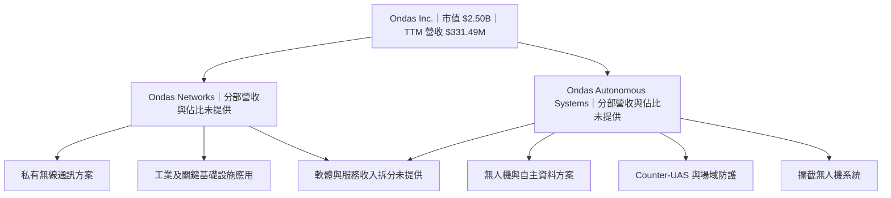
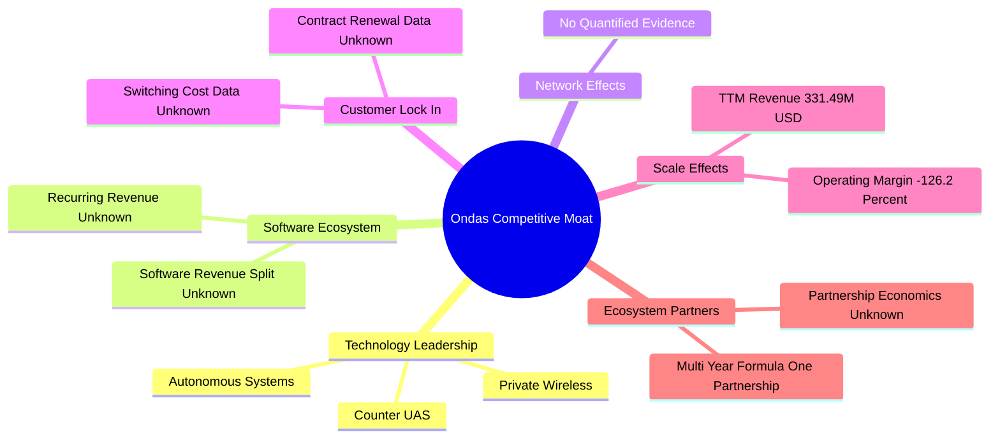
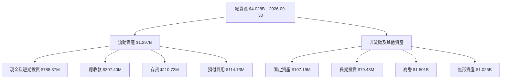
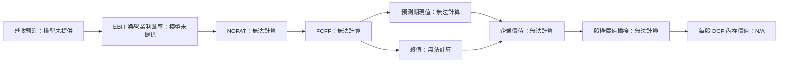
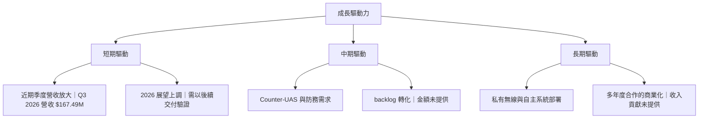
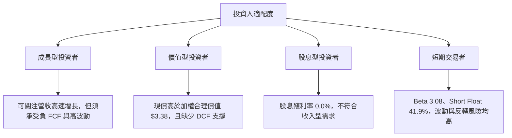

# ONDS 基本面深度分析報告
> **報告日期**：2026-11-20 ｜ **語言**：繁體中文 ｜ **數據來源**：SEC 申報資料 (XBRL)、Yahoo Finance、Finviz、StockAnalysis、Roic.ai ｜ **分析師**：CFA 級機構研究

## 目錄

| # | 章節 | 核心結論 |
|---|------|----------|
| 1 | 執行摘要 | 賣出；加權合理價值 $3.38，MOS -25.1% |
| 2 | 公司概覽與商業模式 | 私有無線、無人機與自主系統；業務拆分數據不足以量化護城河 |
| 3 | 損益表深度分析 | TTM 營收 $331.49M、TTM 成長 1239.4%；營業利潤率 -126.2% |
| 4 | 資產負債表分析 | 現金及短期投資 $788.87M；債務數據存在來源差異 |
| 5 | 現金流量深度分析 | TTM FCF -$311.55M、FCF Yield -12.45%，現金消耗快速 |
| 6 | 獲利能力與資本效率 | ROIC -20.9% 低於 WACC 14.00%，目前摧毀股東價值 |
| 7 | 相對估值分析 | 同業 P/S 法估值 $1.90；現價高於加權合理價值 |
| 8 | DCF 內在價值評估 | N/A：TTM 營業利益為負，不適用本次 DCF 模型 |
| 9 | 成長催化劑 | 2026 年營收放量、提高財測及無人機防務需求是主要催化因素 |
| 10 | 風險矩陣 | 執行與現金消耗、股權稀釋、估值波動為主要風險 |
| 11 | 投資建議 | 依 MOS 評級為賣出；關注營收品質、現金消耗與毛利率 |

---

## 1. 執行摘要

### 1.0 一頁式投資儀表板（Portfolio Manager 30 秒速讀）

| 項目 | 內容 |
|------|------|
| **投資論點（3 句）** | ① TTM 營收達 **$331.49M**、TTM 成長 **1239.4%**，反映近期業務規模快速擴大，但單季年增 **1558.6%** 不等同於可持續獲利。② TTM 營業利益率 **-126.2%**、ROIC **-20.9%**，在 **WACC 14.00%** 下仍大幅侵蝕資本回報。③ TTM FCF **-$311.55M**、FCF Yield **-12.45%**，顯示目前增長伴隨高額現金消耗。 |
| **綜合評分** | **4.2/10**（引用 1.1 評分卡） |
| **財務健康** | 🔴 現金與短期投資 **$788.87M** 提供緩衝，但 TTM FCF 為 **-$311.55M**，且營運資金週期為 **181 天**。 |
| **ROIC vs WACC** | **-20.9% vs 14.00%**；利差為 **-34.9 個百分點**，目前摧毀股東價值。 |
| **FCF 趨勢** | 現金流惡化；TTM FCF Yield **-12.45%**。 |
| **估值** | Forward P/E **-27.290323x**（負盈餘倍數不具通常解讀意義）｜EV/EBITDA **-6.116x**｜FCF Yield **-12.45%** |
| **DCF 內在價值（基準）** | **N/A**；TTM 營業利益為負，DCF 模型未提供，因此無法計算相對 DCF 折溢價。 |
| **安全邊際（MOS）** | **-25.1%**＝(**加權合理價值 $3.38 − 現價 $4.23**) ÷ 加權合理價值 $3.38；🔴 低於 10%，沒有下檔保護。 |
| **預期報酬（基準情境 12M）** | N/A；DCF 情境數據未提供。 |
| **關鍵風險（前二）** | ① **-$311.55M TTM FCF** 所代表的資金消耗速度；② **591.44M 股**流通股數與稀釋股數增加的訊號。 |
| **評級 + 信心度** | 🔴 **賣出**；信心：中。依 MOS 規則直接採用，沒有作一級質化調整。 |

### 1.1 綜合評分卡（全報告唯一）

| 維度 | 評分（1–10） | 主要依據（引用數字與其來源章節） |
|------|--------------|----------------------------------|
| 成長性 | 9.0 | TTM 營收成長 **1239.4%**、最新單季年增 **1558.6%**；高增長但基期與併購影響須留意（第 3 章）。 |
| 獲利能力 | 1.0 | TTM 營業利益率 **-126.2%**、ROIC **-20.9%**、Piotroski **3/8**（第 3、6 章）。 |
| 財務健康 | 6.0 | 現金及短期投資 **$788.87M**，但 TTM FCF **-$311.55M**、CCC **181 天**（第 4、5 章）。 |
| 估值 | 2.0 | MOS **-25.1%**；同業 P/S 推導價值 **$1.90**，低於現價 **$4.23**（第 7、8 章）。 |
| 護城河 | 4.0 | 有私有無線及自主無人機產品，但缺少分部收入、續約率、客戶集中度與市場份額數據（第 2 章）。 |
| 管理層與資本配置 | 3.0 | FY2025 SBC **$16.02M**，最近四季季度 SBC 合計 **$155.41M**；稀釋股數未通過 F-Score 測試（第 3、6 章）。 |
| **綜合評分** | **4.2** | 六項算術平均：\((9+1+6+2+4+3)÷6=4.1667\)，四捨五入至一位小數為 **4.2**。 |

### 1.2 五大投資論點 + 三大核心風險

| 類型 | 項目 | 具體依據 | 信心度 |
|------|------|----------|--------|
| 🟢 **投資論點①** | 營收正在迅速放大 | TTM 營收 **$331.49M**，TTM 年增 **1239.4%**；最新季度營收 **$167.49M**，單季年增 **1558.6%**。若增長能由交付轉化為毛利與現金，估值基礎可改善。 | 🟢 高 |
| 🟢 **投資論點②** | 現金儲備提供短期緩衝 | 現金及短期投資 **$788.87M**；但以 TTM FCF 消耗 **$311.55M** 粗略比較，現金緩衝並不等於可長期自給。 | 🟡 中 |
| 🟢 **投資論點③** | 無人機防務需求可能帶來訂單機會 | 公司產品包含 Counter-UAS、攔截無人機與自主系統；新聞提及提高 2026 展望與訂單／積壓加速，但未提供可供驗證的 backlog 金額。 | 🟡 中 |
| 🟢 **投資論點④** | TTM 毛利率為正 | TTM 毛利率 **36.4%**；與負營業利潤率並存，說明目前的主要挑戰是營業費用與整合成本，而非單純沒有毛利。 | 🟡 中 |
| 🟢 **投資論點⑤** | 分析師共識提供正面催化 | 10 位分析師平均目標價 **$16.68**，但其與同業 P/S 法估值 **$1.90** 落差極大，不能視作已驗證的基本面價值。 | 🟡 低 |
| 🟡 **風險①** | 高額現金消耗 | TTM 營業現金流 **-$290.76M**、FCF **-$311.55M**；若交付增長未能改善費用槓桿，可能需要額外融資。 | 🔴 高 |
| 🔴 **風險②** | 獲利能力與資本效率差 | TTM 營業利益率 **-126.2%**、ROIC **-20.9%**，遠低於 WACC **14.00%**。 | 🔴 高 |
| 🔴 **風險③** | 稀釋與估值波動 | 流通股數 **591.44M**；F-Score 的「稀釋股數未增加」測試未通過。股價從 2026 年 5 月月收盤 **$13.22** 降至 2026 年 11 月 **$4.23**。 | 🔴 高 |

### 1.3 快速統計卡片

| 指標 | 公司實際值（期間） | 同業中位數 | 狀態 |
|------|--------------------|------------|------|
| 營收成長（TTM） | **1239.4%** | — | 🟢 高增長；需確認有機成長與可持續性 |
| 營收成長（最新一季年增） | **1558.6%** | **22.0%** | 🟢 高於同業；可能受低基期與業務整合影響 |
| 毛利率（TTM） | **36.4%** | **23.0%** | 🟢 高於三家同業中位數 |
| 營業利益率（TTM） | **-126.2%** | — | 🔴 大幅虧損 |
| ROIC（TTM） | **-20.9%** | — | 🔴 低於 WACC |
| Forward P/E | **-27.290323x** | **21.8x** | 🔴 公司預期仍虧損，倍數不可直接比較 |
| FCF Yield（TTM） | **-12.45%** | — | 🔴 現金消耗 |
| Piotroski F-Score | **3 / 8** | — | 🔴 財務品質指標偏弱 |

### 1.4 投資結論

```text
╔══════════════════════════════════════════════════════════════════╗
║                    📊 投資結論摘要                               ║
╠══════════════════════════════════════════════════════════════════╣
║  評級：賣出（MOS -25.1%，符合規則 20）                           ║
║  價格（2026-11-19 收盤）：$4.23                                  ║
║  DCF 內在價值（基準）：N/A（TTM 營業利益為負）                   ║
║  安全邊際 MOS：-25.1%（=(加權合理價值−現價)÷加權合理價值）      ║
║  加權合理價值（8.8）：$3.38                                      ║
║  綜合評分：4.2/10（引用 1.1）                                    ║
║  適合投資人：能承受高波動、且願意以小部位承擔執行風險者；        ║
║              不適合重視現金流、估值保護或股息收入的投資人。      ║
╚══════════════════════════════════════════════════════════════════╝
```

---

## 2. 公司概覽與商業模式

### 2.1 業務結構與收入來源

Ondas Inc. 為美國科技與通訊設備公司，營運分為 **Ondas Networks** 與 **Ondas Autonomous Systems**。公司提供私有無線、無人機及自動化資料方案；自主系統相關產品包括 Counter-UAS、場域防護與攔截無人機系統。SEC 10-Q 所列最新期間截至 2026-09-30，TTM 營收為 **$331.49M**。目前沒有可核對的各分部營收與佔比，因此不將總營收拆分為未經證實的比例。



### 2.2 市場份額

市場份額數據未提供，亦沒有可引用的 TAM 與份額年份資料，因此不估算市場佔比。ONDS 的 TTM 營收 **$331.49M**、最新單季年增 **1558.6%**，高於 AVAV、KTOS、RCAT 最新季度年增中位數 **22.0%**；但單季增長差異不能單獨證明市場份額提升，仍須核對併購、交付與有機增長。

### 2.3 競爭護城河分析



### 2.4 護城河強度

| 護城河項目 | 強度（強／中／弱） | 證據（引用數字或事實） | 會削弱它的情況 |
|------------|--------------------|------------------------|----------------|
| 技術與產品 | 中 | 公司涵蓋私有無線、Counter-UAS 與自主無人機方案；但未提供產品市佔、專利價值或競標勝率。 | 同業推出可替代系統、產品性能未達標或交付延誤。 |
| 軟體生態系統 | 弱／未證實 | 軟體收入比例、經常性收入、續約率均未提供。 | 收入主要依賴一次性設備銷售，缺少軟體續約及服務收入。 |
| 網路效應 | 弱／未證實 | 未提供使用者、設備部署量或資料網路規模。 | 客戶可低成本更換供應商，或資料與系統無法形成互通優勢。 |
| 客戶鎖定 | 弱／未證實 | 未提供客戶集中度、合約年期與續約率。 | 採購專案延後、合約取消或客戶自行開發替代方案。 |
| 規模效應 | 弱 | TTM 營收 **$331.49M**，但 TTM 營業利益率 **-126.2%**，尚未證明規模轉化為利潤。 | 新收入仍帶來更快的費用與營運資金增加。 |
| 生態夥伴 | 中／待驗證 | 公司與 Aston Martin Aramco Formula One Team 宣布多年度合作，但財務貢獻未披露。 | 合作只具品牌宣傳效果，沒有轉化為訂單或可持續收入。 |

1.1 評分卡的護城河 **4.0/10**，反映產品與市場方向具備差異化可能，但缺少經常性收入、客戶鎖定、份額及單位經濟性證據。

---

## 3. 損益表深度分析

### 3.1 年度收入成長趨勢（近 4 年）

年度收入取自公司年度損益表，單位為美元。年度成長率依相鄰年度營收計算。

```text
╔══════════════════════════════════════════════════════════════════╗
║              Ondas Inc. 年度收入趨勢（FY2022–FY2025）            ║
╠══════════════════════════════════════════════════════════════════╣
║  FY2022  $2.13M   █                              YoY：基期         ║
║  FY2023  $15.69M  ███████                        YoY：+636.6%      ║
║  FY2024  $7.19M   ███                            YoY：-54.2%       ║
║  FY2025  $50.73M  █████████████████████████      YoY：+605.3%      ║
╠══════════════════════════════════════════════════════════════════╣
║  FY2022–FY2025 營收 CAGR：約 +187.8%                              ║
╚══════════════════════════════════════════════════════════════════╝
```

**計算說明：** FY2023 年增 = \((15.69÷2.13)-1=636.6\%\)；FY2024 年增 = \((7.19÷15.69)-1=-54.2\%\)；FY2025 年增 = \((50.73÷7.19)-1=605.3\%\)。三年 CAGR = \((50.73÷2.13)^{1/3}-1≈187.8\%\)。極低的 FY2022 基期及 FY2024 下滑，令多年 CAGR 對營收波動高度敏感，不應直接外推。

### 3.2 季度收入趨勢分析

| 季度 | 營收 | QoQ 成長 | YoY 成長 | 備註 |
|------|------:|---------:|---------:|------|
| 2025 Q4 | $30.11M | — | **+629.2%** | 年增率取 StockAnalysis 季度資料。 |
| 2026 Q1 | $50.12M | **+66.5%** | **+1079.9%** | QoQ = \(50.12÷30.11-1\)。 |
| 2026 Q2 | $83.77M | **+67.1%** | **+1235.4%** | QoQ = \(83.77÷50.12-1\)。 |
| 2026 Q3 | $167.49M | **+99.9%** | **+1558.6%** | 最新季度年增率以 SEC 對應的 VERIFIED FIGURES 為準；QoQ = \(167.49÷83.77-1\)。 |

連續季度的快速增長代表出貨或併入合併報表的營收大幅擴張，但不能視作穩態增長率。收入倍增亦伴隨高額營業虧損及應收款、存貨增加，關鍵是新增營收能否帶來現金回收與毛利貢獻。

### 3.3 利潤率演變分析

| 利潤率指標 | FY2022 | FY2023 | FY2024 | FY2025 | 趨勢 | 評估 |
|------------|-------:|-------:|-------:|-------:|------|------|
| **毛利率** | 52.1% | 40.7% | 4.8% | 39.7% | 2024 明顯下滑、2025 回升 | 🟡 波動大 |
| **營業利益率** | -2347.9% | -243.7% | -481.4% | -115.1% | 2025 改善，但仍虧損 | 🔴 |
| **淨利率** | -3438.0% | -285.7% | -528.4% | -260.3% | 各年受低營收基期影響嚴重 | 🔴 |

年度毛利率以年度毛利除以年度營收計算；營業利益率與淨利率同理。FY2022 的極端百分比主要是分母只有 **$2.13M**，不宜與後續規模直接比較。FY2025 毛利率回升至 **39.7%**，但營業利益仍為 **-$58.38M**，說明成本基礎及營業費用仍遠高於現有毛利。TTM 營業利益率依 VERIFIED FIGURES 為 **-126.2%**；其他資料來源列出的 TTM margin 有差異，本報告核心評估採用已核驗數值。

### 3.4 費用結構分析

年度費用明細未提供完整且可比的 TTM 分類數字，故不製作金額比例圓餅圖，以免將缺失數據誤作結構。可確認的 FY2025 R&D 為 **$20.88M**，FY2025 營業虧損為 **$58.38M**；FY2026 季度資料顯示營業虧損顯著擴大，原因可能包括收購整合、股權薪酬及成長投入，但各項貢獻拆分未提供。

### 3.5 季度 EPS 趨勢與盈餘品質（Quality of Earnings）

| 季度 | EPS 估計 | EPS 實際 | 超預期／不及預期 |
|------|---------|---------|----------------|
| 2025 Q4 | N/A | N/A | EPS estimate 與 actual 為缺值，不能判定。 |
| 2026 Q1 | N/A | N/A | EPS estimate 與 actual 為缺值，不能判定。 |
| 2026 Q2 | N/A | N/A | EPS estimate 與 actual 為缺值，不能判定。 |
| 2026 Q3 | N/A | N/A | EPS estimate 與 actual 為缺值，不能判定。 |

| 盈餘品質項目 | 數值／佔比 | 評估 |
|--------------|-----------|------|
| 股權薪酬 SBC / 營收 | 最近四季 SBC 合計 **$155.41M**；除以 TTM 營收 **$331.49M**＝**46.9%** | 🔴 SBC 佔營收比高，代表股東承擔實質稀釋成本；季度 SBC 資料合計可能受收購與股權獎酬時點影響。 |
| SBC / 營業現金流 | **$155.41M ÷ -$290.76M = -53.5%**；以現金流絕對值比較為 **53.5%** | 🔴 分母為負，傳統正向覆蓋率不適用；SBC 規模約為營業現金流消耗額的一半。 |
| FCF / 淨利（現金轉換率） | 季度淨利合計約 **$112.47M**；TTM FCF **-$311.55M**，比率約 **-276.9%** | 🔴 正淨利與大額負 FCF 不一致；淨利受 2026 Q1 **$362.95M** 淨利的異常波動影響，現金獲利含金量低。 |
| 一次性／非經常性損益 | 2026 Q1 淨利 **$362.95M**，其後 Q2、Q3 分別虧損 **$88.25M**、**$62.57M**；明細 N/A | 🔴 季度淨利波動顯示可能有非經常性項目，但無法從現有資料確認具體來源。 |
| 有效稅率異常 | N/A | 無完整 TTM 稅前利潤與所得稅拆分，不能計算有效稅率。 |
| 資本化支出 vs 費用化 | TTM Capex **$20.80M**；資本化政策及收購無形資產攤銷明細 N/A | 🟡 Capex 金額可辨識，但不足以判斷是否存在費用資本化造成的盈餘高估。 |

**盈餘品質結論：** TTM 淨利率與季度淨利數據不應被當作可持續獲利證據。TTM FCF **-$311.55M**、SBC／營收 **46.9%**，以及 2026 Q1 異常正淨利，均指向現金轉換與股東稀釋值得高度關注。就目前資料而言，盈餘品質偏弱，估值應更倚重銷售額、毛利與現金消耗的改善，而非表面 EPS。

---

## 4. 資產負債表分析

### 4.1 資產結構分解

下列資產組成取自 StockAnalysis 2026-09-30 結餘；欄位以美元計，部分細項加總與總資產有小幅差異，故不作強制配平。



### 4.2 流動性與營運資金分析

| 指標 | 最新 TTM | 一年前 TTM | 變化 | 解讀 |
|------|----------|------------|------|------|
| 流動比率 | **3.389** | N/A | N/A | 表面短期資產覆蓋較充足；比率來源為市場資料，與季度資產組成可能存在口徑差異。 |
| 速動比率 | **2.604** | N/A | N/A | 顯示除存貨外仍有短期資產緩衝，但現金消耗速度是主要風險。 |
| DSO 應收帳款天數 | **140 天** | **77 天** | **+63 天** | 應收回款時間拉長；需觀察政府及企業客戶付款條件、收入認列與回款品質。 |
| DIO 存貨天數 | **182 天** | **278 天** | **-96 天** | 存貨周轉天數改善，但目前仍約半年；須確認存貨下降是否來自交付而非供應不足。 |
| DPO 應付帳款天數 | **141 天** | **186 天** | **-45 天** | 付款天數縮短，可能減少供應商融資對營運資金的支撐。 |
| CCC 現金轉換週期 | **181 天** | **169 天** | **+12 天** | 整體現金轉換週期延長，應收帳款上升抵銷了存貨天數改善。 |

營運資金天數按期末餘額除以 TTM 流量計算。DSO 上升 **63 天** 是值得關注的方向性訊號；若收入增長主要來自信用銷售或長付款期訂單，營收增長未必能同步轉為現金。

### 4.3 債務結構分析

不同來源的總債務數據不一致：核驗數字區塊列總債務 **N/A**、淨現金 **$788.87M**；另一組市場／財務資料列總債務 **$62.81M**、淨現金 **$726.06M**。本節不以缺失數字反推債務，並將總債務視為**尚待核對**。

```text
╔══════════════════════════════════════════════════════════════════╗
║                   Ondas Inc. 債務健康診斷                        ║
╠══════════════════════════════════════════════════════════════════╣
║  總債務（核驗值）：N/A；另一來源列 $62.81M，口徑待核對          ║
║  現金及短期投資：$788.87M                                        ║
║  淨現金（核驗值）：$788.87M；其他來源列 $726.06M                ║
║  Debt / EBITDA：N/A（TTM EBITDA 為負，倍數無通常解讀意義）       ║
║  利息保障倍數：N/A（利息費用及適用口徑未提供）                   ║
║  判斷：🟡 現金緩衝可觀，但現金消耗與負債口徑需追蹤              ║
╚══════════════════════════════════════════════════════════════════╝
```

### 4.4 股東權益趨勢

| 年度 | 股東權益 | 年度變化 |
|------|---------:|---------:|
| 2022 | $58.22M | — |
| 2023 | $33.14M | -43.1% |
| 2024 | $16.58M | -50.0% |
| 2025 | $437.81M | +2540.0% |

```text
╔══════════════════════════════════════════════════════════════════╗
║                 股東權益變化（年度報表）                         ║
╠══════════════════════════════════════════════════════════════════╣
║  FY2022  $58.22M   ███                                            ║
║  FY2023  $33.14M   ██                                             ║
║  FY2024  $16.58M   █                                              ║
║  FY2025  $437.81M  ██████████████████████████████                 ║
╚══════════════════════════════════════════════════════════════════╝
```

FY2025 權益跳升與資產負債表擴大並存，現有資料不足以拆分其來源；不能僅依權益增加判斷營運改善。2025 年末總資產 **$1.13B**，遠高於 2024 年末 **$109.62M**，應結合收購、發股與合併範圍變化解讀。

---

## 5. 現金流量深度分析

### 5.1 現金流量瀑布圖

以下採 TTM 營業現金流與 Capex 核驗值；淨利以最近四季季度損益表合計作參考。淨利至營業現金流的調節項未提供，故不以虛構橋接數配平。


### 5.2 FCF 轉換率趨勢

| 年度 | FCF | 淨利 | FCF / 淨利 | 解讀 |
|------|----:|----:|-----------:|------|
| 2022 | -$40.89M | -$73.24M | +55.8% | 兩者同為負值，正比率不代表現金獲利良好。 |
| 2023 | -$34.30M | -$44.84M | +76.5% | FCF 仍為負。 |
| 2024 | -$35.20M | -$38.01M | +92.6% | 負淨利下比率接近 100%，仍沒有正現金流。 |
| 2025 | -$40.88M | -$132.02M | +31.0% | 淨虧損擴大；比率受虧損金額變動影響。 |
| TTM | -$311.55M | 約 $112.47M（四季淨利合計） | 約 **-276.9%** | 受 2026 Q1 大額正淨利及後續虧損影響，不宜視為正常化轉換率。 |

### 5.3 自由現金流趨勢

| 期間 | FCF | 備註 |
|------|----:|------|
| FY2022 | -$40.89M | 年度營業現金流與 Capex 均為負向 FCF 組成。 |
| FY2023 | -$34.30M | 仍需外部資金支撐。 |
| FY2024 | -$35.20M | 現金流沒有轉正。 |
| FY2025 | -$40.88M | 現金消耗較 FY2024 擴大。 |
| TTM 至 2026-09-30 | **-$311.55M** | TTM FCF Yield **-12.45%**。 |

```text
╔══════════════════════════════════════════════════════════════════╗
║               自由現金流：年度實際與最新 TTM                     ║
╠══════════════════════════════════════════════════════════════════╣
║  FY2022  -$40.89M  ░░░░                                           ║
║  FY2023  -$34.30M  ░░░                                            ║
║  FY2024  -$35.20M  ░░░                                            ║
║  FY2025  -$40.88M  ░░░░                                           ║
║  TTM     -$311.55M ░░░░░░░░░░░░░░░░░░░░░░░░░░░░                ║
║  TTM FCF Yield：-12.45%                                            ║
╚══════════════════════════════════════════════════════════════════╝
```

TTM FCF 比年度 FCF 更負，主要訊號是營運現金流消耗由年度約 **$34–41M** 的區間升至 TTM **$290.76M** 的營業現金流流出。營收放大若需大幅墊付存貨、應收款、人力與整合費用，現金轉化可能落後於會計收入。

### 5.4 資本配置評估

完整資本配置比例資料未提供，不製作比例圓餅圖。可核對的項目如下：

| 項目 | 已知數據 | 評估 |
|------|----------|------|
| Capex | TTM **$20.80M** | 相較 TTM FCF 缺口不是主要現金流壓力來源；營業現金流流出更大。 |
| 股息 | 殖利率 **0.0%** | 未提供股息支出。 |
| 回購 | N/A | 回購金額未提供；F-Score 顯示稀釋股數未通過測試。 |
| 研發 | FY2025 **$20.88M** | 反映產品開發投入，但尚無法評估其收入回報。 |
| 收購與投資 | 資產負債表含商譽 **$1.501B**、無形資產 **$1.025B**（2026-09-30） | 資產比重值得關注，未提供各筆收購價格、商譽減值測試或投資報酬拆分。 |

---

## 6. 獲利能力與資本效率

### 6.1 ROE / ROA / ROIC 趨勢

| 指標 | 最新可用值 | 歷史或補充資料 | 評估 |
|------|-----------:|----------------|------|
| ROE（TTM） | **4.6%** | 年度資料未提供可比 ROE 序列；另一來源列 7.3%，口徑不同 | 使用核驗值；須注意淨利受單季異常影響。 |
| ROA（TTM） | **N/A** | 另一來源列 -9.7%，與核驗數據區塊未列 ROA 數值 | 不混用衝突值作正式比較。 |
| ROIC（TTM） | **-20.9%** | TTM | 🔴 低於資本成本。 |
| WACC | **14.00%** | 資本成本模組計算值受上限限制 | 作為第 6.2 與第 8 章一致折現率。 |

行業均值未提供，因此不作無來源的同業 ROE、ROA 或 ROIC 均值對比。

### 6.2 ROIC vs WACC 分析（核心價值創造判斷）

```text
╔══════════════════════════════════════════════════════════════════╗
║                ROIC vs WACC 深度分析                            ║
╠══════════════════════════════════════════════════════════════════╣
║  WACC 估算（沿用資本成本資料）：                                 ║
║  ├── 無風險利率（10Y 美債）：       5.05%                        ║
║  ├── 市場風險溢酬 ERP：             5.00%                        ║
║  ├── 原始 Beta：                    3.08                         ║
║  ├── 採用調整後 Beta：              2.00                         ║
║  ├── 股權成本：5.05% + 2.00×5.00% = 15.05%                     ║
║  ├── 稅前債務成本：                 10.47%                       ║
║  ├── 資本權重：股權 97.6%，債務 2.4%                            ║
║  ├── 計算 WACC：                    14.89%                       ║
║  └── 採用 WACC：                    14.00%（依 7%–14% 區間封頂） ║
║                                                                  ║
║  ROIC（TTM）：                      -20.9%                       ║
║  價值利差：ROIC − WACC = -20.9% − 14.00% = -34.9pp              ║
║                                                                  ║
║  結論：🔴 ROIC 大幅低於 WACC，現階段摧毀股東價值。               ║
╚══════════════════════════════════════════════════════════════════╝
```

Beta 採用調整後 **2.00**；原始 Beta **3.08** 經 \(⅔×3.08+⅓=2.3867\) 後，依資本成本資料所示 **0.6–2.0** 範圍限制於 2.00。股權成本 = \(5.05\%+2.00×5.00\%=15.05\%\)。依股權／債務權重與稅前債務成本估算，計算 WACC **14.89%**，但由於資本成本資料採 **7%–14%** 上下限，使用 WACC **14.00%**。ROIC 與 WACC 相差 **-34.9pp**，表明當前新增資本投資尚未創造足夠回報。

### 6.3 杜邦三因素分解

| 因素 | 數值（TTM） | 解讀 |
|------|-------------|------|
| 淨利率 | **33.1%** | 受 TTM 淨利與營收變動、以及季度淨利劇烈波動影響；不代表營業獲利為正。 |
| 資產週轉率 | **0.08** | 資產規模相對營收偏大，亦可能受收購商譽與無形資產影響。 |
| 權益乘數 | **1.70** | 財務槓桿不是 ROE 的主要放大來源。 |
| **ROE** | **4.6%** | 核驗值；三因素以未四捨五入數字計算，顯示值相乘可能因四捨五入有差異。 |

### 6.4 財務體質：Piotroski F-Score

**Piotroski F-Score：3 / 8**。一項因輸入資料缺失而不列入可判定分母，故此處為 8 項可判定測試。

| 測試 | 結果 | 解讀 |
|------|------|------|
| ROA > 0 | ✅ 通過 | 資料中的測試值為正，但與其他虧損及 ROA 來源口徑不同，不能單獨視為獲利轉折。 |
| 營業現金流 > 0 | ❌ 未通過 | TTM 營業現金流 **-$290.76M**。 |
| ROA 高於一年前 | ✅ 通過 | 相較一年前改善，但絕對營運成果仍需其他指標確認。 |
| 營業現金流 > 淨利 | ❌ 未通過 | 現金流與會計損益的落差顯著。 |
| 長期負債／總資產低於一年前 | — 無法判定 | 缺少可比輸入，不作補值。 |
| 流動比率高於一年前 | ❌ 未通過 | 流動比率年度比較未改善。 |
| 稀釋股數未增加 | ❌ 未通過 | 股數增加對每股價值造成稀釋。 |
| 毛利率高於一年前 | ❌ 未通過 | 毛利率測試未通過；需要連續季度毛利率回升佐證。 |
| 資產週轉率高於一年前 | ✅ 通過 | 資產使用效率相較一年前提升。 |

---

## 7. 相對估值分析

### 7.1 同業估值比較表格

同業倍數取自 Yahoo Finance 的 Peer multiples。負盈餘公司的 P/E 與 EV/EBITDA 可能沒有經濟意義；不同公司商業模式與營收增長基期也可能造成倍數差異。

| 估值指標 | **ONDS** | **AVAV** | **KTOS** | **RCAT** | ONDS 評估 |
|----------|---------:|---------:|---------:|---------:|-----------|
| **Trailing P/E** | N/A | N/A | 247.1x | N/A | 🔴 ONDS 虧損，P/E 不適用。 |
| **Forward P/E** | -27.290323x | 21.8x | 26.5x | -3.0x | 🔴 ONDS 前瞻盈餘為負，倍數無法作正向相對估值。 |
| **P/S Ratio** | 7.9x¹ | 2.4x | 3.4x | 4.0x | 🔴 ONDS 高於同業中位數 **3.4x**。 |
| **EV/EBITDA** | -6.116x | 23.4x | 49.2x | -0.5x | 🔴 ONDS EBITDA 為負，倍數不可按正常獲利倍數解讀。 |
| **最新季度營收年增** | 1558.6% | 5.7% | 35.7% | 22.0% | 🟢 高於同業，但須驗證有機增長與現金回收。 |
| **TTM 毛利率** | 36.4% | 26.5% | 23.0% | 8.7% | 🟢 高於同業中位數 **23.0%**。 |

¹ 自身歷史比較模組列 P/S **7.9x**；其他市場估值資料列約 **7.547x**，不同資料快照與計算口徑略有差異，本表採用歷史估值區塊的 **7.9x**。同業中位數：P/S = **3.4x**；季度營收年增 = **22.0%**；TTM 毛利率 = **23.0%**。

### 7.2 歷史估值區間分析

```text
╔══════════════════════════════════════════════════════════════════╗
║                ONDS 自身歷史 P/S（TTM）估值位置                  ║
╠══════════════════════════════════════════════════════════════════╣
║  歷史低點 2.9x ├──────── 現值 7.9x ────────┤ 歷史高點 140.6x     ║
║  歷史中位數：17.9x                                               ║
║  當前百分位：32%                                                 ║
╚══════════════════════════════════════════════════════════════════╝
```

現行 P/S **7.9x** 低於自身五年中位數 **17.9x**，處於歷史 **32 百分位**；但歷史區間上限達 **140.6x**，反映過去估值樣本高度波動。現值低於歷史中位數並不自動代表低估，因同業 P/S 中位數只有 **3.4x**，而 ONDS 仍有深度營業虧損及負 FCF。

### 7.3 情境價值（Bear / Base / Bull，照抄 DCF MODEL 的 Scenarios）

**N/A（DCF 無法計算：TTM 營業利益不為正，DCF MODEL 未提供情境估值）。** 不另行設定情境目標價。

### 7.4 相對估值隱含價格區間

```text
╔══════════════════════════════════════════════════════════════════╗
║                 相對估值每股價值與現價位置                       ║
╠══════════════════════════════════════════════════════════════════╣
║  同業 P/S：$1.90 ───────── 現價：$4.23                           ║
║  分析師共識：$16.68                                               ║
║  現價高於同業 P/S 隱含價值；低於分析師平均目標價                 ║
╚══════════════════════════════════════════════════════════════════╝
```

| 方法 | 每股價值 | 相對現價 | 依據 |
|------|---------:|---------:|------|
| 同業 P/S | **$1.90** | **-55.1%** | AVAV、KTOS、RCAT 的 P/S 中位數 **3.4x** 乘以 ONDS TTM 營收；估值方法區塊提供的每股回推值。 |
| 分析師共識目標價 | **$16.68** | **+294.3%** | 10 位分析師平均目標價；屬市場預期，不是基本面現金流估值。 |

---

## 8. DCF 內在價值評估（Discounted Cash Flow）

> **DCF MODEL：N/A。** TTM 營業利益為負；既定 DCF 模型不對負 TTM 營業利益直接折現。本章不另行建模、不自行補入營收 CAGR、利潤率、終值或股數假設。

### 8.0 估值推理鏈（Thinking Logic）

**核心命題：** ONDS 的價值主要取決於快速增長的設備與自主系統銷售能否轉化為可持續毛利、營業利潤與現金流；目前 Ondas Networks 與 Ondas Autonomous Systems 分部收入佔比均未提供，不能以虛構分部比例拆出現金流底盤。

DCF 模型採用理由及限制如下：

| 決策點 | 本報告採用 | 理由（含數字） | 曾考慮但否決 | 否決理由 |
|--------|-----------|----------------|--------------|----------|
| 現金流定義 | 不計算 | TTM 營業利益為負，模型標示 N/A。 | 自建 FCFF | 會違反提供的估值模型規則，亦需臆測營業利潤率轉正時間。 |
| 預測期 N | N/A | DCF MODEL 未提供預測期。 | 自定 5–10 年 | 缺乏足以支持逐年預測的經營假設。 |
| 終值方法 | N/A | 沒有有效預測 FCFF，終值無法建立。 | Gordon Growth 或退出倍數 | 缺乏 FY+N 現金流或 EBITDA。 |
| EBIT 基礎 | N/A | 不建立模型，故不選 GAAP／非 GAAP EBIT。 | 假設利潤率正常化 | 不具備可稽核的回復路徑。 |
| 主導變數 | 營業利潤率與現金轉換 | TTM 營業利潤率 **-126.2%**、TTM FCF **-$311.55M**，較單純銷售倍數更能決定公司能否自我融資。 | 直接外推營收增長 | TTM 成長 **1239.4%** 不能單獨說明獲利與現金品質。 |

**最脆弱的一環：** 若收入增長不能改善營業費用率、應收回款與 FCF，銷售倍數估值亦可能下修；目前無 DCF 敏感度或情境價值可量化其幅度。



### 8.1 模型假設總表（Model Inputs）

**N/A（數據未提供：DCF MODEL 未建立；沒有逐年營收、利潤率、稅率、Capex、D&A、營運資金變動、SBC 處理、年稀釋率、永續成長率或終值輸入）。** 這些數字不以自行估計替代。

### 8.2 折現率推導（WACC）

本節列示資本成本資料供 ROIC 比較與估值背景使用；因 DCF 模型為 N/A，**不將 WACC 用於自建 DCF**。

```text
╔══════════════════════════════════════════════════════════════════╗
║                    WACC 資料與計算限制                           ║
╠══════════════════════════════════════════════════════════════════╣
║  股權成本 Ke：                                                   ║
║  ├── 無風險利率 Rf：5.05%                                        ║
║  ├── ERP：5.00%                                                  ║
║  ├── 原始 Beta：3.08；採用調整後 Beta：2.00                     ║
║  └── Ke = 5.05% + 2.00×5.00% = 15.05%                           ║
║                                                                  ║
║  債務成本：稅前 10.47%；預設稅率 21.0%                           ║
║  資本權重：股權 97.6%；債務 2.4%                                ║
║  加權計算值：14.89%；資料設定區間上限 14.00%                    ║
║  採用 WACC：14.00%                                               ║
╚══════════════════════════════════════════════════════════════════╝
```

計算值 = \(97.6\%×15.05\%+2.4\%×10.47\%×(1-21.0\%)\) = \(14.6888\%+0.1985\%=14.8873\%\)，四捨五入為 **14.89%**；資本成本資料將其限制在 **7%–14%** 區間，因此採用 **14.00%**。債務餘額與利息計算所用範圍未能從報告資料完整核驗，故不自行重建五步式債務權重模型。

### 8.3 逐年自由現金流預測（基準情境）

**N/A（DCF MODEL 未提供預測期或逐年 FCFF）。** 因此無法列出逐年營收、EBIT、NOPAT、Capex、D&A、營運資金、折現因子及 PV，也無法提供預測期 FCF 現值合計或逐步演算。歷史 TTM FCF **-$311.55M** 不是未來 DCF 預測。

### 8.4 終值計算（Terminal Value）

**N/A（缺少預測期最後一年 FY+N 的 FCFF／EBITDA，且 DCF MODEL 未提供終值）。** 不以假設的永續成長率或退出倍數填補。

### 8.5 企業價值 → 每股內在價值（Bridge）

**N/A（沒有 DCF 企業價值、終值現值或可用的模型股數，因此無法進行 EV 至每股價值橋接）。** DCF 基準內在價值為 N/A；折溢價不適用。本報告不在本節計算 MOS。

### 8.6 敏感性分析（WACC × 永續成長率）

**N/A（DCF MODEL 未提供敏感性矩陣；不自行建立 WACC × g 試算）。** 因此沒有基準格、有效格或可複算的敏感度彈性數值。

### 8.7 反推 DCF（Reverse DCF：市場在預期什麼）

**N/A（DCF 模型未提供）。** 單一股價不能在缺少模型現金流與其餘基準假設時，唯一回推營收 CAGR、營業利潤率、永續成長率或預測期年數。分析師平均目標價 **$16.68** 不是反推 DCF 結果。

### 8.8 估值三角驗證與安全邊際

| 估值方法 | 隱含每股價值 | 上行空間（÷現價） | 權重 | 說明 |
|----------|--------------|-------------------|------|------|
| 同業 P/S | **$1.90** | **-55.1%** | **90%** | 同業中位數 P/S **3.4x** 乘以 ONDS TTM 營收所回推的每股價值。 |
| 分析師共識目標價 | **$16.68** | **+294.3%** | **10%** | 10 位分析師平均目標價；不是 DCF 或現金流估值。 |
| **加權合理價值** | **$3.38** | **-20.1%** | **100%** | 不盈利公司估值權重依固定類型設定。 |

**加權計算：**  
\[
\$1.90×90\%+\$16.68×10\%
=\$1.71+\$1.668
=\$3.378
\approx \$3.38
\]

權重總和 = **90% + 10% = 100%**。同業 Forward P/E 因 ONDS 預期 EPS 為負而不可計算，其權重由可用方法承接；估值權重為公司類型設定，不是本報告自行調整。

**MOS 計算：**
\[
(\$3.38-\$4.23)÷\$3.38
=-\$0.85÷\$3.38
=-25.1\%
\]

**上行空間計算：**
\[
(\$3.38-\$4.23)÷\$4.23
=-\$0.85÷\$4.23
=-20.1\%
\]

```text
╔══════════════════════════════════════════════════════════════════╗
║                  估值區間與安全邊際                              ║
╠══════════════════════════════════════════════════════════════════╣
║  同業 P/S $1.90 ───── 加權合理價值 $3.38 ── 現價 $4.23           ║
║                                                                  ║
║  安全邊際 MOS = (加權合理價值 − 現價) ÷ 加權合理價值 = -25.1%  ║
║  MOS 評估：🔴 低於 10%，沒有安全邊際                             ║
║  上行空間 = (合理價值 − 現價) ÷ 現價 = -20.1%                   ║
║                                                                  ║
║  參考價位：MOS 至少 +10% 對應股價約 $3.04 或以下                ║
║  MOS 位於 -10% 至 +10% 對應約 $3.04–$3.72                        ║
║  MOS 低於 -25% 對應股價高於約 $4.23                              ║
╚══════════════════════════════════════════════════════════════════╝
```

區間換算使用同一加權合理價值 **$3.38**：MOS +10% 的價格上限 = \(3.38×(1-10\%)≈\$3.04\)；MOS -10% 的價格 = \(3.38×1.10≈\$3.72\)。評級仍依程式核驗的 **MOS -25.1%：賣出**。

> 🔎 **程式複算（Python，依本節各項自動重算）**
>
> 加權合理價值 = $1.90 × 90% + $16.68 × 10% = **$3.38**（權重合計 100%）
>
> 以價格 $4.23 計：MOS = **-25.1%**，上行空間 = **-20.1%**
>
> ✅ 與本節所寫數值一致。

### 8.9 DCF 模型的局限與失效條件

- **終值依賴度：** N/A，沒有 DCF 終值或 EV，不能計算佔比。
- **最脆弱假設：** N/A；DCF 假設未提供。從營運角度，營收增長能否改善營業利潤率與現金回收是最重要但尚未證實的命題。
- **不適用情境：** 公司 TTM 營業利益為負、TTM FCF **-$311.55M**，且季度淨利波動極大，傳統 DCF 對目前數據的可靠度低。現階段可先檢視同業 P/S、毛利率、營運費用率、應收款與現金消耗；待營業利潤和 FCF 可預測後再採用 DCF。
- **與第 10 章風險連結：** 訂單延誤會降低營收假設；毛利率下降或整合成本上升會延後營業利潤轉正；應收帳款與存貨增加會壓低現金轉換。

### 8.10 複算檢核表（Audit Trail）

| # | 檢核項目 | 檢查方式 | 結果 |
|---|----------|----------|------|
| 1 | DCF 高／中敏感度輸入四段式推導 | DCF MODEL 為 N/A，沒有假設輸入可核對 | N/A |
| 2 | 每個 DCF 假設都有來歷 | 未建立模型，沒有靜默補值 | ✅ |
| 3 | WACC 五步算式及加權 | 使用提供的計算值、採用值與上限規則 | ✅（使用 14.00%） |
| 4 | Kd 分母與債務權重範圍一致 | 負債口徑資料存在差異，無法獨立核對 | N/A |
| 5 | WACC 與第 6.2 節一致 | 均為 **14.00%** | ✅ |
| 6 | 預測年度數等於 N，且無省略 | 無 DCF 模型與 N | N/A |
| 7 | FY+1 FCFF 與 PV 可複算 | 無 FY+1 預測 | N/A |
| 8 | 預測期 PV 加總 | 無年度 PV | N/A |
| 9 | WACC > g | g 未提供 | N/A |
| 10 | 終值以 FY+N 現金流折現 | 無終值模型 | N/A |
| 11 | EV 至每股價值橋接 | DCF 橋接未提供 | N/A |
| 12 | SBC、EBIT 與股數假設相容 | 未建立 DCF，不使用模型 SBC／稀釋假設 | N/A |
| 13 | 敏感性矩陣基準格等於 DCF 基準值 | 矩陣未提供 | N/A |
| 14 | 敏感性矩陣有效格符合 WACC > g | 矩陣未提供 | N/A |
| 15 | 三情境機率與加權算式 | DCF Scenarios 未提供 | N/A |
| 16 | Reverse DCF 每列只放開一變數 | Reverse DCF 未提供 | N/A |
| 17 | MOS 基準與折溢價基準一致 | MOS 以 8.8 加權價值計算；DCF 折溢價 N/A | ✅ |
| 18 | 報告完整至第 11 章 | 章節 1–11 均保留 | ✅ |
| 19 | 加權合理價值等於各方法加權和 | \(1.90×90\%+16.68×10\%=3.378≈3.38\) | ✅ |
| 20 | 評級符合 MOS 門檻 | MOS **-25.1%**，評級為賣出 | ✅ |

---

## 9. 成長催化劑

### 9.1 催化劑時間軸

目前可核實資料沒有提供未來催化劑的明確完成日期或季度，因此不以推測日期製作甘特圖。已知催化因素及可追蹤時間如下：

| 時間 | 催化劑 | 可驗證指標 |
|------|--------|------------|
| 近期／下一季財報 | 2026 年提高展望與近期創紀錄季度的後續交付 | 季營收是否延續增長；實際財測與收入是否相符。 |
| 未來數季 | backlog 轉化與防務需求 | 新訂單、backlog 金額、交付週期及取消率；目前金額未提供。 |
| 多年度 | Aston Martin Aramco Formula One Team 多年度合作 | 合作是否帶來具體產品訂單、服務收入或可量化商業回報。 |
| 中長期 | Counter-UAS、私有無線及自主系統擴大應用 | 分部收入、毛利率、續約／服務收入與現金轉換。 |

### 9.2 TAM 市場規模分析

**N/A（TAM 數據未提供）。** 公司 TTM 營收 **$331.49M**，最新季度年增 **1558.6%**，表明業務規模快速擴張，但沒有可引用的市場規模、來源年份或滲透率資料，不能據此計算市場滲透率。

### 9.3 成長驅動力結構圖



---

## 10. 風險矩陣

### 10.1 風險評分矩陣

發生機率與衝擊的量化百分比未提供，故不以假定機率／財務損失填入數字象限；以下依已知財務數據列示風險排序。

| 風險 | 資料支持 | 相對優先度 |
|------|----------|------------|
| 現金消耗與資金需求 | TTM FCF **-$311.55M**；現金及短期投資 **$788.87M** | 🔴 高 |
| 營收增長未能轉化為營業利潤 | TTM 營收增長 **1239.4%**，但營業利益率 **-126.2%** | 🔴 高 |
| 稀釋與股權薪酬 | 最近四季 SBC 合計 **$155.41M**；F-Score 稀釋股數測試未通過 | 🔴 高 |
| 應收款與營運資金 | DSO **140 天**，較一年前增加 **63 天**；CCC **181 天** | 🟠 中高 |
| 估值波動 | 股價從 2026-05 月收盤 **$13.22** 降至 2026-11 **$4.23**；Short % Float **41.9%** | 🟠 中高 |

### 10.2 風險清單詳細分析

| # | 風險項目 | 發生機率 | 財務衝擊 | 風險評估 | 緩解措施 |
|---|----------|----------|----------|----------|----------|
| 1 | 🔴 **現金消耗超過訂單轉現金速度** | 中高；TTM OCF **-$290.76M** | 若持續，現金儲備下降並可能需融資；不對未來損失填入未提供的估值 | 🔴 高 | 每季追蹤 OCF、FCF、現金餘額及資金期限；要求營收增長同步改善回款。 |
| 2 | 🔴 **營業槓桿未能出現** | 中高；TTM 營業利益率 **-126.2%** | 毛利增加仍可能被營業費用吸收 | 🔴 高 | 追蹤營業費用／營收、毛利率及分部營業利潤；若營收增長但虧損惡化，降低風險承擔。 |
| 3 | 🔴 **稀釋與 SBC 壓低每股價值** | 已有稀釋訊號；SBC / 營收 **46.9%** | 股數增加會使公司層級成長無法等比例轉化為每股價值 | 🔴 高 | 每季檢視稀釋股數、SBC／營收及管理層激勵安排。 |
| 4 | 🟠 **應收款回收變慢** | 已觀察到 DSO 增加 **63 天** | 可能使營收成長同時擴大營運資金缺口 | 🟠 中高 | 追蹤 DSO、逾期應收、客戶預付款及實際收款。 |
| 5 | 🟠 **業務整合與無形資產風險** | 資產負債表含商譽 **$1.501B**、無形資產 **$1.025B** | 若收購業務未達預期，可能需要減值並增加損失波動 | 🟠 中 | 追蹤分部收入、收購整合成本、商譽減值測試與資本回報。 |
| 6 | 🟡 **高波動與空頭部位** | Beta 原始值 **3.08**；Short % Float **41.9%** | 價格可能大幅偏離基本面；空頭回補亦可放大短線波動 | 🟠 中高 | 以部位上限與分批交易管理風險，避免將短期擠空當成基本面改善。 |

---

## 11. 投資建議

### 11.1 最終評級與評分

加權合理價值 **$3.38** 相對 2026-11-19 收盤價 **$4.23** 的 MOS 為 **-25.1%**，依評級規則為**賣出**，沒有作質化上調或下調。1.1 綜合評分為 **4.2/10**，六項分數依序為成長性 **9.0**、獲利能力 **1.0**、財務健康 **6.0**、估值 **2.0**、護城河 **4.0**、管理層與資本配置 **3.0**。

### 11.2 合理價值與隱含報酬率

| 價值基準 | 每股價值 | 相對 2026-11-19 收盤價 $4.23 | 說明 |
|----------|---------:|-----------------------------:|------|
| 同業 P/S 估值 | $1.90 | -55.1% | 同業 P/S 中位數 **3.4x** 回推。 |
| **加權合理價值** | **$3.38** | **上行空間 -20.1%；MOS -25.1%** | 同業 P/S 權重 90%、分析師共識權重 10%。 |
| 分析師平均目標價 | $16.68 | +294.3% | 10 位分析師均值；與銷售倍數估值差距很大。 |
| DCF 基準情境 | N/A | N/A | DCF 模型未提供。 |
| DCF 悲觀／樂觀情境 | N/A | N/A | DCF 情境值未提供。 |

### 11.3 買入時機與觸發因素

```text
╔══════════════════════════════════════════════════════════════════╗
║                  ✅ 買入觸發因素 Checklist                      ║
╠══════════════════════════════════════════════════════════════════╣
║  目前狀態：MOS -25.1%，現價 $4.23 高於加權合理價值 $3.38       ║
║                                                                  ║
║  重新評估買入條件（需多數符合）：                                ║
║  ☐ 股價回到約 $3.04 或以下，對應 MOS 約 +10%                    ║
║  ☐ 營業利益率連續改善，且虧損幅度相對營收持續收斂              ║
║  ☐ FCF 消耗明顯下降，並由營運現金流改善支持                    ║
║  ☐ DSO 由 140 天下降，CCC 不再高於一年前 169 天                 ║
║                                                                  ║
║  加碼觸發條件（出現以下任一，且估值未過高）：                    ║
║  ☐ 連續兩季營收成長同時伴隨毛利率改善及 OCF 改善                ║
║  ☐ backlog 與新增訂單公布金額，並能按期轉為收入與現金           ║
║  ☐ SBC／營收與稀釋股數增幅持續下降                              ║
║                                                                  ║
║  減碼／退出觸發條件：                                            ║
║  ☐ TTM FCF 消耗維持或高於 -$311.55M，且現金儲備持續下滑        ║
║  ☐ DSO 繼續上升，或收入增加但營業現金流惡化                     ║
║  ☐ 稀釋股數快速上升而每股營收、毛利沒有相應改善                 ║
╚══════════════════════════════════════════════════════════════════╝
```

### 11.4 投資人適配度分析



### 11.5 每季財報監控清單（Quarterly Watch List）

| 監控指標 | 最新基準 | 加碼／改善訊號 | 減碼／警戒訊號 |
|----------|---------|---------------|---------------|
| 季營收 | 2026 Q3 **$167.49M**；QoQ **+99.9%** | 增長由實際交付與可辨識訂單支持，並能持續確認有機成長 | 營收放緩，或收入增加但應收款同步大幅累積 |
| 營業利益率 | TTM **-126.2%**；最新季度 **-113.1%** | 虧損率逐季收斂，且不是單靠一次性收益 | 虧損率惡化或費用增長快於營收 |
| 毛利率 | TTM **36.4%** | 維持或改善，且分部毛利有披露 | 毛利率連續下降，或收入增長主要來自低毛利交付 |
| 營業現金流 | TTM **-$290.76M** | 現金流出連續收斂 | 現金流出擴大、現金減少且融資需求上升 |
| FCF / Capex | TTM FCF **-$311.55M**；Capex **$20.80M** | FCF 缺口隨收入增長而收斂 | FCF 缺口擴大或短期資金消耗速度加快 |
| DSO／CCC | DSO **140 天**；CCC **181 天** | DSO 下降、CCC 回落至一年前 **169 天**或以下 | DSO 再升、逾期應收增加或 CCC 延長 |
| SBC／稀釋股數 | 最近四季 SBC 合計 **$155.41M**；SBC／營收 **46.9%** | SBC 佔營收及稀釋股數增速下降 | SBC 高位維持，或流通股數持續增加而每股營收無改善 |
| 現金及短期投資 | **$788.87M** | 現金下降速度放緩且無需大幅稀釋融資 | 現金加速消耗、融資條件惡化 |
| 財測與 backlog | 新聞提及提高 2026 展望；backlog 數值 N/A | 公司披露可核對 backlog、轉換節奏與毛利 | 財測下修、取消訂單或交付延誤 |

### 11.6 反面論證：什麼會證明論點錯誤（What Would Change My Mind）

```text
╔══════════════════════════════════════════════════════════════════╗
║              ⚠️ 論點失效條件（Disconfirming Evidence）           ║
╠══════════════════════════════════════════════════════════════════╣
║  本報告對公司營運改善與估值的看法，若出現以下情況應重新檢視：  ║
║                                                                  ║
║  ☐ 連續兩季營收年增低於 22.0%（現有同業最新季度年增中位數）， ║
║     且沒有新訂單或 backlog 支持後續恢復                         ║
║  ☐ 營業利益率沒有逐季改善，或 TTM 營業利益率較 -126.2% 更差     ║
║  ☐ TTM FCF 持續低於 -$311.55M，或營業現金流消耗進一步擴大      ║
║  ☐ DSO 高於 140 天且持續上升，或 CCC 高於 181 天                ║
║  ☐ SBC／營收維持約 46.9% 或更高，並伴隨稀釋股數繼續增加        ║
║  ☐ ROIC 持續低於 WACC 14.00%，且看不到可驗證的資本回報改善     ║
║  ☐ 2026 展望下修，或新增訂單未能依預期交付並轉成現金            ║
╚══════════════════════════════════════════════════════════════════╝
```

> **免責聲明**：本報告為 AI 自動生成，僅供研究參考，不構成投資建議。投資有風險，入市需謹慎。

---

## 資料與來源

| 項目 | 內容 |
|------|------|
| 價格 | 4.23 USD，2026-11-19 收盤（Yahoo Finance 日線） |
| 財務報表 | SEC 10-Q filed 2026-11-12，最新季度 2026-09-30（FY2026 Q3） |
| 有回應的資料來源 | SEC 申報資料 (XBRL)、Yahoo Finance、Finviz、StockAnalysis、Roic.ai |
| 由程式計算 | TTM 數字、WACC、DCF 模型、估值方法與權重、加權合理價值、MOS、評級門檻、F-Score、杜邦分解、營運資金天數、綜合評分 |
| 撰寫模型 | openai / gpt-6-luna |

> 本區塊由產生報告的程式依實際取得的資料填寫，非模型撰寫。「由程式計算」的數字不是模型的估計；其餘判斷（評分、情境、策略）是模型的分析。
