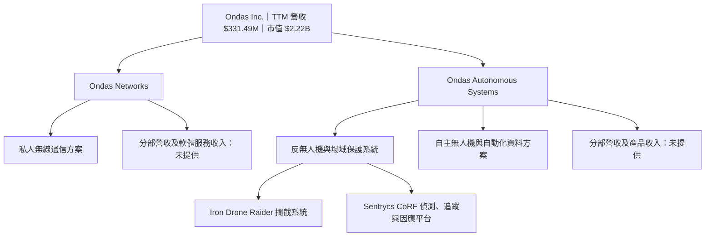
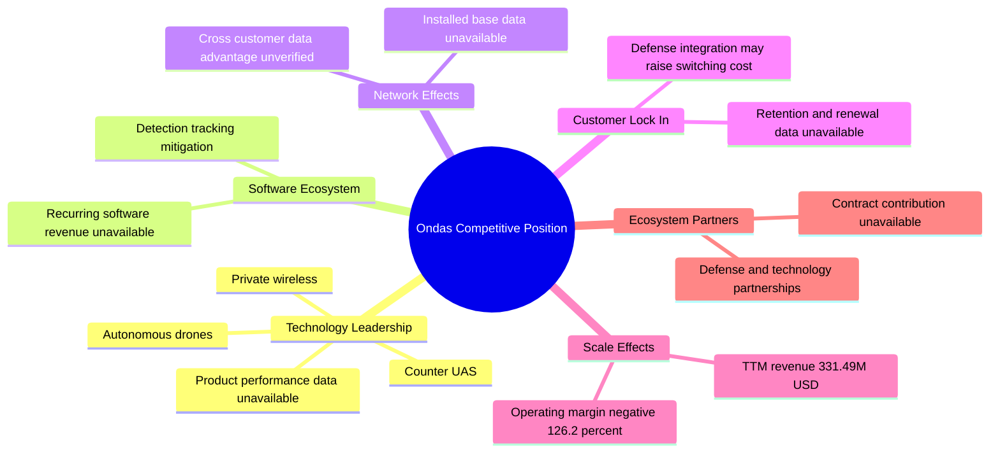
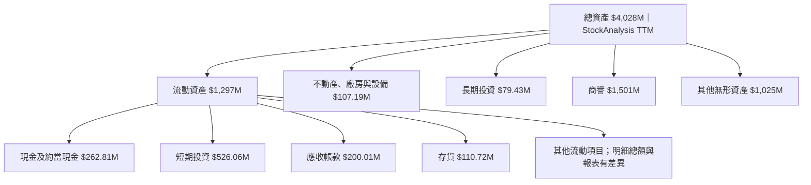
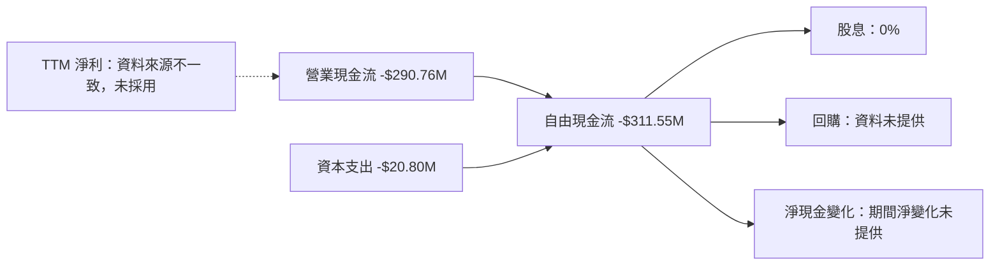
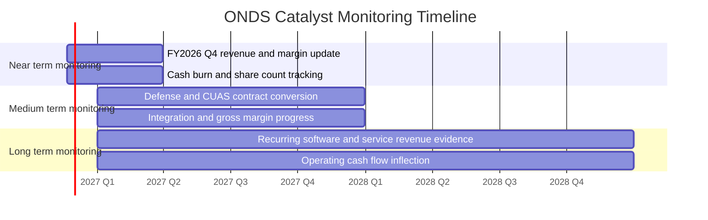
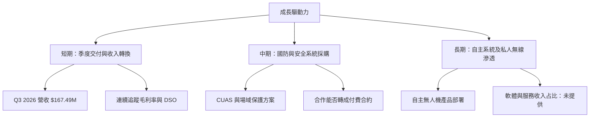
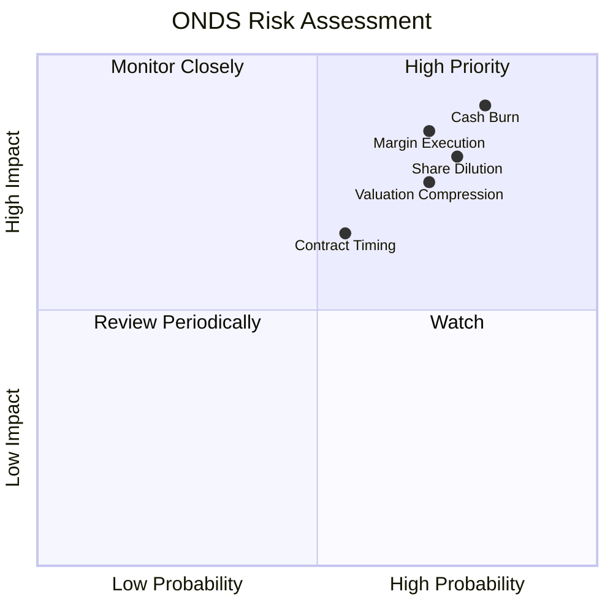
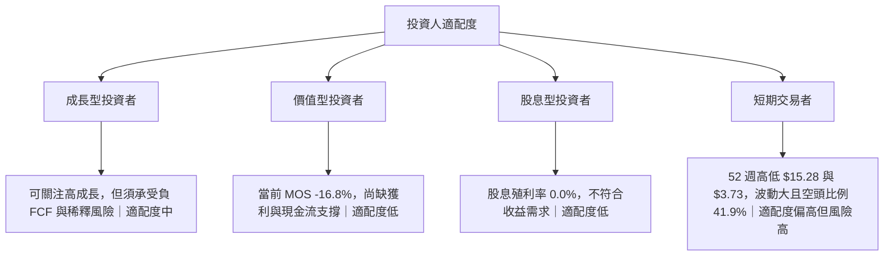

# ONDS 基本面深度分析報告
> **報告日期**：2026-11-21 ｜ **語言**：繁體中文 ｜ **數據來源**：SEC 申報資料 (XBRL)、Yahoo Finance、Finviz、StockAnalysis、Roic.ai ｜ **分析師**：CFA 級機構研究

## 目錄

| # | 章節 | 核心結論 |
|---|------|----------|
| 1 | 執行摘要 | 減碼；加權合理價值 $3.22，MOS -16.8% |
| 2 | 公司概覽與商業模式 | 無法確認收入分部；目前競爭優勢主要是產品與系統整合，持續性仍待驗證 |
| 3 | 損益表深度分析 | TTM 營收 $331.49M、TTM 成長 1,239.4%；TTM 營業利益率 -126.2% |
| 4 | 資產負債表分析 | 現金及短期投資 $788.87M；總債務口徑有資料差異，需審慎核對 |
| 5 | 現金流量深度分析 | TTM FCF -$311.55M；高成長仍伴隨大額現金消耗 |
| 6 | 獲利能力與資本效率 | ROIC -20.9% 對 WACC 14.0%，目前摧毀股東價值 |
| 7 | 相對估值分析 | P/S 高於三家同業中位數；自身歷史 P/S 位於第 32 百分位 |
| 8 | DCF 內在價值評估 | N/A：TTM 營業利益為負，依規則不建立 DCF |
| 9 | 成長催化劑 | 防務無人機、反無人機與自動化需求提供機會，但 TAM 數據未提供 |
| 10 | 風險矩陣 | 營運虧損、現金消耗與稀釋是主要風險 |
| 11 | 投資建議 | 減碼；以 $3.22 加權合理價值及可驗證營運里程碑作為追蹤基準 |

---

## 1. 執行摘要

截至 2026-11-20 收盤，ONDS 股價為 **$3.76**。同業 P/S 法與分析師共識目標價加權後，合理價值為 **$3.22**，MOS 為 **-16.8%**，依規則 20 對應 **減碼**。這項估值結論需與經營現況一併看：TTM 營收成長 **1,239.4%**，但 TTM 營業利益率 **-126.2%**、ROIC **-20.9%**，TTM FCF **-$311.55M**，且 FCF Yield **-14.01%**。快速放量尚未轉化為營業槓桿，當前主要投資命題仍是公司能否在擴大營收的同時控制費用、營運資金和股權稀釋。

### 1.0 一頁式投資儀表板（Portfolio Manager 30 秒速讀）

| 項目 | 內容 |
|------|------|
| **投資論點（3 句）** | ① TTM 營收 $331.49M、TTM 成長 1,239.4%，呈現快速擴張，但不能只以成長率推定其可持續性。② 現金及短期投資 $788.87M，提供資金緩衝；但 TTM FCF 為 -$311.55M，現金消耗仍高。③ 以 $3.22 加權合理價值對照 $3.76 股價，MOS 為 -16.8%，估值尚未反映足夠下檔保護。 |
| **綜合評分** | **4.5/10**（引用 1.1 評分卡） |
| **財務健康** | 🟡 現金及短期投資 $788.87M，但 TTM FCF -$311.55M；流動性受現金消耗速度影響。 |
| **ROIC vs WACC** | **-20.9% vs 14.0%**；現階段資本報酬低於資本成本，摧毀股東價值。 |
| **FCF 趨勢** | TTM FCF -$311.55M；FCF Yield **-14.01%**，仍為大幅現金流出。 |
| **估值** | Forward P/E -24.258x｜EV/EBITDA -5.16x｜FCF Yield -14.01%。負盈餘與負 EBITDA 令部分倍數缺乏傳統估值意義。 |
| **DCF 內在價值（基準）** | **N/A**；TTM 營業利益為負，不建立 DCF。 |
| **安全邊際（MOS）** | **-16.8%＝（加權合理價值 $3.22 − 現價 $3.76）÷ $3.22**｜🔴 無安全邊際。 |
| **預期報酬（基準情境 12M）** | N/A；DCF 情境模型未計算。加權合理價值相對現價的上行空間為 **-14.4%**，不是 12 個月報酬預測。 |
| **關鍵風險（前二）** | TTM FCF -$311.55M 的現金消耗；營業利益率 -126.2% 且 SBC 與流通股增加可能稀釋股東。 |
| **評級 + 信心度** | **🟠 減碼**｜信心：中。規則 20 的 MOS 評級未作質化調整。 |

### 1.1 綜合評分卡（全報告唯一）

| 維度 | 評分（1–10） | 主要依據（引用數字與其來源章節） |
|------|--------------|----------------------------------|
| 成長性 | 8.0 | TTM 營收成長 1,239.4%，最新一季 YoY 1,558.6%；基期較低且成長能否延續仍待驗證（第 3 章）。 |
| 獲利能力 | 2.0 | TTM 營業利益率 -126.2%、ROIC -20.9%；低於 14.0% WACC（第 3、6 章）。 |
| 財務健康 | 7.0 | 現金及短期投資 $788.87M；TTM FCF -$311.55M、CCC 181 天（第 4、5 章）。 |
| 估值 | 3.0 | 加權合理價值 $3.22，MOS -16.8%；P/S 7.0x 高於同業中位數 3.1x（第 7、8 章）。 |
| 護城河 | 4.0 | 涵蓋私人無線、反無人機及自主系統，但收入分部、續約率與客戶留存數據未提供（第 2 章）。 |
| 管理層與資本配置 | 3.0 | FY2025 SBC $16.02M；2026 年各季 SBC 上升，流通股數亦由 469M 增至 590M（第 3、5 章）。 |
| **綜合評分** | **4.5** | 六項算術平均：(8.0 + 2.0 + 7.0 + 3.0 + 4.0 + 3.0) ÷ 6 = 4.3。 |

### 1.2 五大投資論點 + 三大核心風險

| 類型 | 項目 | 具體依據 | 信心度 |
|------|------|----------|--------|
| 🟢 **投資論點①** | 營收快速放量 | TTM 營收 $331.49M，TTM YoY +1,239.4%；最新一季單季 YoY +1,558.6%。但成長受低基期與併購、交付節奏影響的程度未能由現有資料拆分。 | 🟡 中 |
| 🟢 **投資論點②** | 國防及自主系統產品組合 | 公司提供 CUAS、無人機及私人無線方案；有助進入國防、安全與工業自動化需求，但產品別收入與訂單轉換數據未提供。 | 🟡 中 |
| 🟢 **投資論點③** | 現金資源提供緩衝 | 現金及短期投資 $788.87M，可在短期支持營運擴張；但若 FCF 維持 -$311.55M，現金緩衝會被快速消耗。 | 🟡 中 |
| 🟢 **投資論點④** | 毛利率具一定基礎 | TTM 毛利率 36.4%，高於 AVAV 26.5%、KTOS 23.0%、RCAT 8.7%；但毛利未能抵銷龐大營業費用。 | 🟡 中 |
| 🟢 **投資論點⑤** | 分析師仍看好長期前景 | 10 位分析師平均目標價 $16.68；但這是共識參考值，不能取代現金流與同業估值交叉驗證。 | 🟡 低至中 |
| 🟡 **風險①** | 營運虧損與燒錢 | TTM 營業利益率 -126.2%、TTM FCF -$311.55M；若營收放量無法帶動費用率下降，資本需求會持續。 | 🔴 高衝擊 |
| 🔴 **風險②** | 股權稀釋與 SBC | 2026 年 Q1–Q3 SBC 分別為 $19.66M、$69.09M、$59.85M；同期流通股數資料由 469M 升至 590M。 | 🔴 高 |
| 🔴 **風險③** | 估值回落與波動 | P/S 約 7.0x，三家同業中位數 3.1x；52 週高低 $15.28 與 $3.73，股價波動風險高。 | 🔴 高 |

### 1.3 快速統計卡片

| 指標 | 公司實際值（期間） | 同業中位數 | 狀態 |
|------|--------------------|------------|------|
| 營收成長（TTM） | **1,239.4%** | — | 🟢 |
| 營收成長（最新一季年增） | **1,558.6%** | 22.0% | 🟢 成長極高，亦需留意低基期與併購影響 |
| 毛利率（TTM） | **36.4%** | 23.0% | 🟢 |
| 營業利益率（TTM） | **-126.2%** | — | 🔴 |
| ROIC（TTM） | **-20.9%** | — | 🔴 |
| Forward P/E | **-24.258x** | 19.7x | 🔴 ONDS 預期仍虧損；倍數不可直接對等比較 |
| FCF Yield（TTM） | **-14.01%** | — | 🔴 |
| Piotroski F-Score | **3 / 8** | — | 🔴 |

### 1.4 投資結論

```text
╔══════════════════════════════════════════════════════════════════╗
║                    📊 投資結論摘要                               ║
╠══════════════════════════════════════════════════════════════════╣
║  評級：減碼（依 MOS 門檻；未作質化調整）                         ║
║  價格（2026-11-20 收盤）：$3.76                                  ║
║  DCF 內在價值（基準）：N/A（TTM 營業利益為負）                   ║
║  安全邊際 MOS：-16.8%（以加權合理價值為分母）                    ║
║  加權合理價值（8.8）：$3.22                                      ║
║  綜合評分：4.5/10（引用 1.1）                                    ║
║  適合投資人：能承受高波動及稀釋風險、並可追蹤季度執行的投資人    ║
╚══════════════════════════════════════════════════════════════════╝
```

---

## 2. 公司概覽與商業模式

### 2.1 業務結構與收入來源

公司概況列出 Ondas Networks 與 Ondas Autonomous Systems 兩個分部，業務涵蓋私人無線、反無人機系統、無人機及自動化資料方案。**分部收入、各產品收入與服務／軟體收入金額均未提供**，因此不以營收總額反推分部占比。



### 2.2 市場份額

市場份額與 TAM 市占率數據未提供，無法可靠計算。以 TTM 營收 $331.49M 與最新一季 YoY 成長 1,558.6% 觀察，ONDS 已具一定營收規模且擴張很快；但營收規模仍低於大型國防承包商，且各分部收入無法拆分，不能將整體成長直接等同於特定市場份額提升。

### 2.3 競爭護城河分析

下圖是可由現有資料支持的質化結構，不代表各項優勢已形成可量化護城河。



### 2.4 護城河強度

| 護城河項目 | 強度 | 證據 | 會削弱它的情況 |
|------------|------|------|----------------|
| 技術與產品組合 | 中 | 公司產品涵蓋私人無線、CUAS、無人機及自動化資料方案；毛利率 TTM 36.4%。 | 產品效能無法在實際部署中證明差異，或競爭者以更低成本提供可替代方案。 |
| 軟體生態系統 | 弱至中 | Sentrycs CoRF 涉及偵測、識別、追蹤與因應；軟體訂閱或經常性收入未提供。 | 收入主要依賴一次性硬體交付，續約與軟體附加率偏低。 |
| 網路效應 | 弱 | 未提供用戶數、部署點數或資料網絡效應數據。 | 客戶之間無互通效應，或資料優勢難以轉化為定價能力。 |
| 客戶鎖定 | 中 | 國防與安全系統整合通常涉及測試、部署與認證；公司客戶留存數據未提供。 | 客戶採購分散、合約短期化，或標案競爭導致供應商替換。 |
| 規模效應 | 弱 | TTM 營收 $331.49M，但 TTM 營業利益率 -126.2%，目前未顯示規模帶來營業槓桿。 | 營收增加同時費用增速更快，毛利無法覆蓋研發、銷售與管理成本。 |
| 生態夥伴 | 中 | 新聞提及與 Palantir、Regna AI 及其他機構合作活動；財務貢獻未提供。 | 合作未轉化為付費訂單、收入或可複製銷售管道。 |

1.1「護城河」評分為 **4.0/10**，理由是產品覆蓋面與毛利率提供初步支撐，但續約率、軟體收入、客戶集中度及營業槓桿等關鍵證據不足。

---

## 3. 損益表深度分析

### 3.1 年度收入成長趨勢（近 4 年）

FY2022 至 FY2025 營收由 $2.13M 增至 $50.73M；三年 CAGR 約 **188.0%**。此 CAGR 反映低基期下的快速擴張，不能直接當作未來可持續成長預測。

```text
╔══════════════════════════════════════════════════════════════════╗
║           Ondas Inc. 年度收入趨勢（FY2022-FY2025）               ║
╠══════════════════════════════════════════════════════════════════╣
║  FY2022  $2.13M   █                           基期               ║
║  FY2023  $15.69M  ████████                    YoY +636.6%        ║
║  FY2024  $7.19M   ███                         YoY -54.2%         ║
║  FY2025  $50.73M  █████████████████████████   YoY +605.3%       ║
║                                                                  ║
║  FY2022-FY2025 三年收入 CAGR 約 +188.0%                           ║
║  年度變化大，單一年份容易受到低基期、併購與交付節奏影響。        ║
╚══════════════════════════════════════════════════════════════════╝
```

### 3.2 季度收入趨勢分析

| 季度 | 營收 | QoQ | YoY | 備註 |
|------|------:|----:|----:|------|
| 2025 Q4 | $30.11M | +198.1% | N/A | 與 2025 Q3 $10.10M 比較；缺少 2024 Q4 對照數。 |
| 2026 Q1 | $50.12M | +66.5% | +1,079.9% | 同比基數為 2025 Q1 $4.25M。 |
| 2026 Q2 | $83.77M | +67.1% | +1,235.4% | 同比基數為 2025 Q2 $6.27M。 |
| 2026 Q3 | $167.49M | +99.9% | +1,558.6% | 單季營收近乎翻倍；同比基數為 2025 Q3 $10.10M。 |

QoQ 算式依所列季度收入計算，例如 2026 Q3 QoQ = ($167.49M ÷ $83.77M) − 1 ≈ 99.9%。數字顯示交付規模迅速擴大；但在缺乏有機成長、併購貢獻及訂單轉收入拆分的情況下，不能把全部成長外推為穩態需求。

### 3.3 利潤率演變分析

| 利潤率指標 | FY2022 | FY2023 | FY2024 | FY2025 | TTM／最新季度 | 趨勢與評估 |
|------------|--------:|--------:|--------:|--------:|----------------:|------------|
| **毛利率** | 52.1% | 40.7% | 4.8% | 39.8% | TTM 36.4% | 年度間波動大，可能反映產品組合、低基期及併購影響；未提供可將變化歸因至單一因素的分部資料。🟡 |
| **營業利益率** | -2,347.4% | -243.7% | -481.4% | -115.1% | TTM -126.2%；最新一季 -113.1% | FY2025 相對改善但仍大幅虧損；TTM 與最新季度亦未達損益兩平。🔴 |
| **淨利率** | N/A | N/A | N/A | N/A | QUALITY FIGURES TTM 33.1% | TTM 正淨利率與營業虧損並存，顯示非營業項目、稅務或非經常性因素可能影響結果；細項未提供。🟡 |

> 年度毛利率與營業利益率以年度損益表的毛利／營收、營業利益／營收計算；TTM 指標引用 SEC 申報資料計算值。跨來源數值不完全一致，解讀時以明確標示期間的數值為準。

**利潤率演變深度解析：**FY2024 毛利率僅 4.8%，FY2025 回升至 39.8%，但營業利益仍為 -$58.38M，代表毛利改善尚未覆蓋營運費用。TTM 營業利益率 -126.2% 說明目前的核心挑戰不是單純擴大收入，而是營收增長能否伴隨毛利品質改善、固定費用攤薄與較低的交付成本。現有資料沒有產品組合、定價或併購整合拆分，因此不能把改善歸因於某一項結構性變化。

### 3.4 費用結構分析

完整營業費用明細未提供，無法可靠製作費用組成圓餅圖。已知 FY2025 研發費用 $20.88M，FY2024 $12.48M，FY2023 $17.15M；TTM 營業利益率 -126.2% 表明研發以外的營業費用亦對虧損有重大影響，但各項費用金額不能由現有資料拆解。

### 3.5 季度 EPS 趨勢與盈餘品質（Quality of Earnings）

提供的 EPS 預期值與實際值記錄為缺漏，無法判定過去四季 EPS 是超預期或不及預期。可觀察的季度淨利分別為 2025 Q4 -$99.66M、2026 Q1 +$362.95M、2026 Q2 -$88.25M、2026 Q3 -$62.57M；這種大幅波動使單季 EPS 解讀不可靠。Q1 正淨利成因與一次性項目明細未提供，不能將其視為可持續獲利。

| 盈餘品質項目 | 數值／佔比 | 評估 |
|--------------|-----------|------|
| 股權薪酬 SBC / 營收 | TTM 四季 SBC 合計約 $155.41M ÷ TTM 營收 $331.49M = **46.9%** | 🔴 SBC 對股東經濟回報的稀釋負擔高。SBC 依 2025 Q4 至 2026 Q3 季度數據加總。 |
| SBC / 營業現金流 | $155.41M ÷ \|-$290.76M\| = **53.5%** | 🔴 營業現金流為負，SBC 相對現金消耗規模顯著；這個比率採 OCF 絕對值作比較。 |
| FCF / 淨利（現金轉換率） | N/A | TTM 淨利數據於不同資料源中不一致；季度淨利存在 Q1 大額正值，未提供一次性損益調節，避免以不一致分母製造單一轉換率。 |
| 一次性／非經常性損益 | 2026 Q1 淨利 +$362.95M；項目明細未提供 | 🔴 單季異常正淨利，無法確認是否可持續；不應作為常態化獲利基礎。 |
| 有效稅率異常 | N/A | 稅前損益及稅項明細未提供，不能判定是否由稅務利益推升淨利。 |
| 資本化支出 vs 費用化 | TTM 資本支出 $20.80M；資本化政策細節未提供 | 🟡 有資本支出資料，但無法判斷研發、取得成本或其他支出是否延後費用認列。 |

**盈餘品質結論：**營業虧損、負 FCF、高 SBC 及季度淨利大幅波動共同降低 GAAP 淨利的可持續性。現階段不宜以單季正淨利或單一淨利率推導獲利型估值，應優先監控訂單轉收入、毛利率、現金消耗與稀釋股數。

---

## 4. 資產負債表分析

### 4.1 資產結構分解

StockAnalysis 的 TTM 資產負債表列示總資產 $4,028M、流動資產 $1,297M、商譽 $1,501M、無形資產 $1,025M；部分列項與總額加總不完全一致，因此下圖只呈現來源有列出的項目，不將其當作完整的加總式資產分解。



### 4.2 流動性與營運資金分析

| 指標 | 最新 TTM | 一年前 TTM | 變化 | 解讀 |
|------|----------|------------|------|------|
| DSO 應收帳款天數 | 140 天 | 77 天 | +63 天 | 🔴 收款天數增加，營收擴張帶動的應收款占用資金上升；需確認回款品質與客戶付款條件。 |
| DIO 存貨天數 | 182 天 | 278 天 | -96 天 | 🟢 存貨周轉天數下降，方向上減少存貨資金占用；但仍需結合交付與呆滯存貨資料判斷。 |
| DPO 應付帳款天數 | 141 天 | 186 天 | -45 天 | 🟡 付款天數縮短，供應商信用提供的資金緩衝減少；原因與採購條件未提供。 |
| CCC 現金轉換週期 | 181 天 | 169 天 | +12 天 | 🔴 CCC 拉長，與 DSO 上升相符；存貨及應付改善未能抵銷收款放慢。 |

流動性指標方面，StockAnalysis 列示流動比率 3.389、速動比率 2.604；FY2025 年底流動比率約 4.84（流動資產 $685.90M ÷ 流動負債 $141.82M）。但兩者期間不同，不可直接視作同一期比較。公司現金及短期投資達 $788.87M，但 TTM FCF -$311.55M，資產負債表緩衝並不代表現金流風險已消失。

### 4.3 債務結構分析

不同來源對債務及淨現金口徑有差異：SEC 計算的 VERIFIED FIGURES 將總債務列為 N/A、淨現金列為 $788.87M；另一市場資料列示總債務 $62.81M、淨現金 $726.06M。**本報告不以缺漏欄位反推數字，亦不將兩套口徑混合**；應以最新 10-Q 債務附註確認計息負債及到期安排。

```text
╔══════════════════════════════════════════════════════════════════╗
║                   Ondas 債務健康診斷                             ║
╠══════════════════════════════════════════════════════════════════╣
║  現金及短期投資：$788.87M（SEC 10-Q 計算口徑）                   ║
║  VERIFIED FIGURES 總債務：N/A                                    ║
║  VERIFIED FIGURES 淨現金：$788.87M                                ║
║  另一市場資料總債務：$62.81M；淨現金：$726.06M                   ║
║  Debt/EBITDA：無可靠正 EBITDA，負值倍數不具傳統解讀意義           ║
║  Interest Coverage：N/A（利息與計息債務口徑未提供）              ║
║  判斷：現金儲備具緩衝，但必須以 SEC 債務附註確認債務口徑。       ║
╚══════════════════════════════════════════════════════════════════╝
```

### 4.4 股東權益趨勢

| 年度 | 股東權益 | 變化 | 解讀 |
|------|---------:|-----:|------|
| 2022 | $58.22M | — | 基期。 |
| 2023 | $33.14M | -43.1% | 淨虧損及資本結構變化使權益縮減。 |
| 2024 | $16.58M | -50.0% | 權益基礎進一步下降。 |
| 2025 | $437.81M | +2,540.6% | 大幅增加，但現有資料不足以拆分增資、併購及其他權益變動各自貢獻。 |

FY2025 權益增加與股東權益大幅重估並存；應觀察是否靠持續發股支撐擴張，而非僅看期末權益數字。

---

## 5. 現金流量深度分析

### 5.1 現金流量瀑布圖

TTM 淨利在不同資料來源間不一致，且季度數據顯示巨幅波動，因此不填入現金流瀑布。可引用的 TTM 現金流數字如下：



### 5.2 FCF 轉換率趨勢

| 年度 | 營業現金流 | 資本支出 | FCF | 淨利 | FCF／淨利 |
|------|-----------:|---------:|----:|-----:|----------|
| 2022 | -$37.96M | 約 $2.93M | -$40.89M | -$73.24M | 55.8% |
| 2023 | -$34.02M | 約 $0.28M | -$34.30M | -$44.84M | 76.5% |
| 2024 | -$33.47M | 約 $1.73M | -$35.20M | -$38.01M | 92.6% |
| 2025 | -$38.75M | 約 $2.14M | -$40.88M | -$132.02M | 31.0% |

負淨利下，FCF／淨利比率只作算術比較，並非正向的盈餘轉換率。2025 年淨虧損大幅擴大，現金流與會計損益的關係需進一步拆分。TTM 則以指定公式 FCF = 營業現金流 − 資本支出計為 **-$311.55M**。

### 5.3 自由現金流趨勢

```text
╔══════════════════════════════════════════════════════════════════╗
║                Ondas 自由現金流趨勢                              ║
╠══════════════════════════════════════════════════════════════════╣
║  FY2022  -$40.89M  ◀████████████████                            ║
║  FY2023  -$34.30M  ◀█████████████                               ║
║  FY2024  -$35.20M  ◀██████████████                              ║
║  FY2025  -$40.88M  ◀████████████████                            ║
║  TTM     -$311.55M ◀████████████████████████████████████████    ║
║                                                                  ║
║  TTM FCF Yield：-14.01%｜FCF 尚未轉正，現金流風險偏高。         ║
╚══════════════════════════════════════════════════════════════════╝
```

### 5.4 資本配置評估

資本配置中回購、併購、留存現金的 TTM 分拆未提供，不能以不完整數字製作比例圖。

| 項目 | 可用數據 | 評估 |
|------|----------|------|
| 資本支出 | TTM $20.80M | 相對於營業現金流缺口規模較小，但不能單獨代表總投資需求。 |
| 股息 | 殖利率 0.0% | 無股息現金支出。 |
| 股權薪酬 | FY2025 $16.02M；2026 Q1–Q3 分別 $19.66M、$69.09M、$59.85M | 股權薪酬金額上升，可能以股東稀釋替代現金薪酬。 |
| 回購 | N/A | 回購金額未提供。 |
| 留存／併購投資 | N/A | 沒有足夠數據拆分現金用途。 |

---

## 6. 獲利能力與資本效率

### 6.1 ROE / ROA / ROIC 趨勢

| 指標 | 可用期間數據 | 評估 |
|------|--------------|------|
| ROE | TTM 4.6%（QUALITY FIGURES）；另一市場資料列示 7.3% | 跨來源值不一致；依指定品質數據採用 4.6%。 |
| ROA | TTM -9.7%（市場財務資料）；品質測試顯示當期 ROA > 0，口徑不一致 | 不宜混合計算趨勢，需以 SEC 申報重新核對。 |
| ROIC | TTM -20.9% | 低於 WACC 14.0%，資本效率明顯不足。 |
| 歷年 ROIC／ROA／ROE | N/A | 可比口徑的歷年完整序列未提供。 |

### 6.2 ROIC vs WACC 分析（核心價值創造判斷）

```text
╔══════════════════════════════════════════════════════════════════╗
║                ROIC vs WACC 深度分析                            ║
╠══════════════════════════════════════════════════════════════════╣
║  資本成本（採用 Cost of capital 數值）：                         ║
║  ├── 無風險利率 Rf：4.91%                                        ║
║  ├── 市場風險溢酬 ERP：5.00%                                     ║
║  ├── 原始 Beta：3.08；調整後採用 Beta：2.00                     ║
║  ├── 股權成本 Ke：14.91%                                         ║
║  ├── 稅前債務成本：10.47%；稅率：21.0%                           ║
║  ├── 權重：股權 97.3%；債務 2.7%                                 ║
║  ├── 加權計算值：14.73%；限制上限後採用 WACC：14.00%             ║
║  ROIC（TTM）：-20.9%                                             ║
║  EVA 差額：ROIC − WACC = -20.9% − 14.0% = -34.9 個百分點        ║
║                                                                  ║
║  ROIC -20.9%  ◀██████████                                        ║
║  WACC  14.0%       ▓▓▓▓▓▓▓                                        ║
║  結論：ROIC 明顯低於 WACC，現階段摧毀股東價值。                 ║
╚══════════════════════════════════════════════════════════════════╝
```

Beta 的原始值為 3.08；成本資本資料的調整規則為 Beta-adjusted = ⅔ × 原始 Beta + ⅓ = ⅔ × 3.08 + ⅓ ≈ 2.39，因調整後值超過指定上限 2.0，故採用 Beta 2.00。CAPM 股權成本為 4.91% + 2.00 × 5.00% = 14.91%。成本資本資料列出的加權計算值為 14.73%，但限制在 7%–14% 區間後採用 **14.00%**。本報告 6.2 與第 8.2 均採用 14.00%，不另行重建 WACC。由於 ROIC -20.9% 遠低於 WACC，公司的增長只有在新增投資能提高回報率時才會創造價值。

### 6.3 杜邦三因素分解

| 因素 | 數值（TTM） | 解讀 |
|------|-------------|------|
| 淨利率 | 33.1% | 品質數據所列；與其他損益來源的淨利資料有差異，可能受非營業項目影響。 |
| 資產週轉率 | 0.08 | 總資產相對營收週轉偏低；大額商譽與無形資產可能降低資產效率。 |
| 權益乘數 | 1.70 | 資本結構倍數不是 ROE 的主要放大來源。 |
| **ROE** | **4.6%** | 品質數據給定：33.1% × 0.08 × 1.70 = 4.6%（四捨五入）。 |

依品質數據，資產週轉率偏低是 ROE 受限的重要因素；ROE 並非單純由高槓桿支撐。

### 6.4 財務體質：Piotroski F-Score

**Piotroski F-Score：3 / 8**。品質計算對缺少輸入的測試不納入分母，因此本數據的可判定分母為 8。

| 測試 | 結果 | 解讀 |
|------|------|------|
| ROA > 0 | ✅ 通過 | 品質計算顯示當期 ROA 測試通過；與另一來源負 ROA 數值存在口徑差異。 |
| 營業現金流 > 0 | ❌ 未通過 | TTM 營業現金流 -$290.76M，顯示營運尚未自我供血。 |
| ROA 高於一年前 | ✅ 通過 | 方向改善，但不代表 ROA 已達健康水準。 |
| 營業現金流 > 淨利 | ❌ 未通過 | 現金流品質與應計盈餘測試不佳。 |
| 長期負債 ÷ 總資產低於一年前 | — 無法判定 | 缺少一致可比輸入。 |
| 流動比率高於一年前 | ❌ 未通過 | 品質計算未通過；應關注資金消耗與流動負債變化。 |
| 稀釋股數未增加 | ❌ 未通過 | Roic.ai 股數資料由 2026 Q1 469M 增至 Q3 590M。 |
| 毛利率高於一年前 | ❌ 未通過 | 品質計算判定未通過；毛利率改善能否延續仍待後續季度驗證。 |
| 資產週轉率高於一年前 | ✅ 通過 | 品質計算判定通過，但 TTM 資產週轉率仍只有 0.08。 |

---

## 7. 相對估值分析

### 7.1 同業估值比較表格

| 估值指標 | **ONDS** | **AVAV** | **KTOS** | **RCAT** | 本公司評估 |
|----------|---------:|---------:|---------:|---------:|-----------|
| **Trailing P/E** | N/A | N/A | 224.1x | N/A | 🔴 ONDS 虧損，無法以 TTM P/E 比較。 |
| **Forward P/E** | -24.258x | 19.7x | 24.0x | -2.8x | 🔴 ONDS 預期仍虧損；負 P/E 不代表便宜。 |
| **P/S Ratio** | 約 7.0x（歷史估值資料）；市場資料另列 6.71x | 2.2x | 3.1x | 3.7x | 🔴 ONDS 高於同業中位數 3.1x，要求更高成長及未來利潤改善。 |
| **EV/EBITDA** | -5.16x | 21.3x | 43.4x | -0.4x | 🟡 ONDS、RCAT EBITDA 為負，倍數不可作一般排序。 |
| **最新一季營收 YoY** | 1,558.6% | 5.7% | 35.7% | 22.0% | 🟢 成長遠高於同業，但低基期與交易／交付節奏風險較高。 |
| **毛利率（TTM）** | 36.4% | 26.5% | 23.0% | 8.7% | 🟢 高於三家同業，但尚未抵銷營業費用。 |

同業最新一季營收成長中位數為 **22.0%**，毛利率中位數為 **23.0%**。ONDS 的成長與毛利率都高於同業比較值，但因營業利益率為 -126.2%，不能只以較高毛利率推論經營品質較佳。

### 7.2 歷史估值區間分析

```text
╔══════════════════════════════════════════════════════════════════╗
║                ONDS 自身歷史 P/S 區間                           ║
╠══════════════════════════════════════════════════════════════════╣
║  五年 P/S 區間：2.9x ├──────── 7.0x ────────┤ 140.6x           ║
║  五年中位數：17.9x                                               ║
║  目前百分位：第 32 百分位                                        ║
║  評估：低於自身中位數，但高於三家同業 P/S 中位數 3.1x。          ║
║  注意：歷史區間極寬，受到低基期與股價大幅波動影響。              ║
╚══════════════════════════════════════════════════════════════════╝
```

### 7.3 情境價值（Bear / Base / Bull）

**N/A（DCF 無法計算：TTM 營業利益不為正；依規則不建立 DCF，亦不自訂情境目標價。）**

### 7.4 相對估值隱含價格區間

```text
╔══════════════════════════════════════════════════════════════════╗
║              相對估值方法與現價位置                              ║
╠══════════════════════════════════════════════════════════════════╣
║  同業 P/S 估值：$1.72 ───────── 現價 $3.76                      ║
║  分析師共識：  $16.68（參考值；10 位分析師平均目標價）           ║
║                                                                  ║
║  同業 P/S 依據：AVAV、KTOS、RCAT 的 P/S 中位數 3.1x，            ║
║  乘以 ONDS TTM 營收，程式計算每股價值 $1.72。                    ║
║  Forward P/E 方法因無法計算而未納入，權重按固定規則分配。       ║
╚══════════════════════════════════════════════════════════════════╝
```

---

## 8. DCF 內在價值評估（Discounted Cash Flow）

### 8.0 估值推理鏈（Thinking Logic）

**Step 1 — 價值由哪些變數決定？**  
ONDS 的價值主要取決於既有無線通信業務、CUAS／自主系統的收入轉換，以及上述收入能否轉成正營業現金流。各業務收入占比未提供，不能量化分部權重。營運成長與達到正 EBIT 的時間，是估值主導變數；但目前 TTM 營業利益率為 -126.2%，不適合以負 EBIT 作傳統 DCF 起點。

**Step 2 — 模型選擇**

| 決策點 | 本報告採用 | 理由 | 曾考慮但否決 | 否決理由 |
|--------|-----------|------|--------------|----------|
| 現金流定義 | N/A | DCF MODEL 明確為 N/A；TTM 營業利益為負。 | FCFF／FCFE 模型 | 不自行建模，避免以未提供假設製造精確估值。 |
| 預測期 N | N/A | 程式模型未提供預測期。 | 自訂 5–10 年預測 | 違反不得自建 DCF 規則。 |
| 終值方法 | N/A | 模型未提供終值。 | Gordon Growth／退出倍數 | 缺少可靠正向營業現金流基礎。 |
| EBIT 基礎 | N/A | 模型未提供 EBIT 預測。 | GAAP／非 GAAP DCF | 不對虧損營業基礎作自行外推。 |

**Step 3 — 假設推導鏈：**營收 CAGR、期末利潤率、稅率、Capex、D&A、營運資金、SBC、稀釋率、永續成長率及終值等模型輸入均未提供；因此不得設定採用值或虛構推導鏈。

**Step 4 — 最脆弱環節：**若未來營業槓桿改善慢於市場預期，即使營收快速成長，負 FCF 與稀釋仍可能使股東價值低於目前同業估值推導值；但 DCF 數值未計算，無法量化跌幅。

**Step 5 — 計算路徑圖：**因 DCF 模型為 N/A，不畫出不存在的數值計算鏈。

### 8.1 模型假設總表（Model Inputs）

**N/A（數據未提供：DCF MODEL 因 TTM 營業利益不為正而未建立，禁止另行自建模型。）**

### 8.2 折現率推導（WACC）

WACC 依 Cost of capital 數據直接採用 **14.00%**；該資料列示初步計算 14.73%，並限制於 7%–14% 區間。此處說明既有資本成本資料，並不代表本報告建立 DCF。

```text
╔══════════════════════════════════════════════════════════════════╗
║                    WACC 推導（折現率）                           ║
╠══════════════════════════════════════════════════════════════════╣
║  股權成本 Ke（CAPM）：                                            ║
║  ├── 無風險利率 Rf：4.91%                                        ║
║  ├── ERP：5.00%                                                  ║
║  ├── 原始 Beta：3.08；調整後 Beta：2.00                          ║
║  ├── 規模／國別溢酬：未另加計                                     ║
║  └── Ke = 4.91% + 2.00 × 5.00% = 14.91%                         ║
║  債務成本：稅前 10.47%；預設稅率 21.0%                           ║
║  稅後 Kd = 10.47% × (1 − 21.0%) = 8.2713%                        ║
║  資本權重：股權 97.3%；債務 2.7%                                 ║
║  加權計算值：97.3% × 14.91% + 2.7% × 8.2713% = 14.73%            ║
║  採用值：14.73% 受 7%–14% 上限約束，故採 WACC = 14.00%。         ║
╚══════════════════════════════════════════════════════════════════╝
```

資料所列 Beta 調整方式為 ⅔ × 3.08 + ⅓ ≈ 2.39，並依 0.6–2.0 區間限制採用 2.00。RF 日期與 ERP 外部來源日期未提供，故不補造。成本資本數據未列計息負債金額，亦未提供利息費用與平均計息負債的完整明細；本節遵照既有 WACC 輸入，不另反推債務金額或重算權重。第 6.2 節採用同一 WACC **14.00%**。

### 8.3 逐年自由現金流預測（基準情境）

**N/A（DCF MODEL 未提供逐年預測：TTM 營業利益不為正，依規則不建立 DCF。）**

### 8.4 終值計算（Terminal Value）

**N/A（沒有 DCF 預測期、終值現金流或永續成長率；不進行 Gordon Growth 或退出倍數計算。）**

### 8.5 企業價值 → 每股內在價值（Bridge）

**N/A（沒有 DCF 企業價值、預測期現值與終值，不能建立估值橋接。）**  
本節不計算 DCF 折溢價或 MOS；DCF 內在價值未計算，MOS 僅依 8.8 的加權合理價值計算一次。

### 8.6 敏感性分析（WACC × 永續成長率）

**N/A（DCF 敏感性矩陣未提供；不自行產生 WACC × g 估值矩陣或 DCF 情境價值。）**

### 8.7 反推 DCF（Reverse DCF：市場在預期什麼）

**N/A（沒有可用 DCF 模型，亦無法以現價反解營收 CAGR、利潤率、g 或預測期。）**

### 8.8 估值三角驗證與安全邊際

估值方法名稱、每股價值與權重依估值方法資料列示。相對估值方法採同業倍數；同業 Forward P/E 方法無法計算，因此未納入並依既定權重重新分配。

| 估值方法 | 隱含每股價值 | 上行空間（÷現價） | 權重 | 說明 |
|----------|--------------:|------------------:|-----:|------|
| 同業 P/S | $1.72 | -54.3% | 90% | AVAV、KTOS、RCAT 的同業 P/S 中位數 3.1x × TTM 營收，程式計算。 |
| 分析師共識目標價 | $16.68 | +343.6% | 10% | 10 位分析師平均目標價；只作參考，不代表可實現價值。 |
| **加權合理價值** | **$3.22** | **-14.4%** | **100%** | 不作事後微調。 |

逐步演算：

- 加權合理價值 = $1.72 × 90% + $16.68 × 10% = $1.548 + $1.668 = $3.216 ≈ **$3.22**。
- 權重 = 90% + 10% = **100%**。
- MOS = ($3.22 − $3.76) ÷ $3.22 = **-16.8%**。
- 上行空間 = ($3.22 − $3.76) ÷ $3.76 = **-14.4%**。
- 折溢價與 MOS 定義不同；本報告無 DCF 基準價，故不計 DCF 折溢價。

```text
╔══════════════════════════════════════════════════════════════════╗
║                  估值區間與安全邊際                              ║
╠══════════════════════════════════════════════════════════════════╣
║  同業 P/S $1.72 ─── 現價 $3.76 ─── 加權合理價值 $3.22           ║
║                                                                  ║
║  MOS = ($3.22 − $3.76) ÷ $3.22 = -16.8%                         ║
║  上行空間 = ($3.22 − $3.76) ÷ $3.76 = -14.4%                    ║
║  MOS 評估：🟠 介於 -25% 與 -10%，符合「減碼」門檻。              ║
║  建議買入區間：依 MOS ≥ 10% 推導的上限為 $2.90；                 ║
║  但規則 20 要求買入區間須與減碼評級一致，本報告不列為買入建議。  ║
║  合理持有區間／減碼考慮區間：無法以未提供的 DCF 情境定價。       ║
╚══════════════════════════════════════════════════════════════════╝
```

MOS ≥ 10% 對應價格上限的算式為 $3.22 × (1 − 10%) = **$2.898 ≈ $2.90**；這是數學上的 MOS 門檻，不等同於本報告給出買入評級。

> 🔎 **程式複算（Python，依本節各項自動重算）**
>
> 加權合理價值 = $1.72 × 90% + $16.68 × 10% = **$3.22**（權重合計 100%）
>
> 以價格 $3.76 計：MOS = **-16.8%**，上行空間 = **-14.4%**
>
> ✅ 與本節所寫數值一致。

### 8.9 DCF 模型的局限與失效條件

- **終值依賴度：**N/A，無可用 DCF 終值。
- **最脆弱的假設：**未建 DCF，因此不對營收 CAGR 或利潤率變動虛構每股敏感度。
- **不適用情境：**TTM 營業利益率 -126.2%、TTM FCF -$311.55M，直接 DCF 可靠度不足。較適當的後續方法是以 EV/Sales、毛利／獲客與合約單位經濟、分部估值及現金跑道作交叉檢驗。
- **與第 10 章風險矩陣連結：**若營收成長降速、DSO 繼續上升、SBC 增加或融資需求提高，將同時削弱銷售估值倍數及每股價值。

### 8.10 複算檢核表（Audit Trail）

| # | 檢核項目 | 檢查方式 | 結果 |
|---|----------|----------|------|
| 1 | 所有高／中敏感度輸入均有四段式推導 | DCF 模型為 N/A，沒有模型輸入可供逐項檢查。 | N/A |
| 2 | 每個 DCF 假設都有來歷 | 未建立 DCF，不輸入假設值。 | N/A |
| 3 | WACC 算式與權重核對 | 引用成本資本數據；97.3% + 2.7% = 100%，加權計算值 14.73%，採用值受上限限制為 14.00%。 | ✅ |
| 4 | Kd 分母與債務權重 D 範圍一致 | 成本資本輸入已提供整體 Kd 與權重，但未提供足以獨立核對的負債組成金額；不另行反推。 | N/A |
| 5 | WACC 與第 6.2 節同值 | 兩處均採用 14.00%。 | ✅ |
| 6 | 預測年度數等於 N | DCF MODEL 為 N/A。 | N/A |
| 7 | FY+1 九步算式可複算 | 無逐年模型資料。 | N/A |
| 8 | 預測期 PV 合計可複算 | 無預測期 PV。 | N/A |
| 9 | WACC > g | 無模型永續成長率 g。 | N/A |
| 10 | 終值以 FY+N 現金流折現 | 無預測期及終值。 | N/A |
| 11 | EV 至每股價值橋接 | 無 DCF EV 橋接。 | N/A |
| 12 | SBC 處理與股數相容 | 無 DCF 股數及 SBC 模型假設。 | N/A |
| 13 | 矩陣基準格等於 8.5 每股價值 | 無敏感性矩陣。 | N/A |
| 14 | 矩陣格子符合 WACC > g | 無敏感性矩陣。 | N/A |
| 15 | 三情境機率相加為 100% | DCF 情境未計算。 | N/A |
| 16 | 反推 DCF 每列只放開一個變數 | 無可用 DCF 模型。 | N/A |
| 17 | MOS 分母與折溢價基準符合規則 | MOS 以 8.8 加權合理價值 $3.22 為分母；DCF 折溢價不計。 | ✅ |
| 18 | 報告完整至第 11 章 | 章節 1–11 均列出。 | ✅ |
| 19 | 加權合理價值等於各方法加總 | $1.72 × 90% + $16.68 × 10% = $3.216 ≈ $3.22。 | ✅ |
| 20 | 評級符合 MOS 門檻 | MOS -16.8% 落在 -25% 至 -10%，評級減碼。 | ✅ |

本章 N/A 項目原因均為 DCF MODEL 未提供，且依規則不得自行建模；估值結論改以估值方法表列示的加權合理價值作為唯一 MOS 基準。

---

## 9. 成長催化劑

### 9.1 催化劑時間軸

下表為投資人應追蹤的觀察區間，不代表公司已公布特定產品交付日期或財測。



### 9.2 TAM 市場規模分析

**N/A（TAM 數據未提供）。**公司 TTM 營收 $331.49M、TTM 成長 1,239.4%，顯示規模仍在快速擴張；但缺乏反無人機、私人無線及自主系統的可引用 TAM 金額，不能計算滲透率。市場成長潛力需以實際訂單、積壓訂單轉收入及毛利表現驗證。

### 9.3 成長驅動力結構圖



---

## 10. 風險矩陣

### 10.1 風險評分矩陣

下方座標為分析師對發生機率與衝擊的定性估計，並非公司發布的量化機率。



### 10.2 風險清單詳細分析

| # | 風險項目 | 發生機率 | 財務衝擊 | 風險評分 | 緩解措施 |
|---|----------|----------|----------|----------|----------|
| 1 | 🔴 **營運虧損與現金消耗** | 高（分析師估計 70%–85%） | 高；TTM FCF -$311.55M，若持續將消耗現金緩衝 | 🔴 高 | 追蹤季度 OCF、FCF 與現金餘額；要求營收增長同時伴隨費用率下降。 |
| 2 | 🔴 **股權稀釋與 SBC** | 高（分析師估計 65%–80%） | 高；2026 Q1–Q3 SBC 合計 $148.60M，流通股數由 469M 增至 590M | 🔴 高 | 追蹤稀釋股數、SBC／營收及管理層資本配置，避免只看非 GAAP 獲利。 |
| 3 | 🔴 **營業利潤率改善不及預期** | 高（分析師估計 60%–80%） | 高；TTM 營業利益率 -126.2%，最新季度 -113.1% | 🔴 高 | 追蹤毛利與營業費用增速；若收入增加但虧損率未收窄，降低估值假設。 |
| 4 | 🟡 **合約與交付時程波動** | 中（分析師估計 40%–60%） | 中至高；最新一季營收 QoQ 約 +99.9%，波動可能使季度比較失真 | 🟡 中高 | 對照 backlog、訂單取消、交付和應收帳款；未提供 backlog 金額時不以新聞標題替代。 |
| 5 | 🔴 **估值倍數收縮** | 中高（分析師估計 55%–75%） | 高；ONDS P/S 約 7.0x，同業中位數 3.1x | 🔴 高 | 以同業倍數、毛利及 FCF 趨勢定期檢驗估值，不以分析師目標價作唯一錨點。 |
| 6 | 🟡 **應收帳款與營運資金壓力** | 中高（分析師估計 55%–70%） | 中；DSO 由 77 天升至 140 天，CCC 由 169 天升至 181 天 | 🟡 中高 | 每季檢查應收帳齡、回款及存貨周轉；若 DSO 繼續上升，將現金流預測下修。 |

---

## 11. 投資建議

### 11.1 最終評級與評分

MOS 為 -16.8%，落在規則 20 的 -25% 至 -10% 區間，最終評級為 **減碼**，未作一級質化調整。公司綜合評分 **4.5/10**，六項分數為成長性 8.0、獲利能力 2.0、財務健康 7.0、估值 3.0、護城河 4.0、管理層與資本配置 3.0。

### 11.2 合理價值與隱含報酬率

| 估值項目 | 每股價值 | 相對 2026-11-20 收盤價 $3.76 | 權重／備註 |
|----------|---------:|-----------------------------:|------------|
| 加權合理價值 | **$3.22** | **-14.4% 上行空間** | 同業 P/S 90%、分析師共識 10%。 |
| DCF 悲觀情境 | N/A | N/A | DCF MODEL 未計算。 |
| DCF 基準情境 | N/A | N/A | DCF MODEL 未計算。 |
| DCF 樂觀情境 | N/A | N/A | DCF MODEL 未計算。 |

### 11.3 買入時機與觸發因素

```text
╔══════════════════════════════════════════════════════════════════╗
║                  ✅ 買入觸發因素 Checklist                      ║
╠══════════════════════════════════════════════════════════════════╣
║  重新評估買入條件（需多數符合）：                                 ║
║  ☐ TTM FCF 顯著改善，並朝正值收斂                                ║
║  ☐ 連續兩季營業利益率改善，且改善幅度不是單靠一次性項目           ║
║  ☐ DSO 自 140 天下降，CCC 自 181 天收斂                          ║
║  ☐ SBC／營收由目前約 46.9% 明顯下降                              ║
║  ☐ 流通股數增速放緩，新增營收不再主要依靠持續發股支撐             ║
║                                                                  ║
║  加碼觸發條件（需有營運證據）：                                   ║
║  ☐ 連續兩季 FCF 收窄且現金餘額維持充足                           ║
║  ☐ 新增訂單能轉為收入，且毛利率維持或高於 TTM 36.4%              ║
║                                                                  ║
║  減碼／退出觸發條件：                                             ║
║  ☐ FCF 繼續惡化或資金消耗迫使大幅增發                             ║
║  ☐ 營收成長降速，但營業利益率未收窄                               ║
║  ☐ DSO 再度上升、存貨增加或合約交付延後                           ║
╚══════════════════════════════════════════════════════════════════╝
```

### 11.4 投資人適配度分析



### 11.5 每季財報監控清單（Quarterly Watch List）

| 監控指標 | 最新基準 | 加碼觀察條件 | 減碼／警示條件 |
|----------|----------|--------------|----------------|
| 營收成長 | TTM +1,239.4%；最新季 YoY +1,558.6% | 成長維持且來源可由有機訂單與交付驗證 | 連續兩季 YoY 明顯下滑，且沒有毛利或現金流改善補償 |
| 毛利率 | TTM 36.4% | 維持或提升，且毛利增額轉為費用率改善 | 顯著低於 TTM 基準並持續兩季 |
| 營業利益率 | TTM -126.2%；最新季 -113.1% | 連續改善並顯示固定成本攤薄 | 虧損率擴大或營收增長仍無營業槓桿 |
| 營業現金流／FCF | TTM OCF -$290.76M；FCF -$311.55M | 現金流出連續收窄，並朝 FCF 損益兩平移動 | 燒錢速度加快或現金資源下降幅度超出可承受範圍 |
| SBC／稀釋股數 | TTM SBC 約 $155.41M；流通股數資料 469M 至 590M | SBC／營收下降、股數增幅顯著放緩 | SBC 維持高比重或新一輪發行大幅稀釋 |
| DSO／CCC | 140 天／181 天 | DSO 回落，CCC 轉短 | DSO 繼續上升或 CCC 持續拉長 |
| 存貨 | DIO 182 天 | DIO 下行且交付收入同步增加 | DIO 回升並伴隨銷售放緩 |
| 財測與訂單轉收入 | 公司提高 2026 展望的新聞，但具體財測數值未提供 | 財測實現且訂單、收入、毛利與現金流相互印證 | 財測下修、交付延遲或應收款與收入增速失衡 |

### 11.6 反面論證：什麼會證明論點錯誤（What Would Change My Mind）

```text
╔══════════════════════════════════════════════════════════════════╗
║              ⚠️ 論點失效條件（Disconfirming Evidence）           ║
╠══════════════════════════════════════════════════════════════════╣
║  本投資論點應在下列情況發生時重新檢視或退出：                    ║
║  ☐ 營收連續兩季 YoY 低於 22.0% 同業中位數，且毛利未改善          ║
║  ☐ TTM 營業利益率持續低於目前 -126.2%，或收入增加仍不見改善      ║
║  ☐ TTM FCF 由 -$311.55M 進一步惡化，或現金消耗需大幅增發支應     ║
║  ☐ DSO 高於 140 天且 CCC 高於 181 天，顯示營運資金占用惡化       ║
║  ☐ SBC／營收持續高於目前約 46.9%，或流通股數增速未下降           ║
║  ☐ ROIC 持續低於 14.0% WACC，且公司未提出可驗證的改善路徑        ║
║  ☐ 合作、訂單或新產品未能轉為可確認收入與現金回收                ║
╚══════════════════════════════════════════════════════════════════╝
```

> **免責聲明**：本報告為 AI 自動生成，僅供研究參考，不構成投資建議。投資有風險，入市需謹慎。

---

## 資料與來源

| 項目 | 內容 |
|------|------|
| 價格 | 3.76 USD，2026-11-20 收盤（Yahoo Finance 日線） |
| 財務報表 | SEC 10-Q filed 2026-11-12，最新季度 2026-09-30（FY2026 Q3） |
| 有回應的資料來源 | SEC 申報資料 (XBRL)、Yahoo Finance、Finviz、StockAnalysis、Roic.ai |
| 由程式計算 | TTM 數字、WACC、DCF 模型、估值方法與權重、加權合理價值、MOS、評級門檻、F-Score、杜邦分解、營運資金天數、綜合評分 |
| 撰寫模型 | openai / gpt-6-luna |

> 本區塊由產生報告的程式依實際取得的資料填寫，非模型撰寫。「由程式計算」的數字不是模型的估計；其餘判斷（評分、情境、策略）是模型的分析。
