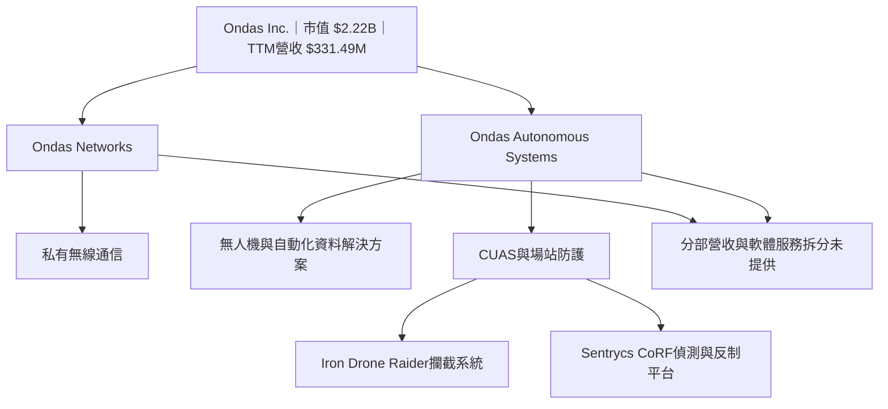
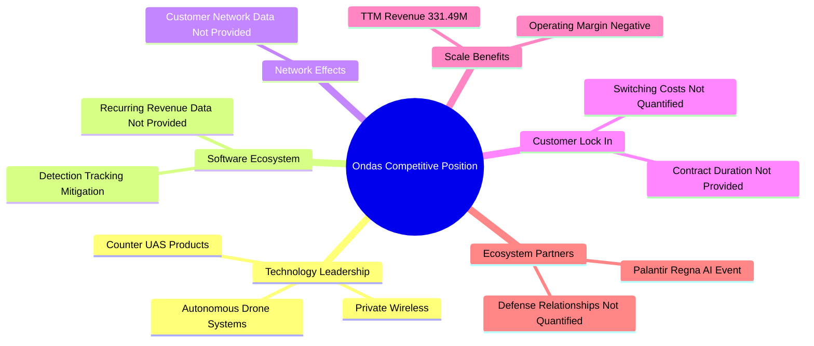
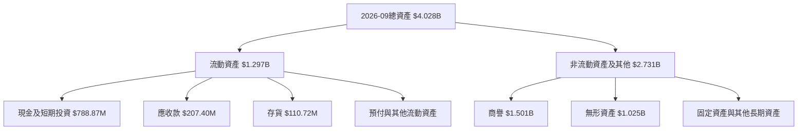
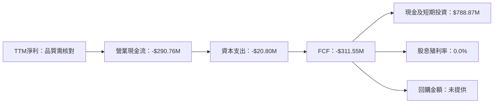
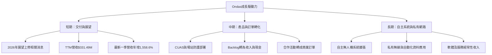
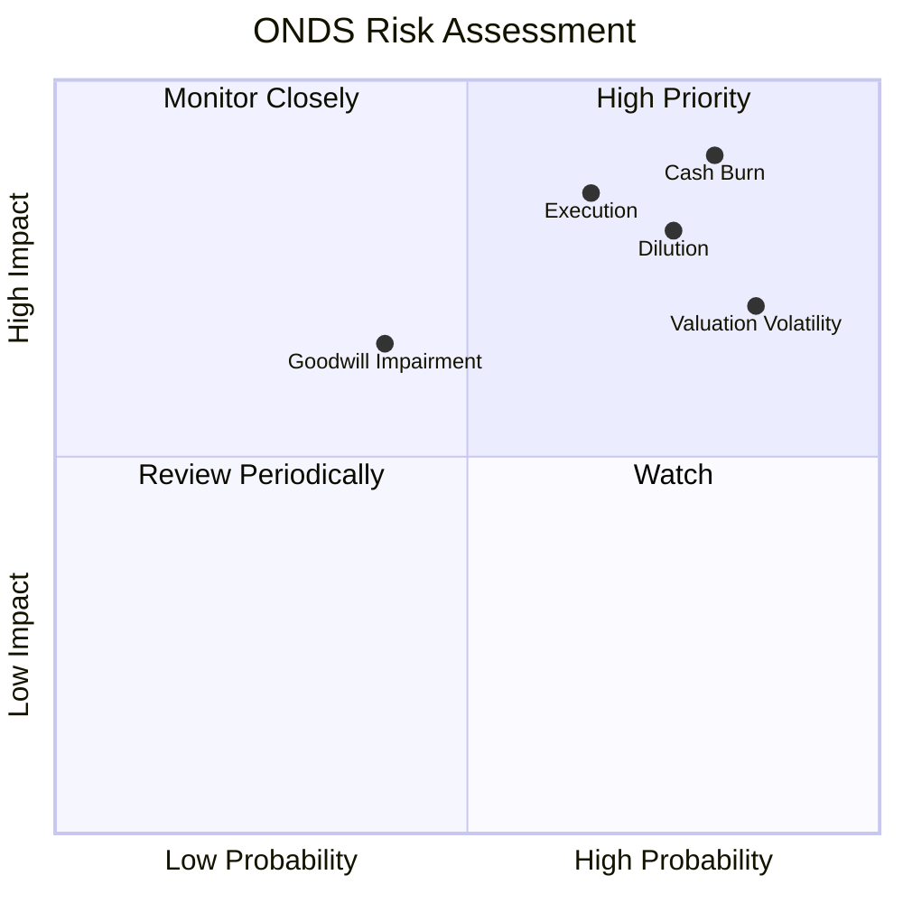
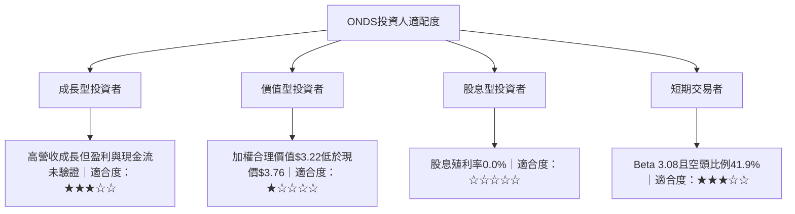

# ONDS 基本面深度分析報告
> **報告日期**：2026-11-21 ｜ **語言**：繁體中文 ｜ **數據來源**：SEC 申報資料 (XBRL)、Yahoo Finance、Finviz、StockAnalysis、Roic.ai ｜ **分析師**：CFA 級機構研究

## 目錄

| # | 章節 | 核心結論 |
|---|------|----------|
| 1 | 執行摘要 | 減碼；加權合理價值 $3.22，MOS -16.8% |
| 2 | 公司概覽與商業模式 | 無分部營收拆分與市場份額資料；產品定位有利基，但護城河證據仍有限 |
| 3 | 損益表深度分析 | TTM 營收 $331.49M、TTM 成長 1,239.4%；營業利益率 -126.2% |
| 4 | 資產負債表分析 | 現金及短期投資 $788.87M；債務數據 N/A，營運資金天數惡化 |
| 5 | 現金流量深度分析 | TTM FCF -$311.55M、FCF Yield -14.01%；資金消耗與 SBC 上升 |
| 6 | 獲利能力與資本效率 | ROIC -20.9% 對 WACC 14.00%，目前摧毀股東價值 |
| 7 | 相對估值分析 | 同業 P/S 中位數 3.1x；自身 P/S 低於歷史中位數，但仍未盈利 |
| 8 | DCF 內在價值評估 | DCF N/A：TTM 營業利益為負，不能把虧損直接折現作為價值 |
| 9 | 成長催化劑 | 防務無人機、反無人機與自動化系統需求為潛在催化劑；TAM 數據未提供 |
| 10 | 風險矩陣 | 執行與現金消耗、稀釋、估值波動為主要風險 |
| 11 | 投資建議 | 減碼；關注營收品質、毛利率、稀釋與 FCF 是否改善 |

---

## 1. 執行摘要

### 1.0 一頁式投資儀表板（Portfolio Manager 30 秒速讀）

| 項目 | 內容 |
|------|------|
| **投資論點（3 句）** | ① TTM 營收 $331.49M，年增 1,239.4%，顯示收購整合及業務放量帶來快速擴張，但高成長尚未轉為營業獲利。② TTM 營業利益率 -126.2%、FCF -$311.55M，表示目前擴張仍依賴外部資金與現金儲備。③ 同業 P/S 法推算 $1.72/股、與分析師共識加權後合理價值 $3.22，低於 2026-11-20 收盤價 $3.76。 |
| **綜合評分** | **4.8/10**（引用 1.1 評分卡） |
| **財務健康** | 🟡 現金及短期投資 $788.87M，但 TTM 營業現金流 -$290.76M、FCF -$311.55M；總債務在核心財務欄位為 N/A。 |
| **ROIC vs WACC** | **-20.9% vs 14.00%**；ROIC 低於資本成本 34.9 個百分點，現階段摧毀股東價值。 |
| **FCF 趨勢** | 惡化；TTM FCF Yield **-14.01%**。 |
| **估值** | Forward P/E **-24.258x**（虧損下不具經濟解讀力）｜EV/EBITDA **-6.116x**｜FCF Yield **-14.01%** |
| **DCF 內在價值（基準）** | **N/A**；TTM 營業利益為負，無適用的 DCF 基準內在價值，故折溢價 N/A。 |
| **安全邊際（MOS）** | **-16.8%**＝($3.22 − $3.76) ÷ $3.22；基準為 8.8 節加權合理價值。🔴 |
| **預期報酬（基準情境 12M）** | DCF 情境 N/A；以加權合理價值衡量的隱含上行空間為 **-14.4%**，不是 12 個月預測報酬。 |
| **關鍵風險（前二）** | 高現金消耗與負營業利潤；股權薪酬及股數增加造成稀釋。 |
| **評級 + 信心度** | 🟠 **減碼** ｜ 信心：中。MOS 為 -16.8%，符合規則 20 的減碼區間；DCF 不可用，故估值信心受限。 |

### 1.1 綜合評分卡（全報告唯一）

| 維度 | 評分（1–10） | 主要依據（引用數字與其來源章節） |
|------|--------------|----------------------------------|
| 成長性 | 9.0 | TTM 營收年增 1,239.4%、最新一季年增 1,558.6%；第 3 章指出基期低且收購／放量可能使成長率波動。 |
| 獲利能力 | 2.0 | TTM 營業利益率 -126.2%、ROIC -20.9%；Piotroski F-Score 3/8；見第 3、6 章。 |
| 財務健康 | 6.0 | 現金及短期投資 $788.87M，但 TTM FCF -$311.55M；CCC 181 天，高於一年前 169 天；見第 4、5 章。 |
| 估值 | 4.0 | MOS -16.8%，現價高於 $3.22 加權合理價值；P/S 7.0x 低於自身五年中位數 17.9x，但高於同業中位數 3.1x；見第 7、8 章。 |
| 護城河 | 5.0 | 涉及私有無線、無人機、自動化與反無人機產品；但分部營收、續約率、市占率與客戶集中度資料未提供；見第 2 章。 |
| 管理層與資本配置 | 3.0 | 稀釋股數測試未通過，2026 年季度 SBC 明顯增加；TTM 現金消耗高，未見回購或股息；見第 3、5 章。 |
| **綜合評分** | **4.8** | 六項算術平均：(9.0 + 2.0 + 6.0 + 4.0 + 5.0 + 3.0) ÷ 6 = 4.83，四捨五入為 **4.8/10**。 |

### 1.2 五大投資論點 + 三大核心風險

| 類型 | 項目 | 具體依據 | 信心度 |
|------|------|----------|--------|
| 🟢 **投資論點①** | 業務規模快速擴張 | TTM 營收 $331.49M、年增 1,239.4%；最新一季營收 $167.49M、年增 1,558.6%。若其中有機成長能延續，可提高固定成本吸收能力。 | 🟡 中 |
| 🟢 **投資論點②** | 現金儲備提供短期緩衝 | 現金及短期投資 $788.87M，為公司持續投資產品與交付提供資金緩衝；但尚不足以抵銷高額現金消耗。 | 🟡 中 |
| 🟢 **投資論點③** | 防務與無人機產品線具政策需求連結 | 公司產品涵蓋 CUAS、攔截無人機、私有無線與自動化；新聞提及提高 2026 年展望及 backlog，但缺少可量化訂單資料。 | 🟡 中 |
| 🟢 **投資論點④** | TTM 毛利率高於部分無人機同業 | 公司 TTM 毛利率 36.4%，高於 AVAV 26.5%、KTOS 23.0%、RCAT 8.7%；但利潤率仍受大額營業費用拖累。 | 🟡 中 |
| 🟢 **投資論點⑤** | 股價已從高點大幅回落 | 2026-11-20 收盤 $3.76，低於 52 週高點 $15.28；跌幅收窄了部分估值風險，但不代表營運風險已解除。 | 🟡 中 |
| 🟡 **風險①** | 營收成長未轉化為現金流 | TTM 營業利益率 -126.2%、營業現金流 -$290.76M、FCF -$311.55M；若持續，現金儲備會快速消耗。 | 🔴 高衝擊 |
| 🔴 **風險②** | 股權稀釋與 SBC 上升 | Piotroski 股數未增加測試未通過；2026 年所列四季 SBC 合計 $155.41M，約為 TTM 營收 46.9%。 | 🔴 高衝擊 |
| 🔴 **風險③** | 併購整合、商譽與估值波動 | StockAnalysis 2026-09 資產表列示商譽 $1.501B、無形資產 $1.025B；若收購資產未達預期，可能出現減損並拉低盈餘與帳面價值。 | 🟡 中高 |

### 1.3 快速統計卡片

| 指標 | 公司實際值（期間） | 同業中位數 | 狀態 |
|------|--------------------|------------|------|
| 營收成長（TTM） | **1,239.4%** | — | 🟢 高成長，但可能受收購與低基期影響 |
| 營收成長（最新一季年增） | **1,558.6%** | **22.0%** | 🟢 顯著高於同業；可持續性待驗證 |
| 毛利率（TTM） | **36.4%** | **23.0%** | 🟢 高於同業中位數 |
| 營業利益率（TTM） | **-126.2%** | — | 🔴 大幅虧損 |
| ROIC（TTM） | **-20.9%** | — | 🔴 低於 WACC 14.00% |
| Forward P/E | **-24.258x** | **19.7x** | 🔴 公司仍虧損；負倍數不具可比性 |
| FCF Yield（TTM） | **-14.01%** | — | 🔴 現金消耗 |
| Piotroski F-Score | **3 / 8** | — | 🔴 基本面測試偏弱 |

### 1.4 投資結論

```text
╔══════════════════════════════════════════════════════════════════╗
║                    📊 投資結論摘要                               ║
╠══════════════════════════════════════════════════════════════════╣
║  評級：減碼（MOS -16.8%，符合規則 20）                           ║
║  價格（2026-11-20 收盤）：$3.76                                  ║
║  DCF 內在價值（基準）：N/A（TTM 營業利益為負）                   ║
║  安全邊際 MOS：-16.8%（＝($3.22−$3.76)÷$3.22）                  ║
║  加權合理價值（8.8）：$3.22                                      ║
║  DCF 情境價值：N/A（DCF MODEL 未提供可用情境）                  ║
║  綜合評分：4.8/10（引用 1.1）                                    ║
║  適合投資人：能承受高波動、採小部位觀察的成長型投資人             ║
╚══════════════════════════════════════════════════════════════════╝
```

---

## 2. 公司概覽與商業模式

### 2.1 業務結構與收入來源

公司資料指出 Ondas Inc. 透過 Ondas Networks 與 Ondas Autonomous Systems 兩個部門經營私有無線、無人機及自動化資料解決方案；可辨識的產品包括 CUAS 系統、Iron Drone Raider、Sentrycs CoRF 等。**各部門營收、占比與軟體／服務收入均未提供，因此不以估計比例繪製收入拆分圖。**



### 2.2 市場份額

市場份額資料未提供，亦無可引用的公司 TAM 或市場滲透率數字。以營收規模而言，公司 TTM 營收 $331.49M，且最新一季營收年增 1,558.6%；但與 AVAV、KTOS、RCAT 相比，ONDS 的成長率顯著較高，盈利與規模成熟度則不足以據此推論市場地位。

### 2.3 競爭護城河分析



### 2.4 護城河強度

| 護城河項目 | 強度（強／中／弱） | 證據（引用數字或事實） | 會削弱它的情況 |
|------------|--------------------|------------------------|----------------|
| 技術與產品差異化 | 中 | 公司有 CUAS、Iron Drone Raider、Sentrycs CoRF 等產品線；產品實際市占與性能比較未提供。 | 競品在偵測精度、攔截成本、可靠性或採購資格上取得優勢。 |
| 軟體生態系統 | 弱至中 | CoRF 涉及偵測、識別、追蹤及反制；軟體訂閱收入、續約率與毛利未提供。 | 收入仍主要由一次性設備交付構成，缺乏可重複收入。 |
| 網路效應 | 弱 | 客戶數、部署規模與資料回饋效應未提供。 | 客戶採多供應商策略或資料無法形成跨客戶優勢。 |
| 客戶鎖定 | 弱至中 | 防務及關鍵場站系統可能具整合與認證成本，但合約期限與客戶集中度未提供。 | 採購延遲、取消或客戶轉向標準化替代品。 |
| 規模效應 | 弱 | TTM 營收快速擴大至 $331.49M，但 TTM 營業利益率仍為 -126.2%。 | 營收擴大仍無法改善成本吸收與營業槓桿。 |
| 生態夥伴 | 中 | 新聞提及與 Palantir、Regna AI 的國防技術合作活動；商業收入貢獻未量化。 | 合作僅停留在展示或試點，沒有轉化為可驗證訂單。 |

**1.1 護城河評分為 5.0/10**：產品與市場定位有一定差異化，但缺少市占、重複收入、客戶留存與合約資料，且目前營業利益率為負。

---

## 3. 損益表深度分析

### 3.1 年度收入成長趨勢（近 4 年）

年度營收採 SEC／StockAnalysis 年度資料；同比成長依相鄰年度營收計算，金額取兩位小數，百分比取一位小數。

```text
╔══════════════════════════════════════════════════════════════════╗
║             Ondas 年度收入趨勢（FY2022-FY2025）                ║
╠══════════════════════════════════════════════════════════════════╣
║ FY2022  $2.13M   █░░░░░░░░░░░░░░░░░░░░  YoY：N/A               ║
║ FY2023  $15.69M  ██████░░░░░░░░░░░░░░  YoY：+636.6% 🟢         ║
║ FY2024  $7.19M   ███░░░░░░░░░░░░░░░░░  YoY：-54.2%  🔴         ║
║ FY2025  $50.73M  ████████████████████  YoY：+605.3% 🟢         ║
║                                                                  ║
║ 2022-2025營收CAGR：($50.73M÷$2.13M)^(1/3)−1 ≈ 188.0%           ║
╚══════════════════════════════════════════════════════════════════╝
```

收入成長具有明顯年度波動：2024 年營收下降 54.2%，2025 年再升至 $50.73M，年增 605.3%。FY2025 的高成長與 2026 年 TTM $331.49M 的規模躍升，顯示企業組合及交付規模有顯著變化；但沒有有機成長與併購貢獻拆分，不能把全部增幅視為內生成長。

### 3.2 季度收入趨勢分析

| 季度 | 營收 | QoQ 成長 | YoY 成長 | 備註 |
|------|------:|---------:|---------:|------|
| 2025 Q4 | $30.11M | +198.1% | +629.20% | QoQ 以 2025 Q3 的 $10.10M 為基期；歷史基期較低。 |
| 2026 Q1 | $50.12M | +66.5% | +1,079.90% | YoY 為單季年增，不是 TTM 成長率。 |
| 2026 Q2 | $83.77M | +67.1% | +1,235.44% | 營收連續擴張；交付與收入確認節奏需追蹤。 |
| 2026 Q3 | $167.49M | +99.9% | **+1,558.6%** | 核心財務指標的最新一季年增率；季度增長極高但不能直接外推。 |

QoQ 計算示例：2026 Q3 為 ($167.49M ÷ $83.77M) − 1 = 99.9%。季度營收逐季提高，但客戶交付是否集中、收購併表及收入確認對增幅的貢獻沒有拆分，應避免把單季增速當成穩態成長率。

### 3.3 利潤率演變分析

年度毛利率與營業利益率由年度收入、毛利與營業利益計算；TTM 與最新季度營業利益率採核心財務指標原值。

| 利潤率指標 | FY2022 | FY2023 | FY2024 | FY2025 | 趨勢 | 評估 |
|------------|-------:|-------:|-------:|-------:|------|------|
| **毛利率** | 52.1% | 40.7% | 4.8% | 39.7% | FY2024 大幅下滑、FY2025 回升 | 🟡 波動大 |
| **營業利益率** | -2,347.9% | -243.7% | -481.1% | -115.1% | 分母小且營業費用高，年度間波動劇烈 | 🔴 持續虧損 |
| **TTM 營業利益率** | — | — | — | **-126.2%** | TTM 持續大幅負值 | 🔴 |
| **最新季度營業利益率** | — | — | — | **-113.1%** | 核心財務數據最新季度值 | 🔴 |

FY2025 毛利率回升至 39.7%，而 TTM 毛利率為 36.4%，代表產品交付的直接毛利已有一定基礎；然而 TTM 營業利益率仍為 -126.2%，說明營業費用與整合成本遠高於毛利貢獻。年度營業利益率的極端負值受小營收基期放大，應主要看近期營收擴大後費用率是否下降，而非將歷史百分比當作穩態。

### 3.4 費用結構分析

未提供完整 TTM 研發、銷售管理、併購費用及 SBC 的一致費用拆分，故不以不完整資料繪製費用結構圓餅圖。可觀察到 FY2025 研發費用為 $20.88M；當年營業利益為 -$58.38M，表示研發之外的營業費用亦不可忽視。

### 3.5 季度 EPS 趨勢與盈餘品質（Quality of Earnings）

| 季度 | EPS 實際值 | EPS 預估／驚喜 | 表現與原因 |
|------|-----------:|-----------------|------------|
| 2025 Q4 | -$0.27（ROIC.ai） | 預估與驚喜 N/A | EPS 歷史有來源，但估計值缺失，不能判定超預期或不及預期。 |
| 2026 Q1 | +$0.59（StockAnalysis；ROIC.ai 列 $0.82） | 預估與驚喜 N/A | 不同資料來源實際 EPS 不一致；季度淨利數據亦顯示異常高的正值，可能涉及非經常項目，需以 10-Q 調節表確認。 |
| 2026 Q2 | -$0.15（StockAnalysis） | 預估與驚喜 N/A | 仍處虧損；季度淨損為 $88.25M。 |
| 2026 Q3 | -$0.10（StockAnalysis） | 預估與驚喜 N/A | 季度淨損 $62.57M；Earnings History 的估計與實際 EPS 均為 NaN，無法計算 beat/miss。 |

| 盈餘品質項目 | 數值/佔比 | 評估 |
|--------------|-----------|------|
| 股權薪酬 SBC / 營收 | 2025 Q4 至 2026 Q3 SBC 合計 $155.41M；除以 TTM 營收 $331.49M = **46.9%** | 🔴 SBC 很高；若相關費用未能帶來相稱的現金盈利，將稀釋每股經濟價值。 |
| SBC / 營業現金流 | $155.41M ÷ \|-$290.76M\| = **53.5%** | 🔴 營業現金流為負，該比例僅表示 SBC 金額約為營業現金流出額的一半，不能解讀為現金覆蓋。 |
| FCF / 淨利（現金轉換率） | 以 QUALITY FIGURES 杜邦淨利率 33.1% × TTM 營收 $331.49M 推得淨利約 $109.72M；-$311.55M ÷ $109.72M ≈ **-284%** | 🔴 僅為跨來源推算；非現金或一次性收益可能令正淨利與負 FCF 背離。 |
| 一次性／非經常性損益 | 2026 Q1 季度淨利資料列示 +$362.95M，EPS 資料又有來源不一致 | 🔴 必須查核 10-Q 的公允價值、處分或其他非經常項目；不宜將單季 GAAP 淨利年化。 |
| 有效稅率異常 | N/A（缺少一致的 TTM 稅前所得與所得稅費用拆分） | 🟡 不以稅率推論盈餘品質。 |
| 資本化支出 vs 費用化 | TTM Capex $20.80M；資本化開發成本與費用化明細 N/A | 🟡 無法判斷是否透過資本化遞延成本。 |

**盈餘品質結論**：淨利與現金流呈現顯著背離，TTM FCF 為 -$311.55M；SBC 金額亦相當於 TTM 營收約 46.9%。因此，當前估值不應依賴單季正 EPS 或 TTM 淨利推算，應優先監控經常性毛利、營業費用、現金消耗及稀釋股數。

---

## 4. 資產負債表分析

### 4.1 資產結構分解

以下細項來自 StockAnalysis 2026-09 資產表；其總資產與其他期間資料存在口徑或資料彙整差異，作結構觀察而非用於估值橋接。



商譽與無形資產合計 $2.526B，約為 StockAnalysis 所列總資產 $4.028B 的 62.7%。比例偏高意味收購資產估值與未來現金流實現程度重要；若被收購業務未達預期，可能形成減損風險。

### 4.2 流動性與營運資金分析

| 指標 | 最新 TTM | 一年前 TTM | 變化 | 解讀 |
|------|----------|------------|------|------|
| 流動比率 | 3.389x（補充資料） | N/A | N/A | 短期流動性看似充足，但不能替代現金流分析；來源口徑與核心數據需核對。 |
| DSO 應收帳款天數 | **140 天** | **77 天** | **+63 天** | 收款週期拉長，可能反映應收款擴張或大額政府／企業專案結算節奏；需追蹤逾期與回款。 |
| DIO 存貨天數 | **182 天** | **278 天** | **-96 天** | 存貨週轉天數下降，方向改善；但仍約半年，需確認是否交付消化而非存貨口徑變化。 |
| DPO 應付帳款天數 | **141 天** | **186 天** | **-45 天** | 對供應商付款天數縮短，可能降低供應商融資對現金的支撐。 |
| CCC 現金轉換週期 | **181 天** | **169 天** | **+12 天** | 現金被營運週期占用時間增加，主要是 DSO 上升抵銷 DIO 改善。 |

### 4.3 債務結構分析

```text
╔══════════════════════════════════════════════════════════════════╗
║                   Ondas 債務健康診斷                            ║
╠══════════════════════════════════════════════════════════════════╣
║ 總債務：        N/A（核心財務資料未提供可用總債務值）            ║
║ 總現金+短期投資：$788.87M                                        ║
║ 淨現金：        $788.87M（核心 VERIFIED 指標；總債務 N/A）       ║
║                                                                  ║
║ Debt/EBITDA：   N/A（總債務可比值缺失；EBITDA 為負）             ║
║ Interest Coverage：N/A（利息費用及一致口徑負債資料不足）         ║
║                                                                  ║
║ 注意：補充市場資料另列總債務 $62.81M、淨現金 $726.06M，           ║
║ 與核心指標的債務 N/A 不一致；本報告不以補充數字取代核心值。     ║
╚══════════════════════════════════════════════════════════════════╝
```

### 4.4 股東權益趨勢

股東權益資料顯示 FY2022 $58.22M、FY2023 $33.14M、FY2024 $16.58M、FY2025 $437.81M。FY2025 的大幅增加與融資、併購或資產重組可能相關，但缺乏完整權益變動表時不將增幅等同於內生獲利。

```text
╔══════════════════════════════════════════════════════════════════╗
║                   Ondas 股東權益變化                            ║
╠══════════════════════════════════════════════════════════════════╣
║ FY2022   $58.22M  ██████░░░░░░░░░░░░░░                          ║
║ FY2023   $33.14M  ███░░░░░░░░░░░░░░░                            ║
║ FY2024   $16.58M  ██░░░░░░░░░░░░░░░                             ║
║ FY2025  $437.81M  ████████████████████                          ║
╚══════════════════════════════════════════════════════════════════╝
```

---

## 5. 現金流量深度分析

### 5.1 現金流量瀑布圖

TTM 淨利與現金流口徑存在資料不一致，圖中僅呈現已核實的營業現金流與 Capex；股息殖利率為 0.0%，回購金額未提供。



### 5.2 FCF 轉換率趨勢

| 年度 | FCF | 淨利 | FCF／淨利 | 解讀 |
|------|----:|-----:|---------:|------|
| FY2022 | -$40.89M | -$73.24M | 約 55.8% | 虧損期間現金流出低於帳面淨損，但仍為負。 |
| FY2023 | -$34.30M | -$44.84M | 約 76.5% | 現金流仍未轉正。 |
| FY2024 | -$35.20M | -$38.01M | 約 92.6% | 現金流出接近淨損規模。 |
| FY2025 | -$40.88M | -$132.02M | 約 31.0% | 淨損遠高於 FCF 流出，兩者含非現金項目差異。 |
| TTM 至 2026-09-30 | **-$311.55M** | 資料口徑不一致 | 不宜直接作為單一轉換率 | 季度營業現金流顯著惡化，須以 SEC 現金流量表核對營運資金及併購影響。 |

### 5.3 自由現金流趨勢

```text
╔══════════════════════════════════════════════════════════════════╗
║                 Ondas 自由現金流：歷史與TTM                     ║
╠══════════════════════════════════════════════════════════════════╣
║ FY2022  -$40.89M  ████████████████████░  負值                   ║
║ FY2023  -$34.30M  █████████████████░░░  負值                   ║
║ FY2024  -$35.20M  █████████████████░░░  負值                   ║
║ FY2025  -$40.88M  ████████████████████░  負值                   ║
║ TTM     -$311.55M █████████████████████  FCF Yield -14.01%     ║
║                                                                  ║
║ TTM FCF 定義：營業現金流 -$290.76M − 資本支出 $20.80M            ║
╚══════════════════════════════════════════════════════════════════╝
```

TTM 現金消耗遠高於 FY2022–FY2025 單年 FCF 流出。不同期間與公司組合可能不完全可比，但若後續現金流沒有快速改善，$788.87M 現金及短期投資將成為重要的融資跑道，而不是自由可分配資本。

### 5.4 資本配置評估

因回購、併購支出及各項投資的 TTM 完整現金金額未提供，不製作資本配置圓餅圖。

| 資本用途 | 可用資料 | 評估 |
|----------|----------|------|
| 研發 | FY2025 $20.88M | 研發支持產品開發，但與營收的 TTM 配比缺乏同口徑資料。 |
| 資本支出 | TTM $20.80M | 相對營業現金流出較小；企業現金消耗主要不只是設備投資。 |
| 股息 | 殖利率 0.0% | 未向股東支付現金股息。 |
| 回購 | N/A | 未提供可核實回購金額。 |
| 股權薪酬 | 2025 Q4 至 2026 Q3 合計 $155.41M | 數額高，需與新增股數、留才及營運績效一併評估。 |

---

## 6. 獲利能力與資本效率

### 6.1 ROE / ROA / ROIC 趨勢

| 指標 | FY2022 | FY2023 | FY2024 | FY2025 | 最新 TTM | 評估 |
|------|-------:|-------:|-------:|-------:|---------:|------|
| ROE | N/A | N/A | N/A | N/A | **4.6%**（QUALITY FIGURES） | 可能受到非經常淨利及權益變動影響，不宜單獨視為持續回報。 |
| ROA | N/A | N/A | N/A | N/A | **-9.7%**（補充資料） | 資產尚未產生正向營業回報。 |
| ROIC | N/A | N/A | N/A | N/A | **-20.9%** | 明顯低於 14.00% WACC，資本效率未達價值創造門檻。 |

### 6.2 ROIC vs WACC 分析（核心價值創造判斷）

成本資本與 WACC 數據採程式計算的資本成本資料；10 年期美債殖利率日期未單獨提供，故不另推定日期。

```text
╔══════════════════════════════════════════════════════════════════╗
║                ROIC vs WACC 深度分析                            ║
╠══════════════════════════════════════════════════════════════════╣
║ WACC輸入：                                                       ║
║ ├── 無風險利率：4.91%                                            ║
║ ├── 市場風險溢酬 ERP：5.00%                                      ║
║ ├── 原始 Beta：3.08；採用調整 Beta：2.00                         ║
║ ├── 股權成本：4.91% + 2.00×5.00% = 14.91%                       ║
║ ├── 稅前債務成本：10.47%；稅後：10.47%×(1−21%) = 8.27%          ║
║ ├── 資本權重：股權 97.3%；債務 2.7%                              ║
║ ├── 未封頂 WACC：97.3%×14.91% + 2.7%×8.27% = 14.73%             ║
║ └── 採用 WACC：14.00%（14.73% 被限制於 7%-14% 區間）             ║
║                                                                  ║
║ ROIC（TTM）：-20.9%                                              ║
║ EVA利差：ROIC − WACC = -20.9% − 14.00% = -34.9個百分點           ║
║                                                                  ║
║ ROIC  -20.9%  ◀ 負報酬                                          ║
║ WACC   14.00%  ◀ 資本成本                                        ║
║ 結論：目前 ROIC 低於 WACC，經濟利潤為負，摧毀股東價值。         ║
╚══════════════════════════════════════════════════════════════════╝
```

Beta 原始值 3.08 經調整公式「⅔ × 3.08 + ⅓」約為 2.39，再受 0.6–2.0 範圍限制，故採用調整 Beta 2.00。依提供的成本資本權重，未封頂計算為 14.73%，採用 WACC 為 14.00%。公司 ROIC -20.9%，比 WACC 低 34.9 個百分點，若不能改善營業利潤與資本週轉，營收成長本身不等同於價值創造。

### 6.3 杜邦三因素分解

| 因素 | 數值（TTM） | 解讀 |
|------|-------------|------|
| 淨利率 | **33.1%** | 可能受非經常項目影響；與營業虧損及負 FCF 的方向不一致。 |
| 資產週轉率 | **0.08** | 每單位資產產生的收入偏低；大額商譽與無形資產亦可能壓低週轉率。 |
| 權益乘數 | **1.70** | 財務槓桿並非 ROE 表面數值的唯一來源。 |
| **ROE** | **4.6%** | 33.1% × 0.08 × 1.70 ≈ 4.5%，與報告的 4.6% 有四捨五入尾差。 |

### 6.4 財務體質：Piotroski F-Score

**Piotroski F-Score：3/8**。九項測試中有一項因缺資料無法判定，因此有效分母為八項。

| 測試 | 結果 | 解讀 |
|------|------|------|
| ROA > 0 | ✅ 通過 | 當期 TTM ROA 指標通過該項比較測試。 |
| 營業現金流 > 0 | ❌ 未通過 | TTM 營業現金流 -$290.76M，現金創造能力弱。 |
| ROA 高於一年前 | ✅ 通過 | 相較一年前改善，但不代表目前絕對報酬已足夠。 |
| 營業現金流 > 淨利（應計品質） | ❌ 未通過 | 現金流無法支持帳面盈餘，須查核非現金與一次性項目。 |
| 長期負債 ÷ 總資產低於一年前 | — 無法判定 | 缺少可比較的長期負債輸入。 |
| 流動比率高於一年前 | ❌ 未通過 | 流動比率相對一年前未改善。 |
| 稀釋股數未增加 | ❌ 未通過 | 股數增加使每股價值可能低於企業層面的成長。 |
| 毛利率高於一年前 | ❌ 未通過 | 毛利率比較測試未通過，顯示毛利改善未能持續或基期差異不利。 |
| 資產週轉率高於一年前 | ✅ 通過 | 資產使用效率相對一年前改善。 |

---

## 7. 相對估值分析

### 7.1 同業估值比較表格

同業倍數採 Yahoo Finance Peer multiples；公司自身倍數取補充市場資料。負 EPS 公司之負 Forward P/E 與負 EV/EBITDA 不可按一般正值倍數解讀。

| 估值指標 | **ONDS** | **AVAV** | **KTOS** | **RCAT** | 本公司評估 |
|----------|---------:|---------:|---------:|---------:|-----------|
| **Trailing P/E** | N/A | N/A | 224.1x | N/A | 🔴 ONDS 無正向可用 TTM P/E。 |
| **Forward P/E** | -24.258x | 19.7x | 24.0x | -2.8x | 🔴 ONDS 為負值，無法以傳統 P/E 判斷便宜。 |
| **P/S Ratio** | 6.709x（補充市場資料） | 2.2x | 3.1x | 3.7x | 🔴 ONDS 高於同業中位數 3.1x，需靠更高成長支撐。 |
| **EV/EBITDA** | -6.116x | 23.4x | 43.4x | -0.4x | 🔴 ONDS EBITDA 為負，負倍數不具有正常估值意義。 |
| **最新季度營收年增** | 1,558.6% | 5.7% | 35.7% | 22.0% | 🟢 ONDS 增速顯著領先；基期與收購效應未知。 |
| **毛利率（TTM）** | 36.4% | 26.5% | 23.0% | 8.7% | 🟢 ONDS 毛利率高於三家同業。 |

同業中位數計算：P/S 的排序為 2.2x、3.1x、3.7x，中位數 3.1x；最新季度營收年增中位數為 22.0%；毛利率中位數為 23.0%。ONDS 的高營收增速與毛利率是優勢，但目前營業利益率為 -126.2%，使其不能僅以增速溢價合理化相對高於同業的 P/S。

### 7.2 歷史估值區間分析

```text
╔══════════════════════════════════════════════════════════════════╗
║                 ONDS 自身 P/S 五年估值區間                      ║
╠══════════════════════════════════════════════════════════════════╣
║ 五年區間：2.9x ├──────────────────────────────────┤ 140.6x      ║
║ 五年中位數：17.9x                                                ║
║ 當前 P/S：7.0x                                                   ║
║ 當前歷史百分位：32%                                              ║
║ 解讀：當前倍數低於歷史中位數，但仍高於同業 P/S 中位數 3.1x。    ║
╚══════════════════════════════════════════════════════════════════╝
```

### 7.3 情境價值（Bear / Base / Bull，照抄 DCF MODEL 的 Scenarios）

**N/A（DCF 無法計算：TTM 營業利益為負，DCF MODEL 未提供有效情境）**。依資料規則不自行設定悲觀、基準或樂觀目標價。

### 7.4 相對估值隱含價格區間

```text
╔══════════════════════════════════════════════════════════════════╗
║                  相對估值每股價值比較                            ║
╠══════════════════════════════════════════════════════════════════╣
║ 同業 P/S 法：$1.72 ─────── 現價 $3.76 ─────── 分析師共識 $16.68 ║
║ 基準依據：AVAV、KTOS、RCAT 同業 P/S 中位數 3.1x × TTM 營收      ║
║ 同業 P/S 法相對現價：-54.3%                                      ║
║ 分析師共識目標：$16.68；10位分析師均值，較現價 +343.6%          ║
╚══════════════════════════════════════════════════════════════════╝
```

相對估值法只列有提供的兩個方法。Forward P/E 因無法計算而未列；不以公司自身 P/S 倍數回推價格，避免得到接近現價的循環估值。

---

## 8. DCF 內在價值評估（Discounted Cash Flow）

### 8.0 估值推理鏈（Thinking Logic）

**本報告不建立獨立 DCF。**核心財務數據顯示 TTM 營業利益率 -126.2%，TTM 營業利益不為正；資料中的 DCF MODEL 因此標示 N/A，原因是「TTM operating income is not positive; a loss discounted forward is not a value」。依規則不以虧損假設自行搭建預測模型，也不編造每股 DCF 價值。

- **Step 1 — 價值來源**：Ondas 的長期價值可能來自私有無線、自治無人機與 CUAS 業務，但各板塊收入占比未提供，無法可靠拆分「現有主業、第二成長曲線與選擇權價值」。
- **Step 2 — 模型選擇**：目前只採用程式提供的同業 P/S 估值及分析師共識加權方法；DCF 因 TTM 營業利益為負而不適用。若以 FCFF 負值直接折現，結果會高度依賴未經證實的利潤率轉正時間。
- **Step 3 — 假設推導**：DCF MODEL 為 N/A，故不存在可引用的預測期、營收 CAGR、營業利潤率、稅率、Capex、D&A、ΔWC、SBC、稀釋率、WACC 情境、終值或敏感度輸入；不補建假設。
- **Step 4 — 最脆弱環節**：估值最脆弱之處，是高速營收成長能否轉成正營業利益與正 FCF；若沒有改善，P/S 相對估值也可能繼續下修。
- **Step 5 — 計算路徑**：DCF 估值流程圖不適用，因模型輸入與逐年現金流均未提供。

### 8.1 模型假設總表（Model Inputs）

**N/A（DCF MODEL 未提供可用模型；TTM 營業利益為負，依規則不自建 DCF。）**

### 8.2 折現率推導（WACC）

DCF 折現率推導在 DCF MODEL N/A 的前提下不作為可計算 DCF 模型輸入。作為第 6.2 節資本效率比較，採用提供的成本資本值：10 年期無風險利率 4.91%、ERP 5.00%、原始 Beta 3.08、調整 Beta 2.00、股權成本 14.91%、稅前債務成本 10.47%、稅率 21.0%、股權／債務權重 97.3%／2.7%。未封頂 WACC 計算值 14.73%，依 7%–14% 範圍上限採用 **14.00%**。此數值與第 6.2 節一致；不另用它建立 DCF。

### 8.3 逐年自由現金流預測（基準情境）

**N/A（DCF MODEL 未提供逐年預測；不得自建 FY+1 至 FY+N 現金流。）**

### 8.4 終值計算（Terminal Value）

**N/A（沒有 DCF 預測期末 FCFF、永續成長率 g 或可用退出倍數；不計算 Gordon Growth 或退出倍數終值。）**

### 8.5 企業價值 → 每股內在價值（Bridge）

**N/A（DCF MODEL 未提供預測期現金流現值、終值及相應橋接；DCF 基準內在價值與其折溢價均為 N/A。）**

### 8.6 敏感性分析（WACC × 永續成長率）

**N/A（未提供可用 DCF 基準、預測現金流與終值，故不產生敏感性矩陣或三情境價值。）**

### 8.7 反推 DCF（Reverse DCF：市場在預期什麼）

**N/A（未提供 DCF 模型，無法從單一現價反解營收 CAGR、利潤率、g 或預測期。）**不以自建模型對市場預期作虛假精確度判斷。

### 8.8 估值三角驗證與安全邊際

| 估值方法 | 隱含每股價值 | 上行空間（÷現價） | 權重 | 說明 |
|----------|--------------:|-------------------:|-----:|------|
| 同業 P/S | **$1.72** | **-54.3%** | **90%** | AVAV、KTOS、RCAT 同業 P/S 中位數 3.1x × TTM 營收；程式估值方法原值。 |
| 分析師共識目標價 | **$16.68** | **+343.6%** | **10%** | 10 位分析師平均目標價；參考項目，較高目標對加權值影響有限。 |
| **加權合理價值** | **$3.22** | **-14.4%** | **100%** | 不含未能計算的 Forward P/E 方法。 |

加權計算：  
**$1.72 × 90% + $16.68 × 10% = $1.548 + $1.668 = $3.216，四捨五入為 $3.22。**  
計算方法對應公司類型「unprofitable」；同業 Forward P/E 因不可計算而未納入。權重與方法數值依估值方法資料原值引用，不作調整。

```text
╔══════════════════════════════════════════════════════════════════╗
║                  估值區間與安全邊際                              ║
╠══════════════════════════════════════════════════════════════════╣
║ 同業P/S $1.72 ── 現價 $3.76 ── [加權合理值 $3.22] ── 共識 $16.68║
║                                                                  ║
║ MOS = ($3.22 − $3.76) ÷ $3.22 = -16.8%                          ║
║ 上行空間 = ($3.22 − $3.76) ÷ $3.76 = -14.4%                     ║
║ 折溢價（DCF基準）：N/A（DCF值不可用）                           ║
║                                                                  ║
║ MOS評估：🟠 減碼區間（-25%至-10%）                              ║
║ MOS≥10%買入參考區間：$2.58–$2.90                                ║
║ 合理持有參考區間：$2.90–$3.54                                    ║
║ 減碼考慮區間：高於約 $3.54（MOS低於-10%）                      ║
╚══════════════════════════════════════════════════════════════════╝
```

買入參考區間是按加權合理價值 $3.22 推算，使 MOS 約為 10%–20%：$3.22 × (1−20%) = $2.58，$3.22 × (1−10%) = $2.90。該區間是估值算術，不是 DCF 支撐的目標價。

> 🔎 **程式複算（Python，依本節各項自動重算）**
>
> 加權合理價值 = $1.72 × 90% + $16.68 × 10% = **$3.22**（權重合計 100%）
>
> 以價格 $3.76 計：MOS = **-16.8%**，上行空間 = **-14.4%**
>
> ✅ 與本節所寫數值一致。

### 8.9 DCF 模型的局限與失效條件

- **終值依賴度**：N/A；沒有可計算的終值或企業價值。
- **最脆弱的估值前提**：同業 P/S 法假設營收增速可以維持、且市場願意給予相對倍數；若營收成長降速或毛利率回落，價值可能低於 $1.72/股的同業 P/S 方法值。
- **不適用情境說明**：TTM 營業利益為負，且 FCF 為 -$311.55M；傳統 DCF 可靠度不足。現階段應輔以 EV/Sales、訂單交付、毛利趨勢與現金消耗速度觀察，不宜把假設利潤率轉正的模型當作確定內在價值。
- **與第 10 章風險矩陣連結**：交付延遲會影響營收；價格或產品組合惡化會壓低毛利；SBC、併購費用與營運資金上升會延後 FCF 轉正。

### 8.10 複算檢核表（Audit Trail）

| # | 檢核項目 | 檢查方式 | 結果 |
|---|----------|----------|------|
| 1 | 所有 DCF 高／中敏感度假設有四段式推導 | DCF 模型為 N/A，無可用假設 | 不適用 |
| 2 | 每個 DCF 假設都有來歷 | 未填入 DCF 假設 | 不適用 |
| 3 | WACC 五步算式齊全且正確 | 不建立 DCF WACC；第 6.2 採用值與組成一致引用 | 不適用 |
| 4 | Kd 分母與債務權重 D 範圍一致 | 債務值在核心財務數據為 N/A；不以補充負債反推 DCF | 不適用 |
| 5 | WACC 與第 6.2 節同值 | 6.2 採用 14.00%；本章不另設 DCF WACC | ✅ |
| 6 | 逐年表格年度數等於 N，且無省略 | DCF MODEL N/A，沒有年度表 | 不適用 |
| 7 | FY+1 九步算式可複算 | 沒有 FY+1 模型數據 | 不適用 |
| 8 | 預測期 PV 合計可複算 | 沒有預測期 PV | 不適用 |
| 9 | WACC > g | DCF 未提供 g | 不適用 |
| 10 | 終值以 FY+N 現金流為基礎 | 沒有預測期末現金流 | 不適用 |
| 11 | EV 至每股價值橋接可複算 | DCF 橋接為 N/A | 不適用 |
| 12 | SBC 組合經濟上相容 | 未建立 DCF，不採用 SBC／股數模型組合 | 不適用 |
| 13 | 敏感性矩陣基準格等於 8.5 | 未提供敏感性矩陣及 DCF 基準值 | 不適用 |
| 14 | 矩陣無 WACC ≤ g 數值格 | 未建立矩陣 | 不適用 |
| 15 | 三情境機率合計 100% | DCF Scenarios 未提供 | 不適用 |
| 16 | 反推 DCF 每列只放開一個變數 | 未建立反推模型 | 不適用 |
| 17 | MOS 與 1.0 相同；折溢價依 8.5 | MOS 均為 -16.8%；DCF 折溢價 N/A | ✅ |
| 18 | 報告完整至第 11 章 | 已列出第 1–11 章 | ✅ |
| 19 | 加權合理價值等於方法價值加權總和 | $1.72×90%+$16.68×10%=$3.216，顯示 $3.22 | ✅ |
| 20 | 評級符合 MOS 門檻 | MOS -16.8%，規則 20 對應減碼 | ✅ |

**修正與限制說明**：DCF 專屬檢核項目因 DCF MODEL 明確為 N/A，均標示「不適用」，沒有以假設值補建模型。估值評級依可用的 8.8 加權合理價值與 MOS 判定。

---

## 9. 成長催化劑

### 9.1 催化劑時間軸

公司未提供具體的產品上市或合約執行日期，無法以確定時間點繪製 Gantt 圖。現階段可觀察的事件包括 2026 年 outlook 上修、backlog 與防務需求相關新聞，以及與 Palantir、Regna AI 的國防技術活動；其收入貢獻與轉換時程尚未量化。

### 9.2 TAM 市場規模分析

**N/A（TAM 數據未提供）**。公司 TTM 營收 $331.49M、年增 1,239.4%，但沒有可引用的市場規模、來源年份或市場滲透率，故不推估 TAM 金額。

### 9.3 成長驅動力結構圖



---

## 10. 風險矩陣

### 10.1 風險評分矩陣

下圖座標是分析師對發生機率與衝擊的定性判斷，並非公司財務披露數字；事件風險數值不應解讀為精確機率。



### 10.2 風險清單詳細分析

| # | 風險項目 | 發生機率 | 財務衝擊 | 風險評估 | 緩解措施 |
|---|----------|----------|----------|----------|----------|
| 1 | 🔴 **現金消耗與融資需求** | 高（定性估計） | 高；TTM FCF -$311.55M，若維持此速度將顯著消耗 $788.87M 現金及短期投資 | 🔴 極高 | 每季追蹤 OCF、FCF、現金餘額及資金用途；要求營收成長與現金流改善同步。 |
| 2 | 🔴 **執行與營收確認風險** | 中高（定性估計） | 高；Q3 營收年增 1,558.6%，但客戶、交付與有機成長拆分未提供 | 🔴 高 | 追蹤 backlog 轉換、取消率、交付延期與應收帳款回款。 |
| 3 | 🔴 **股權稀釋及 SBC** | 高（定性估計） | 高；已列季度 SBC 合計 $155.41M，Piotroski 稀釋股數測試未通過 | 🔴 高 | 每季核對基本／稀釋股數、SBC／營收及 SBC／毛利趨勢。 |
| 4 | 🟠 **商譽與無形資產減損** | 中（定性估計） | 中高；StockAnalysis 列商譽 $1.501B、無形資產 $1.025B | 🟠 中高 | 追蹤併購業務營收、毛利與現金流；注意減損測試與收購會計變動。 |
| 5 | 🟠 **高波動與空頭部位** | 高（定性估計） | 股價波動可能放大；Beta 3.08、Short % Float 41.9%、短倉比率 5.07 | 🟠 高 | 控制部位大小、避免以短期反彈作為基本面改善證據。 |

---

## 11. 投資建議

### 11.1 最終評級與評分

**依 MOS -16.8%，規則 20 評級為減碼；未作質化上調或下調。**1.1 綜合評分為 **4.8/10**，六項分數為成長性 9.0、獲利能力 2.0、財務健康 6.0、估值 4.0、護城河 5.0、管理層與資本配置 3.0。高營收成長尚未抵銷負 ROIC、負 FCF 與稀釋風險。

### 11.2 合理價值與隱含報酬率

| 估值項目 | 每股價值 | 相對 2026-11-20 收盤 $3.76 | 機率／權重 | 說明 |
|----------|---------:|-------------------------:|-------------:|------|
| 同業 P/S 法 | $1.72 | -54.3% | 90% | Peer multiples 方法值。 |
| 分析師共識 | $16.68 | +343.6% | 10% | 10 位分析師平均目標價。 |
| **加權合理價值** | **$3.22** | **-14.4%** | **100%** | 依 8.8 加權結果，非 DCF 目標價。 |
| 悲觀／基準／樂觀 DCF 情境 | N/A | N/A | N/A | DCF MODEL 未提供可用情境。 |

### 11.3 買入時機與觸發因素

```text
╔══════════════════════════════════════════════════════════════════╗
║                  ✅ 買入觸發因素 Checklist                      ║
╠══════════════════════════════════════════════════════════════════╣
║  觀察／建立部位前，優先確認：                                    ║
║  ☐ 營收成長可拆分為有機成長與併購貢獻，且交付可持續              ║
║  ☐ 毛利率維持或高於 TTM 36.4%，並開始收窄營業虧損                ║
║  ☐ DSO 從 140 天下降，CCC 不再高於 181 天                        ║
║  ☐ SBC／營收下降，稀釋股數增幅放緩                               ║
║                                                                  ║
║  估值觸發參考：                                                  ║
║  ☐ 股價低於約 $2.90：相對 $3.22 加權價值的 MOS 約達 10%          ║
║  ☐ $2.58 附近：相對 $3.22 加權價值的 MOS 約達 20%                ║
║                                                                  ║
║  減碼／重新檢視觸發條件：                                        ║
║  ☐ TTM FCF 持續低於 -$311.55M，或現金儲備快速減少                ║
║  ☐ 最新一季營收成長明顯放緩且毛利率同步下滑                      ║
║  ☐ 股數持續增加，SBC 佔營收仍接近目前約 46.9%                    ║
║  ☐ 交付延誤、應收帳款惡化或併購資產出現重大減損                  ║
╚══════════════════════════════════════════════════════════════════╝
```

### 11.4 投資人適配度分析



### 11.5 每季財報監控清單（Quarterly Watch List）

| 指標 | 最新參考值 | 觸發加碼的觀察條件 | 觸發減碼／重新檢視條件 |
|------|------------|--------------------|-------------------------|
| 營收與有機成長 | TTM $331.49M；最新季度年增 1,558.6% | 成長維持且公司能披露有機／併購拆分、交付轉換 | 連續兩季成長顯著放緩，且 backlog 或交付未能支撐 |
| 毛利率 | TTM 36.4% | 維持或提升，顯示產品組合及交付成本可控 | 低於 TTM 36.4% 並持續收縮 |
| 營業利益率 | TTM -126.2%；最新季度 -113.1% | 虧損率連續收窄，且不是單靠一次性項目 | 虧損率擴大或營收增長沒有改善費用率 |
| 營業現金流與 FCF | TTM OCF -$290.76M；FCF -$311.55M | 現金流出連續下降，朝損益兩平改善 | 現金流出擴大或現金餘額快速下降 |
| DSO／CCC | DSO 140 天；CCC 181 天 | DSO、CCC 逐季下降 | DSO 繼續上升、回款延遲或應收款減損增加 |
| SBC 與股數 | 2025 Q4–2026 Q3 SBC 合計 $155.41M | SBC／營收下降、稀釋股數增速放緩 | SBC 持續快速增加或每股營收被稀釋 |
| 存貨 | DIO 182 天 | 隨出貨增加而下降 | 存貨增加但營收、交付未同步 |
| 財測與訂單 | 新聞提及 2026 outlook 上修及 backlog 加速，金額未提供 | 後續財測、訂單與實際收入相互印證 | 財測下修、延期或訂單未轉為現金收入 |

### 11.6 反面論證：什麼會證明論點錯誤（What Would Change My Mind）

```text
╔══════════════════════════════════════════════════════════════════╗
║              ⚠️ 論點失效條件（Disconfirming Evidence）           ║
╠══════════════════════════════════════════════════════════════════╣
║  本投資論點應在下列情況重新檢視或退出：                          ║
║  ☐ 最新一季營收年增連續兩季低於 22.0% 同業中位數，且沒有可驗證  ║
║    的訂單／backlog 支撐                                           ║
║  ☐ TTM 毛利率低於目前 36.4%，且營業利益率仍無收窄跡象            ║
║  ☐ TTM FCF 持續低於 -$311.55M，或現金及短期投資顯著下降           ║
║  ☐ DSO 高於 140 天並持續上升，或 CCC 高於目前 181 天               ║
║  ☐ 股權薪酬／營收長期維持約 46.9% 水準，且稀釋股數繼續增加        ║
║  ☐ ROIC 持續低於 WACC 14.00%，且沒有明確的營業獲利改善路徑       ║
║  ☐ 併購業務未達預期，或商譽及無形資產出現重大減損                ║
╚══════════════════════════════════════════════════════════════════╝
```

> **免責聲明**：本報告為 AI 自動生成，僅供研究參考，不構成投資建議。投資有風險，入市需謹慎。

---

## 資料與來源

| 項目 | 內容 |
|------|------|
| 價格 | 3.76 USD，2026-11-20 收盤（Yahoo Finance 日線） |
| 財務報表 | SEC 10-Q filed 2026-11-12，最新季度 2026-09-30（FY2026 Q3） |
| 有回應的資料來源 | SEC 申報資料 (XBRL)、Yahoo Finance、Finviz、StockAnalysis、Roic.ai |
| 由程式計算 | TTM 數字、WACC、DCF 模型、估值方法與權重、加權合理價值、MOS、評級門檻、F-Score、杜邦分解、營運資金天數、綜合評分 |
| 撰寫模型 | openai / gpt-6-luna |

> 本區塊由產生報告的程式依實際取得的資料填寫，非模型撰寫。「由程式計算」的數字不是模型的估計；其餘判斷（評分、情境、策略）是模型的分析。
