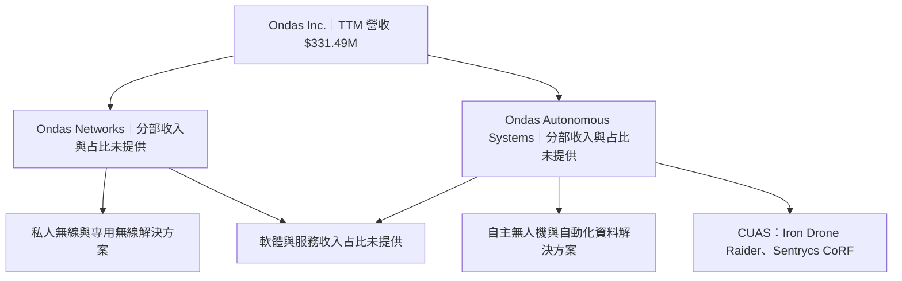
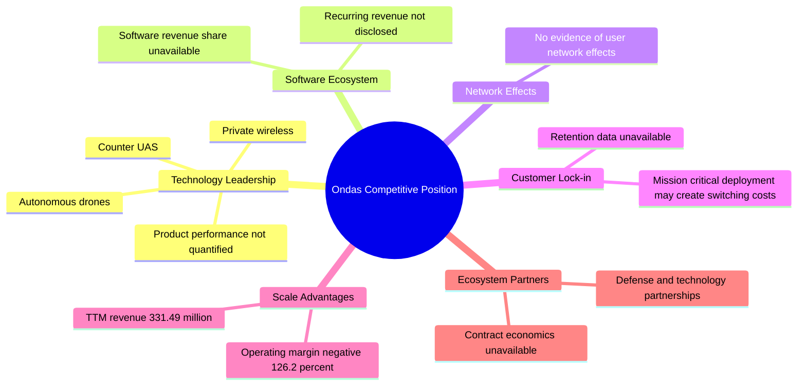
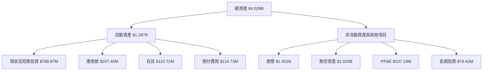
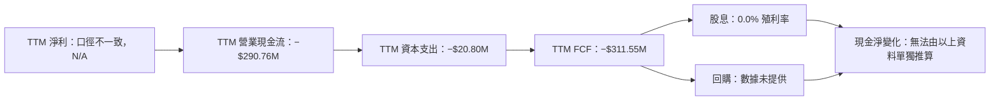
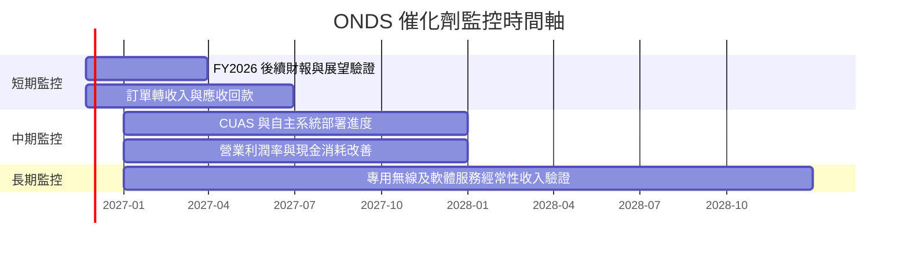
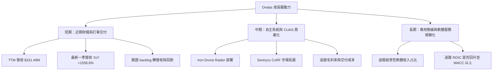
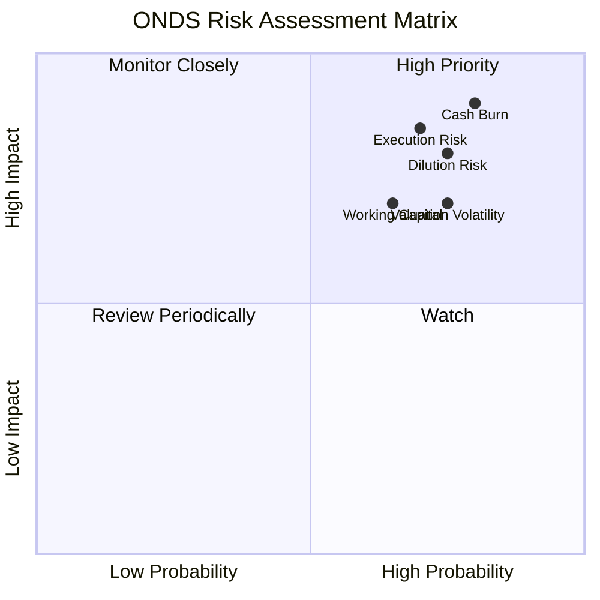
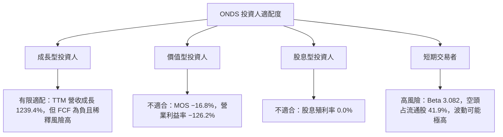

# ONDS 基本面深度分析報告
> **報告日期**：2026-11-22 ｜ **語言**：繁體中文 ｜ **數據來源**：SEC 申報資料 (XBRL)、Yahoo Finance、Finviz、StockAnalysis、Roic.ai ｜ **分析師**：CFA 級機構研究

## 目錄

| # | 章節 | 核心結論 |
|---|------|----------|
| 1 | 執行摘要 | 減碼；加權合理價值 $3.22，MOS −16.8% |
| 2 | 公司概覽與商業模式 | 無分部營收資料，護城河仍待商業化與留存率驗證 |
| 3 | 損益表深度分析 | TTM 營收 $331.49M、TTM 成長 1,239.4%，但營業利益率 −126.2% |
| 4 | 資產負債表分析 | 現金及短期投資 $788.87M；計息債務數據存在來源差異 |
| 5 | 現金流量深度分析 | TTM FCF −$311.55M，現金消耗與 SBC 均需密切監控 |
| 6 | 獲利能力與資本效率 | ROIC −20.9% 明顯低於 WACC 14.0%，目前摧毀股東價值 |
| 7 | 相對估值分析 | P/S 7.0x 高於同業中位數 3.1x；同業 P/S 推算價 $1.72 |
| 8 | DCF 內在價值評估 | DCF 不適用：TTM 營業利益為負，不自建現金流模型 |
| 9 | 成長催化劑 | 國防、無人機與反無人機需求提供機會，但 TAM 與財測數字未提供 |
| 10 | 風險矩陣 | 現金消耗、執行與估值／稀釋為前三大風險 |
| 11 | 投資建議 | 現價高於估值支持區；待現金流、利潤率與訂單轉化改善再評估 |

---

## 1. 執行摘要

### 1.0 一頁式投資儀表板

| 項目 | 內容 |
|------|------|
| **投資論點（3 句）** | ① TTM 營收 $331.49M、TTM 成長 1,239.4%，呈現快速放量，但高成長尚未轉成獲利。② TTM 營業利益率 −126.2%、ROIC −20.9%，低於 14.0% WACC，現階段尚未創造經濟價值。③ TTM FCF −$311.55M、FCF Yield −14.01%；現金及短期投資 $788.87M 可提供緩衝，但若消耗速度持續，資金與稀釋風險上升。 |
| **綜合評分** | **4.3/10**（引用 1.1 六項算術平均） |
| **財務健康** | 🔴 現金儲備 $788.87M，但 TTM FCF −$311.55M，且營運資金現金轉換週期為 181 天 |
| **ROIC vs WACC** | −20.9% vs 14.00%；差距 −34.9 個百分點，摧毀股東價值 |
| **FCF 趨勢** | 🔴 TTM FCF 為 −$311.55M；FCF Yield −14.01% |
| **估值** | Forward P/E −24.258x；EV/EBITDA −5.16x；FCF Yield −14.01%。負盈餘倍數不具正常估值解讀性 |
| **DCF 內在價值（基準）** | N/A；TTM 營業利益為負，DCF MODEL 未計算，無法計算現價相對 DCF 折溢價 |
| **安全邊際（MOS）** | **−16.8%**＝($3.22 − $3.76) ÷ $3.22；基準為 8.8 加權合理價值 |
| **預期報酬（基準情境 12M）** | DCF 基準情境 N/A；以加權合理價值 $3.22 作估值參考，現價隱含上行空間 **−14.4%** |
| **關鍵風險（前二）** | 🔴 TTM FCF −$311.55M；🔴 TTM 營業利益率 −126.2%，擴張未見規模經濟 |
| **評級 + 信心度** | 🟠 **減碼**；信心：中。依 MOS −16.8% 落在減碼區間，且 ROIC 為負；DCF 不適用令估值信心受限 |

### 1.1 綜合評分卡

| 維度 | 評分（1–10） | 主要依據（引用數字與其來源章節） |
|------|--------------|----------------------------------|
| 成長性 | 8.0 | TTM 營收成長 1,239.4%、最新一季年增 1,558.6%；成長率很高，但須考慮收購、低基期及營收品質（第 3 章） |
| 獲利能力 | 2.0 | TTM 營業利益率 −126.2%、ROIC −20.9%、F-Score 3/8（第 3、6 章） |
| 財務健康 | 6.0 | 現金及短期投資 $788.87M、流動比率 3.389；但 FCF −$311.55M，計息債務口徑有資料差異（第 4、5 章） |
| 估值 | 3.0 | MOS −16.8%；公司 P/S 7.0x 高於同業中位數 3.1x（第 7、8 章） |
| 護城河 | 4.0 | 有 CUAS、無人機與專用無線產品，但沒有市場份額、分部收入、客戶留存或軟體經常性收入數據可證實優勢（第 2 章） |
| 管理層與資本配置 | 3.5 | 2026 年稀釋股數由 469M 增至 590M；2026 年前三季 SBC 合計約 $148.60M，股東稀釋與薪酬負擔偏高（第 3、5 章） |
| **綜合評分** | **4.4** | 六項算術平均：(8.0 + 2.0 + 6.0 + 3.0 + 4.0 + 3.5) ÷ 6 = 4.4167，四捨五入為 **4.4/10** |

### 1.2 五大投資論點 + 三大核心風險

| 類型 | 項目 | 具體依據 | 信心度 |
|------|------|----------|--------|
| 🟢 **投資論點①** | 營收放量 | TTM 營收 $331.49M，TTM 年增 1,239.4%；若主要訂單可持續交付，收入規模擴大可能改善固定成本吸收 | 🟡 中 |
| 🟢 **投資論點②** | 產品處於安全與國防需求交會 | 公司產品涵蓋私人無線、無人機、自主系統及反無人機；近期新聞提及訂單積壓與展望上調，但沒有可核實的 backlog 金額 | 🟡 中 |
| 🟢 **投資論點③** | 現金儲備提供轉型時間 | 現金及短期投資 $788.87M，約為目前 TTM FCF 缺口 $311.55M 的 2.53 倍；此為靜態比較，不代表實際現金跑道 |
| 🟢 **投資論點④** | 毛利率已有一定正值 | TTM 毛利率 36.4%，高於 AVAV 26.5%、KTOS 23.0%及 RCAT 8.7%；但毛利尚不足以覆蓋營業費用 |
| 🟢 **投資論點⑤** | 分析師共識高於現價 | 10 位分析師平均目標價 $16.68；相對 $3.76 收盤價上行空間 343.6%，但共識不是基本面保證，權重僅占估值方法 10% |
| 🟡 **風險①** | 現金消耗與籌資稀釋 | TTM 營業現金流 −$290.76M、FCF −$311.55M；流通股數在 2026 年由 469M 增至 590M |
| 🔴 **風險②** | 成長未轉化為營業槓桿 | TTM 營業利益率 −126.2%，最新季度 −113.1%；營收快速擴張時營業損失仍大 |
| 🔴 **風險③** | 估值對預期敏感 | P/S 7.0x 對比同業中位數 3.1x；同業 P/S 方法推算價 $1.72，低於現價 $3.76 |

### 1.3 快速統計卡片

| 指標 | 公司實際值（期間） | 同業中位數 | 狀態 |
|------|--------------------|------------|------|
| 營收成長（TTM） | **1,239.4%** | — | 🟢 |
| 營收成長（最新一季年增） | **1,558.6%** | 22.0% | 🟢 |
| 毛利率（TTM） | **36.4%** | 23.0% | 🟢 |
| 營業利益率（TTM） | **−126.2%** | — | 🔴 |
| ROIC（TTM） | **−20.9%** | — | 🔴 |
| Forward P/E | **−24.258x** | 19.7x | 🔴 負盈餘，倍數不可直接比較 |
| FCF Yield（TTM） | **−14.01%** | — | 🔴 |
| Piotroski F-Score | **3 / 8** | — | 🔴 |

### 1.4 投資結論

```text
╔══════════════════════════════════════════════════════════════════╗
║                       📊 投資結論摘要                            ║
╠══════════════════════════════════════════════════════════════════╣
║  評級：🟠 減碼（MOS −16.8%，依規則 20）                          ║
║  價格（2026-11-20 收盤）：$3.76                                  ║
║  DCF 內在價值（基準）：N/A（TTM 營業利益為負）                   ║
║  安全邊際 MOS：−16.8%＝($3.22−$3.76)÷$3.22                     ║
║  加權合理價值（8.8）：$3.22                                      ║
║  DCF 情境價值：N/A（DCF MODEL 未計算）                           ║
║  綜合評分：4.4/10（引用 1.1）                                    ║
║  適合投資人：可承受高波動、以小部位承擔商業化風險的成長型投資人  ║
╚══════════════════════════════════════════════════════════════════╝
```

---

## 2. 公司概覽與商業模式

### 2.1 業務結構與收入來源

公司經營 Ondas Networks 與 Ondas Autonomous Systems 兩大板塊，涵蓋專用無線、無人機與自動化資料解決方案。TTM 營收為 $331.49M；分部收入、收入占比、軟體／服務收入占比均未提供，因此不推估分部金額或占比。



### 2.2 市場份額

市場份額數據未提供，無法引用公司在私人無線、無人機或 CUAS 市場的占比。就規模比較而言，ONDS TTM 營收 $331.49M，遠低於成熟防務承包商的規模，但最新一季營收年增 1,558.6%，高於 AVAV、KTOS 與 RCAT 的最新季度年增率；這反映高成長，也可能受低基期與併購後合併營收影響。

### 2.3 競爭護城河分析



### 2.4 護城河強度

| 護城河項目 | 強度（強／中／弱） | 證據（引用數字或事實） | 會削弱它的情況 |
|------------|--------------------|------------------------|----------------|
| 技術與產品組合 | 中 | 涵蓋專用無線、自主無人機、Iron Drone Raider、Sentrycs CoRF | 競品性能接近、部署成本高或採購週期延長 |
| 軟體生態系統 | 弱／未證實 | 軟體及服務收入占比、續約率均未提供 | 收入主要為一次性硬體交付，缺乏高毛利持續收入 |
| 網路效應 | 弱／未證實 | 未提供使用者、資料網路或平台連結規模 | 客戶間不共享網路效益，產品替代容易 |
| 客戶鎖定 | 中／待驗證 | 國防與關鍵基礎設施用途可能增加驗證與切換成本，但未提供續約、客戶集中度資料 | 客戶可多供應商採購或長期合約未能續約 |
| 規模效應 | 弱 | TTM 營收 $331.49M，但 TTM 營業利益率 −126.2% | 營收增長仍伴隨費用更快增加 |
| 生態夥伴 | 中／待驗證 | 公司有合作與市場拓展新聞，但沒有合作帶來的收入或合約金額 | 合作未轉化成訂單、毛利或現金回收 |

**1.1 護城河評分 4.0/10**：產品布局具差異化可能，但市場份額、軟體經常性收入、客戶留存與合約經濟性資料不足，尚未證實可持續競爭優勢。

---

## 3. 損益表深度分析

### 3.1 年度收入成長趨勢（近 4 年）

| 財年 | 營收 | YoY | 視覺化 |
|------|------|-----|--------|
| FY2022 | $2.13M | — | ▏ |
| FY2023 | $15.69M | +636.6% | ███ |
| FY2024 | $7.19M | −54.2% | █ |
| FY2025 | $50.73M | +605.3% | ██████████ |

```text
╔══════════════════════════════════════════════════════════════════╗
║              Ondas Inc. 年度收入趨勢（FY2022-FY2025）            ║
╠══════════════════════════════════════════════════════════════════╣
║  FY2022  $2.13M    ▏                 YoY：N/A                   ║
║  FY2023  $15.69M   ███                YoY：+636.6%               ║
║  FY2024  $7.19M    █                  YoY：−54.2%                ║
║  FY2025  $50.73M   ██████████         YoY：+605.3%               ║
║                                                                  ║
║  FY2022–FY2025 營收 CAGR：((50.73 ÷ 2.13)^(1/3) − 1) = 187.8%   ║
╚══════════════════════════════════════════════════════════════════╝
```

三年營收 CAGR 187.8% 受低起始基數、年度營收波動與公司業務擴張影響，不宜直接視為可持續成長率。FY2024 營收下降 54.2%，顯示歷史收入規模小且年度變化劇烈。

### 3.2 季度收入趨勢分析

| 季度 | 營收 | QoQ | YoY | 備註 |
|------|------|-----|-----|------|
| 2025 Q4 | $30.11M | — | +629.2% | YoY 取季度歷史資料 |
| 2026 Q1 | $50.12M | +66.5% | +1,079.9% | 營收延續擴張 |
| 2026 Q2 | $83.77M | +67.1% | +1,235.4% | 同比仍受低基期影響 |
| 2026 Q3 | $167.49M | +99.9% | +1,558.6% | 最新一季 YoY；不是 TTM 成長率 |

最新季度較前季增近一倍，增長速度很高，但單季交付集中可能造成季度波動；需觀察後續訂單交付、應收帳款回收與毛利率是否同步改善。

### 3.3 利潤率演變分析

| 利潤率指標 | FY2022 | FY2023 | FY2024 | FY2025 | 趨勢 | 評估 |
|------------|--------|--------|--------|--------|------|------|
| **毛利率** | 52.1% | 40.7% | 4.8% | 39.7% | FY2024 急降、FY2025 回升 | 🟡 波動大 |
| **營業利益率** | −2,347.4% | −243.7% | −481.1% | −115.1% | FY2025 相對改善，仍大幅為負 | 🔴 |
| **TTM 毛利率** | — | — | — | 36.4% | 依目前 TTM 口徑 | 🟡 |
| **TTM 營業利益率** | — | — | — | −126.2% | 損失仍遠超毛利 | 🔴 |

年度毛利率依年度毛利／營收計算。FY2024 毛利率低至 4.8%，FY2025 回升至 39.7%；可能反映產品組合、收入基期或併購後收入構成改變，但缺乏分部數據，無法確認單一原因。TTM 營業利益率 −126.2% 代表營收成長尚未轉化為營業槓桿。另有彙整資料列出不同口徑的 TTM 營業利益率 −119.5% 及最新季度 −107.2%；本文核心分析採 SEC 申報計算區所列 −126.2% 與 −113.1%。

### 3.4 費用結構分析

完整 SG&A、銷售費用與各項營業費用拆分未提供，因此不畫費用比例圓餅圖。FY2025 研發費用為 $20.88M，2024 年為 $12.48M，YoY 增加 67.3%；同期 2025 年營收為 $50.73M。研發增加有助產品開發，但目前營業損失仍達 $58.38M，須以後續毛利與訂單轉化衡量回報。

### 3.5 季度 EPS 趨勢與盈餘品質（Quality of Earnings）

| 盈餘品質項目 | 數值／佔比 | 評估 |
|--------------|-----------|------|
| 股權薪酬 SBC / 營收 | 2025 Q4–2026 Q3 SBC 合計 $155.41M ÷ TTM 營收 $331.49M = **46.9%** | 🔴 SBC 高，反映顯著非現金薪酬與潛在稀釋成本 |
| SBC / 營業現金流 | $155.41M ÷ −$290.76M = **−53.5%**；以現金消耗絕對值比較，SBC 約為 OCF 消耗的 53.5% | 🔴 不代表 SBC 轉成現金，而是支出與稀釋都需計入股東成本 |
| FCF / 淨利（現金轉換率） | **N/A（TTM 淨利口徑互相矛盾）** | 🔴 資料來源列示 TTM 淨利 $53.16M 與 DuPont 淨利率 33.1%並不一致，避免以不一致分母計算 |
| 一次性／非經常性損益 | 2026 Q1 淨利 $362.95M，與相鄰季度虧損差異極大；具體損益項目未提供 | 🔴 可能含非經常性或非現金項目，不能視為可持續獲利 |
| 有效稅率異常 | N/A（未提供可核對的 TTM 稅前所得與所得稅費用） | 🟡 不假定稅務利益 |
| 資本化支出 vs 費用化 | TTM Capex $20.80M；資本化研發等明細未提供 | 🟡 無法判定是否有重大成本資本化 |

最近四季 EPS 預估值與實際值均為 N/A，不能判定超預期或不及預期。季度淨利分別為 2025 Q4 −$99.66M、2026 Q1 +$362.95M、Q2 −$88.25M、Q3 −$62.57M；其中 Q1 大額獲利使「淨利改善」的解讀失真風險增加，須以 10-Q 的非營業項目、稅項與交易損益明細核實。

**盈餘品質結論**：目前不宜將正的 TTM 淨利或 Q1 單季獲利視為穩定經常性盈餘。SBC 佔 TTM 營收約 46.9%、TTM FCF 為負，且淨利數據不一致，故估值宜以營收倍數與現金消耗能力為主，不宜依 P/E 定價。

---

## 4. 資產負債表分析

### 4.1 資產結構分解

最新 TTM 資產負債表資料列示總資產 $4.028B。下列明細取自 StockAnalysis，因分類項目加總與總資產有差異，圖表僅呈現已披露項目，不視為完整比例分解。



商譽與無形資產規模較大，若併購業務未達預期，可能產生減損風險。流動資產數據較 FY2025 的 $685.90M 大幅增加，主要須與收購、融資及現金配置變化一併評估。

### 4.2 流動性與營運資金分析

| 指標 | 最新 TTM | 一年前 TTM | 變化 | 解讀 |
|------|----------|------------|------|------|
| 流動比率 | 3.389 | N/A | N/A | 🟢 帳面流動資產高於流動負債；資產組成含應收與存貨，並非全為現金 |
| 速動比率 | 2.604 | N/A | N/A | 🟢 短期流動性仍有緩衝 |
| DSO 應收帳款天數 | 140 天 | 77 天 | +63 天 | 🔴 收款週期延長；快速成長可能造成應收款擴張，需監控回收與壞帳 |
| DIO 存貨天數 | 182 天 | 278 天 | −96 天 | 🟡 存貨天數改善，但仍需避免交付延遲與庫存過時 |
| DPO 應付帳款天數 | 141 天 | 186 天 | −45 天 | 🟡 對供應商付款速度加快，可能增加營運資金需求 |
| CCC 現金轉換週期 | 181 天 | 169 天 | +12 天 | 🔴 雖存貨改善，但 DSO 上升使現金回收週期拉長 |

現金轉換週期由 169 天升至 181 天，與 DSO 增加方向一致。收入增長若伴隨收款天數延長，帳面營收不能等同現金回收，亦可能推高營運資金佔用。

### 4.3 債務結構分析

```text
╔══════════════════════════════════════════════════════════════════╗
║                   Ondas Inc. 債務健康診斷                       ║
╠══════════════════════════════════════════════════════════════════╣
║  總債務（核心口徑）：N/A（SEC 計算資料未提供可用值）             ║
║  現金及短期投資：  $788.87M                                      ║
║  淨現金（核心口徑）：$788.87M（依 VERIFIED FIGURES 原值引用）    ║
║                                                                  ║
║  其他彙整資料列示總債務 $62.81M、淨現金 $726.06M；與核心口徑    ║
║  不一致，故不將兩種口徑混算。                                    ║
║  Debt/EBITDA：N/A（EBITDA 為負，倍數無經濟意義）                 ║
║  Interest Coverage：N/A（利息費用與一致債務口徑未提供）          ║
╚══════════════════════════════════════════════════════════════════╝
```

以 $788.87M 現金與短期投資對照負的營業現金流，公司具短期資金緩衝；但若現金消耗維持或惡化，資金續航將縮短。債務口徑有差異，應以最新 10-Q 的借款、租賃與限制性現金附註核對。

### 4.4 股東權益趨勢

| 年度 | 股東權益 | 年度變化 |
|------|----------|----------|
| 2022 | $58.22M | — |
| 2023 | $33.14M | −43.1% |
| 2024 | $16.58M | −50.0% |
| 2025 | $437.81M | +2,541.7% |

```text
╔══════════════════════════════════════════════════════════════════╗
║                   股東權益趨勢（年度）                           ║
╠══════════════════════════════════════════════════════════════════╣
║  2022  $58.22M   ███                                              ║
║  2023  $33.14M   ██                                               ║
║  2024  $16.58M   █                                                ║
║  2025  $437.81M  ████████████████████                             ║
╚══════════════════════════════════════════════════════════════════╝
```

FY2025 權益大幅增加，期間亦伴隨現金由 $29.96M 升至 $550.74M、流通股數後續增加。權益擴張並非單純由累積獲利帶動，需將融資、併購與股本變化拆開看待。

---

## 5. 現金流量深度分析

### 5.1 現金流量瀑布圖



### 5.2 FCF 轉換率趨勢

| 年度 | FCF | 淨利 | FCF／淨利 | 解讀 |
|------|-----|------|-----------|------|
| 2022 | −$40.89M | −$73.24M | 55.8% | 比率為正是因分子、分母同為負值，不代表正向現金轉換 |
| 2023 | −$34.30M | −$44.84M | 76.5% | 營運仍耗現金 |
| 2024 | −$35.20M | −$38.01M | 92.6% | 兩者皆虧損，比率不能解讀為高品質盈餘 |
| 2025 | −$40.88M | −$132.02M | 31.0% | 淨損擴大且 FCF 為負 |
| TTM | −$311.55M | N/A | N/A | TTM 淨利口徑衝突，避免誤算 |

### 5.3 自由現金流趨勢

| 期間 | FCF | 視覺化 |
|------|-----|--------|
| FY2022 | −$40.89M | █████ |
| FY2023 | −$34.30M | ████ |
| FY2024 | −$35.20M | ████ |
| FY2025 | −$40.88M | █████ |
| TTM | −$311.55M | ██████████████████████████████ |

```text
╔══════════════════════════════════════════════════════════════════╗
║                    自由現金流趨勢                                 ║
╠══════════════════════════════════════════════════════════════════╣
║  FY2022  −$40.89M  █████                                        ║
║  FY2023  −$34.30M  ████                                         ║
║  FY2024  −$35.20M  ████                                         ║
║  FY2025  −$40.88M  █████                                        ║
║  TTM     −$311.55M ██████████████████████████████               ║
║  TTM FCF Yield：−14.01%                                          ║
╚══════════════════════════════════════════════════════════════════╝
```

TTM FCF 明顯低於近年年度虧損水準，代表最近四季營運資金與營運消耗急升。最新季度 OCF 為 −$140.65M、Capex 為 −$10.11M；需追蹤是否為交付擴張的暫時性營運資金投入，還是單位經濟性仍未改善。

### 5.4 資本配置評估

資本配置比例圓餅圖所需的回購、股息、收購與投資明細不完整，因此不繪製比例圖。

| 項目 | 已披露數據 | 評估 |
|------|------------|------|
| 資本支出 | TTM $20.80M | 相對營運現金流缺口有限，主要現金壓力來自營運活動 |
| SBC | 最近四季約 $155.41M | 佔 TTM 營收約 46.9%，可能造成顯著稀釋 |
| 股息 | 殖利率 0.0% | 無現金股息回饋 |
| 回購 | N/A | 無法確認是否有回購 |
| 留存資金 | 現金及短期投資 $788.87M | 是重要緩衝，但現金消耗仍須改善 |

---

## 6. 獲利能力與資本效率

### 6.1 ROE / ROA / ROIC 趨勢

| 指標 | FY2022 | FY2023 | FY2024 | FY2025／TTM | 評估 |
|------|--------|--------|--------|-------------|------|
| ROE | N/A | N/A | N/A | TTM 4.6%（QUALITY FIGURES） | 其他彙整口徑列 7.3%，以品質指標原值為主；口徑差異限制解讀 |
| ROA | N/A | N/A | N/A | TTM −9.7%（彙整資料） | 資產擴張尚未帶來穩定資產回報 |
| ROIC | N/A | N/A | N/A | TTM −20.9% | 明顯低於 WACC 14.0% |
| 行業均值 | N/A | N/A | N/A | N/A（數據未提供） | 不臆測行業平均 |

### 6.2 ROIC vs WACC 分析（核心價值創造判斷）

```text
╔══════════════════════════════════════════════════════════════════╗
║                  ROIC vs WACC 深度分析                           ║
╠══════════════════════════════════════════════════════════════════╣
║  WACC（Cost of capital 原值）：14.00%                            ║
║  ├── 無風險利率（10Y 美債）：4.91%                               ║
║  ├── ERP：5.00%                                                  ║
║  ├── 原始 Beta：3.08；調整 Beta：2.00（受 0.6–2.0 區間限制）      ║
║  ├── Ke = 4.91% + 2.00 × 5.00% = 14.91%                        ║
║  ├── 稅前 Kd：10.47%；稅後 Kd = 10.47%×(1−21%) = 8.27%         ║
║  ├── 股權／債務權重：97.3%／2.7%                                 ║
║  ├── 未限制計算 WACC：14.73%；採用值受 7%–14% 上限限制為 14.00%  ║
║                                                                  ║
║  ROIC（TTM）：−20.9%                                             ║
║  EVA spread = ROIC − WACC = −20.9% − 14.0% = −34.9 個百分點     ║
║                                                                  ║
║  ROIC  −20.9%  ◄───────────────────── 低於資本成本              ║
║  WACC   14.0%  ────────────────                                 ║
║                                                                  ║
║  結論：ROIC 顯著低於 WACC，現階段每增加投入資本仍未創造正 EVA。  ║
╚══════════════════════════════════════════════════════════════════╝
```

WACC 原始計算值為 14.73%，但資本成本區塊將其限制在 7%–14% 區間，故本文採 14.00%；第 8 章 DCF 為 N/A，沒有另一個折現率模型。ROIC −20.9% 與 WACC 相差 −34.9 個百分點，投資論點要成立，需看到毛利增加、營業費用率下降，並使 ROIC 穩定轉正且逐步高於資本成本。

### 6.3 杜邦三因素分解

| 因素 | 數值（TTM） | 解讀 |
|------|-------------|------|
| 淨利率 | 33.1% | 品質指標原值；季度淨利波動及 TTM 淨利來源不一致，不能視為穩定營業獲利 |
| 資產週轉率 | 0.08 | 資產相對營收規模大，可能受併購形成的商譽、無形資產影響 |
| 權益乘數 | 1.70 | 有一定財務槓桿，但 ROE 不是高效率資產週轉帶來 |
| **ROE** | **4.6%** | 依 QUALITY FIGURES 原值：33.1% × 0.08 × 1.70 = 4.5%，與提供的 4.6% 差異為四捨五入及底層精度 |

淨利率表面為正，但與營業利益率、季度淨利大幅波動的訊號不一致；ROE 不宜單獨視為經常性獲利能力證據。

### 6.4 財務體質：Piotroski F-Score

**Piotroski F-Score：3 / 8**。來源依九項測試中可判定項目計分，長期負債／總資產測試因缺資料不納入分母。

| 測試 | 結果 | 解讀 |
|------|------|------|
| ROA > 0 | ✅ 通過 | 品質指標計算口徑下通過；與其他彙整 ROA 資料有差異 |
| 營業現金流 > 0 | ❌ 未通過 | TTM OCF −$290.76M |
| ROA 高於一年前 | ✅ 通過 | 相較去年改善，但仍須驗證可持續性 |
| 營業現金流 > 淨利（應計品質） | ❌ 未通過 | 現金流未支持帳面盈餘 |
| 長期負債 ÷ 總資產低於一年前 | — 無法判定 | 缺少輸入資料 |
| 流動比率高於一年前 | ❌ 未通過 | 品質指標判定未通過 |
| 稀釋股數未增加 | ❌ 未通過 | 2026 年股數由 469M 增至 590M |
| 毛利率高於一年前 | ❌ 未通過 | 品質指標判定未通過 |
| 資產週轉率高於一年前 | ✅ 通過 | 營收擴張帶動資產效率改善 |

3/8 表示財務品質尚未建立穩定趨勢；尤其是現金流、稀釋股數與毛利率三項，對高成長公司能否轉化為股東價值至關重要。

---

## 7. 相對估值分析

### 7.1 同業估值比較表格

| 估值指標 | **ONDS** | **AVAV** | **KTOS** | **RCAT** | 本公司評估 |
|----------|----------|---------|---------|---------|-----------|
| **Trailing P/E** | N/A | N/A | 224.1x | N/A | 🟡 大多數同業不適用或倍數極高 |
| **Forward P/E** | −24.258x | 19.7x | 24.0x | −2.8x | 🔴 ONDS 為負值，不能作正常獲利倍數比較 |
| **P/S Ratio** | 7.0x | 2.2x | 3.1x | 3.7x | 🔴 ONDS 高於同業中位數 3.1x |
| **EV/EBITDA** | −5.16x | 21.3x | 43.4x | −0.4x | 🔴 ONDS EBITDA 為負，倍數不具可比性 |
| **最新一季營收 YoY** | 1,558.6% | 5.7% | 35.7% | 22.0% | 🟢 增速最高，但基期與併購影響需查核 |
| **毛利率（TTM）** | 36.4% | 26.5% | 23.0% | 8.7% | 🟢 高於三家比較公司 |

同業數據來源為 Yahoo Finance 的 Peer multiples。三家同業 P/S 中位數為 3.1x；ONDS 的 P/S 7.0x 約為同業中位數的 2.26 倍。另市場彙整欄位列 ONDS P/S 6.709x，與估值歷史資料 7.0x 有口徑差異，本文在同業比較與歷史估值段落按規定採 7.0x。

### 7.2 歷史估值區間分析

```text
╔══════════════════════════════════════════════════════════════════╗
║                  P/S 歷史估值區間（5 年）                        ║
╠══════════════════════════════════════════════════════════════════╣
║  5 年最低：2.9x    當前：7.0x    5 年中位數：17.9x              ║
║  5 年最高：140.6x  當前百分位：32%                               ║
║                                                                  ║
║  2.9x ├─●──────────────●───────────────────────────────┤140.6x  ║
║       最低           當前 7.0x（32 百分位）                      ║
╚══════════════════════════════════════════════════════════════════╝
```

當前 P/S 低於自身五年中位數 17.9x，但歷史區間上限 140.6x 顯示過去估值高度波動；相對歷史較低，不代表相對基本面便宜，因為 P/S 仍高於同業中位數，且公司尚未獲利。

### 7.3 情境價值（Bear / Base / Bull）

N/A（DCF 無法計算：TTM 營業利益為負，DCF MODEL 未提供悲觀、基準與樂觀情境價值）。本節不自行設定情境目標價。

### 7.4 相對估值隱含價格區間

```text
╔══════════════════════════════════════════════════════════════════╗
║               相對估值方法與當前股價位置                         ║
╠══════════════════════════════════════════════════════════════════╣
║  同業 P/S 方法：$1.72  ──────── $3.76（現價）                    ║
║  分析師共識：  $3.76 ───────────────────── $16.68               ║
║                                                                  ║
║  同業 P/S：AVAV、KTOS、RCAT 的 P/S 中位數 3.1x，乘公司 TTM       ║
║  營收並換算每股，估值方法結果照列為 $1.72。                      ║
║  分析師共識：10 位分析師平均目標價 $16.68。                      ║
╚══════════════════════════════════════════════════════════════════╝
```

---

## 8. DCF 內在價值評估（Discounted Cash Flow）

### 8.0 估值推理鏈（Thinking Logic）

**Step 1 — 價值由哪些變數決定？**  
ONDS 的潛在價值來自 Networks 與 Autonomous Systems 的收入轉化、營業利潤率回升，以及產品交付後的現金回收；但分部營收占比未提供，無法拆成可驗證的收入底盤與成長曲線。現有可用錨點為 TTM 營收 $331.49M、營業利益率 −126.2%、FCF −$311.55M。決定估值的核心變數是公司能否將收入快速增長轉成正營業現金流與正營業利潤。

**Step 2 — 模型選擇**

| 決策點 | 本報告採用 | 理由（含數字） | 曾考慮但否決 | 否決理由 |
|--------|-----------|----------------|--------------|----------|
| 現金流定義 | FCFF 不適用 | TTM 營業利益為負，資料指定 DCF MODEL 為 N/A | 自建 FCFF／FCFE | 不符合估值資料規則，且負營業利益使常規 DCF 缺乏可依賴基礎 |
| 預測期 N | N/A | 模型未提供 | 任意設定 5–10 年 | 缺乏可稽核的預測假設 |
| 終值方法 | N/A | 模型未提供 | Gordon Growth／退出倍數 | 不可自建 DCF |
| EBIT 基礎 | N/A | 模型未提供 | GAAP／非 GAAP | 不可自行填入模型輸入 |

**Step 3 — 關鍵假設推導鏈**  
營收 CAGR、期末營業利潤率、永續成長率、預測期、Capex／營收、折舊、營運資金、SBC、股數稀釋、終值與 WACC 均無 DCF MODEL 可引用，因此不推導、不填入假設值，也不以任意輸入替代程式模型。

**Step 4 — 最脆弱的一環**  
目前沒有可以合理外推的正營業獲利或正 FCF 基礎；若成長不能轉化為營業利潤與現金流，任何長期估值都可能高估。

**Step 5 — 計算路徑**


### 8.1 模型假設總表（Model Inputs）

**N/A（DCF MODEL 未計算：TTM 營業利益不為正。依規則不自建 DCF，也不自行補入模型假設。）**

### 8.2 折現率推導（WACC）

本節只呈現成本資本資料，用於第 6.2 節資本效率比較；DCF 折現模型本身仍為 N/A。

```text
╔══════════════════════════════════════════════════════════════════╗
║                    WACC 資料（非 DCF 建模）                      ║
╠══════════════════════════════════════════════════════════════════╣
║  Rf：4.91%；ERP：5.00%                                          ║
║  原始 Beta：3.08；調整後 Beta：2.00                              ║
║  Beta 調整：⅔×3.08 + ⅓×1 = 2.3867；依 0.6–2.0 區間限制為 2.00  ║
║  Ke：4.91% + 2.00×5.00% = 14.91%                               ║
║  稅前 Kd：10.47%；稅率：21.0%；稅後 Kd：8.27%                  ║
║  權重 E/D：97.3%／2.7%                                          ║
║  未限制 WACC：97.3%×14.91% + 2.7%×8.27% = 14.73%               ║
║  區間限制後採用 WACC：14.00%（7%–14% 上限限制）                ║
╚══════════════════════════════════════════════════════════════════╝
```

原始 Beta 3.08 由 Yahoo Finance 提供；採用調整 Beta 2.00，因調整公式結果 2.3867 超過指定上限。Rf 日期未在成本資本數據中另列，不能補稱為某一特定交易日的殖利率。SEC 計算資料未提供本章要求的完整平均計息負債明細與利息費用來源，因此上述 WACC 直接沿用成本資本區塊，不另自行重算或替換。

### 8.3 逐年自由現金流預測（基準情境）

**N/A（DCF MODEL 未計算：TTM 營業利益不為正）。** 因此不列 FY+1 至 FY+N 預測、不計預測 FCF 現值，也不製作歷史與模型預測對照圖。

### 8.4 終值計算（Terminal Value）

**N/A（DCF MODEL 未計算：沒有預測期最後一年 FCFF、永續成長率或終值輸入）。** 不計算 Gordon Growth 或退出倍數終值。

### 8.5 企業價值 → 每股內在價值（Bridge）

**N/A（DCF MODEL 未計算）。** DCF 內在價值與 DCF 折溢價均不提供；不可將相對估值的加權合理價值冒稱為 DCF 價值。

### 8.6 敏感性分析（WACC × 永續成長率）

**N/A（DCF MODEL 未提供敏感度矩陣）。** 不建立 WACC／永續成長率矩陣，不推算 DCF 情境價值。

### 8.7 反推 DCF（Reverse DCF）

**N/A（DCF MODEL 未計算）。** 沒有可用 DCF 方程式，不能由現價反推出營收 CAGR、營業利潤率、永續成長率或預測期長度。

### 8.8 估值三角驗證與安全邊際

| 估值方法 | 隱含每股價值 | 上行空間（÷現價） | 權重 | 說明 |
|----------|--------------|-------------------|------|------|
| 同業 P/S | $1.72 | −54.3% | 90% | 同業中位數 P/S 3.1x × TTM 營收，依估值方法區塊列示 |
| 分析師共識目標價 | $16.68 | +343.6% | 10% | 10 位分析師平均目標價；屬市場參考，非基本面保證 |
| **加權合理價值** | **$3.22** | **−14.4%** | **100%** | 固定方法與權重；Forward P/E 因無法計算而排除，其權重依固定規則分配 |

加權合理價值演算：

`$1.72 × 90% + $16.68 × 10% = $1.548 + $1.668 = $3.216 ≈ $3.22`

權重合計為 90% + 10% = 100%。公司類型為未獲利公司；估值方法固定以同業 P/S 為主、分析師共識為輔。不可計算的同業 Forward P/E 已依規則排除，未另增方法。

MOS 與上行空間：

- **安全邊際 MOS**＝($3.22 − $3.76) ÷ $3.22＝−$0.54 ÷ $3.22＝**−16.8%**
- **隱含上行空間**＝($3.22 − $3.76) ÷ $3.76＝−$0.54 ÷ $3.76＝**−14.4%**
- **折溢價**以 DCF 基準內在價值為分母；DCF 為 N/A，故 N/A。

```text
╔══════════════════════════════════════════════════════════════════╗
║                  估值區間與安全邊際                              ║
╠══════════════════════════════════════════════════════════════════╣
║  $1.72（同業 P/S）──── $3.22（加權合理值）──── $3.76（現價）     ║
║                                                                  ║
║  MOS = ($3.22 − $3.76) ÷ $3.22 = −16.8%                         ║
║  上行空間 = ($3.22 − $3.76) ÷ $3.76 = −14.4%                    ║
║  MOS 評估：🔴 低於 −10%，符合減碼門檻                            ║
║                                                                  ║
║  MOS ≥10% 對應價格上限：$3.22×(1−10%) = $2.898 ≈ $2.90          ║
║  估值參考的買入上限：$2.90；現價 $3.76 高於此價位               ║
╚══════════════════════════════════════════════════════════════════╝
```

> 🔎 **程式複算（Python，依本節各項自動重算）**
>
> 加權合理價值 = $1.72 × 90% + $16.68 × 10% = **$3.22**（權重合計 100%）
>
> 以價格 $3.76 計：MOS = **-16.8%**，上行空間 = **-14.4%**
>
> ✅ 與本節所寫數值一致。

### 8.9 估值模型的局限與失效條件

- **DCF 適用性**：TTM 營業利益率 −126.2%、TTM FCF −$311.55M，將負營業獲利直接折現無法建立可信的現金流底盤，因此 DCF 不適用。
- **最脆弱的假設**：相對估值的同業 P/S 3.1x 是否適合 ONDS，取決於其成長能否轉成可持續毛利與現金流；若營收成長放緩而費用率維持高位，估值有下修風險。
- **替代方法**：短期以 EV/Sales、同業 P/S、訂單轉收入、毛利率與現金消耗作監控；待營業利益轉正後，再考慮 FCFF DCF。
- **連結第 10 章**：若應收款持續增加，將衝擊現金轉換與 ΔWC；若 SBC 與股數增加，將稀釋每股價值；若訂單未能如期交付，收入成長假設與估值倍數均面臨下修。

### 8.10 複算檢核表（Audit Trail）

| # | 檢核項目 | 檢查方式 | 結果 |
|---|----------|----------|------|
| 1 | 高／中敏感度 DCF 輸入完整推導 | DCF MODEL 為 N/A，無模型假設可推導 | N/A（不自建模型） |
| 2 | 每個 DCF 假設均有來歷 | 未輸入自行假設值 | ✅ |
| 3 | WACC 五步 DCF 算式與權重 | DCF 不使用自建 WACC；採成本資本區塊值，權重 97.3% + 2.7% = 100% | N/A（未重算） |
| 4 | Kd 分母與 D 的計息負債範圍一致 | 成本資本資料未列完整負債明細；不另推導 | N/A |
| 5 | WACC 與第 6.2 節同值 | 均引用 14.00% | ✅ |
| 6 | 逐年預測年數符合 N | 無 DCF 預測期 | N/A |
| 7 | FY+1 九步算式可複算 | 無 FY+1 模型列 | N/A |
| 8 | 預測期 PV 加總 | 無預測 PV | N/A |
| 9 | WACC > g | 無 g 輸入 | N/A |
| 10 | 終值基於 FY+N 並折現 N 期 | 無終值 | N/A |
| 11 | EV 至每股價值橋接 | 無 DCF EV | N/A |
| 12 | SBC 組合相容 | DCF 未建模，不套用 A/B/C | N/A |
| 13 | 敏感性基準格與 DCF 每股值一致 | 無敏感性矩陣 | N/A |
| 14 | 矩陣 WACC 與 g 有效性 | 無敏感性矩陣 | N/A |
| 15 | 三情境機率加總 | DCF 情境未提供 | N/A |
| 16 | 反推 DCF 每列只解一變數 | DCF 未提供 | N/A |
| 17 | MOS 與折溢價分母正確 | MOS 使用 $3.22 加權價值；DCF 折溢價 N/A | ✅ |
| 18 | 報告完整至第 11 章 | 章節 1–11 均列出 | ✅ |
| 19 | 加權合理價值等於價值乘權重加總 | 1.72×90% + 16.68×10% = 3.216 ≈ 3.22 | ✅ |
| 20 | 評級符合 MOS 門檻 | MOS −16.8%，評級減碼 | ✅ |

---

## 9. 成長催化劑

### 9.1 催化劑時間軸

下列時間點為財報追蹤期，不代表公司已承諾的產品上市或合約日期。



### 9.2 TAM 市場規模分析

**N/A（TAM 數據未提供）。** 公司涉及私人無線、無人機與反無人機市場，但缺乏可引用 TAM 金額、年份與來源，故不估算市場規模或滲透率。可觀察的公司層級指標為 TTM 營收 $331.49M、TTM 成長 1,239.4%；成長能否延續，需結合合約金額、出貨、客戶回款與分部收入驗證。

### 9.3 成長驅動力結構圖



---

## 10. 風險矩陣

### 10.1 風險評分矩陣

機率及衝擊座標為分析師定性估計，不是公司披露的財務數字。



### 10.2 風險清單詳細分析

| # | 風險項目 | 發生機率 | 財務衝擊 | 風險評分 | 緩解措施 |
|---|----------|----------|----------|----------|----------|
| 1 | 🔴 **現金消耗與籌資風險** | 高（分析師估計） | 高；TTM FCF −$311.55M，TTM OCF −$290.76M | 🔴 9/10 | 每季追蹤 OCF、現金與短期投資、資本支出；若現金流惡化需重新評估資金需求 |
| 2 | 🔴 **執行與交付風險** | 中高（分析師估計） | 高；收入急增但最新季度營業利益率 −113.1% | 🔴 8/10 | 檢查訂單轉收入、毛利率、驗收與回款；不能只以 backlog 新聞推論業績 |
| 3 | 🔴 **SBC 與股數稀釋** | 高（分析師估計） | 高；近四季 SBC 約 $155.41M，股數由 469M 增至 590M | 🔴 8/10 | 追蹤稀釋股數季增率、SBC／營收比例及高管薪酬安排 |
| 4 | 🟠 **營運資金及應收款風險** | 中高（分析師估計） | 中高；DSO 140 天，較一年前增加 63 天 | 🟠 7/10 | 追蹤逾期應收款、預收款、DSO 與 CCC；要求收入增長同步轉現 |
| 5 | 🟠 **估值波動與估值倍數收縮** | 高（分析師估計） | 中高；P/S 7.0x 高於同業中位數 3.1x | 🟠 7/10 | 以同業 P/S、訂單轉化與盈利進展監控，不以分析師高目標價代替估值紀律 |

---

## 11. 投資建議

### 11.1 最終評級與評分

評級為 **🟠 減碼**：加權合理價值 $3.22、現價 $3.76，MOS 為 −16.8%，符合減碼門檻；未作質化調整。1.1 綜合評分為 **4.4/10**，六項分數依序為成長性 8.0、獲利能力 2.0、財務健康 6.0、估值 3.0、護城河 4.0、管理層與資本配置 3.5。

### 11.2 合理價值與隱含報酬率

| 估值參考 | 每股價值 | 相對 2026-11-20 收盤價 $3.76 | 備註 |
|----------|----------|----------------------------|------|
| 加權合理價值 | $3.22 | −14.4% | 8.8 固定估值方法加權值 |
| DCF 悲觀情境 | N/A | N/A | DCF MODEL 未計算 |
| DCF 基準情境 | N/A | N/A | DCF MODEL 未計算 |
| DCF 樂觀情境 | N/A | N/A | DCF MODEL 未計算 |

MOS 為 −16.8%，與上行空間 −14.4% 的分母不同，兩者不可互換。

### 11.3 買入時機與觸發因素

```text
╔══════════════════════════════════════════════════════════════════╗
║                  ✅ 買入觸發因素 Checklist                      ║
╠══════════════════════════════════════════════════════════════════╣
║  估值與財務改善條件：                                            ║
║  ☐ 股價回到 $2.90 或以下（以 $3.22 加權合理價值計算 MOS ≥10%）  ║
║  ☐ TTM FCF 虧損連續收窄，且 OCF 改善不是單靠融資或延後付款       ║
║  ☐ DSO 從 140 天下降，CCC 從 181 天回落                          ║
║  ☐ 毛利改善並帶動營業利益率連續改善                              ║
║                                                                  ║
║  加碼觸發條件：                                                   ║
║  ☐ 連續兩季營收增長伴隨應收帳款與存貨增幅低於營收增幅            ║
║  ☐ SBC／營收比例明顯下降，稀釋股數增速放緩                       ║
║  ☐ ROIC 趨勢改善，並有明確路徑接近或超過 WACC 14.0%             ║
║                                                                  ║
║  減碼／退出觸發條件：                                             ║
║  ☐ TTM 現金消耗明顯加速或現金及短期投資連續大幅下降               ║
║  ☐ 營收放緩但營業損失率未改善                                    ║
║  ☐ DSO、CCC 持續增加，回款與訂單交付惡化                         ║
║  ☐ 股數持續快速增加而營收或毛利未相應提升                        ║
╚══════════════════════════════════════════════════════════════════╝
```

### 11.4 投資人適配度分析



### 11.5 每季財報監控清單（Quarterly Watch List）

| 監控指標 | 最新參考值 | 觸發加碼／改善訊號 | 觸發減碼／警訊 |
|----------|------------|--------------------|----------------|
| 營收與年增率 | TTM $331.49M；最新季年增 1,558.6% | 連續季度營收增長，且非單靠一次性合併或低基期 | 年增率大幅回落且營業損失未收窄 |
| 毛利率 | TTM 36.4% | 毛利率穩定或提升，且未以低毛利訂單換營收 | 毛利率連續下滑 |
| 營業利益率 | TTM −126.2%；最新季 −113.1% | 每季改善並縮小虧損 | 重新惡化或營收擴張仍使虧損加速 |
| 營業現金流與 FCF | TTM OCF −$290.76M；FCF −$311.55M | 消耗持續收窄、營收轉現金 | FCF 消耗擴大或依賴持續融資 |
| SBC 與稀釋股數 | 最近四季 SBC 約 $155.41M；2026 股數 469M 至 590M | SBC／營收下降、股數增速放緩 | SBC 佔比高企且持續增發 |
| DSO／CCC | 140 天／181 天 | DSO 與 CCC 逐季下降 | DSO 或 CCC 持續上升 |
| 存貨天數 | DIO 182 天 | 庫存天數下降且能支持按期交付 | 庫存堆積、退貨或減值增加 |
| 現金及短期投資 | $788.87M | 現金消耗下降且流動性維持 | 現金大幅下降且籌資稀釋增加 |
| 管理層展望與 backlog | 新聞提及展望上調與 backlog 加速；金額未提供 | 10-Q／公司財報提供可核對金額、交付時程與毛利 | 展望未達成或 backlog 取消、延遲 |

### 11.6 反面論證：什麼會證明論點錯誤（What Would Change My Mind）

```text
╔══════════════════════════════════════════════════════════════════╗
║              ⚠️ 論點失效條件（Disconfirming Evidence）           ║
╠══════════════════════════════════════════════════════════════════╣
║  ☐ 最新一季營收年增連續兩季低於 20%，且未見新訂單補位             ║
║  ☐ TTM 毛利率跌破 30% 或連續兩季下降                              ║
║  ☐ TTM 營業利益率未改善，或相較目前 −126.2% 再惡化 20 個百分點    ║
║  ☐ TTM FCF 虧損擴大至低於 −$350M，或現金儲備連續季度快速下降      ║
║  ☐ DSO 高於 160 天，或 CCC 高於 200 天且持續惡化                  ║
║  ☐ 年化股數增幅持續高於 15%，但每股營收與毛利未同步改善            ║
║  ☐ ROIC 持續低於 WACC 14.0%，且管理層未提出可信獲利轉正路徑        ║
╚══════════════════════════════════════════════════════════════════╝
```

> **免責聲明**：本報告為 AI 自動生成，僅供研究參考，不構成投資建議。投資有風險，入市需謹慎。

---

## 資料與來源

| 項目 | 內容 |
|------|------|
| 價格 | 3.76 USD，2026-11-20 收盤（Yahoo Finance 日線） |
| 財務報表 | SEC 10-Q filed 2026-11-12，最新季度 2026-09-30（FY2026 Q3） |
| 有回應的資料來源 | SEC 申報資料 (XBRL)、Yahoo Finance、Finviz、StockAnalysis、Roic.ai |
| 由程式計算 | TTM 數字、WACC、DCF 模型、估值方法與權重、加權合理價值、MOS、評級門檻、F-Score、杜邦分解、營運資金天數、綜合評分 |
| 撰寫模型 | openai / gpt-6-luna |

> 本區塊由產生報告的程式依實際取得的資料填寫，非模型撰寫。「由程式計算」的數字不是模型的估計；其餘判斷（評分、情境、策略）是模型的分析。
