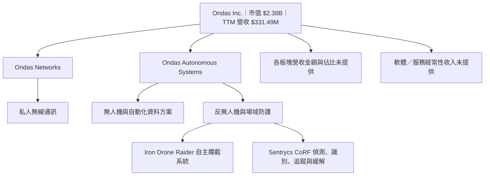
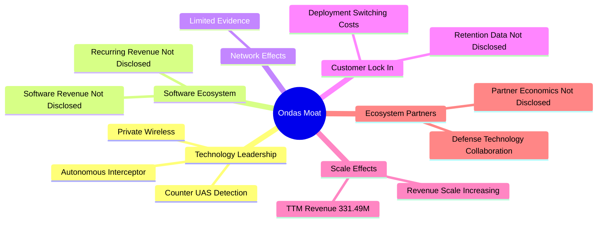
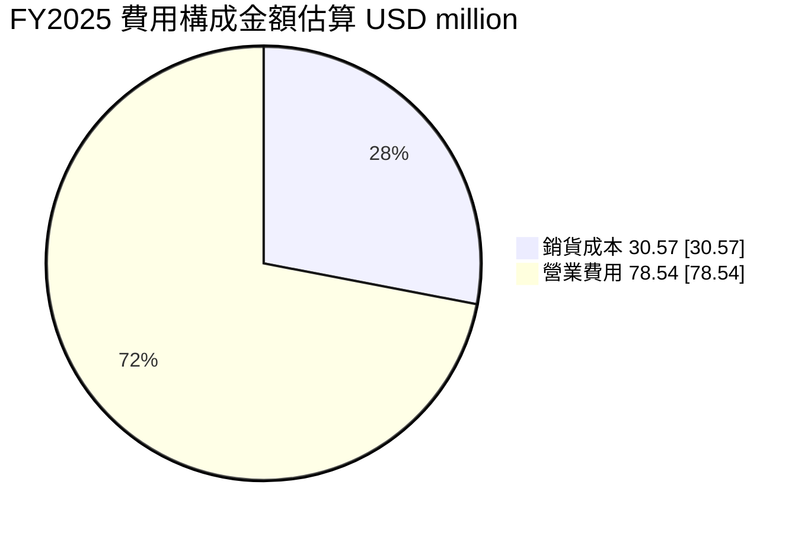
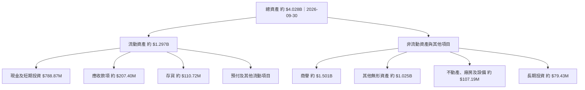
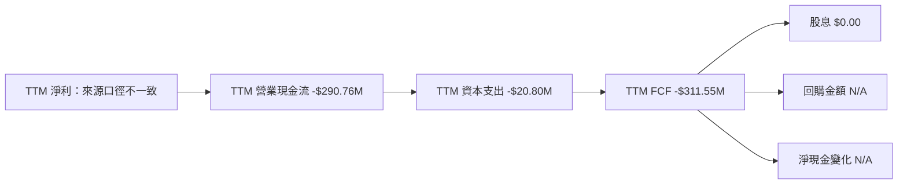
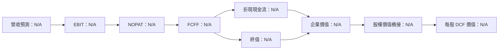
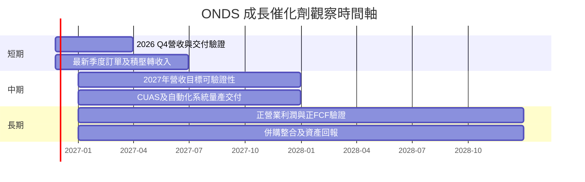
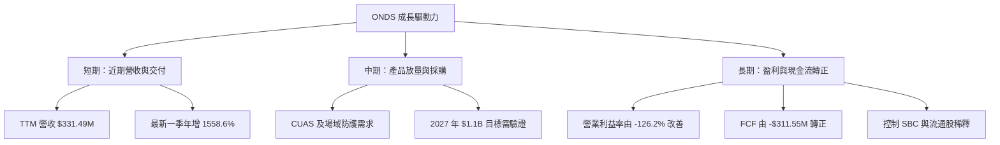
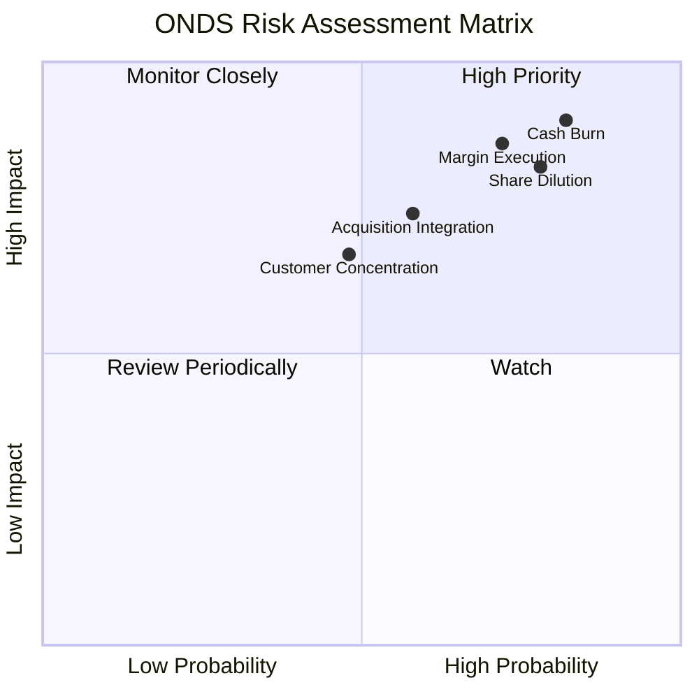
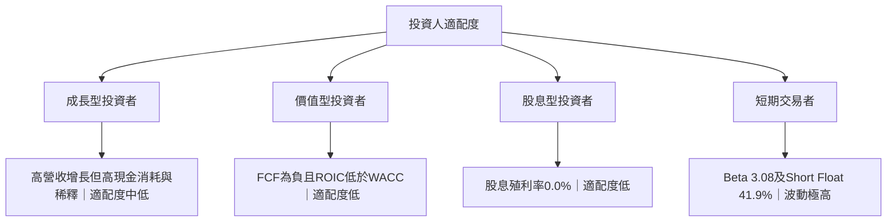

# ONDS 基本面深度分析報告
> **報告日期**：2026-11-24 ｜ **語言**：繁體中文 ｜ **數據來源**：SEC 申報資料 (XBRL)、Yahoo Finance、Finviz、StockAnalysis、Roic.ai ｜ **分析師**：CFA 級機構研究

## 目錄

| # | 章節 | 核心結論 |
|---|------|----------|
| 1 | 執行摘要 | 減碼；加權合理價值 $3.32，MOS -21.4% |
| 2 | 公司概覽與商業模式 | 無市場份額數據；業務成長快速，但護城河證據仍有限 |
| 3 | 損益表深度分析 | TTM 營收 $331.49M、TTM 成長 1,239.4%；營業利益率 -126.2% |
| 4 | 資產負債表分析 | 現金及短期投資 $788.87M；流動性尚可，應收帳款及庫存天數上升 |
| 5 | 現金流量深度分析 | TTM FCF -$311.55M；現金消耗與股權薪酬稀釋是主要觀察點 |
| 6 | 獲利能力與資本效率 | ROIC -20.9% 對 WACC 14.0%，目前摧毀股東價值 |
| 7 | 相對估值分析 | ONDS P/S 高於同業中位數；自身歷史 P/S 位於第 32 百分位 |
| 8 | DCF 內在價值評估 | DCF 不適用：TTM 營業利益為負；以固定權重估值方法三角驗證 |
| 9 | 成長催化劑 | 公司快速放量及管理層提及的 2027 年營收目標是催化劑，惟目標可驗證性仍待觀察 |
| 10 | 風險矩陣 | 燒錢、稀釋與整合執行風險居前 |
| 11 | 投資建議 | 減碼；現價高於加權合理價值，僅在基本面與估值改善後考慮提高曝險 |

---

## 1. 執行摘要

截至 2026-11-23 收盤，ONDS 股價為 **$4.03**。TTM 營收為 **$331.49M**、TTM 營收年增 **1,239.4%**，但 TTM 營業利益率為 **-126.2%**、ROIC 為 **-20.9%**，TTM FCF 為 **-$311.55M**。依同業 P/S 與分析師共識目標價加權後，合理價值為 **$3.32**，以該價值為分母計算的 MOS 為 **-21.4%**，依規則 20 評級為 **減碼**。快速成長目前尚未轉化為正營業現金流或資本回報。

### 1.0 一頁式投資儀表板（Portfolio Manager 30 秒速讀）

| 項目 | 內容 |
|------|------|
| **投資論點（3 句）** | ① TTM 營收年增 **1,239.4%**，且最新一季年增 **1,558.6%**，顯示營收快速放量，但不代表獲利同步改善。② TTM FCF **-$311.55M**、FCF Yield **-13.07%**，若現金消耗延續，股東稀釋風險升高。③ 加權合理價值 **$3.32** 低於 2026-11-23 收盤價 **$4.03**，MOS **-21.4%**。 |
| **綜合評分** | **4.6/10**（引用 1.1 評分卡） |
| **財務健康** | 🟡 現金及短期投資 **$788.87M**，但 TTM FCF **-$311.55M**；以目前現金水位提供緩衝，不消除營運燒錢問題。 |
| **ROIC vs WACC** | **-20.9% vs 14.0%**：差距 **-34.9 個百分點**，目前摧毀股東價值。 |
| **FCF 趨勢** | TTM FCF 為負，季度現金流仍有顯著消耗；FCF Yield **-13.07%**。 |
| **估值** | Forward P/E **-26.0x**（虧損時無經濟意義）｜EV/EBITDA **-5.709x**（TTM EBITDA 為負）｜FCF Yield **-13.07%**。 |
| **DCF 內在價值（基準）** | **N/A**；TTM 營業利益為負，DCF MODEL 未提供。DCF 折溢價不適用。 |
| **安全邊際（MOS）** | **-21.4%＝($3.32 − $4.03) ÷ $3.32**；基準為第 8.8 節加權合理價值。🔴 MOS 為負。 |
| **預期報酬（基準情境 12M）** | DCF 基準情境 N/A；加權合理價值相對現價的隱含上行空間為 **-17.6%**，非 DCF 12 個月預測。 |
| **關鍵風險（前二）** | TTM FCF **-$311.55M** 的資金消耗；TTM 股權薪酬估算約 **$155.41M**，約佔 TTM 營收 **46.9%**。 |
| **評級 + 信心度** | 🟠 **減碼** ｜ 信心：中低（估值計算可重現，但業務組合與獲利路徑資料有限）。 |

### 1.1 綜合評分卡（全報告唯一）

| 維度 | 評分（1–10） | 主要依據（引用數字與其來源章節） |
|------|--------------|----------------------------------|
| 成長性 | 8.0 | TTM 營收年增 **1,239.4%**、最新一季年增 **1,558.6%**；但基期低且營收組合明細缺漏（第 3 章）。 |
| 獲利能力 | 2.0 | TTM 營業利益率 **-126.2%**、ROIC **-20.9%**、Piotroski F-Score **3/8**（第 3、6 章）。 |
| 財務健康 | 6.5 | 現金及短期投資 **$788.87M**、流動比率 **3.389**；但 TTM FCF **-$311.55M**、CCC **181 天**（第 4、5 章）。 |
| 估值 | 4.0 | MOS **-21.4%**；ONDS 歷史 P/S **7.5x**，高於同業 P/S 中位數 **3.3x**（第 7、8 章）。 |
| 護城河 | 4.0 | 有 CUAS、無人機及私人無線產品，但未提供市占率、續約率、客戶集中度或軟體經常性收入數據（第 2 章）。 |
| 管理層與資本配置 | 3.0 | FY2025 SBC **$16.02M**，最新四季 SBC 合計約 **$155.41M**；流通股數曾由 2026 年 3 月約 **469M** 增至 9 月約 **590M**（第 3、5 章）。 |
| **綜合評分** | **4.6** | 六項算術平均：**(8.0 + 2.0 + 6.5 + 4.0 + 4.0 + 3.0) ÷ 6 = 4.6**。 |

### 1.2 五大投資論點 + 三大核心風險

| 類型 | 項目 | 具體依據 | 信心度 |
|------|------|----------|--------|
| 🟢 **投資論點①** | 營收放量 | TTM 營收 **$331.49M**，TTM 年增 **1,239.4%**；最新一季營收 **$167.49M**，單季年增 **1,558.6%**。需確認收入是否可持續及產品組合品質。 | 🟢 高 |
| 🟢 **投資論點②** | 現金資產提供營運緩衝 | 現金與短期投資 **$788.87M**，可支持業務擴張；但現金消耗速度高，不能單憑現金餘額判定財務安全。 | 🟡 中 |
| 🟢 **投資論點③** | 國防與反無人機產品需求可能提供增量 | 公司提供 CUAS、攔截無人機、私人無線及自動化系統；新聞提及國防科技合作與訂單／積壓成長，但未提供可量化的訂單轉收入明細。 | 🟡 中 |
| 🟢 **投資論點④** | 毛利率已有可觀規模 | TTM 毛利率 **36.4%**，高於 AVAV、KTOS、RCAT 中位數 **23.0%**；仍須觀察產品組合及併購相關成本。 | 🟡 中 |
| 🟢 **投資論點⑤** | 股價已大幅回落 | 2026-11 月收盤價 **$4.03**，低於 52 週高點 **$15.28**；股價跌幅不等於估值已便宜，估值仍需回到現金流和利潤率驗證。 | 🟡 中 |
| 🟡 **風險①** | 現金消耗高 | TTM 營業現金流 **-$290.76M**、FCF **-$311.55M**；若營運資金需求或虧損延續，可能需要融資。 | 🔴 高衝擊 |
| 🔴 **風險②** | 股權稀釋與高 SBC | 最新四季 SBC 約 **$155.41M**，約為同期營收 **46.9%**；股票薪酬與增發會稀釋每股經濟利益。 | 🔴 高衝擊 |
| 🔴 **風險③** | 營收暴增尚未帶來營業槓桿 | TTM 營業利益率 **-126.2%**、ROIC **-20.9%**；若擴張需要持續高費用支出，快速成長未必能轉為股東價值。 | 🔴 高衝擊 |

### 1.3 快速統計卡片

| 指標 | 公司實際值（期間） | 同業中位數 | 狀態 |
|------|--------------------|------------|------|
| 營收成長（TTM） | **1,239.4%** | — | 🟢 成長快；低基期與收購影響需留意 |
| 營收成長（最新一季年增） | **1,558.6%** | **22.0%** | 🟢 顯著高於同業，但可持續性未證 |
| 毛利率（TTM） | **36.4%** | **23.0%** | 🟢 高於同業中位數 |
| 營業利益率（TTM） | **-126.2%** | — | 🔴 深度虧損 |
| ROIC（TTM） | **-20.9%** | — | 🔴 低於資本成本 |
| Forward P/E | **-26.0x** | **20.6x** | 🔴 ONDS 預期仍虧損，倍數不可直接比較 |
| FCF Yield（TTM） | **-13.07%** | — | 🔴 現金流為負 |
| Piotroski F-Score | **3 / 8** | — | 🔴 財務品質指標偏弱 |

### 1.4 投資結論

╔══════════════════════════════════════════════════════════════════╗  
║                    📊 投資結論摘要                               ║  
╠══════════════════════════════════════════════════════════════════╣  
║  評級：減碼（MOS -21.4%，依規則 20）                            ║  
║  價格（2026-11-23 收盤）：$4.03                                 ║  
║  DCF 內在價值（基準）：N/A（TTM 營業利益為負）                   ║  
║  安全邊際 MOS：-21.4%（＝($3.32−$4.03)÷$3.32）                 ║  
║  加權合理價值（8.8）：$3.32                                     ║  
║  綜合評分：4.6/10（引用 1.1）                                   ║  
║  適合投資人：能承受高波動與稀釋風險的成長型投資人；不適合以     ║  
║              穩定獲利、現金流或股息為主要需求的投資人。         ║  
╚══════════════════════════════════════════════════════════════════╝  

依 MOS **-21.4%** 對應規則 20 的評級為減碼，未作質化調整。DCF 情境價值未提供，因此不列悲觀、基準、樂觀 DCF 目標價。

---

## 2. 公司概覽與商業模式

### 2.1 業務結構與收入來源

公司由 Ondas Networks 與 Ondas Autonomous Systems 兩個板塊構成，涉及私人無線、無人機、自動化資料及反無人機防護。**各板塊營收、板塊利潤率與軟體服務收入均未提供**，無法判斷營收放量主要由哪個產品或收購資產貢獻。

### 2.2 市場份額

市場份額數據未提供，因此不推算市占率。ONDS TTM 營收 **$331.49M**，規模低於大型國防承包商，但成長率高於同業數據：最新一季年增 **1,558.6%**，對比 AVAV **5.7%**、KTOS **35.7%**、RCAT **22.0%**。然而，缺少市場份額與有機成長拆分，不能把高增長直接等同於競爭地位改善。

### 2.3 競爭護城河分析

### 2.4 護城河強度

| 護城河項目 | 強度（強／中／弱） | 證據（引用數字或事實） | 會削弱它的情況 |
|------------|--------------------|------------------------|----------------|
| 技術與產品 | 中 | 公司有 CUAS、Iron Drone Raider、Sentrycs CoRF 與私人無線產品；營收快速增長，但未提供專利、性能測試或產品市占數據。 | 同業產品性能追平、客戶驗證延遲或採購轉向其他平台。 |
| 軟體生態系統 | 弱 | 軟體收入、訂閱收入、續約率與毛利率拆分均未提供。 | 收入主要是一次性硬體交付，難以形成重複營收。 |
| 網路效應 | 弱 | 未提供用戶數、部署節點數或資料網路效應指標。 | 客戶使用量增加未帶來可測量的服務價值或成本優勢。 |
| 客戶鎖定 | 弱至中 | 國防與關鍵場域系統可能涉及驗證及整合成本，但未提供客戶留存與合約年期。 | 採購延遲、供應商替換或重新認證成本低於預期。 |
| 規模效應 | 弱至中 | TTM 營收 **$331.49M**，但 TTM 營業利益率 **-126.2%**，尚未證明規模擴大帶來營業槓桿。 | 營收增加同時費用與營運資金增速更快。 |
| 生態夥伴 | 中 | 有國防科技合作等新聞，但合作對營收、訂單及毛利的貢獻未披露。 | 合作未轉成可履約合約或商業收入。 |

1.1「護城河」評分為 **4.0/10**，原因是產品與市場方向具備差異化可能，但目前缺少市占率、續約率、軟體經常性收入及規模經濟的量化證據。

---

## 3. 損益表深度分析

### 3.1 年度收入成長趨勢（近 4 年）

年度收入依次為 FY2022 **$2.13M**、FY2023 **$15.69M**、FY2024 **$7.19M**、FY2025 **$50.73M**。柱長按收入相對比例呈現；因年度收入基數差異很大，短柱不代表沒有成長。

╔══════════════════════════════════════════════════════════════════╗  
║              Ondas Inc. 年度收入趨勢（FY2022-FY2025）            ║  
╠══════════════════════════════════════════════════════════════════╣  
║  FY2022  $2.13M   █                                             ║  
║  FY2023  $15.69M  ████████                                      ║  
║  FY2024  $7.19M   ████                                          ║  
║  FY2025  $50.73M  █████████████████████████                     ║  
╠══════════════════════════════════════════════════════════════════╣  
║  年度收入數字：SEC／StockAnalysis 年度損益表；FY2025 YoY +605.28% ║  
║  四年收入增長受低基期、年度波動及可能的收購影響；有機拆分未提供。║  
╚══════════════════════════════════════════════════════════════════╝  

FY2024 收入較 FY2023 下降，FY2025 則大幅回升。FY2025 收入年增 **605.28%**（StockAnalysis 報告值）；此高增長尚未體現在利潤，FY2025 營業虧損 **$58.38M**。TTM 成長率 **1,239.4%** 是 TTM 對前一 TTM，不應與單季年增混用。

### 3.2 季度收入趨勢分析

| 季度 | 營收 | QoQ 成長率 | YoY 成長率 | 備註 |
|------|------:|-----------:|-----------:|------|
| 2025 Q4 | $30.11M | +198.1% | N/A | QoQ 以 2025 Q3 $10.10M 為基礎；2024 Q4 單季數據未提供。 |
| 2026 Q1 | $50.12M | +66.5% | +1,079.9% | 單季年增率取 StockAnalysis 季度資料。 |
| 2026 Q2 | $83.77M | +67.1% | +1,235.4% | 營收較上季續增。 |
| 2026 Q3 | $167.49M | +99.9% | **+1,558.6%** | 最新一季年增率；不是 TTM 成長率。 |

QoQ 使用公式「本季營收 ÷ 前季營收 − 1」，以表列四捨五入數字計算。連續季度放量支持需求正在擴大，但若大量來自收購併表、低基期或一次性專案，不能假設增速會維持。

### 3.3 利潤率演變分析

年度毛利率及營業利益率由年度損益表收入、毛利及營業利益計算；TTM 採 VERIFIED FIGURES 的指標。各年度原始金額經四捨五入，故比率為估算值。

| 利潤率指標 | FY2022 | FY2023 | FY2024 | FY2025 | 最新 TTM | 趨勢 | 評估 |
|------------|-------:|-------:|-------:|-------:|---------:|------|------|
| **毛利率** | 約 52.1% | 約 40.7% | 約 4.8% | 約 39.8% | **36.4%** | FY2024 顯著低點後回升 | 🟡 波動大；產品組合與併購影響未拆分 |
| **營業利益率** | 約 -2,347.4% | 約 -243.7% | 約 -481.4% | 約 -115.1% | **-126.2%** | 虧損率較早期收窄，仍深度為負 | 🔴 固定成本與營運費用仍遠高於毛利 |

年度毛利率波動很大：FY2024 毛利率約 **4.8%**，FY2025 回升至約 **39.8%**。可能反映產品組合、交付批次或併購後業務結構改變，但現有資料不足以將變化歸因於定價能力或成本控制。即使 TTM 毛利率達 **36.4%**，營業利益率仍為 **-126.2%**，表明毛利尚不足以覆蓋營運費用。

不同資料匯總來源對 TTM 營業利益率有 **-126.2%** 與 **-119.5%** 等差異；本報告核心比率採 VERIFIED FIGURES 的 **-126.2%**。最新一季亦有 **-113.1%** 與其他彙整數據不同，採 VERIFIED FIGURES 值。

### 3.4 費用結構分析

FY2025 營收 **$50.73M**、毛利 **$20.16M**、營業虧損 **-$58.38M**。依此推算銷貨成本約 **$30.57M**、營業費用約 **$78.54M**（毛利減營業利益的差額）；這是由年度報表數字計算的費用概況，不代表完整成本分類。

╔══════════════════════════════════════════════════════════════════╗  
║                   FY2025 收入與營業費用概況                     ║  
╠══════════════════════════════════════════════════════════════════╣  
║  營收             $50.73M                                       ║  
║  毛利             $20.16M                                       ║  
║  推算營業費用     $78.54M                                       ║  
║  營業虧損        -$58.38M                                       ║  
║  判讀：營業費用約為營收的 1.55 倍，需看到費用增速低於營收才有槓桿║  
╚══════════════════════════════════════════════════════════════════╝  

### 3.5 季度 EPS 趨勢與盈餘品質（Quality of Earnings）

EPS 預估值與實際值的 beat/miss 資料在最近四季均為 nan，無法可靠判斷是否超預期或不及預期。StockAnalysis 所列季度 EPS 為 2025 Q4 **-$0.27**、2026 Q1 **$0.59**、Q2 **-$0.15**、Q3 **-$0.10**；資料來源未提供相應分析師預估，因此只能描述波動，不能判定盈餘驚喜。

| 盈餘品質項目 | 數值/佔比 | 評估 |
|--------------|-----------|------|
| 股權薪酬 SBC / 營收 | 最新四季 SBC 約 **$155.41M** ÷ TTM 營收 **$331.49M** = **約 46.9%** | 🔴 估算：四季 SBC 取 2025 Q4 至 2026 Q3 季度數據相加；比重高，意味股東稀釋成本重大。 |
| SBC / 營業現金流 | **約 -53.5%**；以營業現金流絕對值計約 **53.5%** | 🔴 TTM OCF 為負，傳統正向現金流覆蓋率不適用；負號表示分母為負。 |
| FCF / 淨利（現金轉換率） | 季度淨利加總 **$112.47M**；FCF **-$311.55M**，比率約 **-277.0%** | 🔴 淨利與 FCF 方向背離，且不同資料源的 TTM 淨利口徑不一致；轉換品質弱。 |
| 一次性/非經常性損益 | FY2026 Q1 淨利 **$362.95M**，其餘列示季度為虧損；一次性項目明細 N/A | 🔴 單季大額正淨利扭曲獲利趨勢；缺少附註不能認定其為經常性盈餘。 |
| 有效稅率異常 | N/A（有效稅率明細未提供） | 🟡 不能確認 TTM 正淨利是否由稅務利益帶動。 |
| 資本化支出 vs 費用化 | TTM Capex **$20.80M**；資本化政策及資本化研發明細 N/A | 🟡 尚無足夠資訊判斷是否有成本遞延。 |

**盈餘品質結論**：最新四季股權薪酬估算約佔營收 **46.9%**，且 TTM FCF **-$311.55M**。季度淨利加總呈正值，但其中 2026 Q1 單季淨利 **$362.95M**，與其他季度虧損及營業虧損走勢不一致；其非營業或一次性來源需查閱申報附註。現階段不宜以正 TTM 淨利視為可持續的獲利基礎，估值宜更重視營收品質、現金流與稀釋。

---

## 4. 資產負債表分析

### 4.1 資產結構分解

截至 2026-09-30，StockAnalysis 彙總總資產約 **$4.028B**，流動資產約 **$1.297B**；現金與短期投資 **$788.87M**。下圖只列有來源的主要項目，項目非完整資產負債表，不應將所列數字直接相加視為總額。

商譽及其他無形資產金額較大，反映資產負債表可能受併購影響。若相關業務未達預期，存在商譽或無形資產減損風險；減損金額與併購資產配置資料未提供。

### 4.2 流動性與營運資金分析

| 指標 | 最新 TTM | 一年前 TTM | 變化 | 解讀 |
|------|----------|------------|------|------|
| DSO 應收帳款天數 | **140 天** | **77 天** | **+63 天** | 應收帳款回收時間拉長；可能與專案交付、客戶付款條款或併購造成的應收增加有關，需確認逾期與客戶集中度。 |
| DIO 存貨天數 | **182 天** | **278 天** | **-96 天** | 存貨周轉改善，但 182 天仍意味資金在存貨中停留較久；需觀察交貨及存貨減值。 |
| DPO 應付帳款天數 | **141 天** | **186 天** | **-45 天** | 對供應商付款天數下降，可能表示付款加快或採購結構變化；不宜單獨解讀為議價力改善。 |
| CCC 現金轉換週期 | **181 天** | **169 天** | **+12 天** | 現金被營運資金占用時間增加，主要警訊是 DSO 上升抵銷 DIO 改善。 |

流動比率 **3.389**、速動比率 **2.604**，短期資產對流動負債有一定覆蓋；但 DSO 增至 **140 天**，且 TTM OCF 為負，流動性不能只由比率判斷。

### 4.3 債務結構分析

核心 VERIFIED FIGURES 顯示總債務 **N/A**，淨現金 **$788.87M**；另一資料彙整報告總債務 **$62.81M**、淨現金 **$726.06M**。兩組口徑不一致，核心結論採前者，並避免自行以現金倒推出缺漏債務。

╔══════════════════════════════════════════════════════════════════╗  
║                   Ondas Inc. 債務健康診斷                        ║  
╠══════════════════════════════════════════════════════════════════╣  
║  總債務：        N/A（核心資本成本資料未提供）                   ║  
║  現金及短期投資： $788.87M                                       ║  
║  淨現金：        $788.87M（採 VERIFIED FIGURES；另源數字不同）   ║  
║  Debt/EBITDA：   N/A（TTM EBITDA 為負，不具解讀意義）             ║  
║  利息保障倍數：  N/A（營業利益為負，利息費用明細不足）           ║  
║  流動比率：      3.389                                           ║  
║  判讀：現金緩衝明顯，但 TTM FCF -$311.55M，持續燒錢仍是核心風險 ║  
╚══════════════════════════════════════════════════════════════════╝  

### 4.4 股東權益趨勢

╔══════════════════════════════════════════════════════════════════╗  
║                  Ondas 歷年股東權益變化                          ║  
╠══════════════════════════════════════════════════════════════════╣  
║  FY2022  $58.22M  ████████████                                   ║  
║  FY2023  $33.14M  ███████                                        ║  
║  FY2024  $16.58M  ███                                            ║  
║  FY2025  $437.81M ██████████████████████████████                 ║  
╚══════════════════════════════════════════════════════════════════╝  

FY2025 股東權益大幅高於 FY2024，伴隨現金由 **$29.96M** 升至 **$550.74M**，顯示融資或其他資本交易改變了資產負債表。2026 年 9 月股數約 **590M**，高於 2026 年 3 月約 **469M**；增資改善流動性，但也稀釋每股權益。

---

## 5. 現金流量深度分析

### 5.1 現金流量瀑布圖

根據固定定義，FCF = 營業現金流 − 資本支出。資料所列為 **-$290.76M** 與 **$20.80M**，兩者以顯示精度直接計算會有 **$0.01M** 四捨五入差異；本報告照錄 VERIFIED FIGURES 的 TTM FCF **-$311.55M**，不以重算值替換。

### 5.2 FCF 轉換率趨勢

| 年度 | FCF | 淨利 | FCF / 淨利 | 解讀 |
|------|-----:|-----:|-----------:|------|
| FY2022 | -$40.89M | -$73.24M | 約 **55.8%** | 分子、分母同為負值，比率為正，並非正向現金轉換。 |
| FY2023 | -$34.30M | -$44.84M | 約 **76.5%** | 仍為虧損與負現金流。 |
| FY2024 | -$35.20M | -$38.01M | 約 **92.6%** | 負值比率接近 1，不應誤判為獲利品質良好。 |
| FY2025 | -$40.88M | -$132.02M | 約 **31.0%** | 淨虧損擴大，現金流仍為負。 |
| 最新 TTM | **-$311.55M** | TTM 淨利來源口徑不一致 | N/A | 依季度淨利加總可算出不同口徑比率，故不以單一數值代表轉換品質。 |

### 5.3 自由現金流趨勢

╔══════════════════════════════════════════════════════════════════╗  
║              自由現金流趨勢（USD million）                       ║  
╠══════════════════════════════════════════════════════════════════╣  
║  FY2022  -40.89  ◀████                                          ║  
║  FY2023  -34.30  ◀███                                           ║  
║  FY2024  -35.20  ◀███                                           ║  
║  FY2025  -40.88  ◀████                                          ║  
║  TTM     -311.55 ◀██████████████████████████████                ║  
╠══════════════════════════════════════════════════════════════════╣  
║  最新 TTM FCF Yield：-13.07%                                     ║  
║  最新 TTM 現金消耗明顯高於過往年度；季度數據顯示 2026 Q3 FCF      ║  
║  -$150.75M，需查明是否為交付、營運資金或一次性支出造成。         ║  
╚══════════════════════════════════════════════════════════════════╝  

### 5.4 資本配置評估

股息殖利率 **0.0%**、派息率 **0.0%**，公司未以股息回饋股東。FY2025 Capex **$2.14M**，但最新 TTM Capex **$20.80M**，資本支出與業務擴張同步上升；最新四季 SBC 約 **$155.41M**，是比現金資本支出更顯著的股東成本。

| 配置項目 | 可得數據 | 評估 |
|----------|----------|------|
| 股息 | 殖利率 **0.0%** | 未回饋現金股息；對成長型公司本身不構成負面，但須證明留存資本回報高於資本成本。 |
| 回購 | N/A | 未提供回購數據。 |
| Capex | TTM **$20.80M** | 高於 FY2025 **$2.14M**；資本支出增加需與產能、訂單及交付能力連結。 |
| 股權薪酬 | 最新四季估算 **$155.41M** | 相對營收比重高，會稀釋每股經濟利益。 |
| 收購／投資 | 長期投資與商譽數字可見，交易明細 N/A | 需追蹤收購後收入、毛利、現金流及商譽減損風險。 |

可用資料不足以建立互斥且完整的「資本配置」圓餅圖，因此不以不完整項目冒充總額比例。

---

## 6. 獲利能力與資本效率

### 6.1 ROE / ROA / ROIC 趨勢

| 指標 | FY2022 | FY2023 | FY2024 | FY2025 | 最新 TTM | 評估 |
|------|-------:|-------:|-------:|-------:|---------:|------|
| ROE | N/A | N/A | N/A | N/A | **4.6%** | QUALITY FIGURES 值；另一彙整資料列 **7.3%**，資料口徑有差異。 |
| ROA | N/A | N/A | N/A | N/A | N/A | 年度歷史 ROA 未提供；另一來源列最新 TTM **-9.7%**，不與品質指標混用。 |
| ROIC | N/A | N/A | N/A | N/A | **-20.9%** | 明顯低於 WACC，現階段資本回報不足。 |
| WACC | — | — | — | — | **14.0%** | 成本資本資料提供值，計算值 14.75% 受上限限制。 |

### 6.2 ROIC vs WACC 分析（核心價值創造判斷）

╔══════════════════════════════════════════════════════════════════╗  
║                ROIC vs WACC 深度分析                             ║  
╠══════════════════════════════════════════════════════════════════╣  
║  股權成本 Ke：                                                   ║  
║  ├── 無風險利率 Rf：             4.92%                           ║  
║  ├── 市場風險溢酬 ERP：          5.00%                           ║  
║  ├── 原始 Beta：                 3.08                            ║  
║  ├── 調整後 Beta：               2.00                            ║  
║  └── Ke = 4.92% + 2.00 × 5.00% = 14.92%                        ║  
║                                                                  ║  
║  債務與資本結構（採成本資本資料）：                              ║  
║  ├── 稅前債務成本：              10.47%                          ║  
║  ├── 股權權重 / 債務權重：       97.4% / 2.6%                   ║  
║  ├── WACC 計算值：               14.75%                          ║  
║  └── 採用 WACC：                 14.00%（限制於 7%–14% 區間）   ║  
║                                                                  ║  
║  ROIC（TTM）：                    -20.9%                          ║  
║  ROIC − WACC：                    -20.9% − 14.0% = -34.9 pp      ║  
║  結論：ROIC 遠低於資本成本，當前營運回報摧毀股東價值。           ║  
╚══════════════════════════════════════════════════════════════════╝  

Beta 原始值 **3.08** 經調整公式 **⅔ × 3.08 + ⅓ = 2.39**，再依提供的 Beta 使用區間封頂為 **2.00**。採用 WACC **14.00%**，不是未封頂的計算值 **14.75%**。ROIC 與 WACC 相差 **-34.9 個百分點**；公司需先顯著降低營業虧損，才可能轉向創造經濟價值。由於第 8 章 DCF MODEL 為 N/A，這裡不另建估值模型。

### 6.3 杜邦三因素分解

依 QUALITY FIGURES 的 TTM 杜邦數據照錄：

| 因素 | 數值（TTM） | 解讀 |
|------|-------------|------|
| 淨利率 | **33.1%** | 正值與營業虧損及季度淨利波動並存，可能受非營業損益影響；持續性待核實。 |
| 資產週轉率 | **0.08** | 資產相對營收周轉偏低；收購後資產擴張可能尚未充分轉化為收入。 |
| 權益乘數 | **1.70** | 槓桿不是 ROE 的唯一來源。 |
| **ROE** | **4.6%** | **33.1% × 0.08 × 1.70 = 4.5%**，四捨五入後約 **4.6%**；照錄品質指標 ROE。 |

杜邦乘積與列示 ROE 有四捨五入差異。ROE 表面為正，主要受淨利率資料口徑影響；資產週轉率僅 **0.08**，不足以證明營運效率已具備穩健回報。

### 6.4 財務體質：Piotroski F-Score

Piotroski F-Score 為 **3 / 8**；九項測試中一項因資料缺漏不計分，因此可判定分母為 8。

| 測試 | 結果 | 解讀 |
|------|------|------|
| ROA > 0 | ✅ 通過 | 品質指標的 ROA 測試通過；與其他來源列負 ROA 的資料有口徑差異。 |
| 營業現金流 > 0 | ❌ 未通過 | TTM OCF **-$290.76M**，現金流仍為負。 |
| ROA 高於一年前 | ✅ 通過 | 相對一年前改善，但單項改善不代表已達正向資本回報。 |
| 營業現金流 > 淨利（應計品質） | ❌ 未通過 | 現金流弱於帳面盈餘，盈餘品質需審慎。 |
| 長期負債 ÷ 總資產低於一年前 | — 無法判定 | 長期負債比較資料缺漏，不推算。 |
| 流動比率高於一年前 | ❌ 未通過 | 相較前期未改善；即使目前流動比率 **3.389**，仍需監控營運資金消耗。 |
| 稀釋股數未增加 | ❌ 未通過 | 2026 年 3 月至 9 月股數由約 **469M** 增至約 **590M**。 |
| 毛利率高於一年前 | ❌ 未通過 | 依品質指標判定未通過，需觀察毛利是否回升並穩定。 |
| 資產週轉率高於一年前 | ✅ 通過 | 相對改善，但 TTM 資產週轉率仍約 **0.08**。 |

---

## 7. 相對估值分析

### 7.1 同業估值比較表格

下表同業倍數採 Yahoo Finance 的 Peer multiples。ONDS 當前倍數取公司估值資料；同業中位數依該區塊所列同業數字計算。負盈餘與負 EBITDA 的倍數不具一般估值解讀性。

| 估值指標 | **ONDS** | **AVAV** | **KTOS** | **RCAT** | 本公司評估 |
|----------|---------:|---------:|---------:|---------:|-----------|
| **Trailing P/E** | N/A | N/A | 237.5x | N/A | 🔴 ONDS 為虧損；同業可比樣本不足 |
| **Forward P/E** | **-26.0x** | 20.6x | 25.5x | -3.0x | 🔴 ONDS 預期仍虧損，倍數比較失去一般意義 |
| **P/S Ratio** | **7.19x** | 2.3x | 3.3x | 3.9x | 🔴 ONDS 高於同業中位數 **3.3x** |
| **EV/EBITDA** | **-5.709x** | 22.2x | 46.8x | -0.5x | 🔴 ONDS TTM EBITDA 為負，倍數不宜作為估值錨 |
| **最新一季營收年增** | **1,558.6%** | 5.7% | 35.7% | 22.0% | 🟢 增長顯著較高，但基期、收購及收入品質需驗證 |
| **TTM 毛利率** | **36.4%** | 26.5% | 23.0% | 8.7% | 🟢 高於同業中位數 **23.0%** |

### 7.2 歷史估值區間分析

╔══════════════════════════════════════════════════════════════════╗  
║             ONDS 歷史 P/S 估值位置（TTM）                         ║  
╠══════════════════════════════════════════════════════════════════╣  
║  五年區間：2.9x ──────────────────────────────── 140.6x          ║  
║  五年中位數：17.9x                                               ║  
║  當前：7.5x     ●                                                ║  
║  當前百分位：第 32 百分位                                         ║  
║  判讀：低於自身中位數，但仍高於同業 P/S 中位數 3.3x               ║  
╚══════════════════════════════════════════════════════════════════╝  

公司自身歷史 P/S **7.5x**，低於五年中位數 **17.9x**，處於第 **32** 百分位；但其歷史區間極寬（**2.9x–140.6x**），歷史中位數受極端高倍數影響，不能單獨證明低估。來源另有公司 P/S **7.191x**，與歷史估值資料庫的 **7.5x** 計算口徑不同。

### 7.3 情境價值（Bear / Base / Bull）

**N/A（DCF 無法計算：TTM 營業利益不為正，DCF MODEL 未提供；不得自行建立情境目標價。）**

### 7.4 相對估值隱含價格區間

╔══════════════════════════════════════════════════════════════════╗  
║                  相對估值每股價值比較                            ║  
╠══════════════════════════════════════════════════════════════════╣  
║  同業 P/S：$1.83 ───── 現價 $4.03 ───── 分析師共識：$16.68       ║  
║  權重：90%                             權重：10%                  ║  
║  加權合理價值：$3.32                                             ║  
╚══════════════════════════════════════════════════════════════════╝  

| 方法 | 每股價值 | 依據 | 權重 |
|------|---------:|------|-----:|
| 同業 P/S | **$1.83** | 同業 P/S 中位數 **3.3x**（AVAV、KTOS、RCAT）乘以 ONDS TTM 營收，再依估值方法資料換算每股價值。 | **90%** |
| 分析師共識目標價 | **$16.68** | 10 位分析師平均目標價；作為參考，並非現金流驗證結果。 | **10%** |
| 同業 Forward P/E | 未計算 | ONDS 虧損，該方法不可計算；依固定方法權重規則，未計算方法不納入。 | — |

此處權重依公司類型「未獲利」固定採用，不是主觀調整。用資料所列方法價值加權：

**$1.83 × 90% + $16.68 × 10% = $1.647 + $1.668 = $3.315 ≈ $3.32**。

以四捨五入至美分後的加權合理價值 **$3.32** 與現價 **$4.03** 比較，隱含上行空間為負。

---

## 8. DCF 內在價值評估（Discounted Cash Flow）

> **DCF MODEL：N/A。** 程式計算指出 ONDS 的 TTM 營業利益不為正，因此不以虧損營業利益建立 DCF。依規則，本章不自行設定營收預測、WACC 情境、終值、敏感度或反推 DCF；以下逐節說明缺漏與可使用的資料。

### 8.0 估值推理鏈（Thinking Logic）

**Step 1 — 價值來源與主導變數**  
理論上，ONDS 價值由私人無線、無人機／自動化及反無人機業務的未來現金流決定；但分部營收比例未提供，因此不能可靠拆成各業務價值或估算各自的選擇權價值。現有可量化錨點是 TTM 營收 **$331.49M**、營業利益率 **-126.2%**、FCF **-$311.55M**。關鍵變數應是「收入放量能否轉為正營業利潤與正現金流」，但目前無法由數據推導 DCF 價值。

**Step 2 — 模型選擇**

| 決策點 | 本報告採用 | 理由（含數字） | 曾考慮但否決 | 否決理由 |
|--------|-----------|----------------|--------------|----------|
| 現金流定義 | FCFF 概念 | WACC 為企業資本成本折現率；但不建立預測值。 | FCFE | 缺少可支持可靠預測的獲利與融資路徑。 |
| 預測期 N | N/A | DCF MODEL 未提供有效預測期。 | 5 年或更長 | 任何年數都會成為未經資料支持的假設。 |
| 終值方法 | N/A | 無有效 FCFF 預測，無法計算終值。 | Gordon Growth／退出倍數 | 會產生無法稽核的估值。 |
| EBIT 基礎 | GAAP 資料可得，但 DCF 不建模 | TTM 營業利益為負。 | 以非 GAAP EBIT 建模 | 未提供調整項與可核實的非 GAAP EBIT。 |

**Step 3 — 假設推導鏈**  
營收 CAGR、期末營業利潤率、有效稅率、Capex/營收、D&A/營收、營運資金假設、SBC 處理、稀釋率、永續成長率及終值方法均未提供 DCF MODEL 的有效基準值。依「VERIFIED FIGURES 優先」規定，不以自行假設填補。

**Step 4 — 最脆弱一環**  
目前最脆弱的假設不是某一個可調整的折現率，而是把營收快速增長轉換成正營業利潤與現金流的能力；因缺少可用 DCF 模型，無法量化其失效時的內在價值跌幅。

**Step 5 — 計算路徑圖**

### 8.1 模型假設總表（Model Inputs）

**N/A（DCF MODEL 未提供：TTM 營業利益為負，不能以虧損營業利益折現建立可靠價值。）**  
因此預測期、營收 CAGR、期末利潤率、稅率、Capex、D&A、營運資金、SBC 組合、年稀釋率、永續成長率及終值方法均不填入未經資料支持的數值。

### 8.2 折現率推導（WACC）

資本成本資料提供的 WACC 用於第 6.2 節 ROIC 比較；由於 DCF MODEL 為 N/A，此處不將該折現率套用於自行建立的現金流預測。

╔══════════════════════════════════════════════════════════════════╗  
║                    WACC 資料（非 DCF 模型）                      ║  
╠══════════════════════════════════════════════════════════════════╣  
║  無風險利率：4.92%｜ERP：5.00%｜原始 Beta：3.08                 ║  
║  Beta 調整：⅔×3.08 + ⅓ = 2.39；上限後採用 Beta：2.00            ║  
║  股權成本：4.92% + 2.00×5.00% = 14.92%                          ║  
║  稅前債務成本：10.47%｜股權／債務權重：97.4%／2.6%              ║  
║  WACC 計算值 14.75%；依 7%–14% 區間限制，採用 14.00%            ║  
║  來源未提供無風險利率觀測日、債務餘額細節及利息費用絕對金額。     ║  
╚══════════════════════════════════════════════════════════════════╝  

### 8.3 逐年自由現金流預測（基準情境）

**N/A（DCF MODEL 未提供：TTM 營業利益為負。）**  
未提供逐年基準情境營收、利潤率、FCFF、折現因子及現值，故不列預測表或示範計算。

### 8.4 終值計算（Terminal Value）

**N/A（無可用預測期 FCFF、終值年現金流或 DCF 模型假設。）**  
WACC 與永續成長率的比較、Gordon Growth 終值、退出倍數及終值現值均不適用。

### 8.5 企業價值 → 每股內在價值（Bridge）

**N/A（無企業價值及 DCF 現金流現值，無法完成股權價值橋接或計算每股 DCF 內在價值。）**  
本節不計算 MOS。DCF 折溢價亦不適用。

### 8.6 敏感性分析（WACC × 永續成長率）

**N/A（無基準 DCF、永續成長率與逐年現金流，不能建立敏感性矩陣或情境估值。）**

### 8.7 反推 DCF（Reverse DCF）

**N/A（缺少有效 DCF 基準模型，無法由現價 $4.03 反推營收 CAGR、營業利潤率、永續成長率或預測期。）**

### 8.8 估值三角驗證與安全邊際

本節採用固定估值方法與權重：未獲利公司類型以同業 P/S 為主要方法，分析師共識為輔；DCF 與同業 Forward P/E 不可計算，不自行增補其他估值方法。

| 估值方法 | 隱含每股價值 | 上行空間（÷現價） | 權重 | 說明 |
|----------|--------------|-------------------|------|------|
| 同業 P/S | **$1.83** | **-54.6%** | **90%** | 同業中位數 P/S **3.3x** × ONDS TTM 營收所推算的每股估值。 |
| 分析師共識目標價 | **$16.68** | **+313.9%** | **10%** | 10 位分析師平均目標價，參考性較高但不是現金流模型。 |
| **加權合理價值** | **$3.32** | **-17.6%** | **100%** | 固定權重下的加權值，未事後調整。 |

逐步演算：

- **加權合理價值** = **$1.83 × 90% + $16.68 × 10%**
- **= $1.647 + $1.668 = $3.315 ≈ $3.32**（依美分四捨五入）
- 方法權重：**90% + 10% = 100%**
- 同業 Forward P/E 因公司仍虧損而不可計算；其權重依固定方法規則由可計算方法承接。

**MOS** = **(加權合理價值 − 現價) ÷ 加權合理價值**  
= **($3.32 − $4.03) ÷ $3.32 = -$0.71 ÷ $3.32 = -21.4%**。

**上行空間** = **(加權合理價值 − 現價) ÷ 現價**  
= **($3.32 − $4.03) ÷ $4.03 = -$0.71 ÷ $4.03 = -17.6%**。

**折溢價**固定以 DCF 基準內在價值為基準，但 DCF 為 N/A，故不計算。

╔══════════════════════════════════════════════════════════════════╗  
║                  估值區間與安全邊際                              ║  
╠══════════════════════════════════════════════════════════════════╣  
║  同業 P/S $1.83 ── 加權合理值 $3.32 ── 現價 $4.03 ── 共識 $16.68║  
║                                                                  ║  
║  安全邊際 MOS = ($3.32 − $4.03) ÷ $3.32 = -21.4%                ║  
║  上行空間 = ($3.32 − $4.03) ÷ $4.03 = -17.6%                    ║  
║  MOS 評估：🔴 負安全邊際                                         ║  
║  DCF 價值與 DCF 折溢價：N/A                                      ║  
║  若要求 MOS ≥ 10%，價格須不高於 $3.32×(1−10%) = $2.99           ║  
╚══════════════════════════════════════════════════════════════════╝  

> 🔎 **程式複算（Python，依本節各項自動重算）**
>
> 加權合理價值 = $1.83 × 90% + $16.68 × 10% = **$3.32**（權重合計 100%）
>
> 以價格 $4.03 計：MOS = **-21.4%**，上行空間 = **-17.6%**
>
> ✅ 與本節所寫數值一致。

### 8.9 DCF 模型的局限與失效條件

- **終值依賴度**：N/A，DCF 模型未建立，無法計算終值佔 EV 比例。
- **最脆弱的假設**：營收高速放量能否形成正營業利潤，以及 SBC、營運資金與資本支出是否能隨營收下降。已知 TTM 營業利益率 **-126.2%**、TTM FCF **-$311.55M**，目前仍處於高再投資／虧損階段。
- **不適用情境說明**：對負營業利益且現金流大幅為負的公司，DCF 結果高度依賴遠期利潤率假設；現階段應優先使用同業 EV/Sales、P/S、訂單轉收入、毛利率及單位經濟性追蹤。
- **與第 10 章風險矩陣的連結**：若收入成長放緩，將直接影響營收估值；若現金消耗及稀釋持續，會降低每股價值；若存貨與應收款積壓，則會增加營運資金需求。

### 8.10 複算檢核表（Audit Trail）

| # | 檢核項目 | 檢查方式 | 結果 |
|---|----------|----------|------|
| 1 | 高／中敏感度 DCF 假設均有推導 | DCF MODEL N/A，未填造假設 | ✅ 不適用；明確標示 N/A |
| 2 | 每個 DCF 假設都有來歷 | 未提供的模型輸入均不自行假設 | ✅ |
| 3 | WACC 五步算式及重算 | 資本成本資料已提供 Ke、權重及封頂 WACC；DCF 不使用 | ✅ WACC 採用值與第 6.2 節一致 |
| 4 | Kd 分母與權重債務範圍一致 | 債務明細及平均計息負債未提供 | ✅ 不另行推導 Kd 或債務權重 |
| 5 | WACC 與第 6.2 節同值 | 比對兩處 | ✅ 14.00% |
| 6 | 逐年表格年度數等於 N | DCF 預測期 N 不存在 | ✅ 不適用 |
| 7 | FY+1 九步算式可複算 | 無 DCF 預測數據 | ✅ 不適用 |
| 8 | 預測期 PV 加總可核對 | 無 DCF 現值 | ✅ 不適用 |
| 9 | WACC > g | g 未提供 | ✅ 不適用 |
| 10 | 終值以 FY+N FCFF 折現 | 無終值模型 | ✅ 不適用 |
| 11 | EV 至每股價值橋接 | 無 DCF EV | ✅ 不適用 |
| 12 | SBC 模型組合一致 | 無 DCF SBC／股數假設 | ✅ 不適用；未建立模型 |
| 13 | 敏感度矩陣基準格一致 | 無矩陣 | ✅ 不適用 |
| 14 | 矩陣無效格標示 | 無矩陣 | ✅ 不適用 |
| 15 | 三情境機率合計 | DCF 情境 N/A | ✅ 不適用 |
| 16 | 反推 DCF 每列只放開一項 | 反推模型 N/A | ✅ 不適用 |
| 17 | MOS 與折溢價基準正確 | MOS 以 $3.32 為分母；DCF 折溢價 N/A | ✅ |
| 18 | 完整輸出至第 11 章 | 檢查章節 | ✅ |
| 19 | 加權合理價值等於加權和 | $1.83×90%+$16.68×10%=$3.315≈$3.32 | ✅ |
| 20 | 評級符合 MOS 門檻 | MOS -21.4% 對應減碼 | ✅ |

---

## 9. 成長催化劑

### 9.1 催化劑時間軸

以下為基於公司業務與近期新聞的觀察時間軸；具體交付期及訂單金額未提供，不代表公司正式時程。

近期新聞提及管理層提出 **2027 年營收 $1.1B** 目標；這是新聞標題中的管理層目標，不是已實現營收或本報告的預測。相對 TTM 營收 **$331.49M**，該目標需要大幅擴張，後續應檢查指引、訂單、交付與現金回收是否一致。

### 9.2 TAM 市場規模分析

**N/A（TAM 數據未提供）。** 公司營收 TTM **$331.49M**，最新一季營收年增 **1,558.6%**，顯示目前規模較小但快速擴張；缺少市場總額、可服務市場定義與公司市占率，故不推算 TAM 或滲透率。

### 9.3 成長驅動力結構圖

---

## 10. 風險矩陣

### 10.1 風險評分矩陣

以下象限位置是質化風險判斷，不是財務報表測量值；座標僅表達相對機率與衝擊高低。

### 10.2 風險清單詳細分析

下表機率為分析師質化估計，不是 SEC 申報中的統計發生率；衝擊幅度方向可判斷，缺少可靠模型時不虛構精確收入跌幅。

| # | 風險項目 | 發生機率 | 財務衝擊 | 風險評分 | 緩解措施 |
|---|----------|----------|----------|----------|----------|
| 1 | 🔴 **現金消耗與融資需求** | 高（分析師估計） | 高；TTM FCF **-$311.55M**，若持續可能加速融資或稀釋 | 🔴 高 | 每季追蹤 OCF、FCF、現金餘額與營運資金；要求交付成長同步改善現金回收。 |
| 2 | 🔴 **股權稀釋與 SBC** | 高（分析師估計） | 高；最新四季 SBC 約 **$155.41M**，股數 2026 年 3–9 月約由 **469M** 增至 **590M** | 🔴 高 | 追蹤稀釋股數、SBC/營收、員工獎酬與增發用途；評估每股營收而非僅總營收。 |
| 3 | 🔴 **營業虧損未收斂** | 高（分析師估計） | 高；TTM 營業利益率 **-126.2%**，ROIC **-20.9%** | 🔴 高 | 追蹤毛利率、費用增速及分部營業利潤；若收入成長未帶來利潤改善，調低估值預期。 |
| 4 | 🟠 **併購整合與資產減損** | 中高（分析師估計） | 中高；商譽約 **$1.501B**、其他無形資產約 **$1.025B**（StockAnalysis） | 🟠 中高 | 檢視併購業務收入、毛利、現金流與減損測試；避免只以營收增長判斷整合成功。 |
| 5 | 🟡 **營運資金與收款風險** | 中高（分析師估計） | 中高；DSO **140 天**、CCC **181 天** | 🟡 中高 | 每季追蹤應收帳齡、預收款、存貨周轉與客戶付款條款。 |
| 6 | 🟡 **估值與股價波動** | 高（分析師估計） | 高；Beta 約 **3.08**，Short % Float **41.9%**，現價由 52 週高點 **$15.28** 下跌 | 🟡 高 | 控制部位、避免以短線波動代替基本面判斷；以財報數據驗證估值。 |

---

## 11. 投資建議

### 11.1 最終評級與評分

依加權合理價值 **$3.32** 與 2026-11-23 收盤價 **$4.03** 計算，MOS 為 **-21.4%**，對應規則 20 評級 **減碼**；沒有作一級質化調整。1.1 評分卡的六項分數為成長性 **8.0**、獲利能力 **2.0**、財務健康 **6.5**、估值 **4.0**、護城河 **4.0**、管理層與資本配置 **3.0**，綜合評分 **4.6/10**。

### 11.2 合理價值與隱含報酬率

| 估值參考 | 每股價值 | 相對現價 $4.03 | 說明 |
|----------|---------:|---------------:|------|
| 加權合理價值 | **$3.32** | **-17.6%** | 同業 P/S 90% 加權、分析師共識 10% 加權。 |
| DCF 悲觀情境 | N/A | N/A | DCF MODEL 未提供。 |
| DCF 基準情境 | N/A | N/A | TTM 營業利益為負，不建立 DCF。 |
| DCF 樂觀情境 | N/A | N/A | 不自行設定 DCF 情境目標價。 |
| 分析師共識目標價 | **$16.68** | **+313.9%** | 10 位分析師平均目標價，未作為主導估值。 |

加權合理價值 **$3.32** 不等於保證目標價；同業 P/S 方法暗示 **$1.83**，共識目標價則為 **$16.68**，估值分歧很大，反映未獲利公司的預期高度依賴未來執行。

### 11.3 買入時機與觸發因素

╔══════════════════════════════════════════════════════════════════╗  
║                  ✅ 買入觸發因素 Checklist                       ║  
╠══════════════════════════════════════════════════════════════════╣  
║  目前立場：減碼，不因股價已跌而自動視為便宜。                    ║  
║                                                                  ║  
║  考慮重新評估（需多數符合）：                                    ║  
║  ✅ 季營收成長有訂單交付與有機成長資料支持                       ║  
║  ✅ 營業利益率連續改善，且費用增速低於營收增速                   ║  
║  ✅ OCF、FCF 消耗幅度連續數季收斂                                ║  
║  ✅ DSO 回落、CCC 不再上升，存貨沒有相對營收過度堆積             ║  
║                                                                  ║  
║  價格觸發：加權合理價值 $3.32 的 90% 約為 $2.99；                 ║  
║  僅代表 MOS 至少 10% 的計算門檻，不代表基本面風險已消失。        ║  
║                                                                  ║  
║  減碼／退出觸發：                                                ║  
║  ☐ 現金流消耗持續加速，或公司需以大幅增發維持營運               ║  
║  ☐ 股數持續增加，但每股營收及每股現金流未改善                   ║  
║  ☐ 毛利率明顯下滑或併購資產出現重大減損                         ║  
╚══════════════════════════════════════════════════════════════════╝  

### 11.4 投資人適配度分析

### 11.5 每季財報監控清單（Quarterly Watch List）

| 指標 | 最新基準 | 觸發加碼／改善訊號 | 觸發減碼／警訊 |
|------|---------|--------------------|----------------|
| 營收與有機成長 | 最新季營收 **$167.49M**，單季年增 **1,558.6%** | 持續披露有機成長、訂單交付及分部營收，並維持收入增長 | 成長大幅放緩且無法由交付時點或收購口徑解釋 |
| 毛利率 | TTM **36.4%** | 毛利率維持或上升，且非由一次性項目帶動 | 毛利率連續下降，或大幅低於 TTM 基準 |
| 營業利益率 | TTM **-126.2%**；最新季 **-113.1%** | 虧損率持續收斂，費用增速低於營收 | 營收增加但營業虧損擴大 |
| OCF／FCF | TTM OCF **-$290.76M**；FCF **-$311.55M** | 季度現金消耗連續收斂，並逐步接近正值 | 單季 FCF 低於 2026 Q3 的 **-$150.75M** 且非短期營運資金時點因素 |
| SBC 與股數 | 最新四季 SBC 約 **$155.41M**；2026 Q3 股數約 **590M** | SBC/營收下降、稀釋速度放緩 | SBC 比重維持高位且股數加速增加 |
| 應收與存貨 | DSO **140 天**、DIO **182 天** | DSO 與 CCC 下降，收款改善 | DSO 或 CCC 再升、應收增長快於收入 |
| 現金與短期投資 | **$788.87M** | 現金消耗趨緩且不依賴大額增發 | 現金快速下降或融資條件惡化 |
| 管理層指引與 2027 目標 | 新聞提及 **2027 年 $1.1B 營收目標** | 公開季度指引逐步對應訂單、交付及現金回收 | 指引下修，或訂單未能轉為已確認收入與回款 |

### 11.6 反面論證：什麼會證明論點錯誤（What Would Change My Mind）

╔══════════════════════════════════════════════════════════════════╗  
║              ⚠️ 論點失效條件（Disconfirming Evidence）            ║  
╠══════════════════════════════════════════════════════════════════╣  
║  本報告對成長潛力的正面觀察，若遇到以下情況應重新檢視：          ║  
║                                                                  ║  
║  ☐ 最新一季營收年增率連續兩季低於 22.0% 同業中位數，且非交付時點 ║  
║     或比較基期造成                                             ║  
║  ☐ 毛利率由 TTM 36.4% 持續下滑，且兩季內未見成本改善             ║  
║  ☐ TTM FCF 未較 -$311.55M 收斂，或現金消耗持續加速               ║  
║  ☐ ROIC 長期低於 WACC 14.0%，且營業利益率未逐季改善               ║  
║  ☐ 股權薪酬仍約佔營收 46.9% 或更高，且稀釋股數持續增加            ║  
║  ☐ DSO 高於 140 天、CCC 高於 181 天且應收帳齡惡化                 ║  
║  ☐ 管理層 2027 年 $1.1B 營收目標下修，或訂單未轉成實際交付與回款 ║  
╚══════════════════════════════════════════════════════════════════╝  

> **免責聲明**：本報告為 AI 自動生成，僅供研究參考，不構成投資建議。投資有風險，入市需謹慎。

---

## 資料與來源

| 項目 | 內容 |
|------|------|
| 價格 | 4.03 USD，2026-11-23 收盤（Yahoo Finance 日線） |
| 財務報表 | SEC 10-Q filed 2026-11-12，最新季度 2026-09-30（FY2026 Q3） |
| 有回應的資料來源 | SEC 申報資料 (XBRL)、Yahoo Finance、Finviz、StockAnalysis、Roic.ai |
| 由程式計算 | TTM 數字、WACC、DCF 模型、估值方法與權重、加權合理價值、MOS、評級門檻、F-Score、杜邦分解、營運資金天數、綜合評分 |
| 撰寫模型 | openai / gpt-6-luna |

> 本區塊由產生報告的程式依實際取得的資料填寫，非模型撰寫。「由程式計算」的數字不是模型的估計；其餘判斷（評分、情境、策略）是模型的分析。
