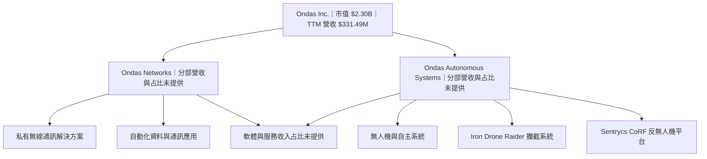
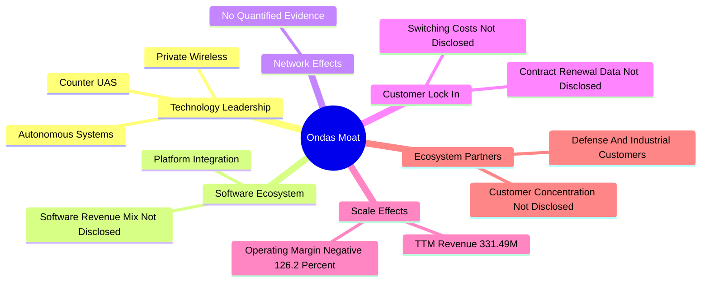
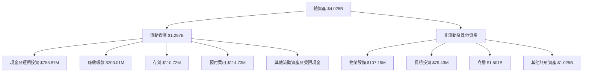
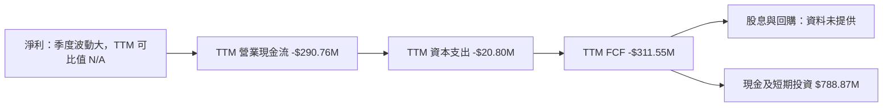
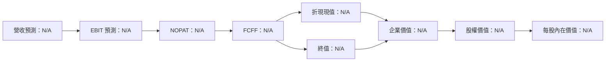
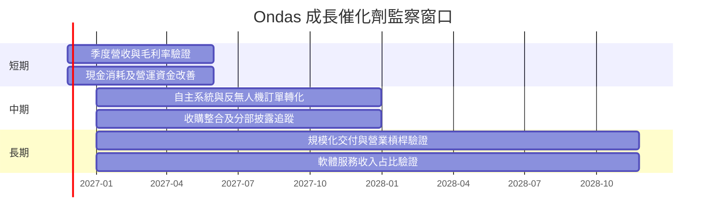
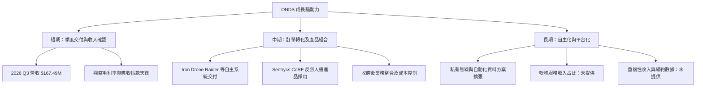
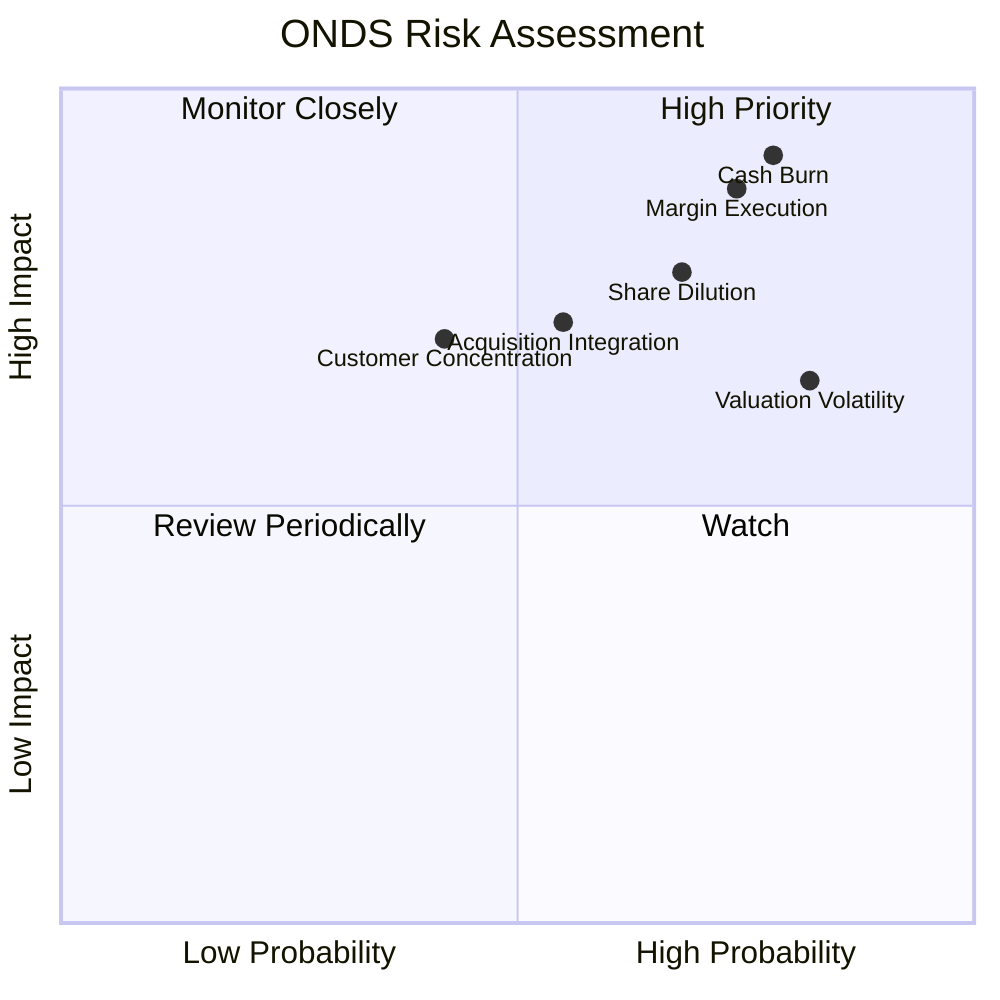
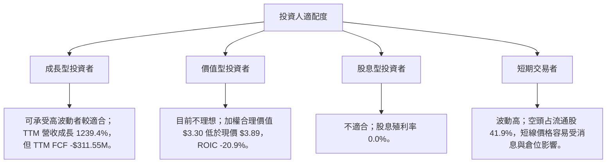

# ONDS 基本面深度分析報告
> **報告日期**：2026-11-25 ｜ **語言**：繁體中文 ｜ **數據來源**：SEC 申報資料 (XBRL)、Yahoo Finance、Finviz、StockAnalysis、Roic.ai ｜ **分析師**：CFA 級機構研究

## 目錄

| # | 章節 | 核心結論 |
|---|------|----------|
| 1 | 執行摘要 | 減碼；加權合理價值 $3.30；MOS -17.9% |
| 2 | 公司概覽與商業模式 | 私有無線、無人機與自主系統；市場份額資料未提供，護城河仍待驗證 |
| 3 | 損益表深度分析 | TTM 營收 $331.49M、TTM 成長 1,239.4%；營業利益率 -126.2% |
| 4 | 資產負債表分析 | 現金及短期投資 $788.87M；總債務在核心資料中為 N/A |
| 5 | 現金流量深度分析 | TTM FCF -$311.55M，現金消耗高且仍在擴大 |
| 6 | 獲利能力與資本效率 | ROIC -20.9% 低於 WACC 14.00%，目前摧毀股東價值 |
| 7 | 相對估值分析 | ONDS P/S 高於同業中位數；自身歷史 P/S 位於第 32 百分位 |
| 8 | DCF 內在價值評估 | DCF N/A：TTM 營業利益為負；依指定方法三角驗證 |
| 9 | 成長催化劑 | 無人機、防禦與自主系統需求提供機會，但 TAM 數字未提供 |
| 10 | 風險矩陣 | 燒錢、執行與稀釋是主要風險 |
| 11 | 投資建議 | 評級減碼；待營業虧損收窄與現金消耗下降後再評估 |

---

## 1. 執行摘要

ONDS 的營收擴張速度很快：TTM 營收為 **$331.49M**、TTM 年增 **1,239.4%**，最新一季營收年增 **1,558.6%**；但同期 TTM 營業利益率為 **-126.2%**、ROIC 為 **-20.9%**，TTM 營業現金流 **-$290.76M**、FCF **-$311.55M**。以 2026-11-24 收盤價 **$3.89** 計，估值方法給出的加權合理價值為 **$3.30**，MOS **-17.9%**；依 MOS 門檻評級為**減碼**。高速成長尚未轉為可持續獲利，這是估值與投資建議的核心制約。

### 1.0 一頁式投資儀表板

| 項目 | 內容 |
|------|------|
| **投資論點（3 句）** | ① TTM 營收達 $331.49M，年增 1,239.4%，反映近期收購與業務放量。② TTM 營業利益率 -126.2%、FCF -$311.55M，營收規模尚未帶來正向營業槓桿。③ 現金及短期投資 $788.87M 提供緩衝，但以目前 TTM 現金流消耗仍須密切監察。 |
| **綜合評分** | **4.3/10**（引用 1.1 評分卡） |
| **財務健康** | 🔴 現金及短期投資 $788.87M，但 TTM FCF -$311.55M；總債務核心資料為 N/A。 |
| **ROIC vs WACC** | **-20.9% vs 14.00%**；ROIC 低於資本成本，現階段摧毀股東價值。 |
| **FCF 趨勢** | TTM FCF 為 **-$311.55M**，FCF Yield **-13.54%**；現金消耗是關鍵限制。 |
| **估值** | Forward P/E **-25.096775x** ｜ EV/EBITDA **-5.424x** ｜ FCF Yield **-13.54%** |
| **DCF 內在價值（基準）** | **N/A**；TTM 營業利益為負，不能以本報告指定模型合理折現虧損。 |
| **安全邊際（MOS）** | **-17.9%**＝($3.30 − $3.89) ÷ $3.30；🔴 低於 0%，現價高於加權合理價值。 |
| **預期報酬（基準情境 12M）** | **N/A**；DCF 情境模型未提供，不能自行建立目標價。 |
| **關鍵風險（前二）** | 營業現金流與 FCF 持續為負；快速擴張可能伴隨整合成本、毛利壓力及股數稀釋。 |
| **評級 + 信心度** | 🔶 **減碼** ｜ 信心：中；估值結論清楚，業務和財務資料存在口徑差異。 |

### 1.1 綜合評分卡（全報告唯一）

| 維度 | 評分（1–10） | 主要依據（引用數字與其來源章節） |
|------|--------------|----------------------------------|
| 成長性 | 8.0 | TTM 營收年增 1,239.4%、最新一季年增 1,558.6%；成長快速但可能包含併購與低基期效應（第 3 章）。 |
| 獲利能力 | 2.0 | TTM 營業利益率 -126.2%、ROIC -20.9%、Piotroski F-Score 3 / 8（第 3、6 章）。 |
| 財務健康 | 7.0 | 現金及短期投資 $788.87M、流動比率 3.389；但 TTM FCF -$311.55M，且應收與存貨天數偏高（第 4、5 章）。 |
| 估值 | 2.0 | MOS -17.9%；ONDS P/S 7.3x，高於三家同業 P/S 中位數 3.2x（第 7、8 章）。 |
| 護城河 | 4.0 | 產品涉及私有無線、反無人機與自主系統，但市場份額、續約率及軟體收入占比未提供（第 2 章）。 |
| 管理層與資本配置 | 3.0 | 近年流通股增加，F-Score 顯示稀釋股數測試未通過；併購擴張與高現金消耗提高資本配置風險（第 3、5 章）。 |
| **綜合評分** | **4.3** | 六項算術平均：(8.0 + 2.0 + 7.0 + 2.0 + 4.0 + 3.0) ÷ 6 = **4.3**。 |

### 1.2 五大投資論點 + 三大核心風險

| 類型 | 項目 | 具體依據 | 信心度 |
|------|------|----------|--------|
| 🟢 **投資論點①** | 業務規模快速放大 | TTM 營收 $331.49M，TTM 年增 1,239.4%；最新一季營收 $167.49M。須留意近期季度營收的劇烈變化可能包含併購與一次性專案影響。 | 🟡 中 |
| 🟢 **投資論點②** | 現金儲備提供營運緩衝 | 現金及短期投資 $788.87M，能為產品開發、交付及營運提供流動性緩衝；但不能消除持續燒錢風險。 | 🟢 高 |
| 🟢 **投資論點③** | 涉足有國防與自主化需求的市場 | 公司提供無人機、自主系統與反無人機產品；防禦需求若落實為可重複交付的訂單，可能支持後續營收。訂單轉換資料未提供。 | 🟡 中 |
| 🟢 **投資論點④** | 最新一季營收顯示業務放量 | 2026 Q3 營收 $167.49M，較 Q2 $83.77M 增加；規模擴大是利潤率改善的前提，但當季營業利益仍為 -$186.42M。 | 🟡 中 |
| 🟢 **投資論點⑤** | 股價已大幅回落 | 2026-11 月收盤價 $3.89，低於 52 週高點 $15.28；下跌可能反映市場重新評估增長、利潤率與稀釋風險，不等同低估。 | 🟡 中 |
| 🟡 **風險①** | 高現金消耗 | TTM 營業現金流 -$290.76M、FCF -$311.55M；若消耗速度持續，現金緩衝將逐季下降。 | 🔴 高衝擊 |
| 🔴 **風險②** | 營收增長未轉為獲利 | TTM 營業利益率 -126.2%，最新一季 -113.1%；若產品組合與固定成本無改善，成長不必然帶來估值支撐。 | 🔴 高衝擊 |
| 🟡 **風險③** | 股數稀釋與執行風險 | F-Score 的稀釋股數測試未通過；季度 SBC 顯著增加，併購整合及股權融資可能削弱每股價值。 | 🔴 高衝擊 |

### 1.3 快速統計卡片

| 指標 | 公司實際值（期間） | 同業中位數 | 狀態 |
|------|--------------------|------------|------|
| 營收成長（TTM） | **1,239.4%** | — | 🟢 高成長；需辨識併購與低基期影響 |
| 營收成長（最新一季年增） | **1,558.6%** | **22.0%** | 🟢 顯著高於同業，但可能不可持續 |
| 毛利率（TTM） | **36.4%** | **23.0%** | 🟢 高於同業中位數 |
| 營業利益率（TTM） | **-126.2%** | — | 🔴 深度虧損 |
| ROIC（TTM） | **-20.9%** | — | 🔴 低於 WACC |
| Forward P/E | **-25.096775x** | **20.3x**¹ | 🔴 ONDS 預估 EPS 為負，倍數不可直接比較 |
| FCF Yield（TTM） | **-13.54%** | — | 🔴 現金消耗 |
| Piotroski F-Score | **3 / 8** | — | 🔴 財務動能偏弱 |

¹三家同業 Forward P/E 中位數為 AVAV 20.3x、KTOS 25.3x、RCAT -2.7x 的中位數 20.3x；ONDS 本身為負值，不宜作傳統相對 P/E 判斷。

### 1.4 投資結論

╔══════════════════════════════════════════════════════════════════╗  
║                    📊 投資結論摘要                               ║  
╠══════════════════════════════════════════════════════════════════╣  
║  評級：減碼（依 8.8 MOS 門檻）                                   ║  
║  價格（2026-11-24 收盤）：$3.89                                 ║  
║  DCF 內在價值（基準）：N/A（TTM 營業利益為負）                   ║  
║  安全邊際 MOS：-17.9%（以加權合理價值 $3.30 為分母）              ║  
║  加權合理價值（8.8）：$3.30                                      ║  
║  綜合評分：4.3/10（引用 1.1）                                    ║  
║  適合投資人：可承受高波動、願意承擔高執行風險的成長型投資人；     ║  
║              不適合以穩定盈餘、股息或資本保全為首要目標者。       ║  
╚══════════════════════════════════════════════════════════════════╝

---

## 2. 公司概覽與商業模式

### 2.1 業務結構與收入來源

Ondas Inc. 透過 **Ondas Networks** 與 **Ondas Autonomous Systems** 兩個主要業務板塊，提供私有無線、無人機、自主資料解決方案與反無人機產品。公司亦介紹 Iron Drone Raider 攔截系統，以及 Sentrycs CoRF 反無人機平台。

業務分部營收及各子業務營收占比未提供，因此不推算分部金額或繪製比例圖。

**業務機制與收入品質：**私有無線業務可能提供通訊設備及相關整合服務收入；自主系統業務則可能由平台交付、硬體與支援服務構成。財務資料沒有提供分部營收、軟體訂閱占比、毛利率或訂單轉換率，故目前無法判斷營收中可重複服務收入的比例。

### 2.2 市場份額

市場份額數據未提供，不能量化公司在無人機、反無人機或私有無線市場的滲透率。公司 TTM 營收 $331.49M，規模仍遠低於大型國防承包商，但其最新一季年增 1,558.6% 明顯高於 AVAV、KTOS、RCAT 的營收年增率；該差異可能受基期、併購及業務組合影響，不能單憑成長率推定市場地位。

### 2.3 競爭護城河分析

### 2.4 護城河強度

| 護城河項目 | 強度（強／中／弱） | 證據（引用數字或事實） | 會削弱它的情況 |
|------------|--------------------|------------------------|----------------|
| 技術與產品 | 中 | 公司提供私有無線、Iron Drone Raider、Sentrycs CoRF 等產品；未提供技術性能、專利、競標勝率或比較測試數據。 | 同類產品性能追上、採購規格改變，或客戶採用競爭方案。 |
| 軟體生態系統 | 弱至中 | 公司業務涉及自動化與資料解決方案，但軟體及服務營收占比、續約率與訂閱指標未提供。 | 收入主要依賴一次性硬體交付，且服務收入無法提升。 |
| 網路效應 | 弱 | 未提供使用者、網路節點或跨客戶資料效應的量化證據。 | 產品價值未因新增使用者或部署規模提升。 |
| 客戶鎖定 | 弱至中 | 國防及基礎設施應用可能有整合、認證與切換成本；合約續約及客戶留存資料未提供。 | 採購流程允許低成本替換，或客戶集中造成議價力下降。 |
| 規模效應 | 弱至中 | TTM 營收 $331.49M，但 TTM 營業利益率 -126.2%，尚未證明規模擴大可帶來正向槓桿。 | 營收增長仍伴隨更快的研發、銷售及整合費用增加。 |
| 生態夥伴 | 弱至中 | 公司產品定位涵蓋國防與工業場景；具體合作、通路貢獻和收入金額未提供。 | 合作未轉化為可持續訂單，或夥伴轉向競爭者。 |

護城河評分引用 1.1 的 **4.0/10**：產品定位有差異化可能，但目前缺少可量化的市場份額、留存率、軟體收入和規模化獲利證據。

---

## 3. 損益表深度分析

### 3.1 年度收入成長趨勢（近 4 年）

╔══════════════════════════════════════════════════════════════════╗  
║              Ondas 年度收入趨勢（FY2022-FY2025）                 ║  
╠══════════════════════════════════════════════════════════════════╣  
║  FY2022  $2.13M   █░░░░░░░░░░░░░░░░░░░░░  YoY：-26.87% 🔴       ║  
║  FY2023  $15.69M  ███████░░░░░░░░░░░░░░  YoY：+638.14% 🟢       ║  
║  FY2024  $7.19M   ███░░░░░░░░░░░░░░░░░░  YoY：-54.16% 🔴        ║  
║  FY2025  $50.73M  █████████████████████  YoY：+605.28% 🟢       ║  
╠══════════════════════════════════════════════════════════════════╣  
║  FY2022-FY2025 收入 CAGR：約 188.0%                               ║  
║  計算：(50.73 ÷ 2.13)^(1/3) − 1 ≈ 188.0%；低基期使 CAGR 偏高。   ║  
╚══════════════════════════════════════════════════════════════════╝

收入呈現階梯式且波動較大的增長：FY2023 上升後 FY2024 回落，FY2025 再快速增長。這種走勢可能與訂單交付時點、併購或低基期有關；單看 CAGR 容易高估穩定的有機成長能力。

### 3.2 季度收入趨勢分析

| 季度 | 營收 | QoQ 成長 | YoY 成長 | 備註 |
|------|------:|---------:|---------:|------|
| 2025 Q4 | $30.11M | +198.1%¹ | +629.2% | 相較 2025 Q3 $10.1M；低基期使百分比增幅放大。 |
| 2026 Q1 | $50.12M | +66.5% | +1,079.9% | 持續放量；需觀察毛利和費用能否同步改善。 |
| 2026 Q2 | $83.77M | +67.1% | +1,235.4% | 營收擴張，但當季營業利益仍為 -$143.71M。 |
| 2026 Q3 | $167.49M | +99.9% | +1,558.6% | 單季營收接近倍增；營業利益為 -$186.42M，增長尚未改善營業虧損。 |

¹以提供的 2025 Q3 營收 $10.1M 計算。QoQ 公式為「本季營收 ÷ 前季營收 − 1」，各期結果四捨五入至一位小數。

### 3.3 利潤率演變分析

| 利潤率指標 | FY2022 | FY2023 | FY2024 | FY2025 | 趨勢 | 評估 |
|------------|-------:|-------:|-------:|-------:|------|------|
| **毛利率**¹ | 52.1% | 40.7% | 4.8% | 39.7% | 波動大；FY2025 回升 | 🟡 |
| **營業利益率**¹ | -2,348.8% | -243.7% | -481.4% | -115.1% | 虧損率 FY2025 收窄 | 🔴 |
| **TTM 營業利益率**² | — | — | — | -126.2% | 最新 TTM 仍顯著為負 | 🔴 |
| **TTM EBITDA Margin** | — | — | — | -87.8% | 仍未轉正 | 🔴 |

¹依各年度營收、毛利及營業利益計算，極端比率主要來自歷史營收基數小。  
²採用 SEC 10-Q 及程式計算的 VERIFIED FIGURES；其他資料來源的營業利益率口徑不同，不混用。

**利潤率演變深度解析：**FY2025 毛利率回升至約 39.7%，但 FY2024 只有約 4.8%，顯示產品組合、交付項目或併購後收入構成可能造成顯著變動。年度營業虧損仍達 $58.38M，TTM 營業利益率為 -126.2%。最新一季營收大幅增加，但營業利益仍為 -$186.42M；若成長由低毛利產品或高整合成本驅動，放量不會自動改善獲利。

### 3.4 費用結構分析

完整 TTM 研發、銷售與管理費用明細未提供，不能以毛利減營業利益反推各費用項目，也不能建立費用占比圓餅圖。FY2025 研發支出為 **$20.88M**，高於 FY2024 的 **$12.48M**；研發投入增加可能支持新產品，但在 TTM 營業利益率 -126.2% 的背景下，仍需監察支出能否帶來可驗證的產品收入。

╔══════════════════════════════════════════════════════════════════╗  
║ 費用結構觀察                                                     ║  
╠══════════════════════════════════════════════════════════════════╣  
║ FY2025 研發支出：$20.88M                                         ║  
║ FY2024 研發支出：$12.48M                                         ║  
║ TTM 營業利益率：-126.2%                                          ║  
║ TTM 費用明細：N/A（完整費用明細未提供）                          ║  
╚══════════════════════════════════════════════════════════════════╝

### 3.5 季度 EPS 趨勢與盈餘品質（Quality of Earnings）

| 季度 | EPS 實際值¹ | 超預期／不及預期 | 說明 |
|------|------------:|------------------|------|
| 2025 Q4 | -$0.27 | N/A | EPS 預估值與 surprise 資料為 nan，不能判斷是否超預期。 |
| 2026 Q1 | +$0.59 | N/A | 季度淨利及 EPS 存在大幅波動；EPS beat/miss 數據未提供。 |
| 2026 Q2 | -$0.15 | N/A | 當季淨虧損 $88.25M；預估值未提供。 |
| 2026 Q3 | -$0.10 | N/A | 當季淨虧損 $62.57M；預估值未提供。 |

¹採 StockAnalysis 季度 EPS 資料；資料來源對 Q1 2026 的季度盈餘呈現差異，故不把單季正 EPS 解讀為持續性獲利。近四季 EPS estimate 均為 nan，不能以「超預期」或「不及預期」概括。

| 盈餘品質項目 | 數值／佔比 | 評估 |
|--------------|-----------|------|
| 股權薪酬 SBC / 營收 | 約 **46.9%**；估算 SBC $155.41M ÷ TTM 營收 $331.49M | 🔴 SBC 相對營收偏高，可能造成顯著經濟稀釋。 |
| SBC / 營業現金流 | 約 **-53.5%**；$155.41M ÷ -$290.76M | 🔴 比率因營業現金流為負而不具一般正向解讀；SBC 金額與現金消耗同時偏高。 |
| FCF / 淨利（現金轉換率） | **N/A** | 不同來源呈現的 TTM 淨利及季度淨利合計差異明顯，無法可靠計算。 |
| 一次性／非經常性損益 | 存在明顯季間波動；金額拆分 N/A | 2026 Q1 單季淨利與其餘季度方向相反；未提供可核對的一次性項目明細，不將其視為經常性盈餘。 |
| 有效稅率異常 | N/A | TTM 稅前損益與所得稅費用明細未提供；虧損與一次性項目使稅率不宜推算。 |
| 資本化支出 vs 費用化 | Capex TTM $20.80M；資本化政策細節 N/A | 未提供研發資本化明細，不能斷言存在遞延費用或盈餘美化。 |

**盈餘品質結論：**ONDS 仍處於營業虧損及大額負 FCF 狀態，故「盈餘含金量」不能依單季正淨利或正 EPS 判定。季度 SBC 顯著增加，且 2026 Q1 存在淨利口徑異常；估值宜以營收、現金消耗、股數稀釋及毛利趨勢為主，而不是依賴短期 EPS。

---

## 4. 資產負債表分析

### 4.1 資產結構分解

以下採 StockAnalysis 2026-09-30 資料。個別資產項目相加與總資產存在小幅差異，可能由其他項目或四捨五入造成，不以反推方式補值。

商譽及無形資產合計約 **$2.526B**，相對總資產 $4.028B 占比較高。若收購標的未達預期，減值風險可能影響帳面權益及未來報表盈餘；但減值測試細節未提供。

### 4.2 流動性與營運資金分析

流動性比率採市場資料來源；營運資金天數照錄程式計算值。

| 指標 | 最新 TTM | 一年前 TTM | 變化 | 解讀 |
|------|----------:|----------:|------:|------|
| 流動比率 | 3.389 | N/A | N/A | 短期資產帳面上高於流動負債，但現金消耗速度仍須納入判斷。 |
| 速動比率 | 2.604 | N/A | N/A | 現金、短期投資及應收等提供流動性；收款品質及限制性資產需追蹤。 |
| DSO 應收帳款天數 | 140 天 | 77 天 | +63 天 | 收款週期明顯拉長；可能反映客戶付款節奏、專案交付或整合變動。 |
| DIO 存貨天數 | 182 天 | 278 天 | -96 天 | 存貨天數改善，但仍須確認不是以更快交付換來低庫存、或存在呆滯料。 |
| DPO 應付帳款天數 | 141 天 | 186 天 | -45 天 | 付款天數縮短，對供應商融資的依賴降低；同時也可能增加營運資金需求。 |
| CCC 現金轉換週期 | 181 天 | 169 天 | +12 天 | 整體現金轉換週期延長，主要需關注應收天數上升。 |

### 4.3 債務結構分析

核心財務數據列示總債務 **N/A**，故下圖不以其他來源填補或計算 Debt/EBITDA、利息保障倍數。市場資料另列總債務 $62.81M、淨現金 $726.06M，與核心資料的債務口徑不一致；本節優先採用核心數據，並將該差異列為需由最新 10-Q 附註核實事項。

╔══════════════════════════════════════════════════════════════════╗  
║                   Ondas 債務健康診斷                             ║  
╠══════════════════════════════════════════════════════════════════╣  
║  總債務：              N/A（核心資料未提供）                      ║  
║  現金及短期投資：      $788.87M                                   ║  
║  核心資料淨現金：      $788.87M（總債務欄為 N/A）                 ║  
║  Debt/EBITDA：         N/A（債務資料不可用；EBITDA 為負）          ║  
║  Interest Coverage：  N/A（利息費用及可比 EBIT 未提供）          ║  
║  評估：                🟡 現金儲備充足，但現金消耗偏高            ║  
╚══════════════════════════════════════════════════════════════════╝

### 4.4 股東權益趨勢

| 年度 | 股東權益 | 觀察 |
|------|---------:|------|
| 2022 | $58.22M | 資本基礎較小。 |
| 2023 | $33.14M | 較前一年下降。 |
| 2024 | $16.58M | 權益進一步收縮。 |
| 2025 | $437.81M | 大幅增加，可能反映融資、併購或其他資本交易；需對照股數及資產增長。 |

╔══════════════════════════════════════════════════════════════════╗  
║ 股東權益變化（年度，USD）                                        ║  
╠══════════════════════════════════════════════════════════════════╣  
║ 2022  $58.22M   ███                                               ║  
║ 2023  $33.14M   ██                                                ║  
║ 2024  $16.58M   █                                                 ║  
║ 2025  $437.81M  █████████████████████                             ║  
║ 2026-09：年度股東權益比較值 N/A                                   ║  
╚══════════════════════════════════════════════════════════════════╝

---

## 5. 現金流量深度分析

### 5.1 現金流量瀑布圖

季度及 TTM 淨利資料口徑不一致，故不以單一季度淨利作為現金流瀑布起點，也不推算股息、回購或淨現金變化金額。

### 5.2 FCF 轉換率趨勢

| 年度 | FCF | 淨利 | FCF／淨利 |
|------|----:|----:|---------:|
| 2022 | -$40.89M | -$73.24M | 55.8% |
| 2023 | -$34.30M | -$44.84M | 76.5% |
| 2024 | -$35.20M | -$38.01M | 92.6% |
| 2025 | -$40.88M | -$132.02M | 31.0% |
| 最新 TTM | -$311.55M | N/A | N/A |

年度比例以同年度現金流及淨利計算；因分子、分母均可能為負，比例大於零不代表獲利現金轉換良好。FY2025 FCF 仍為負，最新 TTM 現金消耗進一步擴大。

### 5.3 自由現金流趨勢

╔══════════════════════════════════════════════════════════════════╗  
║            自由現金流：年度實際與最新 TTM                        ║  
╠══════════════════════════════════════════════════════════════════╣  
║  FY2022  -$40.89M  ████████████████████  FCF 為負                ║  
║  FY2023  -$34.30M  █████████████████     FCF 為負                ║  
║  FY2024  -$35.20M  █████████████████     FCF 為負                ║  
║  FY2025  -$40.88M  ████████████████████  FCF 為負                ║  
║  TTM     -$311.55M ███████████████████████████████████████████   ║  
║  FCF Yield（TTM）：-13.54%                                       ║  
╚══════════════════════════════════════════════════════════════════╝

TTM FCF 顯著低於過去單一年度，與 2026 年季度營業現金流逐季走弱相符：2025 Q4 為 -$12.73M、2026 Q1 -$51.30M、Q2 -$86.08M、Q3 -$140.65M。若這些季度支出延續，現金儲備會較快消耗；但單季現金流受營運資金和交付時點影響，仍須連續觀察。

### 5.4 資本配置評估

| 項目 | 可見數據 | 評估 |
|------|----------|------|
| 資本支出 | TTM $20.80M | 相較營業現金流規模較小；不代表營運已具自我融資能力。 |
| 研發支出 | FY2025 $20.88M；FY2024 $12.48M | 支出提升可支持產品開發，但投資回報尚未由營業利潤率證明。 |
| 股息 | 殖利率 0.0% | 目前不提供股息回報。 |
| 回購 | 金額未提供 | 無法判斷是否有抵銷稀釋的回購。 |
| SBC | 近四季合計約 $155.41M | 偏高，可能造成股東稀釋及經濟成本。 |
| 現金 | $788.87M | 提供短期緩衝，但需與負 FCF 一併評估。 |

資本配置分項金額不完整，故不製作比例圓餅圖。現階段應優先觀察現金消耗、稀釋與併購整合的回報，而不是以現金餘額單獨判定財務安全。

---

## 6. 獲利能力與資本效率

### 6.1 ROE／ROA／ROIC 趨勢

| 指標 | 歷史／最新數值 | 評估 |
|------|----------------|------|
| ROE（TTM） | VERIFIED FIGURES：4.6% | 資料來源另列 7.3%，口徑不一致；採品質指標的 4.6% 作一致性分析。 |
| ROA（TTM） | StockAnalysis：-9.7% | 資產尚未產生穩定回報。 |
| ROIC（TTM） | -20.9% | 明顯低於 14.00% WACC。 |
| ROIC 與同業平均 | N/A | 未提供可比同業 ROIC 數據，不能補入行業平均。 |

### 6.2 ROIC vs WACC 分析（核心價值創造判斷）

╔══════════════════════════════════════════════════════════════════╗  
║                ROIC vs WACC 深度分析                            ║  
╠══════════════════════════════════════════════════════════════════╣  
║  WACC 輸入（程式計算資料）：                                     ║  
║  ├── 無風險利率（10Y 美債）：       4.90%                        ║  
║  ├── 市場風險溢酬 ERP：             5.00%                        ║  
║  ├── 原始 Beta：                    3.08                         ║  
║  ├── 調整後 Beta（採用）：          2.00                         ║  
║  ├── 股權成本 Ke：                  14.90%                       ║  
║  ├── 稅前債務成本 Kd：              10.47%                       ║  
║  ├── 稅率假設：                     21.0%                        ║  
║  ├── 股權／債務權重：               97.3%／2.7%                  ║  
║  └── 採用 WACC：                    14.00%                       ║  
║                                                                  ║  
║  ROIC（TTM）：                      -20.9%                       ║  
║  EVA Spread = ROIC − WACC：         -34.9 個百分點               ║  
║  判斷：ROIC 低於 WACC，現階段摧毀股東價值。                       ║  
╚══════════════════════════════════════════════════════════════════╝

Beta 調整公式為 **⅔ × 3.08 + ⅓ = 2.39**，原始調整值超出設定的 2.0 上限，因此採用調整後 Beta **2.00**。股權成本按 CAPM 為 **4.90% + 2.00 × 5.00% = 14.90%**。來源提供未封頂 WACC **14.73%**，並註明 WACC 限制在 7%–14% 區間，因此本報告採用 **14.00%**；第 8 章 DCF 為 N/A，但 ROIC 比較仍以此 WACC 為準。

**價值創造判斷：**ROIC -20.9% 比 WACC 14.00% 低 **34.9 個百分點**。若 ROIC 持續為負，增加營收及投入資本本身不必然創造價值；必須證明新增業務能改善單位經濟、毛利與營業費用率。

### 6.3 杜邦三因素分解

| 因素 | 數值（TTM） | 解讀 |
|------|-------------|------|
| 淨利率 | 33.1% | 品質指標計算值受季度非經常性盈餘波動影響，不能當作正常化利潤率。 |
| 資產週轉率 | 0.08 | 資產週轉較低；收購形成的商譽與無形資產可能令資產基數上升。 |
| 權益乘數 | 1.70 | 財務槓桿並非 ROE 的主要推升因素。 |
| **ROE** | **4.6%** | **33.1% × 0.08 × 1.70 = 4.6%**（按指定品質指標照錄）。 |

杜邦乘積顯示 ROE 主要受資產週轉率限制；同時，淨利率與其他報表口徑存在差異，分析時不應忽略當季盈餘波動。

### 6.4 財務體質：Piotroski F-Score

| 測試 | 結果 | 解讀 |
|------|------|------|
| ROA > 0 | ✅ 通過 | 該測試期間 ROA 為正。 |
| 營業現金流 > 0 | ❌ 未通過 | TTM 營業現金流為 -$290.76M。 |
| ROA 高於一年前 | ✅ 通過 | 相較一年前改善。 |
| 營業現金流 > 淨利（應計品質） | ❌ 未通過 | 負營業現金流削弱盈餘現金支持。 |
| 長期負債／總資產低於一年前 | — 無法判定 | 缺少可比資料，不納入分母。 |
| 流動比率高於一年前 | ❌ 未通過 | 測試未通過，表示相較一年前沒有改善。 |
| 稀釋股數未增加 | ❌ 未通過 | 股數增加，現有股東持股比例可能被稀釋。 |
| 毛利率高於一年前 | ❌ 未通過 | 毛利率比較測試未通過，顯示毛利動能偏弱。 |
| 資產週轉率高於一年前 | ✅ 通過 | 資產效率比較測試通過。 |

**Piotroski F-Score：3 / 8。**分數偏低的關鍵是現金流、稀釋股數及毛利率測試未通過；長期負債項目缺資料，因此不計入測試分母。

---

## 7. 相對估值分析

### 7.1 同業估值比較表格

| 估值指標 | **ONDS** | **AVAV** | **KTOS** | **RCAT** | ONDS 評估 |
|----------|---------:|---------:|---------:|---------:|-----------|
| **Trailing P/E** | N/A | N/A | 235.1x | N/A | 🔴 ONDS 虧損，無法使用傳統 P/E。 |
| **Forward P/E** | -25.096775x | 20.3x | 25.3x | -2.7x | 🔴 ONDS Forward EPS 為負，倍數不可直接作價值比較。 |
| **P/S Ratio** | 7.3x¹ | 2.3x | 3.2x | 3.6x | 🔴 ONDS 高於三家中位數 3.2x。 |
| **EV/EBITDA** | -5.424x | 21.9x | 46.2x | -0.3x | 🔴 ONDS EBITDA 為負，倍數失去一般估值意義。 |
| **最新一季營收年增** | 1,558.6% | 5.7% | 35.7% | 22.0% | 🟢 增長顯著較快；低基期與併購效應需核實。 |
| **TTM 毛利率** | 36.4% | 26.5% | 23.0% | 8.7% | 🟢 高於同業中位數 23.0%。 |

¹自身歷史估值資料的 P/S 為 7.3x；市場資料另列 6.941368x，口徑及時間點可能不同。相對估值依規定採用同業估值區塊的 peer multiples；歷史定位採專屬歷史估值資料。

### 7.2 歷史估值區間分析

╔══════════════════════════════════════════════════════════════════╗  
║              ONDS 五年 TTM P/S 歷史區間                          ║  
╠══════════════════════════════════════════════════════════════════╣  
║  低點：2.9x       中位數：17.9x       高點：140.6x              ║  
║  當前：7.3x       百分位：第 32 百分位                           ║  
║  區間：2.9x ├────●───────────────┤ 140.6x                       ║  
║              當前 P/S 7.3x                                        ║  
╚══════════════════════════════════════════════════════════════════╝

當前 P/S 低於自身五年中位數 17.9x，位於歷史第 32 百分位；但自身歷史區間極寬，最高達 140.6x，受股價、營收基數及公司規模變動影響甚大。歷史上「低於自身中位數」不構成低估結論；與同業中位數 3.2x 相比，ONDS 當前估值仍偏高。

### 7.3 情境價值（Bear / Base / Bull）

**N/A（DCF 無法計算：TTM 營業利益不為正，指定 DCF MODEL 未提供情境結果）**。依規則不自行建立悲觀、基準及樂觀目標價。

### 7.4 相對估值隱含價格區間

╔══════════════════════════════════════════════════════════════════╗  
║              相對估值方法與現價位置                              ║  
╠══════════════════════════════════════════════════════════════════╣  
║  同業 P/S：$1.81 ───────── 現價 $3.89                            ║  
║  分析師共識：$16.68 ───────────────────────────                  ║  
║  加權合理價值：$3.30                                              ║  
╚══════════════════════════════════════════════════════════════════╝

| 方法 | 每股價值 | 相對現價上行／下行 | 依據 |
|------|---------:|-------------------:|------|
| 同業 P/S | $1.81 | -53.5% | 同業 P/S 中位數 3.2x × TTM 營收，並按指定程式方法換算。 |
| 分析師共識目標價 | $16.68 | +328.8% | 10 位分析師平均目標價；只作參考，不代表已達成基本面。 |

同業 Forward P/E 因無法計算而剔除；相對估值結果及權重由程式依公司類型設定，並於第 8.8 節照錄。

---

## 8. DCF 內在價值評估（Discounted Cash Flow）

### 8.0 估值推理鏈（Thinking Logic）

**Step 1 — 價值由哪些變數決定？**  
ONDS 的股權價值主要取決於現有私有無線與自主系統業務能否將營收轉為正毛利及正現金流，以及新產品能否形成可重複收入。TTM 營收為 $331.49M，但兩個業務板塊的收入占比未提供，無法把價值拆分至分部。當前主導變數不是缺少資料的終值，而是營業虧損和負現金流能否收斂。

**Step 2 — 模型選擇**

| 決策點 | 本報告採用 | 理由（含數字） | 曾考慮但否決 | 否決理由 |
|--------|-----------|----------------|--------------|----------|
| 現金流定義 | 不計算 DCF | TTM 營業利益率 -126.2%、TTM FCF -$311.55M | FCFF／FCFE 自建模型 | 指定模型標記 N/A；不可自行建立替代模型。 |
| 預測期 N | N/A | DCF MODEL 未提供預測期 | 5–10 年預測 | 缺少經核實的獲利基礎及模型輸入。 |
| 終值方法 | N/A | 未提供 DCF 模型及終值 | Gordon Growth／退出倍數 | 不可自行創建情境或終值。 |
| EBIT 基礎 | N/A | TTM 營業利益為負，DCF 模型未提供 | GAAP／非 GAAP 預測 | 不能以自建假設取代指定模型。 |

**Step 3 — 關鍵假設推導鏈**  
營收 CAGR、期末營業利潤率、永續成長率、預測期 N、Capex／營收、D&A／營收、營運資金、SBC、稀釋率及終值方法均為 **N/A**：指定 DCF MODEL 未提供模型輸入，且本報告不可另建 DCF，故沒有可合法引用的錨點、採用值或替代值。

**Step 4 — 最脆弱環節**  
最脆弱的投資假設是營收快速增長最終會形成正毛利及現金流；若營收放量仍伴隨負的營業利益與現金流，市場可能繼續按同業營收倍數而非高成長預期估值。

**Step 5 — 計算路徑圖**

### 8.1 模型假設總表（Model Inputs）

| 假設項目 | 採用值 | 依據／來源 | 敏感度 |
|----------|--------|-------------|--------|
| 預測期長度 N | N/A | DCF MODEL 未提供 | N/A |
| 營收 CAGR | N/A | 未提供 DCF 假設；不能以歷史高增長外推 | N/A |
| 營業利潤率 | N/A | TTM 營業利益率 -126.2%；未提供未來利潤率假設 | N/A |
| 有效稅率 | N/A | 未提供 DCF 稅率輸入 | N/A |
| Capex／營收 | N/A | 雖有 TTM Capex $20.80M，模型假設缺失 | N/A |
| D&A／營收 | N/A | DCF 模型輸入未提供 | N/A |
| 營運資金變動／收入增額 | N/A | DCF 模型輸入未提供 | N/A |
| EBIT 基礎 | N/A | DCF MODEL 未提供 | N/A |
| SBC 處理 | N/A | DCF MODEL 未提供，不能自行選擇模型組合 | N/A |
| 年稀釋率 | N/A | 流通股數有變動，但 DCF 稀釋假設未提供 | N/A |
| 永續成長率 g | N/A | DCF MODEL 未提供 | N/A |
| 終值方法 | N/A | DCF MODEL 未提供 | N/A |
| WACC | 14.00% | Cost of capital 資料；WACC 計算值 14.73% 被限制在 7%–14% 區間 | 高，但本節不執行 DCF |

**FCFF 定義與 SBC 防呆：**一般 FCFF 可用 `NOPAT + D&A − Capex − ΔWC`；但本報告 DCF MODEL 為 N/A，沒有逐年現金流，也不選擇 SBC 組合 A、B 或 C。

### 8.2 折現率推導（WACC）

╔══════════════════════════════════════════════════════════════════╗  
║                    WACC 推導（折現率）                           ║  
╠══════════════════════════════════════════════════════════════════╣  
║  股權成本 Ke（CAPM）：                                           ║  
║  ├── 無風險利率 Rf：                 4.90%                       ║  
║  ├── 市場風險溢酬 ERP：              5.00%                       ║  
║  ├── Beta 原始值：                   3.08                         ║  
║  ├── Beta 採用值（調整後）：         2.00                         ║  
║  ├── Ke：                            4.90% + 2.00 × 5.00%         ║  
║  │                                   = 14.90%                     ║  
║  ├── 規模／國別額外溢酬：            N/A（未另加）                ║  
║                                                                  ║  
║  債務成本：                                                      ║  
║  ├── 稅前 Kd：                       10.47%                       ║  
║  ├── 預設稅率：                      21.0%                        ║  
║  └── 資本成本資料權重：              E 97.3%／D 2.7%              ║  
║                                                                  ║  
║  計算 WACC：                         14.73%                       ║  
║  區間限制後採用 WACC：               14.00%                       ║  
╚══════════════════════════════════════════════════════════════════╝

**逐步演算與資料限制：**Rf、ERP、Beta、Ke、Kd、權重及 WACC 採用值均直接依資本成本資料引用。原始 Beta 的調整計算為 **⅔ × 3.08 + ⅓ = 2.39**，由於規定上限為 2.0，實際採用 **2.00**。來源未提供本節所需的利息費用、同口徑平均計息負債及市值權重明細，因此不能再自行重算完整五步 WACC；依規定採用已計算且封頂後的 **14.00%**。第 6.2 節亦採用同一數值。

### 8.3 逐年自由現金流預測（基準情境）

**N/A（DCF MODEL 未提供：TTM 營業利益為負，不能將虧損直接折現作為公司價值）。**逐年營收、利潤率、稅、D&A、Capex、營運資金、FCFF 及折現因子均未提供；不建立替代模型。

### 8.4 終值計算（Terminal Value）

**N/A（DCF MODEL 未提供預測期末 FCFF、永續成長率及終值方法）。**因此不計算 Gordon Growth 終值或退出倍數終值。

### 8.5 企業價值 → 每股內在價值（Bridge）

| 橋接項目 | 金額 |
|----------|------:|
| 預測期 FCF 現值合計 | N/A |
| 終值現值 | N/A |
| 企業價值 EV | N/A |
| 加：現金及短期投資 | $788.87M（2026-09-30） |
| 減：總債務 | N/A（核心資料未提供） |
| 股權價值 | N/A |
| 稀釋後股數 | N/A（DCF 股數假設未提供） |
| **DCF 每股內在價值** | **N/A** |
| 現價（2026-11-24 收盤） | $3.89 |
| DCF 折溢價 | N/A |

**折溢價公式**為「現價 ÷ DCF 基準內在價值 − 1」；因 DCF 基準內在價值不可得，本節不計算折溢價，也不計算 MOS。

### 8.6 敏感性分析（WACC × 永續成長率）

**N/A（DCF MODEL 未提供敏感性矩陣，亦未提供基準 FCFF、WACC 測試範圍及永續成長率）。**不自建矩陣、情境目標價或機率加權估值。

### 8.7 反推 DCF（Reverse DCF）

**N/A（缺少可用 DCF 基準模型與現金流預測，不能以現價回推單一營運變數）。**不得把多個未知變數同時反推，也不列無法複算的市場隱含 CAGR 或利潤率。

### 8.8 估值三角驗證與安全邊際

估值方法及權重依不盈利公司類型照錄：同業 P/S 權重 90%，分析師共識目標價權重 10%。同業 Forward P/E 無法計算，故剔除，其權重依規定由其餘方法承接。

| 估值方法 | 隱含每股價值 | 上行空間（÷現價） | 權重 | 說明 |
|----------|--------------:|-------------------:|------|------|
| 同業 P/S | $1.81 | -53.5% | 90% | 同業中位數 P/S 3.2x × TTM 營收的程式換算結果。 |
| 分析師共識目標價 | $16.68 | +328.8% | 10% | 10 位分析師平均目標價；不代表公司基本面已實現。 |
| **加權合理價值** | **$3.30** | **-15.2%** | **100%** | 不盈利公司固定權重；同業 Forward P/E 因不可計算而剔除。 |

**逐步演算：**

- 加權價值原始乘積：`$1.81 × 90% + $16.68 × 10% = $1.629 + $1.668 = $3.297`。
- 依程式輸出精度，加權合理價值列示為 **$3.30**；下列 MOS 與上行空間使用 VERIFIED FIGURES 的原值。
- **MOS**＝`($3.30 − $3.89) ÷ $3.30 = -$0.59 ÷ $3.30 = -17.9%`。
- **上行空間**＝`($3.30 − $3.89) ÷ $3.89 = -$0.59 ÷ $3.89 = -15.2%`。
- **折溢價**若以 DCF 基準價值為分母，因 DCF 為 N/A，故無法計算；不可用加權合理價值替代 DCF 基準。

╔══════════════════════════════════════════════════════════════════╗  
║                  估值區間與安全邊際                              ║  
╠══════════════════════════════════════════════════════════════════╣  
║  同業 P/S $1.81 ── 現價 $3.89 ── 加權合理價值 $3.30 ── 共識 $16.68║  
║                                                                  ║  
║  安全邊際 MOS：-17.9%（分母為加權合理價值 $3.30）                ║  
║  評估：🔴 MOS 為負；現價高於加權合理價值。                       ║  
║  上行空間：-15.2%（分母為現價 $3.89）                            ║  
║  評級：減碼；符合 -25% 至 -10% 的減碼區間。                      ║  
╚══════════════════════════════════════════════════════════════════╝

**買入區間與評級一致性：**依 MOS 計算，MOS 達 10% 的價格上限為 `$3.30 × (1 − 10%) = $2.97`。由於評級為減碼，本報告不給出與買入評級相矛盾的買入區間；若價格跌至 $2.97 以下，仍應先檢查基本面及現金消耗，而非單憑估值買入。

> 🔎 **程式複算（Python，依本節各項自動重算）**
>
> 加權合理價值 = $1.81 × 90% + $16.68 × 10% = **$3.30**（權重合計 100%）
>
> 以價格 $3.89 計：MOS = **-17.9%**，上行空間 = **-15.2%**
>
> ✅ 與本節所寫數值一致。

### 8.9 DCF 模型的局限與失效條件

- **終值依賴度：**N/A，沒有 DCF 模型，不能計算終值現值占 EV 比例。
- **最脆弱的假設：**營收快速成長可否轉為正毛利和正 FCF；若此假設不成立，估值更依賴低倍數營收估值。
- **不適用情境：**TTM 營業利益率 -126.2%、FCF -$311.55M，且季度利潤波動大，標準 DCF 的可靠度低。現階段較適合以同業 EV/Sales、P/S、現金消耗及單位經濟性追蹤，而非以遠期終值宣稱精確內在價值。
- **與第 10 章風險矩陣連結：**交付延誤、毛利下滑和營運資金惡化會推高現金消耗；股權稀釋會壓低每股價值；收購整合不佳則可能削弱收入品質並帶來資產減值。

### 8.10 複算檢核表（Audit Trail）

| # | 檢核項目 | 檢查方式 | 結果 |
|---|----------|----------|------|
| 1 | 高／中敏感度輸入均有四段式推導 | DCF 輸入均未提供，未自建假設 | N/A |
| 2 | 每個假設都有來歷 | 8.1 對模型缺值逐項註明 | ✅ |
| 3 | WACC 五步完整重算 | 輸入摘要有提供，平均計息負債等重算明細未提供；採用來源封頂後 WACC | 部分 N/A |
| 4 | Kd 分母與債務權重範圍一致 | 原始逐項計息負債資料未提供，未自行重算 | N/A |
| 5 | WACC 與第 6.2 節同值 | 兩節均採用 14.00% | ✅ |
| 6 | 逐年預測年度數與 N 一致 | N 未提供；DCF 不建模 | N/A |
| 7 | FY+1 九步計算可複算 | DCF MODEL 為 N/A | N/A |
| 8 | 預測期 PV 加總 | DCF MODEL 為 N/A | N/A |
| 9 | WACC > g | g 未提供 | N/A |
| 10 | 終值基於 FY+N 並折現 N 期 | N 未提供 | N/A |
| 11 | EV 至每股價值橋接 | DCF 橋接不可計算；未填造數值 | N/A |
| 12 | SBC 三要素模型組合相容 | DCF MODEL 為 N/A，未選模型組合 | N/A |
| 13 | 矩陣基準格與 DCF 值一致 | DCF 矩陣未提供 | N/A |
| 14 | 矩陣有效格符合 WACC > g | 矩陣未提供 | N/A |
| 15 | 三情境機率總和為 100% | DCF 情境未提供 | N/A |
| 16 | 反推 DCF 每列只放開一個變數 | DCF 模型未提供，未進行反推 | N/A |
| 17 | MOS 與折溢價分母一致規則 | MOS 採 $3.30；DCF 折溢價因 DCF N/A 不計算 | ✅ |
| 18 | 報告完整至第 11 章 | 全部章節均已列出 | ✅ |
| 19 | 加權合理價值等於估值方法加權和 | 原始加總 $3.297，程式輸出四捨五入 $3.30；採用指定輸出值 | ✅ |
| 20 | 評級符合 MOS 門檻 | MOS -17.9%，評級減碼 | ✅ |

---

## 9. 成長催化劑

### 9.1 催化劑時間軸

下列期間為研究追蹤窗口，不是公司公告的財測日期；具體訂單和交付時間未提供。

### 9.2 TAM 市場規模分析

**N/A（TAM 數據未提供）。**目前可核對的是 TTM 營收 $331.49M、TTM 年增 1,239.4%，以及私有無線、無人機及反無人機產品方向。缺少可引用 TAM、年份及公司市場滲透率，不能推算市場空間或滲透率。

### 9.3 成長驅動力結構圖

---

## 10. 風險矩陣

### 10.1 風險評分矩陣

以下座標為分析師主觀風險排序，不是歷史發生率統計。

### 10.2 風險清單詳細分析

| # | 風險項目 | 發生機率 | 財務衝擊 | 風險評分 | 緩解措施 |
|---|----------|----------|----------|----------|----------|
| 1 | 🔴 **現金消耗持續偏高** | 高（分析師估計 70%） | 高；TTM FCF -$311.55M，現金儲備可能下降 | 🔴 9.0/10（分析師判斷） | 每季追蹤 OCF、FCF、現金及短期投資；要求管理層披露資金用途與現金跑道。 |
| 2 | 🔴 **營業虧損與毛利率執行** | 高（分析師估計 70%） | 高；TTM 營業利益率 -126.2%，最新一季仍 -113.1% | 🔴 8.5/10（分析師判斷） | 追蹤分部毛利、低毛利專案占比及營業費用增幅；若營收增長仍未改善營業虧損，降低投資論點信心。 |
| 3 | 🔴 **股權稀釋及 SBC** | 中高（分析師估計 65%） | 高；近四季 SBC 約 $155.41M，F-Score 稀釋股數測試未通過 | 🔴 8.0/10（分析師判斷） | 比對稀釋後股數、SBC／營收及融資用途；檢視高管薪酬與績效目標。 |
| 4 | 🟡 **併購整合及資產減值** | 中（分析師估計 50%） | 高；商譽與無形資產合計約 $2.526B | 🟠 7.0/10（分析師判斷） | 追蹤收購業務營收、毛利、整合成本與減值測試假設。 |
| 5 | 🟡 **估值及股價波動** | 高（分析師估計 75%） | 中高；價格從 52 週高點 $15.28 回落，空頭占流通股 41.9% | 🟠 7.0/10（分析師判斷） | 以基本面與現金流設定持倉上限，避免把短線反彈視為估值確認。 |
| 6 | 🟡 **客戶集中與交付時點** | 中（分析師估計 45%） | 中高；客戶集中度與訂單可見度未提供 | 🟠 6.5/10（分析師判斷） | 要求披露客戶集中度、訂單積壓、取消條款及交付延誤情形。 |

---

## 11. 投資建議

### 11.1 最終評級與評分

評級依 MOS **-17.9%** 落在 -25% 至 -10% 區間，為**減碼**；沒有依質化因素調整一級。綜合評分引用第 1.1 節 **4.3/10**，六項為成長性 8.0、獲利能力 2.0、財務健康 7.0、估值 2.0、護城河 4.0、管理層與資本配置 3.0。快速增長未能抵銷負 FCF、負 ROIC 和高稀釋風險。

### 11.2 合理價值與隱含報酬率

| 方法 | 每股價值 | 相對 2026-11-24 收盤價 $3.89 | 機率／權重 |
|------|---------:|----------------------------:|-----------|
| 同業 P/S | $1.81 | -53.5% | 90% |
| 分析師共識目標價 | $16.68 | +328.8% | 10% |
| **加權合理價值** | **$3.30** | **上行空間 -15.2%；MOS -17.9%** | **100%** |
| DCF 悲觀／基準／樂觀情境 | N/A | N/A | DCF MODEL 未提供 |

分析師共識均值高於現價，但與同業 P/S 方法的估值差異很大；其對加權價值的權重只有 10%。不應把共識目標價直接當作基本面合理價值。

### 11.3 買入時機與觸發因素

╔══════════════════════════════════════════════════════════════════╗  
║                  ✅ 買入觸發因素 Checklist                      ║  
╠══════════════════════════════════════════════════════════════════╣  
║  考慮建立或增加部位前，建議至少觀察：                           ║  
║  ☐ 營業利益率連續兩季改善，且改善幅度來自毛利與費用控制。       ║  
║  ☐ TTM 營業現金流消耗較 -$290.76M 明顯收窄。                     ║  
║  ☐ 應收帳款天數由 140 天回落，且營收增長未伴隨逾期應收增加。     ║  
║  ☐ SBC／營收及稀釋後股數增速下降。                               ║  
║                                                                  ║  
║  加碼觸發條件：                                                 ║  
║  ☐ FCF 消耗連續兩季改善，且非單靠延後付款或一次性收款。         ║  
║  ☐ 公司披露可核驗的訂單轉換、分部毛利與重複服務收入數據。       ║  
║                                                                  ║  
║  減碼／退出觸發條件：                                           ║  
║  ☐ TTM 現金消耗高於現有水準且沒有可驗證的融資或改善路徑。       ║  
║  ☐ 營收增長放緩，同時營業利益率進一步惡化。                     ║  
║  ☐ 股數快速增加或併購導致商譽／無形資產減值。                   ║  
╚══════════════════════════════════════════════════════════════════╝

### 11.4 投資人適配度分析

### 11.5 每季財報監控清單（Quarterly Watch List）

| 監控指標 | 最新基準 | 觸發加碼訊號 | 觸發減碼訊號 |
|----------|---------|--------------|--------------|
| 營收年增 | 最新一季 +1,558.6% | 增長仍正向，且分部及訂單資料顯示可持續有機成長 | 連續兩季明顯放緩，且無訂單或交付解釋 |
| 毛利率 | TTM 36.4%；最新季資料來源存在差異 | TTM 毛利率穩定或提高，並披露產品組合改善 | 毛利率連續下滑，尤其在營收加速時下滑 |
| 營業利益率 | TTM -126.2%；最新季 -113.1% | 虧損率連續兩季收窄 | 虧損率擴大或新增營收沒有帶來費用槓桿 |
| 營業現金流 | TTM -$290.76M | TTM 消耗額連續下降 | 消耗額繼續擴大且現金儲備同步下降 |
| FCF | TTM -$311.55M | FCF 連續改善、資金改善非短期應付款延後 | FCF 持續惡化或融資需求上升 |
| Capex | TTM $20.80M | 資本支出與交付能力、產能利用率相符 | Capex 增長但收入、毛利和利用率未改善 |
| 應收帳款／DSO | DSO 140 天 | DSO 回落且現金回收同步改善 | DSO 再上升、逾期應收增加 |
| 存貨／DIO | DIO 182 天 | 存貨週轉改善且沒有缺貨或交付延誤 | DIO 上升、庫存減值或產品滯銷 |
| SBC／股數稀釋 | 近四季 SBC 約 $155.41M；F-Score 稀釋測試未通過 | SBC 占營收下降、稀釋股數增速收斂 | SBC 維持高位且持續增發 |
| 現金及短期投資 | $788.87M | 現金下降速度減慢且無高成本融資 | 現金下降加速，或債務資料顯示新增融資壓力 |
| 管理層財測與訂單 | 財測及訂單明細未提供 | 披露可核驗、具毛利與交付時程的訂單 | 多次下修、延遲交付或預期收入未落地 |

### 11.6 反面論證：什麼會證明論點錯誤（What Would Change My Mind）

╔══════════════════════════════════════════════════════════════════╗  
║              ⚠️ 論點失效條件（Disconfirming Evidence）           ║  
╠══════════════════════════════════════════════════════════════════╣  
║  下列情況出現時，應重新檢視甚至退出多頭論點：                   ║  
║  ☐ 最新一季營收年增連續兩季低於 20%，且沒有可核驗訂單支撐。      ║  
║  ☐ 營業利益率連續兩季較最新 TTM -126.2% 惡化。                  ║  
║  ☐ TTM FCF 低於 -$311.55M，且現金及短期投資同步快速下降。       ║  
║  ☐ ROIC 維持低於 14.00% WACC，且新增資本投入未改善毛利與現金流。║  
║  ☐ DSO 高於 140 天並持續增加，或應收款回收出現實質問題。        ║  
║  ☐ SBC／營收未下降、流通股數持續快速增加，削弱每股價值。        ║  
║  ☐ 收購業務未形成可驗證收入，或商譽與無形資產出現重大減值。    ║  
╚══════════════════════════════════════════════════════════════════╝

> **免責聲明：**本報告為 AI 自動生成，僅供研究參考，不構成投資建議。投資有風險，入市需謹慎。

---

## 資料與來源

| 項目 | 內容 |
|------|------|
| 價格 | 3.89 USD，2026-11-24 收盤（Yahoo Finance 日線） |
| 財務報表 | SEC 10-Q filed 2026-11-12，最新季度 2026-09-30（FY2026 Q3） |
| 有回應的資料來源 | SEC 申報資料 (XBRL)、Yahoo Finance、Finviz、StockAnalysis、Roic.ai |
| 由程式計算 | TTM 數字、WACC、DCF 模型、估值方法與權重、加權合理價值、MOS、評級門檻、F-Score、杜邦分解、營運資金天數、綜合評分 |
| 撰寫模型 | openai / gpt-6-luna |

> 本區塊由產生報告的程式依實際取得的資料填寫，非模型撰寫。「由程式計算」的數字不是模型的估計；其餘判斷（評分、情境、策略）是模型的分析。
