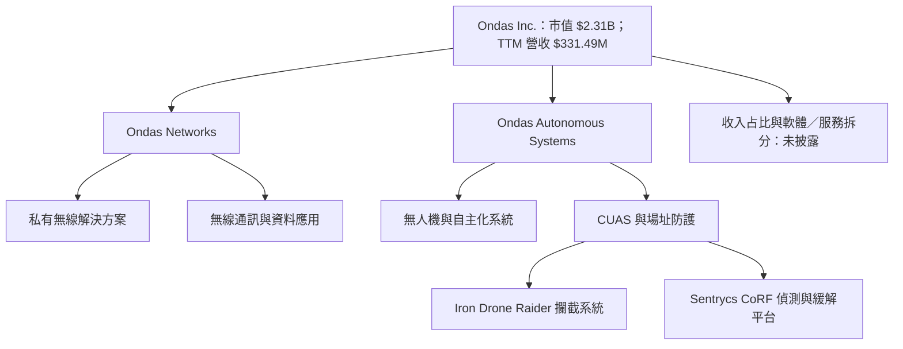
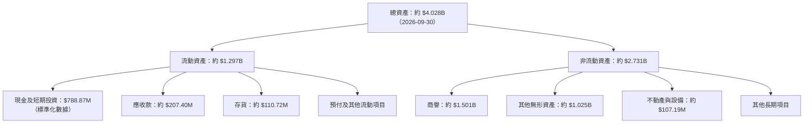
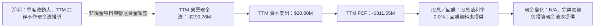
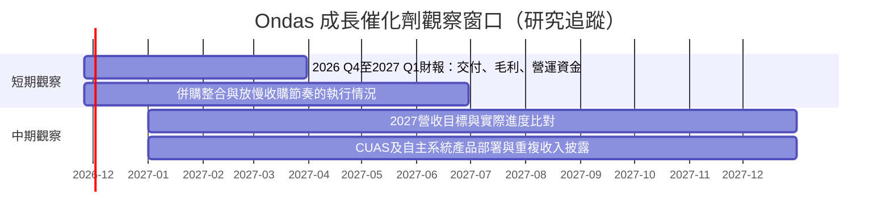
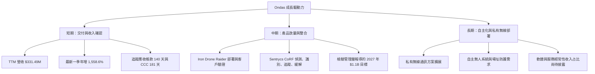
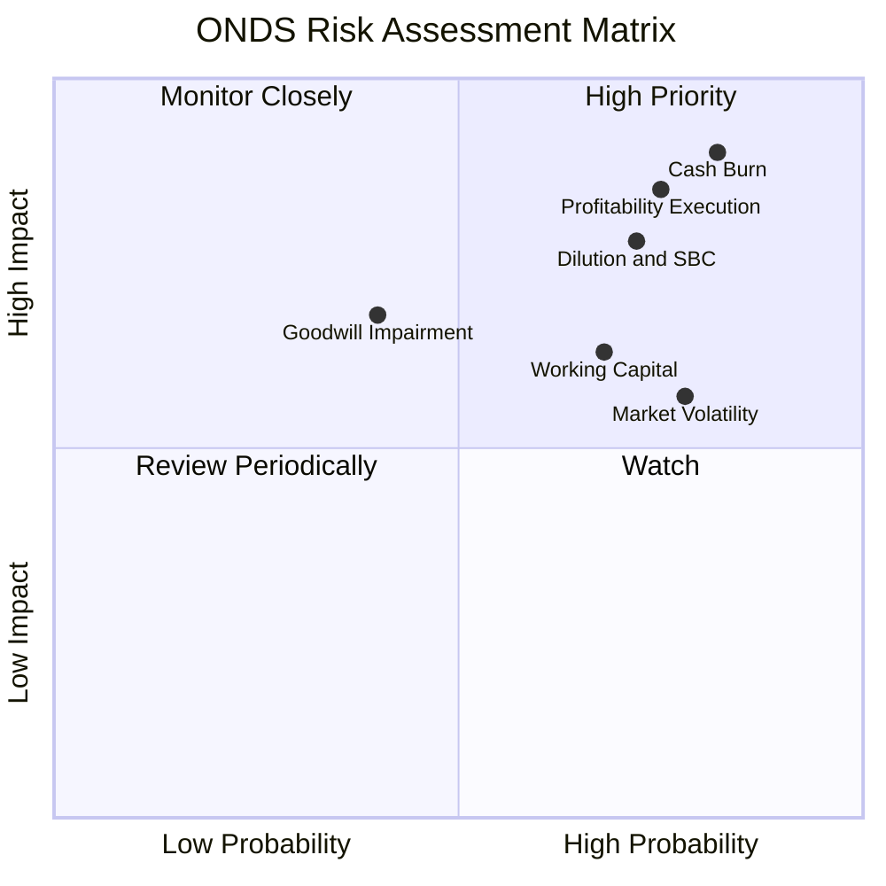
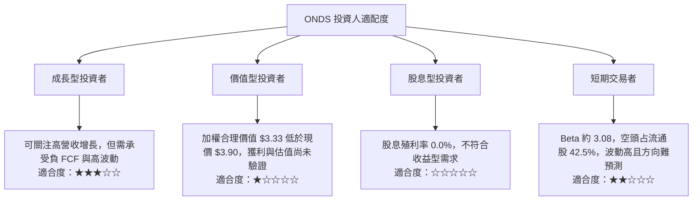

# ONDS 基本面深度分析報告
> **報告日期**：2026-11-26 ｜ **語言**：繁體中文 ｜ **數據來源**：SEC 申報資料 (XBRL)、Yahoo Finance、Finviz、StockAnalysis、Roic.ai ｜ **分析師**：CFA 級機構研究

---

## 目錄

| # | 章節 | 核心結論 |
|---|------|----------|
| 1 | 執行摘要 | 減碼；加權合理價值 $3.33，MOS -17.1% |
| 2 | 公司概覽與商業模式 | 無市場份額數據；技術與客戶鎖定具潛力，但商業護城河仍待驗證 |
| 3 | 損益表深度分析 | TTM 營收 $331.49M、TTM 成長 1,239.4%；營業利益率 -126.2% |
| 4 | 資產負債表分析 | 現金及短期投資 $788.87M；總債務資料 N/A |
| 5 | 現金流量深度分析 | TTM FCF -$311.55M，現金消耗與股權薪酬稀釋為主要關注點 |
| 6 | 獲利能力與資本效率 | ROIC -20.9% 對 WACC 14.0%，目前摧毀股東價值 |
| 7 | 相對估值分析 | 同業 P/S 估值指向 $1.85；股價仍高於加權合理價值 |
| 8 | DCF 內在價值評估 | DCF N/A：TTM 營業利益為負，不能用虧損現金流做可靠基準 DCF |
| 9 | 成長催化劑 | 無 TAM 數字；產品交付、訂單轉營收與管理層 2027 財測是主要觀察項 |
| 10 | 風險矩陣 | 燒錢、執行／獲利轉型與稀釋風險居前 |
| 11 | 投資建議 | 依 MOS 評級減碼；優先等待現金消耗收斂與毛利改善證據 |

---

## 1. 執行摘要

ONDAS 的營收快速放大：TTM 營收 **$331.49M**、TTM 年增 **1,239.4%**，最新一季年增 **1,558.6%**；但同一期間 TTM 營業利益率 **-126.2%**、ROIC **-20.9%**，TTM 營業現金流 **-$290.76M**、FCF **-$311.55M**。以同業 P/S 與分析師共識目標價加權後，合理價值為 **$3.33**，低於 2026-11-25 收盤價 **$3.90**；安全邊際 MOS 為 **-17.1%**。因此，依 MOS 門檻應評為 **減碼**；營收成長雖快，但目前仍未證明可轉化為具正報酬的現金流。

### 1.0 一頁式投資儀表板（Portfolio Manager 30 秒速讀）

| 項目 | 內容 |
|------|------|
| **投資論點（3 句）** | ① TTM 營收年增 **1,239.4%**，產品交付與併購整合推動營收基數快速擴張。② TTM 營業利益率 **-126.2%**、FCF **-$311.55M**，成長尚未轉化為自我融資能力。③ 同業 P/S 估值法為 **$1.85**，加權合理價值 **$3.33**，低於現價 **$3.90**。 |
| **綜合評分** | **4.5/10**（引用 1.1 評分卡） |
| **財務健康** | 🟡 現金及短期投資 **$788.87M**，但 TTM FCF **-$311.55M**；總債務資料 N/A。 |
| **ROIC vs WACC** | **-20.9% vs 14.0%**：利差 **-34.9 個百分點**，目前摧毀股東價值。 |
| **FCF 趨勢** | TTM FCF 為 **-$311.55M**；FCF Yield **-13.51%**，現金消耗仍高。 |
| **估值** | Forward P/E **-25.16x**（負盈餘下不具解讀性）｜EV/EBITDA **-5.445x**｜FCF Yield **-13.51%** |
| **DCF 內在價值（基準）** | **N/A**；TTM 營業利益為負，沒有可靠的正向營業獲利基礎。折溢價 N/A。 |
| **安全邊際（MOS）** | **-17.1%＝($3.33 − $3.90) ÷ $3.33**（加權合理價值為基準）｜🔴 <10% |
| **預期報酬（基準情境 12M）** | DCF 情境為 N/A；若以加權合理價值衡量，隱含上行空間 **-14.6%**，不等同於分析師預測報酬。 |
| **關鍵風險（前二）** | ① TTM 營運現金流 **-$290.76M**、FCF **-$311.55M**。② TTM SBC 約 **$155.41M**，約為營收 **46.9%**，稀釋與留才成本需持續觀察。 |
| **評級 + 信心度** | 🔴 **減碼**｜信心：中低；公司成長性高，但盈利轉型與來源資料一致性仍有不確定性。 |

> 本報告以 SEC 申報資料和程式計算的標準化 TTM 指標作為核心財務判讀依據。其他市場資料來源對部分利潤率、ROE、債務及 TTM FCF 有差異，以下遇到差異會標示來源，不混用為同一口徑。

### 1.1 綜合評分卡（全報告唯一）

| 維度 | 評分（1–10） | 主要依據（引用數字與其來源章節） |
|------|--------------|----------------------------------|
| 成長性 | 8.0 | TTM 營收年增 **1,239.4%**、最新一季年增 **1,558.6%**，但高成長是否可持續仍需驗證（第 3 章）。 |
| 獲利能力 | 1.5 | TTM 營業利益率 **-126.2%**、ROIC **-20.9%**，F-Score **3/8**（第 3、6 章）。 |
| 財務健康 | 6.5 | 現金及短期投資 **$788.87M**；但 TTM FCF **-$311.55M**，且總債務資料 N/A（第 4、5 章）。 |
| 估值 | 3.0 | MOS **-17.1%**；同業 P/S 推導價 **$1.85**，低於現價 $3.90（第 7、8 章）。 |
| 護城河 | 5.0 | 有自主系統、CUAS 與私有無線產品，但缺少市占、客戶集中度及重複性收入明細（第 2 章）。 |
| 管理層與資本配置 | 3.0 | 股數增加（F-Score 稀釋股數測試未通過）、TTM SBC 約佔營收 **46.9%**；近期新聞提及管理層計畫放慢併購節奏，執行成效待觀察。 |
| **綜合評分** | **4.5** | 六項算術平均：**(8.0 + 1.5 + 6.5 + 3.0 + 5.0 + 3.0) ÷ 6 = 4.5**。 |

### 1.2 五大投資論點 + 三大核心風險

| 類型 | 項目 | 具體依據 | 信心度 |
|------|------|----------|--------|
| 🟢 **投資論點①** | 營收擴張速度快 | TTM 營收 **$331.49M**、年增 **1,239.4%**；最新一季營收 **$167.49M**，單季年增 **1,558.6%**。高增長可擴大客戶與部署基礎，但未必代表有機成長，需拆分併購與內生成長。 | 🟡 中 |
| 🟢 **投資論點②** | 手上流動資源可支撐轉型 | 現金及短期投資 **$788.87M**，可為研發、交付與整合提供資金緩衝；但按 TTM 營業現金流消耗推算，靜態覆蓋約 **2.71 年**（$788.87M ÷ $290.76M），不含未來收購、資本需求及融資變化。 | 🟡 中 |
| 🟢 **投資論點③** | 多產品線切入防禦與無人系統需求 | 公司提供私有無線、無人機、自主化資料解決方案及反無人機系統；具備擴大產品組合的可能性，但未披露各產品收入占比。 | 🟡 中 |
| 🟢 **投資論點④** | 最新季度營收連續增加 | 2026 Q1、Q2、Q3 營收分別為 **$50.12M、$83.77M、$167.49M**，QoQ 分別增 **66.5%、67.1%、99.9%**；仍需確認是否伴隨毛利與收款品質改善。 | 🟡 中 |
| 🟢 **投資論點⑤** | 分析師共識仍偏正面 | 10 位分析師平均目標價 **$16.68**、區間 **$13–$25**；但共識價格不等同基本面估值，與同業 P/S 法推導的 $1.85 差距甚大。 | 🟡 中低 |
| 🟡 **風險①** | 現金消耗高於營收轉化能力 | TTM 營業現金流 **-$290.76M**、FCF **-$311.55M**，FCF Yield **-13.51%**；若營收增長或融資不如預期，資本需求可能加大。 | 🔴 高 |
| 🔴 **風險②** | 低毛利或不利產品組合壓抑單位經濟性 | 最新季毛利率按季度申報數據計算約 **21.8%**，低於同業 KTOS 的 TTM **23.0%**及 AVAV 的 **26.5%**；新聞亦提及精準打擊產品組合壓抑 Q3 毛利。 | 🟡 中高 |
| 🔴 **風險③** | SBC、增發與高波動可能稀釋回報 | 最新四季 SBC 合計約 **$155.41M**，約佔 TTM 營收 **46.9%**；短倉占流通股 **42.5%**，Beta 約 **3.08**，價格波動可能放大。 | 🔴 高 |

### 1.3 快速統計卡片

同業中位數依 AVAV、KTOS、RCAT 的 Peer multiples 計算。負盈餘公司的 Forward P/E 不宜用作正常估值比較。

| 指標 | 公司實際值（期間） | 同業中位數 | 狀態 |
|------|--------------------|------------|------|
| 營收成長（TTM） | **1,239.4%** | — | 🟢 |
| 營收成長（最新一季年增） | **1,558.6%** | **22.0%** | 🟢 |
| 毛利率（TTM） | **36.4%** | **23.0%** | 🟢* |
| 營業利益率（TTM） | **-126.2%** | — | 🔴 |
| ROIC（TTM） | **-20.9%** | — | 🔴 |
| Forward P/E | **-25.16x** | **20.7x** | 🔴* |
| FCF Yield（TTM） | **-13.51%** | — | 🔴 |
| Piotroski F-Score | **3 / 8** | — | 🔴 |

\* 毛利率比較受營收與產品組合差異影響；Forward P/E 由於 ONDS 預估 EPS 為負，倍數無法作同方向比較。

### 1.4 投資結論

```text
╔══════════════════════════════════════════════════════════════════╗
║                    📊 投資結論摘要                               ║
╠══════════════════════════════════════════════════════════════════╣
║  評級：減碼（由加權合理價值 MOS 門檻決定）                       ║
║  價格（2026-11-25 收盤）：$3.90                                  ║
║  DCF 內在價值（基準）：N/A（TTM 營業利益為負）                   ║
║  安全邊際 MOS：-17.1%（＝($3.33−$3.90)÷$3.33）                 ║
║  加權合理價值（8.8）：$3.33                                      ║
║  DCF 情境價值：N/A（DCF MODEL 未提供可用情境）                  ║
║  綜合評分：4.5/10（引用 1.1）                                   ║
║  適合投資人：能承受高波動、願意承擔虧損轉型與稀釋風險者；        ║
║              不適合以現金流穩定或低估值為核心的投資人            ║
╚══════════════════════════════════════════════════════════════════╝
```

---

## 2. 公司概覽與商業模式

### 2.1 業務結構與收入來源

Ondas Inc. 在美國及國際市場提供私有無線、無人機、自主化及資料解決方案，並分為 **Ondas Networks** 與 **Ondas Autonomous Systems** 兩個部門。公司概述包含 CUAS（反無人機）及場址防護系統，例如 Iron Drone Raider 自主攔截系統，以及 Sentrycs CoRF 偵測、識別、追蹤與緩解平台。提供的財務資料沒有兩部門收入、子產品收入或服務收入的金額及占比，因此圖中不填入未披露比例。



公司定位涵蓋硬體、通訊與自主系統；是否具有高比例軟體訂閱、維護或服務收入，現有數據未能確認。故目前不宜把其估值視為高毛利、經常性收入軟體公司的估值模式。

### 2.2 市場份額

市場份額數據未提供，亦沒有可引用的市場規模與年份資料。ONDS TTM 營收 **$331.49M**、最新一季年增 **1,558.6%**，規模仍低於已上市的多家航空航太與防務業同業；但其成長率遠高於 AVAV 的 **5.7%**、KTOS 的 **35.7%**及 RCAT 的 **22.0%**。高速成長的基期效應、併購貢獻與實際市占變化，需待公司披露分部營收與訂單資料後再判讀。

### 2.3 競爭護城河分析

```mermaid
mindmap
  root((Ondas Competitive Position))
    Technology Leadership
      Autonomous interception systems
      Private wireless capabilities
      Product performance validation needed
    Software Ecosystem
      Detection identification tracking mitigation
      Recurring software revenue not disclosed
    Network Effects
      No installed base metrics disclosed
      No measurable cross customer data effect
    Customer Lock In
      Mission critical deployment potential
      Switching cost evidence not quantified
    Scale Effects
      TTM revenue 331.49M USD
      Operating losses remain substantial
    Ecosystem Partners
      Defense and security channel potential
      Contract backlog and partner economics unavailable
```



### 2.4 護城河強度

| 護城河項目 | 強度（強／中／弱） | 證據（引用數字或事實） | 會削弱它的情況 |
|------------|--------------------|------------------------|----------------|
| 技術與產品整合 | 中 | 產品包含自主攔截、偵測、識別、追蹤與緩解等能力；但未提供可靠性、部署量或專利經濟價值數據。 | 競品在成本、效能或認證上超越；系統整合未能通過客戶測試。 |
| 軟體生態系統 | 弱至中 | Sentrycs CoRF 涉及偵測與管理功能；軟體／服務收入占比未披露。 | 收入主要為一次性硬體，缺乏續約、維護及升級收入。 |
| 網路效應 | 弱 | 沒有使用者數量、平台交易量或資料網路效應指標。 | 客戶間資料不可互通，部署增加未降低成本或改善產品性能。 |
| 客戶鎖定 | 中 | 國防、通訊與場址防護系統具任務關鍵性；但客戶續約、合約年期與轉換成本未量化。 | 客戶採多供應商策略、招標價格競爭或系統標準化降低轉換成本。 |
| 規模效應 | 弱 | TTM 營收 $331.49M，仍錄得 TTM 營業利益率 -126.2%。 | 營收擴大仍未帶來毛利與費用率改善，規模反而增加交付成本。 |
| 生態夥伴 | 中 | 公司產品可能依賴防務、通訊與系統整合夥伴；具體收入分成與合約依賴度未披露。 | 夥伴關係無法轉化為訂單，或渠道議價權偏向合作方。 |

**1.1 護城河評分為 5.0/10**：產品組合與任務關鍵應用提供潛在差異化，但缺少市占、持續性收入、客戶留存與毛利改善的量化證據。

---

## 3. 損益表深度分析

### 3.1 年度收入成長趨勢（近 4 年）

年收入以 SEC／StockAnalysis 年度數據列示；柱長僅作相對視覺呈現，數字才是收入依據。

```text
╔══════════════════════════════════════════════════════════════════╗
║              Ondas Inc. 年度收入趨勢（FY2022-FY2025）            ║
╠══════════════════════════════════════════════════════════════════╣
║ FY2022  $2.13M    █░░░░░░░░░░░░░░░░░░░░  YoY：-26.8%*          ║
║ FY2023  $15.69M   ██████░░░░░░░░░░░░░░░  YoY：+636.6%          ║
║ FY2024  $7.19M    ███░░░░░░░░░░░░░░░░░░  YoY：-54.2%           ║
║ FY2025  $50.73M   ████████████████████  YoY：+605.3%           ║
╠══════════════════════════════════════════════════════════════════╣
║ FY2022–FY2025 三年收入 CAGR：約 +188.1%                          ║
║ *FY2022 年增以 FY2021 $2.91M 為比較基數。                        ║
╚══════════════════════════════════════════════════════════════════╝
```

計算：FY2022–FY2025 CAGR = \((50.73 ÷ 2.13)^{1/3} - 1\) ≈ **188.1%**。FY2025 成長主要反映公司業務與合併收入基礎大幅變動；歷年收入先升、再降、後快速上升，故 CAGR 不應直接外推為穩定有機成長率。

### 3.2 季度收入趨勢分析

| 季度 | 營收 | QoQ 成長率 | YoY 成長率 | 備註 |
|------|------:|-----------:|-----------:|------|
| 2025 Q4 | $30.11M | +198.1%* | +629.2% | QoQ 以 2025 Q3 $10.10M 計；收入基數低。 |
| 2026 Q1 | $50.12M | +66.5% | +1,079.9% | YoY 使用同季成長率來源。 |
| 2026 Q2 | $83.77M | +67.1% | +1,235.4% | 營收延續擴張；須同時追蹤毛利及收款。 |
| 2026 Q3 | $167.49M | +99.9% | +1,558.6% | 單季年增，**不是 TTM 成長率**；以 2026 Q2 為 QoQ 基數。 |

\* Q4 QoQ 以財務表列示的 Q3 2025 $10.10M 計算。  
例如 Q3 2026 QoQ = \((167.49 ÷ 83.77) - 1\) = **99.9%**。TTM 營收成長率為 **1,239.4%**，與最新一季年增率為不同口徑。

### 3.3 利潤率演變分析

| 利潤率指標 | FY2022 | FY2023 | FY2024 | FY2025 | 趨勢 | 評估 |
|------------|--------:|--------:|--------:|--------:|------|------|
| **毛利率** | 52.1% | 40.7% | 4.8% | 39.7% | 大幅波動；FY2024 低基數後回升 | 🔴 |
| **營業利益率** | -2,347.4% | -243.7% | -481.0% | -115.1% | 虧損率相對收窄，但仍深度虧損 | 🔴 |
| **淨利率** | -3,439.4% | -285.8% | -528.5% | -260.3% | 年度仍為淨虧損；單季出現巨額波動 | 🔴 |

年度毛利率計算採年度毛利 ÷ 年度營收；營業利益率以年度營業利益 ÷ 年度營收。FY2025 毛利率回升至約 **39.7%**，但 TTM 公司摘要顯示毛利率 **36.4%**，最新單季按申報數據計算約 **21.8%**，代表近期產品組合可能較低毛利。季度財務來源間的毛利金額有差異，應以後續 SEC 申報及公司分部披露再確認。

**利潤率演變深度解析**：收入增長快速，但營業費用、研發、整合成本與新產品交付支出尚未被毛利吸收。2026 Q3 營收增加至 $167.49M，營業損失仍為 **-$186.42M**（季度財務表），說明目前不是單純「收入不足」問題，也涉及費用規模、合併整合與產品毛利。若營收繼續上升但營業損失同步擴大，營運槓桿尚未出現。

### 3.4 費用結構分析

完整研發、銷售、管理與其他營業費用明細未提供，不能製作有意義的費用結構圓餅圖。可確認 FY2025 研發費用為 **$20.88M**，FY2024 為 **$12.48M**，FY2023 **$17.15M**，FY2022 **$24.04M**。FY2025 研發支出較 FY2024 上升，但缺乏總營業費用與資本化研發明細，不能推算其占費用比例。

```text
╔══════════════════════════════════════════════════════════════════╗
║                    費用結構數據可得性                            ║
╠══════════════════════════════════════════════════════════════════╣
║  FY2025 研發費用：$20.88M                                        ║
║  FY2025 營業利益：-$58.38M                                       ║
║  其他費用分項及費用占比：未提供，故不製作費用比例圖              ║
╚══════════════════════════════════════════════════════════════════╝
```

### 3.5 季度 EPS 趨勢與盈餘品質（Quality of Earnings）

過去四季 EPS 預估值、實際值及 surprise 欄位均為缺失，因此無法判定季度 EPS 是否超預期或不及預期。StockAnalysis 的 EPS 歷史亦顯示季度盈餘波動：2026 Q1 為正值、2026 Q2、Q3 為負值；不同來源的 EPS 序列與盈餘資料並不完全一致，故不將缺少的實際值或預估值補算為 beats/misses。

| 盈餘品質項目 | 數值／佔比 | 評估 |
|--------------|-----------|------|
| 股權薪酬 SBC / 營收 | TTM SBC 約 **$155.41M ÷ $331.49M = 46.9%** | 🔴 占比高；為非現金會計費用，但對股東的經濟成本會以股數稀釋反映。 |
| SBC / 營業現金流 | SBC 金額相當於營業現金流消耗額約 **53.4%**（$155.41M ÷ $290.76M） | 🔴 比率以現金消耗絕對值計；並非 SBC 可抵銷現金流出。 |
| FCF / 淨利（現金轉換率） | **N/A** | TTM FCF 為 **-$311.55M**，不同來源的 TTM 淨利口徑存在差異且季度淨利劇烈波動，不以不一致的分母計算。 |
| 一次性／非經常性損益 | 季度淨利極端波動；Q1 2026 報告淨利 **$362.95M**，Q2 為 **-$88.25M**、Q3 為 **-$62.57M** | 🔴 Q1 大額正淨利與持續營業虧損不一致；缺少調節明細，不能視為可持續經常性獲利。 |
| 有效稅率異常 | **N/A** | 缺少可可靠對應的 TTM 稅前利益、所得稅費用拆分；不能判定稅務利益是否推升淨利。 |
| 資本化支出 vs 費用化 | TTM 資本支出 **$20.80M**；資本化研發金額未提供 | ⚪ 無法確認資本化政策是否遞延成本；不可由 Capex 反推資本化研發。 |

**盈餘品質結論**：營業損失、現金流出和季度淨利波動同時存在，暫時不能將 GAAP 淨利視作可持續盈餘。TTM SBC 約占營收 46.9%，即使 SBC 不等於當期現金支出，也會透過稀釋降低每股價值；目前估值應更倚重收入、毛利、現金消耗及稀釋趨勢，而非單季淨利。

---

## 4. 資產負債表分析

### 4.1 資產結構分解

最新季度（2026-09-30）StockAnalysis 資產負債表列示總資產約 **$4.028B**、流動資產約 **$1.297B**；其中商譽約 **$1.501B**、其他無形資產約 **$1.025B**。這些項目合計約占總資產 **62.7%**，反映併購形成的商譽與無形資產占比重大；若被收購業務未達預期，減損可能影響帳面權益。不同來源對現金與短期投資分類有差異，本節資產細項依 StockAnalysis 顯示，流動性總額則採標準化現金及短期投資數值。



### 4.2 流動性與營運資金分析

| 指標 | 最新 TTM | 一年前 TTM | 變化 | 解讀 |
|------|----------:|-----------:|------:|------|
| DSO 應收帳款天數 | **140 天** | **77 天** | **+63 天** | 收款天數增加，可能與客戶／合約組合或收入認列時點有關；需追蹤應收帳款逾期與回款。 |
| DIO 存貨天數 | **182 天** | **278 天** | **-96 天** | 存貨天數下降，可能反映周轉改善；但存貨絕對額增加至約 $110.72M，仍應檢視庫齡與交付進度。 |
| DPO 應付帳款天數 | **141 天** | **186 天** | **-45 天** | 付款天數縮短，可能減少以供應商資金支撐營運的程度；亦可能反映供應鏈付款條件改變。 |
| CCC 現金轉換週期 | **181 天** | **169 天** | **+12 天** | 現金轉換週期延長，主要是 DSO 增幅抵銷 DIO 改善，營運資金仍有占用。 |

流動比率 **3.389**、速動比率 **2.604**（市場資料來源）顯示帳面短期資產高於短期負債，但資產中含應收、存貨及預付項目，不能視同現金。應收天數增加 63 天是近期最值得追蹤的營運資金訊號。

### 4.3 債務結構分析

標準化數據列示 **總債務 N/A**，因此不推算 Debt/EBITDA、利息保障倍數或債務到期結構。另一組市場摘要列示總債務 $62.81M、淨現金 $726.06M，但與標準化數據的債務口徑不一致；為避免混用，本報告不以該組數字替代標準化欄位。

```text
╔══════════════════════════════════════════════════════════════════╗
║                   Ondas Inc. 債務健康診斷                        ║
╠══════════════════════════════════════════════════════════════════╣
║  總債務：        N/A（標準化數據未提供）                          ║
║  現金及短期投資：$788.87M                                         ║
║  淨現金：        $788.87M（標準化數據；總債務列為 N/A）           ║
║                                                                  ║
║  Debt/EBITDA：       N/A（缺少一致口徑的總債務）                  ║
║  Interest Coverage：N/A（利息費用及可比債務口徑不足）            ║
║  TTM FCF：       -$311.55M，現金流仍為負                          ║
║  評估：流動資源提供緩衝，但燒錢與負債資料不一致須持續查核          ║
╚══════════════════════════════════════════════════════════════════╝
```

### 4.4 股東權益趨勢

| 財政年度 | 股東權益 | 變化與解讀 |
|----------|---------:|------------|
| 2022 | $58.22M | 歷史基數。 |
| 2023 | $33.14M | 較前一年下降約 43.1%。 |
| 2024 | $16.58M | 持續下降，當年營收為 $7.19M、淨虧損 $38.01M。 |
| 2025 | $437.81M | 大幅增加；現金亦由 FY2024 的 $29.96M 升至 FY2025 的 $550.74M，顯示融資或資本結構變化對權益影響重大。 |
| 2026 Q3 | N/A | 本季度權益數字未提供一致可引用值。 |

```text
╔══════════════════════════════════════════════════════════════════╗
║                  股東權益趨勢（美元）                             ║
╠══════════════════════════════════════════════════════════════════╣
║ FY2022  $58.22M   ███                                            ║
║ FY2023  $33.14M   ██                                             ║
║ FY2024  $16.58M   █                                              ║
║ FY2025  $437.81M  ████████████████████                           ║
║ FY2026 Q3：N/A（當期可比股東權益數據未提供）                     ║
╚══════════════════════════════════════════════════════════════════╝
```

---

## 5. 現金流量深度分析

### 5.1 現金流量瀑布圖

TTM 營業現金流與資本支出採標準化 TTM 數據。由於會計現金流與投資、融資及匯率項目完整明細未提供，下圖僅呈現可確認的主要關係，不把 FCF 推算成現金餘額變化。



### 5.2 FCF 轉換率趨勢

| 期間 | FCF | 淨利 | FCF / 淨利 | 解讀 |
|------|----:|-----:|----------:|------|
| FY2022 | -$40.89M | -$73.24M | 由兩者相除約 55.8% | 淨虧損仍伴隨現金流出；歷史口徑非現金項目可能使比例波動。 |
| FY2023 | -$34.30M | -$44.84M | 約 76.5% | 現金流仍為負，不能視為正向現金轉換。 |
| FY2024 | -$35.20M | -$38.01M | 約 92.6% | 虧損與現金流接近，但均為負值。 |
| FY2025 | -$40.88M | -$132.02M | 約 31.0% | 淨虧損大幅擴大，現金流出較小；應查核非現金費用構成。 |
| TTM 至 2026-09-30 | **-$311.55M** | **不作比率** | **N/A** | TTM 來源的淨利口徑不一致，且季度淨利極端波動。 |

虧損期間的 FCF／淨利比率只能用來觀察現金與會計虧損的差異，不代表正向現金轉換品質。近期 TTM 現金流出明顯高於 FY2025，應優先分析營運資金增加、整合支出及其他營業現金支出。

### 5.3 自由現金流趨勢

| 期間 | FCF | FCF Yield | 觀察 |
|------|----:|----------:|------|
| FY2022 | -$40.89M | 未提供 | 持續負值。 |
| FY2023 | -$34.30M | 未提供 | 略有收斂，仍未自我融資。 |
| FY2024 | -$35.20M | 未提供 | 負值延續。 |
| FY2025 | -$40.88M | 未提供 | 現金消耗略增。 |
| TTM 至 2026-09-30 | **-$311.55M** | **-13.51%** | 消耗額較歷史年度顯著放大。 |

```text
╔══════════════════════════════════════════════════════════════════╗
║             自由現金流：年度歷史與最新 TTM                       ║
╠══════════════════════════════════════════════════════════════════╣
║ FY2022  -$40.89M  ████                                           ║
║ FY2023  -$34.30M  ███                                            ║
║ FY2024  -$35.20M  ███                                            ║
║ FY2025  -$40.88M  ████                                           ║
║ TTM     -$311.55M ████████████████████                           ║
║ TTM FCF Yield：-13.51%                                           ║
╠══════════════════════════════════════════════════════════════════╣
║ TTM 現金消耗大幅高於過往年度；與收入擴張同步觀察，不能只看營收。  ║
╚══════════════════════════════════════════════════════════════════╝
```

### 5.4 資本配置評估

股息殖利率 **0.0%**、派息率 **0.0%**；現有資料未提供回購金額、完整收購支出與現金流資本配置比例，故不製作比例圓餅圖。FY2025 SBC 為 **$16.02M**，2026 最近四季季度 SBC 合計約 **$155.41M**，顯示股權薪酬支出近期明顯提高；這通常有助於留才，但增加股東稀釋成本。公司近期新聞提到管理層打算放慢併購節奏，後續應觀察實際收購支出、整合成本及每股營收增長。

---

## 6. 獲利能力與資本效率

### 6.1 ROE / ROA / ROIC 趨勢

| 指標 | 可得數據 | 評估 |
|------|----------|------|
| ROE（TTM） | **4.6%**（標準化品質指標） | 正值不代表核心營運獲利；DuPont 顯示淨利率為正但資產週轉率低。其他市場摘要列示 ROE 7.3%，本報告採標準化品質數據。 |
| ROA（TTM） | **-9.7%**（市場摘要） | 資產尚未產生足夠營運回報；總資產中商譽及無形資產占比高。 |
| ROIC（TTM） | **-20.9%** | 明顯低於 14.0% WACC，現階段投資資本回報不足。 |

歷史 ROIC 與 ROA 可比序列不完整，行業均值亦未提供，故不填補年度估值或行業比較。

### 6.2 ROIC vs WACC 分析（核心價值創造判斷）

```text
╔══════════════════════════════════════════════════════════════════╗
║                ROIC vs WACC 深度分析                            ║
╠══════════════════════════════════════════════════════════════════╣
║  WACC（採用標準化資本成本數據）：                                ║
║  ├── 無風險利率（10Y 美債）： 4.85%                             ║
║  ├── 市場風險溢酬 ERP：        5.00%                             ║
║  ├── 原始 Beta：               3.08                              ║
║  ├── 調整後 Beta：             2.00（原始值調整後觸及上限）       ║
║  ├── 股權成本 Ke：             14.85%                            ║
║  ├── 稅前債務成本：            10.47%                            ║
║  ├── 股權／債務權重：          97.3%／2.7%                       ║
║  ├── 程式計算 WACC：           14.67%                            ║
║  └── 採用 WACC：               14.00%（受 7%–14% 區間限制）      ║
║                                                                  ║
║  ROIC（TTM）：-20.9%                                             ║
║  EVA 利差 = ROIC − WACC = -20.9% − 14.0% = -34.9 個百分點       ║
║                                                                  ║
║  ROIC  -20.9%  ◀────────────── 低於資本成本                     ║
║  WACC   14.0%  ▓▓▓▓▓▓▓▓▓▓▓▓▓▓                                   ║
║  EVA   -34.9pp  🔴 摧毀股東價值                                  ║
║                                                                  ║
║  結論：投入資本目前未產生足以覆蓋資本成本的回報；                ║
║        需看到營業虧損收窄、現金流改善後才能判斷趨勢反轉。        ║
╚══════════════════════════════════════════════════════════════════╝
```

Beta 調整方式：按資本成本資料，\((2/3 × 3.08) + (1/3 × 1) = 2.39\)，再受資料規定的 **0.6–2.0** 範圍限制，採用調整後 Beta **2.00**。CAPM 股權成本 = **4.85% + 2.00 × 5.00% = 14.85%**。程式計算 WACC 為 **14.67%**，因限制在 **7%–14%** 區間而採用 **14.00%**。本節與估值採用同一 WACC；不以其他口徑重算替代。

### 6.3 杜邦三因素分解

| 因素 | 數值（TTM） | 解讀 |
|------|-------------|------|
| 淨利率 | **33.1%** | 正淨利率與營業利益率 -126.2% 不一致，可能受非營業或非經常性項目影響，不宜外推。 |
| 資產週轉率 | **0.08** | 資產基礎相對收入龐大；商譽與無形資產高，且收入仍處爬坡期。 |
| 權益乘數 | **1.70** | 槓桿並非唯一 ROE 來源；帳面 ROE 亦受到淨利率口徑影響。 |
| **ROE** | **4.6%** | 標準化 DuPont：**33.1% × 0.08 × 1.70 = 4.6%**（依品質指標列示）。 |

ROE 主要受正淨利率項與低資產週轉率共同影響；由於營業利益仍深度為負，正 ROE 不代表核心業務已獲利。

### 6.4 財務體質：Piotroski F-Score

**Piotroski F-Score：3 / 8**。缺少一項測試輸入，因此本次可判定分母為 8，不自行補成九項滿分。

| 測試 | 結果 | 解讀 |
|------|------|------|
| ROA > 0 | ✅ 通過 | 指標期間 ROA 為正；但可能受非營業項目影響。 |
| 營業現金流 > 0 | ❌ 未通過 | TTM 營業現金流 **-$290.76M**。 |
| ROA 高於一年前 | ✅ 通過 | 相較去年改善，但不足以抵銷營業虧損與負現金流。 |
| 營業現金流 > 淨利（應計品質） | ❌ 未通過 | 現金流未支持報告盈餘，需檢查非現金與營運資金項目。 |
| 長期負債 ÷ 總資產低於一年前 | — 無法判定 | 缺少一致負債輸入。 |
| 流動比率高於一年前 | ❌ 未通過 | 最新流動比率未呈現同比改善。 |
| 稀釋股數未增加 | ❌ 未通過 | 稀釋股數增加；股權融資與 SBC 均需追蹤。 |
| 毛利率高於一年前 | ❌ 未通過 | 同比毛利率測試未通過，與近期產品組合壓力相符。 |
| 資產週轉率高於一年前 | ✅ 通過 | 資產週轉改善，但當期仍只有 **0.08**。 |

---

## 7. 相對估值分析

### 7.1 同業估值比較表格

同業倍數取自 Yahoo Finance Peer multiples；ONDS 的 Forward P/E、EV/EBITDA 為市場摘要數據。ONDS 目前仍虧損，故 P/E 類倍數與 EV/EBITDA 的經濟意義有限。

| 估值指標 | **ONDS** | **AVAV** | **KTOS** | **RCAT** | ONDS 評估 |
|----------|---------:|---------:|---------:|---------:|-----------|
| **Trailing P/E** | N/A | N/A | 241.3x | N/A | 🔴 ONDS 為虧損狀態，無法用正盈餘倍數估值。 |
| **Forward P/E** | -25.16x | 20.7x | 25.9x | -2.8x | 🔴 ONDS 預估 EPS 為負，倍數不可直接比較。 |
| **P/S Ratio** | 6.96x* | 2.3x | 3.3x | 3.7x | 🔴 ONDS 高於同業；Peer P/S 中位數為 **3.3x**。 |
| **EV/EBITDA** | -5.445x | 22.4x | 47.7x | -0.3x | 🔴 ONDS EBITDA 為負，EV/EBITDA 不具正向估值解讀。 |
| **最新一季營收 YoY** | 1,558.6% | 5.7% | 35.7% | 22.0% | 🟢 增速遠高於同業，但營收增長尚未轉化為獲利。 |
| **TTM 毛利率** | 36.4% | 26.5% | 23.0% | 8.7% | 🟢 表面高於同業；季度毛利波動與來源差異需注意。 |

\* ONDS 市場摘要 P/S 為 **6.959213x**；自身歷史估值資料為 **7.3x**，兩者口徑／資料時點有差異。Peer P/S 中位數：排序後 2.3x、3.3x、3.7x，中位數 **3.3x**。同業中位數最新一季營收成長為 **22.0%**、TTM 毛利率為 **23.0%**。

### 7.2 歷史估值區間分析

自有歷史估值資料列示 P/S 現值 **7.3x**、五年中位數 **17.9x**、區間 **2.9x–140.6x**，目前百分位 **32%**。歷史區間極寬，受低營收基數、融資與企業組合變動影響，不宜把中位數直接當作合理估值。

```text
╔══════════════════════════════════════════════════════════════════╗
║              ONDS 自身歷史 P/S 區間（TTM）                       ║
╠══════════════════════════════════════════════════════════════════╣
║ 低點 2.9x ───── 現值 7.3x ───────── 中位數 17.9x ───── 高點 140.6x║
║                     ↑                                            ║
║                 百分位 32%                                       ║
║ 評估：低於歷史中位數，但公司收入與資本結構已變，歷史比較可比性有限║
╚══════════════════════════════════════════════════════════════════╝
```

### 7.3 情境價值（Bear / Base / Bull）

**N/A（DCF 無法計算：TTM 營業利益為負，標準化 DCF MODEL 未提供情境假設與情境每股價值）**。不以分析師高低目標價替代 DCF 情境，也不自行設定營收 CAGR 或退出倍數。

### 7.4 相對估值隱含價格區間

估值方法與權重採標準化估值資料，不能更改。公司類型為「未獲利」；同業 Forward P/E 因無法計算而未納入，權重由已計算方法分配。

```text
╔══════════════════════════════════════════════════════════════════╗
║             相對估值與共識目標價：每股價值                       ║
╠══════════════════════════════════════════════════════════════════╣
║ 同業 P/S                 $1.85  ───────┐                         ║
║ 2026-11-25 現價          $3.90  ────────────────●                 ║
║ 加權合理價值              $3.33  ────────────┘                    ║
║ 分析師共識目標價          $16.68 ───────────────────────────────  ║
╠══════════════════════════════════════════════════════════════════╣
║ 同業 P/S：AVAV 2.3x、KTOS 3.3x、RCAT 3.7x，中位數 3.3x            ║
║ 乘 ONDS TTM 營收 $331.49M 後，標準化每股價值 $1.85               ║
║ 分析師共識：10 位分析師平均目標價 $16.68                         ║
╚══════════════════════════════════════════════════════════════════╝
```

| 估值方法 | 每股價值 | 相對現價 | 權重 | 說明 |
|----------|---------:|---------:|-----:|------|
| 同業 P/S | **$1.85** | **-52.6%** | **90%** | Peer 中位數 P/S **3.3x**（AVAV、KTOS、RCAT）乘以 TTM 營收；標準化估值資料已換算為每股價值。 |
| 分析師共識目標價 | **$16.68** | **+327.7%** | **10%** | 10 位分析師平均目標價；僅占較低權重，反映其不確定性。 |

---

## 8. DCF 內在價值評估（Discounted Cash Flow）

### 8.0 估值推理鏈（Thinking Logic）

**模型可用性判斷先於估值**：ONDS 的 TTM 營業利益率為 **-126.2%**，ROIC 為 **-20.9%**，TTM FCF 為 **-$311.55M**。以一個仍在營業虧損且現金流為負的企業建立正向穩態現金流 DCF，必須自行假設未來何時轉盈、轉盈幅度及現金流路徑；標準化 DCF MODEL 明確標為 **N/A**，故本報告不建立替代模型，也不把未經驗證的假設包裝成內在價值。

核心價值變數理論上包括：現有產品收入能否持續擴張、營業利潤率是否能由深度負值轉正、及現金消耗能否顯著收斂。但各業務收入占比、管理層完整財測與正向營業現金流基礎未提供，無法量化上述變數的邊際價值。

| 決策點 | 本報告採用 | 理由（含數字） | 曾考慮但否決 | 否決理由 |
|--------|-----------|----------------|--------------|----------|
| 現金流定義 | N/A | DCF 模型未提供；TTM FCF **-$311.55M**。 | 自行建 FCFF／FCFE | 需要另行假設轉盈時間與資本需求，違反使用標準化模型的要求。 |
| 預測期 N | N/A | 標準化模型未提供年數。 | 自定 5–10 年 | 沒有公司完整長期財測可作錨點。 |
| 終值方法 | N/A | 不適用於未提供的逐年預測模型。 | Gordon Growth／退出倍數 | 缺少正向穩態 FCFF 與模型輸入。 |
| EBIT 基礎 | N/A | TTM 營業利益為負，DCF MODEL 明確 N/A。 | 直接推估 GAAP EBIT | 會形成自行建模，而非解釋標準化模型。 |

- **營收 CAGR**：錨點為 TTM 成長 **1,239.4%**、FY2022–FY2025 年收入 CAGR 約 **188.1%**；但高成長可能包含併購、低基期及收入組合變動。因缺少管理層完整財測和有機成長拆分，無法採用可稽核的預測值；亦不把歷史高增速直接外推。
- **期末營業利潤率**：錨點為 TTM **-126.2%**；雖可期待營收規模擴大改善費用率，但最新一季營業利益仍為負，且未提供可核驗的獲利轉型路徑，故不指定期末利潤率。
- **永續成長率 g**：長期成長率須低於 WACC，且要有穩態現金流基礎；模型與現金流輸入缺漏，故不指定 g。
- **預測期 N**：沒有可採用的官方模型期間，故不自行設定年數。
- **Capex／營收、D&A／營收及營運資金變動**：TTM Capex 為 **$20.80M**，但未提供 D&A 及模型所需逐年營運資金假設；不反推或補造比例。
- **EBIT 基礎與 SBC**：模型沒有提供 GAAP／非 GAAP EBIT 假設及 SBC 處理方式，不自行建立 SBC 組合。
- **年稀釋率**：稀釋股數測試未通過、SBC 占營收約 **46.9%**，但沒有可供模型採用的稀釋率時間序列，故不自行假設。
- **WACC**：採用標準化資本成本資料中的 **14.00%**；程式計算值 **14.67%** 受 7%–14% 限制後採用上限。WACC 輸入詳見 8.2。
- **最脆弱的一環**：若未來營業利潤率無法從深度負值改善，任何以遠期轉盈為基礎的估值都會高估價值；由於標準化 DCF 未提供數值情境，不能量化為某個目標價。

### 8.1 模型假設總表（Model Inputs）

**N/A（標準化 DCF MODEL 未提供模型假設；原因：TTM 營業利益為負，程式未建立 DCF）**。依要求不另建預測模型，因此預測期、營收 CAGR、逐年利潤率、稅率、Capex／營收、D&A／營收、營運資金變動、SBC 組合、年稀釋率、永續成長率及終值方法均不填造數字。

FCFF 定義與模型選擇：本節沒有可用 FCFF 模型，故不套用  
`FCFF = NOPAT + D&A − Capex − ΔWC`  
建立逐年預測。亦不對 SBC 是否計入 EBIT、是否另扣 SBC 或以稀釋股數反映作假設。

### 8.2 折現率推導（WACC）

```text
╔══════════════════════════════════════════════════════════════════╗
║                    WACC 推導（標準化資本成本）                    ║
╠══════════════════════════════════════════════════════════════════╣
║  股權成本 Ke（CAPM）：                                            ║
║  ├── 無風險利率 Rf（10Y 美債）：     4.85%                       ║
║  ├── 市場風險溢酬 ERP：              5.00%                       ║
║  ├── 原始 Beta（Yahoo）：            3.08                        ║
║  ├── Beta 調整：                     (2/3×3.08)+(1/3×1)=2.39     ║
║  │                                    受 0.6–2.0 範圍限制採 2.00 ║
║  └── Ke = 4.85% + 2.00×5.00% =       14.85%                      ║
║                                                                  ║
║  債務成本：                                                        ║
║  ├── 稅前 Kd：                       10.47%                      ║
║  ├── 標準稅率：                      21.0%                       ║
║  └── WACC 組成採程式提供口徑；不以缺失債務資料另行重算            ║
║                                                                  ║
║  資本結構權重：股權 97.3%，債務 2.7%                             ║
║  程式計算 WACC：14.67%                                            ║
║  區間限制：7%–14%，因此採用 WACC：14.00%                         ║
╚══════════════════════════════════════════════════════════════════╝
```

數據來源未提供無風險利率觀察日期、Beta 回溯期間及完整債務／股權市值明細；故採用標準化資本成本資料所列輸入，不替代計算。**WACC 14.00%** 與第 6.2 節相同。DCF 模型為 N/A，因此本節 WACC 僅作資本成本參考，不作自建 DCF 折現率。

### 8.3 逐年自由現金流預測（基準情境）

**N/A（DCF MODEL 未提供：TTM 營業利益為負，標準化模型未輸出逐年營收、EBIT、NOPAT、FCFF、折現因子或現值）**。因此不列逐年表、不計預測期 FCF 現值合計，也不製作帶有預測數字的歷史與模型對照圖。

### 8.4 終值計算（Terminal Value）

適用性檢查：DCF MODEL 未提供永續成長率 \(g\) 或 FY+N FCFF，故 **WACC 14.00% vs g：N/A，無法判定 WACC > g**。Gordon Growth 與退出倍數終值皆為 **N/A**，不計算 TV、PV(TV) 或終值占企業價值比重。

### 8.5 企業價值 → 每股內在價值（Bridge）

**N/A（DCF MODEL 未提供預測期 FCFF、終值、企業價值、現金／債務橋接及模型稀釋股數）**。DCF 基準內在價值因此為 N/A；相對 DCF 內在價值的折溢價亦為 N/A。本節不計算 MOS；全報告 MOS 只以 8.8 的加權合理價值為基準。

### 8.6 敏感性分析（WACC × 永續成長率）

**N/A（標準化 DCF MODEL 未提供敏感性矩陣；無法引用程式矩陣，也不得自行建模）**。營收、營業利潤率、永續成長率與逐年 FCFF 均缺少模型值，因此沒有可複算的敏感性格、三情境 DCF 或機率加權 DCF。

### 8.7 反推 DCF（Reverse DCF：市場在預期什麼）

**N/A（標準化 DCF MODEL 未提供反推結果）**。現價 $3.90 只提供一條估值方程式，但缺少固定的預測期、營收 CAGR、利潤率與 FCFF 路徑；因此不回推多個未知變數，也不建構試算軌跡。

### 8.8 估值三角驗證與安全邊際

以下方法、每股價值與權重依標準化估值方法輸出照列；ONDS 類型為**未獲利公司**，固定權重為同業 P/S **90%**、分析師共識目標價 **10%**。DCF 與同業 Forward P/E 無法計算，因此未列入方法，也不自行重分配以外的權重。

| 估值方法 | 隱含每股價值 | 上行空間（÷現價） | 權重 | 說明 |
|----------|--------------:|-------------------:|-----:|------|
| 同業 P/S | **$1.85** | **-52.6%** | **90%** | 同業中位數 P/S × TTM 營收；同業為 AVAV、KTOS、RCAT。 |
| 分析師共識目標價 | **$16.68** | **+327.7%** | **10%** | 10 位分析師平均目標價；僅作少數權重的交叉參考。 |
| **加權合理價值** | **$3.33** | **-14.6%** | **100%** | 標準化加權結果，未作事後調整。 |

逐步演算：

- 同業 P/S 貢獻 = **$1.85 × 90% = $1.665**
- 分析師共識貢獻 = **$16.68 × 10% = $1.668**
- 加權價值 = **$1.665 + $1.668 = $3.333 ≈ $3.33**
- 權重合計 = **90% + 10% = 100%**
- MOS = \((3.33 - 3.90) ÷ 3.33 = -0.57 ÷ 3.33 = -17.1%\)
- 上行空間 = \((3.33 - 3.90) ÷ 3.90 = -0.57 ÷ 3.90 = -14.6%\)

MOS 評級依規則 20 為 **減碼**（-25% 至 -10%）。沒有進行質化調整。

```text
╔══════════════════════════════════════════════════════════════════╗
║                  估值區間與安全邊際                              ║
╠══════════════════════════════════════════════════════════════════╣
║  同業 P/S $1.85 ─── 現價 $3.90 ─── [合理值 $3.33] ─── 共識 $16.68║
║                                                                  ║
║  安全邊際 MOS = (加權合理價值 − 現價) ÷ 加權合理價值             ║
║               = ($3.33 − $3.90) ÷ $3.33 = -17.1%                ║
║  MOS 評估：🔴 <10% 無；現價高於加權合理價值                       ║
║  上行空間 = ($3.33 − $3.90) ÷ $3.90 = -14.6%                    ║
║  DCF 基準與 DCF 情境：N/A                                        ║
║                                                                  ║
║  參考觀察價：$3.00（若加權合理價值不變，約對應 MOS 10%）          ║
║  評級：減碼；不設定高於現價的建議買入上限                         ║
╚══════════════════════════════════════════════════════════════════╝
```

參考觀察價的算式：**$3.33 × (1 − 10%) = $2.997 ≈ $3.00**。此價位只是以 8.8 合理價值推導的 MOS 10% 參考點，不是 DCF 目標價或獲利保證。

> 🔎 **程式複算（Python，依本節各項自動重算）**
>
> 加權合理價值 = $1.85 × 90% + $16.68 × 10% = **$3.33**（權重合計 100%）
>
> 以價格 $3.90 計：MOS = **-17.1%**，上行空間 = **-14.6%**
>
> ✅ 與本節所寫數值一致。

### 8.9 DCF 模型的局限與失效條件

- **終值依賴度**：N/A，標準化 DCF 未提供終值或企業價值，不能估算終值占比。
- **最脆弱的假設**：由於沒有 DCF 假設表，不能給出具體數值型內在價值。質化上，第一個關鍵變數是營業利潤率能否改善；目前 TTM **-126.2%**。第二個是現金流能否收斂；TTM FCF **-$311.55M**。
- **不適用情境說明**：公司 TTM FCF 為負、營業利益率深度為負且季度淨利波動大，DCF 可靠度偏低。現階段可用同業 EV/Sales 或 P/S、分部估值及單位經濟性作補充，但不能據此宣稱已獲得可驗證的長期內在價值。
- **與第 10 章風險矩陣的連結**：營收交付低於預期會削弱收入成長；產品組合與價格競爭會壓低毛利；應收帳款與存貨擴張會增加營運資金需求；高 SBC 與增發會降低每股價值。

### 8.10 複算檢核表（Audit Trail）

| # | 檢核項目 | 檢查方式 | 結果 |
|---|----------|----------|------|
| 1 | 所有 DCF 高／中敏感度假設均有完整推導 | DCF 假設表為 N/A，未自建假設 | N/A |
| 2 | 每個 DCF 假設都有來源 | DCF MODEL 未提供輸入 | N/A |
| 3 | WACC 計算與採用值 | 程式計算 14.67%，受 7%–14% 限制後採 14.00% | ✅ |
| 4 | Kd 分母與債務權重同口徑 | 標準化總債務 N/A；本報告不另行重算 | N/A |
| 5 | WACC 與第 6.2 節相同 | 兩處採用 14.00% | ✅ |
| 6 | 逐年表格年度數等於 N | DCF 年度表未提供 | N/A |
| 7 | FY+1 FCFF 與 PV 可複算 | 無模型逐年數字 | N/A |
| 8 | 預測期 PV 合計可核對 | 無模型 PV | N/A |
| 9 | WACC > g | g 未提供 | N/A |
| 10 | 終值以 FY+N FCFF 為基礎並折現 N 期 | 無終值輸入 | N/A |
| 11 | EV 至每股價值橋接可複算 | DCF Bridge 未提供 | N/A |
| 12 | SBC 組合與股數處理相容 | DCF SBC／股數組合未提供；未自建模型 | N/A |
| 13 | 敏感性矩陣基準格與 DCF 基準值一致 | 無 DCF 矩陣 | N/A |
| 14 | 敏感性矩陣符合 WACC > g | 無 DCF 矩陣 | N/A |
| 15 | DCF 三情境機率加總 | 無 DCF 情境 | N/A |
| 16 | Reverse DCF 每列只放開一變數且有軌跡 | 無反推模型 | N/A |
| 17 | MOS 以 8.8 加權合理價值為分母 | 1.0 與 8.8 均採 $3.33，MOS -17.1%；DCF 折溢價標 N/A | ✅ |
| 18 | 報告完整至第 11 章 | 已列至第 11 章 | ✅ |
| 19 | 8.8 加權價值等於方法價值加權總和 | $1.85×90% + $16.68×10% = $3.333 ≈ $3.33 | ✅ |
| 20 | 評級符合 MOS 門檻 | MOS -17.1%，評級減碼，無質化調整 | ✅ |

---

## 9. 成長催化劑

### 9.1 催化劑時間軸

下列為研究監控窗口，不代表公司已承諾於該日期完成。新聞所述管理層 **2027 年營收目標 $1.1B** 為市場報導中的前瞻目標，須以公司正式申報或法說內容核實其口徑及可達性。



### 9.2 TAM 市場規模分析

**N/A（TAM 數據未提供）**。現有資料沒有可引用的市場規模、來源與年份，故不估算 TAM 或市場滲透率。公司 TTM 營收為 **$331.49M**、TTM 年增 **1,239.4%**，顯示收入規模正在擴大；但產品線收入占比、可服務市場及訂單轉收入週期未提供，不能由營收成長直接推導市場份額。

### 9.3 成長驅動力結構圖



---

## 10. 風險矩陣

### 10.1 風險評分矩陣

象限座標是研究分析中的質化風險排序，並非財務預測或公司披露的機率。其相對高低依現金流、利潤率、稀釋及市場波動等已知數據判斷。



### 10.2 風險清單詳細分析

下表的百分比區間是分析師定性風險評估，不是公司指引或統計模型預測；財務衝擊以已知曝險指標說明，不能精確量化收入損失。

| # | 風險項目 | 發生機率 | 財務衝擊 | 風險評分 | 緩解措施 |
|---|----------|----------|----------|----------|----------|
| 1 | 🔴 **現金消耗及再融資需求** | 高（主觀 60–80%） | 高：TTM OCF **-$290.76M**、FCF **-$311.55M**；現金可能被快速消耗 | 🔴 高 | 每季追蹤 OCF、Capex、現金餘額與籌資稀釋；若 burn rate 未下降，降低曝險。 |
| 2 | 🔴 **營業獲利轉型不如預期** | 高（主觀 50–70%） | 高：TTM 營業利益率 **-126.2%**，ROIC **-20.9%** | 🔴 高 | 要求收入增長伴隨毛利率提高、費用率下降與季度營業損失收窄。 |
| 3 | 🔴 **SBC 與增發稀釋** | 高（主觀 50–70%） | 高：TTM SBC 約 **$155.41M**，約占 TTM 營收 **46.9%**；F-Score 稀釋股數測試未通過 | 🔴 高 | 每季核對稀釋股數、SBC／營收、SBC／FCF；觀察股數增幅是否快於每股營收。 |
| 4 | 🟡 **營運資金及客戶回款** | 中高（主觀 40–60%） | 中高：DSO **140 天**，較一年前增加 **63 天**；CCC **181 天** | 🟡 中高 | 追蹤應收帳款增幅是否低於營收增幅，核實重大合約付款里程碑及逾期帳款。 |
| 5 | 🟡 **毛利與產品組合風險** | 中高（主觀 40–60%） | 中高：最新季按申報數據計算毛利率約 **21.8%**，低於 TTM 36.4% | 🟡 中高 | 按產品與分部披露毛利；確認大額交付是否為低毛利或一次性項目。 |
| 6 | 🟡 **商譽與無形資產減損** | 中（主觀 25–45%） | 中高：商譽約 **$1.501B**、其他無形資產約 **$1.025B** | 🟡 中 | 評估收購業務訂單、收入與協同效益；留意年度減損測試及整合成本。 |
| 7 | 🟡 **股價波動與空頭風險** | 高（主觀 50–70%） | 高：Beta 約 **3.08**，Short % Float **42.5%**，Short Ratio **5.22** | 🟡 高 | 控制持倉與槓桿，避免將短期軋空或急跌當作基本面變化。 |

---

## 11. 投資建議

### 11.1 最終評級與評分

MOS 為 **-17.1%**，落在規則 20 的 **減碼**區間；未作質化上調或下調。1.1 綜合評分為 **4.5/10**，其六個維度依序為成長性 **8.0**、獲利能力 **1.5**、財務健康 **6.5**、估值 **3.0**、護城河 **5.0**、管理層與資本配置 **3.0**。高營收成長不足以抵銷負 ROIC、負 FCF 及較高 SBC 比重。

### 11.2 合理價值與隱含報酬率

DCF MODEL 為 N/A，故只列標準化估值方法的加權合理價值，不以分析師目標價冒充 DCF 情境。

| 估值依據 | 每股價值 | 相對 2026-11-25 現價 $3.90 | 權重／機率 |
|----------|---------:|-------------------------:|-----------:|
| 同業 P/S | $1.85 | -52.6% | 90% |
| 分析師共識目標價 | $16.68 | +327.7% | 10% |
| **加權合理價值** | **$3.33** | **上行空間 -14.6%；MOS -17.1%** | **100%** |
| DCF 悲觀／基準／樂觀 | N/A | N/A | 未提供 DCF 情境 |

### 11.3 買入時機與觸發因素

```text
╔══════════════════════════════════════════════════════════════════╗
║                  ✅ 買入觸發因素 Checklist                       ║
╠══════════════════════════════════════════════════════════════════╣
║  目前策略：減碼／觀察，不以快速營收增長單獨作為加碼條件          ║
║                                                                  ║
║  重新評估買入條件（需多數符合）：                                 ║
║  ☐ 連續兩季營業利益率改善，且營業虧損額不再隨收入擴大            ║
║  ☐ TTM 營業現金流消耗較 -$290.76M 明顯收窄                      ║
║  ☐ FCF 由 -$311.55M 改善，且改善並非單靠延遲付款                ║
║  ☐ DSO 由 140 天回落，CCC 由 181 天下降                          ║
║  ☐ SBC／營收低於目前約 46.9%，稀釋股數增速放緩                  ║
║                                                                  ║
║  價格觀察：                                                      ║
║  ☐ 約 $3.00 對應加權合理價值 $3.33 的 MOS 約 10%                 ║
║  ☐ 低於 $3.00 仍須先確認現金流與毛利沒有惡化                    ║
║                                                                  ║
║  減碼／退出觸發條件：                                             ║
║  ☐ 營收放緩同時營業虧損與現金消耗擴大                            ║
║  ☐ DSO 持續升高，應收帳款增速高於營收增速                        ║
║  ☐ SBC 與增發持續快於每股營收增長                                ║
║  ☐ 現金及短期投資顯著下滑，且融資條件轉差                        ║
╚══════════════════════════════════════════════════════════════════╝
```

約 $3.00 的價位為按加權合理價值推算 MOS 10% 的參考點，不代表該價格必然低估；若基本面惡化，合理價值本身也會下修。

### 11.4 投資人適配度分析



### 11.5 每季財報監控清單（Quarterly Watch List）

| 指標 | 最新基準 | 觸發加碼的觀察條件 | 觸發減碼／重估條件 |
|------|----------|-------------------|--------------------|
| 營收與有機成長 | TTM **$331.49M**；TTM YoY **1,239.4%**；最新季 YoY **1,558.6%** | 營收維持成長，且公司披露有機成長、交付與訂單轉化來源 | 連續兩季營收增速明顯回落且沒有訂單或交付支撐 |
| 營業利益率 | TTM **-126.2%**；最新季 **-113.1%**（標準化數據） | 季度營業虧損率持續收斂，並可由費用或分部資料驗證 | 營收增長但營業利益率再惡化 |
| 毛利率 | TTM **36.4%**；最新季申報數據約 **21.8%** | 低毛利季度後回升，分部毛利與產品組合改善 | 產品 mix 使毛利連續低於目前 TTM 水準 |
| 營業現金流 | TTM **-$290.76M** | TTM 消耗額連續下降，且不是靠增加應付帳款造成 | 消耗持續擴大或流動資源大幅下滑 |
| FCF 與資本支出 | TTM FCF **-$311.55M**；Capex **$20.80M** | FCF 收窄並有清楚的轉正路徑 | FCF 進一步惡化且需要額外融資 |
| 應收帳款／DSO | DSO **140 天** | DSO 回落，應收增速低於收入增速 | DSO 再升、回款延遲或壞帳風險上升 |
| 存貨／DIO | DIO **182 天** | DIO 下降且交付、銷售同步增加 | 庫存增加但收入未跟上，或出現減值 |
| SBC 與稀釋股數 | TTM SBC 約 **$155.41M**；SBC／營收約 **46.9%** | SBC 占比下降、稀釋股數增幅放緩 | SBC 占比上升或股數增長持續超過每股收入增長 |
| 現金及短期投資 | **$788.87M** | 現金消耗降低且無須以大量增發補足 | 現金下降快於營收增長、融資成本提高 |
| 公司財測與併購 | 新聞報導提及 2027 年 **$1.1B** 營收目標及放慢併購 | 正式財測清晰、訂單與交付逐季支持目標 | 目標下修、併購重啟但整合與回報不明 |

### 11.6 反面論證：什麼會證明論點錯誤（What Would Change My Mind）

```text
╔══════════════════════════════════════════════════════════════════╗
║              ⚠️ 論點失效條件（Disconfirming Evidence）           ║
╠══════════════════════════════════════════════════════════════════╣
║  下列情況出現時，應重新檢視成長論點與估值：                      ║
║  ☐ 核心營收連續兩季年增低於 22%（目前同業中位數年增 22.0%）       ║
║  ☐ 最新季毛利率持續低於約 21.8%，且無產品組合改善證據             ║
║  ☐ TTM 營業利益率未由 -126.2% 收斂，或收入增加時虧損率惡化        ║
║  ☐ TTM FCF 低於目前 -$311.55M，且現金消耗沒有可驗證的下降路徑    ║
║  ☐ DSO 高於目前 140 天並持續增加，或 CCC 超過目前 181 天           ║
║  ☐ SBC／營收高於目前約 46.9%，或稀釋股數增長持續快於營收          ║
║  ☐ ROIC 長期低於 WACC 14.0%，且沒有具體營業獲利轉型進度            ║
║  ☐ 現金及短期投資由 $788.87M 快速下降，並伴隨高折價融資            ║
╚══════════════════════════════════════════════════════════════════╝
```

> **免責聲明**：本報告為 AI 自動生成，僅供研究參考，不構成投資建議。投資有風險，入市需謹慎。

---

## 資料與來源

| 項目 | 內容 |
|------|------|
| 價格 | 3.90 USD，2026-11-25 收盤（Yahoo Finance 即時報價（該交易日已收盤）） |
| 財務報表 | SEC 10-Q filed 2026-11-12，最新季度 2026-09-30（FY2026 Q3） |
| 有回應的資料來源 | SEC 申報資料 (XBRL)、Yahoo Finance、Finviz、StockAnalysis、Roic.ai |
| 由程式計算 | TTM 數字、WACC、DCF 模型、估值方法與權重、加權合理價值、MOS、評級門檻、F-Score、杜邦分解、營運資金天數、綜合評分 |
| 撰寫模型 | openai / gpt-6-luna |

> 本區塊由產生報告的程式依實際取得的資料填寫，非模型撰寫。「由程式計算」的數字不是模型的估計；其餘判斷（評分、情境、策略）是模型的分析。
