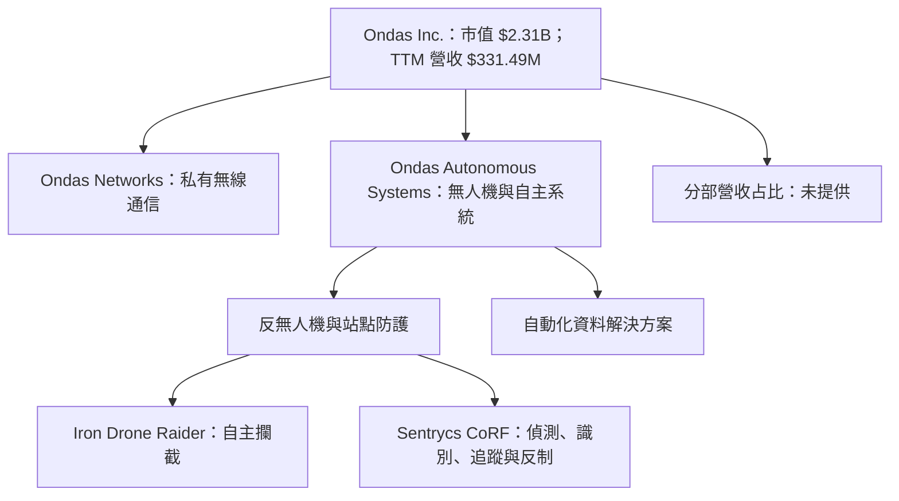
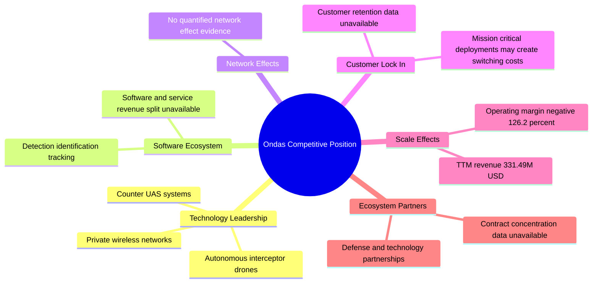
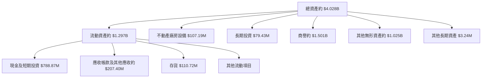
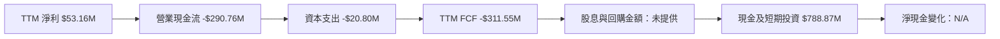
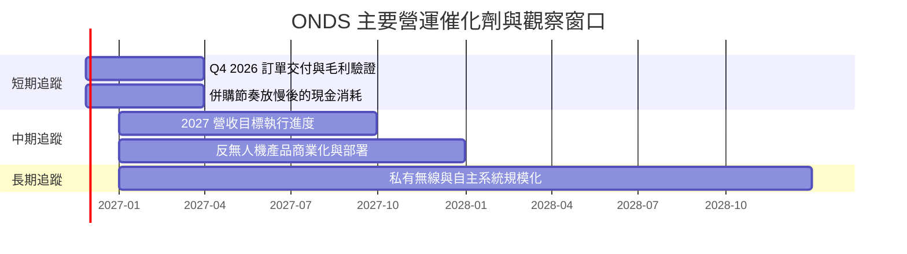
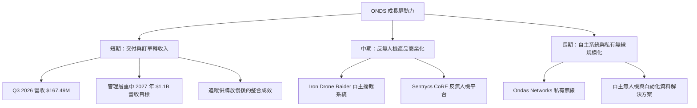
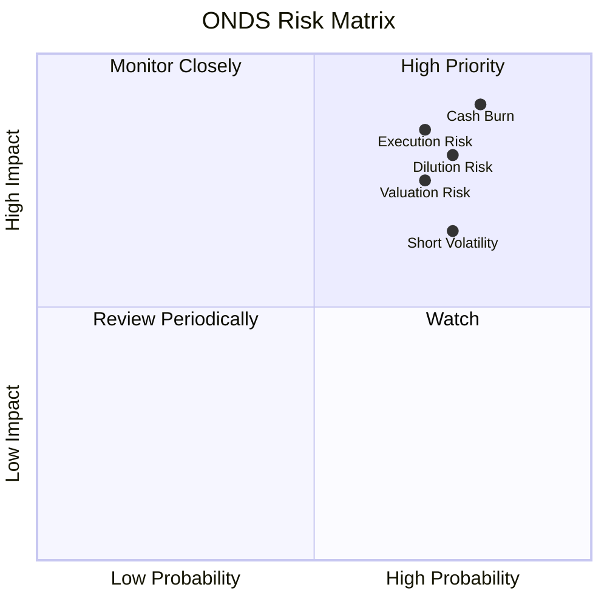
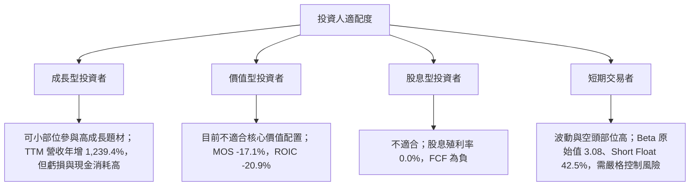

# ONDS 基本面深度分析報告
> **報告日期**：2026-11-27 ｜ **語言**：繁體中文 ｜ **數據來源**：SEC 申報資料 (XBRL)、Yahoo Finance、Finviz、StockAnalysis、Roic.ai ｜ **分析師**：CFA 級機構研究

---

## 目錄

| # | 章節 | 核心結論 |
|---|------|----------|
| 1 | 執行摘要 | 減碼；加權合理價值 $3.33，MOS -17.1% |
| 2 | 公司概覽與商業模式 | 無市場份額數據；技術及客戶導入有潛在價值，商業化證據仍有限 |
| 3 | 損益表深度分析 | TTM 營收 $331.49M、TTM 成長 1,239.4%；TTM 營業利益率 -126.2% |
| 4 | 資產負債表分析 | 現金及短期投資 $788.87M；流動性尚可，但營運資金占用上升 |
| 5 | 現金流量深度分析 | TTM FCF -$311.55M，燒錢與 SBC 稀釋是核心問題 |
| 6 | 獲利能力與資本效率 | ROIC -20.9% 對 WACC 14.0%，目前摧毀股東價值 |
| 7 | 相對估值分析 | P/S 低於自身歷史中位數，仍高於同業中位數；估值方法指向 $3.33 |
| 8 | DCF 內在價值評估 | DCF 不適用：TTM 營業利益為負；以固定權重相對估值作合理價值基準 |
| 9 | 成長催化劑 | 2027 年營收目標是主要催化劑，但須由訂單、交付與毛利率驗證 |
| 10 | 風險矩陣 | 現金消耗、執行與整合風險、估值及股價波動為前三大風險 |
| 11 | 投資建議 | 減碼；現價 $3.90 高於加權合理價值，建議以營運改善而非題材追價 |

---

## 1. 執行摘要

ONDS 的 TTM 營收為 **$331.49M**，TTM 年增 **1,239.4%**，最新一季年增 **1,558.6%**；但同期 TTM 營業利益率為 **-126.2%**、ROIC 為 **-20.9%**，TTM FCF 為 **-$311.55M**。相對估值方法給出的加權合理價值為 **$3.33**，低於 2026-11-25 收盤價 **$3.90**；MOS 為 **-17.1%**。依 MOS 門檻，評級為 **減碼**：營收放量尚未轉化為營業槓桿，且現金消耗與股權薪酬對股東回報形成重大壓力。

### 1.0 一頁式投資儀表板（Portfolio Manager 30 秒速讀）

| 項目 | 內容 |
|------|------|
| **投資論點（3 句）** | ① TTM 營收年增 **1,239.4%**，顯示業務規模快速擴大，但基期低與併購／交付節奏可能影響可比性。② TTM 營業利益率 **-126.2%**、ROIC **-20.9%**，目前成長尚未帶來價值創造。③ TTM FCF **-$311.55M**，現金及短期投資 **$788.87M** 提供緩衝，但若現金消耗持續，融資與稀釋風險會上升。 |
| **綜合評分** | **4.6/10**（引用 1.1 評分卡） |
| **財務健康** | 🟡 現金及短期投資 $788.87M、流動比率 3.389；但 TTM FCF -$311.55M，且 CCC 由 169 天增至 181 天。 |
| **ROIC vs WACC** | **-20.9% vs 14.0%**；差距 -34.9 個百分點，現階段摧毀股東價值。 |
| **FCF 趨勢** | 負值且近期惡化；最新 TTM FCF Yield **-13.51%**。 |
| **估值** | Forward P/E **-25.16x**（資料來源：Yahoo Finance／Finviz 合併資料）；EV/EBITDA **-5.445x**；FCF Yield **-13.51%**。虧損期倍數僅供參考。 |
| **DCF 內在價值（基準）** | **N/A**；TTM 營業利益為負，DCF 模型未計算，因此無法提供相對 DCF 的折溢價。 |
| **安全邊際（MOS）** | **-17.1%＝($3.33 − $3.90) ÷ $3.33**；基準為 8.8 加權合理價值。🔴 <10% 無安全邊際。 |
| **預期報酬（基準情境 12M）** | **N/A**；DCF 情境未計算。分析師共識均值 $16.68 屬外部參考，不視為本報告基準情境。 |
| **關鍵風險（前二）** | TTM FCF -$311.55M、SBC 約為 TTM 營收 46.9%；另有 42.5% 流通股做空比例及高股價波動。 |
| **評級 + 信心度** | 🟠 **減碼**；信心：中低。原因是相對估值資料可用，但盈利預測與 DCF 均無法可靠量化。 |

### 1.1 綜合評分卡（全報告唯一）

| 維度 | 評分（1–10） | 主要依據（引用數字與其來源章節） |
|------|--------------|----------------------------------|
| 成長性 | 8.5 | TTM 營收年增 1,239.4%，最新一季年增 1,558.6%（第 3 章）；惟低基期與併購影響須留意。 |
| 獲利能力 | 2.0 | TTM 營業利益率 -126.2%、ROIC -20.9%、Piotroski 3/8（第 3、6 章）。 |
| 財務健康 | 6.5 | 現金及短期投資 $788.87M、流動比率 3.389；但 FCF -$311.55M、CCC 181 天（第 4、5 章）。 |
| 估值 | 3.0 | 加權合理價值 $3.33、MOS -17.1%；P/S 7.3x 高於同業中位數 3.3x（第 7、8 章）。 |
| 護城河 | 4.0 | 產品涵蓋私有無線、反無人機及自主系統，但尚無市場份額、分部營收或客戶留存量化資料（第 2 章）。 |
| 管理層與資本配置 | 3.5 | FY2025 SBC $16.02M，2026 年最近四季 SBC 合計約 $155.41M；近期新聞稱管理層擬放慢併購，但整合與稀釋仍需追蹤。 |
| **綜合評分** | **4.6** | 六項算術平均：\((8.5+2.0+6.5+3.0+4.0+3.5)÷6=4.583\)，四捨五入至一位小數為 **4.6**。 |

### 1.2 五大投資論點 + 三大核心風險

| 類型 | 項目 | 具體依據 | 信心度 |
|------|------|----------|--------|
| 🟢 **投資論點①** | 收入規模快速擴大 | TTM 營收 $331.49M、TTM 年增 1,239.4%；最新一季營收 $167.49M，單季年增 1,558.6%。若交付與訂單能延續，收入基礎可迅速擴大。 | 🟡 中 |
| 🟢 **投資論點②** | 多個國防與無人系統需求方向 | 公司涵蓋反無人機、無線通信與自主系統，近期新聞顯示公司提出 2027 年 $1.1B 營收目標；該目標尚待訂單與交付驗證。 | 🟡 中低 |
| 🟢 **投資論點③** | 有現金緩衝 | 現金及短期投資 $788.87M；在不考慮其他融資與併購變動下，短期流動性有一定緩衝。 | 🟡 中 |
| 🟢 **投資論點④** | 毛利率已有一定正值 | TTM 毛利率 36.4%，但最新一季毛利率受產品組合影響下滑至約 21.8%（依季度損益資料計算）；若高毛利產品占比回升，毛利可改善。 | 🟡 中低 |
| 🟢 **投資論點⑤** | 自身歷史 P/S 低於中位數 | 目前 P/S 7.3x，低於五年中位數 17.9x、歷史百分位 32%；但仍高於同業中位數 3.3x，不能僅憑歷史折價認定便宜。 | 🟡 中 |
| 🟡 **風險①** | 現金流與 SBC 消耗 | TTM FCF -$311.55M；近四季 SBC 合計約 $155.41M，約為 TTM 營收 46.9%，可能造成顯著稀釋。 | 🔴 高 |
| 🔴 **風險②** | 成長未轉化為利潤 | TTM 營業利益率 -126.2%、ROIC -20.9%；若新產品交付增加但成本同步上升，營收放量仍可能擴大虧損。 | 🔴 高 |
| 🔴 **風險③** | 高波動與空頭部位 | Beta 原始值 3.08；Short % Float 42.5%。股價由 2026-05 月收盤 $13.22 降至 2026-11 收盤 $3.90，價格波動與擠空效應均可能放大。 | 🔴 高 |

### 1.3 快速統計卡片

| 指標 | 公司實際值（期間） | 同業中位數 | 狀態 |
|------|--------------------|------------|------|
| 營收成長（TTM） | **1,239.4%** | — | 🟢 |
| 營收成長（最新一季年增） | **1,558.6%** | 22.0% | 🟢 |
| 毛利率（TTM） | **36.4%** | 23.0% | 🟢 |
| 營業利益率（TTM） | **-126.2%** | — | 🔴 |
| ROIC（TTM） | **-20.9%** | — | 🔴 |
| Forward P/E | **-25.16x** | 20.7x | 🔴 |
| FCF Yield（TTM） | **-13.51%** | — | 🔴 |
| Piotroski F-Score | **3 / 8** | — | 🔴 |

> 同業中位數按 AVAV、KTOS、RCAT 的已提供數值計算。最新一季營收成長中位數為 22.0%；毛利率中位數為 23.0%。Forward P/E 中位數為 20.7x，ONDS 的負 EPS 不宜與正盈利同業直接比較。

### 1.4 投資結論

```text
╔══════════════════════════════════════════════════════════════════╗
║                    📊 投資結論摘要                               ║
╠══════════════════════════════════════════════════════════════════╣
║  評級：減碼（MOS -17.1%，符合規則 20）                           ║
║  價格（2026-11-25 收盤）：$3.90                                  ║
║  DCF 內在價值（基準）：N/A（TTM 營業利益為負，DCF 未計算）       ║
║  安全邊際 MOS：-17.1%＝($3.33−$3.90)÷$3.33                     ║
║  加權合理價值（8.8）：$3.33                                      ║
║  綜合評分：4.6/10（引用 1.1）                                    ║
║  適合投資人：能承受高波動、以小部位參與國防科技成長的投資人；     ║
║              不適合以穩定現金流或低波動為目標者。                 ║
╚══════════════════════════════════════════════════════════════════╝
```

---

## 2. 公司概覽與商業模式

### 2.1 業務結構與收入來源

ONDS 是美國科技與通信設備公司，透過 **Ondas Networks** 和 **Ondas Autonomous Systems** 兩個業務板塊營運，業務涵蓋私有無線、無人機及自動化資料解決方案。公司簡介提及反無人機與站點防護產品，例如 Iron Drone Raider 自主攔截系統及 Sentrycs CoRF 偵測、識別、追蹤與干擾平台。

分部營收及各產品收入占比未提供，故不以比例推定業務組合。



### 2.2 市場份額

**市場份額數據未提供**，公司資料亦未提供可核實的 TAM 或各產品收入拆分，因此不繪製市場份額圖。ONDS 的 TTM 營收為 $331.49M，最新一季年增 1,558.6%；相較 AVAV、KTOS、RCAT 最新季度營收年增率分別為 5.7%、35.7%、22.0%，ONDS 成長速度較快，但規模、基期、併購影響與獲利品質不同，不能直接據此推導市場份額或競爭優勢。

### 2.3 競爭護城河分析



### 2.4 護城河強度

| 護城河項目 | 強度（強／中／弱） | 證據（引用數字或事實） | 會削弱它的情況 |
|------------|--------------------|------------------------|----------------|
| 技術與產品組合 | 中 | 涵蓋私有無線、反無人機偵測與攔截；但未提供各產品收入、部署量或技術性能對照數據。 | 同業產品達到相近性能、價格下降或產品實戰部署未達要求。 |
| 軟體生態系統 | 弱至中 | Sentrycs CoRF 涵蓋偵測至反制流程；軟體與服務收入未單獨披露。 | 收入仍主要依賴低毛利硬體，或軟體續約率及客戶擴張率偏低。 |
| 網路效應 | 弱 | 沒有使用者數、節點數或資料網絡效應的量化證據。 | — |
| 客戶鎖定 | 弱至中 | 防護與通信系統可能涉及系統整合與認證；合約期限、續約率與客戶集中度未提供。 | 採購延遲、替代供應商增加或客戶自行開發。 |
| 規模效應 | 弱 | TTM 營收 $331.49M，但 TTM 營業利益率 -126.2%，目前沒有規模經濟轉為獲利的證據。 | 成長帶來更高研發、整合及交付成本，規模擴張仍未改善毛利。 |
| 生態夥伴 | 弱至中 | 公司與國防科技領域舉辦合作活動；可量化訂單貢獻及夥伴轉介收入未提供。 | 合作未形成可交付合約或商業收入。 |

護城河評分理由：1.1 評為 **4.0/10**，因產品涵蓋多個具戰略需求的技術領域，但目前缺少市場份額、續約、客戶鎖定、軟體收入與持續獲利等量化證據。

---

## 3. 損益表深度分析

### 3.1 年度收入成長趨勢（近 4 年）

FY2022 至 FY2025 營收由 $2.13M 增至 $50.73M，三年 CAGR 約 188.0%；FY2024 曾回落，說明年度成長具有波動性，且最近 TTM 的快速擴張不應簡單外推。

```text
╔══════════════════════════════════════════════════════════════════╗
║              Ondas Inc. 年度收入趨勢（FY2022-FY2025）            ║
╠══════════════════════════════════════════════════════════════════╣
║  FY2022   $2.13M   █                         YoY：N/A             ║
║  FY2023  $15.69M   ███████                   YoY：+636.6%         ║
║  FY2024   $7.19M   ███                       YoY：-54.2%          ║
║  FY2025  $50.73M   █████████████████████████ YoY：+605.3%         ║
║                                                                  ║
║  FY2022–FY2025 三年營收 CAGR：約 +188.0%                         ║
╚══════════════════════════════════════════════════════════════════╝
```

演算：FY2023 年增率 \(15.69÷2.13-1=636.6\%\)；FY2024 年增率 \(7.19÷15.69-1=-54.2\%\)；FY2025 年增率 \(50.73÷7.19-1=605.3\%\)。三年 CAGR 為 \((50.73÷2.13)^{1/3}-1≈188.0\%\)。

### 3.2 季度收入趨勢分析

| 季度 | 營收 | QoQ 成長 | YoY 成長 | 備註 |
|------|------:|---------:|---------:|------|
| 2025 Q4 | $30.11M | 607.3%* | 629.2% | QoQ 以 2025 Q3 $4.25M 為基數；低基期影響大。 |
| 2026 Q1 | $50.12M | 66.5% | 1,079.9% | 相較 2025 Q4 增加；單季年增不等於 TTM 成長。 |
| 2026 Q2 | $83.77M | 67.1% | 1,235.4% | 收入進一步增加；需觀察對應交付毛利與收款。 |
| 2026 Q3 | $167.49M | 99.9% | 1,558.6% | 季營收接近倍增，但季度損益資料顯示毛利率承壓、營業虧損擴大。 |

\*2025 Q4 對 2025 Q3 的季度收入成長率，根據 StockAnalysis 季度收入 $30.11M 與 $4.25M 計算：\(30.11÷4.25-1=608.5\%\)。由於跨來源季度列示可能有口徑差異，此處採直接可比收入計算，不以此替代已核實的 TTM 成長率。2026 年 QoQ 分別為 \(50.12÷30.11-1=66.5\%\)、\(83.77÷50.12-1=67.1\%\)、\(167.49÷83.77-1=99.9\%\)。

### 3.3 利潤率演變分析

| 利潤率指標 | FY2022 | FY2023 | FY2024 | FY2025 | 趨勢 | 評估 |
|------------|-------:|-------:|-------:|-------:|------|------|
| **毛利率** | 52.1% | 40.7% | 4.8% | 39.7% | 2024 明顯下滑、2025 回升 | 🟡 年度波動大 |
| **營業利益率** | -2,347.4% | -243.6% | -481.4% | -115.1% | 2025 相對改善，但仍大幅負值 | 🔴 尚未形成獲利 |
| **TTM 毛利率** | — | — | — | 36.4% | 參照最新 TTM 指標 | 🟡 毛利為正，營業費用負擔重 |
| **TTM 營業利益率** | — | — | — | -126.2% | 最新 TTM | 🔴 高額營業虧損 |

年度毛利率以年度毛利除以年度營收計算；TTM 與最新季度評估採 SEC 10-Q 計算的 VERIFIED FIGURES。其他整合來源的營業利益率有差異，故本報告以經核實 TTM -126.2%、最新一季 -113.1% 為準。季度損益資料另顯示 2026 Q3 營收 $167.49M、毛利 $36.50M，毛利率約 21.8%，低於 TTM 36.4%；近期新聞亦指出精確打擊產品組合影響 Q3 毛利。這表示銷售組合與交付成本可能抵銷規模成長，需觀察後續季度毛利率是否回升。營業利益率持續為負，表示研發、銷售、整合與管理成本遠高於毛利貢獻，現階段收入增長尚未形成營業槓桿。

### 3.4 費用結構分析

完整 TTM 研發、銷售管理及併購相關費用拆分未提供，不能可靠繪製費用結構圓餅圖。可確認 FY2025 研發費用為 **$20.88M**，相較 FY2024 $12.48M 上升；但 FY2025 與 TTM 費用組成不完全一致，不能用單一年度研發費用推算 TTM 費用占比。營業利益率 -126.2% 表明總營業費用與其他營業項目對毛利造成重大超額負擔。

### 3.5 季度 EPS 趨勢與盈餘品質（Quality of Earnings）

近四季 EPS 實際值可由 StockAnalysis 歷史資料交叉參照，但 EPS 預估值缺失，不能判定是否超預期或不及預期。

| 季度 | EPS 實際值 | EPS 預估／超預期狀態 | 說明 |
|------|-----------:|----------------------|------|
| 2025 Q4 | -$0.27 | N/A | 預估值為空，無法判定 beat/miss。 |
| 2026 Q1 | $0.59 | N/A | 與季度淨利 $362.95M 的大幅正值並存；其可持續性未證實。 |
| 2026 Q2 | -$0.15 | N/A | EPS 轉負，季度淨利 -$88.25M。 |
| 2026 Q3 | -$0.10 | N/A | 季度淨利 -$62.57M；估值資料來源報告 TTM EPS -$0.14。 |

| 盈餘品質項目 | 數值/佔比 | 評估 |
|--------------|-----------|------|
| 股權薪酬 SBC / 營收 | 約 **46.9%**：近四季 SBC 約 $155.41M ÷ TTM 營收 $331.49M | 🔴 比例高，代表部分經濟成本以股權支付，可能稀釋每股價值。近四季 SBC 為季度資料加總，與 TTM 期間大致對齊。 |
| SBC / 營業現金流 | 約 **53.5%**（以 \(|OCF|\) 作分母：$155.41M ÷ $290.76M） | 🔴 OCF 為負，該比率只表示 SBC 金額相對現金消耗規模；不應解讀為 SBC 由營運現金流覆蓋。 |
| FCF / 淨利（現金轉換率） | 約 **-586.0%**：-$311.55M ÷ $53.16M | 🔴 TTM 淨利為正但 FCF 大幅為負，現金轉換品質低。淨利可能受非現金或一次性項目影響。 |
| 一次性／非經常性損益 | 2026 Q1 淨利 $362.95M，與其他季度虧損並存；具體來源未提供 | 🔴 獲利異常，應避免將其視為可持續經常性盈餘。 |
| 有效稅率異常 | N/A | TTM 營業利益為負而淨利為正，稅前項目與稅務調節明細不足，不計算有效稅率。 |
| 資本化支出 vs 費用化 | TTM Capex $20.80M；資本化與費用化明細 N/A | 🟡 無法判定是否有重大成本延後費用化；需追蹤資本化政策與併購會計。 |

**盈餘品質結論**：TTM 淨利數據不宜直接當作經常性獲利能力，因 TTM 淨利 $53.16M 與營業利益率 -126.2%、OCF -$290.76M、FCF -$311.55M 同時存在，且 2026 Q1 出現異常正淨利。SBC 金額相對營收偏高，代表 GAAP 淨利即使為正，也不等於沒有股東成本。現階段估值應優先參考收入倍數、現金餘裕與交付毛利，而非 P/E。

---

## 4. 資產負債表分析

### 4.1 資產結構分解

截至 2026-09-30，StockAnalysis 資料列示總資產約 **$4.028B**，其中流動資產約 **$1.297B**；商譽約 $1.501B、其他無形資產約 $1.025B。此資產結構高度受併購形成的商譽與無形資產影響，須關注收購資產未來能否產生現金流，以及是否需認列減損。



### 4.2 流動性與營運資金分析

| 指標 | 最新 TTM | 一年前 TTM | 變化 | 解讀 |
|------|----------|------------|------|------|
| DSO 應收帳款天數 | 140 天 | 77 天 | +63 天 | 🟡 應收帳款收款週期變長，收入快速擴張可能增加未收款項；若後續回款落後於營收，現金流壓力會延續。 |
| DIO 存貨天數 | 182 天 | 278 天 | -96 天 | 🟢 相較一年前下降，可能反映存貨周轉改善；仍需與新訂單及交付量核對，避免把存貨轉成應收帳款卻未收現。 |
| DPO 應付帳款天數 | 141 天 | 186 天 | -45 天 | 🟡 付款週期縮短，供應商融資支持減少，可能增加營運現金需求。 |
| CCC 現金轉換週期 | 181 天 | 169 天 | +12 天 | 🔴 整體現金轉換週期惡化；DSO 增幅抵銷存貨改善與應付天數下降的部分影響。 |

流動比率 **3.389**、速動比率 **2.604**，在帳面比率上有流動性緩衝；但比率不代表資產可即時變現，尤其應收帳款天數上升至 140 天、CCC 為 181 天，應同步追蹤收款品質與客戶付款條款。

### 4.3 債務結構分析

VERIFIED FIGURES 中總債務為 **N/A**，故本節不以其他來源的債務數字替代核實欄位，也不計算淨債務或利息保障倍數。其他市場資料來源曾列示不同的債務數字，存在口徑差異，投資人應以最新 SEC 10-Q 債務附註核對。

```text
╔══════════════════════════════════════════════════════════════════╗
║                   Ondas 債務健康診斷                             ║
╠══════════════════════════════════════════════════════════════════╣
║  總債務：        N/A（核實指標未提供）                            ║
║  現金及短期投資： $788.87M                                        ║
║  淨現金：        $788.87M（依核實數據；總債務欄為 N/A）           ║
║  Debt/EBITDA：   N/A（缺少可用且一致的債務口徑）                  ║
║  Interest Coverage：N/A（利息費用與同口徑債務未提供）            ║
║                                                                  ║
║  ⚠️ 現金緩衝需與 TTM FCF -$311.55M 一併觀察，不等於沒有融資風險。║
╚══════════════════════════════════════════════════════════════════╝
```

### 4.4 股東權益趨勢

| 年度 | 股東權益 | 年度變化 |
|------|---------:|---------:|
| FY2022 | $58.22M | — |
| FY2023 | $33.14M | -43.1% |
| FY2024 | $16.58M | -50.0% |
| FY2025 | $437.81M | +2,540.0% |

```text
╔══════════════════════════════════════════════════════════════════╗
║                 Ondas 歷年股東權益變化                            ║
╠══════════════════════════════════════════════════════════════════╣
║  FY2022  $58.22M   ███                                           ║
║  FY2023  $33.14M   ██                                            ║
║  FY2024  $16.58M   █                                             ║
║  FY2025 $437.81M   █████████████████████████                     ║
╚══════════════════════════════════════════════════════════════════╝
```

FY2025 權益大幅上升與資本結構變化相符，但不能單憑帳面權益增長推斷每股價值同步增加；同期股數增加及 SBC 仍會稀釋既有股東持有比例。

---

## 5. 現金流量深度分析

### 5.1 現金流量瀑布圖

TTM 營業現金流 -$290.76M，資本支出 $20.80M，核實 TTM FCF 為 -$311.55M。兩個經四捨五入的輸入相減為 -$311.56M，與程式核實 FCF 差 $0.01M；本報告保留核實 FCF 原值，不以此差額反推或替換。



淨利至營業現金流之間包含非現金項目、營運資金與其他調節，因此圖中並非「淨利直接加減」的會計等式。現金變化與融資、併購及投資活動明細不足，故淨現金變化列為 N/A。

### 5.2 FCF 轉換率趨勢

| 年度 | FCF | 淨利 | FCF / 淨利 |
|------|----:|-----:|-----------:|
| FY2022 | -$40.89M | -$73.24M | 55.8% |
| FY2023 | -$34.30M | -$44.84M | 76.5% |
| FY2024 | -$35.20M | -$38.01M | 92.6% |
| FY2025 | -$40.88M | -$132.02M | 31.0% |
| TTM 至 2026-09-30 | -$311.55M | $53.16M | -586.0% |

FY2022–FY2025 FCF/淨利雖為正比率，但 FCF 與淨利均為負，該比率不能視為正向的現金轉換。TTM 淨利轉正而 FCF 大幅轉負，更凸顯淨利品質及營運資金資金需求的不確定性。

### 5.3 自由現金流趨勢

| 期間 | 營業現金流 | Capex | FCF | FCF Yield |
|------|-----------:|------:|----:|---------:|
| FY2022 | -$37.96M | -$2.93M | -$40.89M | — |
| FY2023 | -$34.02M | -$0.28M | -$34.30M | — |
| FY2024 | -$33.47M | -$1.73M | -$35.20M | — |
| FY2025 | -$38.75M | -$2.14M | -$40.88M | — |
| TTM 至 2026-09-30 | -$290.76M | $20.80M | **-$311.55M** | **-13.51%** |

```text
╔══════════════════════════════════════════════════════════════════╗
║                 自由現金流趨勢（美元）                           ║
╠══════════════════════════════════════════════════════════════════╣
║  FY2022  -$40.89M  ◀████████                                    ║
║  FY2023  -$34.30M  ◀███████                                     ║
║  FY2024  -$35.20M  ◀███████                                     ║
║  FY2025  -$40.88M  ◀████████                                    ║
║  TTM     -$311.55M ◀████████████████████████████████████████     ║
║                                                                  ║
║  TTM FCF Yield：-13.51%；FCF 惡化幅度遠高於 FY2025 年度基準。    ║
╚══════════════════════════════════════════════════════════════════╝
```

TTM 的營業現金流由 FY2025 的 -$38.75M 擴大至 -$290.76M，且最新季度單季 OCF 為 -$140.65M。季度數據顯示現金消耗集中加速，可能與業務擴張、應收帳款及存貨投入、整合與人力成本有關；各項因素的獨立貢獻未提供，不能進一步量化歸因。

### 5.4 資本配置評估

回購、股息與投資活動的完整 TTM 金額拆分未提供，故不繪製資本配置圓餅圖。

| 資本配置項目 | 可用數據 | 評估 |
|--------------|----------|------|
| Capex | TTM $20.80M | 相對現金消耗規模較小，但 OCF 遠低於零，資本支出不是 FCF 負值的唯一來源。 |
| SBC | 最近四季合計約 $155.41M | 🔴 對股東的經濟成本不可忽略，可能造成股數稀釋。 |
| 股息 | 殖利率 0.0% | 無現金股息回饋。 |
| 回購 | N/A | 金額未提供，不推定有回購。 |
| 併購與投資 | 最近新聞提及管理層擬放慢併購推進 | 🟡 若執行，有助降低整合負擔；須檢視併購支出及整合成效。 |

---

## 6. 獲利能力與資本效率

### 6.1 ROE / ROA / ROIC 趨勢

| 指標 | 可用歷史值 | 最新值 | 評估 |
|------|------------|--------|------|
| ROE | TTM 核實值 4.6%；其他整合來源列示 7.3% | **4.6%** | 採品質指標核實值；不同來源口徑不一致，應以 SEC 申報附註進一步核對。 |
| ROA | TTM -9.7%（整合來源） | -9.7% | 🔴 資產尚未產生正向總資產回報。 |
| ROIC | 年度歷史 N/A | **-20.9%** | 🔴 低於資本成本，負的投入資本回報。 |
| WACC | — | **14.00%** | 依核實資本成本資料，計算值 14.67% 並受 7%–14% 上限限制。 |

沒有一致的逐年 ROIC、ROA 歷史資料及可比行業均值，故不列行業均值或推估歷史值。

### 6.2 ROIC vs WACC 分析（核心價值創造判斷）

```text
╔══════════════════════════════════════════════════════════════════╗
║                ROIC vs WACC 深度分析                            ║
╠══════════════════════════════════════════════════════════════════╣
║  資本成本輸入（依 Cost of capital）：                            ║
║  ├── 無風險利率（10Y 美債）：             4.85%                 ║
║  ├── 市場風險溢酬 ERP：                  5.00%                 ║
║  ├── 原始 Beta：                          3.08                  ║
║  ├── 調整後 Beta（採用）：                2.00                  ║
║  ├── 股權成本 Ke：                       14.85%                 ║
║  ├── 稅前債務成本：                      10.47%                 ║
║  ├── 股權／債務權重：                    97.3% / 2.7%           ║
║  ├── 未設上限計算 WACC：                 14.67%                 ║
║  └── 採用 WACC（上限 14%）：              14.00%                 ║
║                                                                  ║
║  ROIC：                                      -20.9%              ║
║  WACC：                                       14.0%              ║
║  EVA 利差（ROIC − WACC）：                   -34.9 pp            ║
║                                                                  ║
║  ROIC < 0，且低於 WACC 34.9 個百分點；目前摧毀股東價值。        ║
╚══════════════════════════════════════════════════════════════════╝
```

原始 Beta 3.08 經調整後採用 2.00；調整計算 \(⅔×3.08+⅓=2.39\)，但資本成本資料註明 Beta 受 0.6–2.0 區間限制，故採用上限 2.00。股權成本依核實資料為 \(4.85\%+2.00×5.00\%=14.85\%\)。核實資料列示計算 WACC 14.67%，並依指定區間限制採用 **14.00%**。由於 WACC 組成表提供的成本與權重已由程式計算，且總債務的獨立核實口徑缺失，本節不重建一套不同的 WACC。

### 6.3 杜邦三因素分解

| 因素 | 數值（TTM） | 解讀 |
|------|-------------|------|
| 淨利率 | 33.1% | 受到異常淨利與一次性／非營業項目影響的可能性高，不能單獨代表核心獲利。 |
| 資產週轉率 | 0.08 | 資產基礎相對營收龐大，且包含較高商譽與無形資產。 |
| 權益乘數 | 1.70 | 財務槓桿不是 ROE 主要來源。 |
| **ROE** | **4.6%** | QUALITY FIGURES 原值：33.1% × 0.08 × 1.70 = 4.6%。 |

杜邦三項乘積的簡化結果會受四捨五入影響；此處照錄核實指標。低資產週轉率及非經常性淨利成分，是判讀 ROE 時比單看 33.1% 淨利率更重要的因素。

### 6.4 財務體質：Piotroski F-Score

**Piotroski F-Score：3 / 8**。九項檢測中一項因缺少輸入無法判定，故可判定分母為 8。

| 測試 | 結果 | 解讀 |
|------|------|------|
| ROA > 0 | ✅ 通過 | 最新 TTM ROA 為正；但另一整合來源列示 TTM ROA -9.7%，顯示口徑衝突，需留意指標定義。 |
| 營業現金流 > 0 | ❌ 未通過 | TTM OCF -$290.76M。 |
| ROA 高於一年前 | ✅ 通過 | 品質指標比較期間結果為改善。 |
| 營業現金流 > 淨利（應計品質） | ❌ 未通過 | OCF 為負，且低於 TTM 正淨利。 |
| 長期負債／總資產低於一年前 | — 無法判定 | 缺少可比較負債輸入。 |
| 流動比率高於一年前 | ❌ 未通過 | 即使流動比率 3.389，按年度比較仍未通過該項測試。 |
| 稀釋股數未增加 | ❌ 未通過 | 公司流通股數增加，SBC 及融資稀釋需追蹤。 |
| 毛利率高於一年前 | ❌ 未通過 | 相較一年前未達測試條件；最新季度毛利率亦有下行壓力。 |
| 資產週轉率高於一年前 | ✅ 通過 | 相較一年前改善。 |

F-Score 3/8 反映盈利現金流、稀釋與毛利率方面的弱項仍多；即使部分經營指標改善，尚不足以支持獲利品質已穩定轉型。

---

## 7. 相對估值分析

### 7.1 同業估值比較表格

| 估值指標 | **ONDS** | **AVAV** | **KTOS** | **RCAT** | ONDS 評估 |
|----------|---------:|---------:|---------:|---------:|-----------|
| **Trailing P/E** | N/A | N/A | 241.3x | N/A | 🟡 多數公司無可比正盈餘，盈利倍數參考性低。 |
| **Forward P/E** | -25.16x | 20.7x | 25.9x | -2.8x | 🔴 ONDS 與 RCAT 為負值，無法作正常正盈利比較。 |
| **P/S Ratio** | 7.3x | 2.3x | 3.3x | 3.7x | 🔴 ONDS 高於三家同業中位數 **3.3x**。 |
| **EV/EBITDA** | -5.445x | 22.4x | 47.7x | -0.3x | 🔴 ONDS EBITDA 為負，倍數不適合用作常規價值比較。 |
| **最新一季營收年增** | 1,558.6% | 5.7% | 35.7% | 22.0% | 🟢 增長率高於同業，但低基期及交易／交付結構需核實。 |
| **TTM 毛利率** | 36.4% | 26.5% | 23.0% | 8.7% | 🟢 高於三家同業中位數 **23.0%**，但最新一季毛利率有下滑。 |

同業倍數均採 Yahoo Finance 同業倍數區塊。ONDS 的高成長及 TTM 毛利率提供估值支持，但其 P/S 仍高於同業中位數，且營業利益率為負；若收入成長不能伴隨毛利與營業費用改善，單純營收倍數不一定能維持。

### 7.2 歷史估值區間分析

| 指標 | 現值 | 五年中位數 | 歷史區間 | 當前百分位 |
|------|-----:|-----------:|---------:|-----------:|
| P/S（TTM） | 7.3x | 17.9x | 2.9x–140.6x | 32% |

```text
╔══════════════════════════════════════════════════════════════════╗
║               ONDS 自身歷史 P/S 位置                             ║
╠══════════════════════════════════════════════════════════════════╣
║  2.9x（低位） ─────── 7.3x（目前） ───────── 17.9x（中位數）     ║
║                         ↑ 百分位 32%                              ║
║  歷史區間上限：140.6x；極端值使完整區間不宜視為常態估值範圍。      ║
╚══════════════════════════════════════════════════════════════════╝
```

目前 P/S 低於自身五年中位數，但估值仍處歷史分布約 32 百分位，且 P/S 7.3x 高於同業中位數 3.3x。歷史高位受極端值影響，不能因低於中位數就推論價格具有安全邊際。

### 7.3 情境價值（Bear / Base / Bull，照抄 DCF MODEL 的 Scenarios）

**N/A（DCF 無法計算：TTM 營業利益為負，程式未提供 DCF 情境模型）。**不另行建立悲觀、基準、樂觀目標價。

### 7.4 相對估值隱含價格區間

| 估值方法 | 每股價值 | 權重 | 依據 |
|----------|---------:|-----:|------|
| 同業 P/S | $1.85 | 90% | AVAV、KTOS、RCAT 同業 P/S 中位數 3.3x × ONDS TTM 營收，再按公司類型程式計算。 |
| 分析師共識目標價 | $16.68 | 10% | 10 位分析師平均目標價；作為參考，與當前獲利及現金流狀況存在較大落差。 |
| 同業 Forward P/E | 無法計算 | 不另列 | 不適用於公司虧損及負 EPS，程式已將其剔除並按規則分配權重。 |

同業 P/S 回推價值為 $1.85，低於現價；分析師共識目標價 $16.68 代表市場預期分歧大。按核實的估值方法權重，最終加權值於第 8.8 節計算。

---

## 8. DCF 內在價值評估（Discounted Cash Flow）

> **DCF MODEL：N/A。**核實資料顯示 TTM 營業利益為負，因此未提供 DCF 預測模型。依規則不以自建假設替代；本章 8.1–8.7 不提供 DCF 內在價值、預測現金流或 DCF 情境價格。MOS 仍依第 8.8 節加權合理價值計算。

### 8.0 估值推理鏈（Thinking Logic）

本報告不建立 DCF，故不以缺乏依據的假設推導內在價值。ONDS 的價值可由三類營運成果觀察：私有無線、反無人機與自主系統的現有收入（公司未提供分部占比）；隨交付放量形成的毛利與營業槓桿（TTM 毛利率 36.4%，但營業利益率 -126.2%）；以及新產品及國防需求帶來的未來訂單選擇權（2027 年 $1.1B 營收為管理層／新聞報導目標，尚非已實現收入）。

| 決策點 | 本報告採用 | 理由 | 曾考慮但否決 | 否決理由 |
|--------|-----------|------|--------------|----------|
| 現金流估值 | 不計算 DCF | TTM 營業利益為負，程式未生成現金流模型 | 自行預測 FCFF | 需自行填入營收、利潤率、Capex、終值等多項高敏感度假設，不能代替核實模型。 |
| 預測期 N | N/A | 模型未提供 | 任意 5–10 年 | 缺乏依據，且與禁止自建 DCF 的規則衝突。 |
| 終值方法 | N/A | 無逐年 FCFF 與終值輸入 | Gordon Growth／退出倍數 | 無可用第 N 年現金流與終值倍數。 |
| EBIT 基礎與 SBC | N/A | 沒有 DCF EBIT 預測 | GAAP 或非 GAAP 預測 | 不另造模型假設。 |

最脆弱的估值判斷不是 DCF 參數，而是以同業 P/S 倍數回推價格時，市場是否願意持續給予 ONDS 高於同業中位數的營收倍數；若成長與毛利未能支撐溢價，合理價值可能下修至同業 P/S 方法指向的 $1.85。

### 8.1 模型假設總表（Model Inputs）

**N/A（DCF 模型未提供；不建立假設表）。**

### 8.2 折現率推導（WACC）

DCF 折現率推導與逐年模型不適用；但第 6.2 節資本效率分析採用核實 WACC **14.00%**。其核實輸入為無風險利率 4.85%、ERP 5.00%、調整後 Beta 2.00、股權成本 14.85%、稅前債務成本 10.47%、股權／債務權重 97.3%／2.7%；未限制計算值 14.67%，依 7%–14% 區間限制後採用 14.00%。此數值不用來另建 DCF。

### 8.3 逐年自由現金流預測（基準情境）

**N/A（TTM 營業利益不為正，DCF MODEL 未提供預測期、逐年現金流或終值）。**

### 8.4 終值計算（Terminal Value）

**N/A（未提供 DCF 模型，缺少 FY+N FCFF、永續成長率及終值倍數）。**

### 8.5 企業價值 → 每股內在價值（Bridge）

**N/A（沒有 DCF 企業價值與每股價值橋接輸入）。**因此不計算 DCF 折溢價；本報告的 MOS 只採用 8.8 加權合理價值為分母。

### 8.6 敏感性分析（WACC × 永續成長率）

**N/A（沒有 DCF 基準現金流、WACC／永續成長率矩陣或三情境資料）。**

### 8.7 反推 DCF（Reverse DCF：市場在預期什麼）

**N/A（DCF MODEL 未提供反推結果；不以自建迭代程序生成市場隱含假設）。**

### 8.8 估值三角驗證與安全邊際

| 估值方法 | 隱含每股價值 | 上行空間（÷現價） | 權重 | 說明 |
|----------|--------------:|------------------:|-----:|------|
| 同業 P/S | $1.85 | -52.6% | 90% | 同業中位數 P/S 3.3x × TTM 營收；估值方法與每股價值照核實資料。 |
| 分析師共識目標價 | $16.68 | +327.7% | 10% | 10 位分析師平均目標價；只作小權重參照。 |
| **加權合理價值** | **$3.33** | **-14.6%** | **100%** | 虧損公司類型採固定權重：同業 P/S 90%、分析師共識 10%。 |

**逐步演算：**

- 加權合理價值  
  \[
  \$1.85\times90\%+\$16.68\times10\%
  =\$1.665+\$1.668
  =\$3.333
  \approx \$3.33
  \]
- 權重合計：\(90\%+10\%=100\%\)。
- MOS：  
  \[
  (\$3.33-\$3.90)\div\$3.33
  =-\$0.57\div\$3.33
  =-17.1\%
  \]
- 上行空間：  
  \[
  (\$3.33-\$3.90)\div\$3.90
  =-\$0.57\div\$3.90
  =-14.6\%
  \]

估值方法中，同業 Forward P/E 因無法計算而被排除；核實方法已將可用權重固定為同業 P/S 90%、分析師共識 10%，本報告不調整權重。

```text
╔══════════════════════════════════════════════════════════════════╗
║                  估值區間與安全邊際                              ║
╠══════════════════════════════════════════════════════════════════╣
║  $1.85（同業 P/S） ─── $3.33（加權合理值） ─── $3.90（現價）     ║
║                                                                  ║
║  安全邊際 MOS = ($3.33 − $3.90) ÷ $3.33 = -17.1%                 ║
║  MOS 評估：🔴 小於 10%，無正安全邊際                             ║
║  上行空間 = ($3.33 − $3.90) ÷ $3.90 = -14.6%                    ║
║  DCF 基準值：N/A；不以單一 DCF 價值替代加權合理價值。             ║
║                                                                  ║
║  買入參考區間：$0.00–$3.00；$3.00 約對應 MOS +10%                 ║
║  持有參考區間：約 $3.00–$3.66；MOS 約介於 +10% 至 -10%            ║
║  減碼區間：高於約 $3.66；MOS 低於 -10%                            ║
║  賣出門檻參考：高於約 $4.16 時 MOS 低於 -25%                      ║
╚══════════════════════════════════════════════════════════════════╝
```

> $3.00、$3.66、$4.16 為依 $3.33 加權合理價值與 MOS 門檻計算的價格參考，不是 DCF 目標價。買入區間上限低於現價，與目前「減碼」評級一致。

> 🔎 **程式複算（Python，依本節各項自動重算）**
>
> 加權合理價值 = $1.85 × 90% + $16.68 × 10% = **$3.33**（權重合計 100%）
>
> 以價格 $3.90 計：MOS = **-17.1%**，上行空間 = **-14.6%**
>
> ✅ 與本節所寫數值一致。

### 8.9 DCF 模型的局限與失效條件

- **終值依賴度**：N/A，沒有 DCF 預測與終值模型。
- **最脆弱的假設**：本報告無 DCF 假設；相對估值最敏感的是同業 P/S 中位數 3.3x 是否適用，以及 10 位分析師共識 $16.68 的實現程度。
- **不適用情境說明**：TTM 營業利益率 -126.2%、FCF -$311.55M、單季盈虧波動大，DCF 可靠度低。後續應以 EV/Sales 或 P/S、訂單轉收入、分產品毛利、現金消耗及稀釋率作追蹤；待營業利潤轉正且現金流可預測後，再評估 DCF。
- **與第 10 章風險矩陣的連結**：訂單延遲會影響營收假設；產品組合及交付成本會影響毛利；應收與存貨上升會推高現金消耗；融資稀釋會降低每股價值。

### 8.10 複算檢核表（Audit Trail）

| # | 檢核項目 | 檢查方式 | 結果 |
|---|----------|----------|------|
| 1 | 高／中敏感度 DCF 輸入有完整推導 | DCF 未建模，無此類輸入 | N/A |
| 2 | 每個 DCF 假設都有來歷 | DCF 未建立假設 | N/A |
| 3 | WACC 五步算式及重算 | 第 6.2 節採用核實 WACC 14.00%，未自建 WACC | N/A |
| 4 | Kd 分母與債務權重口徑一致 | DCF WACC 未重建；總債務核實值 N/A | N/A |
| 5 | WACC 與第 6.2 節一致 | 資本成本採用值 14.00% | ✅ |
| 6 | 逐年預測年度數等於 N | 無 DCF 模型 | N/A |
| 7 | FY+1 九步算式可複算 | 無逐年預測 | N/A |
| 8 | 預測期 PV 逐項加總 | 無預測期 PV | N/A |
| 9 | WACC > g | 未提供 g | N/A |
| 10 | 終值以 FY+N 現金流及 N 期折現 | 無終值模型 | N/A |
| 11 | EV 至每股價值橋接可複算 | 無 DCF Bridge | N/A |
| 12 | SBC 模型組合相容 | 未建立 DCF 股數假設；已於第 3、5 章量化 SBC | N/A |
| 13 | 敏感度矩陣基準格等於 DCF 價值 | 無矩陣 | N/A |
| 14 | 矩陣只含有效 WACC > g 格 | 無矩陣 | N/A |
| 15 | DCF 三情境機率加總 | 無情境模型 | N/A |
| 16 | Reverse DCF 一次只解一變數 | 無反推模型 | N/A |
| 17 | MOS 分母為 8.8 加權合理價值；折溢價以 DCF 為基準 | MOS 以 $3.33 計算；DCF 折溢價 N/A | ✅ |
| 18 | 報告完整至第 11 章 | 已完整列示 11 章 | ✅ |
| 19 | 加權合理價值等於價值乘權重總和 | $1.85×90%+$16.68×10%=$3.333≈$3.33 | ✅ |
| 20 | 評級符合 MOS 門檻 | MOS -17.1%，對應減碼 | ✅ |

---

## 9. 成長催化劑

### 9.1 催化劑時間軸

以下時間區間為財報追蹤窗口，不代表公司公布的具體交付日期。現有新聞提及管理層重申 2027 年 $1.1B 營收目標，並稱將放慢併購推進、聚焦既有成長。



### 9.2 TAM 市場規模分析

**N/A（TAM 數據未提供）**。公司涉及反無人機、私有無線與自主系統等市場，但財務資料與近期新聞沒有提供可引用的市場規模金額及年份。已知 TTM 營收 $331.49M、TTM 年增 1,239.4%；這表明業務快速放量，但無法由此推算 TAM 或市場滲透率。

### 9.3 成長驅動力結構圖



---

## 10. 風險矩陣

### 10.1 風險評分矩陣

下圖為定性排序，機率／衝擊位置並非公司披露的統計機率。



### 10.2 風險清單詳細分析

| # | 風險項目 | 發生機率 | 財務衝擊 | 風險評估 | 緩解措施 |
|---|----------|----------|----------|----------|----------|
| 1 | 🔴 **現金消耗與融資風險** | 高；TTM OCF -$290.76M | 高；TTM FCF -$311.55M，可能消耗現金並增加外部融資需求 | 🔴 高 | 每季追蹤 OCF、應收帳款、存貨、Capex、現金及短期投資；若現金消耗未下降，降低持倉。 |
| 2 | 🔴 **交付、併購與整合執行** | 高；收入快速增長但營業利益仍大幅為負 | 高；TTM 營業利益率 -126.2%，產品組合已被指出影響 Q3 毛利 | 🔴 高 | 以訂單交付、毛利率、營業費用率及整合後營收確認執行，不只看公告訂單。 |
| 3 | 🔴 **股權稀釋與 SBC** | 高；近四季 SBC 約 $155.41M | 高；SBC 約為 TTM 營收 46.9% | 🔴 高 | 追蹤稀釋股數、SBC／營收、員工股權發放及融資條件；對每股營收與每股現金流同步評估。 |
| 4 | 🟠 **估值下修風險** | 中高；P/S 7.3x 高於同業中位數 3.3x | 高；同業 P/S 方法指向 $1.85 | 🟠 高 | 以營收倍數及毛利質量檢查估值；若收入減速或毛利收縮，避免以分析師共識目標價替代基本面。 |
| 5 | 🟠 **股價波動與空頭部位** | 高；Beta 原始值 3.08、Short % Float 42.5% | 高；短期價格變動可能大幅偏離基本面 | 🟠 高 | 控制倉位、避免槓桿及事件前過度集中；以季度營運數據而非空頭擠壓作投資依據。 |

---

## 11. 投資建議

### 11.1 最終評級與評分

依加權合理價值 $3.33 與 2026-11-25 收盤價 $3.90 計算，MOS 為 -17.1%，對應規則 20 的 **減碼**，未做質化上調或下調。1.1 綜合評分為 **4.6/10**；六項分數為成長性 8.5、獲利能力 2.0、財務健康 6.5、估值 3.0、護城河 4.0、管理層與資本配置 3.5。

### 11.2 合理價值與隱含報酬率

| 估值項目 | 每股價值 | 相對現價 $3.90 | 說明 |
|----------|---------:|----------------:|------|
| 加權合理價值 | **$3.33** | **-14.6%** | 同業 P/S 90% 加權、分析師共識 10% 加權。 |
| DCF 基準情境 | N/A | N/A | TTM 營業利益為負，DCF MODEL 未提供。 |
| 悲觀／樂觀 DCF 情境 | N/A | N/A | 不另建情境模型或自訂目標價。 |
| 分析師共識均值 | $16.68 | +327.7% | 10 位分析師平均目標價，與本報告加權合理價值差距大，僅作參考。 |

### 11.3 買入時機與觸發因素

```text
╔══════════════════════════════════════════════════════════════════╗
║                  ✅ 買入觸發因素 Checklist                       ║
╠══════════════════════════════════════════════════════════════════╣
║  重新評估買入條件（多數符合）：                                  ║
║  ☐ TTM FCF 相較 -$311.55M 明顯收斂，且連續兩季改善              ║
║  ☐ TTM 營業利益率由 -126.2% 持續改善，而非只靠營收放大           ║
║  ☐ Q3 毛利率約 21.8% 的下滑後，後續季度毛利率回升                ║
║  ☐ DSO 由 140 天回落，CCC 由 181 天改善                           ║
║  ☐ SBC／營收明顯低於目前約 46.9%，稀釋股數增速放緩               ║
║                                                                  ║
║  加碼觸發條件（出現以下任一並確認現金可支撐）：                  ║
║  ☐ 營收成長同時帶來毛利額增加、營業虧損收斂                     ║
║  ☐ 2027 年營收目標有已簽訂訂單、交付與收款佐證                   ║
║  ☐ FCF 消耗下降，現金及短期投資維持充足                          ║
║                                                                  ║
║  減碼／退出觸發條件（出現以下任一）：                            ║
║  ☐ TTM FCF 進一步惡化，或現金大幅下降且融資需求上升              ║
║  ☐ 連續兩季收入減速並伴隨毛利率下滑                               ║
║  ☐ 稀釋股數加速增加，SBC／營收維持高位                            ║
║  ☐ 應收帳款天數續升、存貨增加且營收未能轉為現金                   ║
║  ☐ 股價遠高於合理價值，且基本面未同步改善                         ║
╚══════════════════════════════════════════════════════════════════╝
```

### 11.4 投資人適配度分析



### 11.5 每季財報監控清單（Quarterly Watch List）

| 監控指標 | 最新基準 | 加碼觀察條件 | 減碼／重新檢視條件 |
|----------|---------|--------------|--------------------|
| 營收與指引 | TTM $331.49M；最新一季 $167.49M；管理層報導的 2027 目標 $1.1B | 實際營收與已簽訂訂單支持指引，且收入具可收款性 | 營收放緩、指引下修，或目標主要依賴未落地併購 |
| 毛利率 | TTM 36.4%；最新季度按季度損益資料約 21.8% | 產品組合改善、毛利率回升並伴隨毛利額增加 | 毛利率持續低於 TTM 水平，或收入增加但毛利額停滯 |
| 營業利益率 | TTM -126.2%；最新一季 -113.1% | 虧損率逐季收斂 | 虧損率惡化，收入放量仍無營業槓桿 |
| OCF／FCF | TTM OCF -$290.76M；FCF -$311.55M | TTM FCF 持續收斂，現金消耗與收入增速差距縮小 | 季度 OCF 持續惡化或現金餘額快速下降 |
| SBC 與稀釋股數 | 近四季 SBC 約 $155.41M；稀釋股數未通過 F-Score 測試 | SBC／營收下降、稀釋速度放緩 | SBC 維持高比例或新增融資造成大幅稀釋 |
| 應收帳款與存貨 | DSO 140 天、DIO 182 天、CCC 181 天 | DSO、CCC 回落且應收款轉現金 | DSO 或 CCC 續升，存貨增加但訂單交付沒有改善 |
| 現金與投資 | 現金及短期投資 $788.87M | 現金餘額與現金消耗相符，融資壓力降低 | 現金下降速度快於預期，須透過低價融資補充資金 |
| EPS 與淨利品質 | EPS 預估值缺失；TTM 淨利與現金流表現背離 | 季度正收益由營運獲利與現金流支持 | 正淨利主要來自一次性或非現金項目 |

### 11.6 反面論證：什麼會證明論點錯誤（What Would Change My Mind）

```text
╔══════════════════════════════════════════════════════════════════╗
║              ⚠️ 論點失效條件（Disconfirming Evidence）           ║
╠══════════════════════════════════════════════════════════════════╣
║  下列情況發生時，應重新檢視減碼／退出判斷：                      ║
║  ☐ 最新一季營收年增率連續兩季低於 35.7%（已提供同業最高成長率）   ║
║     且訂單或管理層指引同步下修                                   ║
║  ☐ TTM 毛利率低於 23.0% 的同業中位數，且連續兩季未回升            ║
║  ☐ TTM 營業利益率未能由 -126.2% 收斂，反而進一步惡化              ║
║  ☐ TTM FCF 低於目前 -$311.55M，或現金及短期投資大幅下降           ║
║  ☐ DSO 高於目前 140 天、CCC 高於目前 181 天並連續兩季惡化         ║
║  ☐ SBC／營收持續約 46.9% 或更高，且稀釋股數持續快速增加          ║
║  ☐ ROIC 維持負值，或持續低於 WACC 14.00%                          ║
║  ☐ 管理層 2027 年 $1.1B 營收目標缺少已簽訂訂單與實際交付支持      ║
╚══════════════════════════════════════════════════════════════════╝
```

> **免責聲明**：本報告為 AI 自動生成，僅供研究參考，不構成投資建議。投資有風險，入市需謹慎。

---

## 資料與來源

| 項目 | 內容 |
|------|------|
| 價格 | 3.90 USD，2026-11-25 收盤（Yahoo Finance 日線） |
| 財務報表 | SEC 10-Q filed 2026-11-12，最新季度 2026-09-30（FY2026 Q3） |
| 有回應的資料來源 | SEC 申報資料 (XBRL)、Yahoo Finance、Finviz、StockAnalysis、Roic.ai |
| 由程式計算 | TTM 數字、WACC、DCF 模型、估值方法與權重、加權合理價值、MOS、評級門檻、F-Score、杜邦分解、營運資金天數、綜合評分 |
| 撰寫模型 | openai / gpt-6-luna |

> 本區塊由產生報告的程式依實際取得的資料填寫，非模型撰寫。「由程式計算」的數字不是模型的估計；其餘判斷（評分、情境、策略）是模型的分析。
