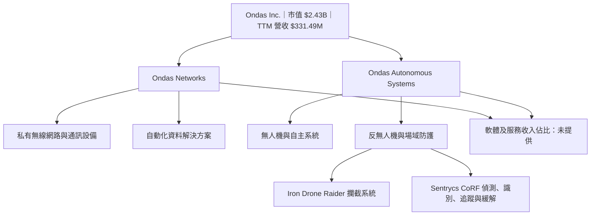
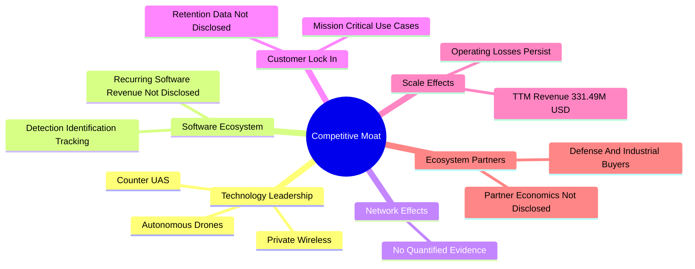
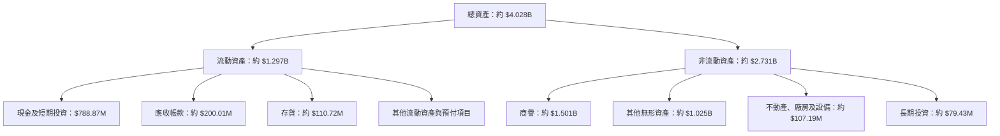
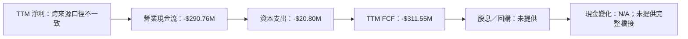
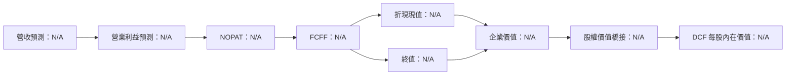
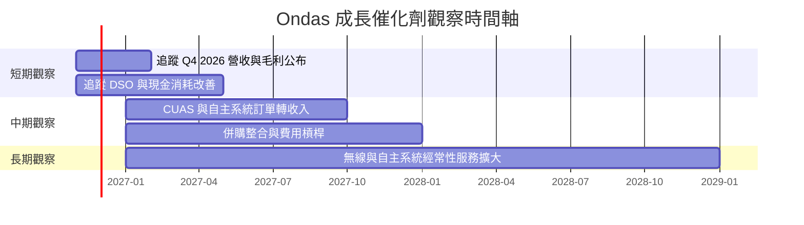
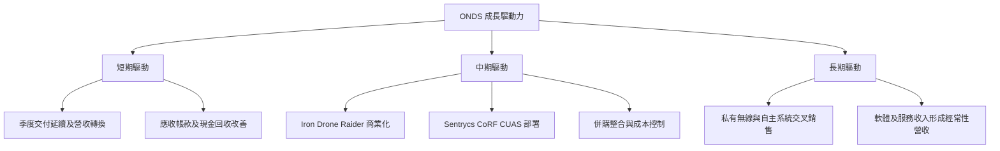
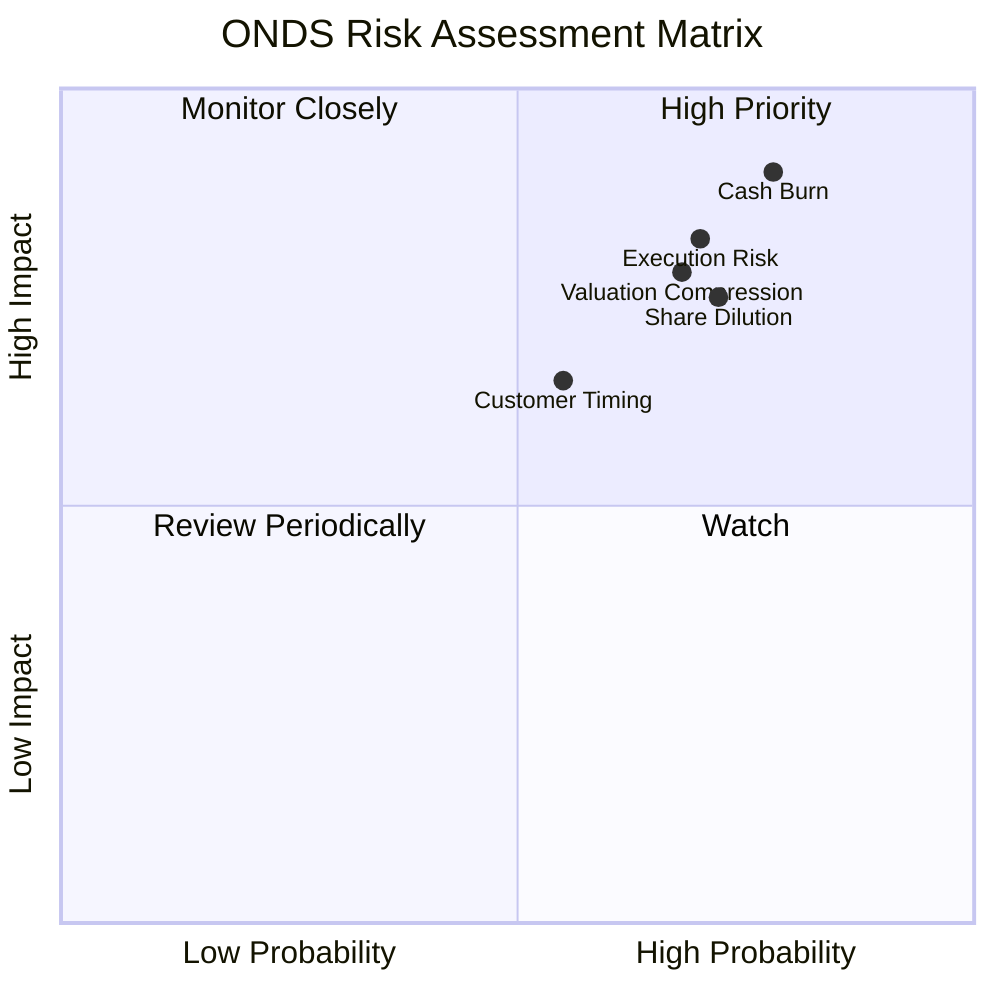
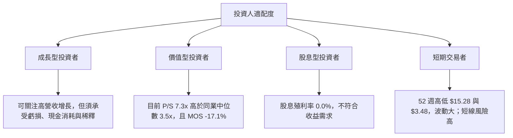

# ONDS 基本面深度分析報告
> **報告日期**：2026-11-28 ｜ **語言**：繁體中文 ｜ **數據來源**：SEC 申報資料 (XBRL)、Yahoo Finance、Finviz、StockAnalysis、Roic.ai ｜ **分析師**：CFA 級機構研究

---

## 目錄

| # | 章節 | 核心結論 |
|---|------|----------|
| 1 | 執行摘要 | 減碼；加權合理價值 $3.33；MOS -17.1% |
| 2 | 公司概覽與商業模式 | 無市場份額數據；業務具技術差異化，但客戶鎖定與規模經濟尚待驗證 |
| 3 | 損益表深度分析 | TTM 營收 $331.49M、TTM 成長 1,239.4%；營業利益率 -126.2% |
| 4 | 資產負債表分析 | 現金及短期投資 $788.87M；計息債務的驗證數字不可得 |
| 5 | 現金流量深度分析 | TTM FCF -$311.55M、FCF Yield -12.85%；現金消耗速度需密切追蹤 |
| 6 | 獲利能力與資本效率 | ROIC -20.9% 對 WACC 14.0%，目前摧毀股東價值 |
| 7 | 相對估值分析 | 本公司 P/S 7.3x，高於同業中位數 3.5x；自身歷史百分位 32% |
| 8 | DCF 內在價值評估 | DCF N/A：TTM 營業利益為負，不能將虧損直接折現作為可信估值 |
| 9 | 成長催化劑 | 無可引用 TAM；自動化無人系統、反無人機與無線網路放量是主要觀察方向 |
| 10 | 風險矩陣 | 現金消耗、執行與獲利轉正、股價波動及稀釋為主要風險 |
| 11 | 投資建議 | MOS 對應減碼；低於約 $3.00 才達到 10% MOS 的估值門檻 |

---

## 1. 執行摘要

截至 2026-11-25 收盤，ONDS 股價為 **$3.90**，加權合理價值為 **$3.33**，依統一定義安全邊際 MOS＝(加權合理價值−現價)÷加權合理價值，為 **-17.1%**，對應規則 20 的 **減碼**。公司 TTM 營收為 **$331.49M**、TTM 營收年增 **1,239.4%**，但 TTM 營業利益率為 **-126.2%**、ROIC 為 **-20.9%**，TTM FCF 為 **-$311.55M**，顯示高速營收擴張尚未轉化為營業槓桿或正向自由現金流。估值採用同業 P/S 與分析師共識加權，而不是無法可靠建立的 DCF；現價較該加權合理價值高約 **17.1%**。

### 1.0 一頁式投資儀表板（Portfolio Manager 30 秒速讀）

| 項目 | 內容 |
|------|------|
| **投資論點（3 句）** | ① TTM 營收 **$331.49M**、TTM 年增 **1,239.4%**，顯示併購及產品交付後規模快速放大。② TTM 毛利率 **36.4%**，但營業利益率 **-126.2%**、ROIC **-20.9%**，營收成長尚未證明能帶來經營獲利。③ TTM FCF **-$311.55M**，現金及短期投資 **$788.87M**，流動性提供緩衝，但若現金消耗延續，融資及稀釋風險會升高。 |
| **綜合評分** | **4.4/10**（引用 1.1；六項算術平均） |
| **財務健康** | 🟡 現金與短期投資 $788.87M、Piotroski F-Score 3/8；但 TTM FCF -$311.55M、CCC 181 天 |
| **ROIC vs WACC** | **-20.9% vs 14.0%**；差距 -34.9 個百分點，目前摧毀股東價值 |
| **FCF 趨勢** | TTM 現金流為負；FCF Yield **-12.85%** |
| **估值** | Forward P/E **-26.45x**（負盈餘倍數不可作正向估值解讀）｜EV/EBITDA **-5.851x**｜FCF Yield **-12.85%** |
| **DCF 內在價值（基準）** | **N/A**；TTM 營業利益為負，DCF 模型未提供。現價相對 DCF 折溢價：N/A |
| **安全邊際（MOS）** | **-17.1%＝($3.33−$3.90)÷$3.33**；加權合理價值基準來自 8.8；🔴 小於 10%，無安全邊際 |
| **預期報酬（基準情境 12M）** | N/A；DCF 情境模型未提供 |
| **關鍵風險（前二）** | TTM FCF -$311.55M，現金消耗可能迫使再融資或稀釋；營業利益率 -126.2%，收入放大仍未帶來營業槓桿 |
| **評級 + 信心度** | **🟠 減碼**；信心：中。評級依 MOS -17.1% 對應減碼，未作質化調整；DCF 不可用，合理價值依賴相對估值與分析師共識 |

### 1.1 綜合評分卡（全報告唯一）

| 維度 | 評分（1–10） | 主要依據（引用數字與其來源章節） |
|------|--------------|----------------------------------|
| 成長性 | 8.0 | TTM 營收年增 **1,239.4%**、最新一季年增 **1,558.6%**，但部分成長來自低基期及業務規模變動（第 3 章） |
| 獲利能力 | 1.5 | TTM 營業利益率 **-126.2%**、ROIC **-20.9%**，Piotroski F-Score **3/8**（第 3、6 章） |
| 財務健康 | 6.0 | 現金及短期投資 **$788.87M**；但 FCF **-$311.55M**、CCC **181 天**，稀釋股數測試未通過（第 4、5、6 章） |
| 估值 | 3.0 | MOS **-17.1%**；本公司 P/S **7.3x**，同業 P/S 中位數 **3.5x**（第 7、8 章） |
| 護城河 | 4.5 | 有專用無線、無人機及反無人機系統等產品；未提供市場份額、續約、軟體經常性收入或客戶集中度等量化證據（第 2 章） |
| 管理層與資本配置 | 3.5 | FY2025 SBC **$16.02M**，最近四季 SBC 約 **$155.41M**；股數增加測試未通過，擴張與併購整合的資本回報尚未證明（第 3、5 章） |
| **綜合評分** | **4.4** | 六項算術平均：(8.0+1.5+6.0+3.0+4.5+3.5)÷6＝**4.4** |

### 1.2 五大投資論點 + 三大核心風險

| 類型 | 項目 | 具體依據 | 信心度 |
|------|------|----------|--------|
| 🟢 **投資論點①** | 收入規模急速擴大 | TTM 營收 **$331.49M**，TTM 年增 **1,239.4%**；最新一季營收 **$167.49M**，單季年增 **1,558.6%** | 🟡 中 |
| 🟢 **投資論點②** | 毛利具一定產品經濟性 | TTM 毛利率 **36.4%**，高於 AVAV、KTOS、RCAT 的同業中位數 **23.0%**；但單季毛利率波動明顯 | 🟡 中 |
| 🟢 **投資論點③** | 資產負債表有現金緩衝 | 現金及短期投資 **$788.87M**，可吸收一段時間營運現金流出；但不能視作永久融資來源 | 🟢 中高 |
| 🟢 **投資論點④** | 產品覆蓋多個國防及自動化需求 | 公司涵蓋私有無線、無人系統、CUAS 與場域防護；若形成跨產品銷售，可能提升客戶價值 | 🟡 中低 |
| 🟢 **投資論點⑤** | 股價已較近期高點大幅回落 | 2026-11-25 收盤 **$3.90**，較 52 週高點 **$15.28** 低約 **74.5%**；跌幅降低價格，但不等同估值便宜 | 🟡 中 |
| 🟡 **風險①** | 高現金消耗 | TTM 營業現金流 **-$290.76M**、TTM FCF **-$311.55M**；若營運資金與經營虧損未改善，現金餘額會快速下降 | 🔴 高衝擊 |
| 🔴 **風險②** | 高估值與獲利缺口並存 | P/S **7.3x**，同業中位數 **3.5x**；營業利益率 **-126.2%**、ROIC **-20.9%** | 🔴 高 |
| 🔴 **風險③** | 稀釋與執行風險 | Piotroski 股數測試未通過；最近四季 SBC 約 **$155.41M**，佔 TTM 營收約 **46.9%**（期間與數據口徑需以申報資料核驗） | 🔴 高 |

### 1.3 快速統計卡片

| 指標 | 公司實際值（期間） | 同業中位數 | 狀態 |
|------|--------------------|------------|------|
| 營收成長（TTM） | **1,239.4%** | — | 🟢 高成長，但基期與併購因素需拆分 |
| 營收成長（最新一季年增） | **1,558.6%** | **22.0%** | 🟢 遠高於同業，惟可持續性尚未驗證 |
| 毛利率（TTM） | **36.4%** | **23.0%** | 🟢 高於同業中位數 |
| 營業利益率（TTM） | **-126.2%** | — | 🔴 大幅虧損 |
| ROIC（TTM） | **-20.9%** | — | 🔴 低於 14.0% WACC |
| Forward P/E | **-26.45x** | **21.7x**¹ | 🔴 公司 Forward EPS 為負，無法作正向可比 |
| FCF Yield（TTM） | **-12.85%** | — | 🔴 現金流為負 |
| Piotroski F-Score | **3 / 8** | — | 🔴 財務趨勢偏弱 |

¹ 三家公司 Forward P/E 的中位數；RCAT 為 -2.9x，負盈餘倍數不具一般正向估值意義。

### 1.4 投資結論

```text
╔══════════════════════════════════════════════════════════════════╗
║                    📊 投資結論摘要                               ║
╠══════════════════════════════════════════════════════════════════╣
║  評級：減碼（依 MOS -17.1% 對應規則 20，未調整）                 ║
║  價格（2026-11-25 收盤）：$3.90                                  ║
║  DCF 內在價值（基準）：N/A（TTM 營業利益為負）                   ║
║  安全邊際 MOS：-17.1%（＝($3.33−$3.90)÷$3.33）                  ║
║  加權合理價值（8.8）：$3.33                                      ║
║  綜合評分：4.4/10（引用 1.1）                                    ║
║  適合投資人：能承受高波動、接受現金消耗及稀釋風險的投資人；      ║
║              不適合以穩定獲利、低波動或股息收入為主的投資人      ║
╚══════════════════════════════════════════════════════════════════╝
```

---

## 2. 公司概覽與商業模式

### 2.1 業務結構與收入來源

Ondas Inc. 透過 Ondas Networks 與 Ondas Autonomous Systems 兩個業務部門，提供私有無線通訊、無人機及自動化資料解決方案。產品描述涵蓋 CUAS、場域防護、攔截無人機及 Cyber/RF 偵測、識別與追蹤等。未提供分部營收、軟體與服務收入金額或各業務收入佔比，因此不製作收入佔比圖，以免把產品描述誤當成財務分部。



### 2.2 市場份額

市場份額數據未提供，亦無可引用的市場規模與年份，因此不以推估比例製作市佔圖。ONDS TTM 營收為 **$331.49M**，最新一季營收年增 **1,558.6%**，高於 AVAV、KTOS、RCAT 的最新季度年增中位數 **22.0%**；但該差距不能直接解讀為市場份額提升，因為公司本身基期較小，且產品交付、收購整合可能影響成長率。

### 2.3 競爭護城河分析



### 2.4 護城河強度

| 護城河項目 | 強度（強／中／弱） | 證據（引用數字或事實） | 會削弱它的情況 |
|------------|--------------------|------------------------|----------------|
| 技術與產品差異化 | 中 | 公司產品涵蓋私有無線、無人機、CUAS、攔截與 RF 偵測；但未提供性能測試、競標勝率或部署量 | 產品效果未達軍方或工業客戶要求、競品快速追上 |
| 軟體生態系統 | 弱至中 | Sentrycs CoRF 涵蓋偵測至緩解流程；軟體收入、訂閱率與續約率未提供 | 收入主要來自一次性硬體，缺少經常性服務收入 |
| 網路效應 | 弱 | 未提供使用者、裝置或資料網路規模數據 | 系統部署增加未提升資料價值或客戶轉換成本 |
| 客戶鎖定 | 弱至中 | 國防及關鍵基礎設施系統可能涉及整合與認證；但客戶留存、合約期及集中度未提供 | 客戶改採多供應商方案、採購週期延長 |
| 規模效應 | 弱 | TTM 營收已達 **$331.49M**，但 TTM 營業利益率仍為 **-126.2%**，尚未見到規模帶來的正向營業槓桿 | 營收增長伴隨更高交付、研發及整合成本 |
| 生態夥伴 | 弱至中 | 產品定位涵蓋國防、工業與場域防護；未提供通路、合作夥伴收入貢獻 | 夥伴未帶來可驗證的訂單轉化 |

護城河評分卡分數為 **4.5/10**：產品線具有差異化可能，但市場份額、客戶鎖定、軟體經常性收入及規模經濟尚缺乏量化證據。

---

## 3. 損益表深度分析

### 3.1 年度收入成長趨勢（近 4 年）

下圖以 FY2022–FY2025 年報營收為準；年增率以年度營收計算。因年度收入有明顯波動，四年 CAGR 不能單獨代表可持續成長速度。

```text
╔══════════════════════════════════════════════════════════════════╗
║                 Ondas Inc. 年度收入趨勢（FY2022–FY2025）          ║
╠══════════════════════════════════════════════════════════════════╣
║  FY2022  $2.13M   █░░░░░░░░░░░░░░░░░░░░  YoY: -26.8% 🔴        ║
║  FY2023  $15.69M  ██████░░░░░░░░░░░░░░  YoY: +636.6% 🟢       ║
║  FY2024  $7.19M   ███░░░░░░░░░░░░░░░░░  YoY: -54.2% 🔴        ║
║  FY2025  $50.73M  ████████████████████  YoY: +605.3% 🟢       ║
║                                                                  ║
║  FY2022–FY2025 CAGR：+188.0%（起訖年度複合成長）                 ║
║  注意：年度營收從 $2.13M 到 $50.73M，期間波動及基期效應極大。   ║
╚══════════════════════════════════════════════════════════════════╝
```

CAGR 算式：\((50.73÷2.13)^{1/3}-1 \approx 188.0\%\)。FY2023、FY2025 的高成長與低基期及業務規模變動相關；FY2024 營收反而下滑 **54.2%**，因此不宜把三年 CAGR 直接外推。

### 3.2 季度收入趨勢分析

| 季度 | 營收 | QoQ 成長 | YoY 成長（單季） | 備註 |
|------|------:|---------:|-----------------:|------|
| 2025 Q4 | $30.11M | +198.1%¹ | +629.2% | 對照 2025 Q3 $10.10M；成長仍受低基期影響 |
| 2026 Q1 | $50.12M | +66.4% | +1,079.9% | 交付及業務規模擴大 |
| 2026 Q2 | $83.77M | +67.2% | +1,235.4% | 連續擴張，但需觀察毛利及現金回收 |
| 2026 Q3 | $167.49M | +99.9% | +1,558.6% | 單季營收接近前一季兩倍，規模增長突出但營業虧損同步擴大 |

¹ 2025 Q4 QoQ 以 2025 Q3 營收 $10.10M 計算。其餘 QoQ 依各季營收計算。最新一季年增率 **1,558.6% 是單季 YoY**，不可與 TTM 成長率混用。TTM 營收成長率為 **1,239.4%**。

### 3.3 利潤率演變分析

| 利潤率指標 | FY2022 | FY2023 | FY2024 | FY2025 | TTM／最新季 | 趨勢與評估 |
|------------|-------:|-------:|-------:|-------:|------------:|------------|
| **毛利率** | 52.1% | 40.7% | 4.8% | 39.7% | TTM 36.4% | FY2024 大幅下滑後回升；產品組合、業務規模及交付結構影響大，🟡 |
| **營業利益率** | -2,347.4% | -243.7% | -481.4% | -115.1% | TTM **-126.2%**；最新季 **-113.1%** | 相對 FY2024 有改善，但仍深度虧損；虧損金額隨擴張加大，🔴 |
| **淨利率** | -3,438.5% | -285.8% | -528.0% | -260.2% | 跨來源口徑不一致 | 單季淨利受非經常性項目影響顯著，不以單一 TTM 淨利率判定常態獲利，🔴 |

年度毛利率與營業利益率是以年度損益表收入、毛利及營業利益計算；TTM 營業利益率採 SEC 財報計算值 **-126.2%**，最新季度營業利益率採驗證數字 **-113.1%**。其他資料源列示不同營業利益率，可能涉及調整與期間口徑差異，本報告遵循 SEC 申報資料計算值。

**利潤率演變深度解析：** TTM 毛利率 **36.4%** 高於同業中位數 **23.0%**，但最新單季毛利率按季報列示毛利及營收計算約 **21.8%**（毛利 $36.50M ÷ 營收 $167.49M），明顯低於 TTM。這可能反映季度產品組合或交付結構改變；新聞亦提及 Q3 精準打擊產品組合壓低毛利，但僅作外部報導線索，未視為已由申報資料證實。營業利益率仍為負三位數，表示研發、銷售、管理與整合成本相對收入過高，毛利改善尚未轉化為營業槓桿。

### 3.4 費用結構分析

費用明細中，無法將研發、銷售、管理費用及併購相關項目完整拆解至同一期間的可核對金額，因此不製作費用結構圓餅圖，也不以營業虧損反推費用項目。可觀察到的研發費用為 FY2025 **$20.88M**，高於 FY2024 **$12.48M**；這支持公司仍處於產品開發與擴張階段，但尚不能據此計算完整費用佔比。

### 3.5 季度 EPS 趨勢與盈餘品質（Quality of Earnings）

最近四季 EPS 預估值及實際值欄位未提供有效數字，不能可靠判定超預期或不及預期。StockAnalysis 資料列示的 EPS 實際值為 2025 Q4 **-$0.27**、2026 Q1 **$0.59**、Q2 **-$0.15**、Q3 **-$0.10**；其中 Q1 正 EPS 與單季淨利 **$362.95M** 同期出現，但後續季度再次虧損，顯示一次性或非營運項目可能影響盈餘。分析師預估與 surprise 數據為 NaN，故不將 EPS 判定為 beat 或 miss。

| 盈餘品質項目 | 數值／佔比 | 評估 |
|--------------|-----------|------|
| 股權薪酬 SBC / 營收 | 最近四季 SBC 合計約 **$155.41M** ÷ TTM 營收 $331.49M＝約 **46.9%** | 🔴 比例極高；最近四季 SBC 來自季度列示值，應以申報文件核對期間口徑。高 SBC 會稀釋現有股東，即使會計上非現金亦有經濟成本 |
| SBC / 營業現金流 | SBC 約 **$155.41M**；TTM OCF **-$290.76M**；以現金消耗絕對值計約 **53.5%** | 🔴 SBC 數額相當於現金消耗的一大部分；此比率不是正向現金流轉換率 |
| FCF / 淨利（現金轉換率） | **N/A**：TTM 淨利跨來源數字不一致，無法使用一致期間口徑計算 | 🔴 不以不相容數據推導比率；TTM FCF 本身為負，盈餘現金轉換品質偏弱 |
| 一次性／非經常性損益 | 2026 Q1 淨利 **$362.95M**，其餘三季淨利均為負；具體一次性項目金額未提供 | 🔴 季度盈餘波動很大，Q1 正 EPS 不能直接視為常態獲利 |
| 有效稅率異常 | N/A；未提供可核對的 TTM 現金稅與稅前損益橋接 | 🟡 不判定正淨利來自稅務利益 |
| 資本化支出 vs 費用化 | TTM Capex **$20.80M**；資本化開發成本明細未提供 | 🟡 無法判定是否有大量成本資本化；不反推資本化金額 |

**盈餘品質結論：** 目前不應將單季正 EPS 或 TTM 淨利欄位視為持續性經濟獲利。TTM FCF **-$311.55M**、SBC 相對營收比例高、季度淨利波動極大，三者共同降低會計盈餘的可持續性。估值宜優先參照收入及現金消耗，而非 P/E。

---

## 4. 資產負債表分析

### 4.1 資產結構分解

最新季末 StockAnalysis 資料列示總資產約 **$4.028B**，其中商譽約 **$1.501B**、其他無形資產約 **$1.025B**、流動資產約 **$1.297B**。商譽與無形資產合計約佔總資產 **62.7%**，反映併購及無形資產的資產權重較高；若收購業務現金流未達預期，減損風險會增加。此細項來自季度資產負債表彙整資料，與不同資料源總資產口徑可能存在差異。



### 4.2 流動性與營運資金分析

市場資料列示流動比率 **3.389**、速動比率 **2.604**；FY2025 年報流動資產 $685.90M、流動負債 $141.82M，按年度期末口徑計算流動比率約 **4.84x**。兩者期間不同，不能直接當成同一時點比較。現金及短期投資 **$788.87M** 提供短期緩衝，但營運現金流每年大額為負，流動性不代表現金消耗沒有風險。

| 指標 | 最新 TTM | 一年前 TTM | 變化 | 解讀 |
|------|----------:|-----------:|------:|------|
| DSO 應收帳款天數 | **140 天** | **77 天** | **+63 天** | 應收帳款回收週期拉長，可能與大額專案交付、收款條件或客戶付款節奏有關；若持續上升，收入增長不易轉化為現金 |
| DIO 存貨天數 | **182 天** | **278 天** | **-96 天** | 存貨周轉有所改善，但 182 天仍代表資金占用時間較長；需觀察是否因營收增長而非單純清庫存 |
| DPO 應付帳款天數 | **141 天** | **186 天** | **-45 天** | 對供應商延後付款的程度下降，可能減少短期營運資金融資來源 |
| CCC 現金轉換週期 | **181 天** | **169 天** | **+12 天** | 應收天數增加抵消存貨改善，現金回收整體變慢；營運資金仍是 FCF 壓力來源 |

### 4.3 債務結構分析

驗證的資本成本資料中，總債務為 **N/A**，不可用缺失值反推或填補。其他市場資料源列示債務 **$62.81M**、淨現金／淨債務 **$726.06M**，但與驗證的「總債務 N/A、淨現金 $788.87M」口徑不一致；本節依優先規則引用驗證數字，不混合計算。

```text
╔══════════════════════════════════════════════════════════════════╗
║                    Ondas 債務健康診斷                            ║
╠══════════════════════════════════════════════════════════════════╣
║  總債務：        N/A（驗證資料未提供）                            ║
║  現金及短期投資：$788.87M  ████████████████████  🟢               ║
║  淨現金：        $788.87M（驗證數字）              🟢             ║
║                                                                  ║
║  Debt/EBITDA：   N/A；TTM EBITDA 為負，倍數不具正常解讀意義      ║
║  利息保障倍數：  N/A；利息費用及可比計息債務口徑不足              ║
║  資料注意：市場資料另列 $62.81M 債務，未與驗證債務口徑一致，      ║
║            不納入本圖推算。                                      ║
╚══════════════════════════════════════════════════════════════════╝
```

### 4.4 股東權益趨勢

```text
╔══════════════════════════════════════════════════════════════════╗
║                 Ondas 歷年股東權益（年末）                       ║
╠══════════════════════════════════════════════════════════════════╣
║  FY2022  $58.22M   ████████████████████                         ║
║  FY2023  $33.14M   ███████████                                  ║
║  FY2024  $16.58M   █████                                        ║
║  FY2025  $437.81M  ████████████████████████████████████████████ ║
║                                                                  ║
║  FY2025 權益大幅增長，但同年總資產升至 $1.13B；需區分資本募集、 ║
║  收購與營運獲利對權益變動的貢獻，不能將帳面權益躍升等同內生獲利。║
╚══════════════════════════════════════════════════════════════════╝
```

---

## 5. 現金流量深度分析

### 5.1 現金流量瀑布圖

TTM 淨利數字存在跨來源口徑不一致，因此圖中不列淨利金額；採用驗證的營業現金流、資本支出與 FCF 數值。股息與回購金額未提供，亦不假設有資本返還。



依驗證數字，FCF 定義為營業現金流減資本支出，採用 **-$311.55M**；其他市場資料源列示 FCF **-$311.60M**，差異來自資本支出口徑及四捨五入，本報告使用驗證值。

### 5.2 FCF 轉換率趨勢

| 年度／期間 | FCF | 淨利 | FCF / 淨利 | 趨勢 |
|------------|----:|-----:|-----------:|------|
| FY2022 | -$40.89M | -$73.24M | 約 55.8% | 兩者皆負，比率不代表正向現金轉換 |
| FY2023 | -$34.30M | -$44.84M | 約 76.5% | 現金消耗低於會計虧損，但仍為負 |
| FY2024 | -$35.20M | -$38.01M | 約 92.6% | 現金流出接近淨損 |
| FY2025 | -$40.88M | -$132.02M | 約 31.0% | 淨損大於 FCF 流出，含非現金費用或其他損益影響 |
| TTM 至 2026-09-30 | **-$311.55M** | N/A：跨來源口徑不一致 | **N/A** | 近期現金消耗大幅擴張，優先關注營運現金流與營運資金 |

年度比率是 FCF 除以淨利的數學結果；當分子分母皆為負時，不應解讀為「正向轉換」。TTM 不計算比率，避免把不同來源及期間的淨利數據拼接。

### 5.3 自由現金流趨勢

```text
╔══════════════════════════════════════════════════════════════════╗
║                   自由現金流趨勢                                 ║
╠══════════════════════════════════════════════════════════════════╣
║  FY2022  -$40.89M  ◀████████████████████                         ║
║  FY2023  -$34.30M  ◀█████████████████                            ║
║  FY2024  -$35.20M  ◀█████████████████                            ║
║  FY2025  -$40.88M  ◀████████████████████                         ║
║  TTM     -$311.55M ◀████████████████████████████████████████████ ║
║                                                                  ║
║  TTM FCF Yield：-12.85%｜TTM OCF：-$290.76M｜Capex：$20.80M      ║
║  評估：年度歷史現金流出約 $34M–$41M，最新 TTM 消耗顯著擴大。     ║
╚══════════════════════════════════════════════════════════════════╝
```

### 5.4 資本配置評估

未提供完整資本配置拆分，無法以可靠金額畫股息、回購、研發、收購及留存資金的圓餅圖。已知 FY2025 SBC **$16.02M**，TTM Capex **$20.80M**，營業現金流為負；季度 SBC 數列顯示最近四季合計約 **$155.41M**，可能受不同期間與資料彙整口徑影響，需以 SEC 10-Q 核對。公司沒有股息殖利率，資料列示股息殖利率 **0.0%**。現階段資本配置的核心考驗是能否將擴張及收購轉化為現金流，而非資本返還。

---

## 6. 獲利能力與資本效率

### 6.1 ROE / ROA / ROIC 趨勢

| 指標 | 歷史／TTM 數值 | 行業均值對比 | 評估 |
|------|----------------|--------------|------|
| ROE | TTM 驗證值 **4.6%**；其他資料源列 **7.3%** | 未提供可核對的同業均值，不列 | 來源差異顯示分母或期間口徑不同；依 QUALITY FIGURES 採 4.6% |
| ROA | TTM 另一資料源列 **-9.7%**；QUALITY FIGURES 顯示 ROA > 0 測試通過 | 未提供 | 口徑不一致，不將單一 ROA 數字與 F-Score 測試混用 |
| ROIC | TTM **-20.9%** | 未提供 | 明顯低於 WACC 14.0%，資本投入尚未產生足夠營業回報 |
| 營業利益率 | TTM **-126.2%**；最新季 **-113.1%** | 未提供 | 仍深度虧損，需觀察收入增加後成本是否被攤薄 |

### 6.2 ROIC vs WACC 分析（核心價值創造判斷）

資本成本區塊列示調整後 Beta **2.00**，原始 Beta **3.08**。CAPM 股權成本 **14.94%**，稅前債務成本 **10.47%**，權重為股權 **97.5%**、債務 **2.5%**；原始 WACC 計算值 **14.77%**，受設定上限限制採用 **14.00%**。本節依照該 WACC，與 ROIC 比較。

```text
╔══════════════════════════════════════════════════════════════════╗
║                ROIC vs WACC 深度分析                            ║
╠══════════════════════════════════════════════════════════════════╣
║  WACC（採用資本成本資料）：                                      ║
║  ├── 無風險利率（10Y美債）：              4.94%                  ║
║  ├── 市場風險溢酬（假設）：                5.00%                  ║
║  ├── Beta 原始／採用調整後：               3.08／2.00             ║
║  ├── Ke = 4.94% + 2.00 × 5.00% =          14.94%                 ║
║  ├── 稅前債務成本：                        10.47%                 ║
║  ├── 稅後 Kd = 10.47% × (1−21%) =          8.27%                  ║
║  ├── 權重：股權 97.5%，債務 2.5%                                  ║
║  ├── 未限制計算值：                             14.77%             ║
║  └── 採用 WACC：受 7%–14% 區間限制為          14.00%             ║
║                                                                  ║
║  ROIC（TTM）：                         -20.9%                   ║
║  EVA spread = ROIC − WACC = -20.9% − 14.0% = -34.9pp            ║
║                                                                  ║
║  ROIC  -20.9%  ◀████████████████████                            ║
║  WACC   14.0%   ▓▓▓▓▓▓▓▓▓▓▓▓▓▓                                  ║
║                                                                  ║
║  結論：ROIC 低於 WACC 34.9 個百分點；目前營運回報未覆蓋資本成本，║
║  代表資本擴張若未改善回報，會摧毀而非創造股東價值。              ║
╚══════════════════════════════════════════════════════════════════╝
```

### 6.3 杜邦三因素分解

| 因素 | 數值（TTM） | 解讀 |
|------|-------------|------|
| 淨利率 | **33.1%** | 依 QUALITY FIGURES 的杜邦列示值；在營業利益率為負的情況下，不能把高淨利率視為常態營運盈利，可能受非營運或一次性項目影響 |
| 資產週轉率 | **0.08** | 資產相對營收轉換效率低；併購形成的商譽與無形資產提高資產基數 |
| 權益乘數 | **1.70** | 槓桿不是 ROE 的主要驅動因子 |
| **ROE** | **4.6%** | 數值照抄 QUALITY FIGURES：33.1% × 0.08 × 1.70 ≈ 4.6%；乘積尾差來自四捨五入 |

### 6.4 財務體質：Piotroski F-Score

Piotroski F-Score 為 **3/8**；一項長期負債測試因缺資料無法判定，故可判定測試數少於九項。逐項沿用 QUALITY FIGURES 結果：

| 測試 | 結果 | 解讀 |
|------|------|------|
| ROA > 0 | ✅ 通過 | 指定期間測試為正；不代表所有來源計算出的 ROA 口徑一致 |
| 營業現金流 > 0 | ❌ 未通過 | TTM OCF 為 **-$290.76M**，經營活動仍大量消耗現金 |
| ROA 高於一年前 | ✅ 通過 | 相較一年前改善，但單項改善不足以抵銷負現金流 |
| 營業現金流 > 淨利（應計品質） | ❌ 未通過 | 現金流弱於盈餘測試，需留意盈餘品質及應收帳款 |
| 長期負債 ÷ 總資產低於一年前 | — 無法判定 | 缺乏對應輸入資料，不補推 |
| 流動比率高於一年前 | ❌ 未通過 | 指標未優於一年前，雖現金仍高，但短期流動性趨勢未改善 |
| 稀釋股數未增加 | ❌ 未通過 | 股數增加會攤薄每股經濟價值 |
| 毛利率高於一年前 | ❌ 未通過 | 毛利率比較測試未過，反映產品組合或成本壓力 |
| 資產週轉率高於一年前 | ✅ 通過 | 資產使用效率改善，但整體週轉率仍低 |

---

## 7. 相對估值分析

### 7.1 同業估值比較表格

同業資料依 Yahoo Finance Peer multiples。公司本身倍數依市場資料及驗證數據；負盈餘的 Forward P/E、EV/EBITDA 不宜當成一般正值倍數解讀。

| 估值指標 | **ONDS** | **AVAV** | **KTOS** | **RCAT** | 本公司評估 |
|----------|---------:|---------:|---------:|---------:|-----------|
| **Trailing P/E** | N/A | N/A | 253.2x | N/A | 🔴 公司尚未形成穩定正向 EPS |
| **Forward P/E** | -26.45x | 21.7x | 27.2x | -2.9x | 🔴 ONDS Forward EPS 為負，倍數不可直接比較 |
| **P/S Ratio** | **7.3x** | 2.4x | 3.5x | 3.9x | 🔴 高於同業中位數 **3.5x** 約 2.1 倍 |
| **EV/EBITDA** | -5.851x | 23.4x | 50.8x | -0.5x | 🔴 公司 EBITDA 為負，倍數失去一般經濟意義 |
| **最新季度營收 YoY** | **1,558.6%** | 5.7% | 35.7% | 22.0% | 🟢 成長率大幅高於同業，但基期與併購效應需拆分 |
| **毛利率（TTM）** | **36.4%** | 26.5% | 23.0% | 8.7% | 🟢 高於同業中位數 **23.0%**，但最近單季降至約 21.8% |

同業 P/S 中位數由 **2.4x、3.5x、3.9x** 得出 **3.5x**。公司 P/S 7.3x 仍反映市場對成長與產品商業化的高預期；在公司營業利益率 -126.2%、FCF 為負的條件下，倍數溢價須由持續成長及未來利潤率改善支持。

### 7.2 歷史估值區間分析

提供的自身歷史估值區間為 **TTM P/S**，不以 P/E 替代。

```text
╔══════════════════════════════════════════════════════════════════╗
║               ONDS 自身歷史 TTM P/S 區間                        ║
╠══════════════════════════════════════════════════════════════════╣
║  5 年低點：2.9x   ├──────●───────────────────────────────┤ 140.6x ║
║  歷史中位數：17.9x              ▲                         ║
║  當前：7.3x           ▲                                   ║
║  當前歷史百分位：32%                                          ║
║                                                                  ║
║  解讀：目前低於自身歷史中位數，但歷史區間極寬且受股價波動影響，║
║  不能單憑低於中位數認定便宜；相對同業 P/S 中位數 3.5x 仍有溢價。║
╚══════════════════════════════════════════════════════════════════╝
```

### 7.3 情境價值（Bear / Base / Bull）

**N/A（DCF 無法計算：TTM 營業利益為負，DCF MODEL 未提供情境結果）**。依數據規則，不自行建立悲觀、基準或樂觀 DCF 目標價。

### 7.4 相對估值隱含價格區間

```text
╔══════════════════════════════════════════════════════════════════╗
║                相對估值方法隱含價格                              ║
╠══════════════════════════════════════════════════════════════════╣
║  同業 P/S：$1.85 ───────── 現價 $3.90 ─────────── 共識 $16.68   ║
║  同業 P/S 折價：-52.6%                      共識上行：+327.7%    ║
║                                                                  ║
║  同業 P/S：AVAV 2.4x、KTOS 3.5x、RCAT 3.9x                      ║
║  中位數 3.5x × ONDS TTM 營收推得每股價值：$1.85                 ║
║  分析師共識：10 位分析師平均目標價 $16.68                       ║
╚══════════════════════════════════════════════════════════════════╝
```

| 方法 | 每股價值 | 相對現價 | 計算依據 |
|------|---------:|---------:|----------|
| 同業 P/S | **$1.85** | **-52.6%** | AVAV、KTOS、RCAT 的 P/S 中位數 **3.5x** × ONDS TTM 營收 |
| 分析師共識目標價 | **$16.68** | **+327.7%** | 10 位分析師平均目標價；為市場預期參考，不是營運現金流估值 |
| 同業 Forward P/E | 不納入 | — | 方法不可計算，按公司類型固定權重規則剔除 |

---

## 8. DCF 內在價值評估（Discounted Cash Flow）

> **DCF MODEL：N/A。** TTM 營業利益為負，且公司目前營運現金流與 FCF 均大幅為負。以現有虧損作為現金流基礎折現，結果會高度取決於未經驗證的扭虧時間與利潤率假設，因此不建立自製 DCF，也不提供 DCF 基準每股內在價值或 DCF 情境價值。

### 8.0 估值推理鏈（Thinking Logic）

**Step 1 — 公司價值的主要來源**

ONDS 的價值理論上由 Networks 私有無線業務、Autonomous Systems 無人機／CUAS 業務，以及未來可能的軟體與服務經常性收入構成；但分部營收佔比與軟體收入未提供，不能將目前 **$331.49M TTM 營收**拆成可驗證的業務組合。對估值最關鍵的變數是「營收能否轉為正向營業利潤與自由現金流」：目前 TTM 營業利益率 **-126.2%**、ROIC **-20.9%**、FCF **-$311.55M**，即使收入年增 1,239.4%，仍不足以證明可持續的現金流底盤。

**Step 2 — 模型選擇**

| 決策點 | 本報告採用 | 理由（含數字） | 曾考慮但否決 | 否決理由 |
|--------|-----------|----------------|--------------|----------|
| 現金流定義 | 不計算 DCF | TTM 營業利益為負、TTM FCF -$311.55M | FCFF／FCFE DCF | 需要假設扭虧時點與長期利潤率，現有數據不足以構成可稽核模型 |
| 預測期 N | N/A | DCF MODEL 未提供 | 自行設定 5–10 年 | 不得另建模型或自行填假設 |
| 終值方法 | N/A | 無可用的正向基準 FCF | Gordon Growth／退出倍數 | 沒有可靠的正向預測現金流作基礎 |
| EBIT 基礎 | N/A | DCF MODEL 未提供 | GAAP 或非 GAAP EBIT | 不得自行選擇並創造預測值 |

**Step 3 — 假設推導鏈**

DCF 模型區塊為 N/A，故營收 CAGR、期末營業利潤率、永續成長率、Capex 比率、稀釋率、終值方法等模型假設均不適用；不以新聞目標或同業倍數拼接成 DCF。

**Step 4 — 最脆弱一環**

若日後建立 DCF，最脆弱假設會是營業利潤率由目前 **-126.2%** 收斂至正值的幅度與時間；若營收增長未帶來營業槓桿，DCF 價值會顯著下降，甚至仍無可用的正向終值。

**Step 5 — 計算路徑**



### 8.1 模型假設總表（Model Inputs）

| 假設項目 | 採用值 | 依據／來源 | 敏感度 |
|----------|--------|-------------|--------|
| 預測期長度 N | N/A | DCF MODEL 未提供；不另建預測 | N/A |
| 營收 CAGR（預測期） | N/A | 未提供 DCF 假設；TTM 成長 1,239.4% 不可直接當作未來 CAGR | N/A |
| 營業利潤率（期末） | N/A | TTM 營業利益率 -126.2%；缺少可驗證的扭虧路徑 | N/A |
| 有效稅率 | N/A | DCF MODEL 未提供 | N/A |
| Capex / 營收 | N/A | TTM Capex $20.80M，但不自行外推 | N/A |
| D&A / 營收 | N/A | DCF MODEL 未提供 | N/A |
| 營運資金變動 / 營收增額 | N/A | DCF MODEL 未提供；CCC 181 天不能直接替代 ΔWC 假設 | N/A |
| EBIT 基礎 | N/A | DCF MODEL 未提供 | N/A |
| SBC 處理 | N/A | 不建立 DCF，不設定 SBC 與股數方案 | N/A |
| 年稀釋率 | N/A | 股數測試未通過，但沒有完整逐年股數假設 | N/A |
| 永續成長率 g | N/A | 不建立終值 | N/A |
| 終值方法 | N/A | 不建立 DCF 終值 | N/A |
| WACC | **14.00%（若折現時採用）** | 資本成本資料：未限制計算值 14.77%，受 7%–14% 區間限制，採 14.00%；因 DCF 模型 N/A，未實際折現 | N/A |

本報告沒有建立 FCFF 或 FCFE 預測，因此不適用 SBC 組合 A/B/C；不能聲稱 SBC 已在某個自製模型中計入一次。

### 8.2 折現率推導（WACC）

此 WACC 是資本成本資料中既有數值，供 ROIC 比較及可能的折現參考；不是本報告 DCF 的實際折現率，因 DCF 為 N/A。10Y 美債殖利率的觀察日未提供，故不補寫日期。Beta 使用調整後數字 **2.00**；原始 Beta **3.08**，按三分之二原始 Beta 加三分之一 1.00 計算為 2.39，並依資本成本區塊設定限制於 0.6–2.0 區間，因此採用 2.00。

```text
╔══════════════════════════════════════════════════════════════════╗
║                    WACC 推導（資本成本資料）                     ║
╠══════════════════════════════════════════════════════════════════╣
║  股權成本 Ke（CAPM）：                                           ║
║  ├── 無風險利率 Rf（10Y 美債）：      4.94%                     ║
║  ├── ERP（假設值）：                   5.00%                     ║
║  ├── 原始 Beta／調整後採用 Beta：       3.08／2.00                ║
║  ├── Beta 調整計算：⅔×3.08 + ⅓×1.00 = 2.39，按上限採 2.00      ║
║  └── Ke = 4.94% + 2.00 × 5.00% =       14.94%                   ║
║                                                                  ║
║  債務成本 Kd：                                                   ║
║  ├── 稅前 Kd：                         10.47%                   ║
║  ├── 預設稅率：                         21.0%                   ║
║  └── 稅後 Kd = 10.47% × (1−21.0%) =     8.27%                    ║
║                                                                  ║
║  資本結構權重：股權 97.5%，債務 2.5%                             ║
║  未限制計算值：14.77%；限制區間：7%–14%；採用 WACC：14.00%       ║
╚══════════════════════════════════════════════════════════════════╝
```

**逐步演算（依資本成本區塊數值）：**

1. **Ke**＝4.94%＋2.00×5.00%＝**14.94%**。
2. **稅前 Kd**＝資本成本區塊列示 **10.47%**；利息費用與平均計息負債的原始金額未提供，不能在此獨立複算。
3. **稅後 Kd**＝10.47%×(1−21.0%)＝10.47%×0.79＝**8.27%**。
4. **權重**＝股權 **97.5%**、債務 **2.5%**；兩者相加為 **100.0%**。市值、債務權重的底層明細未在成本資本區塊列示，故直接引用。
5. **未限制 WACC**＝97.5%×14.94%＋2.5%×8.27%＝14.5665%＋0.20675%＝**14.77325%**，四捨五入為 **14.77%**；採用值受上限限制為 **14.00%**。

### 8.3 逐年自由現金流預測（基準情境）

**N/A：DCF MODEL 未提供逐年預測。** 原因是 TTM 營業利益為負，程式模型不對虧損直接折現；本報告依此不另建模型。因此無逐年營收、營業利潤率、NOPAT、FCFF、折現因子及預測期現值可列，也不以省略年度或自設數字填表。

歷史錨點：FY2022 FCF **-$40.89M**、FY2023 **-$34.30M**、FY2024 **-$35.20M**、FY2025 **-$40.88M**；最新 TTM FCF **-$311.55M**。TTM 現金流出與 FY2022–FY2025 年度數據差距很大，應優先調查近期併購、交付、營運資金與一次性現金需求，不能把年度歷史平均外推成未來值。

### 8.4 終值計算（Terminal Value）

**N/A（DCF MODEL 未提供預測期現金流及終值假設）**。未提供永續成長率 g、預測期最後一年 FCFF 或退出倍數，因此不計算 Gordon Growth 或退出倍數法，也不填入終值現值及終值佔企業價值比重。

### 8.5 企業價值 → 每股內在價值（Bridge）

**N/A（沒有可用 DCF 企業價值）**。不計算企業價值、加減現金與債務的 DCF 橋接，也不以現金餘額直接除以股數替代 DCF 內在價值。現價相對 DCF 內在價值的折溢價為 N/A。

本節不計算 MOS。全報告 MOS 僅依 8.8 的加權合理價值計算，避免將單一相對估值或 DCF 缺失值混用。

### 8.6 敏感性分析（WACC × 永續成長率）

**N/A（DCF MODEL 未提供敏感度矩陣）**。因沒有基準 FCFF、終值及 DCF 每股價值，無法建立 WACC × g 矩陣或進行三情境營運假設推導。依規則，不自行產生敏感度數字、機率加權價值或反推結果。

### 8.7 反推 DCF（Reverse DCF）

**N/A（DCF MODEL 未提供反推 DCF 結果）**。以股價反推營收成長、利潤率、永續成長率或預測期，須先固定其餘模型輸入；現有資料未提供完整基準 DCF 輸入，故沒有可稽核的唯一未知數求解或疊代軌跡。不能根據分析師目標價反推 DCF 假設。

### 8.8 估值三角驗證與安全邊際

| 估值方法 | 隱含每股價值 | 上行空間（÷現價） | 權重 | 說明 |
|----------|--------------:|-------------------:|-----:|------|
| 同業 P/S | **$1.85** | **-52.6%** | **90%** | AVAV、KTOS、RCAT 同業 P/S 中位數 **3.5x** × ONDS TTM 營收 |
| 分析師共識目標價 | **$16.68** | **+327.7%** | **10%** | 10 位分析師平均目標價；屬外部預期參考，非現金流估值 |
| **加權合理價值** | **$3.33** | **-14.6%** | **100%** | 不加入 DCF 或未計算方法 |

**逐步演算（權重外顯）：**

同業 P/S 貢獻＝$1.85×90%＝$1.665；分析師共識貢獻＝$16.68×10%＝$1.668。  
加權值＝$1.665＋$1.668＝**$3.333**，以每股兩位小數呈現為 **$3.33**。權重合計＝90%＋10%＝**100%**。本公司類型為未獲利公司，固定權重偏重同業 P/S；同業 Forward P/E 因不可計算而未納入，權重依既定方法分配，沒有增刪其他方法。

安全邊際使用資料列示加權合理價值 **$3.33**：

- **MOS**＝($3.33−$3.90)÷$3.33＝-$0.57÷$3.33＝**-17.1%**。
- **上行空間**＝($3.33−$3.90)÷$3.90＝-$0.57÷$3.90＝**-14.6%**。
- MOS 評級為 **減碼**；同業 P/S 單項隱含價值 $1.85，顯示估值結果對分析師共識權重較敏感。

```text
╔══════════════════════════════════════════════════════════════════╗
║                  估值區間與安全邊際                              ║
╠══════════════════════════════════════════════════════════════════╣
║  同業 P/S $1.85 ── 加權合理值 $3.33 ── 現價 $3.90 ── 共識 $16.68║
║                                                                  ║
║  安全邊際 MOS = ($3.33 − $3.90) ÷ $3.33 = -17.1%                ║
║  MOS 評估：🔴 無安全邊際；現價高於加權合理價值                    ║
║  上行空間 = ($3.33 − $3.90) ÷ $3.90 = -14.6%                    ║
║  DCF 基準與 DCF 情境：N/A                                        ║
║                                                                  ║
║  10% MOS 對應參考價：$3.33 × (1−10%) = $3.00                    ║
║  建議買入觀察區：不高於約 $3.00，且須配合現金消耗改善             ║
║  減碼區：依 MOS -10% 至 -25% 對應約 $3.66–$4.16                 ║
╚══════════════════════════════════════════════════════════════════╝
```

> 🔎 **程式複算（Python，依本節各項自動重算）**
>
> 加權合理價值 = $1.85 × 90% + $16.68 × 10% = **$3.33**（權重合計 100%）
>
> 以價格 $3.90 計：MOS = **-17.1%**，上行空間 = **-14.6%**
>
> ✅ 與本節所寫數值一致。

### 8.9 DCF 模型的局限與失效條件

- **終值依賴度：** N/A，因沒有 DCF 企業價值及終值。
- **最脆弱假設：** 若自行建立 DCF，最脆弱的部分會是目前營業利益率 **-126.2%** 如何轉正，以及 TTM FCF **-$311.55M** 何時收斂。無法在缺少可驗證營運假設下量化內在價值下限。
- **不適用情境：** 公司目前 FCF 為負、營業虧損極大且收入受低基期及業務組合變化影響，DCF 可靠度低。現階段較適合觀察 EV/Sales、同業 P/S、分部營運指標及營運資金變化；相對估值也只能作為粗略參照。
- **與第 10 章風險矩陣的連結：** 交付延遲與客戶回款放慢會推高 DSO、延長 CCC；毛利下降會延後營業利益轉正；現金消耗超預期會帶來融資稀釋，進一步降低每股價值。

### 8.10 複算檢核表（Audit Trail）

| # | 檢核項目 | 檢查方式 | 結果 |
|---|----------|----------|------|
| 1 | 高／中敏感度輸入四段式推導完整 | DCF MODEL 為 N/A，沒有模型輸入可推導 | ✅ 不適用；未自設 DCF 假設 |
| 2 | 每個模型假設都有來歷 | 8.1 未將缺失輸入補成數值 | ✅ |
| 3 | WACC 五步及算術 | 引用 14.77% 計算值與 14.00% 上限採用值；原始利息與債務金額未提供 | ✅ 算術可核對；原始輸入不完整已揭露 |
| 4 | Kd 分母與債務權重範圍一致 | 直接引用資本成本區塊；無法從底層債務明細重新核對 | ⚠️ 底層債務範圍缺資料，不重算 |
| 5 | WACC 與第 6.2 節一致 | 採用值均為 **14.00%** | ✅ |
| 6 | 預測期年度數與 N 一致 | DCF 為 N/A，沒有逐年表格 | ✅ 不適用 |
| 7 | FY+1 FCFF 九步算式 | 無模型逐年假設 | ✅ 不適用 |
| 8 | 預測期 PV 加總 | 無預測期 PV | ✅ 不適用 |
| 9 | WACC > g | g 未提供 | ✅ 不適用；未計終值 |
| 10 | 終值基於 FY+N 並折現 N 期 | 無終值 | ✅ 不適用 |
| 11 | EV 至每股 DCF 橋接 | 無 DCF EV | ✅ 不適用 |
| 12 | SBC 三要素經濟一致 | 未建立 DCF，不存在 EBIT、SBC 扣除或稀釋率組合 | ✅ 不適用 |
| 13 | 敏感性矩陣基準格與 DCF 價值一致 | 無敏感度矩陣 | ✅ 不適用 |
| 14 | 矩陣有效格符合 WACC > g | 無矩陣 | ✅ 不適用 |
| 15 | 三情境機率合計 | DCF 情境為 N/A | ✅ 不適用 |
| 16 | 反推 DCF 僅解一個變數且有軌跡 | 反推 DCF 為 N/A | ✅ 不適用 |
| 17 | MOS 與折溢價基準正確 | MOS 使用 8.8 加權合理值 $3.33；DCF 折溢價為 N/A | ✅ |
| 18 | 報告完整至第 11 章 | 章節 1–11 均列出 | ✅ |
| 19 | 加權合理價值等於各方法加權總和 | $1.85×90%＋$16.68×10%＝$3.333，顯示 $3.33 | ✅ |
| 20 | 評級符合 MOS 門檻 | MOS -17.1%，對應減碼 | ✅ |

---

## 9. 成長催化劑

### 9.1 催化劑時間軸

時間軸採產品與財報觀察窗口，不把未提供日期的催化劑假裝為確定時程。



### 9.2 TAM 市場規模分析

**N/A（TAM 數據未提供）**。因此不填市場規模、滲透率或市場份額。公司 TTM 營收 **$331.49M**、最新季度營收年增 **1,558.6%**，顯示業務規模快速變化；然而季度增長率需拆解有機成長、併購與交付時間，不能直接作為 TAM 滲透率或長期成長預測。

### 9.3 成長驅動力結構圖



---

## 10. 風險矩陣

### 10.1 風險評分矩陣

下圖以風險事件的相對可能性與衝擊做質化定位，不代表統計預測機率。



### 10.2 風險清單詳細分析

| # | 風險項目 | 發生機率 | 財務衝擊 | 風險評分 | 緩解措施 |
|---|----------|----------|----------|----------|----------|
| 1 | 🔴 **現金消耗與融資風險** | 高；TTM OCF -$290.76M | 高：TTM FCF -$311.55M；若延續將消耗 $788.87M 現金及短期投資 | 🔴 高 | 每季監控 OCF、Capex、現金餘額與融資條款；要求管理層解釋現金消耗的專案與非經常性部分 |
| 2 | 🔴 **營收增長無法轉成利潤** | 高；TTM 營業利益率 -126.2% | 高：若每新增收入仍帶來虧損，收入擴張可能提高而非降低資本需求 | 🔴 高 | 追蹤毛利率、營業費用佔營收、單季營業損失及毛利改善是否延續 |
| 3 | 🔴 **股權稀釋及 SBC** | 中高；Piotroski 股數測試未過 | 高：最近四季 SBC 數列合計約 $155.41M，可能壓低每股價值 | 🔴 高 | 監控稀釋股數、SBC/營收及收購對價股份；以每股營收與每股 FCF 評估而非只看總營收 |
| 4 | 🟠 **估值收縮** | 中高；公司 P/S 7.3x vs 同業中位數 3.5x | 高：成長預期下修時倍數可能向同業靠攏 | 🟠 高 | 以訂單轉收入、毛利及現金流證據驗證高倍數；避免只以分析師目標價作估值錨 |
| 5 | 🟡 **客戶付款與營運資金延長** | 中；DSO 140 天、較前一年增加 63 天 | 中高：CCC 181 天，營收成長可能先占用更多資金 | 🟠 中高 | 追蹤逾期應收、客戶集中度、合約里程碑與預收款 |
| 6 | 🟡 **產品組合與單季毛利波動** | 中；最新季毛利率約 21.8%，低於 TTM 36.4% | 中：高成本產品組合可能抵銷營收成長 | 🟠 中 | 分產品揭露毛利率與交付組合，確認低毛利專案是否具後續服務收入 |

---

## 11. 投資建議

### 11.1 最終評級與評分

ONDS 評級為 **減碼**，因 8.8 加權合理價值 **$3.33** 對比 2026-11-25 收盤 **$3.90**，MOS 為 **-17.1%**，符合規則 20 的減碼區間；未作一級質化調整。綜合評分為 **4.4/10**，引用 1.1 的成長性 8.0、獲利能力 1.5、財務健康 6.0、估值 3.0、護城河 4.5、管理層與資本配置 3.5；分數反映高成長與現金緩衝，仍不足以抵銷虧損、負 FCF 與估值溢價。

### 11.2 合理價值與隱含報酬率

| 估值項目 | 每股價值 | 相對 2026-11-25 收盤 $3.90 | 機率／權重 | 解讀 |
|----------|---------:|--------------------------:|------------:|------|
| 同業 P/S 估值 | $1.85 | -52.6% | 90% 權重 | 同業 P/S 中位數 3.5x × ONDS TTM 營收 |
| 分析師共識目標價 | $16.68 | +327.7% | 10% 權重 | 10 位分析師平均值，與相對估值差距極大 |
| **加權合理價值** | **$3.33** | **上行空間 -14.6%；MOS -17.1%** | **100%** | 估值方法權重固定；不含 DCF |
| DCF 悲觀／基準／樂觀情境 | N/A | N/A | N/A | DCF MODEL 未提供，TTM 營業利益為負 |

### 11.3 買入時機與觸發因素

```text
╔══════════════════════════════════════════════════════════════════╗
║                  ✅ 買入觸發因素 Checklist                      ║
╠══════════════════════════════════════════════════════════════════╣
║  現階段等待條件（多數符合再考慮）：                              ║
║  ☐ 單季營業利益率連續改善，且虧損幅度明顯收窄                   ║
║  ☐ TTM FCF 消耗由 -$311.55M 朝損益兩平方向改善                  ║
║  ☐ DSO 從 140 天下降，CCC 由 181 天回落                          ║
║  ☐ SBC 佔營收及稀釋股數增幅下降                                 ║
║                                                                  ║
║  估值觸發條件：                                                  ║
║  ☐ 股價不高於約 $3.00：對 $3.33 加權合理價值約有 10% MOS        ║
║  ☐ 同業 P/S 估值折讓需與營收品質、毛利及訂單可見度一併確認       ║
║                                                                  ║
║  加碼觸發條件：                                                  ║
║  ☐ 至少兩季營收增長伴隨毛利率穩定、營業虧損率收斂               ║
║  ☐ 現金消耗下降，且改善不是只靠延後付款或一次性融資             ║
║                                                                  ║
║  減碼／退出觸發條件：                                            ║
║  ☐ TTM FCF 消耗進一步擴大，或現金餘額快速下降                   ║
║  ☐ DSO 再升且 CCC 延長，顯示營收無法轉成現金                    ║
║  ☐ 營業利益率惡化、單季毛利率持續低於 TTM 36.4%                  ║
╚══════════════════════════════════════════════════════════════════╝
```

### 11.4 投資人適配度分析



### 11.5 每季財報監控清單（Quarterly Watch List）

| 監控指標 | 最新基準 | 加碼觀察門檻 | 減碼／風險門檻 | 為何重要 |
|----------|---------:|--------------|----------------|----------|
| 單季營收與 YoY | Q3 2026 **$167.49M**；YoY **1,558.6%** | 成長持續且非單靠單一大額交付 | 連續兩季 YoY 大幅下降或收入低於公司已披露財測 | 驗證營收增長品質與訂單轉收入 |
| 毛利率 | TTM **36.4%**；Q3 約 **21.8%** | 毛利率回升並穩定接近或高於 TTM | 連續兩季低於 25% 或持續下滑 | 近期單季毛利可能受產品組合影響 |
| 營業利益率 | TTM **-126.2%**；最新季 **-113.1%** | 每季虧損率收斂且費用增速低於收入增速 | 連續兩季虧損率惡化 | 判斷規模擴張是否產生營業槓桿 |
| OCF／FCF | TTM OCF **-$290.76M**；FCF **-$311.55M** | TTM 現金流消耗持續收斂 | 現金消耗擴大或融資依賴上升 | 評估現金跑道與每股價值 |
| Capex | TTM **$20.80M** | 支出對應可驗證產能、交付或回報 | Capex 增加但收入及毛利未同步改善 | 防止投入資本無回報 |
| DSO／CCC | DSO **140 天**；CCC **181 天** | DSO、CCC 連續下降 | DSO 再上升或 CCC 顯著延長 | 收款與營運資金直接影響現金流 |
| SBC／稀釋股數 | 最近四季 SBC 數列合計約 **$155.41M**；F-Score 股數測試未過 | SBC/營收下降、股數增幅放緩 | 稀釋加速或 SBC 長期高於營收增長帶來的每股價值 | 控制股東經濟稀釋 |
| 現金及短期投資 | **$788.87M** | 現金餘額穩定且 OCF 消耗下降 | 現金下降速度快於營運改善 | 財務緩衝不是永久替代營運現金流 |
| 訂單與財測 | 未提供可量化 backlog 基準 | 財測提升且後續季度轉為收入 | 訂單延後、取消或管理層目標未兌現 | 建立收入可見度；需以申報資料或公司正式公告核驗 |

### 11.6 反面論證：什麼會證明論點錯誤（What Would Change My Mind）

```text
╔══════════════════════════════════════════════════════════════════╗
║              ⚠️ 論點失效條件（Disconfirming Evidence）           ║
╠══════════════════════════════════════════════════════════════════╣
║  下列情況發生時，應重新檢視或退出投資論點：                      ║
║  ☐ 最新一季營收 YoY 連續兩季低於 22.0%                           ║
║    （目前同業最新季度營收成長中位數為 22.0%）                   ║
║  ☐ TTM 營業利益率相較目前 -126.2% 再惡化，或長期無改善趨勢       ║
║  ☐ TTM FCF 消耗高於目前 -$311.55M，且現金及短期投資持續下降      ║
║  ☐ DSO 高於 140 天且 CCC 高於 181 天，顯示回款與資金占用惡化     ║
║  ☐ 稀釋股數持續增加，或 SBC/營收仍接近目前估算的 46.9%           ║
║  ☐ ROIC 持續低於 WACC 14.0%，且無明確改善路徑                    ║
║  ☐ 產品毛利下降，使 TTM 毛利率 36.4% 無法維持                    ║
║  ☐ 管理層所述 2027 年營收目標未轉化為正式申報、訂單及現金回收     ║
╚══════════════════════════════════════════════════════════════════╝
```

> **免責聲明**：本報告為 AI 自動生成，僅供研究參考，不構成投資建議。投資有風險，入市需謹慎。

---

## 資料與來源

| 項目 | 內容 |
|------|------|
| 價格 | 3.90 USD，2026-11-25 收盤（Yahoo Finance 日線） |
| 財務報表 | SEC 10-Q filed 2026-11-12，最新季度 2026-09-30（FY2026 Q3） |
| 有回應的資料來源 | SEC 申報資料 (XBRL)、Yahoo Finance、Finviz、StockAnalysis、Roic.ai |
| 由程式計算 | TTM 數字、WACC、DCF 模型、估值方法與權重、加權合理價值、MOS、評級門檻、F-Score、杜邦分解、營運資金天數、綜合評分 |
| 撰寫模型 | openai / gpt-6-luna |

> 本區塊由產生報告的程式依實際取得的資料填寫，非模型撰寫。「由程式計算」的數字不是模型的估計；其餘判斷（評分、情境、策略）是模型的分析。
