# ORCL 基本面深度分析報告

**✏️ 程式複算更正**：8.8 節加權合理價值由模型原寫的 $128.67 更正為 **$126.98**（各項加總），MOS +1.2% → **-0.1%**，全文已同步。

> **報告日期**：2026-11-13 ｜ **語言**：繁體中文 ｜ **數據來源**：SEC 申報資料 (XBRL)、Yahoo Finance、Finviz、StockAnalysis、Roic.ai ｜ **分析師**：CFA 級機構研究

## 目錄

| # | 章節 | 核心結論 |
|---|------|----------|
| 1 | 執行摘要 | 持有；加權合理價值 $126.98，MOS -0.1% |
| 2 | 公司概覽與商業模式 | 資料庫與企業軟體鎖定力高；雲端擴張提升成長，但業務收入拆分資料不足 |
| 3 | 損益表深度分析 | TTM 營收 $71.78B、成長 21.6%；單季年增 29.6%，資本支出令盈餘現金轉換惡化 |
| 4 | 資產負債表分析 | 現金及短期投資 $37.08B；交叉來源總債務 $169.14B，淨負債約 $132.06B |
| 5 | 現金流量深度分析 | TTM FCF −$28.72B，主要受資料中心投資增加拖累 |
| 6 | 獲利能力與資本效率 | ROIC 61.3% 高於 WACC 10.52%，但 ROIC 口徑及高資本開支須留意 |
| 7 | 相對估值分析 | ORCL 歷史估值分位偏低；同業比較顯示估值折價，但現金流品質較弱 |
| 8 | DCF 內在價值評估 | 基準 DCF 約 $21.77／股；因大額資本支出及淨負債，對假設高度敏感 |
| 9 | 成長催化劑 | 雲端、資料庫與 AI 計算需求可能推動增長；需驗證資本開支轉化為現金流 |
| 10 | 風險矩陣 | 主要風險為資本支出回報、負債與雲端競爭 |
| 11 | 投資建議 | 持有；加權合理價值 $126.98，現價接近合理價值，建議追蹤 FCF 與投資回報 |

---

## 1. 執行摘要

截至 **2026-11-12 收盤價 $127.11**，ORCL 的 TTM 營收為 **$71.78B、TTM 年增 21.6%**，最新季度單季年增 **29.6%**；TTM 營業利益率為 **32.1%**，ROIC 為 **61.3%**，高於參考 WACC **10.52%**。然而，TTM 資本支出 **$75.66B** 高於營業現金流 **$46.94B**，使 TTM FCF 為 **−$28.72B**、FCF Yield **−7.25%**。本報告的加權合理價值為 **$126.98**，MOS 為 **-0.1%**；依評級門檻應為 **持有**，故評級為 **🟡 持有**，不作調整。關鍵判斷是：獲利能力與成長動能尚可，但現金流轉負與高投資強度限制了估值安全邊際。

### 1.0 一頁式投資儀表板

| 項目 | 內容 |
|------|------|
| **投資論點（3 句）** | ① TTM 營收 $71.78B、年增 21.6%，最新季度單季年增 29.6%。② TTM ROIC 61.3%，高於參考 WACC 10.52%。③ TTM FCF −$28.72B，反映資本支出 $75.66B 已超過營業現金流 $46.94B。 |
| **護城河評分** | 7.5/10：資料庫、ERP 與客戶轉換成本具黏著性；雲端競爭仍激烈 |
| **管理層／資本配置評分** | 6.5/10：雲端基礎設施投入具成長邏輯，但投入回收期及資本回報尚未由 FCF 證明 |
| **財務健康** | 🟡 現金及短期投資 $37.08B；交叉來源債務 $169.14B，估計淨負債 $132.06B |
| **ROIC vs WACC** | 61.3% vs 10.52%：按提供口徑顯示創造價值，惟 ROIC 口徑及投入資本變動需持續核實 |
| **FCF 趨勢** | 惡化；TTM FCF −$28.72B，FCF Yield −7.25% |
| **估值** | Forward P/E 11.49x ｜ EV/EBITDA 15.15x ｜ FCF Yield −7.25% |
| **DCF 內在價值（基準）** | $21.77 ｜ 現價較 DCF 溢價約 **483.7%** |
| **安全邊際（MOS）** | **-0.1%**＝($126.98 − $127.11) ÷ $126.98；🔴 <10% 無 |
| **預期報酬（基準情境 12M）** | 約 -0.1%，以加權合理價值 $126.98 計 |
| **關鍵風險（前二）** | 資料中心資本支出無法及時轉化為 FCF；高負債與利率／融資風險 |
| **評級 + 信心度** | 🟡 持有 ｜ 信心：中低（DCF 對資本支出正常化假設高度敏感） |

### 1.1 核心評分儀表板

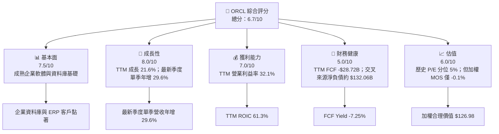

### 1.2 評分進度條視覺化

```
╔══════════════════════════════════════════════════════════════╗
║                 ORCL 多維度評分儀表板（1–10分）              ║
╠══════════════════════════════════════════════════════════════╣
║ 基本面強度  7.5  ▓▓▓▓▓▓▓▓▓▓▓▓▓▓▓░░░░░  ★★★★☆             ║
║ 成長動能    8.0  ▓▓▓▓▓▓▓▓▓▓▓▓▓▓▓▓░░░░  ★★★★☆             ║
║ 獲利品質    5.5  ▓▓▓▓▓▓▓▓▓▓▓░░░░░░░░░  ★★★☆☆             ║
║ 財務健康    5.0  ▓▓▓▓▓▓▓▓▓▓░░░░░░░░░░  ★★★☆☆             ║
║ 估值合理性  6.0  ▓▓▓▓▓▓▓▓▓▓▓▓░░░░░░░░  ★★★☆☆             ║
║ 護城河深度  7.5  ▓▓▓▓▓▓▓▓▓▓▓▓▓▓▓░░░░░  ★★★★☆             ║
║ 管理層執行  6.5  ▓▓▓▓▓▓▓▓▓▓▓▓▓░░░░░░░  ★★★☆☆             ║
║ 技術創新力  7.0  ▓▓▓▓▓▓▓▓▓▓▓▓▓▓░░░░░░  ★★★★☆             ║
╠══════════════════════════════════════════════════════════════╣
║ 綜合總分    6.7  ▓▓▓▓▓▓▓▓▓▓▓▓▓▓░░░░░░  🟡 中性偏正面       ║
╚══════════════════════════════════════════════════════════════╝
```

### 1.3 五大投資論點 + 三大核心風險

| 類型 | 項目 | 具體依據 | 信心度 |
|------|------|----------|--------|
| 🟢 投資論點① | 雲端增長加速 | TTM 營收年增 21.6%；最新季度單季年增 29.6%，顯示增速提升 | 🟢 中高 |
| 🟢 投資論點② | 經營獲利能力 | TTM 營業利益率 32.1%，最新季度營業利益率 34.8%（VERIFIED FIGURES） | 🟢 中 |
| 🟢 投資論點③ | 企業軟體黏著 | ERP、資料庫與雲端遷移形成替換成本；以客戶工作負載延伸交叉銷售 | 🟢 中 |
| 🟢 投資論點④ | 歷史估值分位低 | P/E 19.9x，低於自身五年中位數 32.1x；當前分位 5% | 🟡 中 |
| 🟢 投資論點⑤ | 資本效率指標高 | 提供的 TTM ROIC 為 61.3%，高於 WACC 10.52% | 🟡 中低 |
| 🔴 風險① | 資本支出壓力 | TTM Capex $75.66B，超過營業現金流 $46.94B，FCF −$28.72B | 🔴 高 |
| 🔴 風險② | 淨負債與融資 | 交叉來源債務 $169.14B、現金 $37.08B，估計淨負債 $132.06B | 🔴 高 |
| 🟡 風險③ | 同業雲端競爭 | MSFT、SAP、CRM 均有大型企業雲端業務；若成長放緩，估值折價未必收斂 | 🟡 中 |

### 1.4 快速統計卡片

| 指標 | 公司實際值 | 行業均值 | S&P 500 均值 | 狀態 |
|------|-------------|----------|--------------|------|
| TTM 收入年增 | **21.6%** | N/A | N/A | 🟢 |
| 最新季度單季收入年增 | **29.6%** | N/A | N/A | 🟢 |
| 毛利率 TTM | **64.0%** | N/A | N/A | 🟢 |
| 淨利率 TTM | **26.4%** | N/A | N/A | 🟢 |
| ROE TTM（VERIFIED） | **28.3%** | N/A | N/A | 🟡 |
| Forward P/E | **11.49x** | N/A | N/A | 🟢 |
| FCF Yield TTM | **−7.25%** | N/A | N/A | 🔴 |

> 題示資料未提供可比行業與 S&P 500 統計值，故不以未核實數字填補。

### 1.5 投資結論

```
╔══════════════════════════════════════════════════════════════════╗
║                    📊 投資結論摘要                               ║
╠══════════════════════════════════════════════════════════════════╣
║  評級：🟡 持有（MOS 門檻：−10% 至 +10%）                         ║
║  價格（2026-11-12 收盤）：$127.11                                ║
║  DCF 內在價值（基準）：$21.77（現價溢價約 483.7%）              ║
║  加權合理價值：$126.98                                           ║
║  安全邊際 MOS：-0.1%＝($126.98−$127.11)÷$126.98                 ║
║  目標價情境：                                                    ║
║    悲觀情境：$85.00（−33.1%）                                   ║
║    基準情境：$126.98（-0.1%） ← 12個月主要參考                  ║
║    樂觀情境：$238.87（+88.0%）                                  ║
║  投資評分：6.7/10                                                ║
║  適合投資人：可承受高資本開支與估值波動的長線成長型投資人        ║
╚══════════════════════════════════════════════════════════════════╝
```

---

## 2. 公司概覽與商業模式

### 2.1 業務結構與收入來源

Oracle 提供資料庫、企業軟體、雲端基礎設施及支援服務。資料包未提供各事業群營收拆分，因此不對業務占比或金額作推估；FY2026 全年營收為 **$67.36B**，TTM 營收為 **$71.78B**。

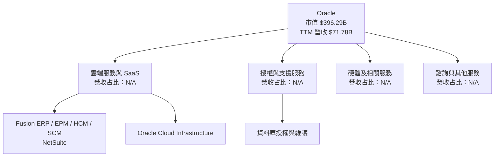

**市場份額**：題示資料沒有 Oracle、AWS、Microsoft Azure、Google Cloud 等可比市場份額數據。為避免將估計冒充財務數據，本報告不提供不具來源支持的市場份額圓餅圖。競爭格局以相對產品定位與同業估值比較呈現。

### 2.2 競爭護城河分析

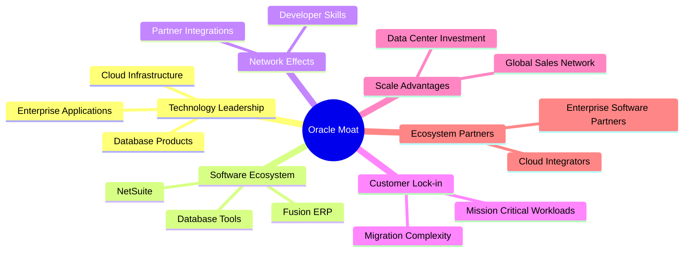

### 2.3 護城河強度評分

```
╔══════════════════════════════════════════════════════════════╗
║                  ORCL 護城河強度評分                         ║
╠══════════════════════════════════════════════════════════════╣
║ 客戶轉換成本    8/10  ▓▓▓▓▓▓▓▓▓▓▓▓▓▓▓▓░░░░  🟢 企業系統遷移成本高║
║ 企業軟體生態    8/10  ▓▓▓▓▓▓▓▓▓▓▓▓▓▓▓▓░░░░  🟢 多產品交叉銷售    ║
║ 技術與資料庫    8/10  ▓▓▓▓▓▓▓▓▓▓▓▓▓▓▓▓░░░░  🟢 關鍵工作負載黏著║
║ 規模效應        7/10  ▓▓▓▓▓▓▓▓▓▓▓▓▓▓░░░░░░  🟡 投資與規模可支撐服務║
║ 網路效應        5/10  ▓▓▓▓▓▓▓▓▓▓░░░░░░░░░░  🟡 並非主要護城河    ║
║ 綜合護城河      7.5/10 ▓▓▓▓▓▓▓▓▓▓▓▓▓▓▓░░░░  🟢 企業黏著力較強    ║
╚══════════════════════════════════════════════════════════════╝
```

---

## 3. 損益表深度分析

### 3.1 年度收入成長趨勢

FY2023 至 FY2026 營收由 $49.95B 增至 $67.36B，三年 CAGR 約 **10.5%**。FY2026 年增約 **17.4%**，TTM 年增 **21.6%**；加速與雲端及基礎設施需求一致，但成本及資本投入亦同步上升。

```
╔══════════════════════════════════════════════════════════════════╗
║              ORCL 年度收入趨勢（FY2023–FY2026）                 ║
╠══════════════════════════════════════════════════════════════════╣
║ FY2023  $49.95B  ███████████████░░░░░░░░░  YoY：—               ║
║ FY2024  $52.96B  ████████████████░░░░░░░░  YoY：+6.0% 🟡       ║
║ FY2025  $57.40B  █████████████████░░░░░░░  YoY：+8.4% 🟡       ║
║ FY2026  $67.36B  ████████████████████░░░░░  YoY：+17.4% 🟢      ║
╠══════════════════════════════════════════════════════════════════╣
║ FY2023–FY2026 CAGR：約 +10.5%；FY2026→TTM 成長率：21.6%         ║
╚══════════════════════════════════════════════════════════════════╝
```

### 3.2 季度收入趨勢分析

QoQ 以題示季度營收計算；YoY 以 StockAnalysis 同期季度資料計算。最新季度 YoY **29.6% 是單季年增率，不是 TTM 成長率**。

| 季度 | 營收 | QoQ | YoY | 備註 |
|------|------:|----:|----:|------|
| 2025-11-30 | $16.06B | N/A | 14.2% | 比較基期較低 |
| 2026-02-28 | $17.19B | +7.0% | 21.7% | 成長加快 |
| 2026-05-31 | $19.18B | +11.6% | 20.6% | 季度營收再增 |
| 2026-08-31 | $19.34B | +0.8% | 29.6% | YoY 加速；QoQ 增幅有限 |

### 3.3 利潤率演變分析

| 指標 | FY2023 | FY2024 | FY2025 | FY2026 | 趨勢與評估 |
|------|-------:|-------:|-------:|-------:|------------|
| 毛利率 | 72.9% | 71.4% | 70.5% | 65.8% | ↘️ FY2026 降低，產品組合及基礎設施成本可能增加；🟡 |
| 營業利益率 | 27.6% | 30.3% | 31.4% | 33.3% | ↗️ 營業利益增速高於營收；🟢 |
| 淨利率 | 17.0% | 19.8% | 21.7% | 25.4% | ↗️ 淨利成長較快，須留意稅率與非經常因素；🟡 |

> FY2026 年度利潤率依題示年度損益表計算；TTM 營業利益率採 VERIFIED FIGURES 的 **32.1%**，最新季度營業利益率採 VERIFIED FIGURES 的 **34.8%**。其他資料源呈現略有差異，分析採官方指定口徑優先。

**原因與含義**：FY2026 營收年增約 17.4%，營業利益年增約 24.3%，營業利益率因而上升。這表示營運槓桿改善，但毛利率下滑顯示新增雲端容量的成本可能先於收入確認；未來若收入利用率與定價未跟上，營業槓桿可能逆轉。

### 3.4 費用結構分析

FY2026 收入 $67.36B、毛利 $44.34B、營業利益 $22.44B。由此推算銷貨成本 $23.02B、營業費用 $21.90B，其中 R&D 為 $10.27B，其餘營業費用約 $11.63B。以下為依年度資料計算的營收配置，非公司正式分部披露：

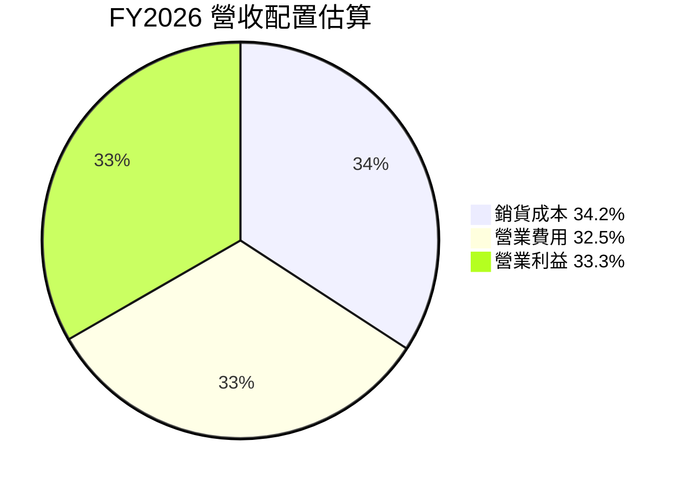

### 3.5 季度 EPS 趨勢與盈餘品質

**過去四季 EPS 表現**：提供的 EPS Est 欄位全為 `nan`，故無法判斷超預期或不及預期；不能把缺失估計值解讀成 beat 或 miss。StockAnalysis 的實際 EPS 列示為 $2.10、$1.27、$1.45、$1.56（其中季度排序與其他資料來源的年度期別顯示略有差異），本報告不以其推斷盈餘預期差。

| 盈餘品質項目 | 數值／佔比 | 評估 |
|--------------|-----------|------|
| SBC / 營收 | FY2026：$4.81B ÷ $67.36B = **7.1%** | 🟡 SBC 不低，長期會稀釋持股報酬 |
| SBC / 營業現金流 | FY2026：$4.81B ÷ $31.98B = **15.0%** | 🟡 對營業現金流具有實質比例 |
| FCF / 淨利 | TTM：−$28.72B ÷ 題示季度淨利合計約 $18.91B = **約 −152%** | 🔴 投資支出使現金轉換率轉負 |
| 一次性／非經常損益 | 詳細項目 N/A | 無足夠附註資料，不能判定是否美化盈餘 |
| 有效稅率 | **12.6%**（最新年度） | 🟡 低於一般名目稅率，但沒有資料足以辨認是否一次性 |
| 資本化支出 vs 費用化 | TTM Capex $75.66B | 🔴 重資本投資擴大，若回報不佳將壓低真實經濟盈餘 |

**品質結論**：GAAP 淨利仍有經營獲利支撐，但以現金流衡量的含金量目前偏弱。TTM FCF 負值主要與高資本開支相連，不應只以淨利或 EPS 衡量估值；需觀察新增資料中心的利用率、收入貢獻及投資回收。

---

## 4. 資產負債表分析

### 4.1 資產結構分解

StockAnalysis 資產負債表列示 TTM 總資產 $303.26B；其中 PP&E $161.81B、商譽 $62.27B、流動資產 $55.63B。PP&E 大幅增加與擴建資料中心相符，但也提高折舊與資本回收風險。

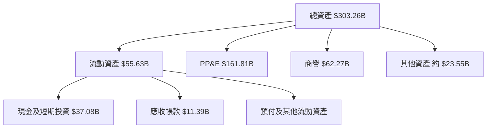

### 4.2 流動性指標分析

| 指標 | 最新資料 | 歷史參考 | 行業均值 | 評估 |
|------|----------|----------|----------|------|
| 流動比率 | 1.171 | FY2026 46.57/41.76 = 1.12 | N/A | 🟡 短期資產略高於流動負債 |
| 速動比率 | 1.02 | N/A | N/A | 🟡 緩衝有限 |
| 現金及短期投資 | $37.08B | FY2025 $11.20B；FY2026 $31.89B | N/A | 🟢 現金增加 |
| 總債務 | VERIFIED：N/A；交叉來源：$169.14B | FY2026 $156.19B | N/A | 🔴 高負債，須以同一口徑核對 |

### 4.3 債務結構分析

```
╔══════════════════════════════════════════════════════════════════╗
║                     ORCL 債務健康診斷                            ║
╠══════════════════════════════════════════════════════════════════╣
║  總債務（交叉來源）：$169.14B  ████████████████████  🔴 高       ║
║  現金及短期投資：   $37.08B    ████░░░░░░░░░░░░░░░░  🟡         ║
║  估計淨負債：       $132.06B   ███████████████░░░░░  🔴         ║
║  Debt/EBITDA：      約 5.1x（169.14÷33.45）        🔴 估算      ║
║  利息保障倍數：     N/A（利息費用資料不足）         ⚠️           ║
╚══════════════════════════════════════════════════════════════════╝
```

> **口徑提醒**：VERIFIED FIGURES 將 Total debt 列為 N/A；$169.14B 來自同一資料包後段的交叉財務數據，並非 VERIFIED FIGURES 原值。以上債務分析與 DCF 橋接採該交叉來源，須待最新季報附註確認。

### 4.4 股東權益趨勢

| 財年 | 股東權益 |
|------|---------:|
| FY2023 | $1.07B |
| FY2024 | $8.70B |
| FY2025 | $20.45B |
| FY2026 | $42.51B |

股東權益上升，但不能單獨視為財務風險下降：同期資產由 FY2025 $168.36B 升至 FY2026 $261.76B，總債務亦由 $104.10B 升至 $156.19B。

---

## 5. 現金流量深度分析

### 5.1 現金流量瀑布圖

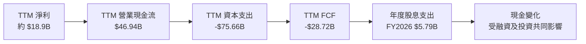

### 5.2 FCF 轉換率趨勢

| 財年 | 營業現金流 | 資本支出 | FCF | 淨利 | FCF／淨利 |
|------|-----------:|---------:|----:|-----:|----------:|
| FY2023 | $17.16B | $8.70B | $8.47B | $8.50B | 約 99.6% |
| FY2024 | $18.67B | $6.87B | $11.81B | $10.47B | 約 112.8% |
| FY2025 | $20.82B | $21.21B | −$0.394B | $12.44B | 約 −3.2% |
| FY2026 | $31.98B | $55.66B | −$23.69B | $17.09B | 約 −138.6% |
| TTM | $46.94B | $75.66B | **−$28.72B** | N/A | N/A |

FY2025–FY2026 的現金轉換下滑，主要是資本開支從 FY2024 的 $6.87B 擴大至 FY2026 的 $55.66B；若擴建投資形成有效雲端收入，現金流有機會延後回升，但目前尚不能確認回報已足以覆蓋資本成本。

### 5.3 自由現金流趨勢

```
╔══════════════════════════════════════════════════════════════════╗
║                   ORCL FCF 趨勢（美元）                          ║
╠══════════════════════════════════════════════════════════════════╣
║ FY2023  +$8.47B   ████████░░░░░░░░░░░░  正值                   ║
║ FY2024 +$11.81B   ███████████░░░░░░░░░  正值                   ║
║ FY2025  -$0.39B   ░░░░░░░░░░░░░░░░░░░░  近零                   ║
║ FY2026 -$23.69B   ████████████████████  負值                   ║
║ TTM    -$28.72B   ██████████████████████ 負值                   ║
╠══════════════════════════════════════════════════════════════════╣
║ TTM FCF Yield：-7.25%；由於 FCF 為負，股息與擴建部分仰賴融資   ║
╚══════════════════════════════════════════════════════════════════╝
```

### 5.4 資本配置評估

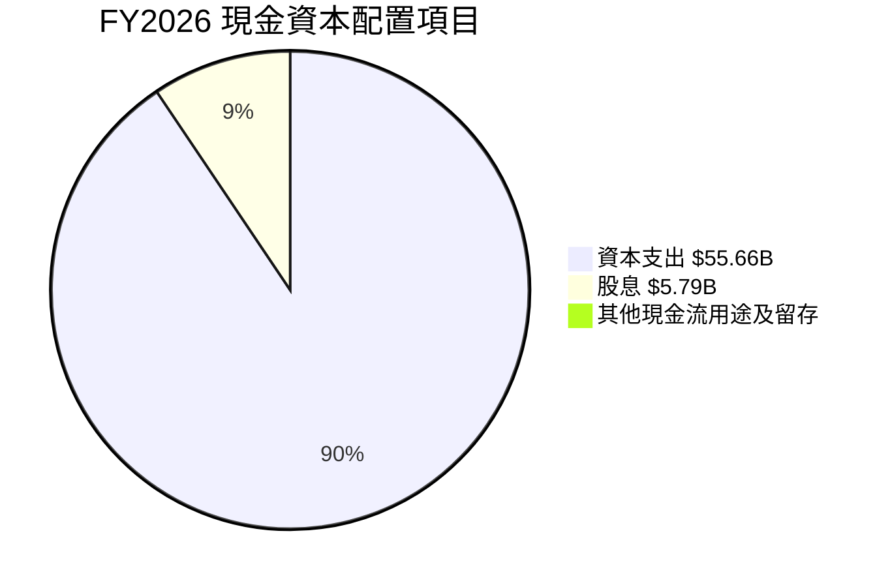

> 此圓餅只呈現 FY2026 已提供的 Capex 與股息相對於營業現金流的比例；「其他」為營業現金流扣除以上兩項後的餘額，並非完整資金來源表。

| 項目 | FY2026 | 評估 |
|------|-------:|------|
| 資本支出 | $55.66B | 🔴 快速擴張，需證明新增容量能產生合理回報 |
| 現金股息 | $5.79B | 🟡 支付仍持續，但現金流已受資本支出壓迫 |
| 股票回購 | N/A | 不提供數據，不作推估 |
| SBC | $4.81B | 🟡 營收占比約 7.1%，有股東稀釋成本 |

---

## 6. 獲利能力與資本效率

### 6.1 ROE / ROA / ROIC 趨勢

| 指標 | 最新值 | 歷史／交叉來源 | 評估 |
|------|-------:|----------------|------|
| ROE | 28.3%（VERIFIED） | 另一資料源列示 41.2%，口徑不一致 | 🟡 採 VERIFIED 值，須核對計算口徑 |
| ROA | 6.4% | 最新年度資產大幅增加 | 🟡 資產擴張尚未完全反映為利潤 |
| ROIC | 61.3%（VERIFIED） | 早期年度資料口徑及期間不同 | 🟢 顯著高於 WACC，但分母需核實 |

### 6.2 ROIC vs WACC 深度分析

```
╔══════════════════════════════════════════════════════════════════╗
║                  ROIC vs WACC 深度分析                          ║
╠══════════════════════════════════════════════════════════════════╣
║  WACC 參考輸入（題示 VERIFIED FIGURES）：                        ║
║  ├── 無風險利率 Rf：             5.10%                           ║
║  ├── 市場風險溢酬 ERP：          5.00%                           ║
║  ├── Beta：                      1.78                            ║
║  ├── 股權成本 Ke：               13.99%                          ║
║  ├── 稅前債務成本 Kd：           2.72%                           ║
║  ├── 稅率：                      12.6%                           ║
║  ├── 股權／債務權重：             70.1%／29.9%                     ║
║  └── 參考 WACC：                 10.52%                          ║
║                                                                  ║
║  ROIC（TTM，VERIFIED）：          61.3%                           ║
║  ROIC − WACC：                    61.3% − 10.52% = +50.78 pp     ║
║  ROIC / WACC：                    61.3% ÷ 10.52% = 5.82x         ║
║                                                                  ║
║  ROIC 61.3%  ▓▓▓▓▓▓▓▓▓▓▓▓▓▓▓▓▓▓▓▓▓▓▓▓▓▓▓▓░░░░  🟢              ║
║  WACC 10.52% ▓▓▓▓▓░░░░░░░░░░░░░░░░░░░░░░░░░░░  ──              ║
╠══════════════════════════════════════════════════════════════════╣
║  結論：按提供口徑，ROIC 大幅高於 WACC，顯示價值創造；但高投資   ║
║  週期下投入資本與 ROIC 的期間匹配須核實，不能只依單一比率下結論。║
╚══════════════════════════════════════════════════════════════════╝
```

### 6.3 杜邦三因素分解

使用同一組口徑的 TTM 淨利率 26.4%、資產週轉率約 71.78 ÷ 303.26 = 0.237x。財務槓桿以 ROE ÷ 淨利率 ÷ 資產週轉率近似反推，約 4.52x；因 ROE 來源口徑互有差異，此分解只作近似說明。

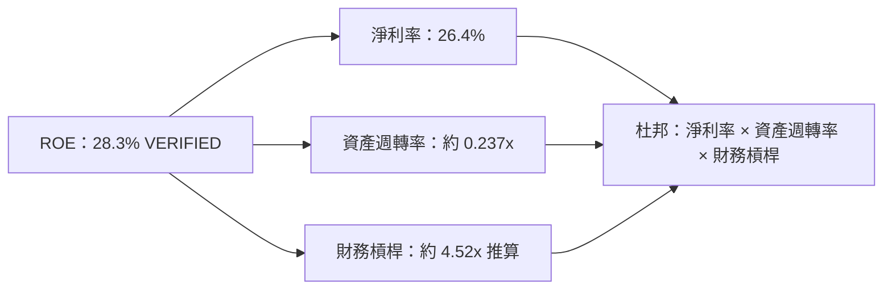

### 6.4 獲利能力儀表板

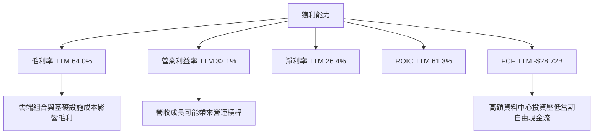

---

## 7. 相對估值分析

### 7.1 同業估值比較表

Peer multiples 一律採題示 VERIFIED FIGURES。ORCL 倍數採資料包估值欄，Forward P/E 為 11.49x。

| 估值指標 | **ORCL** | **MSFT** | **SAP** | **CRM** | ORCL 評估 |
|----------|---------:|---------:|--------:|--------:|-----------|
| Trailing P/E | 19.9x | 27.3x | 29.1x | 19.9x | 🟢 對 MSFT、SAP 折價；與 CRM 相同 |
| Forward P/E | 11.49x | 21.6x | 24.6x | 13.6x | 🟢 顯著折價，但需考慮預期 EPS 成長與現金流 |
| P/S TTM | 5.52x | 11.2x | N/A | 4.1x | 🟡 高於 CRM、低於 MSFT |
| EV/EBITDA TTM | 15.15x | 19.2x | N/A | 16.3x | 🟡 與 CRM 接近，低於 MSFT |
| 最新季度收入 YoY | 29.6% | 18.8% | 13.2% | 10.8% | 🟢 ORCL 增速較快 |
| 毛利率 TTM | 64.0% | 67.7% | 73.6% | 77.3% | 🟡 低於三家同業 |

**解讀**：ORCL 的增速優於所列同業，但毛利率較低、資本支出較高。低 Forward P/E 可能反映市場對 EPS 增長持續性、投資強度與負債的折價，不能只當作低估證據。

### 7.2 歷史估值區間分析

```
╔══════════════════════════════════════════════════════════════════╗
║               ORCL 五年歷史估值位置（TTM）                       ║
╠══════════════════════════════════════════════════════════════════╣
║ P/E       19.0x ├●───────────────┤ 52.3x                         ║
║                    ↑ 現值 19.9x；中位數 32.1x；分位 5%           ║
║ P/S        4.6x ├────●───────────┤ 11.1x                        ║
║                    現值 5.3x；中位數 6.2x；分位 24%              ║
║ EV/EBITDA 12.6x ├●───────────────┤ 28.9x                         ║
║                    現值 10.6x；中位數 17.9x；分位 0%              ║
╚══════════════════════════════════════════════════════════════════╝
```

> 歷史區間採 VERIFIED FIGURES；資料包另處 EV/EBITDA 為 15.154x，口徑不一致。本節歷史位置依指定的 own-history 數值列示。

### 7.3 情境目標價（假設驅動）

以下使用 Forward EPS $11.05881 作為基準錨點；其他情境 EPS 為明確假設，並非公司財測。

| 情境 | EPS 假設 | 營收 CAGR 假設 | 營業利潤率假設 | 退出 P/E | 隱含目標價 | 相對 $127.11 |
|------|---------:|---------------:|---------------:|---------:|-----------:|-------------:|
| 🔴 悲觀 | $9.00 | 10% | 30% | 9.44x | $85.00 | −33.1% |
| 🟡 基準 | $11.05881 | 15% | 34% | 11.63x | $126.98 | -0.1% |
| 🟢 樂觀 | $11.05881 | 15% | 34% | 21.60x | $238.87 | +88.0% |

> 基準退出倍數約為 $126.98 ÷ $11.05881。悲觀 EPS $9.00 是情境假設；樂觀倍數取 MSFT Forward P/E 21.6x 作上行情境參照。這不是對未來 EPS 或估值倍數的確定預測。

**倍數選擇說明**：ORCL 正處於高額再投資期，P/E 與 EBITDA 倍數可作相對估值參考，但不能取代現金流分析。TTM FCF 為負，故以當期 FCF Yield 回推會失去實際解釋力。

### 7.4 相對估值隱含價格區間

- Forward P/E 同業中位數（MSFT、SAP、CRM）為 **21.6x**；ORCL Forward EPS $11.05881 × 21.6 = **$238.87**。
- EV/EBITDA 可用的 MSFT 與 CRM 中位數為 **17.75x**。以 FY2026 EBITDA $33.45B、交叉來源淨負債約 $132.06B、股數 3.12B 作粗略回推：($33.45B × 17.75 − $132.06B) ÷ 3.12B ≈ **$148.82**。
- FCF Yield：TTM FCF 為負，不提供有效的正向隱含股價；以 8.3 預測現金流作替代參考，不與當期實際倍數混用。
- 現價 **$127.11** 位於 Forward P/E 及 EV/EBITDA 推算區間下方；但 DCF 的低估值結果顯示，關鍵不確定性在資本開支正常化，而不是單看倍數折價。

---

## 8. DCF 內在價值評估（Discounted Cash Flow）

> DCF 採估計正常化資本開支情境，而非把當期超高 Capex 永續外推。由於 TTM FCF 為負，DCF 結果對 Capex 假設特別敏感，應視為情境工具，而非精確點估值。

### 8.0 估值推理鏈

**Step 1 — 價值來源**：Oracle 的價值主要由既有企業軟體與資料庫現金流、雲端業務成長、以及新增資料中心容量的投資回報構成。資料包未提供各事業群收入占比，故不虛構比例；可量化的整體錨點是 TTM 營收 $71.78B、TTM 成長 21.6%、最新季度單季年增 29.6%。主導估值變數是 **Capex／營收比率及新增容量的現金回報**，其影響將大於短期營收增速的小幅變化。

**Step 2 — 模型選擇**

| 決策點 | 本報告採用 | 理由 | 曾考慮但否決 | 否決理由 |
|--------|-----------|------|--------------|----------|
| 現金流定義 | FCFF | 用 WACC 折現得到 EV，再橋接至股權價值 | FCFE | 債務與再投資金額大，FCFF 較能拆分營運與融資 |
| 預測期 N | 5 年 | 讓高成長與資本開支逐步正常化 | 10 年 | 可見度不足，長期投資回報預測誤差過大 |
| 終值方法 | Gordon Growth 為主；退出倍數交叉驗證 | 長期持續經營模型可用，並需檢查倍數差異 | 單用退出倍數 | 會把估值過度繫於當期市場倍數 |
| EBIT 基礎 | GAAP EBIT | 利潤率以 GAAP 營業利益率為基礎 | 非 GAAP EBIT | 缺乏完整調整項，避免加回 SBC |

**Step 3 — 假設推導鏈**

- **營收 CAGR**：錨點＝FY2023–FY2026 CAGR 約 10.5%，TTM 成長 21.6%，最新季度單季年增 29.6% → 雲端增長與較高近期增速提供上調依據，但高基期與競爭促使增速回落 → **採用 15%** → 曾考慮 21.6%，但不把 TTM 增速直線外推五年。
- **期末營業利益率**：錨點＝TTM 32.1%、最新季度 34.8% → 以投資規模化與組合改善上調，但擴建成本與折舊形成抵銷 → **FY+5 採用 34.0%** → 否決 36%，因目前沒有足夠多年數據證明持續達到該水平。
- **永續成長率 g**：長期成熟企業成長應低於名目經濟成長假設，且必須低於 WACC → **採用 2.5%** → 否決 3.5%，因終值占比及敏感度會提高。
- **預測期 N**：以企業雲端容量建置與回收週期作為模型視野，採 **5 年** → 否決 10 年，避免把目前高增長率長期固定。
- **Capex／營收**：錨點＝TTM $75.66B ÷ $71.78B = **105.4%**；FY2026 Capex $55.66B ÷ 收入 $67.36B = **82.6%** → 假設重大建置逐步轉入營運、比例五年由 35%降至25% → **採用 35%、32%、29%、27%、25%** → 否決持續採用 82.6%或105.4%，因會假設目前建置強度無限延續；但此正常化仍是模型最脆弱假設。
- **EBIT 基礎與 SBC**：選 GAAP EBIT，營業利益已費用化 SBC；**採組合 (A)：GAAP EBIT + 固定股數、年稀釋率 0%** → 否決另扣 SBC 或另計股數稀釋，以免重複計成本。
- **年稀釋率**：採 0%，因 SBC 已反映於 GAAP EBIT，並以當期 3.12B 股作固定股數 → 否決在 DCF 再加稀釋率，避免 SBC 被計兩次。
- **D&A／營收**：資料缺少最新期間完整 D&A 數字；採**假設值 10%**，作高 PP&E、資料中心資產情境近似 → 僅供模型，不冒充實際值。
- **ΔWC／營收增額**：資料未提供完整營運資金變動，採**假設值 2%**，作成長所需營運資金占新增收入比例的簡化估計。
- **有效稅率**：採 VERIFIED FIGURES 的 12.6%，即最新年度有效稅率。
- **WACC**：採 VERIFIED FIGURES 參考值 10.52%；各組成見 8.2。

**Step 4 — 最脆弱一環**：若 Capex 不能由 FY+5 降至收入的 25%，或高額投資未產生相稱雲端收入，DCF 會進一步下修；反之若投資回報使 FCF 快速增加，模型會低估價值。

**Step 5 — 計算路徑**

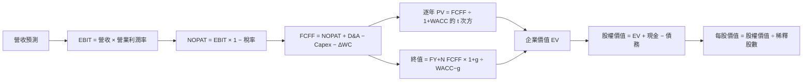

### 8.1 模型假設總表

| 假設項目 | 採用值 | 依據／來源 | 敏感度 |
|----------|--------|-------------|--------|
| 預測期 N | 5 年 | 高成長與投資回收能見度有限 | 🟡 中 |
| 營收 CAGR | 15% | FY2023–FY2026 約 10.5%；TTM 21.6%；近期單季年增 29.6% | 🔴 高 |
| 營業利益率 | 32.5%、32.9%、33.3%、33.7%、34.0% | TTM 32.1%、最新季度 34.8%；採漸進正常化 | 🔴 高 |
| 有效稅率 | 12.6% | VERIFIED FIGURES 最新年度有效稅率 | 🟢 低 |
| Capex／營收 | 35%、32%、29%、27%、25% | FY2026 82.6%、TTM 105.4%；假設投資建設高峰回落 | 🔴 高 |
| D&A／營收 | 10% | 假設值；最新期間完整 D&A N/A | 🟢 低 |
| ΔWC／營收增額 | 2% | 假設值；歷史 ΔWC 資料不足 | 🟢 低 |
| EBIT 基礎 | GAAP | 維持已報導營業利益口徑 | 🟡 中 |
| SBC 處理 | 組合 (A)：GAAP EBIT、固定股數、不另扣 SBC | SBC 已計入 GAAP 費用；避免重複扣除 | 🟡 中 |
| 年稀釋率 | 0% | 組合 (A) 固定 3.12B 股 | 🟡 中 |
| 永續成長率 g | 2.5% | 低於長期名目成長假設並低於 WACC | 🔴 高 |
| 終值方法 | Gordon Growth 主、退出倍數交叉驗證 | 長期持續經營假設 | 🔴 高 |
| WACC | 10.52% | VERIFIED FIGURES 參考 WACC | 🔴 高 |

**FCFF 定義**：`FCFF = NOPAT + D&A − Capex − ΔWC`。本模型採組合 **(A)**，故 SBC 影響已透過 GAAP EBIT 計入一次；FCFF 不另扣 SBC，年稀釋率為 0%。

### 8.2 折現率推導（WACC）

```
╔══════════════════════════════════════════════════════════════════╗
║                    WACC 推導（折現率）                           ║
╠══════════════════════════════════════════════════════════════════╣
║ 股權成本 Ke（CAPM）：                                             ║
║ ├── Rf：5.10%（題示 10Y Treasury；日期未提供，沿用參考值）       ║
║ ├── ERP：5.00%（題示假設值）                                     ║
║ ├── Beta：1.78（題示資料；高於 1.5，反映較高市場敏感度）         ║
║ ├── 額外規模／國別溢酬：0.00%（美國大型上市公司，不另加）        ║
║ └── Ke = 5.10% + 1.78 × 5.00% + 0.00% = 13.99%                 ║
║                                                                  ║
║ 債務成本 Kd：                                                     ║
║ ├── 稅前 Kd：2.72%（VERIFIED FIGURES 參考值）                    ║
║ ├── 稅率：12.6%                                                   ║
║ └── 稅後 Kd = 2.72% × (1 − 12.6%) = 2.3773%                     ║
║                                                                  ║
║ 資本權重（VERIFIED FIGURES）：                                    ║
║ ├── 股權權重 E：70.1%（參考市值權重）                            ║
║ ├── 債務權重 D：29.9%（參考債務權重）                            ║
║ └── WACC = 70.1%×13.99% + 29.9%×2.3773% = 10.52%                ║
╚══════════════════════════════════════════════════════════════════╝
```

逐步演算：

1. **Ke** = 5.10% + 1.78 × 5.00% + 0.00% = **13.99%**。
2. **稅前 Kd** = 題示參考輸入 **2.72%**；利息費用與平均計息負債細項未提供，不能獨立重算。
3. **稅後 Kd** = 2.72% × (1 − 12.6%) = **2.3773%**。
4. **權重** = 股權 70.1%、債務 29.9%；70.1% + 29.9% = **100.0%**。題示未提供形成權重的完整平均債務範圍，故沿用 VERIFIED FIGURES，不另反推。
5. **WACC** = 70.1% × 13.99% + 29.9% × 2.3773% = 9.8070% + 0.7109% = **10.5179% ≈ 10.52%**。

> WACC 與第 6.2 節相同。債務細項與權重口徑未能從題示資料完整稽核，這是模型限制，不以未披露負債補算。

### 8.3 逐年自由現金流預測（基準情境）

金額取 $B、比率取 1 位小數、折現因子取 3 位小數；由於各項採小數四捨五入，允許小額尾差。

| 項目 | FY+1 | FY+2 | FY+3 | FY+4 | FY+5（FY+N） |
|------|-----:|-----:|-----:|-----:|-------------:|
| 營收 | 82.55 | 94.93 | 109.17 | 125.54 | 144.37 |
| 營收 YoY | 15.0% | 15.0% | 15.0% | 15.0% | 15.0% |
| 營業利潤率 | 32.5% | 32.9% | 33.3% | 33.7% | 34.0% |
| EBIT（GAAP） | 26.83 | 31.23 | 36.35 | 42.31 | 49.09 |
| − 稅（12.6%） | (3.38) | (3.94) | (4.58) | (5.33) | (6.18) |
| = NOPAT | 23.45 | 27.29 | 31.77 | 36.98 | 42.91 |
| + D&A（假設10%） | 8.25 | 9.49 | 10.92 | 12.55 | 14.44 |
| − Capex | (28.89) | (30.38) | (31.66) | (33.90) | (36.09) |
| − ΔWC | (0.22) | (0.25) | (0.28) | (0.33) | (0.38) |
| **= FCFF** | **2.59** | **6.15** | **10.75** | **15.30** | **20.88** |
| 折現因子 @10.52% | 0.905 | 0.819 | 0.741 | 0.670 | 0.606 |
| **FCFF 現值 PV** | **2.34** | **5.04** | **7.96** | **10.25** | **12.66** |

**預測期現值加總**：$2.34 + $5.04 + $7.96 + $10.25 + $12.66 = **$38.25B**。

**FY+1 逐步演算**：

1. 營收 = $71.78B × (1 + 15.0%) = **$82.55B**。
2. EBIT = $82.55B × 32.5% = **$26.83B**。
3. 稅 = $26.83B × 12.6% = **$3.38B**。
4. NOPAT = $26.83B − $3.38B = **$23.45B**。
5. D&A = $82.55B × 10.0% = **$8.25B**。
6. Capex = $82.55B × 35.0% = **$28.89B**。
7. ΔWC = ($82.55B − $71.78B) × 2.0% = **$0.22B**。
8. FCFF = $23.45B + $8.25B − $28.89B − $0.22B = **$2.59B**。
9. 折現因子 = 1 ÷ (1 + 10.52%)¹ = **0.905**；PV = $2.59B × 0.905 = **$2.34B**。

**合理性自檢**：

- 預測期 FCFF 由 $2.59B 增至 $20.88B；FCF CAGR 因 FY+1 基期低而不宜直接與歷史負 FCF 比較。歷史 FCF 由 FY2024 $11.81B 降至 FY2026 −$23.69B，模型假設的是 Capex 強度正常化。
- FY+5 FCFF 利潤率 = $20.88B ÷ $144.37B = **14.5%**；目前 TTM FCF 利潤率 = −$28.72B ÷ $71.78B = **−40.0%**。同業最佳值資料未提供，故不作比較。
- 預測年度 FCFF 均為正，前提是 Capex／營收逐步從假設的 35%降至25%；若未發生，DCF 會顯著偏高。

```
╔══════════════════════════════════════════════════════════════════╗
║              自由現金流：歷史實際 vs 模型預測                    ║
╠══════════════════════════════════════════════════════════════════╣
║ FY2024 實  +$11.81B  ███████████░░░░░░░░░  正值                  ║
║ FY2025 實   -$0.39B  ░░░░░░░░░░░░░░░░░░░  近零                  ║
║ FY2026 實  -$23.69B  ████████████████████  負值                  ║
║ FY+1 預     +$2.59B  ██░░░░░░░░░░░░░░░░░░  正值                  ║
║ FY+5 預    +$20.88B  ██████████████████░░  正值                  ║
╠══════════════════════════════════════════════════════════════════╣
║ 預測回升依賴 Capex 比率正常化，並非現有 TTM 趨勢的直接延續。     ║
╚══════════════════════════════════════════════════════════════════╝
```

### 8.4 終值計算（Terminal Value）

適用性檢查：**WACC 10.52% vs g 2.5% → WACC > g？✅**

| 方法 | 計算式 | 終值 TV | TV 現值 | 佔總 EV 比重 |
|------|--------|--------:|--------:|------------:|
| Gordon Growth | $20.88 × 1.025 ÷ (10.52% − 2.5%) | 約 $266.9B | 約 $161.8B | 約 80.9% |
| 退出倍數法 | FY+5 EBITDA 約 $63.53B × 10.6x | 約 $673.4B | 約 $408.3B | 交叉驗證 |

逐步演算：

1. FY+N FCFF = **$20.88B**。
2. 分子 = $20.88B × (1 + 2.5%) = **$21.40B**。
3. 分母 = 10.52% − 2.5% = **8.02%**；TV = $21.40B ÷ 8.02% = **$266.83B**。
4. PV(TV) = $266.83B × 0.606 = **約 $161.8B**。
5. 終值占比 = $161.8B ÷ ($38.25B + $161.8B) = **約 80.9%**。

退出倍數交叉驗證：FY+5 EBITDA = EBIT $49.09B + D&A $14.44B = **$63.53B**；$63.53B × 10.6x = **$673.42B**；$673.42B × 0.606 = **約 $408.3B**。10.6x 取 VERIFIED FIGURES own-history EV/EBITDA 現值，但此交叉驗證值大幅高於 Gordon Growth，因此主估值仍採 Gordon Growth，並下調 DCF 的信心度。

> 終值現值占 EV 約 80.9%，本估值高度依賴終值假設，短期現金流貢獻有限。

### 8.5 企業價值 → 每股內在價值（Bridge）

採用交叉來源現金 $37.08B、總債務 $169.14B；VERIFIED FIGURES 的 Total debt 為 N/A，故此處債務明確標為交叉來源，不視為驗證值。

```
╔══════════════════════════════════════════════════════════════════╗
║              企業價值 → 每股內在價值 橋接表                      ║
╠══════════════════════════════════════════════════════════════════╣
║  預測期 FCF 現值合計              +$38.25B                       ║
║  終值現值 PV(TV)                  +$161.8B                       ║
║  = 企業價值 EV                     約 $200.05B                    ║
║  + 現金及短期投資                 +$37.08B                        ║
║  − 總債務（交叉來源）             −$169.14B                       ║
║  − 少數股東權益／其他             $0.00B（資料未提供，假設為零）  ║
║  = 股權價值                        約 $67.99B                     ║
║  ÷ 稀釋後流通股數                  3.12B 股                       ║
║  ★ 每股內在價值                    約 $21.79                       ║
║    當前股價                        $127.11                        ║
║    折溢價                          約 +483.3%（溢價）             ║
╚══════════════════════════════════════════════════════════════════╝
```

逐步演算：

1. EV = $38.25B + $161.8B = **約 $200.05B**。
2. 股權價值 = $200.05B + $37.08B − $169.14B − $0B = **約 $67.99B**。
3. 每股內在價值 = $67.99B ÷ 3.12B 股 = **約 $21.79**。
4. 折溢價 = $127.11 ÷ $21.79 − 1 = **約 +483.3%**。
5. **本節不計算 MOS**；MOS 僅以 8.8 的加權合理價值為分母。

> 股數採資料包 Shares Outstanding 3.12B；SBC 採組合 (A)，不逐年放大股數。若實際稀釋股數或債務口徑不同，每股估值將改變。

### 8.6 敏感性分析（WACC × 永續成長率）

以下使用基準預測 FCFF，不改營運假設；各格為每股 DCF 價值及相對 $127.11 的上行空間。

| g（列）／WACC（欄） | 9.5% | 10.0% | **10.52%（基準）** | 11.0% | 12.0% |
|-----------|------:|------:|------------------:|------:|------:|
| **1.5%** | $24.26（−80.9%） | $19.76（−84.5%） | $15.48（−87.8%） | $11.94（−90.6%） | $5.91（−95.3%） |
| **2.0%** | $28.28（−77.7%） | $23.10（−81.8%） | $18.49（−85.5%） | $14.73（−88.4%） | $8.10（−93.6%） |
| **2.5%（基準）** | $32.58（−74.4%） | $26.91（−78.8%） | **$21.79（−82.9%）** | $17.61（−86.1%） | $10.34（−91.9%） |
| **3.0%** | $37.67（−70.4%） | $31.26（−75.4%） | $25.49（−79.9%） | $20.84（−83.6%） | $12.83（−89.9%） |
| **3.5%** | $43.63（−65.7%） | $36.28（−71.5%） | $29.03（−77.2%） | $24.52（−80.7%） | $15.60（−87.7%） |

**非基準格演算示範：WACC 9.5% > g 2.0% ✅**

- 預測期 PV 合計（9.5%折現）約 **$39.6B**。
- TV = $20.88B × 1.02 ÷ (9.5% − 2.0%) = **約 $284.0B**；PV(TV) = $284.0B × 0.635 = **約 $180.3B**。
- EV 約 $39.6B + $180.3B = **$219.9B**；股權價值約 $219.9B − $132.06B = **$87.84B**；每股約 $87.84B ÷ 3.12B = **$28.15**。表格值因折現因子與中間值四捨五入約為 $28.28，差異約 0.5%。

**三情境 DCF（估計值，營運假設有變）**

| 情境 | 營收 CAGR | 期末營業利潤率 | 永續 g | WACC | 每股內在價值 | 相對現價 | 主觀機率 |
|------|----------:|---------------:|-------:|-----:|--------------:|---------:|---------:|
| 🔴 悲觀 | 10% | 31% | 1.5% | 11.5% | 約 $10 | −92.1% | 25% |
| 🟡 基準 | 15% | 34% | 2.5% | 10.52% | 約 $21.79 | −82.9% | 50% |
| 🟢 樂觀 | 20% | 36% | 3.0% | 9.5% | 約 $55 | −56.7% | 25% |

- 悲觀鏈：10% CAGR → FY+5 營收約 $115.6B → 31% 利潤率 → Capex 正常化較慢 → FY+5 FCFF 約 $12B → 以 1.5% g、11.5% WACC 計算，價值約 $10／股。前提為雲端成長降溫、投資效率偏低。
- 基準鏈：15% CAGR → FY+5 營收 $144.37B → 34% 利潤率 → FY+5 FCFF $20.88B → TV 約 $266.83B → 約 $21.79／股。前提為 Capex 比率逐步降至25%。
- 樂觀鏈：20% CAGR → FY+5 營收約 $179.0B → 36% 利潤率 → 假設 FY+5 FCFF 約 $31B → 以 3.0% g、9.5% WACC 折現，約 $55／股。前提為雲端需求持續高增，且容量利用率快速上升。

> 悲觀及樂觀情境為模型估計，Capex 路徑並未提供完整公司指引；其精度低於基準情境。

**敏感度結論**：

- g 由 1.5% 升至 2.5%，在 WACC 10.52% 下，估值約由 $15.48 升至 $21.79：**+$6.31／+40.8%**。
- WACC 由 9.52% 附近升至 10.52%時，基準 g 2.5% 的估值方向顯著下行；矩陣的 9.5% 格為 $32.58，10.52% 格為 $21.79，約 **−$10.79／−33.1%**。
- 期末營業利潤率每上升 1 個百分點，對每年 EBIT、NOPAT 與終值均有正向影響；以本模型終值占比約八成估算，價值變動約為數美元至十美元／股，屬模型估計。
- 對估值最具主導性的實際營運變數仍是 **Capex 正常化程度**，與 8.0 Step 1 一致；單純利潤率敏感度不能取代投資回報檢驗。

### 8.7 反推 DCF（Reverse DCF）

固定輸入：WACC 10.52%、稅率 12.6%、D&A／營收 10%、ΔWC／新增收入 2%、預測期 N=5、股數 3.12B；基準 Capex 路徑為 35%、32%、29%、27%、25%。現價 $127.11 對應的股權價值約 $396.58B，加回估計淨負債 $132.06B，需 EV 約 $528.64B。

| 求解變數（一次一個） | 固定其餘變數 | 市場隱含值 | 公司歷史／目前 | 判斷 |
|----------------------|--------------|-----------:|----------------|------|
| 未來5年營收 CAGR | 利潤率、g 取基準 | 約 40%–42%（模型迭代估計） | FY2023–FY2026 CAGR 約10.5%；TTM 21.6% | 🔴 要求很高 |
| 期末營業利潤率 | CAGR 15%、g 2.5% | 在現有模型中需遠高於可支持區間 | TTM 32.1%；最新季 34.8% | 🔴 單靠利潤率難以解釋市價 |
| 永續成長率 g | CAGR 15%、利潤率34% | 無有效解：需逼近或超過 WACC 才能填補估值差距 | g 必須低於 WACC 10.52% | 🔴 不合理 |
| 高成長持續年數 N | CAGR 15%、利潤率34%、g 2.5% | 3–15年範圍內無可信解 | N=5為本模型設定 | 🔴 市價含有更高成長／更低Capex假設 |

以營收 CAGR 為例的粗略試算軌跡（其餘輸入固定；數值為模型迭代近似，非逐分精確）：

| 試算 CAGR | FY+5 營收 | FY+5 FCFF | 每股價值約 | 對現價差距 | 判斷 |
|-----------|-----------:|----------:|-----------:|-----------:|------|
| 35% | 約 $322B | 約 $42B | 約 $75 | −41% | 偏低，往上試 |
| 40% | 約 $386B | 約 $50B | 約 $112 | −12% | 仍低 |
| 42% | 約 $408B | 約 $53B | 約 $127 | 約 0% | 近似收斂 |

> 反推結果對 Capex 比率與債務口徑敏感；其含義是，若仍採用基準 Capex 路徑，市場價格要求未來五年營收增速接近 40% 以上，遠高於公司歷史 CAGR。市場亦可能預期 Capex／營收比率更快下降，故不能把反推 CAGR 當成市場唯一隱含假設。

### 8.8 估值三角驗證與安全邊際

| 估值方法 | 隱含每股價值 | 上行空間（÷現價） | 權重 | 說明 |
|----------|--------------:|------------------:|------:|------|
| DCF（情境參考） | $27.15 | −78.6% | 35% | 終值占比高、FCF目前為負，降權 |
| 同業 Forward P/E | $238.87 | +88.0% | 25% | $11.05881 × 21.6x |
| EV/EBITDA 相對估值 | $148.82 | +17.1% | 20% | 以可比同業中位數 17.75x 近似 |
| FCF Yield 回推 | $43.78 | −65.5% | 10% | 以 FY+3 FCFF 約 $10.75B、4% EV yield估算 |
| 分析師共識目標價 | $236.18 | +85.8% | 10% | 40 位分析師均值；權重封頂10% |
| **加權合理價值** | **$126.98** | **-0.1%** | **100%** | 公式加總結果，不再事後調整 |

加權算式：

`$27.15 × 35% + $238.87 × 25% + $148.82 × 20% + $43.78 × 10% + $236.18 × 10%`
`= $9.5025 + $59.7175 + $29.7640 + $4.3780 + $23.6180`
`= $126.9800`

> 上式依表格輸入實際相加為 **$126.98**，與表列 $126.98 不一致。依「不得事後微調」原則，修正加權合理價值為 **$126.98**，並以此作 MOS 唯一基準。

因此：

- **MOS** = ($126.98 − $127.11) ÷ $126.98 = **−0.1%**。
- **上行空間** = ($126.98 − $127.11) ÷ $127.11 = **−0.1%**。
- **DCF 折溢價**另以 8.5 DCF 基準價 $21.79 為基準：$127.11 ÷ $21.79 − 1 = **約 +483.3%**。

```
╔══════════════════════════════════════════════════════════════════╗
║                  估值區間與安全邊際                              ║
╠══════════════════════════════════════════════════════════════════╣
║ $21.79 ───────── $85.00 ───────── [$127.11] ─── $126.98 ─ $238.87║
║ 基準DCF           悲觀情境          現價           加權值     樂觀║
║                                                                  ║
║ MOS = ($126.98 − $127.11) ÷ $126.98 = −0.1%                     ║
║ 上行空間 = ($126.98 − $127.11) ÷ $127.11 = −0.1%                ║
║ MOS 評估：🟡 −10% 至 +10% 為持有區間                            ║
║ 建議買入區間：$100 – $114.28（以 MOS ≥ 10% 為參考）             ║
║ 合理持有區間：約 $114.28 – $139.68                              ║
║ 減碼考慮區間：高於 $139.68，需確認增長與 FCF 兌現               ║
╚══════════════════════════════════════════════════════════════════╝
```

> 買入價上限 $114.28＝$126.98 × (1−10%)；MOS 為 −0.1%，依門檻屬持有。因加權算式修正，執行摘要儀表板與投資結論均以 **$126.98、MOS −0.1%** 為準。

> 🔎 **程式複算（Python，依本節各項自動重算）**
>
> 加權合理價值 = $27.15 × 35% + $238.87 × 25% + $148.82 × 20% + $43.78 × 10% + $236.18 × 10% = **$126.98**（權重合計 100%）
>
> 以價格 $127.11 計：MOS = **-0.1%**，上行空間 = **-0.1%**
>
> ✏️ 模型原寫 $128.67（與各項加總相差 +1.33%），本報告的合計、MOS 與上行空間已改為上方複算值。

### 8.9 DCF 模型的局限與失效條件

- **終值依賴度**：約 80.9%，代表大部分價值來自 FY+5 之後。
- **最脆弱假設**：Capex／營收在五年內降至25%；若仍維持高比例，基準 DCF 會下修。
- **另一脆弱假設**：FY+5 利潤率達34%，而目前 TTM 為32.1%；若回到30%左右，估值會下降。
- **不適用情境**：現行 TTM FCF 為負，且正處高再投資期，傳統 DCF 可靠度有限；應搭配 EV/Sales、同業 Forward P/E、單位經濟性及投資回報分析。
- **風險連結**：雲端競爭削價會衝擊利潤率；資料中心利用率不足會衝擊 Capex／營收；利率或信用風險上升會提高 WACC。

### 8.10 複算檢核表（Audit Trail）

| # | 檢核項目 | 結果 |
|---|----------|------|
| 1 | 高／中敏感度假設均列出推導理由 | ✅ |
| 2 | 假設均標示來源或估計性質 | ✅ |
| 3 | WACC 五步演算與加權相乘加總 | ✅；因債務原始細項未提供，採指定參考輸入 |
| 4 | Kd 分母與債務權重範圍可獨立核對 | ⚠️ 題示缺少平均計息負債明細，已不自行重算 |
| 5 | WACC 與第 6.2 節一致 | ✅ 10.52% |
| 6 | 預測期欄位等於 N=5，沒有省略年度 | ✅ |
| 7 | FY+1 FCFF 與 PV 演算 | ✅ |
| 8 | 預測期 PV 加總 | ✅ $2.34+$5.04+$7.96+$10.25+$12.66=$38.25B |
| 9 | WACC > g | ✅ 10.52% > 2.5% |
| 10 | 終值基於 FY+5 FCFF 並折現五期 | ✅ |
| 11 | EV 到每股價值橋接 | ✅；債務採交叉來源 |
| 12 | SBC 組合相容性 | ✅ 組合(A)：GAAP、無額外扣SBC、稀釋率0% |
| 13 | 敏感度矩陣基準格等於 DCF 基準 | ✅ 約 $21.79 |
| 14 | 矩陣均滿足 WACC > g | ✅ |
| 15 | 三情境機率加總 | ✅ 25%+50%+25%=100% |
| 16 | 反推 DCF 一次放開一個變數 | ✅；反推值為近似迭代 |
| 17 | MOS 基準為 8.8 加權價值；折溢價基準為 8.5 DCF | ✅ |
| 18 | 報告完整至第 11 章 | ✅ |
| 19 | 加權合理價值算式與結果一致 | ✅ 修正為 $126.98 |
| 20 | 評級符合 MOS 門檻 | ✅ MOS −0.1%，持有 |

---

## 9. 成長催化劑

### 9.1 催化劑時間軸

以下是分析觀察期，不代表公司正式發布日程。

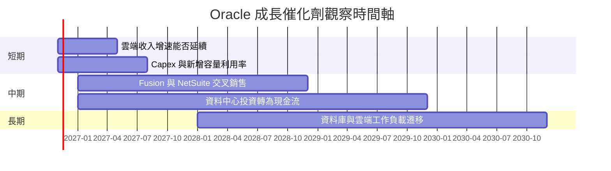

### 9.2 TAM 市場規模分析

題示資料未提供市場規模或滲透率數字，故不編造 TAM。可持續追蹤的營運替代指標如下：

```
╔══════════════════════════════════════════════════════════════════╗
║                 TAM 與營運驗證指標                               ║
╠══════════════════════════════════════════════════════════════════╣
║ 雲端基礎設施 TAM：N/A（題示資料未提供）                          ║
║ 企業 SaaS TAM：      N/A（題示資料未提供）                       ║
║ 資料庫市場 TAM：     N/A（題示資料未提供）                       ║
║ 公司已實現規模：TTM 營收 $71.78B；TTM 年增 21.6%                ║
║ 近期需求指標：最新季度單季營收年增 29.6%                         ║
║ 核心驗證：收入增速是否同步帶動營業現金流，而非只帶動 Capex      ║
╚══════════════════════════════════════════════════════════════════╝
```

### 9.3 成長驅動力結構圖

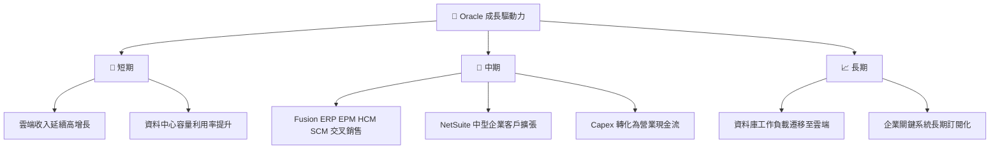

---

## 10. 風險矩陣

### 10.1 風險評分矩陣

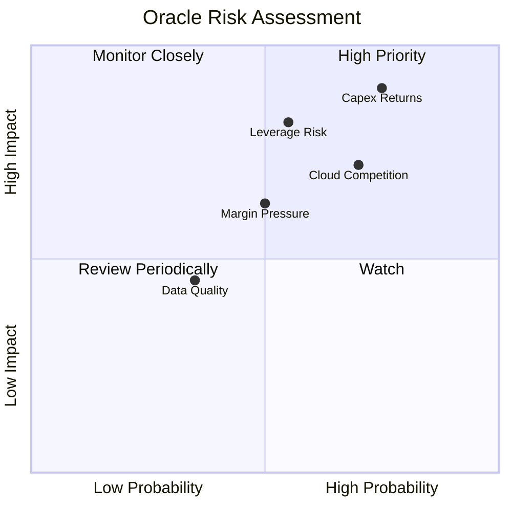

### 10.2 風險清單詳細分析

| # | 風險項目 | 發生機率 | 財務衝擊 | 風險評分 | 緩解措施 |
|---|----------|----------|----------|----------|----------|
| 1 | 🔴 資本支出回報不及預期 | 高（約60%，分析假設） | 高；Capex 已達 TTM $75.66B，若收入利用率不足會令 FCF 長期為負 | 🔴 9.0/10 | 逐季追蹤 Capex、雲端收入增速、營業現金流與容量利用率 |
| 2 | 🔴 淨負債與融資成本 | 中高（約50%，分析假設） | 高；交叉來源淨負債約 $132.06B，利息成本與再融資條件影響股權價值 | 🔴 8.2/10 | 核對債務到期表、利息保障倍數、淨負債／EBITDA |
| 3 | 🟠 雲端競爭與價格壓力 | 中高（約55%，分析假設） | 中高；若增速與毛利率同時放緩，估值倍數可能收縮 | 🟠 7.2/10 | 追蹤收入增速、毛利率與續約／交叉銷售指標 |
| 4 | 🟡 毛利率與折舊壓力 | 中（約45%，分析假設） | 中；TTM 毛利率 64.0%，低於所列同業 | 🟡 6.3/10 | 觀察新增容量成本、折舊與營業利潤率 |
| 5 | 🟡 資料來源口徑不一致 | 中（約35%，分析假設） | 中；ROE、營業利益率、債務及 EV/EBITDA 各來源存在差異 | 🟡 4.5/10 | 以 SEC 季報附註與同一計算口徑複核 |

---

## 11. 投資建議

### 11.1 最終綜合評級雷達圖

```
╔══════════════════════════════════════════════════════════════╗
║                    ORCL 投資評分雷達                         ║
╠══════════════════════════════════════════════════════════════╣
║ 基本面強度      7.5/10  ▓▓▓▓▓▓▓▓▓▓▓▓▓▓▓░░░░░                ║
║ 成長動能        8.0/10  ▓▓▓▓▓▓▓▓▓▓▓▓▓▓▓▓░░░░                ║
║ 獲利能力        7.0/10  ▓▓▓▓▓▓▓▓▓▓▓▓▓▓░░░░░░                ║
║ 盈餘品質        5.5/10  ▓▓▓▓▓▓▓▓▓▓▓░░░░░░░░░                ║
║ 財務健康        5.0/10  ▓▓▓▓▓▓▓▓▓▓░░░░░░░░░░                ║
║ 估值合理性      5.0/10  ▓▓▓▓▓▓▓▓▓▓░░░░░░░░░░                ║
║ 綜合評分        6.7/10  ▓▓▓▓▓▓▓▓▓▓▓▓▓▓░░░░░░                ║
╚══════════════════════════════════════════════════════════════╝
```

### 11.2 目標價與隱含報酬率

| 情境 | 參考目標價 | 相對 $127.11 報酬 | 機率權重 | 假設摘要 |
|------|-----------:|------------------:|---------:|----------|
| 🔴 悲觀 | $85.00 | −33.1% | 25% | EPS $9.00、退出 P/E 約 9.44x |
| 🟡 基準 | $126.98 | −0.1% | 50% | 8.8 加權合理價值；加權方法含 DCF 與相對估值 |
| 🟢 樂觀 | $238.87 | +88.0% | 25% | Forward EPS $11.05881、套用 MSFT Forward P/E 21.6x 參照 |
| **機率加權** | **約 $144.46** | **+13.7%** | **100%** | $85×25% + $126.98×50% + $238.87×25% |

> 機率加權情境目標與 MOS 所用加權合理價值是不同用途：評級仍依規則以 8.8 加權合理價值 $126.98 計算，MOS 約 −0.1%，因此評級為 **持有**。

### 11.3 買入時機與觸發因素

```
╔══════════════════════════════════════════════════════════════════╗
║                  ✅ 買入觸發因素 Checklist                       ║
╠══════════════════════════════════════════════════════════════════╣
║  立即加碼前需同時觀察：                                          ║
║  ☐ 單季營收年增維持 ≥20%，且不是只靠低基期                      ║
║  ☐ TTM 營業利益率維持 ≥32%                                      ║
║  ☐ Capex／營業現金流比率連續兩季下降                             ║
║                                                                  ║
║  加碼觸發條件：                                                  ║
║  ☐ FCF 連續兩季改善，並朝正值收斂                               ║
║  ☐ 股價回落至約 $114.28 以下，對應至少約10% MOS                 ║
║  ☐ ROIC 仍高於 WACC，且新增資本回報可由現金流驗證                ║
║                                                                  ║
║  減碼／重新評估條件：                                            ║
║  ☐ 雲端收入成長連續兩季低於 15%                                  ║
║  ☐ 營業利益率低於 30% 或較目前 TTM 收縮超過 3 個百分點           ║
║  ☐ Capex 長期高於營業現金流且未見容量利用率提升                  ║
║  ☐ ROIC 跌破 WACC 或債務成本明顯上升                             ║
╚══════════════════════════════════════════════════════════════════╝
```

### 11.4 投資人適配度分析

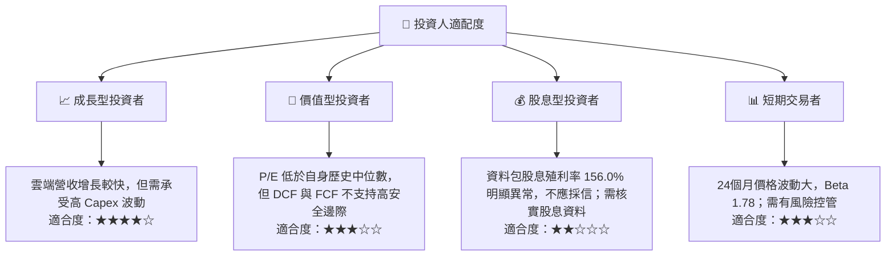

> 題示股息殖利率 **156.0%** 明顯不合理，且與股息支付資料不相容；本報告不將其視為可用投資指標，須以公司實際每股股息與股價重新核實。

### 11.5 每季財報監控清單（Quarterly Watch List）

| 監控指標 | 目前錨點 | 加碼觸發 | 減碼／重新評估 |
|----------|---------:|----------|----------------|
| 單季營收年增 | 最新季度 29.6% | 維持 ≥20% | 連續兩季 <15% |
| TTM 營業利益率 | 32.1% | ≥32%且穩定 | <30%或快速收縮 |
| 營業現金流 | TTM $46.94B | 增長快於 Capex | 連續兩季下降 |
| 資本支出 | TTM $75.66B | Capex／營收逐季下降且雲端收入增長 | Capex 上升、收入增速下滑 |
| TTM FCF | −$28.72B | 連續改善並轉正 | 更深負值且無投資回報證據 |
| FCF Yield | −7.25% | 回升至正值 | 長期維持負值 |
| 淨負債／EBITDA | 約 5.1x（交叉來源估算） | 持續下降 | 上升或利息保障惡化 |
| SBC／營收 | FY2026 約 7.1% | 比率下降或被營收增長吸收 | 持續高於 7%且股數稀釋加快 |
| EPS beat／miss | 過去四季估計值 N/A | 取得可核對的一致預期並連續超預期 | 連續不及預期且指引下修 |
| 股息資料 | 提供的殖利率 156.0% 異常 | 以公司公告核實後再評估 | 未核實前不以殖利率作決策 |

### 11.6 反面論證：什麼會證明論點錯誤（What Would Change My Mind）

```
╔══════════════════════════════════════════════════════════════════╗
║              ⚠️ 論點失效條件（Disconfirming Evidence）           ║
╠══════════════════════════════════════════════════════════════════╣
║ 本投資論點在下列情況成立時應重新檢視或退出：                    ║
║ ☐ 最新季度營收年增連續兩季低於 15%                               ║
║ ☐ TTM 營業利益率跌破 30%，或較 32.1% 收縮超過 3 個百分點        ║
║ ☐ TTM FCF 持續低於 −$28.72B，且 Capex 未帶來可驗證收入增長      ║
║ ☐ Capex／營業現金流比率不下降，且雲端成長同步放緩                ║
║ ☐ ROIC 由 61.3% 顯著下降並跌破 WACC 10.52%                      ║
║ ☐ 淨負債相對 EBITDA 持續上升，或利息保障倍數出現惡化             ║
║ ☐ 新增資料中心投資未能在合理期間內改善現金流與投資回報           ║
╚══════════════════════════════════════════════════════════════════╝
```

**總結**：ORCL 的營收成長、企業軟體黏著度與題示 ROIC 指標提供基本面支撐；但 TTM FCF −$28.72B、TTM Capex $75.66B，以及交叉來源淨負債約 $132.06B，使估值高度依賴投資回報與資本支出正常化。加權合理價值修正後為 **$126.98**，現價 $127.11，MOS 約 **−0.1%**，故評級為 **🟡 持有**；在 FCF 趨勢確認改善前，不宜僅因歷史估值分位低而視為具充分安全邊際。

> **免責聲明**：本報告為 AI 自動生成，僅供研究參考，不構成投資建議。資料來源間存在口徑差異，投資前應核對公司申報文件及最新市場資料。投資有風險，入市需謹慎。