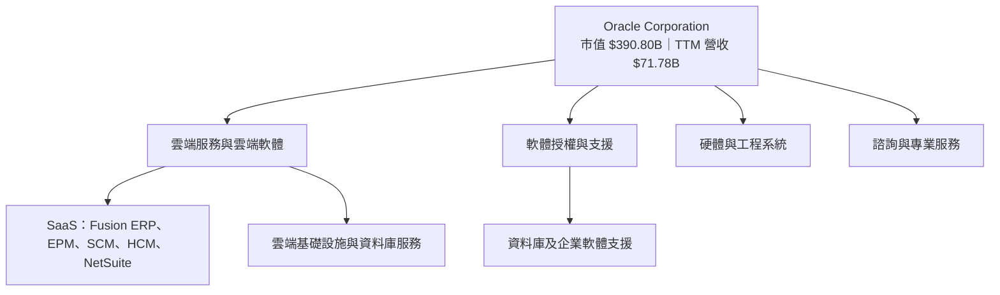
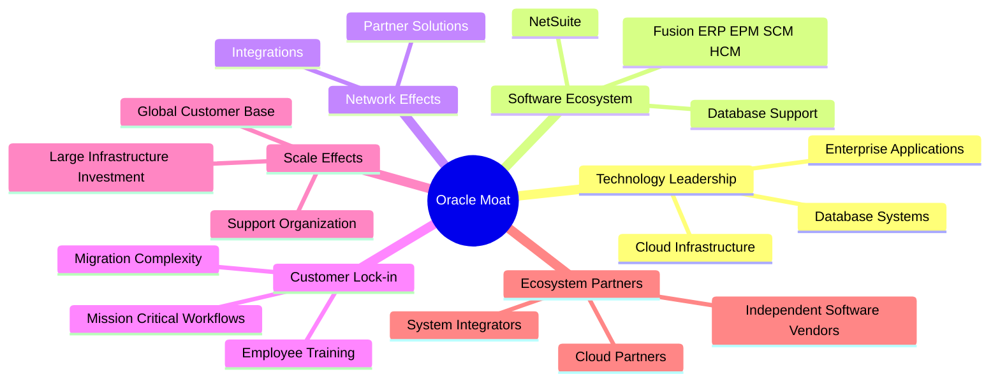
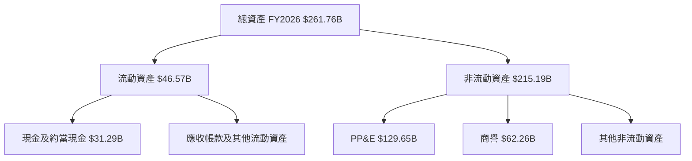
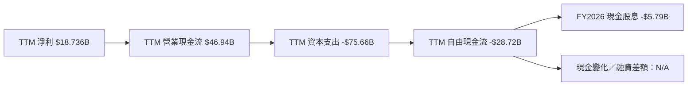
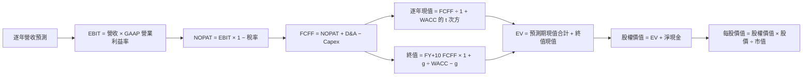
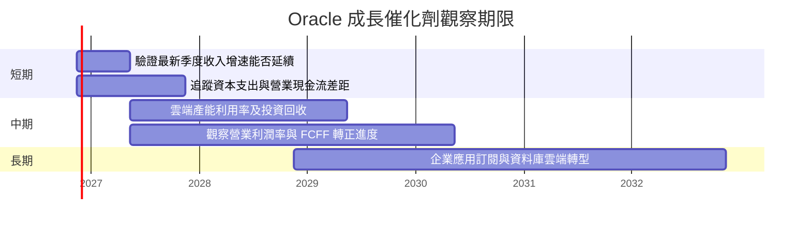
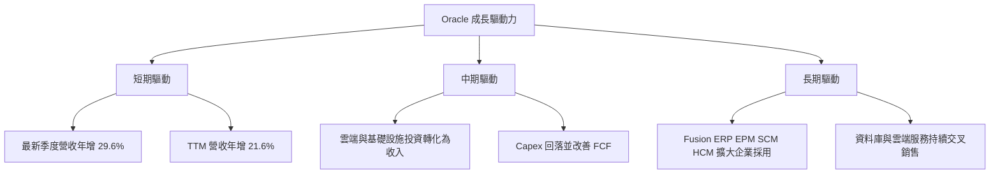
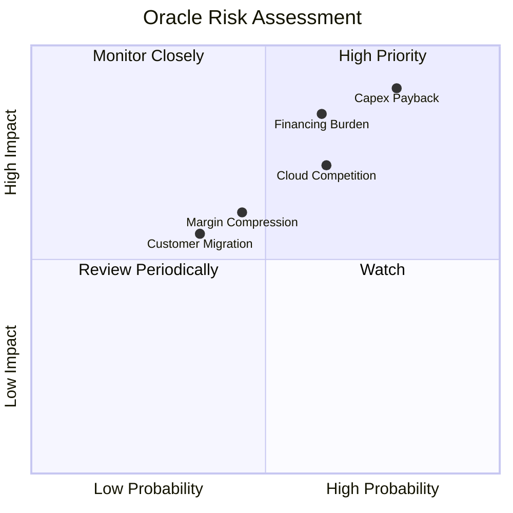
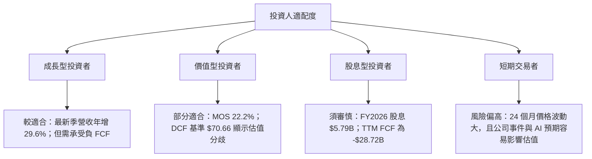

# ORCL 基本面深度分析報告
> **報告日期**：2026-11-14 ｜ **語言**：繁體中文 ｜ **數據來源**：SEC 申報資料 (XBRL)、Yahoo Finance、Finviz、StockAnalysis、Roic.ai ｜ **分析師**：CFA 級機構研究

## 目錄

| # | 章節 | 核心結論 |
|---|------|----------|
| 1 | 執行摘要 | 買入；加權合理價值 $161.02；MOS 22.2% |
| 2 | 公司概覽與商業模式 | 企業軟體與雲端基礎設施構成護城河，市場份額數據未提供 |
| 3 | 損益表深度分析 | TTM 營收 $71.78B、年增 21.6%；最新季年增 29.6% |
| 4 | 資產負債表分析 | 現金及短期投資 $37.08B；Verified Figures 未提供總債務 |
| 5 | 現金流量深度分析 | TTM FCF 為 -$28.72B，主因資本支出升至 $75.66B |
| 6 | 獲利能力與資本效率 | ROIC 61.3% 高於 WACC 9.61%，但再投資回收仍待驗證 |
| 7 | 相對估值分析 | 估值低於五年歷史區間中位數，但低 FCF 使相對估值訊號不完整 |
| 8 | DCF 內在價值評估 | 基準 DCF $70.66；終值佔 EV 194.9%，對假設高度敏感 |
| 9 | 成長催化劑 | 雲端與 AI 基礎設施需求是成長機會，TAM 數據未提供 |
| 10 | 風險矩陣 | 資本支出回報、融資負擔與雲端競爭為主要風險 |
| 11 | 投資建議 | 買入；以 $144.92 以下作 MOS ≥10% 的估值門檻 |

---

## 1. 執行摘要

依據 2026-11-13 收盤價 **$125.35**、加權合理價值 **$161.02** 與安全邊際 **22.2%**，規則 20 對應評級為**買入**；評級與六項評分均不作質化上調或下調。支持買入的證據包括 TTM 營收年增 **21.6%**、最新一季營收年增 **29.6%**，以及 ROIC **61.3%** 高於 WACC **9.61%**。但 TTM FCF 為 **-$28.72B**、FCF Yield **-7.35%**，且基準 DCF 為 **$70.66**，因此投資論點仰賴資本支出最終轉化為雲端營收與現金流，而非只依賴收入成長。

### 1.0 一頁式投資儀表板

| 項目 | 內容 |
|------|------|
| **投資論點（3 句）** | ① TTM 營收年增 **21.6%**、最新一季年增 **29.6%**，顯示收入成長加速。② ROIC **61.3%** 對比 WACC **9.61%**，目前回報指標高於資本成本。③ TTM Capex **$75.66B** 高於營業現金流 **$46.94B**，使 TTM FCF 降至 **-$28.72B**，投資回報尚未反映在現金流。 |
| **綜合評分** | **6.7/10**（引用 1.1 評分卡） |
| **財務健康** | 🟡 現金及短期投資 **$37.08B**，但 Verified Figures 未提供總債務；TTM FCF 為負 |
| **ROIC vs WACC** | **61.3% vs 9.61%**（指標顯示創造價值；需留意資本投入與 ROIC 分母資料差異） |
| **FCF 趨勢** | FY2024 至 FY2026 由 **$11.81B** 降至 **-$23.69B**；TTM FCF Yield **-7.35%** |
| **估值** | Forward P/E **11.3x**（市場資料）；EV/EBITDA **15.0x**（市場資料）；FCF Yield **-7.35%** |
| **DCF 內在價值（基準）** | **$70.66**；以 DCF 為基準的折溢價 **+77.4%** |
| **安全邊際（MOS）** | **+22.2%＝($161.02 − $125.35) ÷ $161.02**（基準：8.8 加權合理價值）｜🟡 有限 |
| **預期報酬（基準情境 12M）** | DCF 基準價 **$70.66**，相對現價 **-43.6%**；12 個月期間不由 DCF 模型直接推導 |
| **關鍵風險（前二）** | 高額 Capex 未能及時轉化為營業現金流；債務與融資成本資訊在不同資料來源間不一致 |
| **評級 + 信心度** | 🟢 **買入** ｜ 信心：中低（DCF 與現金流轉換存在重大不確定性） |

> **資料一致性提醒：**SEC／程式計算的 Verified Figures 與合併市場資料有若干差異：例如 TTM 營業利益率為 **32.1%**，其他市場資料欄列 **34.2%**；ROE 為 **28.3%**，另一來源列 **41.2%**；Verified Figures 的總債務為 **N/A**，其他市場資料列 **$169.14B**。本文指定口徑的指標以 Verified Figures 優先，不把不同口徑混算。

### 1.1 綜合評分卡（全報告唯一）

| 維度 | 評分（1–10） | 主要依據（引用數字與其來源章節） |
|------|--------------|----------------------------------|
| 成長性 | 8.0 | TTM 營收年增 **21.6%**、最新一季營收年增 **29.6%**（第 3 章）；成長仍需轉化為 FCF |
| 獲利能力 | 8.0 | TTM 營業利益率 **32.1%**、ROIC **61.3%** 高於 WACC **9.61%**；F-Score **4/7**（第 6 章） |
| 財務健康 | 5.5 | 現金及短期投資 **$37.08B**，但 FCF **-$28.72B**；總債務 Verified Figures 為 N/A（第 4、5 章） |
| 估值 | 5.0 | MOS **22.2%**；DCF 基準價 **$70.66** 低於現價，歷史 P/E 位於五年區間第 **5** 百分位（第 7、8 章） |
| 護城河 | 9.0 | 企業資料庫、ERP、HCM、SCM 等深度嵌入客戶工作流程；TTM 營業利益率 **32.1%**（第 2 章） |
| 管理層與資本配置 | 5.0 | FY2026 Capex **$55.66B**、SBC **$4.81B**、股數未通過 F-Score 稀釋測試，巨額投資回報需持續驗證 |
| **綜合評分** | **6.8** | 六項算術平均：(**8.0 + 8.0 + 5.5 + 5.0 + 9.0 + 5.0**) ÷ 6 = **6.75**，四捨五入至一位小數為 **6.8** |

### 1.2 五大投資論點 + 三大核心風險

| 類型 | 項目 | 具體依據 | 信心度 |
|------|------|----------|--------|
| 🟢 **投資論點①** | 雲端與企業軟體收入擴張 | TTM 營收 **$71.78B**、年增 **21.6%**；最新一季營收年增 **29.6%**，成長明顯高於上一財年營收年增 **17.35%** | 🟢 高 |
| 🟢 **投資論點②** | 利潤率與資本回報具支撐 | TTM 營業利益率 **32.1%**；ROIC **61.3%** 對比 WACC **9.61%** | 🟢 高 |
| 🟢 **投資論點③** | 估值低於自身歷史中位數 | P/E **19.6x** 對比五年中位數 **32.1x**；P/S **5.2x** 對比 **6.2x** 中位數 | 🟡 中 |
| 🟢 **投資論點④** | 企業軟體具高切換成本 | Oracle ERP、資料庫及企業應用與客戶核心營運流程整合；其商業模式包含軟體訂閱、支援及雲端服務 | 🟢 中高 |
| 🟢 **投資論點⑤** | 淨流動資金可支援投資週期 | 現金及短期投資 **$37.08B**；但債務完整口徑不一致，不能將其直接視為淨現金結論 | 🟡 中 |
| 🟡 **風險①** | 資本支出回收期與現金流壓力 | TTM Capex **$75.66B**、TTM OCF **$46.94B**，導致 FCF **-$28.72B** | 🔴 高衝擊 |
| 🔴 **風險②** | 融資負擔及槓桿資訊不透明 | Verified Figures 總債務為 **N/A**，合併市場資料列總債務 **$169.14B**；口徑差異需在後續季報核實 | 🔴 高衝擊 |
| 🟡 **風險③** | 雲端與 AI 基礎設施競爭 | MSFT 最新季營收年增 **18.8%**、SAP **13.2%**、CRM **10.8%**；Oracle 最新季為 **29.6%**，但高成長需由實際現金流證實 | 🟡 中高 |

### 1.3 快速統計卡片

| 指標 | 公司實際值（期間） | 同業中位數 | 狀態 |
|------|--------------------|------------|------|
| 營收成長（TTM） | **21.6%** | — | 🟢 |
| 營收成長（最新一季年增） | **29.6%** | **13.2%**（MSFT、SAP、CRM） | 🟢 |
| 毛利率（TTM） | **64.0%** | **73.6%**（MSFT、SAP、CRM） | 🟡 |
| 營業利益率（TTM） | **32.1%** | — | 🟢 |
| ROIC（TTM） | **61.3%** | — | 🟢 |
| Forward P/E | **11.3x**（市場資料） | **21.7x**（Peer 區塊僅 MSFT、SAP、CRM 中位數） | 🟢 |
| FCF Yield（TTM） | **-7.35%** | — | 🔴 |
| Piotroski F-Score | **4 / 7** | — | 🟡 |

> 同業中位數以 Peer multiples 區塊可計算的同業資料為準；其中 Forward P/E 中位數為 **21.7x**。Oracle Forward P/E 使用市場資料欄 **11.334854x**，與市場估值欄位口徑並列，不等同 DCF 假設。

### 1.4 投資結論

```text
╔══════════════════════════════════════════════════════════════════╗
║                    📊 投資結論摘要                               ║
╠══════════════════════════════════════════════════════════════════╣
║  評級：買入（MOS 22.2%，ROIC 61.3% 高於 WACC 9.61%）            ║
║  價格（2026-11-13 收盤）：$125.35                               ║
║  DCF 內在價值（基準）：$70.66（現價溢價 77.4%）                 ║
║  安全邊際 MOS：+22.2%（＝(加權合理價值−現價)÷加權合理價值）     ║
║  加權合理價值（8.8）：$161.02                                   ║
║  DCF 情境價值：                                                  ║
║    悲觀情境：$4.68（-96.3%）                                    ║
║    基準情境：$70.66（-43.6%）                                   ║
║    樂觀情境：$215.18（+71.7%）                                  ║
║  綜合評分：6.8/10（引用 1.1）                                    ║
║  適合投資人：能承受高再投資與 FCF 波動的長線成長型投資人         ║
╚══════════════════════════════════════════════════════════════════╝
```

---

## 2. 公司概覽與商業模式

### 2.1 業務結構與收入來源

Oracle 提供企業資料庫、企業應用、雲端基礎設施與技術支援。現有資料未拆分各業務板塊營收及佔比，因此不推算或繪製板塊比例；下圖只呈現業務關係，營收數字採公司整體 TTM 數據。



Oracle 的商業模式結合軟體訂閱、資料庫支援與雲端運算服務。企業應用與資料庫通常嵌入客戶核心流程，能帶來續約、升級與交叉銷售機會；但雲端基礎設施擴張需要大量資本投入，TTM Capex **$75.66B** 已高於 TTM OCF **$46.94B**，所以收入成長本身並不足以證明投資回報成立。

### 2.2 市場份額

市場份額數據未提供，故不繪製市場份額圖或填列比例。Oracle TTM 營收 **$71.78B**、年增 **21.6%**，最新一季營收年增 **29.6%**；同業最新一季年增為 MSFT **18.8%**、SAP **13.2%**、CRM **10.8%**。這顯示 Oracle 近期收入增速較快，但不能在缺少分部營收與市場規模資料時推導市場份額變化。

### 2.3 競爭護城河分析



### 2.4 護城河強度

| 護城河項目 | 強度（強／中／弱） | 證據（引用數字或事實） | 會削弱它的情況 |
|------------|--------------------|------------------------|----------------|
| 技術與資料庫 | 強 | Oracle 核心產品包括資料庫及企業 IT 基礎架構；TTM 營業利益率 **32.1%** | 客戶轉向雲原生、開源或多雲架構，降低專有資料庫依賴 |
| 企業軟體生態 | 強 | Fusion ERP、EPM、SCM、HCM 與 NetSuite 覆蓋企業流程 | 競爭者提供更具整合性的軟體套件，或客戶採用模組化替代產品 |
| 客戶鎖定 | 強 | ERP、資料庫等系統涉及資料遷移、流程重建與員工再培訓 | 雲端遷移工具成熟、標準化介面降低轉換成本 |
| 網路效應 | 中 | 合作夥伴及客戶整合有助擴大應用；未提供可量化網路效應指標 | 客戶採用多供應商架構，降低單一供應商生態價值 |
| 規模效應 | 強 | FY2026 資產 **$261.76B**，TTM 營收 **$71.78B**；具備全球企業服務與基礎設施投入能力 | 大規模 Capex 未形成足夠利用率、資本回報下降 |
| 生態夥伴 | 中 | Oracle 服務企業客戶並提供多類企業應用；夥伴收入及數量未提供 | 競爭者擴大系統整合商與雲端服務夥伴覆蓋 |

1.1「護城河」評分為 **9.0/10**，理由是 Oracle 產品深入企業關鍵流程且 TTM 營業利益率達 **32.1%**；扣分因素是雲端基礎設施的高資本需求與競爭變化。

---

## 3. 損益表深度分析

### 3.1 年度收入成長趨勢（近 4 年）

年度營收由 FY2023 **$49.95B** 增至 FY2026 **$67.36B**。以下年度增幅依各年度營收計算，四年資料可見 FY2025 復甦、FY2026 延續加速。

```text
╔══════════════════════════════════════════════════════════════════╗
║              Oracle 年度收入趨勢（FY2023-FY2026）               ║
╠══════════════════════════════════════════════════════════════════╣
║  FY2023  $49.95B  ███████████████░░░░░░░░░░░  YoY：+6.0%  🟡  ║
║  FY2024  $52.96B  ████████████████░░░░░░░░░░  YoY：+6.0%  🟡  ║
║  FY2025  $57.40B  █████████████████░░░░░░░░░  YoY：+8.4%  🟡  ║
║  FY2026  $67.36B  ████████████████████░░░░░░  YoY：+17.4% 🟢  ║
║                                                                  ║
║  FY2023-FY2026 營收 CAGR：($67.36B ÷ $49.95B)^(1/3) − 1 = 10.5% ║
╚══════════════════════════════════════════════════════════════════╝
```

FY2026 營收年增 **17.35%**，高於 FY2025 **8.38%**，與雲端、訂閱及基礎設施需求擴張相符；但資料未提供各分部收入，無法精確拆解成長來源。TTM 營收 **$71.78B**，相較前一 TTM 年增 **21.6%**，顯示截至 2026-08-31 的成長仍高於 FY2026 全年。

### 3.2 季度收入趨勢分析

| 季度 | 營收 | QoQ 成長 | YoY 成長 | 備註 |
|------|------:|---------:|---------:|------|
| FY2026 Q2（2025-11-30） | $16.06B | -6.6% | 14.22% | 與前一季 $17.19B 比較 |
| FY2026 Q3（2026-02-28） | $17.19B | 7.1% | 21.66% | YoY 成長較前季提高 |
| FY2026 Q4（2026-05-31） | $19.18B | 11.6% | 20.63% | 營收創資料所列季度高點 |
| FY2027 Q1（2026-08-31） | $19.34B | 0.8% | **29.6%** | 最新季度年增率；非 TTM 成長率 |

QoQ 以季度營收相鄰比較計算，受季節性及合約認列時間影響，不宜直接外推。最新一季 YoY **29.6%** 高於前一季 **20.63%**，值得追蹤其後續是否由連續雲端需求支撐。

### 3.3 利潤率演變分析

| 利潤率指標 | FY2023 | FY2024 | FY2025 | FY2026 | 趨勢 | 評估 |
|------------|--------:|--------:|--------:|--------:|------|------|
| **毛利率** | 72.9% | 71.4% | 70.5% | 65.8% | ↘️ 下滑 | 🟡 |
| **營業利益率** | 27.6% | 29.8% | 31.4% | 33.3% | ↗️ 上升 | 🟢 |
| **淨利率** | 17.0% | 19.8% | 21.7% | 25.4% | ↗️ 上升 | 🟢 |

> 年度比例以年度損益表營收與毛利／營業利益／淨利計算；FY2026 數字與 TTM 及其他市場資料因期間與資料來源不同，不應混為同一口徑。指定 TTM 營業利益率以 Verified Figures 的 **32.1%** 為準，最新一季營業利益率為 **34.8%**。

年度營業利益率從 FY2023 **27.6%** 升至 FY2026 **33.3%**，顯示收入增加伴隨營業利益增長；同期營業利益由 **$13.77B** 增至 **$22.44B**。但年度毛利率由 **72.9%** 降至 **65.8%**，可能反映收入組合向雲端基礎設施及相關服務移動、資料中心成本較高；現有資料沒有分部毛利資料，故不能把下降完全歸因於單一因素。營業利益率改善與毛利率下降同時發生，表示營業費用控管或規模效應有部分抵銷成本壓力。

### 3.4 費用結構分析

資料提供研發費用，但未提供完整 TTM 銷售、管理及服務成本分類明細，無法按一致口徑構造完整費用結構圓餅圖。FY2026 研發支出為 **$10.27B**，約佔 FY2026 營收 **15.2%**（$10.27B ÷ $67.36B）；研發支出有助產品與雲端服務迭代，但其回報應由未來營收、毛利及現金流共同驗證。

```text
╔══════════════════════════════════════════════════════════════════╗
║               FY2026 研發支出與營收（可得數據）                 ║
╠══════════════════════════════════════════════════════════════════╣
║  FY2026 營收       $67.36B                                      ║
║  FY2026 研發支出   $10.27B  ≈ 營收的 15.2%                     ║
║  其他費用分類       數據未提供，不以估計比例補足                 ║
╚══════════════════════════════════════════════════════════════════╝
```

### 3.5 季度 EPS 趨勢與盈餘品質（Quality of Earnings）

| 季度 | EPS 實際值 | EPS 預估 | 超預期／不及預期 | EPS YoY |
|------|-----------:|---------:|-----------------|--------:|
| 2025-11-30 | $2.10 | N/A | N/A（預估值缺失） | 90.91% |
| 2026-02-28 | $1.27 | N/A | N/A（預估值缺失） | 24.51% |
| 2026-05-31 | $1.45 | N/A | N/A（預估值缺失） | 21.91% |
| 2026-08-31 | $1.56 | N/A | N/A（預估值缺失） | 54.45% |

EPS 歷史中的估計值均為 nan，故不能判定上述四季超預期或不及預期。2025-11-30 EPS **$2.10** 高於相鄰季度，可能涉及單季獲利波動；資料未提供足夠一次性損益明細，不能將其視為可持續季度 run-rate。

| 盈餘品質項目 | 數值／佔比 | 評估 |
|--------------|------------|------|
| 股權薪酬 SBC / 營收 | 約 **6.7%**（估計：最近四季 SBC $4.82B ÷ TTM 營收 $71.78B） | 🟡 SBC 是股東經濟成本，且 F-Score 的稀釋股數測試未通過 |
| SBC / 營業現金流 | 約 **10.3%**（$4.82B ÷ $46.94B） | 🟡 比重不低；SBC 作為非現金費用會提高 OCF，但帶來股權稀釋 |
| FCF / 淨利（現金轉換率） | 約 **-153.3%**（FCF -$28.72B ÷ TTM 淨利 $18.736B） | 🔴 目前自由現金流未跟上會計獲利 |
| 一次性／非經常性損益 | N/A（未提供足夠明細） | 不據此判定淨利有無被一次性項目美化 |
| 有效稅率 | **12.6%**（最新年度有效稅率） | 🟢 低於美國法定稅率，但模型採指定有效稅率；未見資料可將稅務利益量化為異常 |
| 資本化支出 vs 費用化 | TTM Capex **$75.66B**；資產負債表 PP&E FY2026 **$129.65B**，TTM **$161.81B** | 🟡 固定資產快速增加，代表資本投入很大；資本化不等於虛增利潤，但須檢視資產利用率與折舊 |

**盈餘品質結論：**Oracle 的營業獲利與淨利成長具實質營運支撐，但在資本支出高於營業現金流的階段，GAAP 淨利不能直接代表可分配現金。若大額 Capex 形成可持續雲端收入，當前 FCF 低點可能是投資週期現象；若產能使用率或客戶需求不如預期，則會透過低 FCF、折舊負擔及資本回報下降拖累估值。

---

## 4. 資產負債表分析

### 4.1 資產結構分解

以下以 StockAnalysis 的 FY2026 年度資產負債表數字呈現；TTM 資產資料另有期間差異，不混用。金額單位為美元十億。



FY2026 PP&E **$129.65B**，較 FY2025 **$56.67B** 大幅增加；這與基礎設施投資擴張相符，但也提升折舊、資金需求與產能利用率風險。商譽 **$62.26B** 佔總資產約 **23.8%**，使併購資產減損風險值得留意。

### 4.2 流動性與營運資金分析

| 指標 | 最新 TTM | 一年前 TTM | 變化 | 解讀 |
|------|----------|------------|------|------|
| DSO 應收帳款天數 | **58 天** | **55 天** | **+3 天** | 收款週期略延長；可能反映收入組合或客戶付款時間變化，需關注應收帳款增幅 |
| DIO 存貨天數 | **N/A** | **N/A** | N/A | 公司未列有可計算存貨餘額，不填補推估值 |
| DPO 應付帳款天數 | **156 天** | **N/A** | N/A | 一年前數據缺失，無法比較；較長應付週期可支撐現金，但不應據此推定議價能力 |
| CCC 現金轉換週期 | **N/A** | **N/A** | N/A | DIO 缺失，依公式無法計算 |

可取得的流動比率為 **1.171**、速動比率 **1.02**，顯示短期流動資產略高於流動負債；但高資本支出對現金需求的影響更直接。流動比率年度資料由 FY2025 **0.75**（$24.58B ÷ $32.64B）升至 FY2026 **1.12**（$46.57B ÷ $41.76B），與現金增長一致。

### 4.3 債務結構分析

Verified Figures 的總債務為 **N/A**，並明確要求缺漏不反推；因此下圖不以市場資料中的債務數字補做債務比率或利息保障倍數。需要注意，合併市場資料列總債務 **$169.14B**、淨負債 **$132.07B**，但此數字與 Verified Figures 的債務欄缺漏及其淨現金口徑並存，應於後續 SEC 財報中核實。

```text
╔══════════════════════════════════════════════════════════════════╗
║                   Oracle 債務健康診斷                            ║
╠══════════════════════════════════════════════════════════════════╣
║  總債務（Verified Figures）：N/A；不可用其他口徑回填             ║
║  現金及短期投資：             $37.08B                             ║
║  Net cash（指定口徑）：       $37.08B                             ║
║  Debt/EBITDA：                N/A（總債務口徑未核實）             ║
║  Interest Coverage：          N/A（利息費用資料未提供）           ║
║  財務判斷：                   🟡 現金充足，但槓桿資料需核對       ║
╚══════════════════════════════════════════════════════════════════╝
```

### 4.4 股東權益趨勢

FY2023 至 FY2026 股東權益由 **$1.07B** 增至 **$42.51B**。這反映資產負債表擴張與留存盈餘等因素，但權益基數變動大，歷史 ROE 可能因此波動；FY2026 權益不可與此前極低基數直接解讀為經營效率突變。

```text
╔══════════════════════════════════════════════════════════════════╗
║                 Oracle 股東權益變化（年度）                      ║
╠══════════════════════════════════════════════════════════════════╣
║  FY2023  $ 1.07B  █                                               ║
║  FY2024  $ 8.70B  █████                                           ║
║  FY2025  $20.45B  ███████████                                     ║
║  FY2026  $42.51B  ███████████████████████                         ║
╚══════════════════════════════════════════════════════════════════╝
```

---

## 5. 現金流量深度分析

### 5.1 現金流量瀑布圖

TTM OCF 為 **$46.94B**，Capex 為 **$75.66B**，FCF 為 **-$28.72B**；FY2026 支付股息 **$5.79B**。資料未提供同期間回購金額及現金餘額變化完整橋接，因此圖中不虛構回購或淨現金變化金額。



### 5.2 FCF 轉換率趨勢

| 財年 | 營業現金流 | 資本支出 | FCF | 淨利 | FCF／淨利 |
|------|-----------:|---------:|----:|-----:|----------:|
| FY2023 | $17.16B | $8.70B | $8.47B | $8.50B | 99.6% |
| FY2024 | $18.67B | $6.87B | $11.81B | $10.47B | 112.8% |
| FY2025 | $20.82B | $21.21B | -$0.394B | $12.44B | -3.2% |
| FY2026 | $31.98B | $55.66B | -$23.69B | $17.09B | -138.6% |
| TTM 至 2026-08-31 | $46.94B | $75.66B | **-$28.72B** | $18.736B | **-153.3%** |

FY2026 OCF 增至 **$31.98B**，但 Capex 同期升至 **$55.66B**，使 FCF 從 FY2025 接近損益兩平轉為大幅負值。換言之，營運現金生成改善仍不足以支付當前基礎設施投入。

### 5.3 自由現金流趨勢

```text
╔══════════════════════════════════════════════════════════════════╗
║               Oracle 自由現金流：歷史年度及 TTM                 ║
╠══════════════════════════════════════════════════════════════════╣
║  FY2024  +$11.81B  ████████████░░░░░░░░  FCF/淨利：112.8%      ║
║  FY2025  -$ 0.39B  ░░░░░░░░░░░░░░░░░░░░  FCF/淨利： -3.2%      ║
║  FY2026  -$23.69B  ████████████████████  FCF/淨利：-138.6%     ║
║  TTM     -$28.72B  ███████████████████████ FCF Yield：-7.35%   ║
╚══════════════════════════════════════════════════════════════════╝
```

TTM FCF 的惡化主要對應 Capex 快速擴張；若新增資料中心與雲端能力能在後續期間提高收入密度，FCF 可逐步回升；反之，長期負 FCF 會增加外部融資依賴，也會使以淨利為基礎的估值失真。

### 5.4 資本配置評估

各類資本配置的可得數據如下，沒有足夠同期間回購與留存金額資料，故不繪製比例圓餅圖。

| 資本配置項目 | 金額與期間 | 評估 |
|--------------|------------|------|
| 資本支出 | TTM **$75.66B**；FY2026 **$55.66B** | 最大現金用途；核心問題是未來產能利用率與增量回報 |
| 股息 | FY2026 **$5.79B**；每季股息支付資料可見約 $1.44B–$1.56B | FY2026 股息支出增加，與當前負 FCF 並存 |
| 股權薪酬 | FY2026 **$4.81B**；FY2025 **$4.67B** | 稀釋是實際股東成本，F-Score 稀釋測試未通過 |
| 股票回購 | N/A（未提供可核實金額） | 不以股數或股權變化反推回購 |
| 現金留存／融資 | N/A（缺少同期間完整現金流橋接） | 需持續核對債務發行、償還及現金變化 |

---

## 6. 獲利能力與資本效率

### 6.1 ROE / ROA / ROIC 趨勢

| 指標 | 歷史數據 | 評估 |
|------|----------|------|
| ROE | TTM **28.3%**（QUALITY FIGURES） | 另一市場來源列 **41.2%**，口徑差異明顯；採品質指標的 28.3% |
| ROA | TTM **6.4%**（市場財務資料） | 資產基數快速擴大，ROA 反映資產密集度上升 |
| ROIC | TTM **61.3%**（Verified Figures） | 高於 WACC，但其投入資本定義可能受現金與債務資料口徑影響 |
| FY2026 營業利益率 | **33.3%**（年度財報數據計算） | 年度營業利益率改善；與 TTM 指定口徑 **32.1%** 不同期間 |

資料未提供一致的歷年 ROIC、ROE、ROA 序列及同業 ROIC 均值，故不補列或以單一年度數據推估趨勢。就指定 TTM 指標而言，ROIC 高於資本成本，但負 FCF 說明高回報率並未消除目前大額再投資所造成的現金缺口。

### 6.2 ROIC vs WACC 分析（核心價值創造判斷）

```text
╔══════════════════════════════════════════════════════════════════╗
║                ROIC vs WACC 深度分析                            ║
╠══════════════════════════════════════════════════════════════════╣
║  WACC（直接採用成本資本資料）：9.61%                              ║
║  ├── 無風險利率（10Y 美債）：5.15%                               ║
║  ├── 市場風險溢酬 ERP：5.00%                                     ║
║  ├── Beta 原始值：1.78；採用調整 Beta：1.52                      ║
║  ├── Ke：5.15% + 1.52 × 5.00% = 12.75%                         ║
║  ├── 稅前 Kd：2.72%；稅率：12.6%                                 ║
║  ├── 資本結構權重：E 69.8%／D 30.2%                              ║
║  └── WACC：9.61%                                                 ║
║                                                                  ║
║  ROIC（TTM，指定口徑）：61.3%                                     ║
║  ├── 淨利後營業利益／投入資本公式結果：61.3%（照錄）             ║
║  └── 詳細分子、分母未在品質指標提供，不另行反推                  ║
║                                                                  ║
║  EVA Spread = ROIC − WACC = 61.3% − 9.61% = +51.69 個百分點      ║
║  ROIC 61.3%  ▓▓▓▓▓▓▓▓▓▓▓▓▓▓▓▓▓▓▓▓▓▓▓▓▓▓▓▓▓▓  🟢              ║
║  WACC  9.61% ▓▓▓▓▓░░░░░░░░░░░░░░░░░░░░░░░░░░░  ──              ║
║                                                                  ║
║  結論：以指定口徑，ROIC 高於 WACC，代表帳面資本回報創造價值；     ║
║  但負 FCF 與資本支出快速增長，要求未來新增資產維持足夠利用率。   ║
╚══════════════════════════════════════════════════════════════════╝
```

本報告沿用指定 WACC **9.61%**，不另行重算。成本資本輸入的無風險利率日期在資料中沒有提供，只能照錄 **5.15%**；Beta 採調整後 **1.52**，計算方式為 **⅔ × 1.78 + ⅓**。資本成本區塊提供債務成本及權重，但未提供可用於獨立重算的利息費用與一致口徑計息負債，因此不把其他來源的總債務混入 WACC。

### 6.3 杜邦三因素分解

| 因素 | 數值（TTM） | 解讀 |
|------|-------------|------|
| 淨利率 | **26.4%** | 每一美元營收約有 26.4 美分淨利 |
| 資產週轉率 | **0.24x** | 每一美元資產帶來約 0.24 美元營收，與資產投入擴大一致 |
| 權益乘數 | **4.54x** | 槓桿提高 ROE，但也放大資本結構風險 |
| **ROE** | **28.3%** | 品質指標原列：26.4% × 0.24 × 4.54 = **28.3%** |

杜邦拆解顯示，ROE 由高淨利率與權益乘數共同支持，並非只靠資產週轉率；權益乘數 **4.54x** 代表槓桿是不可忽略因素。三個因子因四捨五入後相乘可能有尾差，以品質指標列示的 ROE **28.3%** 為準。

### 6.4 財務體質：Piotroski F-Score

**F-Score：4 / 7**。分母低於九，原因是資料缺漏的測試不納入可判定測試總數。

| 測試 | 結果 | 解讀 |
|------|------|------|
| ROA > 0 | ✅ 通過 | TTM 獲利為正 |
| 營業現金流 > 0 | ✅ 通過 | TTM OCF **$46.94B** |
| ROA 高於一年前 | ❌ 未通過 | 資產擴張未同步提升 ROA |
| 營業現金流 > 淨利（應計品質） | ✅ 通過 | TTM OCF 高於 TTM 淨利 |
| 長期負債／總資產低於一年前 | — 無法判定 | 缺少品質指標所需一致輸入 |
| 流動比率高於一年前 | ✅ 通過 | 品質指標測試通過 |
| 稀釋股數未增加 | ❌ 未通過 | 股數稀釋測試未通過，SBC 具經濟成本 |
| 毛利率高於一年前 | — 無法判定 | 缺少品質指標所需資料 |
| 資產週轉率高於一年前 | ❌ 未通過 | 資產增速高於營收增速的風險訊號 |

---

## 7. 相對估值分析

### 7.1 同業估值比較表格

Peer multiples 依指定數據；Oracle 市場估值取市場估值欄，與 Verified Figures 的歷史估值口徑不混用。SAP 的 P/S、EV/EBITDA 因混合幣別而為 N/A。

| 估值指標 | **ORCL** | **MSFT** | **SAP** | **CRM** | 本公司評估 |
|----------|---------:|---------:|-------:|-------:|-----------|
| **Trailing P/E** | **19.6x** | 27.3x | 29.3x | 19.9x | 🟢 相對 MSFT、SAP 低，接近 CRM |
| **Forward P/E** | **11.3x** | 21.7x | 24.6x | 13.6x | 🟢 折價；但 Oracle 預期 EPS 與雲端資本投入須實現 |
| **P/S Ratio** | **5.4x** | 11.2x | N/A | 4.1x | 🟡 高於 CRM、低於 MSFT；SAP 混合幣別不可比 |
| **EV/EBITDA** | **15.0x** | 19.3x | N/A | 16.3x | 🟡 低於 MSFT、CRM；SAP 混合幣別不可比 |
| **最新一季營收年增** | **29.6%** | 18.8% | 13.2% | 10.8% | 🟢 Oracle 成長率最高，但仍需觀察現金轉換 |
| **TTM 毛利率** | **64.0%** | 67.7% | 73.6% | 77.3% | 🟡 低於三家同業；產品組合及基礎設施成本值得留意 |

市場估值欄的 Oracle Trailing P/E 為 **19.647335x**、Forward P/E 為 **11.334854x**、EV/EBITDA 為 **14.999x**。歷史估值區塊的 Oracle P/E 為 **19.6x**、EV/EBITDA 為 **10.4x**；兩組 EV/EBITDA 存在明顯口徑差異，歷史比較應採指定「Valuation vs own history」系列，而同業比較採市場 Peer 區塊。

### 7.2 歷史估值區間分析

```text
╔══════════════════════════════════════════════════════════════════╗
║             Oracle 五年歷史估值位置（TTM 倍數）                 ║
╠══════════════════════════════════════════════════════════════════╣
║  P/E        19.0x ├●────────────── 32.1x ────────────┤ 52.3x    ║
║                    現值 19.6x｜五年中位數 32.1x｜百分位 5%       ║
║  P/S         4.6x ├────●──────────  6.2x ────────────┤ 11.1x    ║
║                    現值 5.2x｜五年中位數 6.2x｜百分位 24%       ║
║  EV/EBITDA  12.6x ├●───────────── 17.9x ────────────┤ 28.9x    ║
║                    現值 10.4x｜五年中位數 17.9x｜百分位 0%      ║
╚══════════════════════════════════════════════════════════════════╝
```

P/E、P/S 現值分別位於各自五年區間的 **5** 與 **24** 百分位，確實低於歷史中位數。不過 EV/EBITDA 的現值 **10.4x** 低於所列區間下限 **12.6x**，可能反映來源或期間口徑不一致；應按提供數字引用，但不將此異常視為毫無疑問的低估證據。

### 7.3 情境價值（Bear / Base / Bull，照抄 DCF MODEL）

| 情境 | 第 1 年營收成長 | 期末營業利潤率 | WACC | 每股價值 | 相對現價 | 機率 | 會發生的條件 |
|------|----------------:|----------------:|-----:|----------:|----------:|-----:|--------------|
| 🔴 悲觀 | 10.8% | 26.0% | 10.61% | **$4.68** | **-96.3%** | 25% | 成長顯著低於 TTM 21.6%，高額基建投入無法帶來規模收益、利潤率明顯收縮 |
| 🟡 基準 | 21.6% | 30.6% | 9.61% | **$70.66** | **-43.6%** | 50% | 近期成長延續後逐年淡化，營業利潤率向五年中位數回落 |
| 🟢 樂觀 | 32.4% | 33.6% | 8.61% | **$215.18** | **+71.7%** | 25% | 雲端與 AI 需求使收入加速，營業槓桿抵銷投資與成本壓力 |

模型所列機率加權價值為 **$90.29**，相對現價 **-28.0%**；8.8 估值權重規定使用 DCF 基準價，不以機率加權價替換。

### 7.4 相對估值隱含價格區間

```text
╔══════════════════════════════════════════════════════════════════╗
║          相對估值方法回推價值與現價（2026-11-13）               ║
╠══════════════════════════════════════════════════════════════════╣
║  DCF 基準            $70.66  ───── 現價 $125.35                  ║
║  同業 EV/EBITDA      $197.10 ────────────────                    ║
║  同業 Forward P/E    $239.44 ─────────────────────               ║
║  分析師共識目標價    $236.18 ─────────────────────               ║
╚══════════════════════════════════════════════════════════════════╝
```

| 方法 | 每股價值 | 依據 |
|------|---------:|------|
| DCF（基準） | **$70.66** | 10 年 FCFF、WACC **9.61%**、永續成長 **3.0%** |
| 同業 Forward P/E | **$239.44** | 同業中位數 **21.7x** × Forward EPS **$11.06** |
| 同業 EV/EBITDA | **$197.10** | MSFT、CRM 同業中位數 **17.8x** × TTM EBITDA，再加淨現金 |
| 分析師共識目標價 | **$236.18** | 40 位分析師平均目標價；作為參考，不代表獨立內在價值 |

同業倍數法與分析師共識均高於現價，但與負 FCF 及基準 DCF 形成明顯分歧。估值分歧核心不是當期營收成長，而是高額資本投入能否迅速成為可持續 FCFF。

---

## 8. DCF 內在價值評估（Discounted Cash Flow）

### 8.0 估值推理鏈（Thinking Logic）

**Step 1 — 價值來源與主導變數**

Oracle 價值可拆為既有企業軟體與資料庫營收、雲端應用與基礎設施擴張，以及由資料中心新增產能帶來的成長選擇權。現有資料沒有各分部營收及佔比，不能為上述來源編造比例；已知整體 TTM 營收 **$71.78B**、TTM 成長 **21.6%**。模型中最主導價值的變數是**Capex 從收入的 105.4% 逐步降至 14.4%**：預測前七年 FCFF 均為負，終值現值佔 EV **194.9%**，因此投資轉化速度比短期收入小幅波動更關鍵。

**Step 2 — 模型選擇**

| 決策點 | 本報告採用 | 理由（含數字） | 曾考慮但否決 | 否決理由 |
|--------|-----------|----------------|--------------|----------|
| 現金流定義 | FCFF | 以 WACC **9.61%** 折現並推導 EV；債務資料有口徑差異 | FCFE | 股權現金流會直接受融資結構變動影響 |
| 預測期 N | **10 年** | DCF MODEL 固定預測期為 10 年，符合雲端投資逐步回收的模型設定 | 5 年 | 無法涵蓋模型中 Capex 逐年淡化至第 10 年的過程 |
| 終值方法 | Gordon Growth | 模型提供永續成長率 **3.0%** 與 Gordon Growth 終值 | 退出倍數 | DCF MODEL 未提供退出倍數終值，不能自行建立 |
| EBIT 基礎 | GAAP EBIT | 指定模型使用 GAAP EBIT，FCFF 已反映 SBC 費用 | 非 GAAP EBIT | 會與模型既定假設不一致 |

**Step 3 — 關鍵假設推導鏈**

- **營收成長路徑**：錨點＝TTM 年增 **21.6%**；最新一季年增 **29.6%**。調整＝以 TTM 成長作 FY+1 起點，之後線性淡化至 FY+10 **3.0%**，反映高基期與成熟後成長收斂。**採用值：FY+1 21.6%，FY+10 3.0%**。曾考慮維持 29.6%，但否決，因最新單季增幅不是 TTM 成長率，也不宜直接外推十年。
- **期末營業利潤率**：錨點＝TTM 營業利益率 **32.1%**；FY2026 年度推算營業利益率 **33.3%**。調整＝模型以 TTM 為起點，逐年淡化至近五個財年中位數。**採用 FY+1 32.1%、FY+10 30.6%**。曾考慮維持 FY2026 年度比率，但否決，以遵循指定 TTM 起點與五年中位數假設。
- **永續成長率 g**：錨點＝模型採 **3.0%**，長期成長率需低於 WACC；資料沒有管理層長期財測或宏觀長期名目成長率。調整＝採用模型指定值，與 WACC **9.61%** 保持正利差。**採用 3.0%**。曾考慮 4.0%，但否決，因終值已佔 EV **194.9%**，提高 g 會再放大終值依賴。
- **預測期 N**：錨點＝模型預設 **10 年**。調整＝不擅自變更程式模型期間。**採用 10 年**。曾考慮 5 年，但否決，因 Capex 比率在模型中需要長期逐步回落，縮短預測期會改變終值起點。
- **Capex／營收**：錨點＝TTM Capex **$75.66B** ÷ TTM 營收 **$71.78B**，模型比率 **105.4%**。調整＝假設投入逐步下降，FY+10 回到 D&A 的 1.1 倍，得到 **14.4%**。**採用 FY+1 105.4% 至 FY+10 14.4%**。曾考慮更快回落，但否決，因沒有資料支持雲端產能建設何時完成。
- **D&A／營收**：錨點＝模型列示 TTM **13.1%**。**採用 13.1% 持平**；資料未提供可核實較長歷史比率，故不另作趨勢調整。
- **EBIT 與 SBC**：採 GAAP EBIT。FY2026 SBC **$4.81B**，模型說明 GAAP EBIT 已將 SBC 作為費用；**採用組合 (A)：GAAP EBIT + 固定股數、不另扣 SBC、不另增稀釋率**。曾考慮另扣 SBC 或逐年增加股數，但否決，以免重複計算或改動模型既定組合。
- **營運資金變動**：模型明確未建模；沒有完整 ΔWC 預測假設，依模型設定不另加／扣營運資金。
- **WACC**：錨點＝成本資本資料指定 **9.61%**，由 6.2 節照用。**採用 9.61%**。不另自建替代 WACC，因規則指定使用該區塊輸入。
- **終值方法**：錨點＝模型提供 Gordon Growth，WACC **9.61%** 大於 g **3.0%**。**採用 Gordon Growth**。曾考慮退出倍數交叉驗證，但模型沒有退出倍數數字，不能另行建模。

**Step 4 — 最脆弱假設**

最脆弱的一環是 Capex 由收入的 **105.4%** 降至 **14.4%**；若資料中心建設需求持續、或新增容量未能產生預期收入，終值與每股價值會顯著下降，敏感度矩陣已顯示基準 g 下 WACC 增加 1 個百分點時價值由 **$70.66** 降至 **$47.69**。

**Step 5 — 計算路徑**



### 8.1 模型假設總表（Model Inputs）

| 假設項目 | 採用值 | 依據／來源 | 敏感度 |
|----------|--------|-------------|--------|
| 預測期長度 N | **10 年** | DCF MODEL 指定 | 🟡 中 |
| 營收成長 | FY+1 **21.6%**，FY+10 **3.0%**，逐年線性淡化 | TTM 成長 **21.6%**；終點為模型設定 | 🔴 高 |
| 營業利潤率 | **32.1%** 降至 **30.6%** | TTM 營業利益率與最近五財年中位數假設 | 🔴 高 |
| 有效稅率 | **12.6%** | 最新年度有效稅率 | 🟢 低 |
| Capex／營收 | FY+1 **105.4%** 降至 FY+10 **14.4%** | TTM Capex／營收比，模型淡化至 D&A 的 1.1 倍 | 🔴 高 |
| D&A／營收 | **13.1%** | 模型以 TTM 比例持平 | 🟢 低 |
| 營運資金變動 | 不建模 | DCF MODEL 明確未建模 | 🟢 低 |
| EBIT 基礎 | **GAAP** | DCF MODEL 指定 GAAP EBIT | 🟡 中 |
| SBC 處理 | 組合 **(A)**：不另扣 SBC、股數不額外稀釋 | GAAP EBIT 已含 SBC 費用；模型指示固定股數 | 🟡 中 |
| 年稀釋率 | **0%**（模型固定股數） | SBC 影響已在 GAAP EBIT 計入一次 | 🟡 中 |
| 永續成長率 g | **3.0%** | 模型指定，低於 WACC **9.61%** | 🔴 高 |
| 終值方法 | Gordon Growth | DCF MODEL 提供終值公式；退出倍數未提供 | 🔴 高 |
| WACC | **9.61%** | 成本資本資料指定值 | 🔴 高 |

**FCF 定義：**使用 FCFF，按模型指定公式  
**FCFF = NOPAT + D&A − Capex**。營運資金不建模，也不額外扣 ΔWC。  
**SBC 組合：**本模型採用 **(A)**，故 SBC 影響已計入一次：GAAP EBIT 已含 SBC 費用，FCFF 不另扣 SBC，股數亦不額外稀釋。

### 8.2 折現率推導（WACC）

```text
╔══════════════════════════════════════════════════════════════════╗
║                    WACC 推導（折現率）                           ║
╠══════════════════════════════════════════════════════════════════╣
║  股權成本 Ke（CAPM）：                                           ║
║  ├── 無風險利率 Rf：                         5.15%               ║
║  ├── 市場風險溢酬 ERP：                      5.00%               ║
║  ├── Beta 原始值（Yahoo）：                  1.78                ║
║  ├── Beta 採用值（調整後）：                 1.52                ║
║  ├── Beta 調整：⅔ × 1.78 + ⅓ = 1.52                              ║
║  ├── 規模／國別溢酬：                        0.00%（未另加）    ║
║  └── Ke = 5.15% + 1.52 × 5.00% =             12.75%              ║
║                                                                  ║
║  債務成本 Kd：                                                    ║
║  ├── 稅前 Kd（資料列示）：                   2.72%               ║
║  ├── 有效稅率：                              12.6%               ║
║  └── 稅後 Kd = 2.72% × (1 − 12.6%) =         2.38%               ║
║                                                                  ║
║  資本結構權重（成本資本資料）：                                  ║
║  ├── 股權權重 E：                            69.8%               ║
║  ├── 債務權重 D：                            30.2%               ║
║  └── WACC = 69.8% × 12.75% + 30.2% × 2.38% = 9.61%              ║
╚══════════════════════════════════════════════════════════════════╝
```

**逐步演算（WACC）：**

1. **Ke（CAPM）** = Rf + β × ERP = **5.15% + 1.52 × 5.00% = 12.75%**。
2. **稅前 Kd**：成本資本資料直接列示 **2.72%**；利息費用與一致口徑平均計息負債未提供，無法獨立複算分子與分母，故不反推債務或利息費用。
3. **稅後 Kd** = 2.72% × (1 − 12.6%) = **2.37728% ≈ 2.38%**。
4. **權重**：股權權重 **69.8%**；債務權重 **30.2%**；69.8% + 30.2% = **100.0%**。成本資本資料未列示與此權重同口徑的 E、D 金額，且總債務在 Verified Figures 為 N/A，故不自行補算金額。
5. **WACC** = 69.8% × 12.75% + 30.2% × 2.37728% = 8.8995% + 0.7180% = **9.6175% ≈ 9.61%**（採指定值）。

> 無風險利率的具體觀察日期未提供；不自行指定日期。調整 Beta 原始值為 **1.78**，採用值 **1.52**。WACC 與第 6.2 節採同一數值 **9.61%**。因利息費用及債務口徑缺少可重算資料，此 WACC 依成本資本資料原值採用，而非本報告重新估算。

### 8.3 逐年自由現金流預測（基準情境）

金額單位：美元十億。折現因子保留三位小數。此表逐格照錄 DCF MODEL；模型不含 ΔWC 列。

| 年度 | FY+1 | FY+2 | FY+3 | FY+4 | FY+5 | FY+6 | FY+7 | FY+8 | FY+9 | FY+10 |
|------|-----:|-----:|-----:|-----:|-----:|-----:|-----:|-----:|-----:|------:|
| 營收 | 87.29 | 104.36 | 122.60 | 141.50 | 160.38 | 178.47 | 194.90 | 208.81 | 219.39 | 225.97 |
| 營收 YoY | 21.6% | 19.6% | 17.5% | 15.4% | 13.3% | 11.3% | 9.2% | 7.1% | 5.1% | 3.0% |
| 營業利潤率 | 32.1% | 32.0% | 31.8% | 31.6% | 31.4% | 31.3% | 31.1% | 30.9% | 30.8% | 30.6% |
| EBIT（GAAP） | 28.04 | 33.34 | 38.97 | 44.73 | 50.43 | 55.81 | 60.61 | 64.58 | 67.49 | 69.13 |
| − 稅 | (3.54) | (4.21) | (4.92) | (5.64) | (6.36) | (7.04) | (7.65) | (8.15) | (8.51) | (8.72) |
| = NOPAT | 24.50 | 29.14 | 34.05 | 39.09 | 44.06 | 48.77 | 52.97 | 56.44 | 58.97 | 60.40 |
| + D&A | 11.47 | 13.71 | 16.10 | 18.59 | 21.07 | 23.44 | 25.60 | 27.43 | 28.82 | 29.68 |
| − Capex | (92.02) | (99.46) | (104.45) | (106.25) | (104.22) | (97.93) | (87.25) | (72.38) | (53.87) | (32.65) |
| **= FCFF** | **-56.05** | **-56.61** | **-54.30** | **-48.58** | **-39.09** | **-25.73** | **-8.69** | **11.49** | **33.92** | **57.44** |
| 折現因子 | 0.912 | 0.832 | 0.759 | 0.693 | 0.632 | 0.576 | 0.526 | 0.480 | 0.438 | 0.399 |
| **FCFF 現值 PV** | **-51.13** | **-47.12** | **-41.23** | **-33.65** | **-24.70** | **-14.83** | **-4.57** | **5.51** | **14.85** | **22.94** |

預測期現值合計，以表中四捨五入數字相加為：

**-$51.13B − $47.12B − $41.23B − $33.65B − $24.70B − $14.83B − $4.57B + $5.51B + $14.85B + $22.94B = -$173.93B**。

模型未四捨五入的加總為 **-$173.94B**；與顯示數字的差異為 **$0.01B**，小於 1% 尾差。

**逐步演算（FY+1）：**

1. **營收** = TTM 營收 $71.78B × (1 + 21.6%) = $71.78B × 1.216 = **$87.29B**。
2. **EBIT** = $87.29B × 32.1% = **$28.04B**。
3. **稅** = $28.04B × 12.6% = **$3.53B**；模型未四捨五入稅額列為 **$3.54B**。
4. **NOPAT** = EBIT − 稅 = **$24.50B**（模型列示，使用未四捨五入數值）。
5. **D&A** = $87.29B × 13.1% = **$11.47B**。
6. **Capex** = $87.29B × 105.4% = **$92.02B**。
7. **ΔWC** = **不建模**；此模型未將營運資金變動納入。
8. **FCFF** = NOPAT + D&A − Capex = $24.50B + $11.47B − $92.02B = **-$56.05B**。
9. **折現因子** = 1 ÷ (1 + 9.61%)¹ = **0.912**；PV = -$56.05B × 0.912 = **-$51.13B**。

四捨五入規則：金額保留兩位小數、百分率保留一位小數、折現因子保留三位小數；依程式未四捨五入數據計算的總額與展示列容許尾差。

**合理性自檢：**

- 預測期 FCF CAGR：前七年 FCFF 為負，未定義一般正值 CAGR；FY+1 **-$56.05B** 至 FY+10 **$57.44B**，此改善主要來自 Capex 比率下降，不應解讀為單純營收增長。
- FY+10 FCFF 利潤率 = **$57.44B ÷ $225.97B = 25.4%**；目前 TTM FCF 利潤率 = **-$28.72B ÷ $71.78B = -40.0%**。同業最佳 FCF 利潤率資料未提供，故不比較。
- FY+1 至 FY+7 FCFF 均為負，會拖低預測期 PV 合計；模型仍得到正 EV，是因終值 PV 高於前期負現金流現值。

```text
╔══════════════════════════════════════════════════════════════════╗
║            自由現金流：歷史實際 vs 模型預測                      ║
╠══════════════════════════════════════════════════════════════════╣
║  FY2024（實） +$11.81B  ████░░░░░░░░░░░░░░░░                  ║
║  FY2025（實） -$ 0.39B  ░░░░░░░░░░░░░░░░░░░░                  ║
║  FY2026（實） -$23.69B  ████████░░░░░░░░░░░░                  ║
║  FY+1（預）   -$56.05B  ████████████████████                  ║
║  FY+10（預）  +$57.44B  正值；FCFF 利潤率 25.4%                ║
╠══════════════════════════════════════════════════════════════════╣
║  預測現金流改善主要由 Capex/營收 105.4% 降至 14.4% 驅動。       ║
╚══════════════════════════════════════════════════════════════════╝
```

### 8.4 終值計算（Terminal Value）

**適用性檢查：WACC 9.61% vs g 3.0% → WACC > g？✅**

| 方法 | 計算式 | 終值 TV | TV 現值 | 佔總 EV 比重 |
|------|--------|---------:|---------:|-------------:|
| Gordon Growth | $57.44B × (1 + 3.0%) ÷ (9.61% − 3.0%) | **$894.39B** | **$357.15B** | **194.9%** |
| 退出倍數法 | N/A（DCF MODEL 未提供退出倍數或對應終值） | N/A | N/A | N/A |

**逐步演算：**

1. FY+N 的 FCFF = FY+10 **$57.44B**。
2. 分子 = $57.44B × (1 + 3.0%) = **$59.16B**（按模型未四捨五入值）。
3. 分母 = 9.61% − 3.0% = **6.61%**；TV = $59.16B ÷ 6.61% = **$894.39B**（依模型未四捨五入輸入）。
4. PV(TV) = $894.39B × 0.399 = **$357.15B**（使用未四捨五入折現因子）。
5. 終值佔比 = $357.15B ÷ $183.21B = **194.9%**。

終值現值超過 EV，原因是預測期現金流現值合計為負數 **-$173.94B**。因此，**本估值高度依賴終值假設，短期現金流貢獻有限**。資料沒有提供退出倍數模型，依指定模型不可自行另建交叉驗證。

### 8.5 企業價值 → 每股內在價值（Bridge）

```text
╔══════════════════════════════════════════════════════════════════╗
║              企業價值 → 每股內在價值 橋接表                      ║
╠══════════════════════════════════════════════════════════════════╣
║  預測期 FCF 現值合計            -$173.94B                        ║
║  終值現值 PV(TV)                +$357.15B                        ║
║  ─────────────────────────────────────────────                  ║
║  = 企業價值 EV                    $183.21B                       ║
║  + Net cash（指定口徑）          +$ 37.08B                        ║
║  = 股權價值                       $220.29B                       ║
║  ─────────────────────────────────────────────                  ║
║  每股換算：股權價值 × 股價 ÷ 市值                               ║
║  ★ 每股 DCF 基準內在價值           $70.66                        ║
║    當前股價（2026-11-13）           $125.35                       ║
║    DCF 折溢價                      +77.4%（溢價）                ║
╚══════════════════════════════════════════════════════════════════╝
```

**逐步演算：**

1. **EV** = 預測期 PV 合計 -$173.94B + PV(TV) $357.15B = **$183.21B**。
2. **股權價值** = EV $183.21B + 模型 Net cash $37.08B = **$220.29B**。
3. **每股內在價值** = 股權價值 × 股價 ÷ 市值 = $220.29B × $125.35 ÷ $390.80B = **$70.66**。
4. **折溢價** = 現價 $125.35 ÷ DCF 內在價值 $70.66 − 1 = **+77.4%**。正值代表現價相對 DCF 內在價值有溢價。
5. **本節不計算 MOS**：安全邊際只以 8.8 加權合理價值作分母。

> 每股換算依 DCF MODEL 原式使用股權價值 × 價格 ÷ 市值，沒有另外推算或更換股數。Net cash **$37.08B** 依指定模型口徑列示。DCF MODEL 的「per share」橋接算式與其他市場資料債務口徑不同，故不能將其與合併市場資料的淨負債直接混用。

### 8.6 敏感性分析（WACC × 永續成長率）

格內價值均照錄 DCF MODEL；括號為以現價 **$125.35** 計算的上行空間，比例四捨五入至一位小數。

| g（列）／WACC（欄） | 7.61% | 8.61% | **9.61%（基準）** | 10.61% | 11.61% |
|-----------|------:|------:|------------------:|-------:|-------:|
| **2.0%** | $115.43（-7.9%） | $79.74（-36.4%） | $54.65（-56.4%） | $36.36（-71.0%） | $22.70（-81.9%） |
| **2.5%** | $132.00（+5.3%） | $90.57（-27.7%） | $62.09（-50.5%） | $41.68（-66.8%） | $26.61（-78.8%） |
| **3.0%** | $152.17（+21.4%） | $103.32（-17.6%） | **$70.66（-43.6%）** | $47.69（-62.0%） | $30.97（-75.3%） |
| **3.5%** | $177.23（+41.4%） | $118.57（-5.4%） | $80.63（-35.7%） | $54.55（-56.5%） | $35.87（-71.4%） |
| **4.0%** | $209.23（+66.9%） | $137.13（+9.4%） | $92.37（-26.3%） | $62.45（-50.2%） | $41.42（-67.0%） |

**逐步演算（有效非基準格）：WACC = 10.61% > g = 3.0% ✅**

- 新 WACC 下預測期 PV 合計、終值現值及股權橋接明細未在 DCF MODEL 提供；不得另建模型重算。
- DCF MODEL 敏感度矩陣直接列出該格每股價值 **$47.69**。
- 相對現價 = $47.69 ÷ $125.35 − 1 = **-62.0%**。

**三情境 DCF（營收、利潤率與 WACC 同時變動）**

| 情境 | 營收假設 | 期末營業利潤率 | 永續成長 g | WACC | 每股內在價值 | 相對現價 | 主觀機率 |
|------|----------|----------------:|-----------:|-----:|--------------:|---------:|---------:|
| 🔴 悲觀 | 第 1 年 10.8% | 26.0% | 3.0%（模型共用基準值；情境區塊未另列） | 10.61% | $4.68 | -96.3% | 25% |
| 🟡 基準 | 第 1 年 21.6% | 30.6% | 3.0% | 9.61% | $70.66 | -43.6% | 50% |
| 🟢 樂觀 | 第 1 年 32.4% | 33.6% | 3.0%（模型共用基準值；情境區塊未另列） | 8.61% | $215.18 | +71.7% | 25% |
| **機率加權** | — | — | — | — | **$90.29** | **-28.0%** | **100%** |

情境的逐年營收、FY+10 營收、FCFF 與情境 TV 中間值未在 DCF MODEL 提供，故不自行推造中間橋接。模型已給出每股情境價值及機率；機率加權可複算為：**$4.68 × 25% + $70.66 × 50% + $215.18 × 25% = $90.295 ≈ $90.29**（採模型未四捨五入值）。

**敏感度結論：**

- **g 每增加 1 個百分點**：以 WACC **9.61%** 為例，g 由 **2.5%** 的 **$62.09** 升至 **3.5%** 的 **$80.63**，增加 **$18.54**，相對 **$62.09** 增幅 **29.9%**。
- **WACC 每增加 1 個百分點**：g **3.0%** 下，價值由 **$70.66** 降至 **$47.69**，減少 **$22.97**，相對基準值下降 **32.5%**。
- **期末營業利潤率每增加 1 個百分點**：DCF MODEL 未提供此項敏感度數字，故 **N/A（模型未提供）**。
- 模型顯示 WACC 與 g 的改變都造成顯著價值變動；8.0 指出的 Capex 路徑仍是核心經營假設，但矩陣沒有 Capex 敏感度，不能量化其每 1 個百分點的價值影響。

### 8.7 反推 DCF（Reverse DCF：市場在預期什麼）

DCF MODEL 提供兩個單變數反推結果，其他變數固定在基準值；其餘變數沒有解，不能自行補算。

| 求解變數 | 固定值／基準值 | 市場隱含值（令 DCF = 現價） | 基準值比較 | 判斷 |
|----------|----------------|------------------------------|-----------|------|
| 第 1 年營收成長 | 其餘模型輸入固定於基準 | **32.2%** | 基準 **21.6%** | 🔴 市場現價需更高成長才能支持基準模型價值 |
| 固定營業利潤率 | 其餘模型輸入固定於基準 | **39.2%** | 基準 **32.1% → 30.6%** | 🔴 需大幅高於基準利潤率 |
| 永續成長率 g | N/A | 未計算 | 基準 3.0% | N/A（模型未提供反解結果） |
| 預測期長度 N | N/A | 未計算 | 基準 10 年 | N/A（模型未提供反解結果） |

資料沒有提供反推過程的試算點、逐年營收或 FCFF，因此無法列出可複驗的迭代軌跡；這兩項反推數字只依模型已列結果引用，不假稱已由報告重算。依指定基準 DCF，市場價格要成立，模型需有比基準更高的第 1 年營收成長 **32.2%**，或固定營業利益率 **39.2%**；兩項均高於基準假設。

### 8.8 估值三角驗證與安全邊際

| 估值方法 | 隱含每股價值 | 上行空間（÷現價） | 權重 | 說明 |
|----------|--------------:|------------------:|-----:|------|
| DCF（基準） | $70.66 | -43.6% | 40% | 10 年 FCFF、WACC 9.61%、永續成長 3.0% |
| 同業 Forward P/E | $239.44 | +91.0% | 25% | 同業中位數 21.7x × Forward EPS 11.06 |
| 同業 EV/EBITDA | $197.10 | +57.2% | 25% | 同業中位數 17.8x × TTM EBITDA，加回淨現金 |
| 分析師共識目標價 | $236.18 | +88.4% | 10% | 40 位分析師平均目標價 |
| **加權合理價值** | **$161.02** | **+28.5%** | **100%** | 可獲利公司估值權重；無方法被剔除 |

**逐步演算（權重外顯）：**

**$70.66 × 40% + $239.44 × 25% + $197.10 × 25% + $236.18 × 10%  
= $28.264 + $59.860 + $49.275 + $23.618  
= $161.017 ≈ $161.02。**

加權合理價值沒有事後折讓或調整。該權重依「profitable」公司類型固定；上行空間以現價為分母：

- 上行空間 = ($161.02 − $125.35) ÷ $125.35 = **+28.5%**
- **MOS = ($161.02 − $125.35) ÷ $161.02 = +22.2%**
- 折溢價以 DCF 基準值為分母的另一指標：$125.35 ÷ $70.66 − 1 = **+77.4%**。

```text
╔══════════════════════════════════════════════════════════════════╗
║                  估值區間與安全邊際                              ║
╠══════════════════════════════════════════════════════════════════╣
║  $4.68 ───── $70.66 ───── $125.35 ───── [$161.02] ─── $215.18  ║
║  悲觀DCF      基準DCF       現價        加權合理值       樂觀DCF  ║
║                                                                  ║
║  安全邊際 MOS = (加權合理價值 − 現價) ÷ 加權合理價值 = 22.2%   ║
║  MOS 評估：🟡 10–25% 有限                                       ║
║  上行空間 = (合理價值 − 現價) ÷ 現價 = 28.5%                   ║
║                                                                  ║
║  建議買入區間：現價至 $144.92（MOS ≥ 10%）                     ║
║  合理持有區間：約 $144.92–$177.12（MOS 約 +10% 至 -10%）        ║
║  減碼考慮區間：高於 $215.18（超過 DCF 樂觀情境價值）            ║
╚══════════════════════════════════════════════════════════════════╝
```

買入上限依 MOS ≥10% 求得：**$161.02 × (1 − 10%) = $144.92**。買入區間下限沒有由估值模型導出，故以現價作操作參考起點，而非聲稱存在模型計算的絕對底價。持有區間上界依 MOS = -10% 對應價格：**$161.02 × 1.10 = $177.12**。規則 20 依 MOS **22.2%** 判定為**買入**，不作評級調整。

> 🔎 **程式複算（Python，依本節各項自動重算）**
>
> 加權合理價值 = $70.66 × 40% + $239.44 × 25% + $197.10 × 25% + $236.18 × 10% = **$161.02**（權重合計 100%）
>
> 以價格 $125.35 計：MOS = **+22.2%**，上行空間 = **+28.5%**
>
> ✅ 與本節所寫數值一致。

### 8.9 DCF 模型的局限與失效條件

- **終值依賴度：**終值現值 **$357.15B** 佔 EV **194.9%**，代表預測期負現金流抵銷部分終值，估值高度依賴 FY+10 之後的現金流假設。
- **最脆弱假設：**Capex／營收需由 **105.4%** 降至 **14.4%**；若建設支出持續偏高，價值會低於基準 **$70.66**。目前程式模型沒有單獨提供 Capex 敏感度，無法指定一個更低的精確價值。
- **現金流為負的影響：**TTM FCF **-$28.72B**，基準模型 FY+1 至 FY+7 也為負；DCF 的可靠度低於成熟、穩定產生 FCF 的企業。可輔以 EV/Sales、同業倍數及雲端業務單位經濟性分析，但分部數據未提供，無法建立 SOTP。
- **風險矩陣連結：**雲端需求放緩會打擊營收成長；Capex 回收期延長會提高模型 Capex 假設；融資成本上升則會推高 WACC。敏感度矩陣顯示 WACC 由 **9.61%** 升至 **10.61%**，基準 g 下每股價值由 **$70.66** 降至 **$47.69**。

### 8.10 複算檢核表（Audit Trail）

| # | 檢核項目 | 檢查方式 | 結果 |
|---|----------|----------|------|
| 1 | 所有高／中敏感度輸入均有推導 | 對照 8.0 Step 3；資料缺漏處已標明未提供 | ✅（部分輸入的替代值無法用缺失資料檢驗） |
| 2 | 每個假設都有來歷 | 8.1 逐項列示模型或財務錨點 | ✅ |
| 3 | WACC 算式及權重核對 | 69.8% + 30.2% = 100%；依未四捨五入輸入結果 9.6175% | ✅ |
| 4 | Kd 分母與債務權重同範圍 | 利息費用、同口徑計息債務金額未提供；原值照用，不自行重算 | ⚠️ 無法獨立核實 |
| 5 | WACC 與第 6.2 節同值 | 兩處均為 9.61% | ✅ |
| 6 | 年度數與 N 相同且無省略 | FY+1 至 FY+10 共 10 年 | ✅ |
| 7 | FY+1 算式可複算 | 模型數字照錄；稅與中間項受未四捨五入值影響 | ✅（顯示值有四捨五入尾差） |
| 8 | 預測期 PV 加總 | 展示值合計 -$173.93B；模型未四捨五入值 -$173.94B | ✅（尾差 $0.01B） |
| 9 | WACC > g | 9.61% > 3.0% | ✅ |
| 10 | 終值基於 FY+N 並折現 N 期 | FY+10 FCFF $57.44B；因子 0.399 | ✅ |
| 11 | EV 至每股價值橋接 | EV $183.21B、股權價值 $220.29B、每股 $70.66 | ✅（採模型指定換算式） |
| 12 | SBC 組合相容 | GAAP EBIT、不另扣 SBC、固定股數／稀釋率 0% | ✅ |
| 13 | 矩陣基準格等於 8.5 | g 3.0%、WACC 9.61% = $70.66 | ✅ |
| 14 | 矩陣有效格條件 | 示範格 WACC 10.61% > g 3.0% | ✅ |
| 15 | 三情境機率 | 25% + 50% + 25% = 100% | ✅ |
| 16 | 反推每列只放開一項且有迭代軌跡 | 只引用模型給出的兩項結果；迭代點未提供 | ⚠️ 軌跡資料未提供 |
| 17 | MOS 與折溢價基準一致 | MOS 以 $161.02；折溢價以 DCF $70.66 | ✅ |
| 18 | 已完整輸出至第 11 章 | 本報告保留 11 章 | ✅ |
| 19 | 加權合理價值等於各方法加權和 | 未四捨五入和 $161.017，顯示 $161.02 | ✅ |
| 20 | 評級符合 MOS 門檻 | MOS 22.2% 落在 10%–25%，評級買入 | ✅ |

需保留的限制：Kd、計息負債與反推 DCF 迭代軌跡資料不足，無法獨立驗證；本章已照錄指定模型，並降低 DCF 結論信心度。

---

## 9. 成長催化劑

### 9.1 催化劑時間軸

公司沒有提供催化劑的具體公布日期，時間軸僅按需觀察的業務期限排序，不表示管理層財測或確定交付時程。



### 9.2 TAM 市場規模分析

**N/A（TAM 數據未提供）**。Oracle TTM 營收 **$71.78B**、TTM 年增 **21.6%**，最新一季年增 **29.6%**，可作成長動能觀察，但不足以推導可服務市場規模或市場滲透率。

### 9.3 成長驅動力結構圖



短期可驗證訊號是季度收入能否延續增長；中期關鍵在 Capex 投資後的產能利用與 FCF 回升；長期則取決於企業應用及資料庫客戶是否持續擴大雲端採用。後兩項缺少分部數據，須在公司財報中持續驗證。

---

## 10. 風險矩陣

### 10.1 風險評分矩陣

以下機率與影響座標為研究判斷，不是公司披露的財務數值；金額與營運門檻仍以可核實財務數據表示。



### 10.2 風險清單詳細分析

| # | 風險項目 | 發生機率 | 財務衝擊 | 風險評估 | 緩解措施 |
|---|----------|----------|----------|----------|----------|
| 1 | 🔴 **Capex 回收與產能利用率** | 中高（研究判斷） | TTM Capex **$75.66B**，高於 OCF **$46.94B**；FCF **-$28.72B** | 🔴 高 | 追蹤 Capex／營收、OCF 與 FCF；若連續數季 Capex 上升而收入增速減速，重新檢視 DCF |
| 2 | 🔴 **債務與融資負擔** | 中高（研究判斷） | Verified Figures 總債務 N/A；另一資料源列 **$169.14B**，口徑需核實 | 🔴 高 | 以 SEC 10-Q 核對借款、租賃、利息費用、到期結構與淨負債 |
| 3 | 🟡 **雲端競爭及價格壓力** | 中高（研究判斷） | 最新季 Oracle 營收年增 **29.6%**，高於 MSFT **18.8%**、SAP **13.2%**、CRM **10.8%**；但 Oracle TTM 毛利率 **64.0%** 低於三者 | 🟡 高 | 監控分部營收、毛利率、續約與產能使用；成長若伴隨毛利持續下降，檢視競爭品質 |
| 4 | 🟡 **營業利潤率收縮** | 中（研究判斷） | DCF 基準期末營業利益率由 TTM **32.1%** 淡化至 **30.6%** | 🟡 中高 | 追蹤營收成長與毛利、營業費用比例；避免單看營收 |
| 5 | 🟡 **稀釋與 SBC** | 中（研究判斷） | FY2026 SBC **$4.81B**，約佔年度營收 **7.1%**；F-Score 稀釋股數測試未通過 | 🟡 中 | 追蹤年度稀釋股數、SBC／營收與回購是否真正抵銷稀釋 |
| 6 | 🟡 **應收帳款天數延長** | 中（研究判斷） | DSO 從一年前 **55 天**升至 **58 天** | 🟡 中 | 觀察 DSO 是否持續走高、應收款增速是否超過營收 |

---

## 11. 投資建議

### 11.1 最終評級與評分

依 8.8 加權合理價值 **$161.02** 與現價 **$125.35**，MOS 為 **22.2%**，符合規則 20 的**買入**門檻，未作一級調整。公司品質綜合評分為 **6.8/10**，六項依序為成長性 **8.0**、獲利能力 **8.0**、財務健康 **5.5**、估值 **5.0**、護城河 **9.0**、管理層與資本配置 **5.0**；最主要折衷點是成長和獲利能力較佳，但 FCF 與資本配置風險顯著。

### 11.2 合理價值與隱含報酬率

| 估值基準 | 每股價值 | 相對現價報酬／上行空間 | 機率 | 解讀 |
|----------|---------:|-------------------------:|-----:|------|
| 加權合理價值 | **$161.02** | **+28.5%** | — | MOS **22.2%**；規則 20 對應買入 |
| 悲觀 DCF | **$4.68** | **-96.3%** | 25% | 成長減速、利潤率壓縮及較高 WACC |
| 基準 DCF | **$70.66** | **-43.6%** | 50% | DCF 模型基準假設 |
| 樂觀 DCF | **$215.18** | **+71.7%** | 25% | 高成長、較高期末利潤率及較低 WACC |
| DCF 機率加權參考 | **$90.29** | **-28.0%** | 100% | 只作情境參考，不替代 8.8 加權估值 |

### 11.3 買入時機與觸發因素

```text
╔══════════════════════════════════════════════════════════════════╗
║                  ✅ 買入觸發因素 Checklist                      ║
╠══════════════════════════════════════════════════════════════════╣
║  現價附近的分批買入條件：                                        ║
║  ✅ 現價低於加權合理價值 $161.02，MOS 為 22.2%                   ║
║  ✅ 買入估值上限約 $144.92，對應 MOS ≥10%                        ║
║  ☐ 最新一季營收年增 29.6% 能否延續，需看下一季確認               ║
║                                                                  ║
║  加碼觸發條件（出現以下任一）：                                  ║
║  ☐ TTM FCF 從 -$28.72B 明確改善，且 Capex 增長低於 OCF 增長     ║
║  ☐ DSO 從 58 天回落，或至少不再連續上升                          ║
║  ☐ 營收成長維持雙位數，營業利益率維持在 32.1% 左右               ║
║                                                                  ║
║  減碼／停損觸發條件（出現以下任一）：                             ║
║  ☐ Capex 持續高於 OCF，且雲端收入增長連續兩季明顯放緩            ║
║  ☐ TTM FCF 持續低於 -$28.72B，且無明確投資回收證據              ║
║  ☐ 營業利益率較 32.1% 下滑超過 3 個百分點                        ║
║  ☐ 淨負債、利息成本或債務到期壓力經 SEC 文件核實後明顯惡化       ║
╚══════════════════════════════════════════════════════════════════╝
```

### 11.4 投資人適配度分析



### 11.5 每季財報監控清單（Quarterly Watch List）

| 監控指標 | 最新基準 | 觸發加碼門檻 | 觸發減碼／重新評估門檻 |
|----------|----------|--------------|-------------------------|
| 營收年增 | 最新一季 **29.6%**；TTM **21.6%** | 年增維持雙位數且連續成長 | 連續兩季年增低於 **10%** |
| 營業利益率 | TTM **32.1%**；最新一季 **34.8%** | TTM 仍約 **32.1%** 或更高 | 低於 **29.1%**（較 TTM 基準下降 3 個百分點） |
| OCF | TTM **$46.94B** | OCF 增速高於 Capex 增速 | OCF 明顯轉弱或轉負 |
| Capex | TTM **$75.66B** | Capex／營收逐季回落，且收入增長能支撐投入 | Capex 進一步上升、營收增速同步下降 |
| FCF | TTM **-$28.72B**；Yield **-7.35%** | FCF 缺口持續收窄 | FCF 進一步惡化且無明確投資回收 |
| FCF／淨利 | 約 **-153.3%** | 比率逐步轉正並改善 | 長期維持大幅負值 |
| DSO | **58 天**，一年前 **55 天** | 回落至不高於 58 天 | 持續升高且應收款增速超過營收 |
| SBC | FY2026 **$4.81B** | SBC／營收下降，稀釋減緩 | 稀釋股數持續增加且 SBC 佔比升高 |
| 債務與利息支出 | Verified Figures 總債務 N/A；其他資料源列 $169.14B | SEC 10-Q 顯示債務與利息負擔穩定 | 淨負債、利息成本或到期壓力增加 |
| 管理層財測 | 未提供可核實財測 | 財測上修且實際收入、FCF 追上 | 財測上修但 Capex 與 FCF 惡化 |

### 11.6 反面論證：什麼會證明論點錯誤（What Would Change My Mind）

```text
╔══════════════════════════════════════════════════════════════════╗
║              ⚠️ 論點失效條件（Disconfirming Evidence）           ║
╠══════════════════════════════════════════════════════════════════╣
║  本投資論點在下列情況成立時應重新檢視或退出：                    ║
║  ☐ 最新季度營收年增連續兩季低於 10%                              ║
║  ☐ TTM 營業利益率低於 29.1%（較目前 32.1% 收縮逾 3 個百分點）   ║
║  ☐ TTM FCF 低於目前 -$28.72B，且 Capex／營收仍高於 100%        ║
║  ☐ DSO 持續升高並超過 65 天，且應收款增幅高於營收增幅            ║
║  ☐ ROIC 跌破 WACC 9.61%，且無短期反彈證據                        ║
║  ☐ SEC 申報核實後顯示淨負債與利息負擔快速上升                    ║
║  ☐ 雲端投資未能在後續數年帶動 FCF 缺口收窄                        ║
╚══════════════════════════════════════════════════════════════════╝
```

> **免責聲明：**本報告為 AI 自動生成，僅供研究參考，不構成個別投資建議。投資有風險，入市需謹慎。

---

## 資料與來源

| 項目 | 內容 |
|------|------|
| 價格 | 125.35 USD，2026-11-13 收盤（Yahoo Finance 日線） |
| 財務報表 | SEC 10-Q filed 2026-09-11，最新季度 2026-08-31（FY2027 Q1） |
| 有回應的資料來源 | SEC 申報資料 (XBRL)、Yahoo Finance、Finviz、StockAnalysis、Roic.ai |
| 由程式計算 | TTM 數字、WACC、DCF 模型、估值方法與權重、加權合理價值、MOS、評級門檻、F-Score、杜邦分解、營運資金天數、綜合評分 |
| 撰寫模型 | openai / gpt-6-luna |

> 本區塊由產生報告的程式依實際取得的資料填寫，非模型撰寫。「由程式計算」的數字不是模型的估計；其餘判斷（評分、情境、策略）是模型的分析。
