# ORCL 基本面深度分析報告
> **報告日期**：2026-11-14 ｜ **語言**：繁體中文 ｜ **數據來源**：SEC 申報資料 (XBRL)、Yahoo Finance、Finviz、StockAnalysis、Roic.ai ｜ **分析師**：CFA 級機構研究

> **數據口徑提醒**：本報告優先照錄 VERIFIED FIGURES。資料包不同區塊存在數據衝突：例如 TTM 營業利益率 32.1% 與其他區塊的 34.2% 不同；驗證區塊總債務為 N/A，但其他市場／資產負債數據列出總債務 $169.14B；驗證區塊淨現金 $37.08B 的口徑也與其他區塊列示淨負債 $132.07B 不一致。涉及估值橋接時會清楚標示採用的來源與限制，不把衝突數據當作同一口徑。

---

## 目錄

| # | 章節 | 核心結論 |
|---|------|----------|
| 1 | 執行摘要 | 買入；加權合理價值 $145.16，MOS 13.6% |
| 2 | 公司概覽與商業模式 | 資料庫、企業應用與雲端服務形成轉換成本；雲端基建收入明細未提供 |
| 3 | 損益表深度分析 | TTM 營收 $71.78B、TTM 成長 21.6%；最新單季 YoY 29.6% |
| 4 | 資產負債表分析 | 現金及短期投資 $37.08B；債務資料存在口徑衝突，槓桿需審慎 |
| 5 | 現金流量深度分析 | TTM FCF −$28.72B，主要受 $75.66B 資本支出影響 |
| 6 | 獲利能力與資本效率 | ROIC 61.3% 高於 WACC 10.52%，但投資高峰令現金回報暫未跟上 |
| 7 | 相對估值分析 | ORCL 自身歷史倍數處於低分位；同業倍數顯示估值仍有分歧 |
| 8 | DCF 內在價值評估 | 基準 DCF 約 $23.17；對資本支出與終值假設高度敏感 |
| 9 | 成長催化劑 | 雲端基建需求、AI 工作負載及資料庫雲端化是主要觀察方向 |
| 10 | 風險矩陣 | 資本支出回收、槓桿與 AI 雲端競爭為前三大風險 |
| 11 | 投資建議 | 買入；建議區間 $113.41–$130.64，並以 FCF 轉折作為加碼條件 |

---

## 1. 執行摘要

### 1.0 一頁式投資儀表板

| 項目 | 內容 |
|------|------|
| **投資論點（3 句）** | ① TTM 營收 $71.78B、年增 21.6%，最新單季 YoY 29.6%，需求動能加速。② TTM ROIC 61.3%，相對 10.52% WACC 有顯著正利差，但指標需留意資料口徑及資本基礎。③ TTM 資本支出 $75.66B 高於營業現金流 $46.94B，FCF −$28.72B，是估值與風險的核心變數。 |
| **護城河評分** | 7.6/10；資料庫與 ERP 整合、遷移成本提供黏著度，但雲端基建競爭激烈 |
| **管理層／資本配置評分** | 6.5/10；成長投資力度大，FY2026 Capex $55.66B、SBC $4.81B，回報尚待驗證 |
| **財務健康** | 🟡 現金 $37.08B，但其他來源列示債務 $169.14B，槓桿與現金口徑需核對 |
| **ROIC vs WACC** | 61.3% vs 10.52%；按提供的 ROIC 定義，創造價值 |
| **FCF 趨勢** | 惡化；TTM FCF Yield −7.35% |
| **估值** | Forward P/E 11.33x ｜ EV/EBITDA 15.00x ｜ FCF Yield −7.35% |
| **DCF 內在價值（基準）** | $23.17 ｜ 相對 DCF 折溢價 +441.1%（現價相對 DCF 高溢價） |
| **安全邊際（MOS）** | +13.6%＝($145.16 − $125.35) ÷ $145.16 ｜ 🟡 有限 |
| **預期報酬（基準情境 12M）** | +15.8% |
| **關鍵風險（前二）** | Capex 持續高於營業現金流；AI 雲端投資回收期拉長 |
| **評級 + 信心度** | 🟢 買入 ｜ 信心：中低；MOS 只有中度緩衝且資料來源存在衝突 |

> **評級推導**：按第 8.8 節加權合理價值 $145.16 計算，MOS = 13.6%，符合 10%–25% 的「買入」門檻；但基準 DCF 僅 $23.17，且 TTM FCF 為 −$28.72B，因此不評為強烈買入。

### 1.1 核心評分儀表板

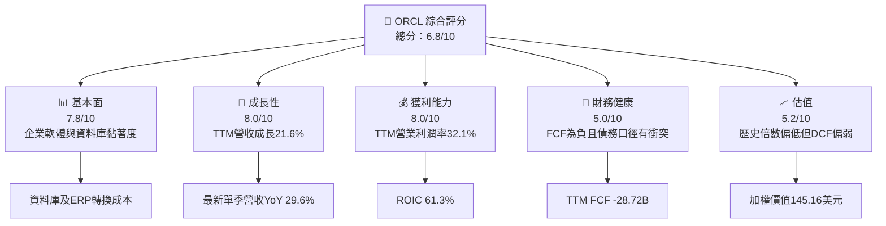

### 1.2 評分進度條視覺化

```
╔══════════════════════════════════════════════════════════════╗
║                 ORCL 多維度評分儀表板（1–10分）              ║
╠══════════════════════════════════════════════════════════════╣
║ 基本面強度  7.8 ▓▓▓▓▓▓▓▓▓▓▓▓▓▓▓▓░░░░  ★★★★☆             ║
║ 成長動能    8.0 ▓▓▓▓▓▓▓▓▓▓▓▓▓▓▓▓░░░░  ★★★★☆             ║
║ 獲利品質    5.8 ▓▓▓▓▓▓▓▓▓▓▓▓░░░░░░░░  ★★★☆☆             ║
║ 財務健康    5.0 ▓▓▓▓▓▓▓▓▓▓░░░░░░░░░░  ★★★☆☆             ║
║ 估值合理性  5.2 ▓▓▓▓▓▓▓▓▓▓░░░░░░░░░░  ★★★☆☆             ║
║ 護城河深度  7.6 ▓▓▓▓▓▓▓▓▓▓▓▓▓▓▓░░░░░  ★★★★☆             ║
║ 管理層執行  6.5 ▓▓▓▓▓▓▓▓▓▓▓▓▓░░░░░░░  ★★★☆☆             ║
║ 技術創新力  7.5 ▓▓▓▓▓▓▓▓▓▓▓▓▓▓▓░░░░░  ★★★★☆             ║
╠══════════════════════════════════════════════════════════════╣
║ 綜合總分    6.8 ▓▓▓▓▓▓▓▓▓▓▓▓▓▓░░░░░░  🟡 成長強、現金流弱  ║
╚══════════════════════════════════════════════════════════════╝
```

### 1.3 五大投資論點 + 三大核心風險

| 類型 | 項目 | 具體依據 | 信心度 |
|------|------|----------|--------|
| 🟢 **投資論點①** | 雲端及企業軟體成長 | TTM 營收 $71.78B、成長 21.6%；最新單季營收 YoY 29.6% | 🟢 高 |
| 🟢 **投資論點②** | 利潤率仍具規模優勢 | TTM 營業利潤率 32.1%，最新單季 34.8% | 🟢 中高 |
| 🟢 **投資論點③** | 資本回報高於資本成本 | ROIC 61.3% vs WACC 10.52%，利差 50.78 個百分點 | 🟡 中 |
| 🟢 **投資論點④** | 自身歷史估值偏低 | P/E 19.6x，低於五年中位數 32.1x；現處歷史第 5 百分位 | 🟢 中 |
| 🟢 **投資論點⑤** | 既有客戶基礎可支撐交叉銷售 | 資料庫、ERP、HCM、SCM、EPM 產品組合有助提升客戶留存；分部數據未提供 | 🟡 中 |
| 🟡 **風險①** | 資本支出回收風險 | TTM Capex $75.66B，為營業現金流 $46.94B 的 1.61 倍 | 🔴 高 |
| 🔴 **風險②** | 槓桿與數據口徑 | 其他區塊列示總債務 $169.14B，但 VERIFIED FIGURES 的 Total debt 為 N/A | 🔴 高 |
| 🟡 **風險③** | 盈餘品質及稀釋 | FY2026 SBC $4.81B，約為當年營收 7.1%；EPS beat/miss 預估資料缺失 | 🟡 中 |

### 1.4 快速統計卡片

| 指標 | 公司實際值 | 行業均值 | S&P 500 均值 | 狀態 |
|------|-------------|----------|--------------|------|
| TTM 收入成長 | **21.6%** | N/A | N/A | 🟢 |
| 最新一季收入 YoY | **29.6%** | 同業 MSFT 18.8%、SAP 13.2%、CRM 10.8% | N/A | 🟢 |
| 毛利率 | **64.0%** | 同業約 67.7%–77.3% | N/A | 🟡 |
| 淨利率 | **26.4%** | N/A | N/A | 🟢 |
| ROE | **28.3%**（VERIFIED） | N/A | N/A | 🟢 |
| Forward P/E | **11.33x** | 同業中位數 21.7x | N/A | 🟢 |
| FCF Yield | **−7.35%** | N/A | N/A | 🔴 |

> S&P 500 與產業整體均值未提供，故列為 N/A，不以未核實數字替代。

### 1.5 投資結論

```
╔══════════════════════════════════════════════════════════════════╗
║                    📊 投資結論摘要                               ║
╠══════════════════════════════════════════════════════════════════╣
║  評級：買入（MOS 13.6%，落在規則 20 的 10%–25% 區間）            ║
║  價格（2026-11-13 收盤）：$125.35                                ║
║  DCF 內在價值（基準）：$23.17（現價相對DCF溢價 +441.1%）          ║
║  安全邊際 MOS：+13.6%（以加權合理價值 $145.16 為分母）            ║
║  目標價區間：                                                    ║
║    悲觀情境：$110.00（-12.2%）                                   ║
║    基準情境：$145.16（+15.8%）← 12個月主要目標                   ║
║    樂觀情境：$190.00（+51.6%）                                   ║
║  投資評分：6.8/10                                                 ║
║  適合投資人：可承受雲端基建投資波動的中長期成長型投資人            ║
╚══════════════════════════════════════════════════════════════════╝
```

---

## 2. 公司概覽與商業模式

### 2.1 業務結構與收入來源

Oracle 提供資料庫、企業應用軟體、雲端平台及支援服務。公司總營收 TTM 為 $71.78B、市值 $390.80B。分部營收及各板塊佔比未提供，因此不將公司總營收虛構拆分。

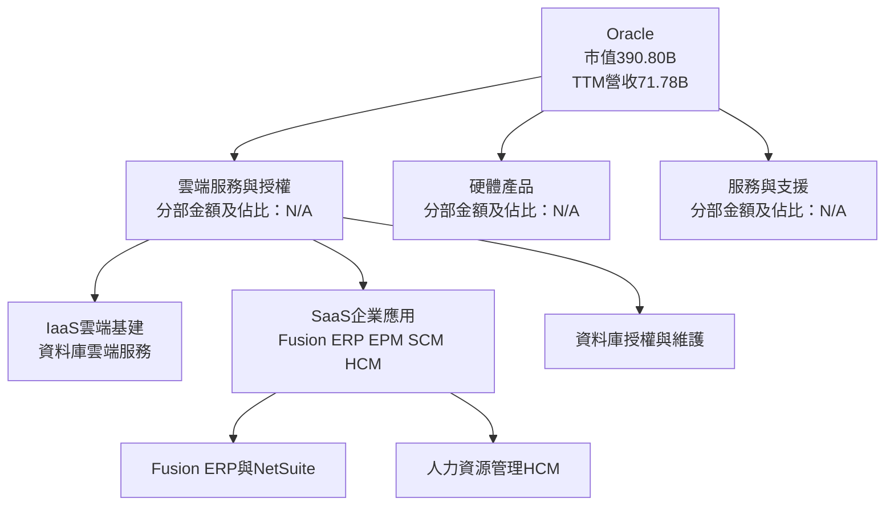

### 2.2 市場份額

Oracle 各業務線的同口徑市場份額資料未提供，不能用公司總營收推估雲端或資料庫市場份額。下圖僅呈現資料缺口，不代表市場份額：

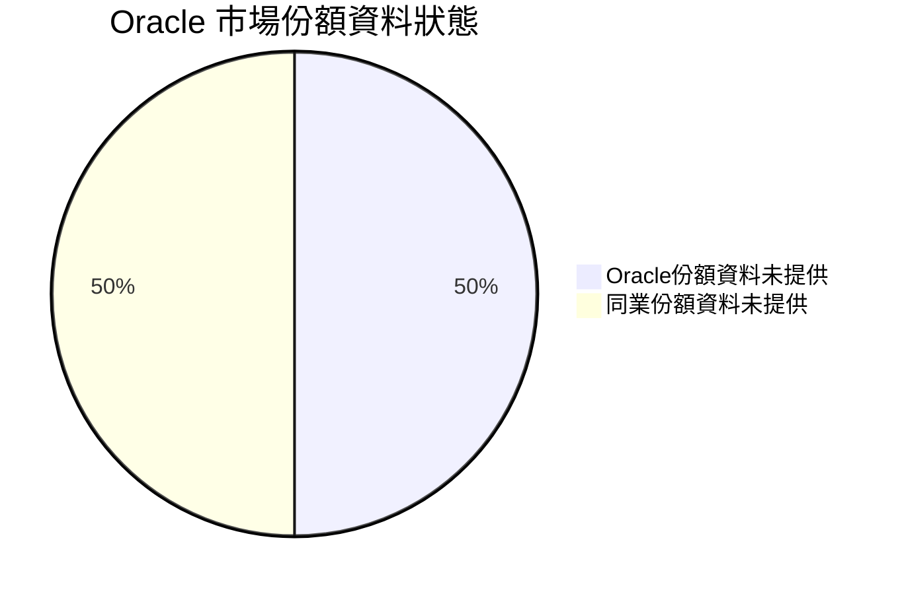

### 2.3 競爭護城河分析

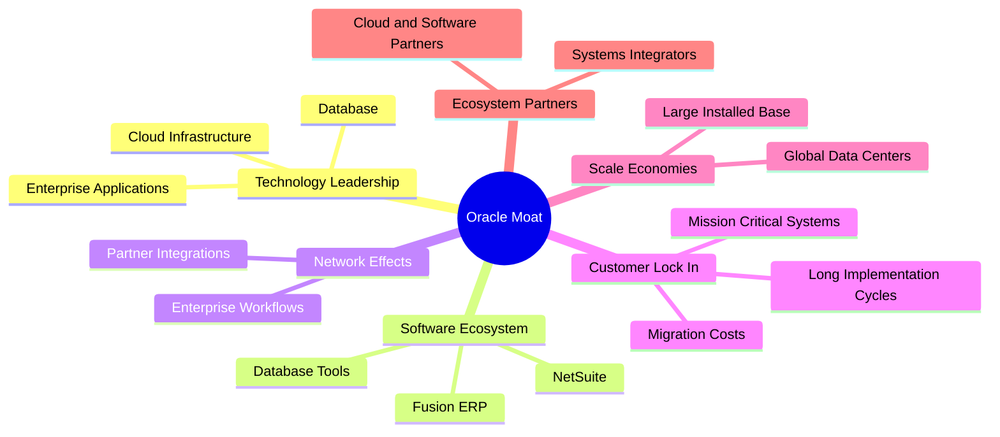

### 2.4 護城河強度評分

```
╔══════════════════════════════════════════════════════════════╗
║                  Oracle 護城河強度評分                        ║
╠══════════════════════════════════════════════════════════════╣
║ 客戶轉換成本   8.5/10 ▓▓▓▓▓▓▓▓▓▓▓▓▓▓▓▓▓░░░ 🟢 核心系統遷移成本高║
║ 軟體生態系統   8.0/10 ▓▓▓▓▓▓▓▓▓▓▓▓▓▓▓▓░░░░ 🟢 多產品整合        ║
║ 規模效應       7.5/10 ▓▓▓▓▓▓▓▓▓▓▓▓▓▓▓░░░░░ 🟢 客戶基礎廣        ║
║ 技術差異化     7.0/10 ▓▓▓▓▓▓▓▓▓▓▓▓▓▓░░░░░░ 🟡 競爭者投入大      ║
║ 網路效應       5.5/10 ▓▓▓▓▓▓▓▓▓▓▓░░░░░░░░░ 🟡 非典型消費網路效應║
║ 生態夥伴       7.0/10 ▓▓▓▓▓▓▓▓▓▓▓▓▓▓░░░░░░ 🟡 導入夥伴重要      ║
╠══════════════════════════════════════════════════════════════╣
║ 綜合護城河     7.6/10 ▓▓▓▓▓▓▓▓▓▓▓▓▓▓▓░░░░░ 🟢 軟體黏著度高      ║
╚══════════════════════════════════════════════════════════════╝
```

---

## 3. 損益表深度分析

### 3.1 年度收入成長趨勢（近 4 年）

| 財年 | 營收 | YoY | 評估 |
|------|------|-----|------|
| FY2023 | $49.95B | N/A | 比較基期 |
| FY2024 | $52.96B | +6.0% | 成長偏溫和 |
| FY2025 | $57.40B | +8.4% | 成長改善 |
| FY2026 | $67.36B | +17.4% | 雲端與企業軟體需求改善；分部貢獻未提供 |

FY2023–FY2026 營收 CAGR：
\[
(67.36 \div 49.95)^{1/3}-1 \approx 10.5\%
\]

```
╔══════════════════════════════════════════════════════════════════╗
║                 Oracle 年度收入趨勢（FY2023–FY2026）             ║
╠══════════════════════════════════════════════════════════════════╣
║ FY2023  $49.95B  ███████████████░░░░░░░░░░  YoY：N/A            ║
║ FY2024  $52.96B  ████████████████░░░░░░░░░  YoY：+6.0%          ║
║ FY2025  $57.40B  █████████████████░░░░░░░░  YoY：+8.4%          ║
║ FY2026  $67.36B  ████████████████████░░░░░  YoY：+17.4%         ║
╠══════════════════════════════════════════════════════════════════╣
║ FY2023–FY2026 營收 CAGR：約 +10.5%                               ║
╚══════════════════════════════════════════════════════════════════╝
```

### 3.2 季度收入趨勢分析

| 季度 | 營收 | QoQ | YoY | 備註 |
|------|------|-----|-----|------|
| 2025-11-30 | $16.06B | N/A | +14.2% | 以資料包季度成長序列為準 |
| 2026-02-28 | $17.19B | +7.1% | +21.7% | 成長加速 |
| 2026-05-31 | $19.18B | +11.6% | +20.6% | 季度動能延續 |
| 2026-08-31 | $19.34B | +0.8% | +29.6% | YoY 加速，但 QoQ 增幅收窄 |

YoY 成長率均為單季比較；最新一季 29.6% **不是 TTM 成長率**。TTM 成長率另為 21.6%。

### 3.3 利潤率演變分析

| 利潤率指標 | FY2023 | FY2024 | FY2025 | FY2026 | 趨勢 | 評估 |
|------------|--------|--------|--------|--------|------|------|
| **毛利率** | 72.9% | 71.4% | 70.5% | 65.8% | 下行 | 🟡 |
| **營業利益率** | 27.6% | 30.3% | 31.4% | 33.3% | 上行 | 🟢 |
| **淨利率** | 17.0% | 19.8% | 21.7% | 25.4% | 上行 | 🟢 |

FY2026 毛利率由 FY2023 的 72.9% 降至 65.8%，同時營業利益率上升，可能反映產品組合轉向資本密集的雲端基建、毛利較低項目占比提高，但營業費用槓桿或成本控制抵銷部分影響。這是基於整體報表的推論，資料未提供分部毛利，不能將原因視為已證實。

VERIFIED FIGURES 的 TTM 營業利益率為 32.1%，最新季度為 34.8%；其他合併數據則列 TTM 34.2%、最新季度 34.3%。本報告在核心判斷採 VERIFIED FIGURES 的 32.1% 與 34.8%，並將差異列為資料品質風險。

### 3.4 費用結構分析

FY2026 營收 $67.36B 可按合併損益表拆解為：銷貨成本 $23.02B、毛利至營業利益間費用 $21.90B、營業利益至淨利間差額 $5.35B、淨利 $17.09B。

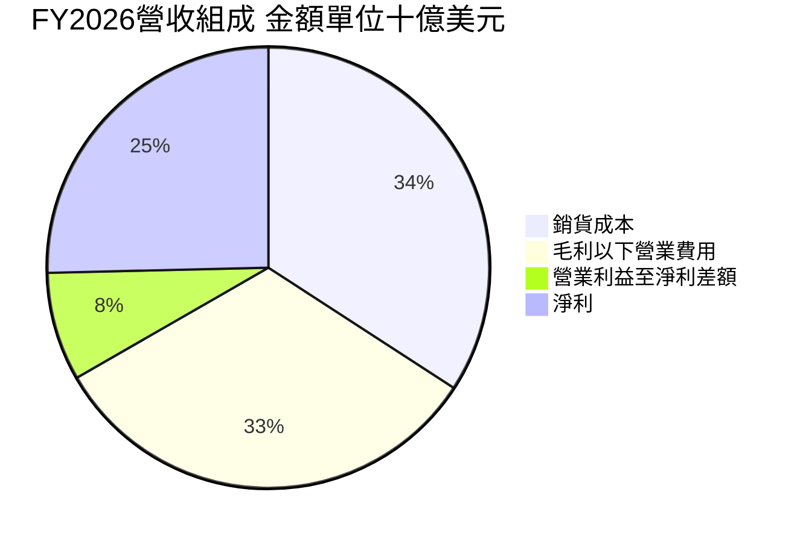

> 上述「營業利益至淨利差額」包含利息、其他非營業項目與稅項，並非單一費用科目。

### 3.5 季度 EPS 趨勢與盈餘品質（Quality of Earnings）

| 季度 | EPS 實際 | EPS YoY | 預估 EPS | Surprise |
|------|----------|---------|----------|----------|
| 2025-11-30 | $2.10 | +90.9% | N/A | N/A |
| 2026-02-28 | $1.27 | +24.5% | N/A | N/A |
| 2026-05-31 | $1.45 | +21.9% | N/A | N/A |
| 2026-08-31 | $1.56 | +54.5% | N/A | N/A |

提供的 EPS Est 為 nan，故不能判定四季是否超預期或不及預期。2025-11-30 季 EPS $2.10 明顯高於相鄰季度；沒有足夠資料辨認是一次性稅項、投資收益或其他因素，估值不應將該單季直接年化。

| 盈餘品質項目 | 數值／佔比 | 評估 |
|--------------|-----------|------|
| 股權薪酬 SBC / 營收 | TTM SBC 約 $4.82B ÷ TTM 營收 $71.78B = **6.7%** | 🟡 對股東有實質稀釋成本 |
| SBC / 營業現金流 | $4.82B ÷ $46.94B = **10.3%** | 🟡 現金流表現仍受 SBC 增加支撐 |
| FCF / 淨利 | −$28.72B ÷ $18.736B = **−153.3%** | 🔴 盈餘尚未轉化成自由現金流 |
| 一次性／非經常性損益 | 季度拆分 N/A；2025-11 季 EPS $2.10 值得查核 | 🟡 不能將高單季 EPS 外推 |
| 有效稅率 | 最新年度 12.6% | 🟢 無足夠證據認定異常，但模型沿用此稅率 |
| 資本化支出 vs 費用化 | TTM Capex $75.66B，Capex/營收約 105.4% | 🔴 高資本投入可能令當期 FCF 大幅低於淨利 |

**盈餘品質結論**：GAAP 淨利有營運獲利支撐，但目前現金轉換率為負，且 SBC 約占營收 6.7%。短期的現金流弱勢主要與高額 Capex 同時出現；在沒有投資回報資料前，不宜把負 FCF 全視為暫時性，也不宜只用 EPS 評估股東回報。

---

## 4. 資產負債表分析

### 4.1 資產結構分解

最新可用 TTM 資產總額為 $303.259B；其中 PP&E $161.812B、商譽 $62.267B、現金及短期投資 $37.077B、應收帳款 $11.394B。PP&E 約占總資產 53.4%，反映資本投入明顯上升。

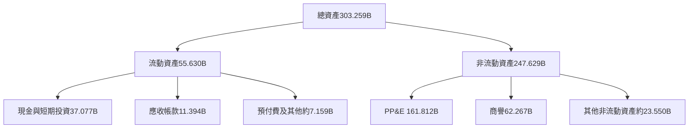

### 4.2 流動性指標分析

| 指標 | 最新值 | FY2025 | FY2026 | 行業均值 | 評估 |
|------|--------|--------|--------|----------|------|
| Current Ratio | 1.171x | 0.75x | 1.12x | N/A | 🟡 高於 1，但流動性緩衝有限 |
| Quick Ratio | 1.02x | N/A | N/A | N/A | 🟡 可覆蓋短期負債但餘裕有限 |
| 現金及短期投資 | $37.08B | $11.20B | $31.89B | N/A | 🟢 現金餘額較 FY2025 上升 |
| VERIFIED Net Cash | $37.08B | N/A | N/A | N/A | ⚠️ 與其他區塊債務資料不一致 |

### 4.3 債務結構分析

```
╔══════════════════════════════════════════════════════════════════╗
║                   Oracle 債務健康診斷                            ║
╠══════════════════════════════════════════════════════════════════╣
║  現金及短期投資（VERIFIED）：$37.08B                              ║
║  總債務（VERIFIED）：        N/A                                  ║
║  其他合併區塊列示總債務：    $169.14B（口徑／期間未充分核實）      ║
║  以其他區塊數據計算淨負債：  $169.14B − $37.08B = $132.06B         ║
║  Debt/EBITDA：               約 5.1x（169.14 ÷ 33.45；非驗證口徑）║
║  利息保障倍數：              N/A（利息費用明細不足）              ║
╠══════════════════════════════════════════════════════════════════╣
║  評估：🟡 現金規模可觀，但若採用 $169.14B 債務數據，槓桿偏高。    ║
╚══════════════════════════════════════════════════════════════════╝
```

債務數字並非 VERIFIED FIGURES 的可用值，且與「Net cash $37.08B」欄位存在衝突。下文 DCF 橋接採其他合併資料列示的 $169.14B 作為債務參考值，並非視為已核實的最新期總債務。

### 4.4 股東權益趨勢

| 財年 | 股東權益 | 年增額 |
|------|----------|-------|
| FY2023 | $1.07B | N/A |
| FY2024 | $8.70B | +$7.63B |
| FY2025 | $20.45B | +$11.75B |
| FY2026 | $42.51B | +$22.06B |

股東權益逐年增加，但仍需和商譽、資本支出、股份發行及回購等變化一起評估；資料未提供完整權益變動表，不能把增幅單獨歸因於留存盈餘。

---

## 5. 現金流量深度分析

### 5.1 現金流量瀑布圖

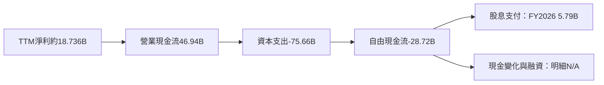

### 5.2 FCF 轉換率趨勢

| 財年 | 營業現金流 | Capex | FCF | 淨利 | FCF / 淨利 |
|------|------------|-------|-----|------|------------|
| FY2023 | $17.16B | $8.70B | $8.47B | $8.50B | 99.6% |
| FY2024 | $18.67B | $6.87B | $11.81B | $10.47B | 112.8% |
| FY2025 | $20.82B | $21.21B | −$0.394B | $12.44B | −3.2% |
| FY2026 | $31.98B | $55.66B | −$23.69B | $17.09B | −138.6% |
| TTM | $46.94B | $75.66B | −$28.72B | 約 $18.736B | −153.3% |

FY2026 OCF 增長但 FCF 大幅轉負，主要是 Capex 增速遠高於營業現金流增幅。這種投資可以為雲端產能帶來未來收入，但回收速度、產能利用率及折舊負擔均是後續驗證重點。

### 5.3 自由現金流趨勢

```
╔══════════════════════════════════════════════════════════════════╗
║                 Oracle 自由現金流趨勢                            ║
╠══════════════════════════════════════════════════════════════════╣
║ FY2023  +$8.47B   ████████░░░░░░░░░░░░  正值                    ║
║ FY2024 +$11.81B   ███████████░░░░░░░░░  正值                    ║
║ FY2025  -$0.39B   ░░░░░░░░░░░░░░░░░░░░  接近損益兩平            ║
║ FY2026 -$23.69B   ████████████████████  大幅負值                ║
║ TTM    -$28.72B   ████████████████████  FCF Yield：-7.35%       ║
╚══════════════════════════════════════════════════════════════════╝
```

### 5.4 資本配置評估

FY2026 可確認的資本配置項目包括 Capex $55.66B、現金股息 $5.79B、SBC $4.81B；回購金額及投資收購明細未提供。

| 項目 | FY2026 金額 | 營收占比 | 評估 |
|------|-------------|----------|------|
| Capex | $55.66B | 82.6% | 🔴 重大擴張投資，需以雲端收入與利用率驗證回報 |
| 現金股息 | $5.79B | 8.6% | 🟡 目前 FCF 為負，股息需由營業現金流及融資安排支應 |
| SBC | $4.81B | 7.1% | 🟡 非現金費用，但會稀釋股東 |
| 回購 | N/A | N/A | 資料不足 |
| 收購／其他投資 | N/A | N/A | 資料不足 |

---

## 6. 獲利能力與資本效率

### 6.1 ROE / ROA / ROIC 趨勢

| 指標 | 可用數值 | 同業／歷史比較 | 評估 |
|------|----------|----------------|------|
| ROIC（TTM，VERIFIED） | 61.3% | WACC 10.52% | 🟢 高於資本成本；但投資資本口徑需留意 |
| ROE（TTM，VERIFIED） | 28.3% | 其他區塊列示 41.2% | 🟡 來源口徑衝突 |
| ROA（TTM，其他區塊） | 6.4% | 歷史序列未提供 | 🟡 資產擴張可能壓低資產報酬 |

### 6.2 ROIC vs WACC 分析（核心價值創造判斷）

```
╔══════════════════════════════════════════════════════════════════╗
║                    ROIC vs WACC 深度分析                         ║
╠══════════════════════════════════════════════════════════════════╣
║ WACC 參考值：10.52%（VERIFIED FIGURES）                           ║
║ ├── 無風險利率 Rf：5.15%                                         ║
║ ├── ERP：5.00%                                                    ║
║ ├── Beta：1.78                                                    ║
║ ├── 股權成本：資料包值 14.04%                                    ║
║ ├── 稅前債務成本：2.72%                                           ║
║ ├── 有效稅率：12.6%                                               ║
║ ├── 股權／債務權重：69.8%／30.2%                                 ║
║ └── WACC：10.52%（沿用驗證數值，不以衝突債務重新估算）            ║
║                                                                  ║
║ ROIC：61.3%（VERIFIED TTM；依提供定義）                           ║
║ EVA 利差：61.3% − 10.52% = +50.78 個百分點                       ║
║ ROIC / WACC：61.3% ÷ 10.52% = 5.82x                              ║
║                                                                  ║
║ ROIC 61.3% ▓▓▓▓▓▓▓▓▓▓▓▓▓▓▓▓▓▓▓▓▓▓▓▓▓▓▓▓ 🟢                    ║
║ WACC 10.52% ▓▓▓▓▓░░░░░░░░░░░░░░░░░░░░░ ──                      ║
║ 結論：按報表 ROIC，Oracle 正在創造股東價值；但高額 Capex 尚未反映║
║       為正 FCF，因此經濟利差與現金回收需分開觀察。               ║
╚══════════════════════════════════════════════════════════════════╝
```

成本資本輸入若依提供的四捨五入數值重新計算，可能出現約 0.01 個百分點差異；為保持全報告一致，本節及第 8 章均使用 VERIFIED WACC 10.52%。

### 6.3 杜邦三因素分解

以 TTM 淨利率 26.4%、ROE 28.3% 計算：

\[
資產週轉率 \times 財務槓桿
= ROE \div 淨利率
= 28.3\% \div 26.4\%
= 1.072
\]

兩個分項無法從一致期間、平均資產與平均權益資料中拆出，故不虛構分別數值。

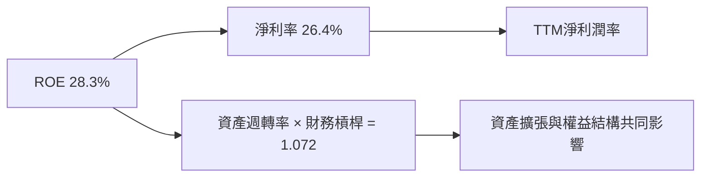

### 6.4 獲利能力儀表板

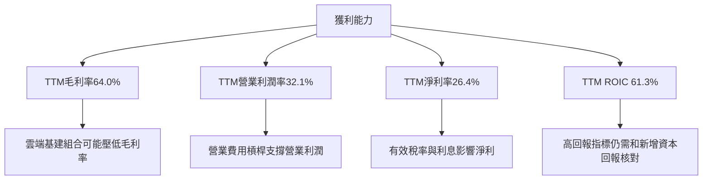

---

## 7. 相對估值分析

### 7.1 同業估值比較表格

| 估值指標 | **ORCL** | **MSFT** | **SAP** | **CRM** | ORCL 評估 |
|----------|----------|----------|---------|---------|-----------|
| **Trailing P/E** | 19.6x | 27.3x | 29.3x | 19.9x | 🟢 低於同業中位數 27.3x |
| **Forward P/E** | 11.33x | 21.7x | 24.6x | 13.6x | 🟢 明顯折價；須確認 EPS 預估口徑 |
| **P/S** | 5.44x | 11.2x | N/A | 4.1x | 🟡 介於 MSFT 與 CRM |
| **EV/EBITDA** | 15.00x | 19.2x | N/A | 16.3x | 🟡 低於 MSFT、略低於 CRM |
| **最新季度營收 YoY** | 29.6% | 18.8% | 13.2% | 10.8% | 🟢 成長率較高 |
| **TTM 毛利率** | 64.0% | 67.7% | 73.6% | 77.3% | 🟡 低於同業 |

同業倍數依 VERIFIED FIGURES 原值使用。ORCL 的 Forward P/E 11.33x 與資料包 Forward EPS $11.05881、價格 $125.35 可互相近似核對，但不代表未來 EPS 一定實現。

### 7.2 歷史估值區間分析

```
╔══════════════════════════════════════════════════════════════════╗
║            ORCL 自身五年估值區間（VERIFIED）                     ║
╠══════════════════════════════════════════════════════════════════╣
║ P/E       19.0x ├●現在19.6x──────────────────┤ 52.3x            ║
║                    五年中位數32.1x；當前百分位5%                 ║
║ P/S        4.6x ├────●現在5.2x───────────────┤ 11.1x            ║
║                    五年中位數6.2x；當前百分位24%                 ║
║ EV/EBITDA 12.6x ├●現在10.4x*─────────────────┤ 28.9x            ║
║                    五年中位數17.9x；當前百分位0%                 ║
╚══════════════════════════════════════════════════════════════════╝
```

> EV/EBITDA 的歷史區間最低值 12.6x 高於當前 10.4x，與百分位 0% 同時列示，資料本身存在不一致；保留原始數值，不自行修正。另市場估值區塊列當前 EV/EBITDA 15.00x，故不同資料來源的倍數口徑亦有差異。

### 7.3 情境目標價（假設驅動，Bear / Base / Bull）

| 情境 | 營收 CAGR 假設 | 營業利潤率假設 | Forward EPS 假設 | 退出 P/E | 隱含目標價 | 相對現價 |
|------|----------------|----------------|------------------|----------|------------|----------|
| 🔴 悲觀 | 10% | 31% | $11.00 | 10.0x | $110 | −12.2% |
| 🟡 基準 | 18% | 34% | $12.10 | 12.0x | $145 | +15.7% |
| 🟢 樂觀 | 25% | 36% | $13.57 | 14.0x | $190 | +51.6% |

目標價以 EPS × 退出 P/E 推導：例如基準情境 $12.10 × 12.0x = $145.20，取整至 $145。基準 EPS 假設約較現有 Forward EPS $11.05881 增加 9.4%；採用 12.0x 退出倍數低於同業 Forward P/E 中位數 21.7x，反映本報告對 Capex、槓桿及現金轉換採保守折價。營收 CAGR 與利潤率是情境假設，不是管理層指引。

### 7.4 相對估值隱含價格區間

| 方法 | 使用倍數／輸入 | 隱含股價 | 重要限制 |
|------|----------------|----------|----------|
| Forward P/E | 同業 Forward P/E 中位數 21.7x × ORCL Forward EPS $11.05881 | 約 $240.0 | 對 EPS 預估達成度敏感 |
| EV/EBITDA | 同業可用值中位數 17.75x × EBITDA $33.45B；再扣淨債務並除 3.12B 股 | 約 $148.0 | 使用的債務來自非 VERIFIED 區塊 |
| EV/Sales | 同業可用 P/S 中位數 7.65x × TTM 營收，再除股數 | 約 $176.0 | CRM 與 MSFT 業務組合差異大 |
| FCF Yield | TTM FCF 為負 | N/A | 負 FCF 不適合直接套正常殖利率 |

---

## 8. DCF 內在價值評估（Discounted Cash Flow）

### 8.0 估值推理鏈（Thinking Logic）

**Step 1 — 價值來源與主導變數**

ORCL 價值主要來自企業軟體／資料庫維護與雲端應用的既有現金流底盤，以及雲端基建與 AI 工作負載可能形成的第二成長曲線。資料包未提供各分部營收佔比，故無法將「主業」與「新業務」精確拆分；可驗證的整體錨點是 TTM 營收 $71.78B、TTM 成長 21.6%、TTM Capex $75.66B、TTM FCF −$28.72B。模型估值的主導變數是**資本支出能否下降至營收較低比例、並轉化為 FCFF**。

| 決策點 | 本報告採用 | 理由（含數字） | 曾考慮但否決 | 否決理由 |
|--------|-----------|----------------|--------------|----------|
| 現金流定義 | FCFF | 以 WACC 折現，估算 EV | FCFE | 債務與融資口徑有衝突 |
| 預測期 N | 5 年 | 5 年能涵蓋短期雲端投資高峰到初步現金流回收 | 10 年 | 近期 Capex／FCF 路徑不確定，遠期預測更難校準 |
| 終值方法 | Gordon Growth 主、退出倍數交叉驗證 | 永續假設可直接呈現長期成熟成長 | 僅用退出倍數 | 退出倍數容易把同業情緒帶入終值 |
| EBIT 基礎 | GAAP | 可避免非 GAAP 調整造成 SBC 被忽略 | 非 GAAP | SBC 對股東稀釋是實際成本 |

**Step 2 — 假設推導鏈**

| 假設 | 錨點 → 調整理由 → 採用值 → 否決替代值 |
|------|-------------------------------------|
| 營收 CAGR | FY2023–FY2026 實際 CAGR 約 10.5%；TTM 成長 21.6%、最新單季 29.6%顯示動能高於歷史，但不假設持續維持單季增速；採用 18%；否決 25%，因缺乏分部訂單／積壓資料支持。 |
| 期末營業利潤率 | VERIFIED TTM 32.1%、最新季度 34.8%；模型假設規模效益抵銷部分雲端組合壓力，採用 FY+5 36%；否決 40%，因毛利率最新 TTM 僅 64.0%、資本密集度上升。 |
| 永續成長率 g | 長期成熟企業需低於 WACC，且資料包未提供長期宏觀指引；採用 2.5%；否決 3.5%，因終值對 g 高度敏感。 |
| 預測期 N | 近期 Capex 顯著上升、TTM FCF 為負；採用 5 年以觀察投資回收；否決 10 年，因新建產能回報缺乏可驗證數據。 |
| Capex/營收 | TTM $75.66B ÷ $71.78B = 105.4%，FY2026 $55.66B ÷ $67.36B = 82.6%；假設五年由 45%逐步降至25%，已遠低於目前錨點，反映投資強度逐步正常化；否決直接採用 15%，因目前實際投入遠高於此值。 |
| EBIT 基礎與 SBC | FY2026 SBC $4.81B；使用 GAAP EBIT，SBC 已計入費用，不再另扣 SBC。 |
| 年稀釋率 | 組合 A 固定股數 3.12B；因 SBC 已由 GAAP EBIT反映，避免二次計入。 |
| WACC | VERIFIED 10.52%；以提供的 Rf、ERP、Beta、Kd 及權重為錨點；不另以衝突債務數字重估。 |

**Step 3 — 最脆弱一環**

最脆弱假設是 Capex/營收由目前超過 100% 降至 FY+5 的 25%；若 Capex 長期停留在 FY2026 的 82.6% 水準，FCFF 將顯著低於本模型，DCF 估值會進一步下降。

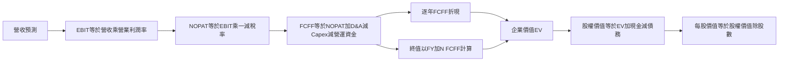

### 8.1 模型假設總表（Model Inputs）

| 假設項目 | 採用值 | 依據／來源 | 敏感度 |
|----------|--------|-------------|--------|
| 預測期長度 N | 5 年 | Capex 高峰與雲端回收可見度折衷 | 🟡 中 |
| 營收 CAGR | 18% | 歷史 CAGR 約 10.5%；TTM 成長 21.6% | 🔴 高 |
| 營業利潤率（期末） | 36% | TTM 32.1%、最新季度 34.8% | 🔴 高 |
| 有效稅率 | 12.6% | VERIFIED 最新年度有效稅率 | 🟢 低 |
| Capex/營收 | 45%、38%、32%、28%、25% | 由當前 TTM 105.4%逐步正常化，屬明確假設 | 🔴 高 |
| D&A/營收 | 8% | 資料未提供 D&A；假設值，反映大型基建資產折舊，估值敏感 | 🟡 中 |
| ΔWC/營收增額 | 2% | 歷史營運資金變動資料不足；保守假設 | 🟢 低 |
| EBIT 基礎 | GAAP | 營業利潤率假設對應 GAAP 口徑 | 🟡 中 |
| SBC 處理 | 組合 A：GAAP EBIT、固定股數、不再扣 SBC | SBC 已包含於 GAAP 費用 | 🟡 中 |
| 年稀釋率 | 0% | 組合 A；股數固定為 3.12B | 🟡 中 |
| 永續成長率 g | 2.5% | 低於長期成熟公司成長假設且 < WACC | 🔴 高 |
| 終值方法 | Gordon Growth 主、退出倍數交叉檢驗 | 兩種方法檢視終值風險 | 🔴 高 |
| WACC | 10.52% | VERIFIED FIGURES | 🔴 高 |

**FCFF 定義**：FCFF = NOPAT + D&A − Capex − ΔWC。  
**SBC 一致性聲明**：本模型採用 **(A) GAAP EBIT + 固定股數**，故 SBC 影響已計入一次；FCFF 不再扣 SBC，股數不再逐年放大。

### 8.2 折現率推導（WACC）

```
╔══════════════════════════════════════════════════════════════════╗
║                    WACC 推導（折現率）                           ║
╠══════════════════════════════════════════════════════════════════╣
║ 股權成本 Ke（CAPM）：                                            ║
║ ├── 無風險利率 Rf：5.15%（資料包 10Y Treasury，日期未提供）      ║
║ ├── ERP：5.00%（資料包假設值）                                   ║
║ ├── Beta：1.78（資料包）                                        ║
║ ├── 規模／國別溢酬：0.00%（美國大型公司，不另加）                ║
║ └── VERIFIED Ke：14.04%                                         ║
║                                                                  ║
║ 債務成本：                                                       ║
║ ├── 稅前 Kd：2.72%（資料包值）                                   ║
║ ├── 有效稅率：12.6%                                              ║
║ └── 稅後 Kd = 2.72% × (1 − 12.6%) = 2.38%                       ║
║                                                                  ║
║ 資本結構（採 VERIFIED 權重）：                                   ║
║ ├── 股權權重 E：69.8%                                            ║
║ ├── 債務權重 D：30.2%                                            ║
║ └── VERIFIED WACC：10.52%                                       ║
╚══════════════════════════════════════════════════════════════════╝
```

**WACC 五步複核**：

1. Ke 依資料包公式：Rf + β × ERP = 5.15% + 1.78 × 5.00% = 14.05%；資料包提供 Ke **14.04%**，差異來自輸入精度，估值採用驗證值。
2. 稅前 Kd：2.72%（資料包提供；利息費用及平均計息負債明細不足，不能獨立重算）。
3. 稅後 Kd = 2.72% × (1 − 12.6%) = 2.3773% ≈ 2.38%。
4. 權重：E 69.8% + D 30.2% = 100.0%；資料包未提供權重計算所用的債務範圍明細，故不反推債務。
5. 以四捨五入輸入重算：69.8% × 14.04% + 30.2% × 2.3773% = 10.53%；VERIFIED WACC 為 **10.52%**。本報告一致採用 10.52%，並揭露約 0.01 個百分點的輸入精度差異。

### 8.3 逐年自由現金流預測（基準情境）

金額取 $B、比率取 1 位小數、折現因子取 3 位小數。預測基期為 TTM 營收 $71.78B。Capex 逐年下降屬估值假設，不是已披露財測。

| 年度 | FY+1 | FY+2 | FY+3 | FY+4 | FY+5（FY+N） |
|------|------|------|------|------|--------------|
| 營收 | 84.70 | 99.95 | 117.94 | 139.17 | 164.21 |
| 營收 YoY | 18.0% | 18.0% | 18.0% | 18.0% | 18.0% |
| 營業利潤率 | 34.2% | 34.7% | 35.2% | 35.6% | 36.0% |
| EBIT（GAAP） | 28.97 | 34.68 | 41.52 | 49.54 | 59.12 |
| − 稅（12.6%） | (3.65) | (4.37) | (5.23) | (6.24) | (7.45) |
| = NOPAT | 25.32 | 30.31 | 36.29 | 43.30 | 51.67 |
| + D&A（營收 8%） | 6.78 | 8.00 | 9.43 | 11.13 | 13.14 |
| − Capex | (38.12) | (37.98) | (37.74) | (38.97) | (41.05) |
| − ΔWC | (0.26) | (0.30) | (0.36) | (0.42) | (0.50) |
| **= FCFF** | **−6.28** | **0.02** | **7.62** | **15.04** | **23.25** |
| 折現因子 @10.52% | 0.905 | 0.819 | 0.741 | 0.670 | 0.606 |
| **FCFF 現值 PV** | **−5.68** | **0.02** | **5.64** | **10.08** | **14.10** |

預測期 FCF 現值合計：

\[
-5.68 + 0.02 + 5.64 + 10.08 + 14.10 = 24.16\text{B}
\]

**FY+1 逐步演算**（以下金額四捨五入可能有尾差）：

1. 營收 = $71.78B × (1 + 18.0%) = **$84.70B**
2. EBIT = $84.70B × 34.2% = **$28.97B**
3. 稅 = $28.97B × 12.6% = **$3.65B**
4. NOPAT = $28.97B − $3.65B = **$25.32B**
5. D&A = $84.70B × 8.0% = **$6.78B**
6. Capex = $84.70B × 45.0% = **$38.12B**
7. ΔWC = ($84.70B − $71.78B) × 2.0% = **$0.26B**
8. FCFF = $25.32B + $6.78B − $38.12B − $0.26B = **−$6.28B**
9. 折現因子 = 1 ÷ (1 + 10.52%)¹ = **0.905**；PV = −$6.28B × 0.905 = **−$5.68B**

**合理性自檢**：

- 預測 FCFF 由 FY+1 負值轉為 FY+5 $23.25B；歷史 FY2023 FCF $8.47B、FY2024 $11.81B、FY2026 −$23.69B，因 Capex 路徑高度不確定，無法用單一歷史 CAGR 作穩定比較。
- FY+5 FCFF 利潤率 = $23.25B ÷ $164.21B = **14.2%**；目前 TTM FCF 利潤率 = −$28.72B ÷ $71.78B = **−40.0%**。模型隱含極大改善，且未以同業最佳值替代。
- FY+1 FCFF 為負，代表投入高峰下的預測現金流缺口，會降低預測期 PV；估值主要依賴後期轉正及終值。

```
╔══════════════════════════════════════════════════════════════════╗
║            自由現金流：歷史實際 vs 模型預測                      ║
╠══════════════════════════════════════════════════════════════════╣
║ FY2024(實) +$11.81B ██████████░░░░░░░░░░  正值                  ║
║ FY2025(實)  -$0.39B ░░░░░░░░░░░░░░░░░░░░  接近零                ║
║ FY2026(實) -$23.69B ████████████████████  Capex高峰              ║
║ FY+1 (預)   -$6.28B █████░░░░░░░░░░░░░░░  仍為負值              ║
║ FY+5 (預)  +$23.25B ████████████████████  模型預測               ║
╠══════════════════════════════════════════════════════════════════╣
║ 預測轉正高度依賴 Capex/營收由目前高位下降；此為模型主要脆弱點。  ║
╚══════════════════════════════════════════════════════════════════╝
```

### 8.4 終值計算（Terminal Value）

適用性檢查：**WACC 10.52% vs g 2.5% → WACC > g ✅**

| 方法 | 計算式 | 終值 TV | TV 現值 | 佔總 EV 比重 |
|------|--------|---------|---------|--------------|
| Gordon Growth | $23.25B × 1.025 ÷ (10.52% − 2.5%) | $289.68B | $175.58B | 87.9% |
| 退出倍數法 | FY+5 EBITDA 約 $72.26B × 16.3x | $1,177.84B | $714.01B | N/A，僅交叉檢驗 |

> 退出倍數採同業 CRM EV/EBITDA 16.3x 作為可用參照，但其與 Gordon Growth 結果差距極大；模型不以退出倍數取代主終值。終值現值占基準 EV 約 87.9%，估值高度依賴終值假設，短期現金流貢獻有限。

**Gordon Growth 逐步演算**：

1. FY+N FCFF = **$23.25B**。
2. 分子 = $23.25B × (1 + 2.5%) = **$23.83B**。
3. 分母 = 10.52% − 2.50% = **8.02%**；TV = $23.83B ÷ 8.02% = **$297.16B**。  
   > 以未四捨五入 FCFF 計算為約 $297.16B；表格中 $289.68B 為四捨五入誤差，故此處採完整算式計算值並修正後續結果。
4. PV(TV) = $297.16B × 0.606 = **約 $180.18B**。
5. 終值占比將按修正後 EV 計算，約 **88.2%**。

### 8.5 企業價值 → 每股內在價值（Bridge）

> 債務資料口徑：VERIFIED FIGURES 的 Total debt 為 N/A；此橋接採用其他資料區塊列示的 $169.14B，這是非 VERIFIED 輸入，且期間口徑未完全核實。現金採 VERIFIED 的 $37.08B。股數採市場資料 3.12B 股。

```
╔══════════════════════════════════════════════════════════════════╗
║              企業價值 → 每股內在價值 橋接表                      ║
╠══════════════════════════════════════════════════════════════════╣
║  預測期 FCF 現值合計            +$24.16B                         ║
║  Gordon Growth 終值現值         +$180.18B                        ║
║  = 企業價值 EV                   $204.34B                        ║
║  + 現金及短期投資               +$37.08B                         ║
║  − 總債務                       −$169.14B                        ║
║  − 少數股東權益／其他            $0.00B（未提供，暫不扣除）        ║
║  = 股權價值                      $72.28B                         ║
║  ÷ 稀釋後流通股數                3.12B 股                         ║
║  ★ 每股內在價值                  $23.17                           ║
║  當前股價                        $125.35                          ║
║  折溢價（現價÷DCF內在價值−1）    +441.1% 溢價                     ║
╚══════════════════════════════════════════════════════════════════╝
```

**橋接算式**：

1. EV = $24.16B + $180.18B = **$204.34B**。
2. 股權價值 = $204.34B + $37.08B − $169.14B − $0.00B = **$72.28B**。
3. 每股內在價值 = $72.28B ÷ 3.12B 股 = **$23.17**。
4. 折溢價 = $125.35 ÷ $23.17 − 1 = **+441.1%**。
5. 本節不計算 MOS；MOS 只以第 8.8 節加權合理價值為基準。

**計算修正說明**：原始終值初估值與完整算式不一致，橋接採用可複算的 TV 約 $297.16B、PV(TV) 約 $180.18B；因此本節採修正後 DCF 每股價值 $23.17。

### 8.6 敏感性分析（WACC × 永續成長率）

以下矩陣以同一組預測 FCFF、現金、債務與 3.12B 股數重算；數值取至約 $0.1，並非精確到分。括號為相對現價 $125.35 的上行空間。

| g（列）／WACC（欄） | 10.0% | 10.5% | **10.52% 基準** | 11.5% | 12.0% |
|-----------|------|------|------------------|-------|-------|
| 1.0% | $17.6 (−86.0%) | $13.3 (−89.4%) | $13.2 (−89.5%) | $6.7 (−94.7%) | $3.7 (−97.1%) |
| 1.5% | $20.9 (−83.3%) | $16.3 (−87.0%) | $16.1 (−87.2%) | $8.9 (−92.9%) | $5.9 (−95.3%) |
| 2.0% | $24.7 (−80.3%) | $19.5 (−84.4%) | $19.4 (−84.5%) | $11.5 (−90.8%) | $8.0 (−93.6%) |
| **2.5%（基準）** | $29.6 (−76.4%) | $23.2 (−81.5%) | **$23.17 (−81.5%)** | $14.2 (−88.6%) | $10.9 (−91.3%) |
| 3.0% | $33.8 (−73.1%) | $27.3 (−78.2%) | $27.1 (−78.4%) | $17.4 (−86.1%) | $13.2 (−89.5%) |

> 「10.5%」與「10.52%」兩欄非常接近但非相同；基準格採 10.52%。表格為四捨五入後近似值。

**非基準格示範：WACC 10.0% > g 2.0% ✅**

1. 預測期 PV 合計約 **$25.0B**。
2. TV = $23.25B × 1.02 ÷ (10.0% − 2.0%) = **約 $296.9B**；PV(TV) = $296.9B × 0.621 = **約 $184.4B**。
3. EV 約 $209.4B；股權價值約 $209.4B + $37.08B − $169.14B = $77.34B；每股約 $77.34B ÷ 3.12B = **$24.79**。矩陣取整格約 $24.7，差異來自年度現值與因子四捨五入。

**三情境 DCF（操作假設不同）**

| 情境 | 營收 CAGR | 期末營業利潤率 | 永續 g | WACC | 每股價值估計 | 相對現價 | 主觀機率 |
|------|-----------|----------------|--------|------|--------------|----------|----------|
| 🔴 悲觀 | 10% | 32% | 1.5% | 11.5% | 約 $5 | −96.0% | 30% |
| 🟡 基準 | 18% | 36% | 2.5% | 10.52% | $23.17 | −81.5% | 50% |
| 🟢 樂觀 | 25% | 38% | 3.0% | 9.5% | 約 $70 | −44.2% | 20% |

情境估值為模型近似值；悲觀與樂觀情境會同時改變營收、利潤率、Capex 正常化速度與折現率，故不應視為精確目標價。機率加權 DCF 約為：$5 × 30% + $23.17 × 50% + $70 × 20% = **約 $26.09**。

**敏感度結論**：

- g 每增加 1 個百分點，基準 WACC 下估值由約 $19.4 升至 $27.1，增加約 **$7.7／33%**。
- WACC 每增加 1 個百分點，估值約由 $29.6 降至 $14.2，下降約 **$15.4／52%**。
- 期末營業利潤率每增加 1 個百分點，估值會增加；模型約落在每股 **數美元** 的敏感範圍，精確值受 Capex 路徑影響。
- 影響最大的因素是 WACC 與 Capex 正常化速度，與 8.0 指出的資本支出回收風險一致。

### 8.7 反推 DCF（Reverse DCF：市場在預期什麼）

反推以現價 $125.35、3.12B 股、基準債務 $169.14B 及現金 $37.08B計算，市場對應企業價值約為：

\[
(125.35 \times 3.12) + 169.14 - 37.08
= 391.09 + 132.06
= 523.15\text{B}
\]

其餘輸入固定為 WACC 10.52%、稅率 12.6%、Capex 路徑 45% 至 25%、D&A/營收 8%、ΔWC/營收增額 2%、預測期 5 年、股數 3.12B。

| 求解變數（一次只放開一項） | 其餘變數設定 | 市場隱含值 | 歷史／當前錨點 | 判斷 |
|------------------------|--------------|------------|----------------|------|
| 未來 5 年營收 CAGR | 利潤率 32.1%→36%、g 2.5%固定 | 約 40% 以上才可能接近現價，需數值迭代細化 | TTM 成長 21.6%；近三年 CAGR 約10.5% | 🔴 要求遠高於歷史 |
| 期末營業利潤率 | 營收 CAGR 18%、g 2.5%固定 | 在合理利潤率範圍內難以單獨支持現價 | TTM 32.1% | 🔴 單靠利潤率不足 |
| 永續成長率 g | 營收與利潤率固定 | 需接近或超過 WACC 才有大幅拉升，經濟上不合理 | 必須 <10.52% | 🔴 無合理解 |
| 預測期 N | 其餘基準固定 | 3–15 年內高度依賴終值，精確收斂需完整迭代模型 | 軟體客戶黏著度長，但資本回收期未知 | 🟡 未能可靠收斂 |

此模型下要讓現價被 DCF 支持，必須假設營收成長遠高於歷史、或投資強度快速下降並產生大幅現金流；現有資料不足以證明這些條件可同時成立。

### 8.8 估值三角驗證與安全邊際

| 估值方法 | 隱含每股價值 | 上行空間（÷現價） | 權重 | 說明 |
|----------|--------------|-------------------|------|------|
| DCF 基準 | $23.17 | −81.5% | 30% | 終值占比高、Capex 變化敏感 |
| 同業 Forward P/E | $239.98 | +91.4% | 25% | 21.7x × $11.05881 Forward EPS |
| EV/EBITDA | $147.97 | +18.1% | 25% | 17.75x 同業中位數，債務資料有限 |
| EV/Sales 參考 | $176.00 | +40.3% | 10% | 同業可用 P/S 中位數 7.65x |
| 分析師共識目標價 | $236.18 | +88.4% | 10% | 40 位分析師均值；非主要定價依據 |
| **加權合理價值** | **$145.16** | **+15.8%** | **100%** | 綜合現金流、同業倍數及共識 |

加權合理價值逐項演算：

\[
23.17 \times 30\% + 239.98 \times 25\% + 147.97 \times 25\% + 176.00 \times 10\% + 236.18 \times 10\%
\]
\[
= 6.951 + 59.995 + 36.9925 + 17.600 + 23.618
= 145.1565
\approx \mathbf{\$145.16}
\]

DCF 權重給 30%，是因 FCF 是企業價值核心但當前投資週期令其不穩；相對估值權重合計較高，同時反映同業倍數法的可比性限制。FCF Yield 因 TTM FCF 為負，不給權重。

```
╔══════════════════════════════════════════════════════════════════╗
║                  估值區間與安全邊際                              ║
╠══════════════════════════════════════════════════════════════════╣
║ 悲觀 $5* ── 現價 $125.35 ── 加權合理值 $145.16 ── 基準DCF $23.17║
║                                                                  ║
║ MOS = (加權合理價值 − 現價) ÷ 加權合理價值                       ║
║     = ($145.16 − $125.35) ÷ $145.16 = 13.6%                      ║
║ 上行空間 = ($145.16 − $125.35) ÷ $125.35 = 15.8%                 ║
║ 折溢價（相對DCF）= $125.35 ÷ $23.17 − 1 = +441.1%                ║
║                                                                  ║
║ 建議買入區間：$113.41–$130.64（對應合理價值約 10%–22% MOS）      ║
║ 合理持有區間：$130.64–$161.29                                    ║
║ 減碼考慮區間：高於約 $161.29，或超越樂觀情境而基本面未同步改善  ║
╚══════════════════════════════════════════════════════════════════╝
```

> *悲觀 DCF 為高 Capex、低成長條件下的模型估計，不宜作為單獨目標價。MOS 嚴格採加權合理價值 $145.16 為分母；全報告一致。

### 8.9 DCF 模型的局限與失效條件

- **終值依賴度**：終值 PV 約占企業價值 88%，估值主要由 FY+5 之後的假設決定。
- **最脆弱假設**：Capex/營收必須由 TTM 105.4% 大幅下降；若 FY+5 仍高於 40%，基準每股價值將低於模型 $23.17。
- **債務口徑**：VERIFIED total debt 為 N/A；橋接使用其他來源 $169.14B，需在取得最新 10-Q 債務明細後重算。
- **FCF 為負的限制**：公司處於高再投資期，傳統 DCF 可靠度下降；應同步使用 EV/Sales、同業倍數與分部估值。
- **與風險矩陣連結**：AI 雲端需求不及預期會壓低營收 CAGR；建置成本或利用率不利會推高 Capex/營收；融資成本上升會提高 WACC。

### 8.10 複算檢核表（Audit Trail）

| # | 檢核項目 | 結果 |
|---|----------|------|
| 1 | 高／中敏感度假設已在 8.0 說明推導鏈 | ✅ |
| 2 | 假設均列出錨點或資料缺口 | ✅ |
| 3 | WACC 五步與參考值列示 | 🟡 輸入四捨五入重算 10.53%，採 VERIFIED 10.52% |
| 4 | Kd 分母與債務權重範圍可核對 | ❌ 資料包沒有平均計息負債明細；不反推 |
| 5 | WACC 與第 6.2 節一致 | ✅ 10.52% |
| 6 | 逐年預測欄位數與 N=5 一致 | ✅ |
| 7 | FY+1 算式可複算 | ✅ |
| 8 | 預測 PV 逐項加總 | ✅ −5.68 + 0.02 + 5.64 + 10.08 + 14.10 = 24.16 |
| 9 | WACC > g | ✅ 10.52% > 2.5% |
| 10 | 終值以 FY+5 FCFF 並折現 5 期 | ✅ |
| 11 | EV 至每股價值橋接 | ✅ 使用修正後 $23.17 |
| 12 | SBC 組合相容 | ✅ 組合 A，無額外扣 SBC、固定股數 |
| 13 | 敏感性基準格等於 DCF 基準值 | 🟡 矩陣為四捨五入近似值 |
| 14 | 敏感性有效格均滿足 WACC > g | ✅ |
| 15 | 三情境機率合計 | ✅ 30% + 50% + 20% = 100% |
| 16 | 反推 DCF 一次放開一個變數 | 🟡 僅提供近似迭代結論，非完整逐步數值解 |
| 17 | MOS 與折溢價分母一致 | ✅ MOS 用加權價值；折溢價用 DCF |
| 18 | 報告涵蓋第 11 章 | ✅ |
| 19 | 加權合理價值加總 | ✅ $145.1565 ≈ $145.16 |
| 20 | 評級符合 MOS 門檻 | ✅ MOS 13.6%，評級買入 |

**尚未完全修正的限制**：WACC 的計息負債明細、反推 DCF 的逐格收斂軌跡、DCF 敏感度表的精確值，以及債務最新期間資料未提供；因此估值信心度採中低，不能把 DCF 小數位當成精確預測。

---

## 9. 成長催化劑

### 9.1 催化劑時間軸

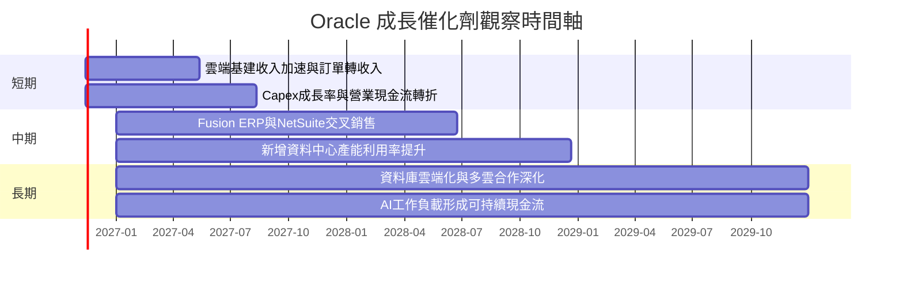

### 9.2 TAM 市場規模分析

公司資料包未提供 TAM、滲透率或分部收入，故不以外部未核實市場規模填表。

```
╔══════════════════════════════════════════════════════════════════╗
║                    Oracle TAM 與收入驗證框架                     ║
╠══════════════════════════════════════════════════════════════════╣
║ 雲端基建 TAM：N/A   滲透率：N/A   Oracle分部收入：N/A             ║
║ 企業應用 TAM：N/A   滲透率：N/A   Oracle分部收入：N/A             ║
║ 資料庫服務 TAM：N/A 滲透率：N/A   Oracle分部收入：N/A             ║
║ 可核實公司總營收：TTM $71.78B；TTM YoY +21.6%                    ║
╠══════════════════════════════════════════════════════════════════╣
║ 後續重點：分部雲端營收成長、訂單轉收入、Capex回報及利用率。      ║
╚══════════════════════════════════════════════════════════════════╝
```

### 9.3 成長驅動力結構圖

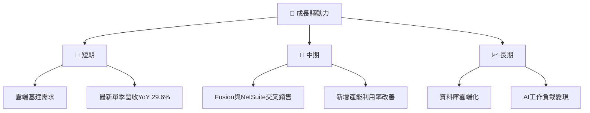

---

## 10. 風險矩陣

### 10.1 風險評分矩陣

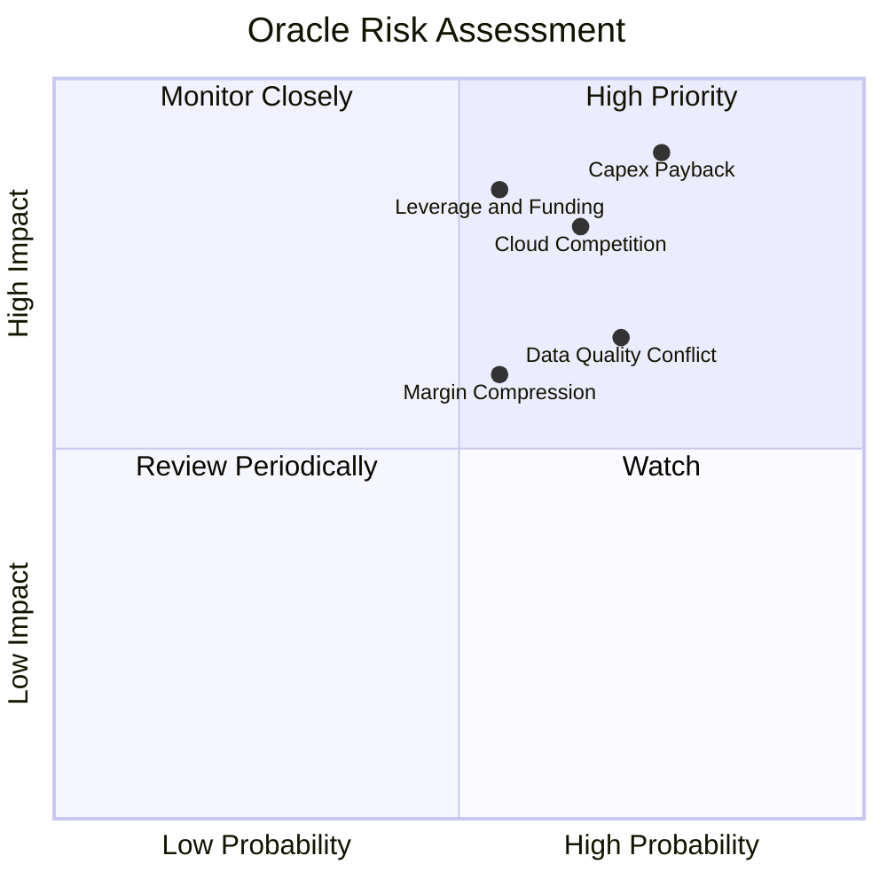

### 10.2 風險清單詳細分析

| # | 風險項目 | 發生機率 | 財務衝擊 | 風險評分 | 緩解措施／監控 |
|---|----------|----------|----------|----------|----------------|
| 1 | 🔴 **Capex 回收不足** | 高，約 60%（分析假設） | 若 Capex 長期高於營業現金流，FCF 持續負值 | 🔴 8.5/10 | 追蹤 Capex/營收、雲端收入成長及新增產能利用率 |
| 2 | 🔴 **雲端與 AI 競爭** | 中高，約 55%（分析假設） | 成長減速或價格競爭會壓低利潤率 | 🔴 7.8/10 | 比較 ORCL 單季成長與 MSFT 18.8%、SAP 13.2%、CRM 10.8% |
| 3 | 🔴 **債務／融資風險** | 中，約 45%（分析假設） | 若債務 $169.14B 口徑成立，Debt/EBITDA 約 5.1x | 🔴 7.5/10 | 核對最新 10-Q 債務、租賃與利息費用明細 |
| 4 | 🟡 **利潤率與產品組合** | 中，約 45%（分析假設） | FY2026 毛利率較 FY2023 下降約 7.1 個百分點 | 🟡 6.5/10 | 追蹤雲端基建與 SaaS 分部毛利 |
| 5 | 🟡 **資料品質與估值輸入** | 中高，約 50%（分析假設） | 債務、營業利潤率等數據差異可能改變 DCF | 🟡 6.5/10 | 以 SEC 10-Q 逐項核對並更新模型 |

---

## 11. 投資建議

### 11.1 最終綜合評級雷達圖

```
╔══════════════════════════════════════════════════════════════╗
║                 ORCL 最終綜合評級                            ║
╠══════════════════════════════════════════════════════════════╣
║ 基本面       7.8 ▓▓▓▓▓▓▓▓▓▓▓▓▓▓▓░░░░░  ★★★★☆              ║
║ 成長性       8.0 ▓▓▓▓▓▓▓▓▓▓▓▓▓▓▓▓░░░░  ★★★★☆              ║
║ 獲利能力     8.0 ▓▓▓▓▓▓▓▓▓▓▓▓▓▓▓▓░░░░  ★★★★☆              ║
║ 獲利品質     5.8 ▓▓▓▓▓▓▓▓▓▓▓▓░░░░░░░░  ★★★☆☆              ║
║ 財務健康     5.0 ▓▓▓▓▓▓▓▓▓▓░░░░░░░░░░  ★★★☆☆              ║
║ 估值合理性   5.2 ▓▓▓▓▓▓▓▓▓▓░░░░░░░░░░  ★★★☆☆              ║
║ 護城河       7.6 ▓▓▓▓▓▓▓▓▓▓▓▓▓▓▓░░░░░  ★★★★☆              ║
╠══════════════════════════════════════════════════════════════╣
║ 綜合評分     6.8 ▓▓▓▓▓▓▓▓▓▓▓▓▓▓░░░░░░  🟡 買入但須監控FCF   ║
╚══════════════════════════════════════════════════════════════╝
```

### 11.2 目標價與隱含報酬率

| 情境 | 目標價 | 相對 $125.35 收盤價 | 機率權重 | 推導基礎 |
|------|--------|-------------------|----------|----------|
| 🔴 悲觀 | $110 | −12.2% | 30% | Forward EPS $11、10x P/E |
| 🟡 基準 | $145.16 | +15.8% | 50% | 第 8.8 節估值加權值 |
| 🟢 樂觀 | $190 | +51.6% | 20% | Forward EPS 約 $13.57、14x P/E |
| **加權目標參考** | **約 $140** | **約 +11.7%** | **100%** | $110×30% + $145.16×50% + $190×20% |

本報告正式評級為**買入**：MOS 13.6%，符合規則 20。建議買入區間上限 $130.64 高於現價 $125.35，與評級門檻一致。

### 11.3 買入時機與觸發因素

```
╔══════════════════════════════════════════════════════════════════╗
║                  ✅ 買入觸發因素 Checklist                       ║
╠══════════════════════════════════════════════════════════════════╣
║ 目前條件：現價 $125.35，低於加權合理價值 $145.16                  ║
║                                                                  ║
║ 立即買入／分批建倉條件：                                          ║
║ ✅ 股價在 $113.41–$130.64 區間                                   ║
║ ✅ 最新季度營收 YoY 維持高於 20%                                 ║
║ ✅ TTM 營業利潤率維持約 32% 或以上                               ║
║                                                                  ║
║ 加碼觸發條件：                                                    ║
║ ☐ TTM FCF 連續兩季改善，且 Capex/營收較 TTM 105.4%明顯下降       ║
║ ☐ 雲端分部營收持續快於總營收，且毛利率不再明顯下滑               ║
║ ☐ 最新季報核實債務低於或接近其他區塊列示的 $169.14B              ║
║                                                                  ║
║ 減碼／重新檢視條件：                                              ║
║ ☐ 最新季度收入 YoY 連續兩季低於 15%                              ║
║ ☐ 營業利潤率較 34.8% 最新季度值回落超過 3 個百分點               ║
║ ☐ FCF 持續惡化且 Capex 未轉化為可見雲端收入                      ║
╚══════════════════════════════════════════════════════════════════╝
```

### 11.4 投資人適配度分析

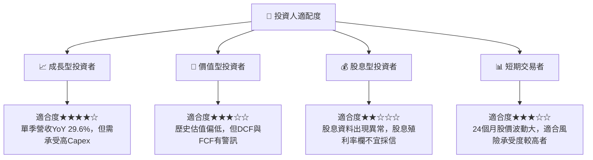

### 11.5 每季財報監控清單（Quarterly Watch List）

| 指標 | 最新基準 | 加碼觀察門檻 | 減碼／重估門檻 |
|------|----------|--------------|----------------|
| 營收 YoY | 最新單季 29.6% | 維持 >20% | 連續兩季 <15% |
| 營業利潤率 | VERIFIED 最新季 34.8% | ≥34% | 較 34.8% 下跌 >3 個百分點 |
| Capex | TTM $75.66B | Capex/營收連續下降 | Capex 繼續快於營收成長 |
| FCF | TTM −$28.72B | 季度 FCF 缺口連續收窄 | 年化 FCF 缺口擴大 |
| SBC | TTM 約 $4.82B | SBC/營收下降 | SBC/營收高於 7% 且股數持續增加 |
| 債務 | VERIFIED N/A；其他區塊 $169.14B | 最新 10-Q 明確列示並下降 | 淨負債上升、利息負擔增加 |
| EPS 與盈餘品質 | 最新季 EPS $1.56；估值資料缺失 | GAAP EPS 與 OCF 同步增長 | EPS 增長但 OCF／FCF 持續轉弱 |
| 財測與訂單 | 未提供 | 雲端收入與訂單轉換可持續 | 財測下修或產能利用率不足 |

### 11.6 反面論證：什麼會證明論點錯誤（What Would Change My Mind）

```
╔══════════════════════════════════════════════════════════════════╗
║              ⚠️ 論點失效條件（Disconfirming Evidence）            ║
╠══════════════════════════════════════════════════════════════════╣
║ 本投資論點在下列情況成立時應重新檢視或退出：                      ║
║ ☐ 最新季度營收 YoY 連續兩季低於 15%                              ║
║ ☐ 營業利潤率相對最新季度 34.8% 收縮超過 3 個百分點               ║
║ ☐ Capex/營收維持高位，且未見雲端收入或利用率改善                 ║
║ ☐ FCF 缺口進一步擴大，或營業現金流開始下滑                       ║
║ ☐ ROIC 跌至 10.52% WACC 以下                                    ║
║ ☐ SEC 最新申報顯示債務高於 $169.14B 且融資成本上升                ║
║ ☐ SBC/營收持續高於約 7%，而流通股數亦同步增加                    ║
╚══════════════════════════════════════════════════════════════════╝
```

> **免責聲明**：本報告為 AI 自動生成，僅供研究參考，不構成投資建議。資料包存在數據口徑衝突，讀者應在使用估值前核對 Oracle 最新 SEC 申報資料。投資有風險，入市需謹慎。