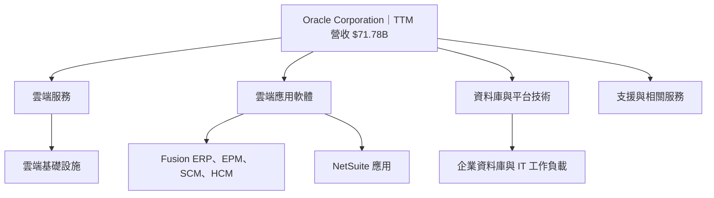
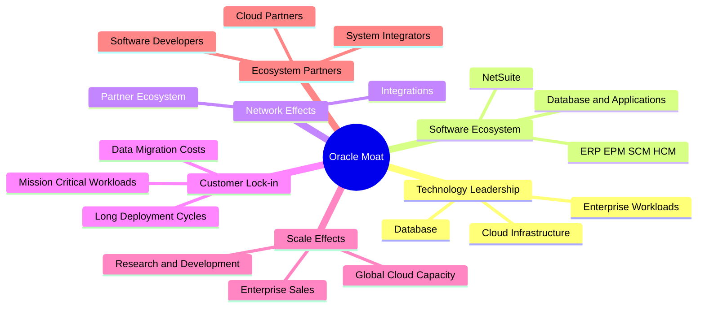
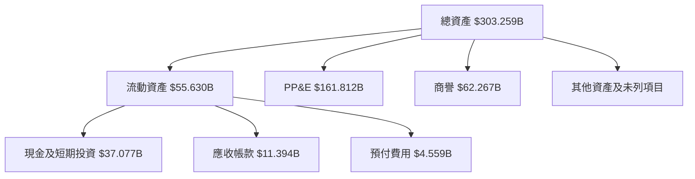
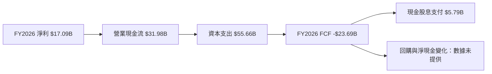
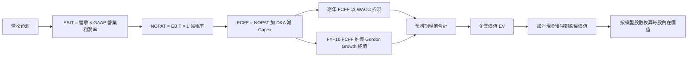
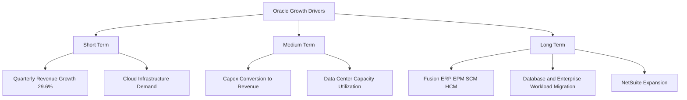
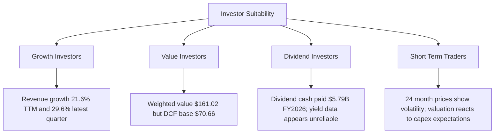

# ORCL 基本面深度分析報告

> **報告日期**：2026-11-15 ｜ **語言**：繁體中文 ｜ **數據來源**：SEC 申報資料 (XBRL)、Yahoo Finance、Finviz、StockAnalysis、Roic.ai ｜ **分析師**：CFA 級機構研究

## 目錄

| # | 章節 | 核心結論 |
|---|------|----------|
| 1 | 執行摘要 | 買入；加權合理價值 $161.02；MOS +22.2% |
| 2 | 公司概覽與商業模式 | 企業軟體、資料庫與雲端基礎設施形成客戶鎖定；細分營收未提供 |
| 3 | 損益表深度分析 | TTM 營收 $71.78B、年增 21.6%；最新一季年增 29.6% |
| 4 | 資產負債表分析 | 現金與短期投資 $37.08B；債務資料相互矛盾，不能簡化為確定淨現金 |
| 5 | 現金流量深度分析 | TTM FCF -$28.72B，主因資本支出 $75.66B |
| 6 | 獲利能力與資本效率 | ROIC 61.3% 高於 WACC 9.61%；但 FCF 轉負反映再投資負擔 |
| 7 | 相對估值分析 | ORCL 估值低於所列同業及自身五年中位數，但 DCF 顯示現價高於基準內在價值 |
| 8 | DCF 內在價值評估 | 基準 DCF $70.66；加權合理價值 $161.02；兩種估值基準不可混用 |
| 9 | 成長催化劑 | 雲端與 AI 基礎設施需求是主要驅動；TAM 數據未提供 |
| 10 | 風險矩陣 | 首要風險為資本支出回收、融資負擔與高成長預期落空 |
| 11 | 投資建議 | 買入；建議區間 $125.35–$144.92，並密切追蹤 FCF 與資本支出 |

---

## 1. 執行摘要

ORCL 的 TTM 營收為 **$71.78B**、TTM 年增 **21.6%**，最新一季營收年增 **29.6%**，而 TTM ROIC **61.3%** 明顯高於 **9.61% WACC**；但同期資本支出 **$75.66B** 高於營業現金流 **$46.94B**，使 TTM FCF 為 **-$28.72B**。估值上，DCF 基準值為 **$70.66**，低於 2026-11-13 收盤價 **$125.35**；但含同業相對估值及分析師共識後，加權合理價值為 **$161.02**，MOS **+22.2%**。因此依規則 20 評級為**買入**：高 ROIC、雲端成長與相對估值支持正面判斷，惟負 FCF、DCF 終值依賴度高及債務數據矛盾使信心度為**中**。

### 1.0 一頁式投資儀表板（Portfolio Manager 30 秒速讀）

| 項目 | 內容 |
|------|------|
| **投資論點（3 句）** | ① TTM 營收年增 21.6%，最新一季年增 29.6%，增長動能仍在加速。② TTM ROIC 61.3% 對比 WACC 9.61%，顯示營運回報高於資本成本。③ TTM FCF -$28.72B、FCF Yield -7.35%，顯示基礎設施投資尚未轉化為正自由現金流。 |
| **綜合評分** | **6.3/10**（引用 1.1 評分卡） |
| **財務健康** | 🟡 現金與短期投資 $37.08B，但債務資料互有矛盾，TTM FCF 為負。 |
| **ROIC vs WACC** | **61.3% vs 9.61%**（帳面上創造價值；見第 6.2 節口徑限制） |
| **FCF 趨勢** | 大額資本投資令 FCF 轉負；最新 FCF Yield **-7.35%**。 |
| **估值** | Forward P/E **11.3x**（Yahoo Finance）；EV/EBITDA 歷史資料 **10.4x**；FCF Yield **-7.35%**。 |
| **DCF 內在價值（基準）** | **$70.66** ｜ 現價相對 DCF 溢價 **+77.4%**（計算：$125.35 ÷ $70.66 − 1） |
| **安全邊際（MOS）** | **+22.2%**＝($161.02 − $125.35) ÷ $161.02（基準為 8.8 加權合理價值）｜ 🟡 10–25% 有限 |
| **預期報酬（基準情境 12M）** | DCF 基準情境為 **-43.6%**；加權合理價值所隱含上行空間為 **+28.5%**，兩者估值口徑不同。 |
| **關鍵風險（前二）** | 資本支出持續高於營業現金流；AI／雲端容量擴建回收不及預期。 |
| **評級 + 信心度** | 🟢 **買入** ｜ 信心：**中** |

### 1.1 綜合評分卡（全報告唯一）

| 維度 | 評分（1–10） | 主要依據（引用數字與其來源章節） |
|------|--------------|----------------------------------|
| 成長性 | 8.0 | TTM 營收年增 21.6%、最新一季年增 29.6%（第 3 章）；但尚未取得各雲端產品的分部增速。 |
| 獲利能力 | 8.0 | TTM 營業利益率 32.1%、ROIC 61.3%，遠高於 WACC 9.61%；Piotroski F-Score 4/7（第 6 章）。 |
| 財務健康 | 4.0 | 現金與短期投資 $37.08B，但債務來源不一致，且 TTM FCF -$28.72B（第 4、5 章）。 |
| 估值 | 6.0 | MOS +22.2%；P/E 低於五年中位數 32.1x，但 DCF 基準價值低於現價（第 7、8 章）。 |
| 護城河 | 8.0 | 資料庫、企業 ERP、雲端軟體及遷移成本構成黏著度；分部及續約指標未提供（第 2 章）。 |
| 管理層與資本配置 | 5.0 | FY2026 SBC $4.81B、資本支出 $55.66B，投入規模大；稀釋股數測試未通過，資本回報成效仍待驗證。 |
| **綜合評分** | **6.5** | 六項算術平均：(8.0 + 8.0 + 4.0 + 6.0 + 8.0 + 5.0) ÷ 6 = **6.5**。 |

### 1.2 五大投資論點 + 三大核心風險

| 類型 | 項目 | 具體依據 | 信心度 |
|------|------|----------|--------|
| 🟢 **投資論點①** | 營收增速加快 | TTM 營收 $71.78B、年增 21.6%；FY2026 收入年增 17.35%，最新季度年增 29.6%。雲端與基礎設施需求若延續，收入規模可支撐更高現金流。 | 🟢 高 |
| 🟢 **投資論點②** | 高資本回報 | TTM ROIC 61.3%，高於 WACC 9.61% 約 51.7 個百分點；惟 ROIC 分母受現金、債務及股東權益資料口徑影響。 | 🟢 高 |
| 🟢 **投資論點③** | 企業軟體客戶黏著 | ERP、資料庫及企業工作負載遷移具轉換成本；FY2026 資產規模升至 $261.76B，PP&E $129.65B，反映雲端資產投入明顯擴大。 | 🟡 中 |
| 🟢 **投資論點④** | 相對估值較自身歷史低 | P/E 19.6x，低於五年中位數 32.1x；P/S 5.2x，低於五年中位數 6.2x。估值折讓反映市場對投資回收及資本支出的疑慮。 | 🟡 中 |
| 🟢 **投資論點⑤** | 加權價值高於現價 | 第 8.8 節加權合理價值 $161.02，對照 $125.35 收盤價，上行空間 28.5%、MOS 22.2%。此結果部分受同業估值及分析師共識推升。 | 🟡 中 |
| 🟡 **風險①** | 資本支出回收落後 | TTM Capex $75.66B、營業現金流 $46.94B，FCF -$28.72B；若新增容量未快速帶來收入，估值及融資彈性都會受壓。 | 🔴 高衝擊 |
| 🔴 **風險②** | 融資及債務資料不確定 | Verified Figures 的 Total debt 為 N/A；其他市場資料列示總債務 $169.14B、淨負債 $132.07B。兩種口徑差異重大，需以 SEC 同期附註核實。 | 🔴 高衝擊 |
| 🟡 **風險③** | DCF 對終值高度敏感 | DCF 終值現值 $357.15B，為企業價值 $183.21B 的 194.9%；預測期 FCF 現值合計為負。長期再投資假設變動會大幅改變估值。 | 🔴 高衝擊 |

### 1.3 快速統計卡片

| 指標 | 公司實際值（期間） | 同業中位數 | 狀態 |
|------|--------------------|------------|------|
| 營收成長（TTM） | **21.6%** | — | 🟢 |
| 營收成長（最新一季年增） | **29.6%** | **13.2%** | 🟢 |
| 毛利率（TTM） | **64.0%** | **73.6%** | 🟡 |
| 營業利益率（TTM） | **32.1%** | — | 🟢 |
| ROIC（TTM） | **61.3%** | — | 🟢 |
| Forward P/E | **11.3x** | **21.7x** | 🟢 |
| FCF Yield（TTM） | **-7.35%** | — | 🔴 |
| Piotroski F-Score | **4 / 7** | — | 🟡 |

同業中位數以 MSFT、SAP、CRM 所提供數據計算；P/S、EV/EBITDA 及毛利率中位數僅以有數值的同業計算。

### 1.4 投資結論

```text
╔══════════════════════════════════════════════════════════════════╗
║                    📊 投資結論摘要                               ║
╠══════════════════════════════════════════════════════════════════╣
║  評級：買入（MOS +22.2%，依規則 20）                            ║
║  價格（2026-11-13 收盤）：$125.35                               ║
║  DCF 內在價值（基準）：$70.66（現價溢價 +77.4%）                ║
║  安全邊際 MOS：+22.2%（＝($161.02−$125.35)÷$161.02）            ║
║  加權合理價值（8.8）：$161.02                                   ║
║  DCF 情境價值：                                                   ║
║    悲觀情境：$4.68（-96.3%）                                    ║
║    基準情境：$70.66（-43.6%）                                   ║
║    樂觀情境：$215.18（+71.7%）                                  ║
║  綜合評分：6.5/10（引用 1.1）                                   ║
║  適合投資人：能承受高資本支出、估值波動並有多年持有期的投資人   ║
╚══════════════════════════════════════════════════════════════════╝
```

---

## 2. 公司概覽與商業模式

### 2.1 業務結構與收入來源

公司總部與產品描述顯示，Oracle 提供企業 IT 架構所需的資料庫、應用軟體及雲端服務。整體 TTM 營收為 **$71.78B**；但提供資料沒有可核對的各業務分部營收及占比，因此不拆算分部金額或比例。



### 2.2 市場份額

市場份額數據未提供，亦沒有可引用的 TAM 資料。從已知收入看，ORCL TTM 營收 $71.78B、最新一季營收年增 29.6%，高於所列 MSFT、SAP、CRM 最新季度營收增速 18.8%、13.2%、10.8%；但這些整體公司數字不能直接視為相同產品市場的份額比較。

### 2.3 競爭護城河分析



### 2.4 護城河強度

| 護城河項目 | 強度（強／中／弱） | 證據（引用數字或事實） | 會削弱它的情況 |
|------------|--------------------|------------------------|----------------|
| 技術與資料庫 | 強 | 資料庫與企業關鍵系統為核心產品；公司最新季度營收年增 29.6%。 | 雲端原生替代品、開源技術降低轉換門檻。 |
| 軟體生態系統 | 強 | Fusion ERP、EPM、SCM、HCM 與 NetSuite 覆蓋企業流程。 | 客戶採多雲／最佳單點產品策略，削弱套件綁定。 |
| 客戶鎖定 | 強 | 核心資料、業務流程與工作負載轉移需承擔遷移、測試及營運風險。 | 產品互通性提升、轉換工具成熟或定價過高。 |
| 網路效應 | 中 | 合作夥伴與系統整合商可擴大導入；具體網路效應指標未提供。 | 夥伴策略分散或客戶選擇多雲供應商。 |
| 規模效應 | 中至強 | FY2026 營收 $67.36B，PP&E $129.65B，顯示資料中心資產建置規模大。 | 資產利用率不足，或資本成本高於新增回報。 |
| 生態夥伴 | 中 | 有系統整合與雲端合作的產品型態；合作夥伴貢獻數據未提供。 | 競爭者提供更有吸引力的聯盟條件。 |

1.1 的護城河評分 **8.0/10**，主要依據企業軟體套件、資料庫及工作負載遷移成本；未提供續約率、客戶流失率等直接量化證據，因此未給更高分。

---

## 3. 損益表深度分析

### 3.1 年度收入成長趨勢（近 4 年）

FY2023–FY2026 營收分別為 $49.95B、$52.96B、$57.40B、$67.36B；近三年收入 CAGR 約 **10.5%**，計算為 \((67.36 ÷ 49.95)^{1/3} - 1\)。FY2026 成長加速至 17.35%，高於 FY2025 的 8.38%，與雲端及基礎設施需求擴張一致；但資料未提供分部營收，無法精確拆解各業務貢獻。

```text
╔══════════════════════════════════════════════════════════════════╗
║              Oracle 年度收入趨勢（FY2023-FY2026）                ║
╠══════════════════════════════════════════════════════════════════╣
║  FY2023  $49.95B  ██████████████████░░░░░░░░░░░  YoY：基期       ║
║  FY2024  $52.96B  ███████████████████░░░░░░░░░░  YoY：+6.02%     ║
║  FY2025  $57.40B  █████████████████████░░░░░░░  YoY：+8.38%     ║
║  FY2026  $67.36B  █████████████████████████░░░░  YoY：+17.35%    ║
╠══════════════════════════════════════════════════════════════════╣
║  FY2023-FY2026 營收 CAGR：約 +10.5%                              ║
╚══════════════════════════════════════════════════════════════════╝
```

### 3.2 季度收入趨勢分析

| 季度 | 營收 | QoQ 成長 | YoY 成長 | 備註 |
|------|------|----------|----------|------|
| FY2026 Q2（2025-11-30） | $16.06B | +7.58% | +14.22% | 季增計算：$16.058B ÷ $14.926B − 1。 |
| FY2026 Q3（2026-02-28） | $17.19B | +7.05% | +21.66% | 年增與季度資料庫列示相符。 |
| FY2026 Q4（2026-05-31） | $19.18B | +11.60% | +20.63% | 季增動能再升。 |
| FY2027 Q1（2026-08-31） | $19.35B | +0.84% | +29.60% | 最新單季年增，不是 TTM 成長率。 |

收入年增速度近四季由 14.22% 升至 29.60%，但最新季度季增僅 0.84%，顯示年增率部分受到較低基期影響；需觀察後續季度季增及雲端分部數據。

### 3.3 利潤率演變分析

| 利潤率指標 | FY2023 | FY2024 | FY2025 | FY2026／TTM | 趨勢 | 評估 |
|------------|--------|--------|--------|-------------|------|------|
| **毛利率** | 72.9% | 71.4% | 70.5% | FY2026：65.8%；TTM：64.0% | ↘️ | 🟡 |
| **營業利益率** | 27.6% | 30.3% | 31.4% | FY2026：33.3%；TTM：32.1% | ↗️ | 🟢 |
| **淨利率** | 17.0% | 19.8% | 21.7% | TTM：26.4% | ↗️ | 🟢 |

年度毛利率及營業利益率以年度損益表金額除以營收計算；TTM 利潤率採用 Verified Figures 數值。毛利率下行而營業利益率改善，可能反映雲端基礎設施等成本密集型業務占比上升，同時營業費用管理或規模效益抵銷部分毛利壓力。雲端分部毛利與費用拆解未提供，因此產品組合效應仍屬合理推論，而非可直接驗證的歸因。

### 3.4 費用結構分析

可用數據支持 FY2026 營收 $67.36B、毛利 $44.34B、營業利益 $22.44B、研發費用 $10.27B；沒有完整且一致的其他營業費用細項，無法用圓餅圖表示完整費用結構。FY2026 研發費用約為營收 **15.2%**（$10.27B ÷ $67.36B），反映產品與雲端能力投入的重要性。

### 3.5 季度 EPS 趨勢與盈餘品質（Quality of Earnings）

| 季度 | EPS 實際 | YoY 成長 | QoQ 成長 | 盈餘驚喜 |
|------|----------|----------|----------|----------|
| FY2026 Q2（2025-11-30） | $2.10 | +90.91% | +100.0% | N/A（EPS 預估及實際驚喜資料為 nan） |
| FY2026 Q3（2026-02-28） | $1.27 | +24.51% | -39.5% | N/A |
| FY2026 Q4（2026-05-31） | $1.45 | +21.91% | +14.2% | N/A |
| FY2027 Q1（2026-08-31） | $1.56 | +54.45% | +7.6% | N/A |

EPS 與淨利在季度間波動，尤其 FY2026 Q2 淨利 $6.135B 高於相鄰季度；但資料未提供可識別的一次性損益附註，不能把波動直接歸因為特定一次性項目。四季分析師 EPS 預估欄皆為 nan，故無法判斷實際盈餘是超預期或不及預期。

| 盈餘品質項目 | 數值／佔比 | 評估 |
|--------------|-----------|------|
| 股權薪酬 SBC／營收 | TTM 估算：$4.82B ÷ $71.78B = **6.7%**；FY2026：$4.81B ÷ $67.36B = **7.1%** | 🟡 SBC 是實質股東成本；Piotroski 稀釋股數測試未通過。 |
| SBC／營業現金流 | TTM 估算：$4.82B ÷ $46.94B = **10.3%**；FY2026：$4.81B ÷ $31.98B = **15.0%** | 🟡 比率不低，須結合股數變化追蹤。 |
| FCF／淨利（現金轉換率） | TTM：-$28.72B ÷ StockAnalysis TTM 淨利 $18.736B = **-153.3%** | 🔴 現金轉換受 Capex 大幅拖累。 |
| 一次性／非經常性損益 | N/A（未提供可核對附註） | 不將季度波動自行判定為一次性損益。 |
| 有效稅率異常 | 12.6%（最新年度有效稅率） | 🟡 低於一般名目企業稅率，但未提供稅務調節表，不能判定是否有一次性稅務利益。 |
| 資本化支出 vs 費用化 | TTM Capex $75.66B；PP&E FY2026 $129.65B，TTM 資本支出極高 | 🟡 資料中心投資形成長期資產，但折舊、資產利用率與資本化利息細項不足。 |

**盈餘品質結論**：GAAP 獲利具有正營業現金流支持，且品質指標顯示營業現金流高於淨利；然而 TTM Capex 高於 OCF，使 FCF／淨利轉換率為 -153.3%。因此目前核心問題不是 GAAP 淨利是否被高估，而是雲端投資能否以新增收入及長期利用率收回。若 Capex 維持高位且收入變現延遲，使用正盈餘倍數估值可能低估再投資需求。

---

## 4. 資產負債表分析

### 4.1 資產結構分解

最新 TTM 資產 $303.259B；流動資產 $55.630B、PP&E $161.812B、商譽 $62.267B。各明細來自 StockAnalysis 的最新季度資產負債表；未列示資產項目差額不自行反推。



### 4.2 流動性與營運資金分析

| 指標 | 最新 TTM | 一年前 TTM | 變化 | 解讀 |
|------|----------|------------|------|------|
| DSO 應收帳款天數 | 58 天 | 55 天 | +3 天 | 收款天數上升，或為帳單時點及客戶組合變化；應收帳款 $11.394B，需持續觀察。 |
| DIO 存貨天數 | N/A | N/A | N/A | 公司沒有相應存貨餘額，不能推算。 |
| DPO 應付帳款天數 | 156 天 | N/A | N/A | 一年前數值缺資料；156 天顯示付款週期偏長，但不能單憑此推斷議價力。 |
| CCC 現金轉換週期 | N/A | N/A | N/A | DIO 缺值且資料不完整，不能以 DSO、DPO 反推替代。 |

其他流動性資料：流動比率 **1.171**、速動比率 **1.02**。這代表流動資產略高於流動負債，但覆蓋幅度不大；資本支出與債務口徑不確定性，使單看流動比率不足以判定融資安全。

### 4.3 債務結構分析

資料存在明顯口徑差異：Verified Figures 的 Total debt 為 **N/A**；市場資料列示總債務 **$169.14B**、淨負債 **$132.07B**；FY2026 資產負債表另列債務 **$156.19B**。因此下圖以已明確列示的市場資料呈現，並不把它冒充為同一口徑的 Verified Figures。

```text
╔══════════════════════════════════════════════════════════════════╗
║                   Oracle 債務健康診斷                            ║
╠══════════════════════════════════════════════════════════════════╣
║  總債務（市場資料）：$169.14B  ████████████████████ 來源口徑待核 ║
║  現金+短期投資：   $37.08B   ████░░░░░░░░░░░░░░░░  現金緩衝       ║
║  淨負債（市場資料）：$132.07B  ███████████████░░░░░  非淨現金狀態   ║
║                                                                  ║
║  Debt/EBITDA：N/A（債務與 EBITDA 口徑未統一）                    ║
║  Interest Coverage：N/A（利息費用未提供）                        ║
║  Verified Figures 總債務：N/A                                    ║
╚══════════════════════════════════════════════════════════════════╝
```

Cost of capital 的債務成本及權重是模型輸入，不能當作已驗證債務餘額；核實前應避免以單一淨負債數字作槓桿結論。

### 4.4 股東權益趨勢

| 財年 | 股東權益 |
|------|----------|
| FY2023 | $1.07B |
| FY2024 | $8.70B |
| FY2025 | $20.45B |
| FY2026 | $42.51B |

FY2026 股東權益增加，與盈利累積及資產負債表擴張並存；但 FY2026 總資產 $261.76B、總負債 $218.70B，權益仍只占總資產一部分，不能將股東權益上升單獨解讀為財務槓桿下降。

---

## 5. 現金流量深度分析

### 5.1 現金流量瀑布圖

FY2026 淨利 $17.09B、營業現金流 $31.98B、Capex $55.66B、年度 FCF -$23.69B；TTM FCF 則為 -$28.72B。股息資料可取得 FY2026 支付 $5.79B，但回購及同期淨現金變化未提供，圖中不估計。



### 5.2 FCF 轉換率趨勢

| 財年 | OCF | Capex | FCF | 淨利 | FCF／淨利 |
|------|-----|-------|-----|------|-----------|
| FY2023 | $17.16B | $8.70B | $8.47B | $8.50B | 99.6% |
| FY2024 | $18.67B | $6.87B | $11.81B | $10.47B | 112.8% |
| FY2025 | $20.82B | $21.21B | -$0.394B | $12.44B | -3.2% |
| FY2026 | $31.98B | $55.66B | -$23.69B | $17.09B | -138.6% |
| TTM | $46.94B | $75.66B | **-$28.72B** | N/A（不同來源 TTM 淨利 $18.736B） | TTM 約 -153.3% |

負值不是核心營業現金流惡化的同義詞，而是資本支出增幅大於營業現金流增幅；但現金回收時間拉長，實質上提高融資與執行風險。

### 5.3 自由現金流趨勢

```text
╔══════════════════════════════════════════════════════════════════╗
║                 Oracle 自由現金流趨勢                            ║
╠══════════════════════════════════════════════════════════════════╣
║  FY2023  +$8.47B   ███████░░░░░░░░░░░░░░░░  FCF 為正             ║
║  FY2024  +$11.81B  ██████████░░░░░░░░░░░░░  FCF 為正             ║
║  FY2025  -$0.394B  ░░░░░░░░░░░░░░░░░░░░░░░  接近損益平衡         ║
║  FY2026  -$23.69B  ░░░░░░░░░░░░░░░░░░░░░░░  Capex 明顯上升       ║
║  TTM     -$28.72B  ░░░░░░░░░░░░░░░░░░░░░░░  FCF Yield -7.35%     ║
╚══════════════════════════════════════════════════════════════════╝
```

FCF 由 FY2024 正 $11.81B 轉為 FY2026 負 $23.69B，主要對應 Capex 從 FY2024 的 $6.87B 增至 FY2026 的 $55.66B。這筆投資若能帶動雲端收入及容量利用率提升，可能形成後續營業槓桿；若收入回收較慢，則負 FCF 可能延續並提高融資需求。

### 5.4 資本配置評估

| 配置項目 | 已知數據 | 評估 |
|----------|----------|------|
| 資本支出 | FY2026 $55.66B；TTM $75.66B | 高度投入雲端與基礎設施；投資報酬須由收入、利用率及 FCF 驗證。 |
| 股息 | FY2026 支付 $5.79B | 現金流為負時仍有股息支出，需與融資需求共同評估。 |
| SBC | FY2026 $4.81B | 具稀釋成本；稀釋股數未增加測試未通過。 |
| 股票回購 | N/A（未提供） | 不繪製資本配置比例圖。 |
| 股息殖利率 | 市場資料顯示 160.0%，疑似單位／格式異常 | 不採用此欄作投資依據；另有歷年每股股息資料但不能把來源錯誤的 160.0% 當成可信殖利率。 |

---

## 6. 獲利能力與資本效率

### 6.1 ROE／ROA／ROIC 趨勢

| 指標 | FY2026／TTM | 過往可用資料 | 評估 |
|------|-------------|--------------|------|
| ROE | TTM 28.3%（Quality Figures）；市場資料另列 41.2% | 口徑差異，歷年同口徑序列未提供 | 不混合比較；杜邦分析依 28.3%。 |
| ROA | 市場資料 TTM 6.4% | Piotroski 確認 ROA 為正，但缺完整數列 | 正值，但低於高 ROE，反映資產基礎龐大。 |
| ROIC | TTM 61.3% | 10 年資料顯示過往 ROIC 多低於當前值，但口徑不完全一致 | 🟢 高於 WACC；須留意近期資本投入是否充分反映在分母中。 |

未提供可比同業 ROIC、ROE、ROA 的同口徑數值，因此不列行業均值。

### 6.2 ROIC vs WACC 分析（核心價值創造判斷）

```text
╔══════════════════════════════════════════════════════════════════╗
║                ROIC vs WACC 深度分析                            ║
╠══════════════════════════════════════════════════════════════════╣
║  WACC（直接採用 Cost of capital 數值）：9.61%                    ║
║  ├── 無風險利率 Rf：                 5.15%                       ║
║  ├── ERP：                           5.00%                       ║
║  ├── 原始 Beta：                     1.78                        ║
║  ├── 調整後 Beta：                   1.52                        ║
║  ├── 股權成本 Ke：                  12.75%                       ║
║  ├── 稅前債務成本：                  2.72%                       ║
║  ├── 有效稅率：                     12.6%                        ║
║  ├── E / D 權重：                    69.8% / 30.2%                ║
║  └── ✅ WACC：                       9.61%                       ║
║                                                                  ║
║  ROIC（TTM，採用 Verified Figures）：61.3%                       ║
║  EVA 利差 = ROIC − WACC = 61.3% − 9.61% = +51.69 個百分點         ║
║                                                                  ║
║  ROIC 61.3%  高於 WACC 9.61%  → 🟢 帳面上創造經濟價值            ║
║  結論：當前 ROIC 為 WACC 約 6.4 倍；但高 Capex 與債務口徑不一，   ║
║        應以後續投入資本回報與 FCF 驗證，不宜把差距外推不變。      ║
╚══════════════════════════════════════════════════════════════════╝
```

CAPM 算式為 \(5.15\% + 1.52 \times 5.00\% = 12.75\%\)。提供的權重與成本若直接相乘，按顯示精度會得到約 9.62%，與程式提供的 WACC 9.61% 有 0.01 個百分點四捨五入差異；依要求採用 **9.61%**，不另行替換。ROIC 與 WACC 的比較僅代表所給 TTM 計算口徑，且負 FCF 說明新增投資回報還沒有完全反映在現金流中。

### 6.3 杜邦三因素分解

| 因素 | 數值（TTM） | 解讀 |
|------|-------------|------|
| 淨利率 | 26.4% | 有效盈利能力較高。 |
| 資產週轉率 | 0.24 | 資產基礎大，尤其資料中心資產擴增可能壓低周轉率。 |
| 權益乘數 | 4.54 | 財務槓桿對 ROE 有實質放大效果。 |
| **ROE** | **28.3%** | 依 Quality Figures 原值；三因素按其精度相乘有尾差，以原列 ROE 為準。 |

ROE 並非只由淨利率驅動，權益乘數 4.54 倍相當重要；因此需與債務口徑核實及 FCF 資料共同看待。

### 6.4 財務體質：Piotroski F-Score

Piotroski F-Score 為 **4/7**；共 9 項檢驗中，缺失輸入的項目不計入分母，故分母為 7。

| 測試 | 結果 | 解讀 |
|------|------|------|
| ROA > 0 | ✅ 通過 | TTM 資產報酬為正。 |
| 營業現金流 > 0 | ✅ 通過 | TTM OCF $46.94B。 |
| ROA 高於一年前 | ❌ 未通過 | 資產擴張未帶來更高 ROA。 |
| 營業現金流 > 淨利（應計品質） | ✅ 通過 | OCF 高於 TTM 淨利口徑。 |
| 長期負債／總資產低於一年前 | — 無法判定 | 缺資料。 |
| 流動比率高於一年前 | ✅ 通過 | 流動比率方向改善。 |
| 稀釋股數未增加 | ❌ 未通過 | SBC 及股數稀釋需持續監控。 |
| 毛利率高於一年前 | — 無法判定 | 缺資料。 |
| 資產週轉率高於一年前 | ❌ 未通過 | 資產增長快於收入周轉改善。 |

---

## 7. 相對估值分析

### 7.1 同業估值比較表格

| 估值指標 | **ORCL** | **MSFT** | **SAP** | **CRM** | ORCL 評估 |
|----------|----------|----------|---------|---------|-----------|
| **Trailing P/E** | 19.6x | 27.3x | 29.3x | 19.9x | 🟢 低於所列同業；反映現金流與融資風險折價。 |
| **Forward P/E** | 11.3x | 21.7x | 24.6x | 13.6x | 🟢 明顯較低，但公司 Forward EPS 預估口徑仍有不確定性。 |
| **P/S Ratio** | 5.2x | 11.2x | N/A | 4.1x | 🟡 介於 MSFT 與 CRM 之間；SAP 因幣別混合不比較。 |
| **EV/EBITDA** | 10.4x | 19.3x | N/A | 16.3x | 🟢 低於兩個可比值；債務／EV 口徑差異須留意。 |
| **最新一季營收 YoY** | 29.6% | 18.8% | 13.2% | 10.8% | 🟢 ORCL 成長較快，但單季增速可能受基期及產品組合影響。 |
| **毛利率（TTM）** | 64.0% | 67.7% | 73.6% | 77.3% | 🟡 ORCL 較低，可能反映基礎設施業務成本結構不同。 |

Peer multiples 使用 Yahoo Finance 所列數據。ORCL P/E、P/S、EV/EBITDA 採五年估值歷史資料的現值，以維持估值章節與歷史分析的同一套口徑。

### 7.2 歷史估值區間分析

```text
╔══════════════════════════════════════════════════════════════════╗
║                 ORCL 五年估值區間                                ║
╠══════════════════════════════════════════════════════════════════╣
║  P/E：      19.0x ├─● 19.6x（現值，百分位 5%）──────┤ 52.3x       ║
║                         五年中位數 32.1x                         ║
║  P/S：       4.6x ├────● 5.2x（現值，百分位 24%）───┤ 11.1x      ║
║                         五年中位數 6.2x                          ║
║  EV/EBITDA：12.6x ├─● 10.4x*（現值，百分位 0%）─────┤ 28.9x      ║
║                         五年中位數 17.9x                         ║
╚══════════════════════════════════════════════════════════════════╝
```

\* EV/EBITDA 的現值 10.4x 低於歷史區間下緣 12.6x，但數值按歷史估值來源原樣呈現；這種區間外情形可能反映資料日、EV／EBITDA 定義或歷史區間計算口徑不同，需核對原始時間序列。

### 7.3 情境價值（Bear / Base / Bull，照抄 DCF MODEL 的 Scenarios）

| 情境 | 第 1 年營收成長 | 期末營業利潤率 | WACC | 每股價值 | 相對現價 | 機率 | 會發生的條件 |
|------|----------------|----------------|------|----------|----------|------|--------------|
| 🔴 悲觀 | 10.8% | 26.0% | 10.61% | $4.68 | -96.3% | 25% | 雲端容量變現慢、成長明顯放緩且競爭壓低長期利潤率。 |
| 🟡 基準 | 21.6% | 30.6% | 9.61% | $70.66 | -43.6% | 50% | 起始成長延續，但資本支出在預測期逐步回落。 |
| 🟢 樂觀 | 32.4% | 33.6% | 8.61% | $215.18 | +71.7% | 25% | AI 與雲端需求顯著超預期、利潤率保持擴張且資金成本下降。 |

### 7.4 相對估值隱含價格區間

```text
╔══════════════════════════════════════════════════════════════════╗
║            相對估值與共識隱含價值                                ║
╠══════════════════════════════════════════════════════════════════╣
║  DCF 基準                  $70.66                                ║
║  現價                     $125.35                                ║
║  同業 EV/EBITDA           $197.10                                ║
║  分析師共識                $236.18                                ║
║  同業 Forward P/E          $239.44                                ║
╚══════════════════════════════════════════════════════════════════╝
```

| 方法 | 每股價值 | 依據 |
|------|----------|------|
| 同業 Forward P/E | $239.44 | MSFT、SAP、CRM 同業 Forward P/E 中位數 21.7x × ORCL Forward EPS $11.06。 |
| 同業 EV/EBITDA | $197.10 | MSFT、CRM 中位數倍數 17.8x × TTM EBITDA，並加回模型所用淨現金。 |
| 分析師共識目標價 | $236.18 | 40 位分析師平均目標價。 |

---

## 8. DCF 內在價值評估（Discounted Cash Flow）

### 8.0 估值推理鏈（Thinking Logic）

**Step 1 — 價值由哪些變數決定？**  
模型以 ORCL TTM 營收 **$71.78B** 為起點，預測既有企業軟體及雲端服務的收入成長、GAAP EBIT 利潤率，以及高額 Capex 逐步回歸後的 FCFF。由於沒有分部營收與雲端分部占比，不能把某一業務單獨量化為營收占比；模型主導變數是**資本支出從 TTM 105.4% 營收向長期水平回落的速度**，因為它直接決定 FCFF 從負轉正的時間。

**Step 2 — 模型選擇**

| 決策點 | 本報告採用 | 理由（含數字） | 曾考慮但否決 | 否決理由 |
|--------|-----------|----------------|--------------|----------|
| 現金流定義 | FCFF | 對應 WACC 折現並先求 EV；模型列式 FCFF = NOPAT + D&A − Capex | FCFE | 債務資料不完整，直接以股權現金流推算較不穩健。 |
| 預測期 N | 10 年 | 模型指定 10 年；Capex 由 TTM 105.4% 營收向 FY+10 的 14.4% 收斂 | 5 年 | 無法涵蓋模型設定的資本支出正常化過程。 |
| 終值方法 | Gordon Growth | 區塊計算終值 $894.39B，WACC 9.61% 高於 g 3.0% | 只用退出倍數 | 模型未提供退出倍數終值，且不可自建替代模型。 |
| EBIT 基礎 | GAAP EBIT | TTM 營業利益率 32.1%；SBC 已作費用處理 | 非 GAAP EBIT | 會改變模型口徑，且資料沒有一致調整數據。 |

**Step 3 — 關鍵假設推導鏈**

- **營收成長**：錨點＝TTM 營收年增 21.6%、FY2026 成長 17.35%、近三年 CAGR 約 10.5% → 最新單季年增升至 29.6%，但部分可能受基期影響 → **模型 FY+1 採 21.6%，線性遞減至 FY+10 的 3.0%** → 曾考慮將最新季度 29.6% 延續為長期增速，但缺少分部與訂單資料，否決。
- **期末營業利潤率**：錨點＝TTM GAAP 營業利益率 32.1%，FY2026 由年度數據推算約 33.3% → 模型將利潤率逐步降至歷史五年中位水準 → **FY+1 32.1%、FY+10 30.6%** → 曾考慮維持 33.3%，但忽略競爭與雲端成本結構，否決。
- **Capex／營收**：錨點＝TTM Capex $75.66B ÷ TTM 營收 $71.78B = 105.4% → 高於常態的投入不宜無限期延續，但 AI／雲端投資可能使回落較慢 → **由 FY+1 105.4% 線性降至 FY+10 14.4%** → 曾考慮快速降至 D&A 的 13.1%，但模型採 1.1 倍 D&A 下限，否決更快回落。
- **永續成長率 g**：錨點＝成熟經濟長期名目成長常低於高成長期，資料沒有公司長期指引 → 採 **3.0%**，且低於 WACC 9.61% → 曾考慮 4.0%，但會放大終值且缺乏公司特定長期數據，否決。
- **預測期 N**：錨點＝模型預設 10 年，現有資本支出需時間消化 → 採 **10 年** → 曾考慮縮短為 5 年，但不足以表達 Capex 正常化，否決。
- **WACC**：錨點＝Cost of capital 輸出 WACC **9.61%** → 按規定直接採用，不另估；β 使用調整後 1.52 → 曾考慮原始 β 1.78，但模型明列調整後 Beta，故否決。
- **SBC 與股數**：錨點＝GAAP EBIT 已包含 SBC 費用；FY2026 SBC $4.81B → 採組合 **(A) GAAP EBIT + 固定股數、年稀釋率 0%** → 不再額外扣 SBC 或稀釋股數，避免重複計入。
- **稅率、D&A、ΔWC**：有效稅率錨點 12.6%；D&A／營收 13.1%；工作資金變化沒有模型數值。DCF 模型明確不建模營運資金變化，故不自行補入 ΔWC。

**Step 4 — 最脆弱環節**  
最脆弱的是 Capex 由 FY+1 92.02B 降至 FY+10 32.65B 的正常化路徑；若投資需求持續偏高，FCFF 及 DCF 價值將低於基準情境。

**Step 5 — 計算路徑圖**



### 8.1 模型假設總表（Model Inputs）

| 假設項目 | 採用值 | 依據／來源 | 敏感度 |
|----------|--------|-------------|--------|
| 預測期長度 **N** | 10 年 | DCF 模型設定；涵蓋 Capex 正常化至 FY+10。 | 🟡 中 |
| 營收成長 | FY+1 21.6%，FY+10 3.0%，線性遞減 | TTM 年增 21.6% 為起點；末年採模型終端成長設定。 | 🔴 高 |
| 營業利潤率 | 32.1% → 30.6% | TTM 32.1%，FY+10 收斂至近五年中位水準。 | 🔴 高 |
| 有效稅率 | 12.6% | 最新年度有效稅率。 | 🟢 低 |
| Capex／營收 | 105.4% → 14.4% | TTM Capex／營收；末年依模型向 1.1×D&A 收斂。 | 🔴 高 |
| D&A／營收 | 13.1% | TTM 比率，模型固定。 | 🟢 低 |
| 營運資金變動 | 不建模 | DCF 模型明列 Working capital is not modelled；不自行填數。 | 🟢 低 |
| EBIT 基礎 | GAAP | GAAP EBIT 已包含 SBC 費用。 | 🟡 中 |
| SBC 處理 | 組合 (A)：不重扣 SBC | GAAP EBIT 已扣 SBC；固定股數，避免重複計入。 | 🟡 中 |
| 年稀釋率 | 0%（模型組合 A） | 模型明列不再稀釋股數；股數以模型換算方式處理。 | 🟡 中 |
| 永續成長率 g | 3.0% | DCF 模型設定；低於 WACC 9.61%。 | 🔴 高 |
| 終值方法 | Gordon Growth | DCF 模型直接使用永續成長法。 | 🔴 高 |
| WACC | 9.61% | Cost of capital 區塊直接採用。 | 🔴 高 |

**FCFF 定義**：按模型採 \(FCFF = NOPAT + D&A - Capex\)，不含營運資金變動。  
**SBC 一致性**：本模型採用 **(A) GAAP EBIT + 固定股數**，故 SBC 影響已計入一次；不在 FCFF 再扣 SBC，也不逐年放大股數。

### 8.2 折現率推導（WACC）

```text
╔══════════════════════════════════════════════════════════════════╗
║                    WACC 推導（折現率）                           ║
╠══════════════════════════════════════════════════════════════════╣
║  股權成本 Ke（CAPM）：                                            ║
║  ├── 無風險利率 Rf：                    5.15%                    ║
║  ├── 市場風險溢酬 ERP：                 5.00%                    ║
║  ├── 原始 Beta：                        1.78                     ║
║  ├── 調整後 Beta：                      1.52                     ║
║  ├── Beta 調整：                        ⅔×1.78 + ⅓×1 = 1.52      ║
║  ├── 規模／國別溢酬：                   0.00%（未另加）          ║
║  └── Ke = 5.15% + 1.52×5.00% =         12.75%                   ║
║                                                                  ║
║  債務成本：                                                      ║
║  ├── 稅前 Kd：                          2.72%                    ║
║  ├── 有效稅率：                        12.6%                     ║
║  └── 稅後 Kd：2.72%×(1−12.6%) =        2.3773%                  ║
║                                                                  ║
║  資本結構權重：                                                  ║
║  ├── 股權權重：                         69.8%                    ║
║  ├── 債務權重：                         30.2%                    ║
║  └── ✅ 採用 WACC：                     9.61%                    ║
╚══════════════════════════════════════════════════════════════════╝
```

逐步演算如下：

1. **Ke（CAPM）** = 5.15% + 1.52 × 5.00% = **12.75%**。
2. **稅前 Kd**：採用資本成本資料提供的 **2.72%**；利息費用及其平均計息負債分母未提供，不能自行重算。
3. **稅後 Kd** = 2.72% × (1 − 12.6%) = **2.3773%**。
4. **權重**：股權 **69.8%**、債務 **30.2%**，合計 **100.0%**；市值與同期計息負債的完整組成未提供，因此沿用模型權重。
5. 依顯示數字計算：12.75% × 69.8% + 2.3773% × 30.2% = 8.8995% + 0.7179% = **9.6174%**。因與來源採用 WACC **9.61%** 有 0.0074 個百分點差異，報告估值一律使用程式指定的 **9.61%**，不自行改寫。

Rf 日期及 Beta 觀察期間未提供；ERP 5.00% 是成本資本輸入中的假設值。規模及國別溢酬沒有來源值，因此不另加。此節與第 6.2 節使用同一 WACC。

### 8.3 逐年自由現金流預測（基準情境）

金額單位：$B；折現因子依來源保留三位小數，營收及現金流依來源原值列示。公式為 \(FCFF = NOPAT + D&A - Capex\)。

| 年度 | FY+1 | FY+2 | FY+3 | FY+4 | FY+5 | FY+6 | FY+7 | FY+8 | FY+9 | FY+10 |
|------|------|------|------|------|------|------|------|------|------|-------|
| 營收 | 87.29 | 104.36 | 122.60 | 141.50 | 160.38 | 178.47 | 194.90 | 208.81 | 219.39 | 225.97 |
| 營收 YoY | 21.6% | 19.6% | 17.5% | 15.4% | 13.3% | 11.3% | 9.2% | 7.1% | 5.1% | 3.0% |
| 營業利潤率 | 32.1% | 32.0% | 31.8% | 31.6% | 31.4% | 31.3% | 31.1% | 30.9% | 30.8% | 30.6% |
| EBIT（GAAP） | 28.04 | 33.34 | 38.97 | 44.73 | 50.43 | 55.81 | 60.61 | 64.58 | 67.49 | 69.13 |
| − 稅 | (3.54) | (4.21) | (4.92) | (5.64) | (6.36) | (7.04) | (7.65) | (8.15) | (8.51) | (8.72) |
| = NOPAT | 24.50 | 29.14 | 34.05 | 39.09 | 44.06 | 48.77 | 52.97 | 56.44 | 58.97 | 60.40 |
| + D&A | 11.47 | 13.71 | 16.10 | 18.59 | 21.07 | 23.44 | 25.60 | 27.43 | 28.82 | 29.68 |
| − Capex | (92.02) | (99.46) | (104.45) | (106.25) | (104.22) | (97.93) | (87.25) | (72.38) | (53.87) | (32.65) |
| **= FCFF** | **-56.05** | **-56.61** | **-54.30** | **-48.58** | **-39.09** | **-25.73** | **-8.69** | **11.49** | **33.92** | **57.44** |
| 折現因子 @9.61% | 0.912 | 0.832 | 0.759 | 0.693 | 0.632 | 0.576 | 0.526 | 0.480 | 0.438 | 0.399 |
| **FCFF 現值 PV** | **-51.13** | **-47.12** | **-41.23** | **-33.65** | **-24.70** | **-14.83** | **-4.57** | **5.51** | **14.85** | **22.94** |

預測期 PV 合計的完整加總為：

**-$51.13 − $47.12 − $41.23 − $33.65 − $24.70 − $14.83 − $4.57 + $5.51 + $14.85 + $22.94 = -$173.93B**。模型列示合計 **-$173.94B**，差異為四捨五入尾差，約 0.01B。

**FY+1 逐步演算示範**

1. 營收 = $71.78B × (1 + 21.6%) = **$87.29B**（依模型未四捨五入底層輸入列示）。
2. EBIT = 模型營收 × 32.1% = **$28.04B**。
3. 稅 = $28.04B × 12.6% = **$3.53B**；模型列示 $3.54B，為底層未四捨五入數值差異。
4. NOPAT = $28.04B − $3.54B = **$24.50B**。
5. D&A = 模型估計值 **$11.47B**；D&A／營收採模型固定 13.1%。
6. Capex = 模型估計值 **$92.02B**；FY+1 Capex／營收採模型輸入 105.4%。
7. ΔWC = **0**（DCF 模型未建模營運資金，不代表實際營運資金變化為零）。
8. FCFF = $24.50B + $11.47B − $92.02B = **-$56.05B**。
9. 折現因子 = 1 ÷ (1 + 9.61%)¹ = **0.912**；PV = -$56.05B × 0.912 = **-$51.13B**。

逐年 FCFF 從 FY+1 至 FY+7 為負，FY+8 起轉正；負現金流納入折現合計，而不是忽略。歷史 FY2024 FCF 為 $11.81B、FY2025 為 -$0.394B、FY2026 為 -$23.69B；由於歷史基期有正有負，FCF CAGR 無法以通常 CAGR 有意義比較。FY+10 FCFF 利潤率為 **25.4%**（$57.44B ÷ $225.97B），但不是與目前 TTM -40.0%（-$28.72B ÷ $71.78B）同一階段：基準模型明確假設 Capex 回落。整體預測高度依賴投資回收，並非單純收入成長外推。

### 8.4 終值計算（Terminal Value）

**適用性檢查**：WACC **9.61%** vs g **3.0%** → WACC > g？✅

| 方法 | 計算式 | 終值 TV | TV 現值 | 佔總 EV 比重 |
|------|--------|---------|---------|--------------|
| Gordon Growth | $57.44B × (1 + 3.0%) ÷ (9.61% − 3.0%) | $894.39B | $357.15B | 194.9% |
| 退出倍數法 | N/A（DCF 模型未提供退出倍數估值） | N/A | N/A | N/A |

逐步演算：

1. FY+N 的 FCFF = **$57.44B**。
2. 分子 = $57.44B × (1 + 3.0%) = **$59.1632B**。
3. 分母 = 9.61% − 3.0% = **6.61%**；$59.1632B ÷ 6.61% = **$894.90B**。模型指定終值為 **$894.39B**，兩者有約 0.06% 差異，屬底層未四捨五入輸入所致；估值計算照用模型的 $894.39B。
4. PV(TV) = $894.39B × 0.399 = **$357.15B**（折現因子採模型精度）。
5. 終值佔比 = $357.15B ÷ $183.21B = **194.9%**。

終值現值高於企業價值，是因預測期 FCFF 現值合計為負；這表示模型價值高度依賴 FY+8 以後現金流正常化與終值假設。

### 8.5 企業價值 → 每股內在價值（Bridge）

```text
╔══════════════════════════════════════════════════════════════════╗
║              企業價值 → 每股內在價值 橋接表                      ║
╠══════════════════════════════════════════════════════════════════╣
║  預測期 FCF 現值合計             -$173.94B                       ║
║  終值現值 PV(TV)                 +$357.15B                       ║
║  ─────────────────────────────────────────────                  ║
║  = 企業價值 EV                    $183.21B                       ║
║  + 淨現金（模型輸入）             +$37.08B                        ║
║  = 股權價值                       $220.29B                       ║
║  每股價值換算：股權價值×股價÷市值                                ║
║  ★ 每股內在價值                 $70.66                          ║
║    當前股價                     $125.35                         ║
║    折溢價                       +77.4%（現價高於 DCF）           ║
╚══════════════════════════════════════════════════════════════════╝
```

1. EV = -$173.94B + $357.15B = **$183.21B**（依模型底層現金流及四捨五入合計）。
2. 股權價值 = $183.21B + $37.08B = **$220.29B**；模型使用 Net cash 輸入，沒有另列獨立總債務扣項。
3. 每股內在價值 = $220.29B × $125.35 ÷ $390.80B = **$70.66**（模型指定換算方式）。
4. 折溢價 = $125.35 ÷ $70.66 − 1 = **+77.4%**。
5. 本節不計算 MOS；MOS 僅以第 8.8 節加權合理價值為分母。

股權價值橋接使用 DCF 模型列示的 net cash $37.08B；它與其他市場資料列示的總債務 $169.14B、淨負債 $132.07B 不一致。每股換算採模型提供的市值比例公式，不另以不同來源股數重建，以避免跨來源混合。

### 8.6 敏感性分析（WACC × 永續成長率）

每格為模型提供的每股價值；括號為相對 $125.35 現價的上行／下行幅度。

| g（列）／WACC（欄） | 7.61% | 8.61% | **9.61%（基準）** | 10.61% | 11.61% |
|-----------|------|------|------------------|-------|-------|
| **2.0%** | $115.43（-7.9%） | $79.74（-36.4%） | $54.65（-56.4%） | $36.36（-71.0%） | $22.70（-81.9%） |
| **2.5%** | $132.00（+5.3%） | $90.57（-27.7%） | $62.09（-50.5%） | $41.68（-66.8%） | $26.61（-78.8%） |
| **3.0%** | $152.17（+21.4%） | $103.32（-17.6%） | **$70.66（-43.6%）** | $47.69（-62.0%） | $30.97（-75.3%） |
| **3.5%** | $177.23（+41.4%） | $118.57（-5.4%） | $80.63（-35.7%） | $54.55（-56.5%） | $35.87（-71.4%） |
| **4.0%** | $209.23（+66.9%） | $137.13（+9.4%） | $92.37（-26.3%） | $62.45（-50.2%） | $41.42（-67.0%） |

選格規則：選取 **WACC 8.61% > g 3.5% ✅**。該格模型輸出每股價值 **$118.57**。因敏感度矩陣僅提供結果、沒有各 WACC 情境下逐年現值及底層未四捨五入現金流，不能獨立展示可精確複算的 PV 合計；為遵守「DCF 數字一律照抄」，不另造該格中間值。矩陣顯示在固定 g 下提高 WACC 會降低價值，在固定 WACC 下提高 g 會提高價值。

**三情境 DCF（模型輸出）**

| 情境 | 成長假設 | 期末營業利潤率 | WACC | 每股內在價值 | 相對現價 | 主觀機率 |
|------|----------|----------------|------|--------------|----------|----------|
| 🔴 悲觀 | Year-1 10.8% | 26.0% | 10.61% | $4.68 | -96.3% | 25% |
| 🟡 基準 | Year-1 21.6% | 30.6% | 9.61% | $70.66 | -43.6% | 50% |
| 🟢 樂觀 | Year-1 32.4% | 33.6% | 8.61% | $215.18 | +71.7% | 25% |
| **機率加權** | — | — | — | **$90.29** | **-28.0%** | **100%** |

機率加權算式：$4.68 × 25% + $70.66 × 50% + $215.18 × 25% = **$90.30**；模型列示 **$90.29**，差異為底層未四捨五入數值造成。第 8.8 加權合理價值仍必須採用基準 DCF $70.66，而不是情境機率加權值。

**敏感度結論**：就提供矩陣而言，基準 g 3.0% 下 WACC 由 8.61% 升至 9.61%，每股價值由 $103.32 降至 $70.66，變動 **-$32.66**；g 由 2.0% 升至 3.0%、固定 WACC 9.61%，每股價值由 $54.65 升至 $70.66，變動 **+$16.01**。敏感度矩陣只直接呈現 WACC 與 g；利潤率敏感度沒有獨立矩陣，不能虛構每 +1 個百分點的價格變化。主要營運驅動仍是 Capex 回落與正 FCF 形成時間，與 8.0 所述一致。

### 8.7 反推 DCF（Reverse DCF：市場在預期什麼）

模型在固定其餘基準假設、一次求解一項變數下，提供兩項反推結果。其他求解欄位沒有模型解，故不外推。

| 求解的變數（一次一個） | 其餘變數設定 | 市場隱含值 | 基準值／歷史比較 | 判斷 |
|------------------------|--------------|--------------|------------------|------|
| Year-1 營收成長 | 其餘輸入固定為基準 | **32.2%** | 基準 21.6%；最新一季營收年增 29.6% | 🔴 高於基準，且略高於最新季度增速；要求強勁增長延續。 |
| 固定營業利潤率 | 其餘輸入固定為基準 | **39.2%** | 基準 32.1% → 30.6% | 🔴 顯著高於目前 TTM 水準。 |
| 永續成長率 g | N/A | 未計算 | N/A | 模型未提供解。 |
| 預測期長度 N | N/A | 未計算 | N/A | 模型未提供解。 |

逐步試算軌跡未提供；因此不能補寫收斂表或聲稱某一級距誤差低於 1%。反推結果顯示，單按基準 DCF 假設要支持現價，須在其他假設固定時達到 **32.2% Year-1 營收成長**，或 **39.2% 固定營業利潤率**。前者高於 TTM 增速 21.6%，後者高於目前 32.1%；兩者都要求模型基準以外的營運表現。

### 8.8 估值三角驗證與安全邊際

| 估值方法 | 隱含每股價值 | 上行空間（÷現價） | 權重 | 說明 |
|----------|--------------|-------------------|------|------|
| DCF（基準） | $70.66 | -43.6% | 40% | 10 年 FCFF、WACC 9.61%、終端成長 3.0%。 |
| 同業 Forward P/E | $239.44 | +91.0% | 25% | 同業中位數 21.7x × ORCL Forward EPS $11.06。 |
| 同業 EV/EBITDA | $197.10 | +57.2% | 25% | 同業中位數 17.8x × TTM EBITDA，加回模型所用淨現金。 |
| 分析師共識目標價 | $236.18 | +88.4% | 10% | 40 位分析師平均目標價。 |
| **加權合理價值** | **$161.02** | **+28.5%** | **100%** | Profitable 公司類型的固定方法及權重。 |

逐步加權：  
**$70.66 × 40% + $239.44 × 25% + $197.10 × 25% + $236.18 × 10%  
= $28.264 + $59.860 + $49.275 + $23.618  
= $161.017 ≈ $161.02**。

安全邊際與上行空間按不同分母計算：

\[
MOS = (161.02 - 125.35) \div 161.02
= 35.67 \div 161.02
= \mathbf{22.2\%}
\]

\[
上行空間 = (161.02 - 125.35) \div 125.35
= 35.67 \div 125.35
= \mathbf{28.5\%}
\]

```text
╔══════════════════════════════════════════════════════════════════╗
║                  估值區間與安全邊際                              ║
╠══════════════════════════════════════════════════════════════════╣
║  $4.68 ───── $70.66 ───── [$125.35] ───── $161.02 ───── $215.18 ║
║  悲觀DCF       基準DCF          現價          加權合理值    樂觀DCF║
║                                                                  ║
║  MOS = (加權合理價值−現價)÷加權合理價值 = +22.2%                ║
║  MOS 評估：🟡 有限                                               ║
║  上行空間 = (合理價值−現價)÷現價 = +28.5%                      ║
║                                                                  ║
║  建議買入區間：$125.35–$144.92（MOS 至少 10%，上限約為合理價值90%）║
║  合理持有區間：$144.92–$161.02                                  ║
║  減碼考慮區間：高於 $215.18，須重新檢視成長與估值假設            ║
╚══════════════════════════════════════════════════════════════════╝
```

規則 20 的 MOS 評級為**買入**，不作質化調整。加權合理價值為 8.8 唯一 MOS 分母；DCF 基準值只用於折溢價分析。

> 🔎 **程式複算（Python，依本節各項自動重算）**
>
> 加權合理價值 = $70.66 × 40% + $239.44 × 25% + $197.10 × 25% + $236.18 × 10% = **$161.02**（權重合計 100%）
>
> 以價格 $125.35 計：MOS = **+22.2%**，上行空間 = **+28.5%**
>
> ✅ 與本節所寫數值一致。

### 8.9 DCF 模型的局限與失效條件

- **終值依賴度**：終值現值 $357.15B 為 EV $183.21B 的 194.9%；因預測期 FCFF 現值合計為負，估值對第 10 年後現金流假設高度敏感。
- **最脆弱假設**：其一，Capex／營收由 FY+1 105.4% 降至 FY+10 14.4%；其二，營收成長由 21.6% 線性回落至 3.0%。若 Capex 沒有回落、收入增長同步放慢，現金流價值會下修。
- **FCF 為負的限制**：TTM FCF -$28.72B，FY2026 年度 FCF -$23.69B；負 FCF 且再投資期很高時，DCF 可靠度下降。應同時追蹤雲端單位經濟、容量利用率、EV/Sales、同業估值及分部現金流，而不是只看單一終值模型。
- **與第 10 章風險連結**：雲端容量回收慢會衝擊收入成長及 Capex 假設；融資成本上升會提高 WACC；競爭降價會壓低營業利潤率；監管或資料中心建置限制會延遲資產投入轉化為收入。
- **數據局限**：債務在不同來源為 N/A、$156.19B 或 $169.14B；DCF 使用的淨現金 $37.08B 與市場資料列示淨負債不一致。DCF 每股換算使用模型提供的股權價值、市值及股價公式，而非自行重建股份橋接。

### 8.10 複算檢核表（Audit Trail）

| # | 檢核項目 | 檢查方式 | 結果 |
|---|----------|----------|------|
| 1 | 所有 🔴高／🟡中敏感度輸入有推導 | 逐項對照 8.0、8.1 | ✅ |
| 2 | 每個假設有來歷 | 8.1 依據欄及資料來源 | ✅ |
| 3 | WACC 算式齊全、權重合計 100% | 顯示權重 69.8% + 30.2%；重算有 0.01pp 尾差 | ⚠️ 採用來源 WACC 9.61% |
| 4 | Kd 分母與債務權重 D 同範圍 | 利息費用、平均及期末計息負債分項未提供 | ⚠️ 沿用來源成本與權重 |
| 5 | WACC 與第 6.2 節相同 | 比對 9.61% | ✅ |
| 6 | 逐年欄位等於 N、無省略年度 | 10 年，FY+1 至 FY+10 | ✅ |
| 7 | FY+1 FCFF 與 PV 可複算 | 依表列值重算；底層四捨五入有尾差 | ✅（尾差已說明） |
| 8 | PV 逐項加總等於模型合計 | 顯示加總 -$173.93B，模型 -$173.94B | ✅（約 $0.01B 四捨五入差） |
| 9 | WACC > g | 9.61% > 3.0% | ✅ |
| 10 | 終值以 FY+10 FCFF、折現 10 期 | 模型終值及 PV 依輸出引用 | ✅ |
| 11 | EV 至每股價值橋接 | 按模型橋接值引用；每股採指定換算式 | ⚠️ 債務與淨現金來源矛盾，已揭露 |
| 12 | SBC 三要素一致 | GAAP EBIT、無 SBC 再扣、稀釋率 0% | ✅ |
| 13 | 矩陣基準格等於 DCF 基準值 | 9.61%、g 3.0% 格為 $70.66 | ✅ |
| 14 | 矩陣格子有效性 | 全部所列 WACC 均高於相應 g | ✅ |
| 15 | 情境機率合計 100% | 25% + 50% + 25% | ✅ |
| 16 | 反推每列只放開一個變數 | 只照錄模型已提供兩項；未編造其餘解及軌跡 | ⚠️ 原始疊代軌跡未提供 |
| 17 | MOS 與折溢價基準正確 | MOS 用 $161.02；折溢價用 $70.66 | ✅ |
| 18 | 報告完整至第 11 章 | 已逐章輸出 | ✅ |
| 19 | 加權價值等於各項價值乘權重 | 算得 $161.017，四捨五入 $161.02 | ✅ |
| 20 | 評級符合 MOS 門檻 | MOS 22.2%，評級買入 | ✅ |

**需保留的資料限制**：總債務、模型淨現金與市場淨負債口徑互相矛盾；WACC 組成按顯示數字重算與指定值有微小尾差；反推 DCF 的完整迭代資料未提供。本報告照用模型指定估值，不另行重建缺少的輸入。

---

## 9. 成長催化劑

### 9.1 催化劑時間軸

缺少管理層對產品、產能及財務指引的具體時間表，因此不以未驗證日期製作 Gantt 圖。可觀察的時間層次如下：

| 時間範圍 | 催化劑 | 已知數據／追蹤重點 |
|----------|--------|--------------------|
| 短期：接下來數季 | 雲端與基礎設施收入增長延續 | 最新季度營收年增 29.6%；觀察季增是否能維持。 |
| 中期：未來 1–3 年 | 資料中心投資轉化為收入及利用率 | TTM Capex $75.66B，已高於 OCF $46.94B；關鍵在新增產能能否變現。 |
| 長期：3 年以上 | 企業軟體、資料庫及雲端應用交叉銷售 | Fusion ERP、EPM、SCM、HCM 與 NetSuite 構成產品套件；客戶數、續約率及分部收入未提供。 |

### 9.2 TAM 市場規模分析

**N/A（TAM 數據未提供）**。可觀察的公司自身規模指標是 TTM 營收 $71.78B、年增 21.6%，以及最新季度年增 29.6%。若收入增速延續，成長空間仍具吸引力，但缺乏可引用市場總額與滲透率，不能量化市場份額或 TAM。

### 9.3 成長驅動力結構圖



---

## 10. 風險矩陣

### 10.1 風險評分矩陣

財務資料沒有提供各風險發生機率或量化衝擊估計；為避免把主觀機率偽裝成財務數據，不繪製帶數值座標的 quadrantChart。主要風險依財務影響排序如下：

1. 資本支出無法及時轉化為營業現金流。
2. 債務、利息與淨現金口徑不一致。
3. 成長放緩、利潤率下降或資金成本上升，令高終值占比 DCF 下修。

### 10.2 風險清單詳細分析

| # | 風險項目 | 發生機率 | 財務衝擊 | 風險等級 | 緩解措施 |
|---|----------|----------|----------|----------|----------|
| 1 | 🔴 **資本支出回收不及預期** | 無可靠機率數據 | TTM Capex $75.66B，較 OCF $46.94B 高 $28.72B；FCF -$28.72B | 🔴 高 | 每季追蹤 Capex、雲端收入、容量利用率及 FCF；要求投資支出與新增收入同步改善。 |
| 2 | 🔴 **融資與債務資料不確定** | 無可靠機率數據 | 市場資料總債務 $169.14B、淨負債 $132.07B，與 Verified Figures 的 debt N/A、DCF net cash $37.08B 不一致 | 🔴 高 | 核對 SEC 10-Q 債務及租賃負債附註、到期表、利息支出與信用額度。 |
| 3 | 🟠 **收入成長低於預期** | 無可靠機率數據 | DCF 反推現價需要 Year-1 成長 32.2%，高於基準 21.6% | 🔴 高 | 觀察單季年增、季增、訂單與剩餘履約義務；避免只用高年增率外推。 |
| 4 | 🟠 **利潤率收縮** | 無可靠機率數據 | 反推 DCF 要求固定營業利潤率 39.2%，高於 TTM 32.1% | 🟠 中高 | 追蹤 GAAP 營業利潤率、毛利率及雲端基礎設施單位成本。 |
| 5 | 🟡 **估值高度依賴終值** | 已知模型結構 | 終值 PV 為 EV 的 194.9%，且預測期 PV 為負 | 🔴 高 | 使用相對估值交叉驗證，定期更新 WACC、g 及 Capex 回落假設。 |
| 6 | 🟡 **SBC 與股數稀釋** | 已知存在，但未提供稀釋率 | FY2026 SBC $4.81B，Piotroski 稀釋股數測試未通過 | 🟡 中 | 追蹤稀釋股數、SBC／營收比例及員工獎酬政策。 |

---

## 11. 投資建議

### 11.1 最終評級與評分

MOS 為 **22.2%**，依規則 20 評級為**買入**，未作質化調整；MOS 以 8.8 加權合理價值 $161.02 為分母。1.1 綜合評分為 **6.5/10**，六項分數依序為成長性 8.0、獲利能力 8.0、財務健康 4.0、估值 6.0、護城河 8.0、管理層與資本配置 5.0。

### 11.2 合理價值與隱含報酬率

| 估值 | 每股價值 | 機率 | 相對 2026-11-13 收盤價 $125.35 |
|------|----------|------|-------------------------------|
| 加權合理價值 | **$161.02** | — | **+28.5% 上行空間**；MOS +22.2% |
| DCF 悲觀情境 | $4.68 | 25% | -96.3% |
| DCF 基準情境 | $70.66 | 50% | -43.6% |
| DCF 樂觀情境 | $215.18 | 25% | +71.7% |
| DCF 情境機率加權值 | $90.29 | 100% | -28.0% |

加權合理價值與 DCF 情境機率加權值是不同計算口徑：前者包含相對估值與分析師共識，後者只反映 DCF 情境，不可互換。

### 11.3 買入時機與觸發因素

```text
╔══════════════════════════════════════════════════════════════════╗
║                  ✅ 買入觸發因素 Checklist                       ║
╠══════════════════════════════════════════════════════════════════╣
║  立即買入觸發條件（多數符合）：                                  ║
║  ✅ 價格位於 $125.35–$144.92，對應加權合理價值 MOS 至少約 10%     ║
║  ✅ 最新季度營收年增 29.6% 後，後續季度仍維持兩位數年增           ║
║  ✅ Capex 增速開始低於營業現金流增速，FCF 由深度負值改善          ║
║                                                                  ║
║  加碼觸發條件（出現以下任一）：                                  ║
║  ☐ 雲端收入增長延續且營業利益率維持 32% 左右或以上               ║
║  ☐ TTM FCF 連續改善，Capex／營收從 105.4% 明確回落                ║
║  ☐ SEC 申報資料確認債務、租賃與淨現金口徑，融資風險下降           ║
║                                                                  ║
║  減碼／重新評估條件（出現以下任一）：                            ║
║  ☐ 連續兩季營收年增低於 15%，且管理層未提供可驗證的回升依據       ║
║  ☐ TTM Capex 持續高於 OCF，FCF 進一步惡化                         ║
║  ☐ 營業利益率較 TTM 32.1% 收縮超過 3 個百分點                     ║
║  ☐ ROIC 下降至 WACC 9.61% 以下，或債務資料核實後顯示槓桿快速上升  ║
╚══════════════════════════════════════════════════════════════════╝
```

買入區間上限採加權合理價值的 90%：$161.02 × 90% = **$144.92**；下限以最新收盤價 $125.35 作為評估起點，並不表示股價低於該價即必然便宜，仍需確認財報與資本支出趨勢。

### 11.4 投資人適配度分析



- **成長型投資人**：較適合能接受雲端建置與資本支出週期的投資人；TTM 成長 21.6%、最新季度成長 29.6% 是主要支持依據。
- **價值型投資人**：估值低於自身歷史與部分同業，但基準 DCF $70.66 低於現價，需接受模型分歧。
- **股息型投資人**：FY2026 股息支付 $5.79B，但市場資料的 160.0% 殖利率疑似錯誤，不宜以該值判斷收益。
- **短期交易者**：24 個月價格波動大；短線走勢可能受雲端投資回收、分析師預期及風險偏好影響。

### 11.5 每季財報監控清單（Quarterly Watch List）

| 監控指標 | 最新基準 | 加碼觸發 | 減碼／重新評估觸發 |
|----------|----------|----------|--------------------|
| 營收成長 | TTM +21.6%；最新季度 YoY +29.6% | 多季維持兩位數，且不是只靠單季基期 | 連續兩季低於 15% |
| 營業利益率 | TTM 32.1%；最新季度 34.8%（Verified Figures） | 維持約 32% 或更高，並有收入支撐 | 相對 TTM 基準收縮超過 3 個百分點 |
| Capex | TTM $75.66B；FY2026 $55.66B | Capex 增速下降、收入持續增長 | Capex 長期高於 OCF 且沒有利用率改善 |
| 營業現金流 | TTM $46.94B | OCF 增速保持正值並接近／超越 Capex | OCF 下降或資金需求明顯擴大 |
| FCF | TTM -$28.72B；FCF Yield -7.35% | FCF 持續改善並逐季接近損益平衡 | FCF 再度大幅惡化 |
| 毛利率 | TTM 64.0% | 穩定或改善，表示產品組合及成本受控 | 持續下降且無營業槓桿補償 |
| SBC／稀釋股數 | FY2026 SBC $4.81B；稀釋股數測試未通過 | SBC／營收下降、股數增長趨緩 | SBC 比例上升或稀釋加速 |
| 債務與利息 | 多來源數據不一致 | SEC 10-Q 可核對債務與到期結構 | 債務及利息負擔較目前估值輸入更高 |
| 預測及資本回收 | DCF 隱含 Year-1 成長 32.2% 才支持現價 | 實際收入、現金流逐步接近預期 | 成長及利潤率均低於模型基準 |

### 11.6 反面論證：什麼會證明論點錯誤（What Would Change My Mind）

```text
╔══════════════════════════════════════════════════════════════════╗
║              ⚠️ 論點失效條件（Disconfirming Evidence）           ║
╠══════════════════════════════════════════════════════════════════╣
║  本投資論點在下列情況成立時應重新檢視或退出：                    ║
║  ☐ 最新季度營收年增連續兩季低於 15%                              ║
║  ☐ TTM 營業利益率由 32.1% 下滑超過 3 個百分點                    ║
║  ☐ TTM FCF 維持低於 -$28.72B，或資本支出仍長期高於 OCF           ║
║  ☐ ROIC 跌破 WACC 9.61%，顯示新增投資不再創造價值                ║
║  ☐ 債務核實後淨負債高於市場資料列示的 $132.07B，且利息上升        ║
║  ☐ 新增雲端資產無法轉化為收入，Capex／營收未按模型方向下降        ║
║  ☐ SBC／營收高於目前 TTM 約 6.7%，且稀釋股數增速加快              ║
╚══════════════════════════════════════════════════════════════════╝
```

> **免責聲明**：本報告為 AI 自動生成，僅供研究參考，不構成投資建議。投資有風險，入市需謹慎。

---

## 資料與來源

| 項目 | 內容 |
|------|------|
| 價格 | 125.35 USD，2026-11-13 收盤（Yahoo Finance 日線） |
| 財務報表 | SEC 10-Q filed 2026-09-11，最新季度 2026-08-31（FY2027 Q1） |
| 有回應的資料來源 | SEC 申報資料 (XBRL)、Yahoo Finance、Finviz、StockAnalysis、Roic.ai |
| 由程式計算 | TTM 數字、WACC、DCF 模型、估值方法與權重、加權合理價值、MOS、評級門檻、F-Score、杜邦分解、營運資金天數、綜合評分 |
| 撰寫模型 | openai / gpt-6-luna |

> 本區塊由產生報告的程式依實際取得的資料填寫，非模型撰寫。「由程式計算」的數字不是模型的估計；其餘判斷（評分、情境、策略）是模型的分析。
