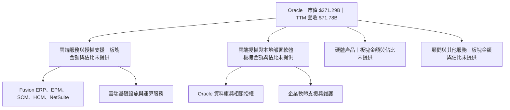
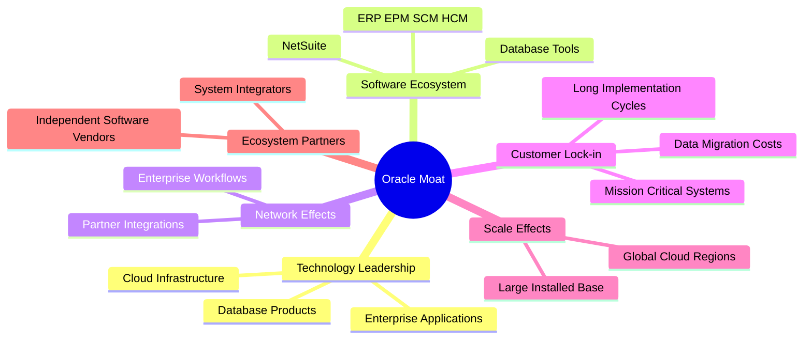
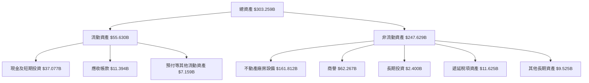
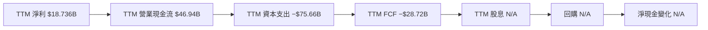
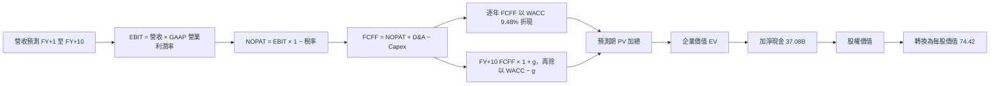
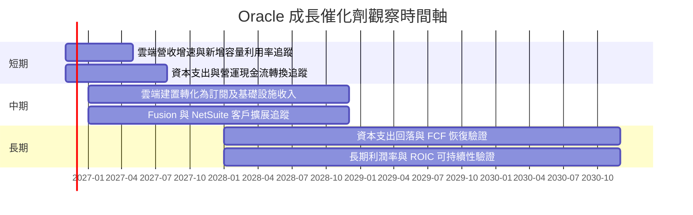
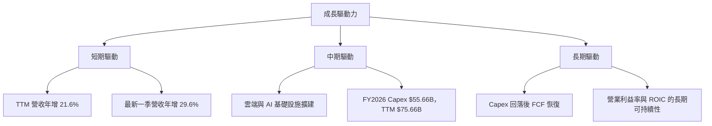
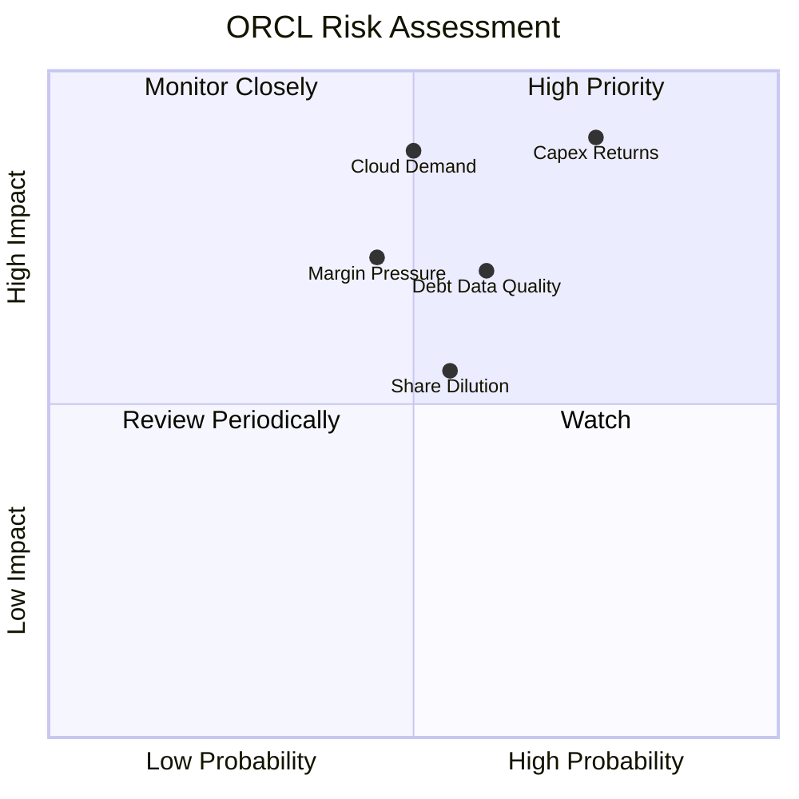
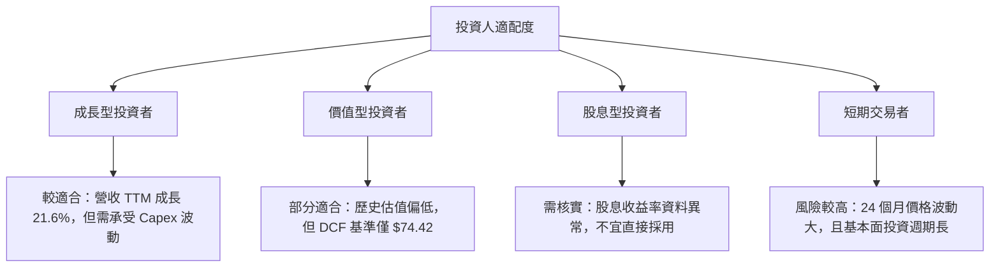

# ORCL 基本面深度分析報告
> **報告日期**：2026-11-17 ｜ **語言**：繁體中文 ｜ **數據來源**：SEC 申報資料 (XBRL)、Yahoo Finance、Finviz、StockAnalysis、Roic.ai ｜ **分析師**：CFA 級機構研究

## 目錄

| # | 章節 | 核心結論 |
|---|------|----------|
| 1 | 執行摘要 | 強烈買入；加權合理價值 $161.32，MOS +26.2% |
| 2 | 公司概覽與商業模式 | 企業軟體與雲端基礎設施具轉換成本；市場份額數據未提供 |
| 3 | 損益表深度分析 | TTM 營收 $71.78B、年增 21.6%；最新一季年增 29.6% |
| 4 | 資產負債表分析 | 現金及短期投資 $37.08B；負債口徑資料互有矛盾 |
| 5 | 現金流量深度分析 | TTM FCF −$28.72B，主要受資料中心投資拉低 |
| 6 | 獲利能力與資本效率 | ROIC 61.3% 高於 WACC 9.48%，帳面上創造價值 |
| 7 | 相對估值分析 | ORCL 估值低於所列同業與自身歷史中位數 |
| 8 | DCF 內在價值評估 | DCF 基準 $74.42；加權合理價值 $161.32，兩者差異大 |
| 9 | 成長催化劑 | 雲端與 AI 基礎設施需求是成長主軸，TAM 數據未提供 |
| 10 | 風險矩陣 | 資本支出、執行與融資風險為主要風險 |
| 11 | 投資建議 | 評級依 MOS 為強烈買入；須密切監控資本支出與 FCF |

---

## 1. 執行摘要

截至 **2026-11-16 收盤價 $119.09**，ORCL 的 TTM 營收為 $71.78B、年增 21.6%，最新一季營收年增 29.6%，TTM 營業利益率 32.1%，ROIC 61.3%。但 TTM 資本支出 $75.66B 高於營業現金流 $46.94B，形成 **−$28.72B TTM FCF**。按固定估值方法加權後合理價值為 $161.32，MOS 為 +26.2%；且 ROIC 高於 WACC 9.48%，依規則 20 評級為**強烈買入**。主要保留是 DCF 基準價值僅 $74.42，且終值現值佔 EV 189.4%，顯示估值高度依賴長期假設。

### 1.0 一頁式投資儀表板（Portfolio Manager 30 秒速讀）

| 項目 | 內容 |
|------|------|
| **投資論點（3 句）** | ① TTM 營收年增 21.6%，最新一季年增 29.6%，顯示成長速度仍高。② TTM 營業利益率 32.1%、ROIC 61.3%，顯示營運獲利及資本回報具吸引力。③ TTM FCF 為 −$28.72B、資本支出 $75.66B，雲端擴建若未轉化為現金流，估值可能受壓。 |
| **綜合評分** | **6.8/10**（引用 1.1 評分卡） |
| **財務健康** | 🟡 現金及短期投資 $37.08B，但總債務資料口徑不一致，且 FCF 為負 |
| **ROIC vs WACC** | 61.3% vs 9.48%（創造價值；詳見第 6 章） |
| **FCF 趨勢** | 大型投資期，TTM FCF Yield **−7.74%** |
| **估值** | Forward P/E 10.77x｜EV/EBITDA 14.45x｜FCF Yield −7.74% |
| **DCF 內在價值（基準）** | $74.42｜現價相對 DCF 溢價 **+60.0%**（8.5 基準） |
| **安全邊際（MOS）** | **+26.2%**＝($161.32 − $119.09) ÷ $161.32（基準為 8.8 加權合理價值）｜🟢 >25% 充足 |
| **預期報酬（基準情境 12M）** | +35.5%（加權合理價值相對現價；不是 DCF 基準情境報酬） |
| **關鍵風險（前二）** | 資本支出無法及時轉化為營收與現金流；高額投資提高融資與執行風險 |
| **評級 + 信心度** | 🟢 **強烈買入**｜信心：中（估值方法分歧與 FCF 為負降低信心） |

### 1.1 綜合評分卡（全報告唯一）

| 維度 | 評分（1–10） | 主要依據（引用數字與其來源章節） |
|------|--------------|----------------------------------|
| 成長性 | 8.5 | TTM 營收年增 21.6%、最新一季年增 29.6%（第 3 章） |
| 獲利能力 | 8.5 | TTM 營業利益率 32.1%、ROIC 61.3% 對 WACC 9.48%（第 6 章） |
| 財務健康 | 5.0 | 現金及短期投資 $37.08B，但 TTM FCF −$28.72B，債務數據不一致（第 4–5 章） |
| 估值 | 6.5 | MOS +26.2%；DCF $74.42 與加權價值 $161.32 落差顯著（第 8 章） |
| 護城河 | 7.5 | ERP、資料庫及雲端服務形成轉換成本；定量客戶留存與市場份額數據未提供（第 2 章） |
| 管理層與資本配置 | 5.0 | FY2026 SBC $4.81B、Capex $55.66B；投資規模大但回報兌現仍待驗證（第 3、5 章） |
| **綜合評分** | **6.8** | 六項算術平均：(8.5 + 8.5 + 5.0 + 6.5 + 7.5 + 5.0) ÷ 6 = 6.833，四捨五入至一位小數 |

### 1.2 五大投資論點 + 三大核心風險

| 類型 | 項目 | 具體依據 | 信心度 |
|------|------|----------|--------|
| 🟢 **投資論點①** | 雲端與企業軟體成長 | TTM 營收 $71.78B、年增 21.6%；最新一季年增 29.6% | 🟢 高 |
| 🟢 **投資論點②** | 高營業獲利能力 | TTM 營業利益率 32.1%，最新一季 34.8% | 🟢 高 |
| 🟢 **投資論點③** | 資本回報高於資金成本 | ROIC 61.3%，WACC 9.48%，差距 51.82 個百分點 | 🟢 中高 |
| 🟢 **投資論點④** | 相對估值低於歷史中位數 | P/E 18.7x，低於 5 年中位數 32.1x；EV/EBITDA 9.9x，低於中位數 17.9x | 🟢 中 |
| 🟢 **投資論點⑤** | 大規模投資可能擴大雲端供應能力 | TTM Capex $75.66B、PP&E 由 FY2025 $56.67B 升至 TTM $161.81B；投資回報需持續追蹤 | 🟡 中 |
| 🟡 **風險①** | 資本支出超過營運現金流 | TTM Capex $75.66B、OCF $46.94B，FCF −$28.72B | 🔴 高衝擊 |
| 🔴 **風險②** | 資料口徑與估值分歧 | DCF $74.42、加權合理價值 $161.32；淨現金與債務數字存在來源差異 | 🔴 高衝擊 |
| 🟡 **風險③** | 股權薪酬與股數稀釋 | FY2026 SBC $4.81B；Piotroski 股數未增加測試未通過 | 🟡 中 |

### 1.3 快速統計卡片

| 指標 | 公司實際值（期間） | 同業中位數 | 狀態 |
|------|--------------------|------------|------|
| 營收成長（TTM） | **21.6%** | — | 🟢 |
| 營收成長（最新一季年增） | **29.6%** | 13.2%（MSFT、SAP、CRM） | 🟢 |
| 毛利率（TTM） | **64.0%** | 73.6%（MSFT、SAP、CRM） | 🟡 |
| 營業利益率（TTM） | **32.1%** | — | 🟢 |
| ROIC（TTM） | **61.3%** | — | 🟢 |
| Forward P/E | **10.77x** | 21.4x（MSFT、SAP、CRM） | 🟢 |
| FCF Yield（TTM） | **−7.74%** | — | 🔴 |
| Piotroski F-Score | **4 / 7** | — | 🟡 |

> 同業營收成長中位數＝median(18.8%、13.2%、10.8%)＝13.2%；毛利率中位數＝median(67.7%、73.6%、77.3%)＝73.6%；Forward P/E 中位數＝21.4x。

### 1.4 投資結論

```text
╔══════════════════════════════════════════════════════════════════╗
║                    📊 投資結論摘要                               ║
╠══════════════════════════════════════════════════════════════════╣
║  評級：強烈買入（依 MOS +26.2%，且 ROIC 61.3% > WACC 9.48%）      ║
║  價格（2026-11-16 收盤）：$119.09                                ║
║  DCF 內在價值（基準）：$74.42（現價溢價 +60.0%）                  ║
║  安全邊際 MOS：+26.2%＝($161.32−$119.09)÷$161.32                 ║
║  加權合理價值（8.8）：$161.32                                    ║
║  DCF 情境價值：                                                   ║
║    悲觀情境：$5.98（−95.0%）                                     ║
║    基準情境：$74.42（−37.5%）                                    ║
║    樂觀情境：$224.87（+88.8%）                                   ║
║  綜合評分：6.8/10（引用 1.1）                                    ║
║  適合投資人：能承受雲端投資週期波動、持有期較長的成長型投資人    ║
╚══════════════════════════════════════════════════════════════════╝
```

---

## 2. 公司概覽與商業模式

### 2.1 業務結構與收入來源

Oracle 提供企業資料庫、企業應用軟體、雲端服務及相關支援。資料未列出各業務板塊營收，因此不拆分板塊佔比或推估金額。



### 2.2 市場份額

市場份額數據未提供，故不提供市占率或市占圖。ORCL TTM 營收 $71.78B、年增 21.6%，最新一季年增 29.6%；Peer 資料中 MSFT、SAP、CRM 最新一季營收成長分別為 18.8%、13.2%、10.8%。這些數字顯示 ORCL 近期成長快於所列同業，但不能直接等同市場份額增加。

### 2.3 競爭護城河分析



### 2.4 護城河強度

| 護城河項目 | 強度（強／中／弱） | 證據（引用數字或事實） | 會削弱它的情況 |
|------------|--------------------|------------------------|----------------|
| 技術與資料庫產品 | 強 | 資料庫及企業應用為長期核心產品；TTM 營業利益率 32.1% | 客戶轉向開源、雲原生或多雲替代方案 |
| 軟體生態系統 | 強 | Fusion ERP、EPM、SCM、HCM 及 NetSuite 形成跨部門產品組合 | 產品整合不佳、客戶導入成本高於替代效益 |
| 客戶鎖定 | 強 | 關鍵系統遷移涉及資料、流程與停機風險；量化留存率未提供 | SaaS 介面與資料可攜性改善，降低轉換成本 |
| 規模效應 | 中至強 | TTM 營收 $71.78B；TTM OCF $46.94B，可支持高資本投入 | Capex 持續高於 OCF、雲端利用率不足 |
| 網路效應 | 中 | 企業系統與合作夥伴整合具互補性；量化網路效應數據未提供 | 客戶採多供應商架構，平台整合價值降低 |
| 生態夥伴 | 中 | 企業軟體依賴顧問、整合商與 ISV；夥伴營收貢獻未提供 | 夥伴優先推廣競爭平台或建立替代工具 |

**1.1 護城河分數 7.5/10**，主要依據是企業關鍵系統的轉換成本及產品組合；因市場份額、客戶留存與雲端分部獲利資料未提供，未給更高分數。

---

## 3. 損益表深度分析

### 3.1 年度收入成長趨勢（近4年）

年度營收 YoY 由提供的年度數據計算；FY2023 至 FY2026 CAGR 約為 10.5%。

```text
╔══════════════════════════════════════════════════════════════════╗
║              Oracle 年度收入趨勢（FY2023-FY2026）               ║
╠══════════════════════════════════════════════════════════════════╣
║  FY2023  $49.95B  ███████████████░░░░░░░░░░░  基期             ║
║  FY2024  $52.96B  ████████████████░░░░░░░░░░  YoY +6.0%  🟡   ║
║  FY2025  $57.40B  █████████████████░░░░░░░░░  YoY +8.4%  🟡   ║
║  FY2026  $67.36B  ████████████████████░░░░░░  YoY +17.4% 🟢   ║
║                                                                  ║
║  FY2023-FY2026 CAGR：約 +10.5%                                  ║
╚══════════════════════════════════════════════════════════════════╝
```

計算例：FY2026 YoY＝($67.36B ÷ $57.40B) − 1 ≈ 17.4%。FY2026 成長加速，與雲端服務及基礎設施需求擴張相符；未提供各部門收入拆分，不能量化雲端對增量的貢獻。

### 3.2 季度收入趨勢分析

| 季度 | 營收（$B） | QoQ 成長 | YoY 成長 | 備註 |
|------|-----------:|---------:|---------:|------|
| FY2026 Q2（2025-11） | 16.06 | — | 14.2% | 作為最近四季表格基期；季度營收採 StockAnalysis |
| FY2026 Q3（2026-02） | 17.19 | 7.0% | 21.7% | 需求與營收增速高於前季 |
| FY2026 Q4（2026-05） | 19.18 | 11.6% | 20.6% | 季末營收再提高 |
| FY2027 Q1（2026-08） | 19.35 | 0.8% | 29.6% | 年增加速；QoQ 增幅較低，可能有季節性 |

QoQ 例：FY2027 Q1＝($19.345B ÷ $19.184B)−1 ≈ 0.8%。最新一季 YoY 29.6% 為單季數字，不能視為 TTM 成長率。

### 3.3 利潤率演變分析

年度比率依年度損益表的毛利、營業利益及營收計算；TTM 利潤率採核實指標。

| 利潤率指標 | FY2023 | FY2024 | FY2025 | FY2026 | 趨勢 | 評估 |
|------------|-------:|-------:|-------:|-------:|------|------|
| **毛利率** | 72.9% | 71.4% | 70.5% | 65.8% | 下行；FY2026 降幅較大 | 🟡 |
| **營業利益率** | 27.6% | 30.3% | 31.4% | 33.3% | 逐年改善 | 🟢 |
| **淨利率** | 17.0% | 19.8% | 21.7% | 25.4% | 逐年改善 | 🟢 |

年度毛利率下降與營業利益率上升同時出現，可能反映收入組合、分部成本與費用控制變化；現有資料未提供分部毛利與費用明細，不能將毛利下滑歸因於單一產品。FY2026 營業利益 $22.44B，高於 FY2025 的 $18.05B，增加約 24.3%，快於營收成長 17.4%，顯示期間內營業槓桿改善。TTM 營業利益率核實值為 32.1%，最新一季為 34.8%。

### 3.4 費用結構分析

未提供足以可靠拆分 TTM 營業費用類別的明細；因此不以推算數字繪製費用圓餅圖。FY2026 研發費用為 $10.27B，約佔營收 15.2%（$10.27B ÷ $67.36B）；其餘營業費用分類金額未提供。

### 3.5 季度 EPS 趨勢與盈餘品質（Quality of Earnings）

EPS 實際值採 StockAnalysis 季度資料；EPS 預估值缺失，故無法判定「超預期／不及預期」。

| 季度 | EPS 實際 | EPS 預估 | YoY EPS 成長 | 判讀 |
|------|---------:|---------:|-------------:|------|
| FY2026 Q2（2025-11） | $2.10 | N/A | 90.9% | 預估資料缺漏；高成長可能受比較基期影響 |
| FY2026 Q3（2026-02） | $1.29 | N/A | 24.5% | 無法判定 beat/miss |
| FY2026 Q4（2026-05） | $1.47 | N/A | 21.9% | 無法判定 beat/miss |
| FY2027 Q1（2026-08） | $1.58 | N/A | 54.5% | YoY 成長加速；預估值缺漏 |

EPS 趨勢表中 FY2026 Q2 的 EPS $2.10 與下一季明顯不同，且該季淨利 $6.13B 高於相鄰季度；因資料未附一次性項目明細，不將單季高值直接外推。四季 EPS Est 均為缺漏，因此「過去四季盈餘超預期／不及預期」無法核實。

| 盈餘品質項目 | 數值／佔比 | 評估 |
|--------------|------------|------|
| 股權薪酬 SBC / 營收 | FY2026 $4.81B ÷ $67.36B＝**7.1%** | 🟡 股份薪酬具實質稀釋成本；Piotroski 股數未增加測試未通過 |
| SBC / 營業現金流 | FY2026 $4.81B ÷ $31.98B＝**15.0%** | 🟡 比重不可忽略；現金流為非現金加回，但經濟成本仍由股東承擔 |
| FCF / 淨利（現金轉換率） | TTM −$28.72B ÷ TTM 淨利 $18.736B＝**−153.3%** | 🔴 資本支出遠高於現金創造能力；短期 FCF 不代表成熟期盈利能力 |
| 一次性／非經常性損益 | N/A（無完整明細） | 🟡 個別季度淨利有波動，需查閱 10-Q 附註 |
| 有效稅率異常 | **12.6%**（最新年度有效稅率） | 🟡 DCF 依此採用；未提供多年度稅務調節表，不能確認是否可持續 |
| 資本化支出 vs 費用化 | TTM Capex $75.66B；資本化資產增加明顯 | 🔴 Capex 本身不是費用化支出；須留意折舊年限、資產利用率及回報 |

**盈餘品質結論：**GAAP 營業獲利與 OCF 均為正，但資本支出使 TTM FCF 轉負；SBC 約佔 FY2026 營收 7.1%，亦削弱每股盈餘對股東的完整代表性。短期估值不宜只用淨利或 EPS，應以雲端投資回報及 FCF 恢復進度交叉驗證。

---

## 4. 資產負債表分析

### 4.1 資產結構分解

以下採 StockAnalysis 2026-08-31 TTM 資產負債表項目；單位為 $B。



### 4.2 流動性與營運資金分析

| 指標 | 最新 TTM | 一年前 TTM | 變化 | 解讀 |
|------|----------|------------|------|------|
| DSO 應收帳款天數 | 58 天 | 55 天 | +3 天 | 收款時間略延長，可能受客戶組合、計費或付款條件影響；應追蹤應收帳款增速 |
| DIO 存貨天數 | N/A | N/A | N/A | 財報未報列存貨餘額，不能推算 |
| DPO 應付帳款天數 | 156 天 | N/A | N/A | 一年前基準缺資料；可能反映供應商付款週期，不能單憑此判定議價力 |
| CCC 現金轉換週期 | N/A | N/A | N/A | DIO 不可計算；不得自行填補 CCC |

流動性補充：2026-08-31 流動資產 $55.63B、流動負債在另一來源列示 $47.51B；但財務數據的 Current Ratio 為 1.171，兩者口徑並非完全一致。依既定品質指標，流動比率同比改善；不以混合來源自行重算替代。

### 4.3 債務結構分析

核實財務指標把總債務列為 N/A、淨現金列為 $37.08B；其他財務資料列示總債務 $169.14B、現金 $37.08B、淨負債 $132.07B。兩者互相矛盾，故不將「淨現金 $37.08B」視為扣除債務後淨現金，也不以此推算債務倍數。

```text
╔══════════════════════════════════════════════════════════════════╗
║                   Oracle 債務健康診斷                            ║
╠══════════════════════════════════════════════════════════════════╣
║  總債務：        核實指標 N/A；其他來源列示 $169.14B             ║
║  現金+短期投資： $37.08B                                         ║
║  淨現金／負債：  核實指標列 $37.08B；其他來源列淨負債 $132.07B   ║
║  Debt/EBITDA：   N/A（負債口徑不一致，避免混算）                 ║
║  Interest Coverage：N/A（利息費用未提供）                        ║
║  判斷：🟡 現金規模可觀，但高額投資與債務資料差異需核對            ║
╚══════════════════════════════════════════════════════════════════╝
```

### 4.4 股東權益趨勢

| 財年結束日 | 股東權益（$B） | YoY 變化 |
|------------|----------------:|---------:|
| 2023-05-31 | 1.07 | — |
| 2024-05-31 | 8.70 | +713.1% |
| 2025-05-31 | 20.45 | +135.1% |
| 2026-05-31 | 42.51 | +107.9% |

股東權益由低基期大幅增長；FY2023 僅 $1.07B，因此初期百分比變動特別大。權益增加不能單獨視為去槓桿，FY2026 年末其他來源仍列總債務 $156.19B，應同步監控負債及利息成本。

---

## 5. 現金流量深度分析

### 5.1 現金流量瀑布圖

以下數字為 TTM：FCF = OCF − Capex，資本配置後的淨現金變化無法由現有資料完整推導。



### 5.2 FCF 轉換率趨勢

| 財年 | OCF（$B） | FCF（$B） | 淨利（$B） | FCF / 淨利 |
|------|----------:|----------:|-----------:|-----------:|
| FY2023 | 17.16 | 8.47 | 8.50 | 99.6% |
| FY2024 | 18.67 | 11.81 | 10.47 | 112.8% |
| FY2025 | 20.82 | −0.394 | 12.44 | −3.2% |
| FY2026 | 31.98 | −23.69 | 17.09 | −138.6% |
| 最新 TTM | 46.94 | −28.72 | 18.736 | −153.3% |

FCF 轉換率下滑主要對應資本支出快速增加，而非 OCF 同步惡化：FY2026 OCF $31.98B，高於 FY2025 $20.82B；但 FY2026 Capex $55.66B，使年度 FCF 轉負。

### 5.3 自由現金流趨勢

```text
╔══════════════════════════════════════════════════════════════════╗
║              自由現金流趨勢（年度／TTM）                         ║
╠══════════════════════════════════════════════════════════════════╣
║  FY2023   +$8.47B   ██████████████░░░░░░   FCF Yield N/A        ║
║  FY2024  +$11.81B   ████████████████████   FCF Yield N/A        ║
║  FY2025   −$0.394B  ██░░░░░░░░░░░░░░░░░░   FCF Yield N/A        ║
║  FY2026  −$23.69B   ░░░░░░░░░░░░░░░░░░░░   FCF Yield N/A        ║
║  TTM     −$28.72B   ░░░░░░░░░░░░░░░░░░░░   Yield −7.74%        ║
╚══════════════════════════════════════════════════════════════════╝
```

FCF Yield 的 TTM 核實值為 −7.74%；未提供歷年市值序列，因此不計算歷年 FCF Yield。

### 5.4 資本配置評估

回購金額及完整資本配置比例未提供，故不繪製比例圓餅圖。

| 項目 | 已知數據 | 評估 |
|------|----------|------|
| 資本支出 | FY2026 $55.66B；TTM $75.66B | 高額擴建有望支援雲端需求，但回報時間與利用率是關鍵 |
| 股息 | FY2026 支付 $5.79B | 現金分配持續增加；需與投資及負債管理平衡 |
| 股權薪酬 | FY2026 $4.81B | 占 FY2026 營收約 7.1%，需關注稀釋 |
| 股票回購 | N/A | 數據未提供 |
| 留存現金／淨現金變化 | N/A | 數據未提供 |

---

## 6. 獲利能力與資本效率

### 6.1 ROE / ROA / ROIC 趨勢

品質指標中可直接引用的 ROIC、ROE 僅有 TTM 指標；其他來源 ROE 與此處口徑不同，不混列成同一序列。

| 指標 | 最新值 | 其他可用歷史值 | 評估 |
|------|-------:|----------------|------|
| ROIC（TTM） | 61.3% | N/A（同口徑歷史序列未提供） | 🟢 高於 WACC 9.48% |
| ROE（TTM，品質指標） | 28.3% | N/A（同口徑歷史序列未提供） | 🟢 正向，但受權益乘數影響 |
| ROA（TTM） | N/A（品質指標未提供） | 其他來源列示 6.4%，口徑不同 | 不混用作趨勢 |
| 行業均值 | N/A | 數據未提供 | 不作同業平均推估 |

### 6.2 ROIC vs WACC 分析（核心價值創造判斷）

```text
╔══════════════════════════════════════════════════════════════════╗
║                ROIC vs WACC 深度分析                            ║
╠══════════════════════════════════════════════════════════════════╣
║  WACC 採用財務資料計算值：9.48%                                  ║
║  ├── 無風險利率（10Y 美債）：5.12%                               ║
║  ├── 股權風險溢酬 ERP：5.00%                                     ║
║  ├── 原始 Beta：1.78；採用調整 Beta：1.52                        ║
║  ├── 股權成本：12.71%（來源核實值）                              ║
║  ├── 稅前債務成本：2.72%；稅率：12.6%                            ║
║  ├── 股權／債務權重：68.7%／31.3%                                ║
║  └── ✅ WACC：9.48%（直接採用，詳細推導見 8.2）                   ║
║                                                                  ║
║  ROIC（TTM）：61.3%                                               ║
║  EVA spread = ROIC − WACC = 61.3% − 9.48% = +51.82 個百分點      ║
║                                                                  ║
║  ROIC 61.3%  ▓▓▓▓▓▓▓▓▓▓▓▓▓▓▓▓▓▓▓▓▓▓▓▓▓▓▓▓▓▓▓▓▓▓▓▓  🟢        ║
║  WACC  9.48% ▓▓▓▓▓░░░░░░░░░░░░░░░░░░░░░░░░░░░░░░░             ║
║  結論：依核實指標，ROIC 約為 WACC 的 6.47 倍                    ║
╚══════════════════════════════════════════════════════════════════╝
```

ROIC/WACC＝61.3% ÷ 9.48% ≈ 6.47 倍，顯示目前投入資本回報明顯超過資金成本。惟 ROIC 分母受現金、負債與權益口徑影響；負債數據存在來源差異，故對 61.3% 的可持續性應保持審慎，而不是將其直接外推。

### 6.3 杜邦三因素分解

| 因素 | 數值（TTM） | 解讀 |
|------|-------------|------|
| 淨利率 | 26.4% | 每一美元營收約產生 26.4 美分淨利 |
| 資產週轉率 | 0.24 | 資產基數相對營收大，反映資本密集度上升 |
| 權益乘數 | 4.54 | 槓桿對 ROE 有推升作用 |
| **ROE** | **28.3%** | 26.4% × 0.24 × 4.54 ≈ 28.3% |

杜邦結果依指定品質指標原值引用。ROE 不是只由淨利率帶動：權益乘數 4.54 倍及資產週轉率 0.24 倍共同影響；槓桿使得 ROE 不宜脫離資產負債表單獨解讀。

### 6.4 財務體質：Piotroski F-Score

Piotroski F-Score 為 **4 / 7**；測試分母低於 9，是因缺少部分輸入。

| 測試 | 結果 | 解讀 |
|------|------|------|
| ROA > 0 | ✅ 通過 | 獲利能力為正 |
| 營業現金流 > 0 | ✅ 通過 | TTM OCF 為正 |
| ROA 高於一年前 | ❌ 未通過 | 資產回報同比未改善 |
| 營業現金流 > 淨利（應計品質） | ✅ 通過 | OCF 高於淨利，應計品質測試通過 |
| 長期負債 ÷ 總資產低於一年前 | — 無法判定 | 缺資料 |
| 流動比率高於一年前 | ✅ 通過 | 流動性相對改善 |
| 稀釋股數未增加 | ❌ 未通過 | 股數稀釋可能削弱每股價值增長 |
| 毛利率高於一年前 | — 無法判定 | 缺資料 |
| 資產週轉率高於一年前 | ❌ 未通過 | 資產擴張尚未同步轉為更高週轉 |

---

## 7. 相對估值分析

### 7.1 同業估值比較表格

ORCL 的 P/E、P/S、EV/EBITDA 同業比較數據取核實估值資料；同業數值依指定 Peer multiples。公司 Forward P/E 採估值資料列示的 10.77x。

| 估值指標 | **ORCL** | **MSFT** | **SAP** | **CRM** | ORCL 評估 |
|----------|---------:|---------:|--------:|--------:|-----------|
| **Trailing P/E** | 18.7x | 27.0x | 29.1x | 19.7x | 🟢 低於三家同業 |
| **Forward P/E** | 10.77x | 21.4x | 24.5x | 13.4x | 🟢 低於同業 |
| **P/S Ratio** | 5.17x | 11.1x | N/A | 4.0x | 🟡 介於同業可比值之間 |
| **EV/EBITDA** | 14.45x | 19.0x | N/A | 16.1x | 🟢 低於可比同業 |
| **最新一季營收 YoY** | 29.6% | 18.8% | 13.2% | 10.8% | 🟢 ORCL 高於三家 |
| **毛利率（TTM）** | 64.0% | 67.7% | 73.6% | 77.3% | 🔴 低於三家 |

SAP 的 P/S 及 EV/EBITDA 因幣別混合不可比，故保留 N/A，不作替代估算。

### 7.2 歷史估值區間分析

```text
╔══════════════════════════════════════════════════════════════════╗
║          ORCL 五年歷史估值區間（TTM 倍數）                       ║
╠══════════════════════════════════════════════════════════════════╣
║  P/E         19.0x ├────────中位數 32.1x────────┤ 52.3x        ║
║  現值 18.7x  ↓（歷史百分位 0%）                                  ║
║                                                                  ║
║  P/S          4.6x ├────中位數 6.2x────┤ 11.1x                  ║
║  現值 5.0x（歷史百分位 14%）                                    ║
║                                                                  ║
║  EV/EBITDA   12.6x ├────────中位數 17.9x────────┤ 28.9x        ║
║  現值 9.9x  ↓（歷史百分位 0%）                                  ║
╚══════════════════════════════════════════════════════════════════╝
```

股價與財報計算的歷史估值顯示，P/E、P/S、EV/EBITDA 均在自身歷史區間偏低位置。但不同資料源的現值倍數不同，例如市場資料列示 EV/EBITDA 14.45x，歷史估值資料列示 9.9x；兩者口徑不一致，表中歷史位置依指定的歷史估值序列引用，跨表解讀應保留此差異。

### 7.3 情境價值（Bear / Base / Bull，照抄 DCF MODEL 的 Scenarios）

| 情境 | 第 1 年營收成長 | 期末營業利潤率 | WACC | 每股價值 | 相對現價 | 機率 | 會發生的條件 |
|------|----------------:|----------------:|-----:|---------:|---------:|-----:|--------------|
| 🔴 悲觀 | 10.8% | 26.0% | 10.48% | $5.98 | −95.0% | 25% | 雲端增長降速、資本支出仍高、利潤率受競爭或低利用率壓縮 |
| 🟡 基準 | 21.6% | 30.6% | 9.48% | $74.42 | −37.5% | 50% | TTM 成長延續後逐步降至成熟增速，利潤率略降 |
| 🟢 樂觀 | 32.4% | 33.6% | 8.48% | $224.87 | +88.8% | 25% | 新增雲端需求持續高於目前增速，利用率提升且利潤率擴張 |

### 7.4 相對估值隱含價格區間

```text
╔══════════════════════════════════════════════════════════════════╗
║                 相對估值隱含每股價值                             ║
╠══════════════════════════════════════════════════════════════════╣
║  $74.42      $119.09       $194.99       $236.18      $236.75    ║
║  基準 DCF     現價          EV/EBITDA     分析師共識   Forward P/E║
╚══════════════════════════════════════════════════════════════════╝
```

| 方法 | 每股價值 | 相對現價 | 依據 |
|------|---------:|---------:|------|
| 同業 Forward P/E | $236.75 | +98.8% | MSFT、SAP、CRM 同業中位數 21.4x × 公司 Forward EPS $11.06 |
| 同業 EV/EBITDA | $194.99 | +63.7% | MSFT、CRM 中位數 17.6x × TTM EBITDA，再加回淨現金 |
| 分析師共識目標價 | $236.18 | +98.3% | 40 位分析師平均目標價 |
| DCF 基準 | $74.42 | −37.5% | 10 年 FCFF、WACC 9.48%、永續成長率 3.0% |

---

## 8. DCF 內在價值評估（Discounted Cash Flow）

> 模型金額單位為美元十億（$B）。DCF 逐年預測、折現、終值、敏感性及情境數字均依程式計算結果引用；不另建替代模型。

### 8.0 估值推理鏈（Thinking Logic）

**Step 1 — 價值來源與主導變數**

ORCL 價值主要取決於既有企業軟體與資料庫現金流、雲端基礎設施增長，以及高額資料中心投資能否轉化為營收；各自營收佔比未提供，不能虛構分部比例。對此 DCF 而言，資本支出由 FY+1 Capex $92.02B 逐步降至 FY+10 $32.65B，是 FCFF 由負轉正的關鍵變數之一；終值現值佔 EV 189.4%，因此長期現金流與 WACC、永續成長率亦主導結果。

**Step 2 — 模型選擇**

| 決策點 | 本報告採用 | 理由（含數字） | 曾考慮但否決 | 否決理由 |
|--------|-----------|----------------|--------------|----------|
| 現金流定義 | FCFF | 以 WACC 折現，求 EV；模型定義 FCFF＝NOPAT + D&A − Capex | FCFE | 資本結構與負債口徑有差異，以企業現金流較合適 |
| 預測期 N | 10 年 | DCF MODEL 固定 10 年；成長假設由 21.6% 線性降至 3.0% | 5 年 | 高額雲端建置與 Capex 漸退不能僅用 5 年描述 |
| 終值方法 | Gordon Growth | WACC 9.48% 大於 g 3.0%，符合使用條件 | 只用退出倍數 | 未提供 DCF 模型退出倍數輸入，不能自建 |
| EBIT 基礎 | GAAP EBIT | 模型明確採 GAAP，FY+1 利潤率 32.1% | 非 GAAP EBIT | 會加回 SBC，與模型已選擇的 SBC 處理不一致 |

**Step 3 — 關鍵假設推導鏈**

- **預測期營收成長**：錨點＝TTM 營收成長 21.6%；最新一季單季 YoY 29.6% 高於 TTM，模型以 TTM 作 FY+1 起點，再線性降至 FY+10 3.0%；**採用 FY+1 21.6% 至 FY+10 3.0%**；曾可用最新一季 29.6% 作起點，但該數字是單季、存在季節性，故不直接外推。
- **期末營業利潤率**：錨點＝TTM GAAP 營業利益率 32.1%；模型降至 30.6%，代表成熟期利潤率小幅收斂；**採用 30.6%**；採用 33.6% 樂觀情境可推高估值，但非基準假設。
- **永續成長率 g**：錨點＝模型給定 3.0%，與長期成熟公司名目成長假設相符；WACC 為 9.48%，g 保持低於 WACC；**採用 3.0%**；不採用 4.0%，因為提高終值敏感度且更接近高成長長期假設。
- **預測期 N**：錨點＝模型固定 10 年；**採用 10 年**；不改成更短期間，因 Capex 從 FY+1 至 FY+10 才逐步回落，縮短期間會提前忽略投資週期。
- **Capex／營收**：錨點＝TTM Capex／營收＝$75.66B ÷ $71.78B＝105.4%；模型由 FY+1 的 105.4% 降至 FY+10 的 14.4%；**採用模型線性遞降路徑**；若永久維持 105.4%，FCF 可能持續為負，與模型所假設的投資週期性不符，但實際回落速度仍有重大不確定性。
- **EBIT 基礎與 SBC**：錨點＝TTM 營業利益率 32.1%，GAAP EBIT 已將 SBC 列為費用；**採用 GAAP EBIT**；不採非 GAAP EBIT，避免把 SBC 成本加回。
- **年稀釋率**：本模型組合 A 固定股數，年稀釋率為 0%；因 GAAP EBIT 已含 SBC 費用，不另以股份稀釋重複計成本。此為模型設定，不代表公司實際股數未稀釋；Piotroski 股數測試未通過。
- **終值方法**：錨點＝WACC 9.48%、g 3.0%；**採用 Gordon Growth**；退出倍數作交叉驗證所需倍數未由 DCF MODEL 提供，不另造數值。
- **WACC**：錨點＝財務資料所列 WACC 9.48%；**採用 9.48%**；不另行重估，因指定使用核實資本成本值。

**Step 4 — 最脆弱的一環**

最脆弱的假設是 Capex 由 TTM 營收的 105.4% 逐步回落至 14.4%；若基礎設施投資沒有及時帶動可計費營收，FCFF 將低於模型預測。終值佔 EV 189.4%，表示若現金流恢復延後，企業價值可能大幅低於基準。

**Step 5 — 計算路徑圖**



### 8.1 模型假設總表（Model Inputs）

| 假設項目 | 採用值 | 依據／來源 | 敏感度 |
|----------|--------|-------------|--------|
| 預測期長度 N | 10 年 | DCF MODEL 固定輸入 | 🟡 中 |
| 營收成長 | FY+1 21.6% → FY+10 3.0% | TTM 成長率 21.6%；模型線性衰減 | 🔴 高 |
| 營業利潤率 | FY+1 32.1% → FY+10 30.6% | TTM 32.1%；模型衰減至近 5 年中位水準 | 🔴 高 |
| 有效稅率 | 12.6% | 最新年度有效稅率 | 🟢 低 |
| Capex／營收 | FY+1 105.4% → FY+10 14.4% | TTM Capex／營收 105.4%；模型逐步降至 1.1×D&A 水準 | 🔴 高 |
| D&A／營收 | 13.1% | TTM 指標 | 🟢 低 |
| 營運資金變動／營收增額 | 未建模 | DCF MODEL 明示未建模；不可自行補值 | 🟡 中 |
| EBIT 基礎 | GAAP | 模型採 GAAP EBIT | 🟡 中 |
| SBC 處理 | 組合 A：GAAP EBIT、固定股數、不另扣 SBC | GAAP EBIT 已含 SBC 費用 | 🟡 中 |
| 年稀釋率（股數） | 0% | 模型組合 A；現實稀釋風險另列 | 🟡 中 |
| 永續成長率 g | 3.0% | DCF MODEL 固定輸入；低於 WACC 9.48% | 🔴 高 |
| 終值方法 | Gordon Growth | DCF MODEL 以 Gordon Growth 計終值 | 🔴 高 |
| WACC | 9.48% | Cost of capital 核實值 | 🔴 高 |

**SBC 組合聲明：**本模型採用 **(A) GAAP EBIT + 固定股數**，故 SBC 影響已計入一次；FCFF 不再減 SBC，股數不逐年稀釋。

FCFF 定義依模型為 `NOPAT + D&A − Capex`；模型明確不納入營運資金變化。

### 8.2 折現率推導（WACC）

```text
╔══════════════════════════════════════════════════════════════════╗
║                    WACC 推導（折現率）                           ║
╠══════════════════════════════════════════════════════════════════╣
║  股權成本 Ke（CAPM）：                                           ║
║  ├── 無風險利率 Rf：5.12%                                       ║
║  ├── ERP：5.00%（資料列示假設值）                               ║
║  ├── 原始 Beta：1.78；調整 Beta：1.52                           ║
║  ├── 調整方式：⅔ × 1.78 + ⅓ × 1 = 1.52                         ║
║  ├── 規模／國別溢酬：0.00%（未另加）                            ║
║  └── Ke 核實值：12.71%                                          ║
║                                                                  ║
║  債務成本：                                                      ║
║  ├── 稅前 Kd：2.72%                                              ║
║  ├── 有效稅率：12.6%                                            ║
║  └── 稅後 Kd = 2.72% × (1 − 12.6%) = 2.37728% ≈ 2.38%          ║
║                                                                  ║
║  資本結構（核實權重）：股權 68.7%／債務 31.3%                   ║
║  └── WACC 核實值：9.48%                                         ║
╚══════════════════════════════════════════════════════════════════╝
```

**逐步演算與輸入來歷**

1. **Ke（CAPM）**＝Rf + β × ERP。代入已列數字：5.12% + 1.52 × 5.00%＝12.72%；資料計算欄列示 **12.71%**，差異來自未顯示的底層精度，因此後續採用來源指定的 12.71%。
2. **稅前 Kd**＝2.72%（核實輸入）。利息費用與平均計息負債明細未提供，不能自行回推或宣稱重新驗算。
3. **稅後 Kd**＝2.72% × (1 − 12.6%)＝2.72% × 0.874＝2.37728% ≈ **2.38%**。
4. **權重**＝股權 68.7%、債務 31.3%；68.7% + 31.3%＝100%。市值與計息負債的底層權重輸入採核實資本成本資料；因債務分項與權重所用底層市值不可完全核對，這裡不另行重建 E／D。
5. **WACC**＝68.7% × 12.71% + 31.3% × 2.37728%＝8.73077% + 0.74410%＝9.47487% ≈ **9.48%**。

Rf 日期未在資本成本欄位明示，故只引用 10 年期美債利率 5.12%，不另指定日期。ERP 5.00% 為假設輸入；未另加規模或國別溢酬。債務明細口徑與市場資料存在差異，故按要求直接使用 9.48%，不以替代債務數字重估 WACC。第 6.2 與本節均使用 9.48%。

### 8.3 逐年自由現金流預測（基準情境）

| 年度 | FY+1 | FY+2 | FY+3 | FY+4 | FY+5 | FY+6 | FY+7 | FY+8 | FY+9 | FY+10 |
|------|------:|------:|------:|------:|------:|------:|------:|------:|------:|-------:|
| 營收 | 87.29 | 104.36 | 122.60 | 141.50 | 160.38 | 178.47 | 194.90 | 208.81 | 219.39 | 225.97 |
| 營收 YoY | 21.6% | 19.6% | 17.5% | 15.4% | 13.3% | 11.3% | 9.2% | 7.1% | 5.1% | 3.0% |
| 營業利潤率 | 32.1% | 32.0% | 31.8% | 31.6% | 31.4% | 31.3% | 31.1% | 30.9% | 30.8% | 30.6% |
| EBIT（GAAP） | 28.04 | 33.34 | 38.97 | 44.73 | 50.43 | 55.81 | 60.61 | 64.58 | 67.49 | 69.13 |
| − 稅 | (3.54) | (4.21) | (4.92) | (5.64) | (6.36) | (7.04) | (7.65) | (8.15) | (8.51) | (8.72) |
| = NOPAT | 24.50 | 29.14 | 34.05 | 39.09 | 44.06 | 48.77 | 52.97 | 56.44 | 58.97 | 60.40 |
| + D&A | 11.47 | 13.71 | 16.10 | 18.59 | 21.07 | 23.44 | 25.60 | 27.43 | 28.82 | 29.68 |
| − Capex | (92.02) | (99.46) | (104.45) | (106.25) | (104.22) | (97.93) | (87.25) | (72.38) | (53.87) | (32.65) |
| **= FCFF** | **−56.05** | **−56.61** | **−54.30** | **−48.58** | **−39.09** | **−25.73** | **−8.69** | **11.49** | **33.92** | **57.44** |
| 折現因子 @9.48% | 0.913 | 0.834 | 0.762 | 0.696 | 0.636 | 0.581 | 0.531 | 0.485 | 0.443 | 0.404 |
| **FCFF 現值 PV** | **−51.20** | **−47.23** | **−41.38** | **−33.82** | **−24.86** | **−14.94** | **−4.61** | **5.57** | **15.01** | **23.22** |

**預測期 FCF 現值合計：**  
−$51.20 − $47.23 − $41.38 − $33.82 − $24.86 − $14.94 − $4.61 + $5.57 + $15.01 + $23.22 ＝ **−$174.24B**。  
模型列示合計為 **−$174.23B**；差額 $0.01B 來自逐年表格四捨五入。後續企業價值橋接沿用模型原值 −$174.23B。

**FY+1 逐步演算**

1. **營收**＝TTM 營收 $71.78B × (1 + 21.6%)＝**$87.29B**。
2. **EBIT**＝$87.29B × 32.1%＝**$28.04B**。
3. **稅**＝$28.04B × 12.6%＝**$3.54B**。
4. **NOPAT**＝$28.04B − $3.54B＝**$24.50B**。
5. **D&A**＝$87.29B × 13.1%＝**$11.47B**。
6. **Capex**＝$87.29B × 105.4%＝**$92.02B**。
7. **ΔWC**＝模型不建模，故不列數值或扣除。
8. **FCFF**＝$24.50B + $11.47B − $92.02B＝**−$56.05B**。
9. **折現因子**＝1 ÷ (1 + 9.48%)¹＝0.913；**PV**＝−$56.05B × 0.913＝**−$51.20B**。

**合理性自檢**

- 預測期 FCF CAGR：因 FY+1 至 FY+7 FCFF 為負，標準 CAGR 無定義；由 FY+1 −$56.05B 到 FY+10 $57.44B 為負轉正，不與歷史 FCF CAGR 作百分比比較。
- FY+10 FCFF 利潤率＝$57.44B ÷ $225.97B＝**25.4%**；目前 TTM FCF 利潤率＝−$28.72B ÷ $71.78B＝**−40.0%**；同業最佳 FCF 利潤率未提供。
- FY+1 至 FY+7 FCFF 為負；這會降低預測期現值，且由 FY+8 才轉正。終值假設因此承擔很大一部分估值。

```text
╔══════════════════════════════════════════════════════════════════╗
║            自由現金流：歷史實際 vs 模型預測                      ║
╠══════════════════════════════════════════════════════════════════╣
║  FY2024(實)  +$11.81B  ████████████████████                     ║
║  FY2025(實)   −$0.394B █                                        ║
║  FY2026(實)  −$23.69B  ░                                        ║
║  FY+1 (預)   −$56.05B  ░                                        ║
║  FY+10(預)   +$57.44B  ████████████████████                     ║
╠══════════════════════════════════════════════════════════════════╣
║  模型轉折依賴 Capex／營收由 105.4% 降至 14.4%；此為核心風險。    ║
╚══════════════════════════════════════════════════════════════════╝
```

### 8.4 終值計算（Terminal Value）

**適用性檢查：**WACC 9.48% vs g 3.0% → WACC > g？✅

| 方法 | 計算式 | 終值 TV | TV 現值 | 佔總 EV 比重 |
|------|--------|---------|---------|--------------|
| Gordon Growth | 57.44 × (1 + 3.0%) ÷ (9.48% − 3.0%) | $913.14B | $369.18B | 189.4% |
| 退出倍數法 | N/A（DCF MODEL 未提供終值退出倍數輸入） | N/A | N/A | N/A |

**逐步演算**

1. **FY+N FCFF**＝FY+10 FCFF **$57.44B**。
2. **分子**＝$57.44B × (1 + 3.0%)＝模型列示終值分子所對應結果。
3. **分母**＝9.48% − 3.0%＝6.48%；模型列示 **TV $913.14B**。
4. **PV(TV)**＝模型列示 **$369.18B**。
5. **終值佔比**＝$369.18B ÷ $194.95B＝**189.4%**。

按顯示到兩位小數的輸入直接重算，終值與折現值會受未顯示的底層精度影響；以上估值表格均照錄模型輸出，不以重算結果覆寫。終值現值大於 EV，是因為預測期 FCF 現值合計為負數。**本估值高度依賴終值假設，短期現金流貢獻有限。**

### 8.5 企業價值 → 每股內在價值（Bridge）

```text
╔══════════════════════════════════════════════════════════════════╗
║              企業價值 → 每股內在價值 橋接表                      ║
╠══════════════════════════════════════════════════════════════════╣
║  預測期 FCF 現值合計            −$174.23B                        ║
║  終值現值 PV(TV)                +$369.18B                        ║
║  ─────────────────────────────────────────────                  ║
║  = 企業價值 EV                   $194.95B                        ║
║  + 淨現金（模型核實值）          +$37.08B                         ║
║  = 股權價值                      $232.03B                        ║
║  每股價值轉換                    $232.03B × $119.09 ÷ $371.29B  ║
║  ★ 每股內在價值                  $74.42                           ║
║    當前股價                      $119.09                          ║
║    現價相對 DCF 折溢價           +60.0%（溢價）                   ║
╚══════════════════════════════════════════════════════════════════╝
```

**逐步演算（依模型橋接值）**

1. **EV**＝−$174.23B + $369.18B＝**$194.95B**。
2. **股權價值**＝$194.95B + $37.08B＝**$232.03B**。
3. **每股內在價值**＝依模型提供的市值／價格轉換：$232.03B × $119.09 ÷ $371.29B＝**$74.42**。
4. **折溢價**＝$119.09 ÷ $74.42 − 1＝**+60.0%**。模型另列每股價值相對現價 −37.5%，其分母為現價，表示每股價值低於現價 37.5%；這與折溢價的分母定義不同。
5. **本節不計算 MOS**：MOS 只在 8.8 以加權合理價值作分母計算。

股數／轉換：DCF 模型未提供稀釋股數除法，而明列每股價值計算式為「股權價值 × 價格 ÷ 市值」，故照錄 $74.42。模型淨現金採 $37.08B；其他來源列示總債務 $169.14B、淨負債 $132.07B，與此橋接輸入不一致，是估值的重要限制。

### 8.6 敏感性分析（WACC × 永續成長率）

| g（列）／WACC（欄） | 7.48% | 8.48% | **9.48%（基準）** | 10.48% | 11.48% |
|-----------|------:|------:|------------------:|-------:|-------:|
| 2.0% | $121.42（+2.0%） | $83.86（−29.6%） | $57.59（−51.6%） | $38.54（−67.6%） | $24.34（−79.6%） |
| 2.5% | $139.07（+16.8%） | $95.29（−20.0%） | $65.40（−45.1%） | $44.09（−63.0%） | $28.41（−76.1%） |
| 3.0% | $160.65（+34.9%） | $108.81（−8.6%） | **$74.42（−37.5%）** | $50.39（−57.7%） | $32.96（−72.3%） |
| 3.5% | $187.66（+57.6%） | $125.04（+5.0%） | $84.95（−28.7%） | $57.59（−51.6%） | $38.08（−68.0%） |
| 4.0% | $222.44（+86.8%） | $144.90（+21.7%） | $97.40（−18.2%） | $65.90（−44.7%） | $43.89（−63.1%） |

上行／下行欄以現價 $119.09 為分母；每股價值照錄敏感度矩陣。

**逐步演算限制：**敏感度矩陣除結果外，沒有提供每一格的預測期 PV、TV 中間值與未四捨五入折現因子。依規則不得自行重建替代 DCF，因此無法對非基準格完整重算 EV／每股價值；矩陣數值逐格照錄模型輸出，視為模型可稽核資料不足。

**三情境 DCF**

| 情境 | 營收假設 | 期末營業利潤率 | g | WACC | 每股價值 | 相對現價 | 主觀機率 |
|------|----------|----------------|---:|-----:|---------:|---------:|----------:|
| 🔴 悲觀 | Year-1 growth 10.8% | 26.0% | N/A（情境輸入未列示） | 10.48% | $5.98 | −95.0% | 25% |
| 🟡 基準 | Year-1 growth 21.6% | 30.6% | 3.0% | 9.48% | $74.42 | −37.5% | 50% |
| 🟢 樂觀 | Year-1 growth 32.4% | 33.6% | N/A（情境輸入未列示） | 8.48% | $224.87 | +88.8% | 25% |
| **機率加權** | — | — | — | — | **$94.93** | **−20.3%** | 100% |

情境模型未提供悲觀與樂觀情境的逐年營收、FY+10 FCFF、TV 中間值及各情境 g，無法據此補造完整推導鏈。可核對的機率加權式為：$5.98 × 25% + $74.42 × 50% + $224.87 × 25%＝$94.9225，四捨五入至兩位小數為 $94.92；模型列示 $94.93，差異約 $0.01，屬顯示精度／底層精度差異。8.8 固定採基準 DCF $74.42，不採機率加權值。

**敏感度結論（依矩陣）**

- g 從 2.5% 升至 3.5%，WACC 維持 9.48%：$65.40 → $84.95，增加 $19.55，約 +29.9%。
- WACC 從 8.48% 升至 10.48%，g 維持 3.0%：$108.81 → $50.39，下降 $58.42，約 −53.7%。
- 期末營業利潤率每 +1pp 的單獨估值影響未提供；不能以其他情境的混合變化反推出此數字。
- 依已提供敏感度矩陣，WACC 變動對估值影響更大；這與 8.0 所述 WACC、長期現金流及終值共同主導價值一致。

### 8.7 反推 DCF（Reverse DCF：市場在預期什麼）

現價 $119.09 下，模型提供兩項單變數反推結果；其餘輸入保持基準值。未提供反推過程的逐次迭代表格，因此不能捏造試算軌跡。

| 求解的變數（一次一個） | 其餘變數設定 | 市場隱含值 | 公司歷史實際 | 判斷 |
|------------------------|--------------|--------------|--------------|------|
| Year-1 營收成長率 | 利潤率、g 等其餘輸入固定基準 | 30.3%（基準 21.6%） | TTM 21.6%；最新單季 YoY 29.6% | 🔴 相對基準偏高，接近最新單季增長但需持續 |
| 固定營業利潤率 | 營收成長等其餘輸入固定基準 | 37.5% | TTM 32.1% | 🔴 高於目前約 5.4 個百分點 |
| 永續成長率 g | 未提供反推解 | 未計算 | — | N/A |
| 預測期長度 N | 未提供反推解 | 未計算 | — | N/A |

**反推結論：**依反推模型，要讓 DCF 價值等於現價，Year-1 營收成長需 30.3%，或固定營業利潤率需達 37.5%；前者略高於 TTM 21.6%，後者高於 TTM 32.1%。由於反推結果缺少疊代軌跡及可核對的逐年路徑，應視為模型指示而非精確預測。

### 8.8 估值三角驗證與安全邊際

| 估值方法 | 隱含每股價值 | 上行空間（÷現價） | 權重 | 說明 |
|----------|--------------:|-------------------:|------:|------|
| DCF（基準） | $74.42 | −37.5% | 40% | 10 年 FCFF、WACC 9.48%、g 3.0% |
| 同業 Forward P/E | $236.75 | +98.8% | 25% | 同業中位數 21.4x × Forward EPS $11.06 |
| 同業 EV/EBITDA | $194.99 | +63.7% | 25% | 同業中位數 17.6x × TTM EBITDA，加回淨現金 |
| 分析師共識目標價 | $236.18 | +98.3% | 10% | 40 位分析師平均目標價 |
| **加權合理價值** | **$161.32** | **+35.5%** | **100%** | 盈利公司估值權重；無其他方法列入 |

**加權計算：**  
$74.42 × 40% + $236.75 × 25% + $194.99 × 25% + $236.18 × 10%  
＝$29.768 + $59.1875 + $48.7475 + $23.618  
＝$161.321 ≈ **$161.32**。權重合計 40% + 25% + 25% + 10%＝100%。

**MOS＝($161.32 − $119.09) ÷ $161.32＝26.2%。**  
**上行空間＝($161.32 − $119.09) ÷ $119.09＝35.5%。**

```text
╔══════════════════════════════════════════════════════════════════╗
║                  估值區間與安全邊際                              ║
╠══════════════════════════════════════════════════════════════════╣
║  $5.98 ───── $74.42 ───── $119.09 ───── [$161.32] ───── $224.87║
║ 悲觀 DCF      基準 DCF       現價          加權合理值   樂觀 DCF  ║
║                                                                  ║
║  MOS = ($161.32 − $119.09) ÷ $161.32 = +26.2%                  ║
║  MOS 評估：🟢 >25% 充足                                        ║
║  上行空間 = ($161.32 − $119.09) ÷ $119.09 = +35.5%             ║
║  建議買入區間：$109.21 – $145.19                               ║
║  合理持有區間：$145.19 – $161.32                                ║
║  減碼考慮：高於 $224.87，或基本面未達預期時提前檢視             ║
╚══════════════════════════════════════════════════════════════════╝
```

買入區間下緣採 52 週低點 $109.21 作技術參考，上緣為加權合理價值的 90%：$161.32 × 90%＝$145.19。此區間是操作參考，不是另外一套估值模型。

> 🔎 **程式複算（Python，依本節各項自動重算）**
>
> 加權合理價值 = $74.42 × 40% + $236.75 × 25% + $194.99 × 25% + $236.18 × 10% = **$161.32**（權重合計 100%）
>
> 以價格 $119.09 計：MOS = **+26.2%**，上行空間 = **+35.5%**
>
> ✅ 與本節所寫數值一致。

### 8.9 DCF 模型的局限與失效條件

- **終值依賴度：**終值 PV 為 $369.18B、EV 為 $194.95B，終值佔 EV 189.4%；預測期 FCFF PV 為負，終值假設超過企業價值本身。
- **最脆弱假設：**Capex／營收須從 105.4% 逐步降至 14.4%；若回落延後，FCFF 恢復推遲。其次是永續成長率及 WACC，矩陣顯示 g 及折現率變化會大幅改變價值。
- **適用性：**公司 TTM FCF −$28.72B，正處高再投資期；DCF 可靠度低於現金流穩定企業。應同步參考 EV/Sales、同業倍數及投資回報／雲端利用率指標，但不能以未提供數字重做估值。
- **風險連結：**建置延誤與需求不及預期會提高 Capex／營收、降低收入成長與終值；利率上升會提高 WACC；競爭壓力會壓縮營業利潤率。

### 8.10 複算檢核表（Audit Trail）

| # | 檢核項目 | 檢查方式 | 結果 |
|---|----------|----------|------|
| 1 | 高／中敏感度輸入有推導 | 對照 8.0、8.1；模型未給細節處已明示資料限制 | ✅ |
| 2 | 假設均有來源或標示 | 依據欄列示 TTM、模型固定值或資料缺漏 | ✅ |
| 3 | WACC 五步算式與權重 | 權重 68.7% + 31.3%＝100%；由顯示值算得 9.47487% ≈ 9.48% | ✅ |
| 4 | Kd 分母與債務權重口徑一致 | 利息費用、平均計息負債與期末計息負債明細未提供；採用已核實 WACC，不能獨立稽核口徑 | ⚠️ |
| 5 | WACC 與第 6.2 節一致 | 兩處均為 9.48% | ✅ |
| 6 | 預測年度數量與 N | FY+1 至 FY+10 共 10 年，無省略 | ✅ |
| 7 | FY+1 FCFF 與 PV | NOPAT + D&A − Capex＝−$56.05B；折現後 −$51.20B | ✅ |
| 8 | 預測期 PV 加總 | 顯示值相加 −$174.24B，模型合計 −$174.23B；差 $0.01B 來自四捨五入 | ✅ |
| 9 | WACC > g | 9.48% > 3.0% | ✅ |
| 10 | 終值基期與折現期 | 以 FY+10 FCFF，折現 10 期；表列結果照錄模型 | ✅ |
| 11 | 橋接算式 | −$174.23B + $369.18B＝$194.95B；加 $37.08B＝$232.03B | ✅ |
| 12 | SBC 三要素相容 | GAAP EBIT、無 SBC 扣除列、固定股數（年稀釋率 0%） | ✅ |
| 13 | 敏感度基準格 | g 3.0%、WACC 9.48%＝$74.42，等於 DCF 基準 | ✅ |
| 14 | 敏感度有效性 | 所有矩陣中 WACC 均大於 g | ✅ |
| 15 | 三情境機率與加權 | 25% + 50% + 25%＝100%；可見值算得 $94.9225，模型列 $94.93 | ⚠️ |
| 16 | Reverse DCF 單變數 | 提供兩項單變數解；未附逐次迭代軌跡 | ⚠️ |
| 17 | MOS／折溢價基準 | MOS 以 $161.32 計；DCF 折溢價以 $74.42 計 | ✅ |
| 18 | 報告完整至第 11 章 | 章節完整 | ✅ |
| 19 | 加權合理價值 | 各項權重乘積加總 $161.321，四捨五入 $161.32 | ✅ |
| 20 | 評級門檻 | MOS +26.2% 且 ROIC 61.3% > WACC 9.48%，符合強烈買入 | ✅ |

未能完全稽核的項目為模型底層精度、債務口徑、情境加權尾差及反推迭代路徑；以上均已標註，未以自建數字填補。

---

## 9. 成長催化劑

### 9.1 催化劑時間軸



時間軸為分析追蹤期，不表示公司已公告具體業績指引。

### 9.2 TAM 市場規模分析

**N/A（TAM 數據未提供）。**ORCL TTM 營收 $71.78B、年增 21.6%，最新一季年增 29.6%，營收規模及增速顯示雲端與企業軟體仍有成長動能。因缺少市場規模、年份及來源，不能計算 TAM 滲透率。

### 9.3 成長驅動力結構圖



---

## 10. 風險矩陣

### 10.1 風險評分矩陣

機率與衝擊座標為研究判斷，不是公司指引或歷史損失機率。



### 10.2 風險清單詳細分析

| # | 風險項目 | 發生機率 | 財務衝擊 | 風險評分 | 緩解措施 |
|---|----------|----------|----------|----------|----------|
| 1 | 🔴 **Capex 回報低於預期** | 高（約 60%，研究估計） | 高；TTM Capex $75.66B、FCF −$28.72B | 🔴 9/10 | 逐季追蹤 Capex／營收、雲端成長、OCF 與 FCF；投資成長但現金流未改善時下調估值假設 |
| 2 | 🔴 **雲端需求或交付未達模型路徑** | 中高（約 45%，研究估計） | 高；最新一季營收年增 29.6%，若放緩將壓低成長假設 | 🔴 8/10 | 追蹤雲端相關營收增速、已承諾需求及容量利用率；相關分部數據需依財報更新 |
| 3 | 🟠 **債務與現金口徑差異、融資風險** | 中（約 40%，研究估計） | 高；另一來源列總債務 $169.14B，與核實資料的淨現金欄不一致 | 🟠 7/10 | 核對 SEC 資產負債表及債務到期表；關注利息費用、到期集中度和融資成本 |
| 4 | 🟡 **毛利率或營業利潤率收縮** | 中（約 40%，研究估計） | 中高；TTM 營業利益率 32.1%，模型期末假設 30.6% | 🟡 6/10 | 追蹤雲端成本、產品組合與營業費用；若營業利益率同比下滑超過 2pp，重新檢視估值 |
| 5 | 🟡 **股權薪酬與股份稀釋** | 中（約 45%，研究估計） | 中；FY2026 SBC $4.81B，Piotroski 股數測試未通過 | 🟡 5/10 | 追蹤 SBC／營收、稀釋股數增長及回購抵銷效果 |

---

## 11. 投資建議

### 11.1 最終評級與評分

MOS +26.2% 且 ROIC 61.3% 高於 WACC 9.48%，規則 20 對應 **強烈買入**；未因質化因素調整評級。1.1 評分卡的綜合評分為 **6.8/10**，六項分數依序為成長性 8.5、獲利能力 8.5、財務健康 5.0、估值 6.5、護城河 7.5、管理層與資本配置 5.0。

### 11.2 合理價值與隱含報酬率

| 估值項目 | 每股價值 | 相對 2026-11-16 收盤 $119.09 | 機率／權重 |
|----------|---------:|---------------------------:|-----------:|
| 加權合理價值（8.8） | **$161.32** | **+35.5%** | 估值方法加權 100% |
| 悲觀 DCF 情境 | $5.98 | −95.0% | 25% |
| 基準 DCF 情境 | $74.42 | −37.5% | 50% |
| 樂觀 DCF 情境 | $224.87 | +88.8% | 25% |
| DCF 情境機率加權 | $94.93（模型列示） | −20.3% | 100% |

加權合理價值與 DCF 情境機率加權值採用不同方法，不可混為同一目標價；8.8 評級及 MOS 依規則使用 $161.32。

### 11.3 買入時機與觸發因素

```text
╔══════════════════════════════════════════════════════════════════╗
║                  ✅ 買入觸發因素 Checklist                      ║
╠══════════════════════════════════════════════════════════════════╣
║  立即分批買入條件（多數符合）：                                  ║
║  ✅ 股價低於 8.8 加權合理價值 90%：$145.19                       ║
║  ✅ 最新一季營收年增維持在 20% 以上                              ║
║  ✅ 營業利益率維持在 32.1% 左右或更高                            ║
║  ✅ Capex 增速放緩，且 OCF 仍保持正值                            ║
║                                                                  ║
║  加碼觸發條件（出現以下任一）：                                  ║
║  ☐ TTM FCF 由負轉正，或連續兩季呈改善                            ║
║  ☐ 雲端收入增長維持高於公司 TTM 21.6% 的增長基準                 ║
║  ☐ 資本支出回落且雲端營收、利用率同步上升                        ║
║                                                                  ║
║  減碼／重新評估條件（出現以下任一）：                            ║
║  ☐ 最新一季營收年增低於 15% 且連續兩季未恢復                    ║
║  ☐ 營業利益率低於 30.6% 並持續收縮                              ║
║  ☐ TTM FCF 進一步惡化，且 Capex／營收沒有下降                    ║
║  ☐ 債務增加但雲端成長及現金流轉換無相應改善                      ║
╚══════════════════════════════════════════════════════════════════╝
```

### 11.4 投資人適配度分析



### 11.5 每季財報監控清單（Quarterly Watch List）

| 指標 | 目前基準 | 觸發加碼 | 觸發減碼／重新檢視 |
|------|----------|----------|-------------------|
| 營收年增 | 最新一季 29.6%；TTM 21.6% | 單季 YoY ≥ 20% 且持續 | 連續兩季 <15% |
| 營業利益率 | TTM 32.1%；最新一季 34.8% | ≥32.1% | 低於 30.6% 且未回升 |
| OCF | TTM $46.94B | 持續增長且同步提高 FCF | OCF 轉負或顯著下滑 |
| Capex | TTM $75.66B | Capex／營收下降、營收保持增長 | Capex 維持高位但營收增速放緩 |
| FCF | TTM −$28.72B | 連續改善並接近／轉正 | FCF 進一步惡化且未見投資回報 |
| SBC | FY2026 $4.81B，約佔營收 7.1% | SBC／營收下降、稀釋減緩 | SBC／營收上升且股數持續增加 |
| 應收帳款天數 DSO | 58 天；一年前 55 天 | 回落至接近或低於 58 天 | 持續增加並快於營收增長 |
| 雲端／AI 資本效率 | 分部數據未提供 | 公司披露的雲端成長、容量利用與投資回報同步改善 | 投資擴大但收入或現金流未跟上 |
| 管理層財測 | 本資料未提供 | 後續指引維持或上修 | 下修收入、利潤率或現金流指引 |

### 11.6 反面論證：什麼會證明論點錯誤（What Would Change My Mind）

```text
╔══════════════════════════════════════════════════════════════════╗
║              ⚠️ 論點失效條件（Disconfirming Evidence）           ║
╠══════════════════════════════════════════════════════════════════╣
║  本投資論點在下列情況成立時應重新檢視或退出：                    ║
║  ☐ 最新一季營收 YoY 連續兩季低於 15%                             ║
║  ☐ TTM 營業利益率跌破 30.6%，且連續兩季未回升                   ║
║  ☐ TTM FCF 持續低於 −$28.72B，且 Capex／營收未下降               ║
║  ☐ ROIC 跌破 WACC 9.48%                                         ║
║  ☐ SBC／營收持續高於 FY2026 約 7.1%，稀釋股數仍加速增加          ║
║  ☐ 資料中心投資未帶動雲端收入，導致模型 Capex 回落假設失效       ║
║  ☐ 核對 SEC 後確認淨負債顯著高於可支撐的現金流與到期償債能力     ║
╚══════════════════════════════════════════════════════════════════╝
```

> **免責聲明**：本報告為 AI 自動生成，僅供研究參考，不構成投資建議。投資有風險，入市需謹慎。

---

## 資料與來源

| 項目 | 內容 |
|------|------|
| 價格 | 119.09 USD，2026-11-16 收盤（Yahoo Finance 日線） |
| 財務報表 | SEC 10-Q filed 2026-09-11，最新季度 2026-08-31（FY2027 Q1） |
| 有回應的資料來源 | SEC 申報資料 (XBRL)、Yahoo Finance、Finviz、StockAnalysis、Roic.ai |
| 由程式計算 | TTM 數字、WACC、DCF 模型、估值方法與權重、加權合理價值、MOS、評級門檻、F-Score、杜邦分解、營運資金天數、綜合評分 |
| 撰寫模型 | openai / gpt-6-luna |

> 本區塊由產生報告的程式依實際取得的資料填寫，非模型撰寫。「由程式計算」的數字不是模型的估計；其餘判斷（評分、情境、策略）是模型的分析。
