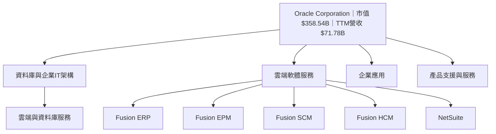
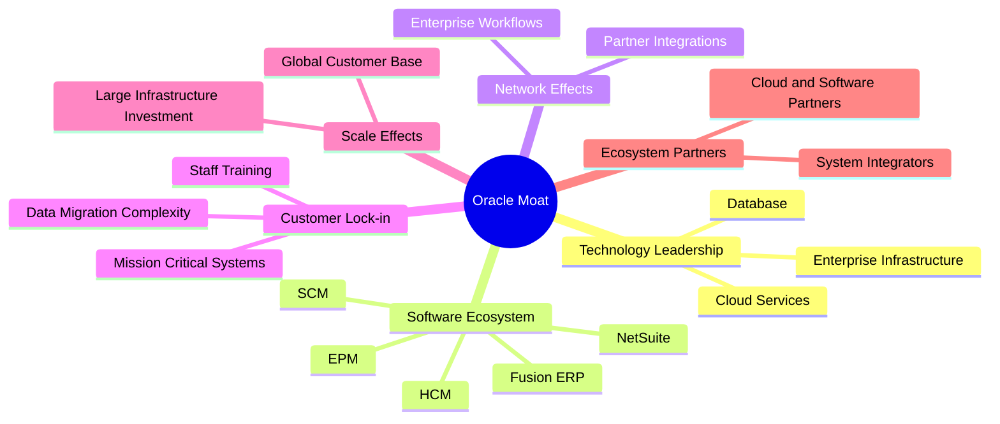
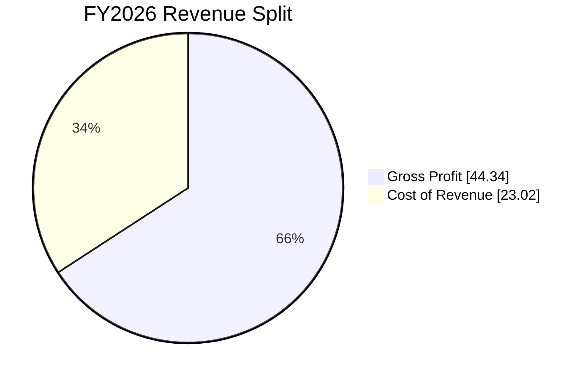
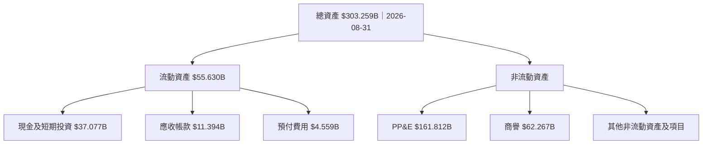
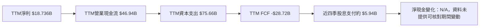
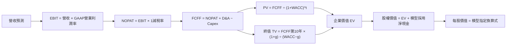
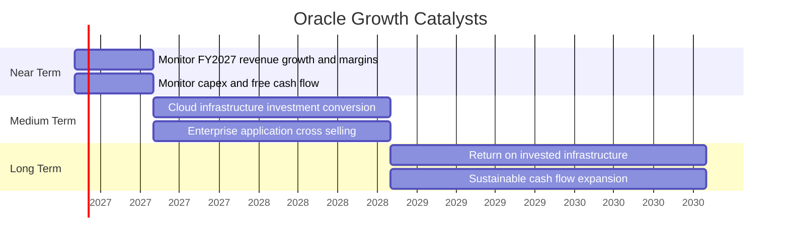
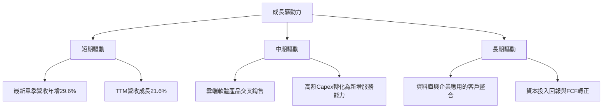
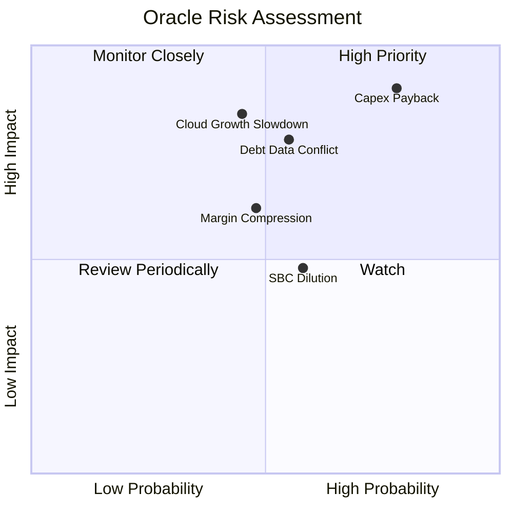
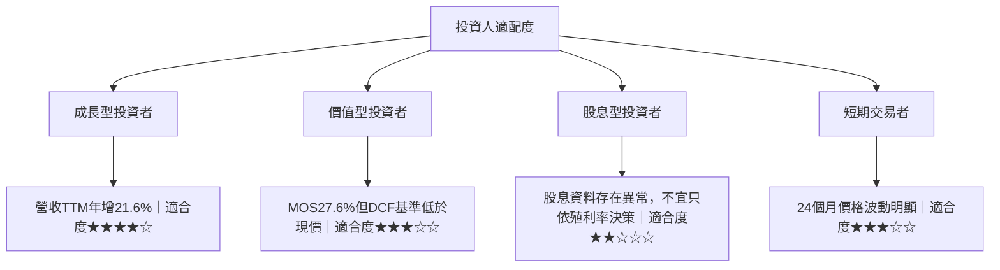

# ORCL 基本面深度分析報告
> **報告日期**：2026-11-18 ｜ **語言**：繁體中文 ｜ **數據來源**：SEC 申報資料 (XBRL)、Yahoo Finance、Finviz、StockAnalysis、Roic.ai ｜ **分析師**：CFA 級機構研究

## 目錄

| # | 章節 | 核心結論 |
|---|------|----------|
| 1 | 執行摘要 | 強烈買入；加權合理價值 $158.78；MOS 27.6% |
| 2 | 公司概覽與商業模式 | 企業軟體、資料庫與雲端服務具客戶黏著；營收分部占比未提供 |
| 3 | 損益表深度分析 | TTM 營收 $71.78B、成長 21.6%；最新單季營收年增 29.6% |
| 4 | 資產負債表分析 | 現金及短期投資 $37.08B；總債務資料口徑不一致，需核實 |
| 5 | 現金流量深度分析 | TTM FCF −$28.72B，主因資本支出 $75.66B 高於營業現金流 |
| 6 | 獲利能力與資本效率 | ROIC 61.3% 高於 WACC 9.39%，但高資本支出令現金回報承壓 |
| 7 | 相對估值分析 | 本益比低於同業中位數及自身歷史；DCF 與相對估值訊號分歧 |
| 8 | DCF 內在價值評估 | 基準 DCF $77.03；終值現值占 EV 185.9%，對假設高度敏感 |
| 9 | 成長催化劑 | 最新單季營收年增 29.6%；雲端、AI 基礎設施投資為觀察重點 |
| 10 | 風險矩陣 | 主要風險為資本支出回收、負債資料不確定性及雲端成長降速 |
| 11 | 投資建議 | MOS 對應強烈買入；執行上須以 FCF 與資本支出回收作為驗證條件 |

---

## 1. 執行摘要

ORCL 的最新 TTM 營收為 **$71.78B**，年增 **21.6%**；最新一季（FY2027 Q1）營收年增 **29.6%**、營業利益率 **34.8%**，顯示近期需求與營運槓桿仍在改善。然而 TTM 資本支出 **$75.66B** 高於營業現金流 **$46.94B**，使 FCF 達 **−$28.72B**、FCF Yield **−8.01%**；這是投資論點中最重要的反向證據。

估值方面，程式計算的加權合理價值為 **$158.78**，相對 **2026-11-17 收盤價 $115.00** 的 MOS 為 **27.6%**；ROIC **61.3%** 高於 WACC **9.39%**。依 MOS 門檻及 ROIC/WACC 條件，評級為 **強烈買入**。但基準 DCF 價值僅 **$77.03**，現價相對 DCF 溢價 **49.3%**，與相對估值及分析師共識的高估值結果有明顯差異；因此買入評級依賴成長、資本支出轉化及相對估值方法能否成立。

### 1.0 一頁式投資儀表板

| 項目 | 內容 |
|------|------|
| **投資論點（3 句）** | ① TTM 營收年增 21.6%、最新一季年增 29.6%，顯示增長尚未停滯。② ROIC 61.3% 對比 WACC 9.39%，目前資本報酬高於資本成本。③ TTM FCF −$28.72B、FCF Yield −8.01%，資本支出能否轉化為現金回報是估值驗證關鍵。 |
| **綜合評分** | **7.3/10**（引用 1.1 評分卡） |
| **財務健康** | 🟡 現金及短期投資 $37.08B；但債務資料來源口徑不一致，且流動比率 1.171。 |
| **ROIC vs WACC** | **61.3% vs 9.39%**；依所提供 ROIC 口徑為創造股東價值。 |
| **FCF 趨勢** | 惡化；TTM FCF **−$28.72B**、FCF Yield **−8.01%**，主要受資本支出上升影響。 |
| **估值** | Forward P/E **10.398949x** ｜ EV/EBITDA **14.09x** ｜ FCF Yield **−8.01%** |
| **DCF 內在價值（基準）** | **$77.03** ｜現價相對 DCF 溢價 **49.3%**（第 8.5 節） |
| **安全邊際（MOS）** | **27.6%**＝($158.78 加權合理價值 − $115.00 現價) ÷ $158.78｜🟢 >25% 充足 |
| **預期報酬（基準情境 12M）** | DCF 基準情境相對現價 **−33.0%**；加權合理價值上行空間 **+38.1%**。兩者採用不同估值口徑，不應混為同一目標。 |
| **關鍵風險（前二）** | 高資本支出未轉化為正 FCF；債務及淨現金口徑不一致。 |
| **評級 + 信心度** | 🟢 **強烈買入** ｜信心：中。MOS 與 ROIC/WACC 支持評級，但 FCF 與 DCF 結果構成重大不確定性。 |

### 1.1 綜合評分卡（全報告唯一）

| 維度 | 評分（1–10） | 主要依據（引用數字與其來源章節） |
|------|--------------|----------------------------------|
| 成長性 | 8.0 | TTM 營收年增 21.6%、最新單季年增 29.6%（第 3 章）。 |
| 獲利能力 | 8.0 | TTM 營業利益率 32.1%、ROIC 61.3%；Piotroski F-Score 4/7（第 3、6 章）。 |
| 財務健康 | 5.0 | 現金及短期投資 $37.08B、流動比率 1.171；債務數據口徑有衝突，FCF 為 −$28.72B（第 4、5 章）。 |
| 估值 | 8.0 | MOS 27.6%；P/E 18.0x 低於自身五年中位數 32.1x，但基準 DCF 價值低於現價（第 7、8 章）。 |
| 護城河 | 9.0 | 企業資料庫、ERP／HCM／SCM 等系統與客戶整合具黏著性；營收與客戶留存分部數據未提供（第 2 章）。 |
| 管理層與資本配置 | 6.0 | FY2026 SBC $4.81B、Capex $55.66B，投資幅度大；稀釋股數未通過 F-Score 測試（第 3、5、6 章）。 |
| **綜合評分** | **7.3** | 六項算術平均：(8.0+8.0+5.0+8.0+9.0+6.0)÷6 = **7.3**。 |

### 1.2 五大投資論點 + 三大核心風險

| 類型 | 項目 | 具體依據 | 信心度 |
|------|------|----------|--------|
| 🟢 **投資論點①** | 收入增長加速 | TTM 營收 $71.78B、年增 21.6%；最新單季年增 29.6%，較 FY2026 Q1 的 12.17% 明顯加速。若是雲端服務與基礎設施需求帶動，增長可提高現有軟體客戶的交叉銷售機會。 | 🟢 高 |
| 🟢 **投資論點②** | 資本報酬遠高於資本成本 | ROIC 61.3% 對比 WACC 9.39%，差額 **51.91 個百分點**。若 ROIC 口徑可持續且不被新增投資稀釋，投入資本仍創造經濟價值。 | 🟢 中高 |
| 🟢 **投資論點③** | 估值低於自身歷史 | P/E 18.0x，低於五年中位數 32.1x；P/S 4.8x，低於中位數 6.2x。市場已反映部分成長與資本支出風險。 | 🟡 中 |
| 🟢 **投資論點④** | 軟體與雲端產品組合 | Oracle Fusion ERP、EPM、SCM、HCM、NetSuite 與資料庫產品可支援客戶端到端企業工作流程；財務數據未提供各分部占比，不宜量化成長貢獻。 | 🟡 中 |
| 🟢 **投資論點⑤** | 加權估值顯示折價 | 加權合理價值 $158.78，MOS 27.6%；其中同業 Forward P/E 法與分析師共識分別估值 $231.37、$236.18，對整體合理價值貢獻較大。 | 🟡 中 |
| 🟡 **風險①** | 資本支出回收不及預期 | TTM Capex $75.66B，約為 OCF $46.94B 的 1.61 倍，導致 FCF −$28.72B。若資本支出無法帶來可持續營收，現金流及估值將承壓。 | 🔴 高衝擊 |
| 🔴 **風險②** | 資產負債資料口徑衝突 | 核心核實數字列示總債務 N/A、淨現金 $37.08B；其他市場資料列總債務 $169.14B、淨負債 $132.07B。不可將兩種口徑當成一致事實。 | 🔴 高衝擊 |
| 🟡 **風險③** | DCF 對終值極度敏感 | 基準 DCF $77.03，終值現值占 EV 185.9%，預測期 PV 為負。若再投資期拉長或終值假設偏樂觀，DCF 價值可能顯著低於加權合理價值。 | 🔴 高衝擊 |

### 1.3 快速統計卡片

| 指標 | 公司實際值（期間） | 同業中位數 | 狀態 |
|------|--------------------|------------|------|
| 營收成長（TTM） | **21.6%** | — | 🟢 |
| 營收成長（最新一季年增） | **29.6%** | **13.2%** | 🟢 |
| 毛利率（TTM） | **64.0%** | **73.6%** | 🟡 |
| 營業利益率（TTM） | **32.1%** | — | 🟢 |
| ROIC（TTM） | **61.3%** | — | 🟢 |
| Forward P/E | **10.398949x** | **20.9x** | 🟢 |
| FCF Yield（TTM） | **−8.01%** | — | 🔴 |
| Piotroski F-Score | **4 / 7** | — | 🟡 |

### 1.4 投資結論

```text
╔══════════════════════════════════════════════════════════════════╗
║                    📊 投資結論摘要                               ║
╠══════════════════════════════════════════════════════════════════╣
║  評級：強烈買入（MOS 27.6%，且 ROIC 61.3% > WACC 9.39%）          ║
║  價格（2026-11-17 收盤）：$115.00                                ║
║  DCF 內在價值（基準）：$77.03（現價溢價 49.3%）                  ║
║  安全邊際 MOS：27.6%（以加權合理價值為分母）                     ║
║  加權合理價值（8.8）：$158.78                                    ║
║  DCF 情境價值：                                                   ║
║    悲觀情境：$6.89（−94.0%）                                     ║
║    基準情境：$77.03（−33.0%）                                    ║
║    樂觀情境：$231.63（+101.4%）                                  ║
║  綜合評分：7.3/10（引用 1.1）                                    ║
║  適合投資人：能承受高資本支出及估值模型分歧的成長型、長線投資人  ║
╚══════════════════════════════════════════════════════════════════╝
```

---

## 2. 公司概覽與商業模式

### 2.1 業務結構與收入來源

公司資料列示 Oracle 提供資料庫、企業 IT 架構、雲端軟體與企業應用服務。營收總額及分部占比可用資料如下；公司摘要未提供可直接核對的雲端、授權及硬體分部營收，因此不拆分百分比。



各分部的營收金額、占比及毛利率資料未提供；上述分類依公司業務描述呈現，不代表各板塊占比。

### 2.2 市場份額

市場份額數據未提供。相對規模方面，Oracle TTM 營收 $71.78B，最新一季營收年增 29.6%，高於所列 Microsoft 18.8%、SAP 13.2% 及 Salesforce 10.8%；但 Oracle TTM 毛利率 64.0%，低於三家同業數據的中位數 73.6%。這些差異反映業務組合不同，不能直接視為市場份額或產品競爭力的量化比較。

### 2.3 競爭護城河分析



### 2.4 護城河強度

| 護城河項目 | 強度（強／中／弱） | 證據（引用數字或事實） | 會削弱它的情況 |
|------------|--------------------|------------------------|----------------|
| 技術與產品 | 強 | 資料庫與企業 IT 產品線涵蓋資料管理及多類企業應用；TTM 營收 $71.78B。 | 客戶轉向替代資料庫、開源或雲端原生產品。 |
| 軟體生態系統 | 強 | Fusion ERP、EPM、SCM、HCM、NetSuite 等覆蓋企業流程。 | 產品互通性不足、升級複雜或雲端替代方案更具成本效益。 |
| 客戶鎖定 | 強 | 核心資料與企業流程遷移涉及整合、風險及人員培訓；量化續約率未提供。 | 客戶採用多雲架構並降低單一供應商依賴。 |
| 網路效應 | 中 | 系統整合及企業應用互通可增加生態價值；直接網路效應數據未提供。 | 競爭平台以更廣泛第三方生態吸引開發者與客戶。 |
| 規模效應 | 強 | TTM 營收 $71.78B；公司投入大量資本建設基礎設施，但 TTM Capex 已達 $75.66B。 | 投資利用率不足，規模投入無法轉化為收入與正 FCF。 |
| 生態夥伴 | 中 | 企業軟體導入通常涉及顧問、系統整合及技術夥伴；夥伴收入貢獻未提供。 | 夥伴轉向競爭平台或客戶偏好自建系統。 |

**1.1「護城河」評分 9.0/10 的依據**：產品組合、企業流程整合及遷移成本有結構性優勢；但缺少分部營收、續約與市占數據，故評分不代表各護城河已由可量化指標完整驗證。

---

## 3. 損益表深度分析

### 3.1 年度收入成長趨勢（近 4 年）

```text
╔══════════════════════════════════════════════════════════════════╗
║              Oracle 年度收入趨勢（FY2023-FY2026）                ║
╠══════════════════════════════════════════════════════════════════╣
║  FY2023  $49.95B  ███████████████░░░░░░░░░  YoY: +17.71% 🟢    ║
║  FY2024  $52.96B  ████████████████░░░░░░░░  YoY: +6.02%  🟡    ║
║  FY2025  $57.40B  █████████████████░░░░░░░  YoY: +8.38%  🟡    ║
║  FY2026  $67.36B  ████████████████████░░░░░  YoY: +17.35% 🟢    ║
║                                                                  ║
║  FY2023-FY2026 三年收入 CAGR：((67.36 ÷ 49.95)^(1/3)-1) = 10.5% ║
╚══════════════════════════════════════════════════════════════════╝
```

FY2026 收入較 FY2025 增加約 **17.35%**，且 FY2027 Q1 最新單季年增 **29.6%**。這一加速提高市場對雲端與 AI 基礎設施收入的期待；但目前沒有分部數據可確定加速主要來自哪一項服務，需在後續財報追蹤各項雲端營收與剩餘履約義務等指標。

### 3.2 季度收入趨勢分析

| 季度 | 營收（$B） | QoQ 成長 | YoY 成長 | 備註 |
|------|------------:|---------:|---------:|------|
| FY2026 Q2（2025-11-30） | 16.06 | N/A | 14.22% | YoY 及營收取自季度資料。 |
| FY2026 Q3（2026-02-28） | 17.19 | +7.05% | 21.66% | 營收較前季提升，YoY 增長擴大。 |
| FY2026 Q4（2026-05-31） | 19.18 | +11.60% | 20.63% | 季節性及業務組合可能影響 QoQ。 |
| FY2027 Q1（2026-08-31） | 19.35 | +0.84% | 29.60% | QoQ 成長放慢，但同期年增明顯加速。 |

QoQ 算式：FY2026 Q3 = 17.19÷16.058−1 = 7.05%；FY2026 Q4 = 19.184÷17.19−1 = 11.60%；FY2027 Q1 = 19.345÷19.184−1 = 0.84%。QoQ 變化會受季節性影響，故應與 YoY 一併解讀。

### 3.3 利潤率演變分析

| 利潤率指標 | FY2023 | FY2024 | FY2025 | FY2026 | 趨勢 | 評估 |
|------------|--------|--------|--------|--------|------|------|
| **毛利率** | 72.9% | 71.4% | 70.5% | 65.8% | ↘️ 近年下滑，FY2026 降幅較大。 | 🟡 |
| **營業利益率** | 27.6% | 30.3% | 31.4% | 33.3% | ↗️ 年度數據呈擴張。 | 🟢 |
| **淨利率** | 17.0% | 19.8% | 21.7% | 25.4% | ↗️ 淨利成長快於營收。 | 🟢 |

年度毛利率、營業利益率與淨利率由年度損益表金額相除計算；FY2026 年度營業利益率為 22.44÷67.36 = 33.3%，而 TTM 經核實營業利益率為 **32.1%**，期間不同，不能互換。最新單季營業利益率依核實數據為 **34.8%**。毛利率下滑而營業利益率上升，表示總體毛利結構承壓，但營業費用相對收入的控制、產品組合或其他成本項目使營業利潤仍改善；分部成本資料未提供，無法將改善歸因於特定產品或定價。

### 3.4 費用結構分析

FY2026 年度營收 $67.36B、毛利 $44.34B；依兩項披露數字計算，營業成本約為 $23.02B。此圖只展示營收扣除營業成本後的毛利結構，並非公司完整費用分攤。



```text
╔══════════════════════════════════════════════════════════════════╗
║                  FY2026 營收與營業成本概覽                       ║
╠══════════════════════════════════════════════════════════════════╣
║  營收 $67.36B       ██████████████████████████                  ║
║  毛利 $44.34B       █████████████████                            ║
║  營業成本 $23.02B   █████████                                    ║
║  R&D $10.27B        █████                                        ║
║  （R&D 為營業費用細項，不另與上方營業成本重複相加）               ║
╚══════════════════════════════════════════════════════════════════╝
```

### 3.5 季度 EPS 趨勢與盈餘品質（Quality of Earnings）

| 季度 | EPS（美元） | EPS 年增 | EPS 超預期／不及預期 |
|------|------------:|---------:|----------------------|
| FY2026 Q2 | 2.10 | 90.91% | N/A（估值及實際值均未提供） |
| FY2026 Q3 | 1.27 | 24.51% | N/A（估值及實際值均未提供） |
| FY2026 Q4 | 1.45 | 21.91% | N/A（估值及實際值均未提供） |
| FY2027 Q1 | 1.56 | 54.45% | N/A（估值及實際值均未提供） |

盈餘「超預期／不及預期」資料列為 nan，不能把缺少預估值的季度判定為 beat 或 miss。最新季度淨利年增 62.6%，高於營收年增 29.6%；EPS 年增 54.5%，但資料不足以分解有效稅率、利息、股數及一次性項目各自的貢獻。

| 盈餘品質項目 | 數值／佔比 | 評估 |
|--------------|-----------|------|
| 股權薪酬 SBC / 營收 | FY2026：$4.81B ÷ $67.36B = **7.1%** | 🟡 SBC 占比具實質性，且稀釋股數測試未通過；須關注每股盈餘能否同步增長。 |
| SBC / 營業現金流 | FY2026：$4.81B ÷ $31.98B = **15.0%** | 🟡 對 OCF 具一定比例，但 SBC 為非現金費用，不能直接等同現金支出。 |
| FCF / 淨利（現金轉換率） | TTM：−$28.72B ÷ $18.736B = **−153.3%** | 🔴 現金轉換率為負，源於高額資本支出；目前 GAAP 淨利不能代表可分配現金。 |
| 一次性／非經常性損益 | N/A（未提供可核對明細） | 無法判斷是否有重大項目美化或壓低盈餘。 |
| 有效稅率 | **12.6%**（估值模型所用最新年度有效稅率） | 🟡 未提供歷年稅率明細，不能判定此稅率是否可持續。 |
| 資本化支出 vs 費用化 | TTM Capex **$75.66B**；資本化支出大幅高於 FY2026 的 $55.66B | 🔴 資本投資會壓低 FCF；折舊攤銷與投資產能利用率需持續追蹤。 |

**盈餘品質結論**：營收及淨利成長具支持，但 TTM FCF 轉換率為 −153.3%、Capex 高達 $75.66B，代表當前經濟盈餘尚未轉化為可自由分配現金。SBC 約占 FY2026 營收 7.1%，對股東每股價值有稀釋成本。估值不宜只依 EPS 或 P/E，應同時觀察資本支出趨勢及投資回報。

---

## 4. 資產負債表分析

### 4.1 資產結構分解

截至 2026-08-31，資產資料列示總資產 **$303.259B**、流動資產 **$55.630B**、PP&E **$161.812B**、商譽 **$62.267B**。圖中只列有披露數字的主要項目，並非完整資產加總。



### 4.2 流動性與營運資金分析

| 流動性指標 | 最新數值 | 歷史比較 | 評估 |
|------------|----------|----------|------|
| 流動比率 | 1.171 | FY2026 流動資產 $46.57B、流動負債 $41.76B | 🟡 短期資產高於短期負債，但流動性緩衝不厚。 |
| Quick Ratio | 1.02 | 歷史趨勢資料未完整提供 | 🟡 速動資產接近流動負債。 |
| 現金及短期投資 | $37.08B | FY2026 年末 $31.89B | 🟢 現金水位上升，但債務口徑需核實。 |

**營運資金天數（照抄 QUALITY FIGURES）**

| 指標 | 最新 TTM | 一年前 TTM | 變化 | 解讀 |
|------|----------|------------|------|------|
| DSO 應收帳款天數 | 58 天 | 55 天 | +3 天 | 收款週期延長，可能代表應收增加或收入結構改變；需追蹤是否持續。 |
| DIO 存貨天數 | N/A | N/A | N/A | 公司未提供可用存貨餘額，不推算。 |
| DPO 應付帳款天數 | 156 天 | N/A | N/A | 最新值較長，可能反映付款週期或供應商條款；無一年前資料可比較。 |
| CCC 現金轉換週期 | N/A | N/A | N/A | DIO 缺資料，不能自行補算。 |

### 4.3 債務結構分析

債務資料出現重大口徑差異：核實財務數字列「總債務 N/A、淨現金 $37.08B」；市場資料另列總債務 $169.14B、淨負債 $132.07B。由於不得以未核對口徑取代核實數字，本節不將後者併入 DCF 或當成已確認債務。

```text
╔══════════════════════════════════════════════════════════════════╗
║                   Oracle 債務健康診斷                            ║
╠══════════════════════════════════════════════════════════════════╣
║  現金及短期投資： $37.08B  ████████████████████  已披露          ║
║  總債務：         N/A      資料來源口徑不一致，需核對 SEC 報表   ║
║  核實淨現金欄：   $37.08B  核實數字未列出可用總債務              ║
║  市場資料總債務： $169.14B 與核實欄位不一致，不作主模型輸入     ║
║  Debt/EBITDA：    N/A      因債務口徑未核實，不計算               ║
║  Interest Coverage：N/A    利息費用資料未提供                    ║
╚══════════════════════════════════════════════════════════════════╝
```

WACC 所列債務成本及債務權重依核實資本成本資料使用；其債務餘額及利息費用細項未提供，無法在本報告獨立重建。

### 4.4 股東權益趨勢

| 財年末 | 股東權益（$B） | YoY 變化 |
|--------|----------------:|---------:|
| FY2023 | 1.07 | — |
| FY2024 | 8.70 | +713.1% |
| FY2025 | 20.45 | +135.1% |
| FY2026 | 42.51 | +107.9% |

```text
╔══════════════════════════════════════════════════════════════════╗
║                  股東權益趨勢（年度）                            ║
╠══════════════════════════════════════════════════════════════════╣
║  FY2023  $1.07B   █                                             ║
║  FY2024  $8.70B   █████                                         ║
║  FY2025  $20.45B  ████████████                                  ║
║  FY2026  $42.51B  █████████████████████████                     ║
║  FY2026 較 FY2023 增加：$42.51B − $1.07B = $41.44B              ║
╚══════════════════════════════════════════════════════════════════╝
```

權益基數上升有助改善帳面資本緩衝，但不能單憑帳面權益推導現金流或資本回報；同期資產及負債亦大幅擴張，應與資本支出、負債償還及股數變化一併檢視。

---

## 5. 現金流量深度分析

### 5.1 現金流量瀑布圖



圖中各項為不同現金流階段或資料點，非將淨利直接加總到營業現金流；TTM 股息約以所列最近四季季度支付額相加，僅作季度現金支出概覽。

### 5.2 FCF 轉換率趨勢

| 財年 | 營業現金流（$B） | Capex（$B） | FCF（$B） | 淨利（$B） | FCF / 淨利 |
|------|------------------:|------------:|---------:|-----------:|-----------:|
| FY2023 | 17.16 | 8.70 | 8.47 | 8.50 | 99.6% |
| FY2024 | 18.67 | 6.87 | 11.81 | 10.47 | 112.8% |
| FY2025 | 20.82 | 21.21 | −0.394 | 12.44 | −3.2% |
| FY2026 | 31.98 | 55.66 | −23.69 | 17.09 | −138.6% |
| TTM 至 2026-08-31 | 46.94 | 75.66 | −28.72 | 18.736 | −153.3% |

FY2025 起 FCF 由正轉負，FY2026 及 TTM 進一步惡化，主要是 Capex 增幅遠高於 OCF 增幅。此處 FCF 一律採核實定義 **OCF − Capex**。

### 5.3 自由現金流趨勢

```text
╔══════════════════════════════════════════════════════════════════╗
║                  自由現金流趨勢（$B）                            ║
╠══════════════════════════════════════════════════════════════════╣
║  FY2023  +$8.47B   ████████████░░░░░░░░░░  正值                ║
║  FY2024 +$11.81B   █████████████████░░░░░  正值                ║
║  FY2025  -$0.39B   ░░░░░░░░░░░░░░░░░░░░░  近零負值            ║
║  FY2026 -$23.69B   ░░░░░░░░░░░░░░░░░░░░░  大額負值            ║
║  TTM    -$28.72B   ░░░░░░░░░░░░░░░░░░░░░  FCF Yield -8.01%    ║
║  兩年方向：Capex 由 FY2024 $6.87B 升至 FY2026 $55.66B          ║
╚══════════════════════════════════════════════════════════════════╝
```

### 5.4 資本配置評估

完整資本配置比例未提供，故不以圓餅圖製造組成比重。已披露項目如下：

| 項目 | 金額／資料 | 評估 |
|------|------------|------|
| Capex | FY2026 $55.66B；TTM $75.66B | 資本配置最大可見壓力；需以新增收入、利用率及未來折舊回報驗證。 |
| 股息 | FY2026 $5.79B | 現金支付增加；在 FCF 為負時須關注其對融資需求的影響。 |
| SBC | FY2026 $4.81B | 非現金薪酬但會稀釋持有人權益。 |
| 回購 | N/A（未提供可核對金額） | 不推測回購額或回購對股數的淨效果。 |
| 留存現金／淨負債變化 | N/A（總債務口徑有差異） | 需待債務與現金流分類核對後評估。 |

---

## 6. 獲利能力與資本效率

### 6.1 ROE / ROA / ROIC 趨勢

| 指標 | 歷史資料 | 最新核實值 | 評估 |
|------|----------|-----------|------|
| ROE | QUALITY FIGURES：TTM **28.3%**；其他財務摘要另列 41.2% | **28.3%** | 口徑不一致，以核實品質指標為主；使用杜邦數據時亦為 28.3%。 |
| ROA | 財務摘要 TTM 6.4%；F-Score 顯示 ROA > 0 | **6.4%** | 正值，但相對資產規模的獲利效率低於 ROE。 |
| ROIC | 歷史 Roic.ai 資料顯示過去曾有較低回報；不同期間口徑不可直接拼接 | **61.3%** | 高於 WACC 9.39%；但需留意擴建期間資產及投入資本定義對比率的影響。 |

ROE 的不同來源數字不應混用：本報告在品質指標與 DuPont 採 **28.3%**；市場摘要的 **41.2%** 作為資料衝突而非同期間補充。

### 6.2 ROIC vs WACC 分析（核心價值創造判斷）

```text
╔══════════════════════════════════════════════════════════════════╗
║                ROIC vs WACC 深度分析                            ║
╠══════════════════════════════════════════════════════════════════╣
║  資本成本輸入（採核實數值）：                                    ║
║  ├── 無風險利率（10Y美債）： 5.10%                               ║
║  ├── 市場風險溢酬（假設）：  5.00%                               ║
║  ├── 原始 Beta：              1.78                               ║
║  ├── 調整後 Beta：            1.52                               ║
║  ├── 股權成本：               12.70%                             ║
║  ├── 稅前債務成本：           2.72%                              ║
║  ├── 稅後債務成本：           2.72%×(1−12.6%) = 2.38%            ║
║  ├── 權重 E / D：             67.9% / 32.1%                      ║
║  └── WACC：                   9.39%                              ║
║                                                                  ║
║  最新 TTM ROIC：              61.3%                               ║
║  ROIC − WACC：                61.3% − 9.39% = 51.91 個百分點      ║
║  ROIC / WACC：                61.3% ÷ 9.39% = 6.53 倍            ║
║                                                                  ║
║  結論：依核實 ROIC 定義，公司目前創造股東價值；                  ║
║  但負 FCF 表示高資本投入尚未完成現金回收驗證。                    ║
╚══════════════════════════════════════════════════════════════════╝
```

WACC 依提供的 Cost of capital 固定採 **9.39%**，不另造一個替代折現率。詳細來源與限制見第 8.2 節。

### 6.3 杜邦三因素分解

| 因素 | 數值（TTM） | 解讀 |
|------|-------------|------|
| 淨利率 | 26.4% | 淨利占收入比重高，支撐 ROE。 |
| 資產週轉率 | 0.24 | 每單位資產產生的營收偏低；資產擴張後仍需靠收入利用率提升。 |
| 權益乘數 | 4.54 | 財務槓桿對 ROE 有明顯放大效果。 |
| **ROE** | **28.3%** | 26.4% × 0.24 × 4.54 = 約 28.8%；品質指標原列 ROE **28.3%**，差異來自四捨五入及輸入精度。 |

按指定品質指標，三因素為 **26.4% × 0.24 × 4.54 = ROE 28.3%**。經四捨五入的顯示數直接相乘約 28.8%，故採原列 ROE，不以顯示值重算替換。ROE 既有淨利率支撐，也受到 4.54 倍權益乘數放大，不宜只看 ROE 推論低風險。

### 6.4 財務體質：Piotroski F-Score

**Piotroski F-Score：4 / 7**。可判定分母為 7；缺乏輸入的測試不納入分母。

| 測試 | 結果 | 解讀 |
|------|------|------|
| ROA > 0 | ✅ 通過 | 公司維持正資產報酬。 |
| 營業現金流 > 0 | ✅ 通過 | TTM OCF 為 $46.94B。 |
| ROA 高於一年前 | ❌ 未通過 | 資產報酬未呈改善，新增資產轉化效率值得追蹤。 |
| 營業現金流 > 淨利（應計品質） | ✅ 通過 | OCF 高於淨利，應計品質測試通過；但大額 Capex 使 FCF 仍為負。 |
| 長期負債 ÷ 總資產低於一年前 | — 無法判定 | 缺少可比輸入。 |
| 流動比率高於一年前 | ✅ 通過 | 最新流動比率高於一年前。 |
| 稀釋股數未增加 | ❌ 未通過 | 股數稀釋可能降低每股價值增長。 |
| 毛利率高於一年前 | — 無法判定 | 缺少可比輸入。 |
| 資產週轉率高於一年前 | ❌ 未通過 | 資產擴張尚未帶動更高週轉率。 |

---

## 7. 相對估值分析

### 7.1 同業估值比較表格

同業數字依 Peer multiples。Oracle 自身估值與同業估值資料來源及口徑不同，且 Oracle 的 P/S、EV/EBITDA 亦有不同資料段的差異；本表本公司估值採核實歷史估值數字與市場估值數字中直接列示者。

| 估值指標 | **ORCL** | **MSFT** | **SAP** | **CRM** | 本公司評估 |
|----------|----------:|--------:|-------:|-------:|-----------|
| **Trailing P/E** | 18.0x | 26.4x | 27.7x | 17.8x | 🟢 低於同業中位數 26.4x，但須考慮成長及資本支出差異。 |
| **Forward P/E** | 10.398949x | 20.9x | 23.3x | 12.1x | 🟢 低於同業中位數 20.9x；前瞻 EPS 預期較高也可能是低倍數原因。 |
| **P/S Ratio** | 4.8x（自身歷史指標） | 10.9x | N/A | 3.6x | 🟡 可比較同業中位數 7.25x；SAP 因混合幣別不可比。 |
| **EV/EBITDA** | 9.5x（自身歷史指標） | 18.6x | N/A | 14.8x | 🟢 低於可比同業中位數 16.7x。 |
| **最新單季營收年增** | 29.6% | 18.8% | 13.2% | 10.8% | 🟢 ORCL 增長最高，但需後續確認是否可持續。 |
| **毛利率（TTM）** | 64.0% | 67.7% | 73.6% | 77.3% | 🟡 低於同業中位數 73.6%。 |

注意：Oracle 自身歷史估值資料列示 P/S 4.8x、EV/EBITDA 9.5x；其他市場估值區另列 P/S 4.995213x、EV/EBITDA 14.09x。因來源或期間口徑可能不同，本報告不以後者替換「自身歷史」分析數字，亦不將兩組數值混成單一倍數。

### 7.2 歷史估值區間分析

```text
╔══════════════════════════════════════════════════════════════════╗
║            ORCL 五年估值位置（TTM 倍數）                        ║
╠══════════════════════════════════════════════════════════════════╣
║  P/E       19.0x ├─────● 18.0x ───────────────┤ 52.3x           ║
║                    中位數 32.1x｜目前百分位 0%                  ║
║  P/S        4.6x ├─● 4.8x ────────┤ 11.1x                      ║
║                    中位數 6.2x｜目前百分位 10%                  ║
║  EV/EBITDA 12.6x ├● 9.5x ───────────────┤ 28.9x                ║
║                    中位數 17.9x｜目前百分位 0%                  ║
╚══════════════════════════════════════════════════════════════════╝
```

各估值倍數目前位於自身歷史偏低位置，反映估值壓縮；但估值低於歷史並非充分的買入理由，尤其 TTM FCF 已為負值，未來需由資本回報及現金流改善驗證折價是否過度。

### 7.3 情境價值（Bear / Base / Bull，照抄 DCF MODEL）

| 情境 | 第 1 年營收成長 | 期末營業利潤率 | WACC | 每股價值 | 相對現價 | 機率 | 會發生的條件 |
|------|----------------:|----------------:|-----:|----------:|----------:|-----:|--------------|
| 🔴 悲觀 | 10.8% | 26.0% | 10.39% | $6.89 | −94.0% | 25% | 雲端增長大幅降速、資本回收延遲且折現率上升。 |
| 🟡 基準 | 21.6% | 30.6% | 9.39% | $77.03 | −33.0% | 50% | 以目前 TTM 成長為起點，後續逐步降至長期增長，利潤率回落至歷史中位。 |
| 🟢 樂觀 | 32.4% | 33.6% | 8.39% | $231.63 | +101.4% | 25% | 雲端需求持續加速、規模效率擴大且資本成本下降。 |

### 7.4 相對估值隱含價格區間

```text
╔══════════════════════════════════════════════════════════════════╗
║            估值方法隱含每股價值與現價位置                       ║
╠══════════════════════════════════════════════════════════════════╣
║  $77.03 ─────── $115.00 ─────── $186.03 ─────── $231.37         ║
║  基準 DCF          現價          EV/EBITDA       Forward P/E      ║
║                                      $236.18 分析師共識           ║
╚══════════════════════════════════════════════════════════════════╝
```

| 方法 | 每股價值 | 相對現價 | 依據 |
|------|---------:|---------:|------|
| 同業 Forward P/E | $231.37 | +101.2% | 同業中位數 20.9x × 公司 Forward EPS $11.06。 |
| 同業 EV/EBITDA | $186.03 | +61.8% | 同業中位數 16.7x（MSFT、CRM）× TTM EBITDA，再加回核實淨現金。 |
| DCF（基準） | $77.03 | −33.0% | 10 年 FCFF、WACC 9.39%、永續成長 3.0%。 |

---

## 8. DCF 內在價值評估（Discounted Cash Flow）

### 8.0 估值推理鏈（Thinking Logic）

**Step 1 — 價值來源及主導變數**

ORCL 價值主要來自既有企業軟體與資料庫現金流、雲端／企業應用增長，以及高額資料中心投資的未來回報；但提供的資料沒有各業務分部營收占比，無法量化各來源權重。模型最主導變數是 **Capex/營收的收斂速度及第 10 年 FCFF**：基準模型前七年 FCFF 均為負，終值 PV 卻占 EV 185.9%，故價值高度依賴投資由現金消耗轉為現金產出的時間點。

**Step 2 — 模型選擇**

| 決策點 | 本報告採用 | 理由（含數字） | 曾考慮但否決 | 否決理由 |
|--------|-----------|----------------|--------------|----------|
| 現金流定義 | FCFF | 對應 WACC 9.39% 折現並推導 EV。 | FCFE | 資本結構及債務數據存在口徑差異。 |
| 預測期 N | 10 年 | DCF 模型固定 10 年；企業雲端及基礎設施投資回收可能需要較長期間。 | 5 年 | 無法涵蓋模型中 Capex 逐步收斂及現金流轉正過程。 |
| 終值方法 | Gordon Growth | 模型已提供永續成長率 3.0% 及 Gordon TV。 | 退出倍數 | DCF 模型未提供可用退出倍數及對應終值。 |
| EBIT 基礎 | GAAP EBIT | DCF 模型明列 GAAP EBIT。 | 非 GAAP | 可能排除 SBC，且無完整調整項目資料。 |

**Step 3 — 主要假設推導鏈**

- **營收成長路徑**：錨點＝TTM 營收成長 **21.6%**，最新一季年增 **29.6%** → 調整＝模型採首年 21.6%，其後線性降至第 10 年 3.0%，反映高成長增長逐步正常化 → **採用模型所列逐年成長率** → 曾考慮持續採用最新單季 29.6%，但未有足夠證據支持十年不降速，故不採用。
- **期末營業利益率**：錨點＝TTM 營業利益率 **32.1%**，模型第 10 年 **30.6%** → 調整＝模型按近五財年中位數方向收斂 → **採用 30.6%** → 曾考慮維持 TTM 32.1%，但模型使用歷史中位數作為成熟期利潤率。
- **永續成長率 g**：錨點＝模型取 **3.0%**；該值低於 WACC 9.39% → 調整＝終值需維持低於折現率並避免長期超常增長 → **採用 3.0%** → 不採用高於 3.0% 的永久高成長值，以免終值過度膨脹。
- **預測期 N**：錨點＝模型指定 **10 年** → 調整＝可容納營收增長與資本支出率逐步淡出的假設 → **採用 10 年** → 曾考慮縮短預測期，但與模型既定假設不一致，且難以捕捉晚期 FCF 轉正。
- **Capex/營收**：錨點＝TTM Capex/營收約 **105.4%** → 調整＝模型由第 1 年 105.4% 線性淡出至第 10 年 **14.4%**，約為 D&A 的 1.1 倍 → **採用模型逐年數值** → 不採用立即回落至維持性 Capex，因當期投資仍處於高峰期。
- **EBIT 基礎與 SBC**：錨點＝FY2026 SBC **$4.81B**，GAAP EBIT 已費用化 SBC → **採用 GAAP EBIT + 固定股數，組合 (A)** → 不採用再從 FCFF 扣 SBC，避免重複計算同一成本。
- **股數年稀釋率**：錨點＝模型明示「股數不再稀釋」→ **採用 0% 額外年稀釋率** → 不採用模型外的股數增長率，因本模型以 GAAP SBC 費用反映 SBC 成本。
- **終值方法**：錨點＝模型提供 Gordon Growth，FY+10 FCFF $57.44B → **採用 Gordon Growth** → 退出倍數未提供，不自行添加或估算。
- **WACC**：錨點＝核實資本成本為 **9.39%** → 採用核實數值及其資本權重，不自行重建替代折現率 → 不採用較低 WACC，因會提高終值與估值敏感度。

**Step 4 — 最脆弱環節**

最脆弱假設是 Capex/營收由 105.4% 在十年內降至 14.4%；若建設支出維持高檔，FCF 轉正將延後，DCF 價值會下降，且悲觀情境已顯示每股價值可降至 $6.89。

**Step 5 — 計算路徑圖**



### 8.1 模型假設總表（Model Inputs）

| 假設項目 | 採用值 | 依據／來源 | 敏感度 |
|----------|--------|-------------|--------|
| 預測期長度 N | 10 年 | DCF 模型指定；不另改預測期。 | 🟡 中 |
| 營收成長 | FY+1 21.6% 線性降至 FY+10 3.0% | TTM vs prior TTM 成長 21.6%；模型設定首年採該值。 | 🔴 高 |
| 營業利潤率 | FY+1 32.1% 至 FY+10 30.6% | TTM 營業利益率 32.1%；期末依模型近五財年中位數淡出。 | 🔴 高 |
| 有效稅率 | 12.6% | 最新年度有效稅率。 | 🟢 低 |
| Capex / 營收 | FY+1 105.4% 至 FY+10 14.4% | TTM Capex/營收，並按模型淡出至約 1.1×D&A。 | 🔴 高 |
| D&A / 營收 | 13.1% | TTM D&A/營收，模型固定。 | 🟢 低 |
| 營運資金變動 / 營收增額 | N/A；模型未納入 | DCF 模型明示 Working capital is not modelled。 | 🟢 低 |
| EBIT 基礎 | GAAP | DCF 模型採 GAAP EBIT。 | 🟡 中 |
| SBC 處理 | GAAP EBIT 已費用化，不另扣 SBC | SBC 成本已計入 GAAP EBIT。 | 🟡 中 |
| 年稀釋率 | 0% 額外稀釋 | 模型固定股數、不再稀釋；配合組合 (A)。 | 🟡 中 |
| 永續成長率 g | 3.0% | DCF 模型指定；低於 WACC 9.39%。 | 🔴 高 |
| 終值方法 | Gordon Growth | DCF 模型已列終值。退出倍數未提供，不另估。 | 🔴 高 |
| WACC | 9.39% | 核實 Cost of capital 數值，見 8.2。 | 🔴 高 |

**FCFF 定義**：採用 FCFF = NOPAT + D&A − Capex；模型不含 ΔWC 項。SBC 僅透過 GAAP EBIT 費用化反映，固定股數不再稀釋；本模型採用 **(A)**，故 SBC 影響已計入一次。

### 8.2 折現率推導（WACC）

Beta 原始值 **1.78**，採調整後 Beta **1.52 = ⅔×1.78 + ⅓×1.00**；調整使 Beta 向市場平均值收斂。ERP **5.00%** 為模型假設值，資料未列其歷史估計方法；規模及國別溢酬未另加。10 年期無風險利率為 **5.10%**，未提供精確觀測日，因此不補寫日期。

```text
╔══════════════════════════════════════════════════════════════════╗
║                    WACC 推導（折現率）                           ║
╠══════════════════════════════════════════════════════════════════╣
║  股權成本 Ke（CAPM）：                                           ║
║  ├── 無風險利率 Rf：             5.10%                           ║
║  ├── 市場風險溢酬 ERP：          5.00%（假設值）                 ║
║  ├── 原始 Beta：                 1.78                            ║
║  ├── 調整後 Beta：               1.52                            ║
║  ├── 規模／國別溢酬：            0.00%（未另加）                 ║
║  └── Ke = 5.10% + 1.52×5.00% = 12.70%                           ║
║                                                                  ║
║  債務成本 Kd：                                                    ║
║  ├── 稅前 Kd：                   2.72%（核實輸入）               ║
║  ├── 有效稅率：                  12.6%                           ║
║  └── 稅後 Kd = 2.72%×(1−12.6%) = 2.376128% ≈ 2.38%               ║
║                                                                  ║
║  資本權重（核實輸入）：E 67.9% / D 32.1%                         ║
║  └── WACC = 67.9%×12.70% + 32.1%×2.376128%                       ║
║           = 8.6233% + 0.7627% = 9.3860% ≈ 9.39%                 ║
╚══════════════════════════════════════════════════════════════════╝
```

**五步演算與資料限制**

1. **Ke（CAPM）** = Rf + β × ERP = 5.10% + 1.52 × 5.00% = **12.70%**。
2. **稅前 Kd** = **2.72%（核實輸入）**。利息費用與平均計息負債細項未提供，無法獨立重建分子及分母；不以總負債或無息負債反推。
3. **稅後 Kd** = 2.72% × (1 − 12.6%) = 2.72% × 0.874 = **2.376128%**。
4. **權重** = 股權 **67.9%**、債務 **32.1%**；權重相加 = 67.9% + 32.1% = **100.0%**。股權市值可見市場數據為 $358.54B，債務金額與核實數據缺漏，故不反推債務權重背後的美元金額。
5. **WACC** = 67.9% × 12.70% + 32.1% × 2.376128% = 8.6233% + 0.7627% = **9.3860% ≈ 9.39%**。

WACC 使用值與第 6.2 節一致。由於計息負債金額與利息費用底層資料未提供，第 2、4 步只能照採核實成本輸入及權重，不能視為獨立重建的債務資本結構。

### 8.3 逐年自由現金流預測（基準情境）

單位：$B；折現因子保留三位小數。數值依 DCF 模型逐年照列；模型未列 ΔWC，故不自行增列。

| 年度 | 成長率 | 營收 | 營業利潤率 | EBIT | 稅 | NOPAT | D&A | Capex | FCFF | 折現因子 | PV |
|------|-------:|-----:|------------:|-----:|---:|------:|----:|------:|-----:|----------:|---:|
| FY+1 | 21.6% | 87.29 | 32.1% | 28.04 | 3.54 | 24.50 | 11.47 | 92.02 | −56.05 | 0.914 | −51.24 |
| FY+2 | 19.6% | 104.36 | 32.0% | 33.34 | 4.21 | 29.14 | 13.71 | 99.46 | −56.61 | 0.836 | −47.31 |
| FY+3 | 17.5% | 122.60 | 31.8% | 38.97 | 4.92 | 34.05 | 16.10 | 104.45 | −54.30 | 0.764 | −41.49 |
| FY+4 | 15.4% | 141.50 | 31.6% | 44.73 | 5.64 | 39.09 | 18.59 | 106.25 | −48.58 | 0.698 | −33.93 |
| FY+5 | 13.3% | 160.38 | 31.4% | 50.43 | 6.36 | 44.06 | 21.07 | 104.22 | −39.09 | 0.638 | −24.96 |
| FY+6 | 11.3% | 178.47 | 31.3% | 55.81 | 7.04 | 48.77 | 23.44 | 97.93 | −25.73 | 0.584 | −15.02 |
| FY+7 | 9.2% | 194.90 | 31.1% | 60.61 | 7.65 | 52.97 | 25.60 | 87.25 | −8.69 | 0.534 | −4.63 |
| FY+8 | 7.1% | 208.81 | 30.9% | 64.58 | 8.15 | 56.44 | 27.43 | 72.38 | 11.49 | 0.488 | 5.60 |
| FY+9 | 5.1% | 219.39 | 30.8% | 67.49 | 8.51 | 58.97 | 28.82 | 53.87 | 33.92 | 0.446 | 15.12 |
| FY+10 | 3.0% | 225.97 | 30.6% | 69.13 | 8.72 | 60.40 | 29.68 | 32.65 | 57.44 | 0.408 | 23.41 |

**預測期 FCF 現值合計**：  
−$51.24 + (−$47.31) + (−$41.49) + (−$33.93) + (−$24.96) + (−$15.02) + (−$4.63) + $5.60 + $15.12 + $23.41 = **−$174.45B**。  
模型以未四捨五入底層數據列示合計 **−$174.43B**；顯示數相加相差 $0.02B，屬逐年四捨五入尾差。

**FY+1 逐步演算（模型列示數值）**

1. **營收** = TTM 營收 $71.78B × (1 + 21.6%) = **$87.29B**。
2. **EBIT** = $87.29B × 32.1% = **$28.04B**。
3. **稅** = $28.04B × 12.6% = **$3.54B**。
4. **NOPAT** = $28.04B − $3.54B = **$24.50B**。
5. **D&A** = $87.29B × 13.1% = **$11.47B**。
6. **Capex** = $87.29B × 105.4% = **$92.02B**。
7. **ΔWC**：模型未納入，故不計。
8. **FCFF** = $24.50B + $11.47B − $92.02B = **−$56.05B**。
9. **折現因子** = 1÷(1+9.39%)¹ = **0.914**；PV = −$56.05B × 0.914 = **−$51.24B**。

**合理性自檢**

- 預測 FCFF CAGR：因 FY+1 FCFF 為負、FY+10 FCFF 為正，CAGR 不具可比性；歷史 FY2023–FY2026 FCF 亦由正值轉負，CAGR 同樣不宜計算。
- FY+10 FCF 利潤率 = $57.44B ÷ $225.97B = **25.4%**；目前 TTM FCF 利潤率 = −$28.72B ÷ $71.78B = **−40.0%**。同業最佳水準未提供，不作比較。
- FY+1 至 FY+7 FCFF 為負，因模型假設 Capex 高於 NOPAT+D&A；折現後拉低預測期價值，不能忽略其融資與執行風險。

```text
╔══════════════════════════════════════════════════════════════════╗
║            自由現金流：歷史實際 vs 模型預測                      ║
╠══════════════════════════════════════════════════════════════════╣
║  FY2024(實)  +$11.81B  ████████████████████                      ║
║  FY2025(實)   -$0.39B  ░                                        ║
║  FY2026(實)  -$23.69B  ░                                        ║
║  FY+1 (預)   -$56.05B  ░                                        ║
║  FY+7 (預)    -$8.69B  ░                                        ║
║  FY+8 (預)   +$11.49B  ███████████████████                      ║
║  FY+10(預)   +$57.44B  ████████████████████                     ║
╠══════════════════════════════════════════════════════════════════╣
║  預測期現金流轉正要到 FY+8；高 Capex 收斂速度是估值關鍵。        ║
╚══════════════════════════════════════════════════════════════════╝
```

### 8.4 終值計算（Terminal Value）

**適用性檢查**：WACC **9.39%** vs g **3.0%** → WACC > g？✅

| 方法 | 計算式 | 終值 TV | TV 現值 | 佔總 EV 比重 |
|------|--------|---------|---------|--------------|
| Gordon Growth | 57.44 × (1+3.0%) ÷ (9.39%−3.0%) | $926.06B | $377.52B | 185.9% |
| 退出倍數法 | N/A（DCF 模型未提供退出倍數輸入） | N/A | N/A | N/A |

**逐步演算**

1. FY+N 的 FCFF = **FY+10 $57.44B**。
2. 分子 = $57.44B × (1+3.0%) = **$59.1632B**。
3. 分母 = 9.39% − 3.0% = **6.39%**；TV = $59.1632B ÷ 0.0639 = **$926.06B**（採模型列示數字）。
4. PV(TV) = $926.06B × **0.408** = **$377.52B**（採模型列示數字）。
5. 終值現值占比 = $377.52B ÷ $203.08B = **185.9%**。

終值 PV 超過 EV，是因預測期 FCF 現值合計為負 **−$174.43B**，不是計算錯誤的簡單呈現；這也代表估值高度依賴終值假設，短期現金流貢獻有限。

### 8.5 企業價值 → 每股內在價值（Bridge）

```text
╔══════════════════════════════════════════════════════════════════╗
║              企業價值 → 每股內在價值 橋接表                      ║
╠══════════════════════════════════════════════════════════════════╣
║  預測期 FCF 現值合計            −$174.43B                        ║
║  終值現值 PV(TV)                +$377.52B                        ║
║  ─────────────────────────────────────────────                  ║
║  = 企業價值 EV                   $203.08B                        ║
║  + 模型所列淨現金                +$37.08B                        ║
║  = 股權價值                      $240.16B                        ║
║  每股價值：依模型換算式          $77.03                           ║
║  當前股價（2026-11-17）          $115.00                          ║
║  折溢價（現價÷DCF內在價值−1）    +49.3%（溢價）                  ║
╚══════════════════════════════════════════════════════════════════╝
```

**逐步演算與限制**

1. **EV** = 預測期 PV 合計 −$174.43B + PV(TV) $377.52B = **$203.09B**；模型列示 EV 為 **$203.08B**，差 $0.01B 為未四捨五入底層數據與顯示值的尾差。
2. **股權價值** = 模型 EV $203.08B + 模型淨現金 $37.08B = **$240.16B**。
3. **每股內在價值** = 模型指定換算式「股權價值 × 股價 ÷ 市值」= $240.16B × $115.00 ÷ $358.54B = **$77.03**。此處照用 DCF 模型換算方式，不改以不一致的股數資料另建橋接。
4. **折溢價** = $115.00 ÷ $77.03 − 1 = **+49.3%**。現價高於基準 DCF 價值。
5. **本節不計算 MOS**：MOS 僅以第 8.8 節加權合理價值為分母。

模型使用核實現金及短期投資 $37.08B 作為淨現金橋接輸入；但核實財務欄位總債務為 N/A，其他市場資料另列債務，口徑尚未調和。DCF 模型的每股價值換算依其既定「股權價值 × 價格 ÷ 市值」方式，不用未核實債務推導另行替換。

### 8.6 敏感性分析（WACC × 永續成長率）

下表價值逐格照抄 DCF 模型；括號內上行空間按指定現價 $115.00 計算。

| g／WACC | 7.39% | 8.39% | **9.39%（基準）** | 10.39% | 11.39% |
|---------|------:|------:|------------------:|-------:|-------:|
| 2.0% | $125.59 (+9.2%) | $86.71 (−24.6%) | $59.63 (−48.1%) | $40.03 (−65.2%) | $25.47 (−77.9%) |
| 2.5% | $144.01 (+25.2%) | $98.57 (−14.3%) | $67.70 (−41.1%) | $45.75 (−60.2%) | $29.65 (−74.2%) |
| **3.0%（基準）** | $166.62 (+44.9%) | $112.63 (−2.1%) | **$77.03 (−33.0%)** | $52.25 (−54.6%) | $34.33 (−70.1%) |
| 3.5% | $195.04 (+69.6%) | $129.57 (+12.7%) | $87.95 (−23.5%) | $59.68 (−48.1%) | $39.60 (−65.6%) |
| 4.0% | $231.85 (+101.6%) | $150.37 (+30.8%) | $100.90 (−12.3%) | $68.28 (−40.6%) | $45.59 (−60.4%) |

**矩陣示範格**：所選格 WACC **8.39% > g 3.0% ✅**。模型敏感度表列示此格每股價值 **$112.63**；因 DCF 模型未提供該格的預測期 PV、TV 及 EV 中間值，且要求不得自建或改算模型，本報告不補造中間值。讀者可按模型同一套 FCFF 與終值公式重算。

**三情境 DCF**（採模型提供情境，不自行重建未列示中間年度）

| 情境 | 第 1 年成長 | 期末營業利潤率 | g | WACC | 每股價值 | 相對現價 | 機率 |
|------|------------:|---------------:|--:|-----:|---------:|---------:|-----:|
| 🔴 悲觀 | 10.8% | 26.0% | 3.0%（基準終值設定） | 10.39% | $6.89 | −94.0% | 25% |
| 🟡 基準 | 21.6% | 30.6% | 3.0% | 9.39% | $77.03 | −33.0% | 50% |
| 🟢 樂觀 | 32.4% | 33.6% | 3.0%（基準終值設定） | 8.39% | $231.63 | +101.4% | 25% |
| **機率加權** | — | — | — | — | **$98.14** | **−14.7%** | **100%** |

模型沒有列出三情境的 FY+10 營收、FCFF、TV 等中間金額，故不虛構其推導鏈；情境價值與假設按模型原值引用。機率加權算式：$6.89×25% + $77.03×50% + $231.63×25% = **$98.145 ≈ $98.14**（依模型列示值及取整）。

**敏感度結論**

- **g 每 +1pp**（3.0% 至 4.0%，WACC 9.39%）：$77.03 → $100.90，增加 **$23.87／31.0%**。
- **WACC 每 +1pp**（9.39% 至 10.39%，g 3.0%）：$77.03 → $52.25，減少 **$24.78／32.2%**。
- **營業利潤率每 +1pp**：敏感度矩陣未列此單變數試算值，故每股變動金額 N/A，不另建模型。
- 矩陣顯示 WACC 與 g 變化對估值影響巨大；與 8.0 指出的終值及資本支出收斂為主導風險一致。

### 8.7 反推 DCF（Reverse DCF：市場在預期什麼）

固定基準輸入：WACC **9.39%**、稅率 **12.6%**、Capex/營收依模型逐年假設、ΔWC 不建模、預測期 **10 年**、股數處理依模型固定股數。模型提供兩項反推結果；其餘變數未解，不補造。

| 求解的變數（一次一個） | 其餘變數設定 | 市場隱含值 | 公司歷史／基準 | 判斷 |
|------------------------|--------------|-------------:|----------------|------|
| 第 1 年營收成長率 | 其餘採基準值 | 29.0% | 基準 21.6%；最新單季年增 29.6% | 🔴 市場價格要求首年成長高於基準假設。 |
| 固定營業利潤率 | 其餘採基準值 | 36.4% | TTM 32.1% | 🔴 隱含利潤率高於目前 TTM。 |
| 永續成長率 g | 未提供反推值 | 未計算 | 基準 3.0% | N/A（模型未提供解）。 |
| 預測期長度 N | 未提供反推值 | 未計算 | 基準 10 年 | N/A（模型未提供解）。 |

**試算軌跡限制**：模型只列反推收斂結果，沒有每個候選成長率對應的營收、FCFF 及每股估值試算表。為遵守不得另建或改動 DCF 的規則，不補做未提供的疊代軌跡。

**反推結論**：若以基準 DCF 假設解釋現價，模型顯示首年營收成長須達 **29.0%** 或固定營業利益率須達 **36.4%**；前者接近最新單季年增 29.6%，但後者高於目前 TTM 32.1%。兩者顯示市場價格要求高於基準 DCF 的營運表現，而不是低預期狀態。

### 8.8 估值三角驗證與安全邊際

| 估值方法 | 隱含每股價值 | 上行空間（÷現價） | 權重 | 說明 |
|----------|--------------:|------------------:|------:|------|
| DCF（基準） | $77.03 | −33.0% | 40% | 10 年 FCFF、WACC 9.39%、g 3.0%。 |
| 同業 Forward P/E | $231.37 | +101.2% | 25% | 同業中位數 20.9x × 公司 Forward EPS $11.06。 |
| 同業 EV/EBITDA | $186.03 | +61.8% | 25% | MSFT、CRM 同業中位數 16.7x × TTM EBITDA，再加回淨現金。 |
| 分析師共識目標價 | $236.18 | +105.4% | 10% | 40 位分析師平均目標價；參考性較高，不等同內在價值。 |
| **加權合理價值** | **$158.78** | **+38.1%** | **100%** | — |

加權合理價值算式：  
**$77.03×40% + $231.37×25% + $186.03×25% + $236.18×10%**  
= $30.812 + $57.8425 + $46.5075 + $23.618  
= **$158.78**。

方法權重依公司類型 **profitable** 固定。各方法均已列示，沒有額外剔除方法。

```text
╔══════════════════════════════════════════════════════════════════╗
║                  估值區間與安全邊際                              ║
╠══════════════════════════════════════════════════════════════════╣
║  $6.89 ───── $77.03 ───── $115.00 ───── [$158.78] ───── $231.63 ║
║  悲觀DCF       基準DCF          現價       加權合理值      樂觀DCF ║
║                                                                  ║
║  MOS = ($158.78 − $115.00) ÷ $158.78 = 27.6%                    ║
║  MOS 評估：🟢 >25% 充足                                          ║
║  上行空間 = ($158.78 − $115.00) ÷ $115.00 = 38.1%               ║
║  折溢價基準另計：現價相對 DCF $77.03 溢價 49.3%                 ║
║                                                                  ║
║  建議買入區間：$115.00 – $142.90                                 ║
║  （上限 = $158.78 × 90%，對應至少 10% MOS；非評級目標價）        ║
║  合理持有區間：$142.90 – $158.78                                 ║
║  減碼考慮區間：高於 $231.63，需重新檢視樂觀情境定價              ║
╚══════════════════════════════════════════════════════════════════╝
```

> 🔎 **程式複算（Python，依本節各項自動重算）**
>
> 加權合理價值 = $77.03 × 40% + $231.37 × 25% + $186.03 × 25% + $236.18 × 10% = **$158.78**（權重合計 100%）
>
> 以價格 $115.00 計：MOS = **+27.6%**，上行空間 = **+38.1%**
>
> ✅ 與本節所寫數值一致。

### 8.9 DCF 模型的局限與失效條件

- **終值依賴度**：終值現值占 EV **185.9%**；預測期現值合計為負，表示估值主要依賴第 10 年後的現金流假設。
- **最脆弱假設**：第一，Capex/營收由 FY+1 的 105.4% 降至 FY+10 的 14.4%；第二，g 與 WACC 的差距只有 6.39 個百分點。敏感度矩陣顯示，基準價值 $77.03 可隨 g、WACC 變動而大幅變化；基準情境以外的悲觀模型價值為 $6.89。
- **不適用情境**：目前 FCF 為負且處於高再投資期，DCF 可靠度低於成熟、現金流穩定企業。補充分析可用 EV/Sales、分部估值及投資項目利用率，但所需分部與單位經濟性數據未提供。
- **與第 10 章風險連結**：AI／雲端投資需求降溫會壓低營收成長；資本建設延誤或利用率不足會使 Capex 淡出較慢；利率上升會透過 WACC 直接壓低終值。

### 8.10 複算檢核表（Audit Trail）

| # | 檢核項目 | 檢查方式 | 結果 |
|---|----------|----------|------|
| 1 | 所有 🔴高／🟡中敏感度輸入有推導 | 對照 8.0 Step 3 與 8.1 | ✅ 已列營收、利潤率、Capex、g、N、SBC、股數、終值與 WACC 推導；模型未提供逐項中間值者明示限制。 |
| 2 | 每個假設有來歷 | 檢查 8.1 依據欄 | ✅ |
| 3 | WACC 算式及權重 | 67.9%+32.1%=100%；重算為 9.3860% | ✅ |
| 4 | Kd 分母與債務權重範圍一致 | 債務餘額及利息費用分母未提供，採用核實 Kd 與權重 | ⚠️ 底層美元債務未能獨立核對；已明示，不反推。 |
| 5 | WACC 與第 6.2 節同值 | 兩節均採 9.39% | ✅ |
| 6 | 逐年表格年度數等於 N | FY+1 至 FY+10 共 10 年 | ✅ |
| 7 | FY+1 FCFF 與 PV | $24.50+$11.47−$92.02=−$56.05；×0.914=−$51.24 | ✅（依模型四捨五入值） |
| 8 | 預測期 PV 加總 | 顯示值相加 −$174.45B，模型 −$174.43B | ⚠️ 差額 $0.02B，為逐年四捨五入尾差。 |
| 9 | WACC > g | 9.39% > 3.0% | ✅ |
| 10 | 終值以 FY+10 現金流及 10 期折現 | FY+10 FCFF $57.44B；折現因子 0.408 | ✅ |
| 11 | EV、股權價值及每股價值橋接 | 模型 EV $203.08B；股權價值 $240.16B；每股 $77.03 | ✅（EV 顯示值存在 $0.01B 尾差） |
| 12 | SBC 合法組合 | GAAP EBIT、無 −SBC 列、年稀釋率 0% | ✅ 組合 (A) |
| 13 | 矩陣基準格等於 DCF 基準值 | g 3.0%、WACC 9.39% = $77.03 | ✅ |
| 14 | 矩陣有效格及示範格 | 所列 WACC 均大於 g；示範格 WACC 8.39% > g 3.0% | ✅ |
| 15 | 三情境機率加總 | 25%+50%+25%=100% | ✅ |
| 16 | 反推 DCF 一列一個未知變數 | 提供營收成長率及固定利潤率兩項解；其他列標未計算 | ✅ |
| 17 | MOS、折溢價基準一致 | MOS 用 $158.78；折溢價用 DCF $77.03 | ✅ |
| 18 | 報告完整至第 11 章 | 已包含 11 章 | ✅ |
| 19 | 加權合理價值算術 | 四項權重乘積合計 $158.78 | ✅ |
| 20 | MOS 對應評級 | MOS 27.6%、ROIC 61.3% > WACC 9.39%，強烈買入 | ✅ |

---

## 9. 成長催化劑

### 9.1 催化劑時間軸

具體事件日期未提供，以下按投資監控期間分類；不代表公司已發布對應時間表。



### 9.2 TAM 市場規模分析

**N/A（TAM 數據未提供）**。目前可引用的營收資料為 TTM $71.78B、年增 21.6%，最新一季年增 29.6%；這顯示收入增速提升，但不能以此反推市場規模或滲透率。TAM 應待公司或可信第三方發布具來源及年份的量化數字後再建模。

### 9.3 成長驅動力結構圖



---

## 10. 風險矩陣

### 10.1 風險評分矩陣

下圖位置為分析師質化判斷，不代表財務資料庫的機率統計。



### 10.2 風險清單詳細分析

| # | 風險項目 | 發生機率 | 財務衝擊 | 風險評分 | 緩解措施 |
|---|----------|----------|----------|----------|----------|
| 1 | 🔴 **資本支出回收不足** | 中高（分析判斷） | TTM FCF 已為 −$28.72B；若收入未跟上，現金流缺口可能持續擴大。 | 🔴 9/10 | 每季比較 Capex、OCF、FCF 及新增雲端收入；檢視投資利用率與建設進度。 |
| 2 | 🔴 **債務口徑與融資風險** | 中（分析判斷） | 資料一處列債務 N/A，另一處列總債務 $169.14B；若後者接近實際，利率與再融資風險更高。 | 🔴 8/10 | 以 SEC 最新 10-Q 核對債務到期表、租賃負債、利息費用及現金限制。 |
| 3 | 🔴 **雲端或 AI 相關需求降速** | 中（分析判斷） | 最新單季營收年增 29.6%；若連續轉弱，將挑戰基準 DCF 首年 21.6% 成長假設。 | 🔴 8/10 | 追蹤雲端分部營收、訂單／履約義務與管理層財測。 |
| 4 | 🟡 **毛利率與產品組合承壓** | 中（分析判斷） | FY2023 至 FY2026 年度毛利率由 72.9% 降至 65.8%；TTM 毛利率 64.0%。 | 🟡 7/10 | 追蹤雲端基礎設施成本、定價及分部毛利率。 |
| 5 | 🟡 **股權薪酬及股數稀釋** | 中（分析判斷） | FY2026 SBC $4.81B，占收入 7.1%；Piotroski 稀釋股數測試未通過。 | 🟡 6/10 | 同時追蹤 diluted shares、每股 FCF、SBC/營收及回購淨效果。 |

風險分數及機率屬分析判斷，不是資料庫實際機率；財務衝擊以已披露現金流、成長與利潤率數字描述，未憑空給出收入下降百分比。

---

## 11. 投資建議

### 11.1 最終評級與評分

按加權合理價值 $158.78 與現價 $115.00 計算，MOS 為 **27.6%**；且 ROIC **61.3%** 高於 WACC **9.39%**，依規則 20 評級為 **強烈買入**，不作一級調整。公司綜合評分為 **7.3/10**，其六項分數為成長性 8.0、獲利能力 8.0、財務健康 5.0、估值 8.0、護城河 9.0、管理層與資本配置 6.0；該品質評分不取代 MOS 評級。

### 11.2 合理價值與隱含報酬率

| 估值項目 | 每股價值 | 相對現價 | 機率 |
|----------|---------:|---------:|-----:|
| 加權合理價值 | $158.78 | +38.1% | — |
| DCF 悲觀情境 | $6.89 | −94.0% | 25% |
| DCF 基準情境 | $77.03 | −33.0% | 50% |
| DCF 樂觀情境 | $231.63 | +101.4% | 25% |
| DCF 機率加權值（參考） | $98.14 | −14.7% | 100% |

加權合理價值與 DCF 機率加權值差異很大，主要因相對 Forward P/E 及分析師共識估值高於 DCF。部位管理宜將 FCF 及資本支出回收作為評級有效性的必要驗證條件，而非僅依分析師目標價。

### 11.3 買入時機與觸發因素

```text
╔══════════════════════════════════════════════════════════════════╗
║                  ✅ 買入觸發因素 Checklist                      ║
╠══════════════════════════════════════════════════════════════════╣
║  立即建立／分批買入前提：                                        ║
║  ✅ 2026-11-17 收盤價 $115.00，位於建議買入區間 $115–$142.90。  ║
║  ✅ 核對最新 SEC 10-Q 的總債務與淨現金，排除資料口徑衝突。       ║
║  ✅ 財報持續顯示營收增長，並追蹤毛利率及營業利益率變化。         ║
║                                                                  ║
║  加碼觸發條件：                                                  ║
║  ☐ Capex 不再高於 OCF，且 FCF 季度趨勢連續改善。                 ║
║  ☐ 最新單季營收年增維持在 21.6% 以上，或管理層財測支持加速。     ║
║  ☐ ROIC 維持高於 WACC 9.39%，且資本投入回報可由現金流驗證。      ║
║                                                                  ║
║  減碼／重新評估條件：                                            ║
║  ☐ FCF 缺口擴大，且 Capex/營收未按模型假設逐步下降。             ║
║  ☐ 營收增速下降並伴隨營業利益率低於模型期末 30.6% 路徑。         ║
║  ☐ 核實債務顯示融資需求或利息負擔高於原估值假設。                 ║
╚══════════════════════════════════════════════════════════════════╝
```

### 11.4 投資人適配度分析



股息殖利率資料列為 **168.0%**，與其他股息及估值資料明顯不協調，且未能確認其口徑，因此不作股息投資論據。

### 11.5 每季財報監控清單（Quarterly Watch List）

| 監控指標 | 目前基準 | 觸發加碼／正面訊號 | 觸發減碼／負面訊號 |
|----------|----------|--------------------|--------------------|
| 營收成長 | TTM 21.6%；最新單季年增 29.6% | 最新單季年增維持或高於 21.6%，且後續指引支持。 | 連續兩季年增低於 TTM 21.6%，需檢視需求及基期。 |
| 營業利益率 | TTM 32.1%；最新一季 34.8% | 最新季度維持在 32.1% 以上。 | 連續兩季低於 32.1%，且營收同步減速。 |
| 毛利率 | TTM 64.0% | 穩定或回升，並有分部資料支持改善。 | 持續低於 64.0%，尤其與雲端擴張同時發生。 |
| Capex | TTM $75.66B；FY2026 $55.66B | Capex 增幅放慢並伴隨收入及 OCF 增長。 | Capex 維持上升、OCF 無法追上。 |
| FCF | TTM −$28.72B | 季度 FCF 缺口連續收窄；長期轉正為關鍵。 | TTM FCF 進一步惡化或融資需求增加。 |
| OCF | TTM $46.94B | OCF 成長快於 Capex 成長。 | OCF 下降且投資支出維持高檔。 |
| SBC／稀釋股數 | FY2026 SBC $4.81B；F-Score 股數測試未通過 | SBC/營收下降或稀釋股數趨穩。 | SBC 增速高於營收、每股指標被稀釋。 |
| 資產負債表 | 現金及短期投資 $37.08B；債務口徑不一致 | SEC 報表確認債務金額、到期結構及淨現金。 | 債務明確高於現金且融資成本上升。 |
| 管理層財測 | 未提供可核對財測數字 | 財測支持營收增長及 Capex 回收路徑。 | 下修成長指引而維持高額資本支出。 |

### 11.6 反面論證：什麼會證明論點錯誤（What Would Change My Mind）

```text
╔══════════════════════════════════════════════════════════════════╗
║              ⚠️ 論點失效條件（Disconfirming Evidence）           ║
╠══════════════════════════════════════════════════════════════════╣
║  本投資論點在下列情況成立時應重新檢視或退出：                    ║
║  ☐ 最新單季營收年增連續兩季低於 TTM 成長率 21.6%。               ║
║  ☐ TTM 營業利益率持續低於 32.1%，且無可見的成本改善路徑。         ║
║  ☐ Capex 維持高於 OCF，令 FCF 缺口由目前 −$28.72B 繼續擴大。     ║
║  ☐ ROIC 跌破 WACC 9.39%，代表投入資本不再覆蓋資本成本。          ║
║  ☐ Capex/營收未朝模型由 105.4% 向 FY+10 的 14.4% 收斂。         ║
║  ☐ 核實總債務顯示融資風險明顯高於以 $37.08B 淨現金所作模型假設。 ║
║  ☐ SBC 占收入持續高於 FY2026 的 7.1%，且稀釋股數繼續增加。      ║
╚══════════════════════════════════════════════════════════════════╝
```

> **免責聲明**：本報告為 AI 自動生成，僅供研究參考，不構成投資建議。投資有風險，入市需謹慎。

---

## 資料與來源

| 項目 | 內容 |
|------|------|
| 價格 | 115.00 USD，2026-11-17 收盤（Yahoo Finance 即時報價（該交易日已收盤）） |
| 財務報表 | SEC 10-Q filed 2026-09-11，最新季度 2026-08-31（FY2027 Q1） |
| 有回應的資料來源 | SEC 申報資料 (XBRL)、Yahoo Finance、Finviz、StockAnalysis、Roic.ai |
| 由程式計算 | TTM 數字、WACC、DCF 模型、估值方法與權重、加權合理價值、MOS、評級門檻、F-Score、杜邦分解、營運資金天數、綜合評分 |
| 撰寫模型 | openai / gpt-6-luna |

> 本區塊由產生報告的程式依實際取得的資料填寫，非模型撰寫。「由程式計算」的數字不是模型的估計；其餘判斷（評分、情境、策略）是模型的分析。
