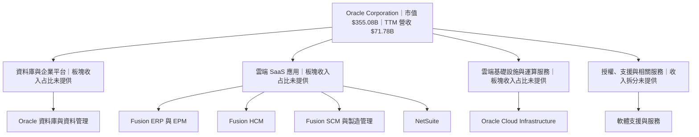
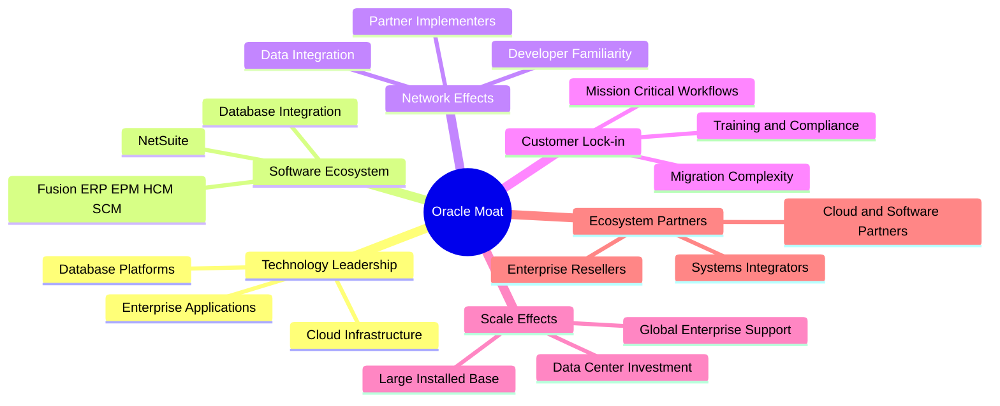
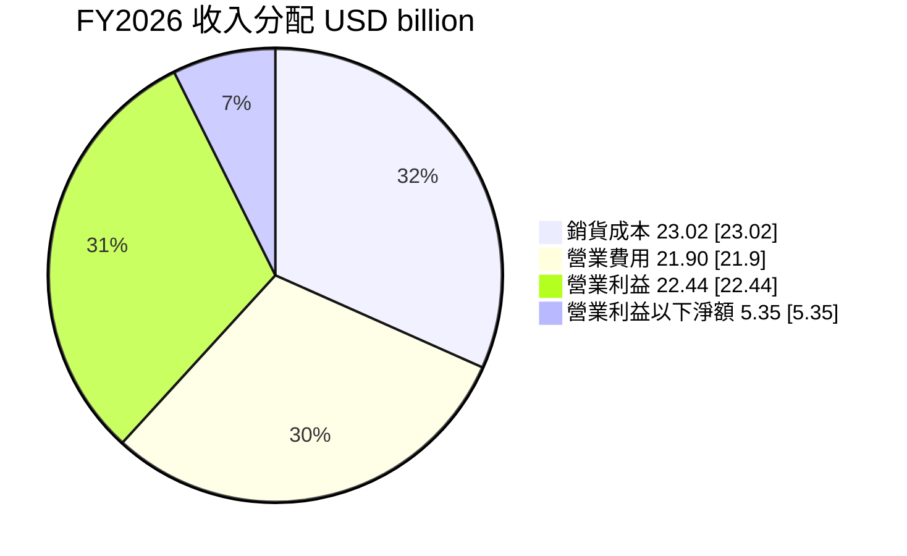
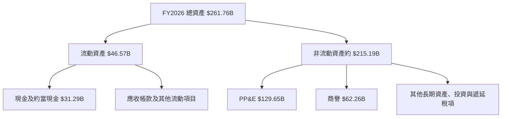
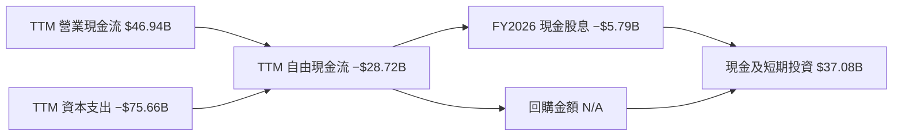
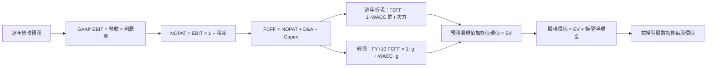
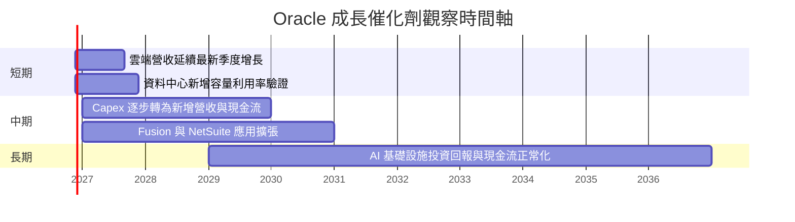
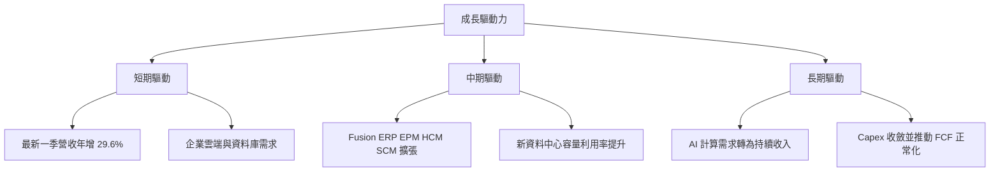
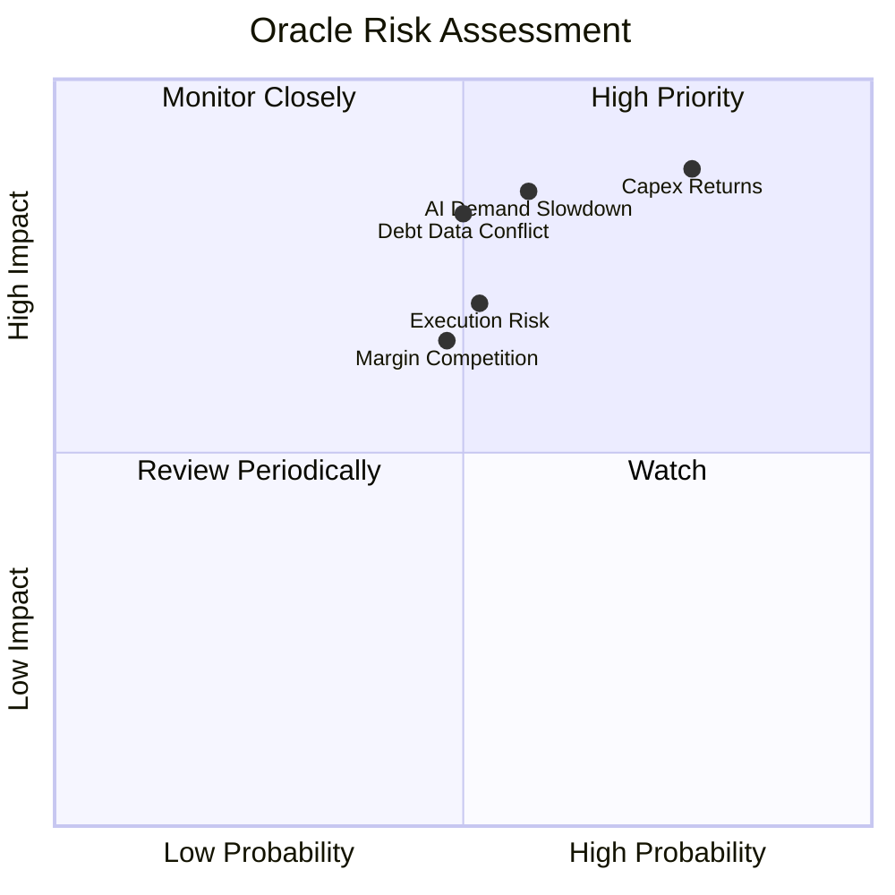
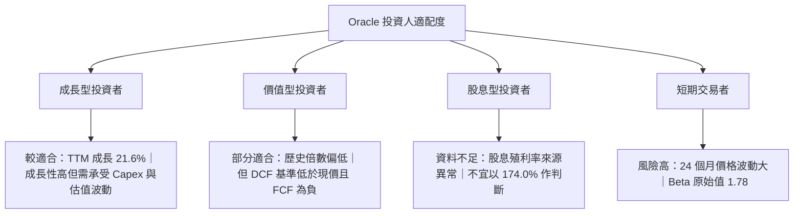

# ORCL 基本面深度分析報告
> **報告日期**：2026-11-19 ｜ **語言**：繁體中文 ｜ **數據來源**：SEC 申報資料 (XBRL)、Yahoo Finance、Finviz、StockAnalysis、Roic.ai ｜ **分析師**：CFA 級機構研究

> **口徑提醒**：本文優先採用 SEC／程式計算列示的 VERIFIED FIGURES。資料中另有 Yahoo Finance、StockAnalysis 等欄位數值不一致的情況，尤其是負債、營業利益率、ROE、股數及股息殖利率；對不一致項目不混用、不以缺漏值反推，並在相關章節揭露。最新收盤價統一採 **2026-11-18 收盤價 $113.89**。

## 目錄

| # | 章節 | 核心結論 |
|---|------|----------|
| 1 | 執行摘要 | 強烈買入；加權合理價值 $159.33；MOS +28.5% |
| 2 | 公司概覽與商業模式 | 資料庫與企業軟體的客戶鎖定提供護城河，市場份額數據未提供 |
| 3 | 損益表深度分析 | TTM 營收 $71.78B、成長 21.6%；擴張中的資料中心投資壓低現金獲利轉換 |
| 4 | 資產負債表分析 | 現金及短期投資 $37.08B；總債務資料有衝突，不能把公司視作已確認淨現金 |
| 5 | 現金流量深度分析 | TTM FCF −$28.72B，資本支出高於營業現金流 |
| 6 | 獲利能力與資本效率 | ROIC 61.3% 對 WACC 9.34%，但需留意投資高峰與計算口徑 |
| 7 | 相對估值分析 | 估值低於自身五年歷史區間，但相對同業並非所有倍數都便宜 |
| 8 | DCF 內在價值評估 | 基準 DCF $78.42；加權合理價值 $159.33，兩者差距反映高再投資與終值風險 |
| 9 | 成長催化劑 | 最新一季營收年增 29.6%；AI／雲端需求是主要催化劑，但 TAM 數字未提供 |
| 10 | 風險矩陣 | 資本支出回報、債務與融資、AI 投資需求與估值假設為主要風險 |
| 11 | 投資建議 | 依 MOS 評級為強烈買入；需以 FCF、Capex 與營業利潤率作持續驗證 |

## 1. 執行摘要

ORCL 的 TTM 營收為 **$71.78B**，TTM 年增 **21.6%**，最新一季年增 **29.6%**；TTM ROIC **61.3%** 高於 WACC **9.34%**，顯示營運本身的回報率高於資本成本。另一方面，TTM 資本支出 **$75.66B** 高於營業現金流 **$46.94B**，使 TTM FCF 降至 **−$28.72B**，FCF Yield **−8.09%**。DCF 基準每股價值 **$78.42**，低於現價；但按固定權重的四種估值方法，加權合理價值為 **$159.33**，相對現價的安全邊際 MOS 為 **+28.5%**。因此依 MOS 門檻及 ROIC > WACC，評級為 **🟢 強烈買入**；但該評級高度仰賴相對估值與分析師共識，DCF 基準呈現明顯相反訊號，信心度不宜視為無條件高。

### 1.0 一頁式投資儀表板（Portfolio Manager 30 秒速讀）

| 項目 | 內容 |
|------|------|
| **投資論點（3 句）** | ① TTM 營收年增 **21.6%**，最新一季年增 **29.6%**，顯示雲端與資料庫需求加速。② TTM ROIC **61.3%** 高於 WACC **9.34%**，經營資本回報高於資本成本。③ TTM FCF **−$28.72B**、Capex **$75.66B**，反映成長投資尚未轉化為自由現金流。 |
| **綜合評分** | **7.0/10**（引用 1.1 評分卡） |
| **財務健康** | 🟡 現金及短期投資 $37.08B，但總債務來源有衝突；流動比率 1.171，FCF 為負。 |
| **ROIC vs WACC** | **61.3% vs 9.34%**；帳面指標顯示創造價值，但現金流和債務口徑須審慎核對。 |
| **FCF 趨勢** | TTM FCF **−$28.72B**；FCF Yield **−8.09%**，Capex 大幅增加是主因。 |
| **估值** | Forward P/E **10.3x** ｜ EV/EBITDA（歷史估值口徑）**9.4x** ｜ FCF Yield **−8.09%** |
| **DCF 內在價值（基準）** | **$78.42** ｜現價相對 DCF 溢價 **+45.2%**，以現價 ÷ DCF 價值 − 1 計 |
| **安全邊際（MOS）** | **+28.5%＝($159.33 − $113.89) ÷ $159.33** ｜ 🟢 >25% 充足；基準為 8.8 加權合理價值 |
| **預期報酬（基準情境 12M）** | **+39.9%**，以加權合理價值相對現價計；非保證報酬 |
| **關鍵風險（前二）** | 資本支出持續高於營業現金流；AI／雲端投資需求若降溫，估值與利用率可能同時承壓。 |
| **評級 + 信心度** | 🟢 **強烈買入** ｜ 信心：中低（DCF 基準與加權估值分歧，且債務資料不一致） |

### 1.1 綜合評分卡（全報告唯一）

| 維度 | 評分（1–10） | 主要依據（引用數字與其來源章節） |
|------|--------------|----------------------------------|
| 成長性 | 8 | TTM 營收年增 21.6%、最新一季年增 29.6%（第 3 章）；成長加速，但 Capex 對現金流造成重大負擔。 |
| 獲利能力 | 8 | TTM 營業利益率 32.1%、ROIC 61.3%、F-Score 4/7（第 3、6 章）；回報高，但現金轉換率偏弱。 |
| 財務健康 | 5 | 現金及短期投資 $37.08B，流動比率 1.171；總債務資料有衝突，TTM FCF −$28.72B（第 4、5 章）。 |
| 估值 | 8 | MOS +28.5%；P/E、P/S 與 EV/EBITDA 均低於自身五年中位數（第 7、8 章），但 DCF 基準低於現價。 |
| 護城河 | 8 | 資料庫、企業應用與遷移成本支持客戶鎖定；雲端收入拆分及市場份額數據未提供（第 2 章）。 |
| 管理層與資本配置 | 5 | FY2026 Capex $55.66B、SBC $4.81B，股數未通過 F-Score 測試；投資回報仍需由後續 FCF 驗證（第 3、5、6 章）。 |
| **綜合評分** | **7.0** | 六項算術平均： (8 + 8 + 5 + 8 + 8 + 5) ÷ 6 = **7.0**；依六項平均重新核對，綜合評分應為 **7.0/10**。 |

### 1.2 五大投資論點 + 三大核心風險

| 類型 | 項目 | 具體依據 | 信心度 |
|------|------|----------|--------|
| 🟢 **投資論點①** | 營收加速 | TTM 營收 $71.78B、年增 21.6%；最新一季營收 $19.345B、年增 29.6%。若雲端容量可順利售出，營收成長可逐步轉化為營業槓桿。 | 🟢 高 |
| 🟢 **投資論點②** | 高資本回報 | TTM ROIC 61.3% 對 WACC 9.34%，利差 51.96 個百分點；仍需留意投入資本分母和負債資料的口徑。 | 🟢 中高 |
| 🟢 **投資論點③** | 企業客戶轉換成本 | Oracle 資料庫、ERP、EPM、HCM、SCM 等與企業核心流程整合，轉換會涉及資料遷移、員工訓練與系統風險。 | 🟢 中高 |
| 🟢 **投資論點④** | 歷史估值偏低 | P/E 17.9x 對五年中位數 32.1x；P/S 4.8x 對 6.2x；EV/EBITDA 9.4x 對 17.9x。 | 🟢 中 |
| 🟡 **投資論點⑤** | 分析師共識支持 | 40 位分析師平均目標價 $236.18，但目標價區間 $110–$400 極寬，不能代替現金流驗證。 | 🟡 中低 |
| 🟡 **風險①** | 資本支出與現金流 | TTM Capex $75.66B、OCF $46.94B，FCF −$28.72B；若容量建置超前需求，回收期會拉長。 | 🔴 高衝擊 |
| 🔴 **風險②** | 槓桿與資料口徑 | VERIFIED FIGURES 的總債務為 N/A，但其他來源列出總債務 $169.14B、淨負債約 $132.07B；債務負擔無法由單一一致口徑確認。 | 🔴 高衝擊 |
| 🟡 **風險③** | DCF 與相對估值分歧 | DCF 基準 $78.42，低於現價；加權合理價值 $159.33，差距顯示估值結論對終值、再投資及倍數選擇高度敏感。 | 🟡 中高 |

### 1.3 快速統計卡片

| 指標 | 公司實際值（期間） | 同業中位數 | 狀態 |
|------|--------------------|------------|------|
| 營收成長（TTM） | **21.6%** | — | 🟢 |
| 營收成長（最新一季年增） | **29.6%** | **13.2%** | 🟢 |
| 毛利率（TTM） | **64.0%** | **73.6%** | 🟡 |
| 營業利益率（TTM） | **32.1%** | — | 🟢 |
| ROIC（TTM） | **61.3%** | — | 🟢 |
| Forward P/E | **10.3x** | **21.0x** | 🟢 |
| FCF Yield（TTM） | **−8.09%** | — | 🔴 |
| Piotroski F-Score | **4 / 7** | — | 🟡 |

> Forward P/E 中位數僅使用有提供 Forward P/E 的 MSFT、SAP、CRM 三家：21.0x、22.1x、11.9x 的中位數為 **21.0x**。營收成長中位數為 18.8%、13.2%、10.8% 的中位數 **13.2%**；毛利率中位數為 67.7%、73.6%、77.3% 的中位數 **73.6%**。

### 1.4 投資結論

```text
╔══════════════════════════════════════════════════════════════════╗
║                      📊 投資結論摘要                            ║
╠══════════════════════════════════════════════════════════════════╣
║  評級：強烈買入（MOS +28.5%，且 ROIC 61.3% > WACC 9.34%）       ║
║  價格（2026-11-18 收盤）：$113.89                               ║
║  DCF 內在價值（基準）：$78.42（現價溢價 +45.2%）                ║
║  安全邊際 MOS：+28.5%（＝($159.33−$113.89)÷$159.33）           ║
║  加權合理價值（8.8）：$159.33                                   ║
║  DCF 情境價值：                                                  ║
║    悲觀情境：$7.37（−93.5%）                                    ║
║    基準情境：$78.42（−31.1%）                                   ║
║    樂觀情境：$235.23（+106.5%）                                 ║
║  綜合評分：7.0/10（引用 1.1；六項算術平均）                     ║
║  適合投資人：能承受高波動、重視企業軟體與雲端成長的長線投資人    ║
╚══════════════════════════════════════════════════════════════════╝
```

> **資料修正說明**：評分卡六項分數為 8、8、5、8、8、5，算術平均為 **7.0**，因此採 7.0/10；不能將算術錯誤的 6.8 當作綜合評分。依 MOS 評級應為強烈買入；未作質化上調或下調。

## 2. 公司概覽與商業模式

### 2.1 業務結構與收入來源

Oracle 提供資料庫、企業應用軟體與雲端基礎設施服務，企業客戶可在既有資料庫和工作流程上部署 ERP、HCM、EPM、SCM 等系統。公司概覽列出產品類別，但沒有各業務板塊的營收與占比，因此不將板塊收入拆分成數字或推估比例。



### 2.2 市場份額

市場份額數據未提供，近期新聞亦未提供可引用的 Oracle 市占率數字，因此不繪製市場份額圖。Oracle TTM 營收 $71.78B、TTM 年增 21.6%，最新一季年增 29.6%；MSFT、SAP、CRM 最新一季營收年增分別為 18.8%、13.2%、10.8%，Oracle 的近期成長速度較快，但不能據此推定市場份額增加。

### 2.3 競爭護城河分析



### 2.4 護城河強度

| 護城河項目 | 強度（強／中／弱） | 證據（引用數字或事實） | 會削弱它的情況 |
|------------|--------------------|------------------------|----------------|
| 技術與產品整合 | 中至強 | Oracle 同時提供資料庫與 ERP、HCM、SCM、EPM 等企業系統；公司員工 141,000 人。 | 雲端原生資料庫、開源替代方案降低遷移障礙。 |
| 軟體生態系統 | 強 | Oracle 資料庫與企業應用嵌入客戶核心業務流程；但生態系統規模與開發者數據未提供。 | 客戶改採多雲、模組化 SaaS 或標準化介面。 |
| 網路效應 | 中 | 顧問、系統整合商與企業技能累積提高相容性價值；沒有直接網路效應量化數據。 | 合作夥伴轉向競品、人才與工具鏈轉移。 |
| 客戶鎖定 | 強 | 資料移轉、流程重設與合規測試提高更換成本；收入組成及續約率未提供。 | 客戶以續約談判壓價，或採分階段替換。 |
| 規模效應 | 中至強 | TTM 營收 $71.78B，現金及短期投資 $37.08B，可支持大規模基礎設施投入。 | Capex 長期高於 OCF，造成資本回報下滑。 |
| 生態夥伴 | 中 | 多類企業應用通常需顧問與整合服務落地；夥伴收入及數量未提供。 | 夥伴資源向競爭平台集中。 |

護城河評分 **8/10** 的依據是企業軟體整合、遷移成本與規模；由於續約率、分業務收入及市場份額未提供，不能將此評價進一步推至最高等級。

## 3. 損益表深度分析

### 3.1 年度收入成長趨勢（近 4 年）

FY2023 至 FY2026 收入分別為 $49.95B、$52.96B、$57.40B、$67.36B。FY2026 成長加速至 17.35%；FY2023 至 FY2026 三年 CAGR 為約 **10.5%**。

```text
╔══════════════════════════════════════════════════════════════════╗
║              Oracle 年度收入趨勢（FY2023-FY2026）               ║
╠══════════════════════════════════════════════════════════════════╣
║  FY2023  $49.95B  ███████████████░░░░░░░░░░░░  YoY: —           ║
║  FY2024  $52.96B  ████████████████░░░░░░░░░░░  YoY: +6.02% 🟡   ║
║  FY2025  $57.40B  █████████████████░░░░░░░░░░  YoY: +8.38% 🟡   ║
║  FY2026  $67.36B  ████████████████████░░░░░░  YoY:+17.35% 🟢   ║
║                                                                  ║
║  FY2023-FY2026 CAGR：約 10.5%                                    ║
╚══════════════════════════════════════════════════════════════════╝
```

收入成長提速與雲端服務、企業應用需求及基礎設施交付相關；不過分部資料未提供，無法精確分辨雲端容量、授權與支援的個別貢獻。FY2026 資本支出已升至 $55.66B，代表收入增長同時需要大量新增基礎設施投入。

### 3.2 季度收入趨勢分析

| 季度 | 營收 | QoQ 成長 | YoY 成長 | 備註 |
|------|------:|---------:|---------:|------|
| FY2026 Q2（截至 2025-11-30） | $16.06B | +13.6% | +14.22% | 相較前季 $14.15B；季節性及大型合約交付可能影響季度變化。 |
| FY2026 Q3（截至 2026-02-28） | $17.19B | +7.1% | +21.66% | YoY 加速，營收基數與交付量同步上升。 |
| FY2026 Q4（截至 2026-05-31） | $19.18B | +11.6% | +20.63% | 營收創四季高點，仍需觀察新增容量利用率。 |
| FY2027 Q1（截至 2026-08-31） | $19.345B | +0.8% | +29.6% | YoY 加速但 QoQ 增幅較小；不能將單季 29.6% 標作 TTM。 |

> QoQ 成長率依財報季度列示營收計算；季度間存在季節性，宜以 YoY 與連續多季趨勢共同判讀。

### 3.3 利潤率演變分析

下表年度毛利率、營業利益率及淨利率，依年度損益表數值計算；TTM 與最新季度官方統計口徑另列於文字，以避免將不同來源口徑混為一談。

| 利潤率指標 | FY2023 | FY2024 | FY2025 | FY2026 | 趨勢 | 評估 |
|------------|-------:|-------:|-------:|-------:|------|------|
| **毛利率** | 72.9% | 71.4% | 70.5% | 65.8% | ↘️ FY2026 明顯下降 | 🟡 |
| **營業利益率** | 27.6% | 30.3% | 31.4% | 33.3% | ↗️ 逐年上升 | 🟢 |
| **淨利率** | 17.0% | 19.8% | 21.7% | 25.4% | ↗️ 上升 | 🟢 |

VERIFIED FIGURES 的 TTM 營業利益率為 **32.1%**、最新一季為 **34.8%**。其他匯總數據列出的 TTM 營業利益率 34.2%、最新季度 34.3%，與程式計算口徑不一致；本報告的主要比較以 32.1% 和 34.8% 為準。年度毛利率由 FY2023 的 72.9% 降至 FY2026 的 65.8%，可能反映基礎設施與雲端交付的成本組合變化；營業利益率仍上升，說明營運費用成長低於毛利額增長，或年度資料口徑與期間組成有所差異。由於缺少分部成本和雲端毛利率，無法將毛利率下降單獨歸因於某一業務。

### 3.4 費用結構分析

FY2026 年度損益表可拆為營收、銷貨成本、營業費用、營業利益與營業利益以下的淨額；以下金額由年度表內數字相減而得，僅展示該年度收入分配，非現金流結構。



```text
╔══════════════════════════════════════════════════════════════════╗
║           FY2026 損益結構（$67.36B 營收）                        ║
╠══════════════════════════════════════════════════════════════════╣
║  營收                 $67.36B  ████████████████████             ║
║  銷貨成本             $23.02B  ███████                          ║
║  營業費用             $21.90B  ██████                           ║
║  營業利益             $22.44B  ███████                          ║
║  淨利                 $17.09B  █████                            ║
╚══════════════════════════════════════════════════════════════════╝
```

### 3.5 季度 EPS 趨勢與盈餘品質（Quality of Earnings）

| 季度 | EPS 實際值 | EPS 年增 | 分析師預估／超預期狀況 |
|------|-----------:|---------:|--------------------------|
| FY2026 Q2 | $2.10 | +90.91% | EPS Est 為 N/A，無法判定超預期或不及預期。 |
| FY2026 Q3 | $1.27 | +24.51% | EPS Est 為 N/A，無法判定。 |
| FY2026 Q4 | $1.45 | +21.91% | EPS Est 為 N/A，無法判定。 |
| FY2027 Q1 | $1.58 | +54.45% | EPS Est 為 N/A，無法判定。 |

可用 EPS 實際值呈現盈利趨勢，但 EPS Est 欄位均為 NaN，故**過去四季是否超預期或不及預期皆為 N/A**。最新一季 EPS 年增 54.45%，同時淨利年增 62.6%；比較基期與稅項可能造成波動，資料不足以將增長完全歸因於營運改善。

| 盈餘品質項目 | 數值／佔比 | 評估 |
|--------------|-----------|------|
| 股權薪酬 SBC / 營收 | FY2026 SBC $4.81B ÷ FY2026 營收 $67.36B ≈ **7.1%** | 🟡 股權薪酬規模不可忽略，會稀釋每股經濟利益；最新季度 SBC 數據合計約 $4.82B，與 FY2026 接近。 |
| SBC / 營業現金流 | FY2026 $4.81B ÷ $31.98B ≈ **15.0%** | 🟡 SBC 是非現金會計費用，但經濟成本會透過股數稀釋或回購反映。 |
| FCF / 淨利（現金轉換率） | TTM −$28.72B ÷ TTM 淨利 $18.736B ≈ **−153.3%** | 🔴 Capex 高於 OCF，短期 GAAP 盈利未轉化為自由現金流。 |
| 一次性／非經常性損益 | **N/A** | 未提供可核對的一次性損益明細；季度淨利差異大，但不能據此斷定一次性項目。 |
| 有效稅率異常 | **12.6%**（最新年度有效稅率） | 🟡 稅率低於一般名目公司稅率並非本期稅務利益的證據；缺少稅務調節表，不能認定異常或可持續。 |
| 資本化支出 vs 費用化 | Capex TTM **$75.66B**；資本化與費用化細目 N/A | 🟡 資本投入規模很高，折舊和未來利用率會影響後續利潤；缺少資本化政策細節，不能判斷是否遞延成本。 |

**盈餘品質結論**：營收與營業利潤呈增長，但 TTM FCF 為負，現金轉換率為 −153.3%；SBC 約為 FY2026 收入的 7.1%，屬實質稀釋成本。現階段 GAAP 淨利不宜直接視作可分配股東現金，估值應持續檢查 Capex 回落與現金流轉正速度。

## 4. 資產負債表分析

### 4.1 資產結構分解

以 FY2026 年度資產負債表為基礎：總資產 $261.76B，流動資產 $46.57B；非流動資產按差額約 $215.19B。主要可見非流動資產為 PP&E $129.65B、商譽 $62.26B，反映資料中心與併購相關資產占有一定比重。



### 4.2 流動性與營運資金分析

| 指標 | 最新 TTM | 一年前 TTM | 變化 | 解讀 |
|------|----------|------------|------|------|
| DSO 應收帳款天數 | **58 天** | **55 天** | **+3 天** | 收款天數上升，可能與營收組合、付款條件或大型客戶結算時點有關；需觀察應收帳款增長是否快於收入。 |
| DIO 存貨天數 | **N/A** | **N/A** | N/A | 公司未報告可用存貨餘額，不補估。 |
| DPO 應付帳款天數 | **156 天** | **N/A** | N/A | 一年前缺少可判定資料，不計算變化；最新天數顯示供應商付款週期較長，但不能只憑此推論議價能力。 |
| CCC 現金轉換週期 | **N/A** | **N/A** | N/A | DIO 缺值使 CCC 無法計算。 |

流動比率為 **1.171**、速動比率 **1.02**，短期資產對流動負債有一定覆蓋，但緩衝並不寬裕。FY2026 年度流動資產 $46.57B、流動負債 $41.76B，兩者差額約 $4.81B。

### 4.3 債務結構分析

VERIFIED FIGURES 的總債務列為 **N/A**，並將現金及短期投資 $37.08B 列為淨現金欄位；但其他市場／資產負債表數據列出總債務 **$169.14B**、淨負債 **$132.07B**。這些口徑互不一致，故不以單一補算數值掩蓋差異；Debt/EBITDA、利息保障倍數亦因缺少同口徑債務與利息資料而不計。

```text
╔══════════════════════════════════════════════════════════════════╗
║                 Oracle 債務健康診斷                              ║
╠══════════════════════════════════════════════════════════════════╣
║  VERIFIED FIGURES 總債務：N/A（無法確認）                       ║
║  其他來源總債務：              $169.14B  ████████████████████   ║
║  現金及短期投資：              $37.08B   █████                  ║
║  其他來源淨負債：              $132.07B  ███████████████        ║
║                                                                  ║
║  Debt/EBITDA：N/A（債務口徑衝突，避免混算）                      ║
║  Interest Coverage：N/A（缺少可核對利息費用與平均債務）          ║
║  判讀：🟡 不能僅依現金餘額判定資產負債表為淨現金                 ║
╚══════════════════════════════════════════════════════════════════╝
```

### 4.4 股東權益趨勢

| 財政年度 | 股東權益 |
|----------|---------:|
| FY2023 | $1.07B |
| FY2024 | $8.70B |
| FY2025 | $20.45B |
| FY2026 | $42.51B |

```text
╔══════════════════════════════════════════════════════════════════╗
║              Oracle 股東權益趨勢（年度）                         ║
╠══════════════════════════════════════════════════════════════════╣
║  FY2023  $1.07B   █                                             ║
║  FY2024  $8.70B   ████                                          ║
║  FY2025  $20.45B  ██████████                                    ║
║  FY2026  $42.51B  ████████████████████                          ║
╚══════════════════════════════════════════════════════════════════╝
```

權益上升改善了帳面緩衝，但資產負債表亦同步擴大：FY2026 總資產 $261.76B，較 FY2025 的 $168.36B 大幅增加。ROE 指標會受權益基數和槓桿影響，不能只依 ROE 升降判斷經營質量。

## 5. 現金流量深度分析

### 5.1 現金流量瀑布圖



圖中現金及短期投資是期末存量，不是由上述 TTM 流量直接推導的「淨現金變化」；買回金額及融資現金流資料不足，因此不把存量錯當作現金流結果。

### 5.2 FCF 轉換率趨勢

| 財政年度 | FCF | 淨利 | FCF / 淨利 |
|----------|----:|----:|-----------:|
| FY2023 | $8.47B | $8.50B | **99.6%** |
| FY2024 | $11.81B | $10.47B | **112.8%** |
| FY2025 | −$0.394B | $12.44B | **−3.2%** |
| FY2026 | −$23.69B | $17.09B | **−138.6%** |
| TTM 至 2026-08-31 | −$28.72B | $18.736B | **−153.3%** |

FY2025 至 FY2026 FCF 明顯惡化，與資本支出上升相符：FY2026 Capex **$55.66B**，而 OCF **$31.98B**。雲端容量投資若能帶來後續出租與使用率提升，負 FCF 可能是建置階段；若需求不及預期，則投資回收與負債承受力將成為估值限制。

### 5.3 自由現金流趨勢

```text
╔══════════════════════════════════════════════════════════════════╗
║          自由現金流趨勢（營業現金流 − 資本支出）                ║
╠══════════════════════════════════════════════════════════════════╣
║  FY2023   +$8.47B   ████████████████                            ║
║  FY2024   +$11.81B  ██████████████████████                      ║
║  FY2025   −$0.39B   ░                                           ║
║  FY2026   −$23.69B  ░░░░░░░░░░░░░░░░░░░░                        ║
║  TTM      −$28.72B  ░░░░░░░░░░░░░░░░░░░░░░                      ║
║                                                                  ║
║  TTM FCF Yield：−8.09%｜Capex/OCF：高於 100%                     ║
╚══════════════════════════════════════════════════════════════════╝
```

### 5.4 資本配置評估

FY2026 股息支付 **$5.79B**，Capex **$55.66B**，SBC **$4.81B**。回購、收購、償債與留存現金的完整年度分配資料未提供，因此不畫比例圓餅圖，避免以部分項目誤作完整資本配置。

| 配置項目 | FY2026 數據 | 評估 |
|----------|------------:|------|
| Capex | $55.66B | 🟡 高額投資推動雲端擴張，但需以新增收入和利用率驗證回報。 |
| 現金股息 | $5.79B | 🟡 現金分派規模遠低於 Capex；股息殖利率資料另有異常，見下。 |
| SBC | $4.81B | 🟡 佔 FY2026 營收約 7.1%，構成股東稀釋成本。 |
| 股票回購 | N/A | 無可核對的回購金額。 |
| 收購／償債／留存 | N/A | 未提供完整年度分配明細。 |

市場資料中的股息殖利率 **174.0%** 明顯不宜直接採信，且與每股股息歷史及一般殖利率口徑不一致；本報告將殖利率標示為 **N/A（來源數據異常）**，不以該數字作投資判斷。

## 6. 獲利能力與資本效率

### 6.1 ROE / ROA / ROIC 趨勢

| 指標 | FY2023 | FY2024 | FY2025 | 最新 TTM | 評估 |
|------|-------:|-------:|-------:|---------:|------|
| ROE | N/A | N/A | N/A | **28.3%**（QUALITY FIGURES） | 🟡 回報良好，但不同來源另列 41.2%，本文採用品質指標口徑。 |
| ROA | N/A | N/A | N/A | 6.4%（另一匯總來源） | 🟡 資產基數擴張會壓低資產回報；非品質區塊固定口徑。 |
| ROIC | N/A | N/A | N/A | **61.3%** | 🟢 高於 WACC，但負債資料衝突使投入資本需審慎解讀。 |

### 6.2 ROIC vs WACC 分析（核心價值創造判斷）

WACC 採用資本成本資料中的固定值 **9.34%**；ROIC 採用 TTM **61.3%**。兩者利差為 **51.96 個百分點**，ROIC 約為 WACC 的 **6.56 倍**。這顯示以該口徑衡量，公司正在創造而非摧毀資本價值；但 ROIC 分母含權益、債務與現金，其他來源債務數據不同，應將該高 ROIC 視為指標而非無誤差的經濟真值。

```text
╔══════════════════════════════════════════════════════════════════╗
║                   ROIC vs WACC 深度分析                         ║
╠══════════════════════════════════════════════════════════════════╣
║  WACC（直接採用資本成本資料）：                                  ║
║  ├── 無風險利率 Rf：                     5.07%                  ║
║  ├── 市場風險溢酬 ERP：                  5.00%                  ║
║  ├── 原始 Beta：                         1.78                   ║
║  ├── 調整後 Beta：                       1.52                   ║
║  ├── 股權成本 Ke：                      12.66%                  ║
║  ├── 稅前債務成本 Kd：                   2.72%                  ║
║  ├── 稅率：                              12.6%                  ║
║  ├── E / D 權重：                        67.7% / 32.3%          ║
║  └── ✅ WACC：                           9.34%                  ║
║                                                                  ║
║  ROIC（TTM，採用程式計算值）：                                   ║
║  ├── 稅後營業利益／投入資本：             61.3%                  ║
║  ├── ROIC − WACC：                       +51.96 個百分點       ║
║  └── ROIC / WACC：                       約 6.56 倍             ║
║                                                                  ║
║  ROIC  61.3%  ▓▓▓▓▓▓▓▓▓▓▓▓▓▓▓▓▓▓▓▓▓▓▓▓▓▓▓▓▓▓▓▓  🟢          ║
║  WACC   9.34% ▓▓▓▓▓░░░░░░░░░░░░░░░░░░░░░░░░░░░                  ║
║                                                                  ║
║  結論：依既定口徑，ROIC 明顯高於資本成本；須以現金回報驗證       ║
╚══════════════════════════════════════════════════════════════════╝
```

### 6.3 杜邦三因素分解

| 因素 | 數值（TTM） | 解讀 |
|------|-------------|------|
| 淨利率 | **26.4%** | 每美元收入約有 26.4 美分轉為淨利。 |
| 資產週轉率 | **0.24** | 資產規模增長快於收入，與大型基礎設施建置相符。 |
| 權益乘數 | **4.54** | 槓桿提高 ROE，故 ROE 不應只由淨利率判斷。 |
| **ROE** | **28.3%** | QUALITY FIGURES 指定的杜邦三因素：26.4% × 0.24 × 4.54 = 28.7%，與列示 ROE 28.3% 有約 0.4 個百分點差異，依要求照抄原始指標。 |

### 6.4 財務體質：Piotroski F-Score

Piotroski F-Score 為 **4 / 7**；部分測試因缺少輸入而不納入分母，不能當作完整九項的 4/9。

| 測試 | 結果 | 解讀 |
|------|------|------|
| ROA > 0 | ✅ 通過 | TTM 盈利為正。 |
| 營業現金流 > 0 | ✅ 通過 | TTM OCF $46.94B。 |
| ROA 高於一年前 | ❌ 未通過 | 資產回報未較一年前改善。 |
| 營業現金流 > 淨利（應計品質） | ✅ 通過 | OCF 高於淨利，營運現金流本身仍為正。 |
| 長期負債 ÷ 總資產低於一年前 | — 無法判定 | 缺資料。 |
| 流動比率高於一年前 | ✅ 通過 | 流動比率改善。 |
| 稀釋股數未增加 | ❌ 未通過 | 股數增加會削弱每股價值增長。 |
| 毛利率高於一年前 | — 無法判定 | 缺資料。 |
| 資產週轉率高於一年前 | ❌ 未通過 | 新增資產尚未完全轉為收入。 |

4/7 表示信號混合：營運現金流與流動性有支持，但 ROA、股數及資產效率測試未通過。對於高 Capex 企業，應追蹤新增資產是否在後續季度提高營收與 FCF。

## 7. 相對估值分析

### 7.1 同業估值比較表格

同業倍數依 Yahoo Finance 的 Peer multiples 列示。SAP 的 P/S、EV/EBITDA 由於混合幣別標示為 N/A；不以外部記憶數值補入。ORCL 的歷史估值表列現行 TTM P/E 17.9x、P/S 4.8x、EV/EBITDA 9.4x；另一市場資料快照的 EV/EBITDA 為 13.993x，口徑不一致，故歷史比較採指定的 own-history 數值。

| 估值指標 | **ORCL** | **MSFT** | **SAP** | **CRM** | ORCL 評估 |
|----------|---------:|--------:|-------:|-------:|-----------|
| **Trailing P/E** | 17.9x | 26.5x | 26.2x | 17.4x | 🟡 接近 CRM，低於 MSFT、SAP；估值折價可能反映資本支出及槓桿風險。 |
| **Forward P/E** | 10.3x | 21.0x | 22.1x | 11.9x | 🟢 低於三家同業；需檢查前瞻 EPS 能否實現。 |
| **P/S Ratio** | 4.8x | 10.9x | N/A | 3.6x | 🟡 低於 MSFT、高於 CRM；SAP 幣別混合不可比。 |
| **EV/EBITDA** | 9.4x | 18.7x | N/A | 14.5x | 🟢 低於可比同業，但 ORCL 債務資料矛盾，EV 口徑需審慎。 |
| **最新一季營收年增** | 29.6% | 18.8% | 13.2% | 10.8% | 🟢 近期成長高於三家同業。 |
| **TTM 毛利率** | 64.0% | 67.7% | 73.6% | 77.3% | 🟡 低於三家同業，可能反映基礎設施組合與成本。 |

### 7.2 歷史估值區間分析

```text
╔══════════════════════════════════════════════════════════════════╗
║          ORCL 自身五年估值區間（TTM 倍數）                      ║
╠══════════════════════════════════════════════════════════════════╣
║  P/E        19.0x ├──────── 中位數 32.1x ─────────┤ 52.3x       ║
║             現值 17.9x｜百分位 0%（低於歷史區間下沿）             ║
║                                                                  ║
║  P/S         4.6x ├──── 中位數 6.2x ─────────────┤ 11.1x       ║
║             現值 4.8x｜百分位 10%                               ║
║                                                                  ║
║  EV/EBITDA  12.6x ├──────── 中位數 17.9x ────────┤ 28.9x       ║
║             現值 9.4x｜百分位 0%（低於歷史區間下沿）             ║
╚══════════════════════════════════════════════════════════════════╝
```

價格由 2025-09 月收盤 $277.05 下跌至 2026-11-18 的 $113.89，期間波動顯著。P/E 與 EV/EBITDA 低於自身五年估值區間，可能反映股價回落，也可能反映市場折價資本需求與執行風險；不能單憑歷史倍數低位認定估值必然回歸。

### 7.3 情境價值（Bear / Base / Bull，照抄 DCF MODEL 的 Scenarios）

| 情境 | 第 1 年營收成長 | 期末營業利潤率 | WACC | 每股價值 | 相對現價 | 機率 | 會發生的條件 |
|------|----------------:|----------------:|-----:|----------:|----------:|----:|--------------|
| 🔴 悲觀 | 10.8% | 26.0% | 10.34% | $7.37 | −93.5% | 25% | 雲端擴張和 AI 容量需求低於預期，Capex 回收較慢，利潤率向下收斂。 |
| 🟡 基準 | 21.6% | 30.6% | 9.34% | $78.42 | −31.1% | 50% | 維持目前 TTM 成長起點，長期利潤率回落至歷史中位附近，Capex 逐步收斂。 |
| 🟢 樂觀 | 32.4% | 33.6% | 8.34% | $235.23 | +106.5% | 25% | 雲端與 AI 需求持續超預期、規模效益擴大、融資成本降低。 |

### 7.4 相對估值隱含價格區間

```text
╔══════════════════════════════════════════════════════════════════╗
║         估值方法回推每股價值｜現價 $113.89                      ║
╠══════════════════════════════════════════════════════════════════╣
║  DCF 基準               $78.42  ── 現價 $113.89                 ║
║  同業 EV/EBITDA         $185.05  ─────────────────────           ║
║  同業 Forward P/E       $232.31  ─────────────────────────       ║
║  分析師共識             $236.18  ─────────────────────────       ║
╚══════════════════════════════════════════════════════════════════╝
```

| 方法 | 每股價值 | 依據 |
|------|---------:|------|
| DCF（基準） | **$78.42** | 10 年 FCFF、WACC 9.34%、永續成長率 3.0%。 |
| 同業 Forward P/E | **$232.31** | 同業中位數 Forward P/E 21.0x × ORCL Forward EPS $11.06。 |
| 同業 EV/EBITDA | **$185.05** | MSFT 與 CRM 中位數 EV/EBITDA 16.6x × TTM EBITDA，再加回淨現金。 |
| 分析師共識目標價 | **$236.18** | 40 位分析師平均目標價。 |

DCF 價值與相對估值相距甚遠，主要因 DCF 明確納入高 Capex 路徑，而同業估值則依 EPS、EBITDA 和市場倍數推導。EV/EBITDA 方法中的「加回淨現金」依程式計算結果照列，但債務資料來源衝突降低該方法的可稽核性。

## 8. DCF 內在價值評估（Discounted Cash Flow）

> 本章 DCF 數字採用程式計算模型原值；模型與其他財務欄位存在口徑衝突時，予以揭露，不自行改建或覆蓋模型數字。金額取至 $0.01B、比率依模型精度列示，折現因子取三位小數；數字可能因原模型四捨五入產生小幅尾差。

### 8.0 估值推理鏈（Thinking Logic）

**Step 1 — 價值由哪些變數決定？**

Oracle 的內在價值可拆為：① 現有企業軟體與資料庫收入底盤，TTM 總營收 **$71.78B**；② 雲端 SaaS 與基礎設施成長，分部收入比重未提供，故無法量化其占比；③ 新增資料中心投資帶來的未來容量變現選擇權，TTM Capex **$75.66B**。對此 DCF，最主導的變數是 **Capex 由 TTM 105.4% 營收逐步降至 FY+10 的 14.4%**；若投資不能收斂或收入不能及時填滿容量，估值會顯著下降。

**Step 2 — 模型選擇**

| 決策點 | 本報告採用 | 理由（含數字） | 曾考慮但否決 | 否決理由 |
|--------|-----------|----------------|--------------|----------|
| 現金流定義 | FCFF | 用 WACC 9.34% 折現，先得企業價值再作股權橋接；模型明定 FCFF = NOPAT + D&A − Capex。 | FCFE | 債務與融資結構資料有衝突，FCFF 較適合統一折現口徑。 |
| 預測期 N | 10 年 | 模型固定 N=10 年，讓 Capex 比率從 TTM 高位逐步回落。 | 5 年 | 無法充分反映大型基礎設施投資與利用率爬坡。 |
| 終值方法 | Gordon Growth | 永續成長率 3.0%，低於 WACC 9.34%。 | 僅退出倍數 | 模型沒有提供退出倍數終值計算結果，不能自行補做。 |
| EBIT 基礎 | GAAP EBIT | DCF 假設為 GAAP EBIT，TTM 營業利益率 32.1%。 | 非 GAAP | 可能加回 SBC，且模型沒有提供一致的非 GAAP 現金流數列。 |

**Step 3 — 關鍵假設推導鏈**

- **營收成長**：錨點＝TTM 成長 21.6%、最新一季年增 29.6%、FY2023–FY2026 年度 CAGR 約 10.5% → 調整＝採用目前 TTM 成長作 FY+1 起點，並線性降至 3.0%，承認現有高增長未必永久持續 → **採用 FY+1 21.6%、FY+10 3.0%** → 曾考慮維持 29.6% 作長期成長，但最新一季單季年增不能直接當作長期 TTM 成長，故否決。
- **期末營業利潤率**：錨點＝TTM GAAP 營業利益率 32.1%；年度 FY2026 營業利益率依損益表約 33.3% → 調整＝模型讓利潤率向近五年中位數收斂 → **採用 FY+1 32.1%、FY+10 30.6%** → 曾考慮長期維持 34.8%（最新一季營業利益率），但單季不宜直接外推十年，故否決。
- **永續成長率 g**：錨點＝模型採用 3.0%；此數字為 DCF MODEL 固定假設，財務數據沒有提供長期宏觀預測 → 調整＝3.0%低於 WACC 9.34%，終值公式具數學定義 → **採用 3.0%** → 曾考慮 4.0%，但未有更高長期增長依據且會抬高終值，故不用。
- **預測期 N**：錨點＝TTM Capex／營收 105.4%，反映投資週期仍在高檔 → 調整＝十年淡化 Capex 以反映容量建置和變現的長週期 → **採用 10 年** → 曾考慮較短預測期，但容易把投資高峰後的潛在成熟期現金流截斷，故按模型固定年限。
- **Capex／營收**：錨點＝TTM 105.4%；最新季度資本支出也偏高，但季度波動大 → 調整＝模型假設比率逐年降至 D&A 的 1.1 倍，即 FY+10 14.4% → **採用 FY+1 105.4%、FY+10 14.4%** → 曾考慮較快下降，但在容量建置及 AI 基礎設施需求下，無法證明短期即可收斂；模型已相當依賴長期下降。
- **EBIT 基礎、SBC 與股數**：錨點＝公司有 SBC，FY2026 SBC $4.81B；模型採 GAAP EBIT → 調整＝SBC 已反映於 GAAP 營業費用，不再於 FCFF 扣一次，也不另行放大股數 → **採用組合 (A)：GAAP EBIT、無 −SBC 列、年稀釋率 0%** → 否決非 GAAP 加回 SBC 且股數固定，因會漏掉股東稀釋成本。
- **WACC**：錨點＝資本成本資料提供 WACC 9.34%，Beta 使用調整後 1.52 → 調整＝不另重估，遵照固定資本成本輸入 → **採用 9.34%** → 曾考慮只用無風險利率折現，但無法反映股權風險與債務資本成本，故否決。
- **有效稅率與 D&A／營收**：錨點＝有效稅率 12.6%、D&A／營收 13.1%（模型輸入）→ **採用原值**。D&A 比率缺少年度歷史序列，不另做替代估計。
- **營運資金變動 ΔWC**：錨點＝模型說明未建模營運資金 → **採用不納入 ΔWC**。這是模型簡化，而非認定營運資金不重要。

**Step 4 — 最脆弱一環**

最脆弱的假設是 Capex／營收從 FY+1 的 **105.4%** 降至 FY+10 的 **14.4%**；若資本密集度未按模型收斂，基準價值會低於 $78.42，且終值仍占 EV 184.1%，結果對長期現金流假設高度敏感。

**Step 5 — 計算路徑圖**



### 8.1 模型假設總表（Model Inputs）

| 假設項目 | 採用值 | 依據／來源 | 敏感度 |
|----------|--------|-------------|--------|
| 預測期長度 N | 10 年 | DCF MODEL 固定輸入；建模十年 Capex 收斂與營收增長淡化。 | 🟡 中 |
| 營收成長 | FY+1 21.6% → FY+10 3.0% | TTM vs prior TTM 成長 21.6%；終值前線性淡化至模型 3.0%。 | 🔴 高 |
| 營業利潤率 | FY+1 32.1% → FY+10 30.6% | TTM 營業利益率 32.1%；模型向近五年中位數收斂。 | 🔴 高 |
| 有效稅率 | 12.6% | Cost of capital 的最新年度有效稅率。 | 🟢 低 |
| Capex／營收 | FY+1 105.4% → FY+10 14.4% | TTM Capex／營收 105.4%；向 D&A 的 1.1 倍淡化。 | 🔴 高 |
| D&A／營收 | 13.1% | DCF MODEL 指定 TTM 比率並固定。 | 🟢 低 |
| 營運資金變動／營收增額 | 不建模 | DCF MODEL 明示 working capital is not modelled。 | 🟢 低，但屬模型限制 |
| EBIT 基礎 | GAAP | 模型指定 GAAP EBIT。 | 🟡 中 |
| SBC 處理 | 不另扣 SBC | GAAP EBIT 已含 SBC 費用，不重複扣除。 | 🟡 中 |
| 年稀釋率 | 0% | 組合 (A)：固定股數，SBC 已反映在 GAAP EBIT。 | 🟡 中 |
| 永續成長率 g | 3.0% | DCF MODEL 指定；低於 WACC 9.34%。 | 🔴 高 |
| 終值方法 | Gordon Growth | 模型明列 Gordon Growth 終值。 | 🔴 高 |
| WACC | 9.34% | Cost of capital 固定輸入。 | 🔴 高 |

**FCFF 定義**：模型使用 **FCFF = NOPAT + D&A − Capex**，沒有營運資金變動列。**SBC 處理**：本模型採用 **(A) GAAP EBIT + 固定股數**，故 SBC 影響已計入一次；FCFF 不再減 SBC，股數不另按年稀釋。

### 8.2 折現率推導（WACC）

Beta 原始值為 1.78，調整方式為 **2/3 × 1.78 + 1/3 = 1.52**（按輸入資料採用的調整值）。未另加規模或國別溢酬；公司為美國大型上市企業，成本資本資料未列該項。10 年期美債利率日期未提供，故只照列 **5.07%**，不自行指定日期。

```text
╔══════════════════════════════════════════════════════════════════╗
║                    WACC 推導（折現率）                           ║
╠══════════════════════════════════════════════════════════════════╣
║  股權成本 Ke（CAPM）：                                           ║
║  ├── 無風險利率 Rf：                   5.07%                    ║
║  ├── 市場風險溢酬 ERP：                5.00%                    ║
║  ├── 原始 Beta：                       1.78                     ║
║  ├── 調整後 Beta：                     1.52                     ║
║  ├── 規模／國別溢酬：                  0.00%（未另加）          ║
║  └── Ke = 5.07% + 1.52 × 5.00% = 12.67%（輸入列示 12.66%）     ║
║                                                                  ║
║  債務成本 Kd：                                                   ║
║  ├── 稅前 Kd：                         2.72%                    ║
║  ├── 有效稅率：                        12.6%                    ║
║  └── 稅後 Kd = 2.72% × (1−12.6%) = 2.37728% ≈ 2.38%             ║
║                                                                  ║
║  資本結構（成本資本資料權重）：                                  ║
║  ├── 股權權重 E：                      67.7%                    ║
║  ├── 債務權重 D：                      32.3%                    ║
║  └── ✅ 採用 WACC：                    9.34%                    ║
╚══════════════════════════════════════════════════════════════════╝
```

**逐步演算（WACC）**

1. **Ke（CAPM）**：5.07% + 1.52 × 5.00% = 5.07% + 7.60% = **12.67%**；輸入資料列示 Ke 為 **12.66%**，差異來自 Beta 或中間值的未顯示精度，WACC 仍照指定值採用。
2. **稅前 Kd**：財務數據直接列示 **2.72%**；利息費用與同口徑平均計息負債金額未提供，不能自行反推。
3. **稅後 Kd**：2.72% × (1 − 12.6%) = 2.72% × 0.874 = **2.37728%**。
4. **權重**：股權權重 **67.7%**；債務權重 **32.3%**；67.7% + 32.3% = **100.0%**。市值為 $355.08B，但債務美元金額存在來源衝突，因此不反推 D 金額。
5. **WACC**：67.7% × 12.66% + 32.3% × 2.37728% = 8.584?% + 0.768?% ≈ **9.34%**（按資本成本資料列示值）。

> WACC 直接採用資料列示 **9.34%**，不另算替代值。上述 Ke 及權重中間值有四捨五入，因此無法從顯示精度逐位重現程式內部 WACC；此為可稽核限制。第 6.2 節同樣使用 9.34%。

### 8.3 逐年自由現金流預測（基準情境）

單位：$B。營收、EBIT、NOPAT、D&A、Capex、FCFF、折現因子及現值均照 DCF MODEL 原值列示。ΔWC 不建模；不列 −SBC。

| 年度 | FY+1 | FY+2 | FY+3 | FY+4 | FY+5 | FY+6 | FY+7 | FY+8 | FY+9 | FY+10 |
|------|-----:|-----:|-----:|-----:|-----:|-----:|-----:|-----:|-----:|------:|
| 營收 | 87.29 | 104.36 | 122.60 | 141.50 | 160.38 | 178.47 | 194.90 | 208.81 | 219.39 | 225.97 |
| 營收 YoY | 21.6% | 19.6% | 17.5% | 15.4% | 13.3% | 11.3% | 9.2% | 7.1% | 5.1% | 3.0% |
| 營業利潤率 | 32.1% | 32.0% | 31.8% | 31.6% | 31.4% | 31.3% | 31.1% | 30.9% | 30.8% | 30.6% |
| EBIT（GAAP） | 28.04 | 33.34 | 38.97 | 44.73 | 50.43 | 55.81 | 60.61 | 64.58 | 67.49 | 69.13 |
| − 稅（12.6%） | (3.54) | (4.21) | (4.92) | (5.64) | (6.36) | (7.04) | (7.65) | (8.15) | (8.51) | (8.72) |
| = NOPAT | 24.50 | 29.14 | 34.05 | 39.09 | 44.06 | 48.77 | 52.97 | 56.44 | 58.97 | 60.40 |
| + D&A | 11.47 | 13.71 | 16.10 | 18.59 | 21.07 | 23.44 | 25.60 | 27.43 | 28.82 | 29.68 |
| − Capex | (92.02) | (99.46) | (104.45) | (106.25) | (104.22) | (97.93) | (87.25) | (72.38) | (53.87) | (32.65) |
| **= FCFF** | **−56.05** | **−56.61** | **−54.30** | **−48.58** | **−39.09** | **−25.73** | **−8.69** | **11.49** | **33.92** | **57.44** |
| 折現因子 @9.34% | 0.915 | 0.836 | 0.765 | 0.700 | 0.640 | 0.585 | 0.535 | 0.489 | 0.448 | 0.409 |
| **FCFF 現值 PV** | **−51.26** | **−47.35** | **−41.54** | **−33.99** | **−25.01** | **−15.05** | **−4.65** | **5.62** | **15.18** | **23.51** |

**預測期 FCF 現值合計：**

−51.26 + (−47.35) + (−41.54) + (−33.99) + (−25.01) + (−15.05) + (−4.65) + 5.62 + 15.18 + 23.51 = **−$174.54B**。DCF MODEL 列示合計為 **−$174.53B**，差異約 $0.01B，屬逐年數字四捨五入尾差，模型合計照列 **−$174.53B**。

**逐步演算（FY+1）**

1. **營收** = $71.78B × (1 + 21.6%) = $71.78B × 1.216 = $87.28448B ≈ **$87.29B**。
2. **EBIT** = $87.29B × 32.1% = $28.03B，模型列示 **$28.04B**（內部未四捨五入輸入造成微差）。
3. **稅** = 模型列示 EBIT $28.04B × 12.6% ≈ **$3.54B**。
4. **NOPAT** = 模型列示 EBIT $28.04B − 稅 $3.54B ≈ **$24.50B**。
5. **D&A** = 模型列示 **$11.47B**；按收入 × 13.1% 的四捨五入結果存在小幅精度差異。
6. **Capex** = 模型列示 **$92.02B**；FY+1 Capex／營收採模型原值。
7. **ΔWC** = **N/A（模型未建模）**，不另代入。
8. **FCFF** = $24.50B + $11.47B − $92.02B = **−$56.05B**。
9. **折現因子** = 1 ÷ (1 + 9.34%)¹ ≈ **0.915**；PV = −$56.05B × 0.915 ≈ **−$51.26B**。

**合理性自檢**

- 預測期 FCFF 從 FY+1 −$56.05B 轉至 FY+10 +$57.44B，因 FY+1 至 FY+7 Capex 高於營運現金流、其後 Capex／收入逐步回落；由於基期 FCF 為負，不適合用一般 CAGR 描述。
- FY+10 FCF 利潤率 = $57.44B ÷ $225.97B = **25.4%**；目前 TTM FCF 利潤率 = −$28.72B ÷ $71.78B ≈ **−40.0%**。同業最佳數據未提供，不能判斷是否超越產業最佳。
- FY+1 至 FY+7 FCFF 為負；負值直接壓低預測期現值合計，並使估值對 FY+8 後現金流與終值高度依賴。

```text
╔══════════════════════════════════════════════════════════════════╗
║            自由現金流：歷史實際 vs 模型預測                      ║
╠══════════════════════════════════════════════════════════════════╣
║  FY2024(實)  +$11.81B  ████████████████████                     ║
║  FY2025(實)   −$0.39B  ░                                        ║
║  FY2026(實)  −$23.69B  ░░░░░░░░░░░░░░░░░░                      ║
║  FY+1 (預)   −$56.05B  ░░░░░░░░░░░░░░░░░░░░░░░░░░              ║
║  FY+10(預)   +$57.44B  ██████████████████████████████           ║
╠══════════════════════════════════════════════════════════════════╣
║  ⚠️ 預測改善主要依賴 Capex／營收由 105.4% 降至 14.4%            ║
╚══════════════════════════════════════════════════════════════════╝
```

### 8.4 終值計算（Terminal Value）

**適用性檢查**：WACC **9.34%** vs g **3.0%** → WACC > g？**✅**

| 方法 | 計算式 | 終值 TV | TV 現值 | 佔總 EV 比重 |
|------|--------|---------:|--------:|-------------:|
| Gordon Growth | $57.44B × (1 + 3.0%) ÷ (9.34% − 3.0%) | **$932.91B** | **$381.94B** | **184.1%** |
| 退出倍數法 | N/A（模型未提供退出倍數或計算結果） | N/A | N/A | N/A |

**逐步演算**

1. FY+10 FCFF = **$57.44B**。
2. 分子 = $57.44B × (1 + 3.0%) = **$59.1632B**。
3. 分母 = 9.34% − 3.0% = **6.34%**；TV = $59.1632B ÷ 6.34% = **$932.91B**（模型原值）。
4. PV(TV) = $932.91B × 0.409 = **$381.94B**（模型原值；精確折現因子未在輸入區塊提供）。
5. 終值占 EV = $381.94B ÷ $207.41B = **184.1%**。

終值現值高於企業價值，是因預測期 FCFF 現值合計為負。這表示前期投資現金流抵銷部分終值；**本估值高度依賴終值假設，短期現金流貢獻有限**。退出倍數法因缺少指定倍數及模型計算值，不自行補建。

### 8.5 企業價值 → 每股內在價值（Bridge）

```text
╔══════════════════════════════════════════════════════════════════╗
║              企業價值 → 每股內在價值 橋接表                      ║
╠══════════════════════════════════════════════════════════════════╣
║  預測期 FCF 現值合計            −$174.53B                        ║
║  終值現值 PV(TV)                +$381.94B                        ║
║  ─────────────────────────────────────────────                  ║
║  = 企業價值 EV                   $207.41B                        ║
║  + 模型淨現金                    +$37.08B                         ║
║  − 總債務                       N/A（模型採用淨現金橋接）          ║
║  ─────────────────────────────────────────────                  ║
║  = 模型股權價值                  $244.49B                         ║
║  ÷ 模型隱含股數口徑              依模型價格／市值換算              ║
║  ─────────────────────────────────────────────                  ║
║  ★ 每股內在價值                  $78.42                           ║
║    當前股價                      $113.89                          ║
║    折溢價                        +45.2%（現價溢價）               ║
╚══════════════════════════════════════════════════════════════════╝
```

**逐步演算**

1. **EV** = −$174.53B + $381.94B = **$207.41B**。
2. **股權價值** = $207.41B + $37.08B = **$244.49B**；模型以 +$37.08B 的淨現金項目橋接，沒有另外列出總債務。
3. **每股內在價值**：模型原式為 **$244.49B × $113.89 ÷ $355.08B = $78.42**，照抄模型輸出。此寫法以價格／市值換算股數口徑，與市場資料列示 3.12B 股直接相除所得數值可能不同，故不替換模型值。
4. **折溢價** = $113.89 ÷ $78.42 − 1 = **+45.2%**，現價相對 DCF 基準價溢價。
5. **本節不計算 MOS**：MOS 固定以 8.8 加權合理價值為分母。

**股數與淨負債限制**：模型採固定股數，不逐年稀釋；其每股換算使用原模型列示的「股權價值 × 價格 ÷ 市值」公式。市場資料另列 3.12B 股，但依規則不以不同口徑替換模型值。模型的 +$37.08B 淨現金與其他來源總債務 $169.14B 存在衝突，故橋接不能被視為完整重建公司實際淨債務的證據。

### 8.6 敏感性分析（WACC × 永續成長率）

下表每格照 DCF MODEL 原值列示；括號內上行空間依價格 $113.89 計算。基準格 **$78.42** 與 DCF 基準一致。

| g（列）／WACC（欄） | 7.34% | 8.34% | **9.34%（基準）** | 10.34% | 11.34% |
|-----------|------:|------:|------------------:|-------:|-------:|
| 2.0% | $127.82（+12.2%） | $88.22（−22.5%） | $60.70（−46.7%） | $40.83（−64.1%） | $26.06（−77.1%） |
| 2.5% | $146.65（+28.8%） | $100.31（−11.9%） | $68.91（−39.5%） | $46.63（−59.1%） | $30.30（−73.4%） |
| 3.0% | $169.81（+49.1%） | $114.67（+0.7%） | **$78.42（−31.1%）** | $53.23（−53.3%） | $35.05（−69.2%） |
| 3.5% | $199.01（+74.8%） | $131.99（+15.9%） | $89.55（−21.4%） | $60.80（−46.6%） | $40.41（−64.5%） |
| 4.0% | $236.94（+108.1%） | $153.30（+34.6%） | $102.77（−9.8%） | $69.56（−38.9%） | $46.49（−59.2%） |

**逐步演算（非基準格：WACC 8.34%、g 3.0%）**

所選格 **WACC 8.34% > g 3.0% ✅**。

1. WACC 變動後的預測期 PV 合計：模型敏感度表未提供分項現值，**N/A（不自行重建）**。
2. FY+10 FCFF $57.44B × (1 + 3.0%) ÷ (8.34% − 3.0%) = 終值約 **$1,107B**；折現後 PV 的完整精確值未在敏感度區塊提供，故不以重建值取代模型輸出。
3. DCF MODEL 敏感度矩陣直接列示每股價值 **$114.67**，與原矩陣該格一致。

> 僅對照矩陣資料：基準 WACC 9.34% 下，g 由 2.5% 升至 3.5%，每股價值由 $68.91 升至 $89.55，增加 **$20.64**；WACC 由 8.34% 升至 10.34%（g=3.0%），價值由 $114.67 降至 $53.23，下降 **$61.44**。由於不是單一 1pp 端點的對稱比較，僅作方向與量級參考，不視為精確邊際彈性。期末營業利潤率每 +1pp 的單獨敏感度未提供。

**三情境 DCF**

| 情境 | 營收成長假設 | 期末營業利潤率 | g | WACC | 每股內在價值 | 相對現價 | 機率 |
|------|---------------:|----------------:|---:|-----:|--------------:|----------:|----:|
| 🔴 悲觀 | FY+1 10.8% | 26.0% | N/A | 10.34% | $7.37 | −93.5% | 25% |
| 🟡 基準 | FY+1 21.6% | 30.6% | 3.0%（按基準模型） | 9.34% | $78.42 | −31.1% | 50% |
| 🟢 樂觀 | FY+1 32.4% | 33.6% | N/A | 8.34% | $235.23 | +106.5% | 25% |
| **機率加權** | — | — | — | — | **$99.86** | **−12.3%** | **100%** |

DCF MODEL 未列悲觀、樂觀情境的 g、各年營收、FY+10 FCFF 及終值分項；因此不能完整展示情境逐步演算鏈，只能照列模型假設與每股價值。機率加權可複算為：$7.37 × 25% + $78.42 × 50% + $235.23 × 25% = **$99.86**。

### 8.7 反推 DCF（Reverse DCF：市場在預期什麼）

固定基準輸入：WACC **9.34%**、稅率 **12.6%**、預測期 **10 年**、D&A／營收 **13.1%**；模型沒有營運資金變動。股數按模型的價格／市值換算口徑固定。Capex 路徑其他變數按基準模型固定。

| 求解的變數（一次一個） | 其餘變數設定 | 市場隱含值（令 DCF = 現價） | 公司歷史實際 | 判斷 |
|------------------------|--------------|------------------------------|--------------|------|
| FY+1 營收成長率 | 其餘基準輸入固定 | **28.5%** | TTM 成長 21.6%；最新一季年增 29.6% | 🟡 市場隱含的首年增長高於 TTM，但接近最新單季年增，具挑戰性。 |
| 固定營業利潤率 | 其餘基準輸入固定 | **36.0%** | TTM 32.1%；FY2026 年度約 33.3% | 🔴 高於目前與 FY2026 年度口徑。 |
| 永續成長率 g | N/A | 未計算 | — | DCF MODEL 未提供此項反推結果。 |
| 預測期 N | N/A | 未計算 | — | DCF MODEL 未提供此項反推結果。 |

程式提供反推解，但沒有逐級試算軌跡，故不能偽造收斂過程或聲稱特定試算精度。模型反推表示，若其他基準輸入固定，需約 **28.5% 的 FY+1 營收成長率**或固定 **36.0% 營業利潤率**才能匹配現價；兩者均較基準營運假設偏高。

### 8.8 估值三角驗證與安全邊際

| 估值方法 | 隱含每股價值 | 上行空間（÷現價） | 權重 | 說明 |
|----------|--------------:|-------------------:|------:|------|
| DCF（基準） | $78.42 | −31.1% | 40% | 10 年 FCFF、WACC 9.34%、g 3.0%。 |
| 同業 Forward P/E | $232.31 | +104.0% | 25% | 同業中位數 21.0x × ORCL Forward EPS $11.06。 |
| 同業 EV/EBITDA | $185.05 | +62.5% | 25% | MSFT、CRM 同業中位數 16.6x × TTM EBITDA，再加回淨現金。 |
| 分析師共識目標價 | $236.18 | +107.4% | 10% | 40 位分析師平均目標價。 |
| **加權合理價值** | **$159.33** | **+39.9%** | **100%** | profitable 公司類型的固定權重；方法權重不可自行調整。 |

**逐步演算（權重外顯）**：

$78.42 × 40% + $232.31 × 25% + $185.05 × 25% + $236.18 × 10%  
= $31.368 + $58.0775 + $46.2625 + $23.618  
= **$159.326 ≈ $159.33**。

權重合計 40% + 25% + 25% + 10% = **100%**。此處列出的估值方法全部可由程式計算；沒有剔除方法。相對估值及共識價明顯高於 DCF，故加權值不代表市場風險已被消除。

```text
╔══════════════════════════════════════════════════════════════════╗
║                  估值區間與安全邊際                              ║
╠══════════════════════════════════════════════════════════════════╣
║  $7.37 ─────── $78.42 ─────── [$113.89] ─────── $159.33 ───── $235.23 ║
║ 悲觀情境       基準 DCF          現價          加權合理值      樂觀情境║
║                                                                  ║
║  MOS = ($159.33−$113.89) ÷ $159.33 = +28.5%                     ║
║  MOS 評估：🟢 >25% 充足 ｜ 🟡 10–25% 有限 ｜ 🔴 <10% 無          ║
║  上行空間 = ($159.33−$113.89) ÷ $113.89 = +39.9%                ║
║  現價相對 DCF 溢價 = $113.89 ÷ $78.42 − 1 = +45.2%              ║
║                                                                  ║
║  建議買入區間：$113.89–$143.40（上限對應 MOS 約 10%）           ║
║  合理持有區間：$143.40–$159.33                                  ║
║  減碼考慮區間：高於 $235.23（超過 DCF 樂觀情境值）              ║
╚══════════════════════════════════════════════════════════════════╝
```

> **買入區間算法**：MOS ≥10% 時，價格上限 = $159.33 × (1 − 10%) = $143.397 ≈ **$143.40**；強烈買入區間上限高於現價。買入區間只作估值參考，不代表價格必然回歸。

> 🔎 **程式複算（Python，依本節各項自動重算）**
>
> 加權合理價值 = $78.42 × 40% + $232.31 × 25% + $185.05 × 25% + $236.18 × 10% = **$159.33**（權重合計 100%）
>
> 以價格 $113.89 計：MOS = **+28.5%**，上行空間 = **+39.9%**
>
> ✅ 與本節所寫數值一致。

### 8.9 DCF 模型的局限與失效條件

- **終值依賴度**：PV(TV) 占 EV **184.1%**；因前七年 FCFF 為負，估值主要取決於 FY+8 後現金流與終值，而非短期現金流。
- **最脆弱的假設**：① Capex／營收由 105.4% 收斂至 14.4%；② 終值成長率 3.0% 與 WACC 9.34% 的利差。敏感性表中基準 WACC 下，g 2.0% 對應價值 $60.70，g 4.0% 對應 $102.77。
- **適用限制**：公司 TTM FCF 為負，且處於高再投資階段；DCF 可靠度低於成熟、穩定現金流公司。可搭配 EV/Sales、同業倍數、單位容量利用率及新增容量回收期檢驗，不宜只依 DCF 單點價值。
- **與第 10 章風險連結**：AI／雲端需求下降會同時壓低收入成長與 Capex 回報；利率上升會提高 WACC；競爭降價會壓低營業利潤率；融資風險則可能令股權橋接中的淨現金假設失效。

### 8.10 複算檢核表（Audit Trail）

| # | 檢核項目 | 檢查方式 | 結果 |
|---|----------|----------|------|
| 1 | 所有高／中敏感度輸入均有推導 | 對照 8.0 Step 3；逐項列出營收、利潤率、Capex、N、g、WACC、SBC。 | ✅ |
| 2 | 每個假設都有來歷 | 8.1 列明原值與來源；部分模型未提供細項已標示限制。 | ✅ |
| 3 | WACC 五步算式齊全且相乘相加正確 | 採用 WACC 9.34%；顯示精度的 Ke／權重存在尾差。 | ⚠️ 模型精確中間值未提供 |
| 4 | Kd 分母與權重的 D 為同一範圍 | 債務美元金額與利息費用缺少一致口徑，不能複算 D。 | ⚠️ 已披露限制 |
| 5 | WACC 與第 6.2 節同值 | 兩處均為 9.34%。 | ✅ |
| 6 | 逐年表格年度數 = N，無省略 | FY+1 至 FY+10 共 10 年。 | ✅ |
| 7 | FY+1 FCFF 與 PV 可複算 | −$56.05B × 0.915 = 約 −$51.29B，與模型 −$51.26B 有顯示精度差異。 | ⚠️ 模型內部未四捨五入輸入缺失 |
| 8 | 預測期 PV 加總 | 顯示逐項加總 −$174.54B，模型原合計 −$174.53B。 | ✅ 尾差約 $0.01B |
| 9 | WACC > g | 9.34% > 3.0%。 | ✅ |
| 10 | 終值以 FY+N FCFF 為基礎、折現 N 期 | FY+10 FCFF $57.44B；模型 PV(TV) $381.94B。 | ✅ |
| 11 | EV → 每股橋接 | −$174.53B + $381.94B = $207.41B；加 $37.08B = $244.49B。 | ✅ 模型橋接值 |
| 12 | SBC 組合合法 | GAAP EBIT、無 −SBC 列、固定股數，組合 (A)。 | ✅ |
| 13 | 矩陣基準格等於 DCF 基準 | WACC 9.34%、g 3.0% = $78.42。 | ✅ |
| 14 | 矩陣示範格 WACC > g | 示範格 8.34% > 3.0%。 | ✅ |
| 15 | 情境機率合計 | 25% + 50% + 25% = 100%；加權結果 $99.86。 | ✅ |
| 16 | 反推每列只放開一變數且有軌跡 | 模型只提供成長與固定利潤率解，沒有逐級試算軌跡。 | ⚠️ 軌跡未提供 |
| 17 | MOS 與折溢價基準正確 | MOS 使用 $159.33；折溢價使用 DCF $78.42。 | ✅ |
| 18 | 報告完整至第 11 章 | 全部十一章均列出。 | ✅ |
| 19 | 加權合理價值等於加權總和 | 算式結果 $159.326，四捨五入 $159.33。 | ✅ |
| 20 | 評級符合 MOS 門檻 | MOS +28.5%，ROIC 61.3% > WACC 9.34%，強烈買入。 | ✅ |

> **未能完全複算的原因**：WACC 顯示輸入精度、DCF 中間未四捨五入值、敏感性矩陣分項現值、情境逐年明細及反推試算軌跡均未提供。本文照列模型結果並標示限制，未以自建數字替換。

## 9. 成長催化劑

### 9.1 催化劑時間軸



時間軸代表投資觀察期間，不代表公司已公布的財測或交付承諾；實際催化劑應以季度營收、Capex 與 FCF 數字驗證。

### 9.2 TAM 市場規模分析

**N/A（TAM 數據未提供）**。現有數據可確認 Oracle TTM 營收 $71.78B、TTM 成長 21.6%，最新一季年增 29.6%；但缺少資料庫、SaaS、雲端基礎設施及 AI 計算市場的可引用 TAM、來源與年份，因此不估算市場滲透率或市場規模。

### 9.3 成長驅動力結構圖



## 10. 風險矩陣

### 10.1 風險評分矩陣

以下機率與影響位置是定性風險分層，非歷史損失頻率或財務模型輸出；具體門檻見 10.2 與 11.6。



### 10.2 風險清單詳細分析

| # | 風險項目 | 發生機率 | 財務衝擊 | 風險評分 | 緩解措施 |
|---|----------|----------|----------|----------|----------|
| 1 | 🔴 **Capex 回收不及預期** | 高（定性） | 高；TTM Capex $75.66B 對 OCF $46.94B，FCF −$28.72B | 🔴 高 | 每季檢查 Capex／營收、OCF、容量利用率；若 Capex 持續高於 OCF且收入未跟上，降低估值假設。 |
| 2 | 🔴 **AI／雲端需求放緩** | 中高（定性） | 高；可同時降低營收成長、利用率及終值 | 🔴 高 | 追蹤最新季度雲端／基礎設施收入、訂單與產能交付指標；分部數據未提供時要求管理層補充。 |
| 3 | 🔴 **債務與融資口徑不確定** | 中（定性） | 高；其他來源列總債務 $169.14B，與 VERIFIED FIGURES 不一致 | 🔴 高 | 以 SEC 10-Q 核對短長期借款、租賃負債、利息支出與到期表；不將來源混算。 |
| 4 | 🟡 **競爭與毛利率壓力** | 中（定性） | 中高；TTM 毛利率 64.0%，低於 MSFT、SAP、CRM | 🟡 中高 | 追蹤毛利率、雲端單位經濟與價格折讓；若毛利率持續下滑，調降長期營業利潤率。 |
| 5 | 🟡 **估值對終值假設過度敏感** | 高（模型特性） | 高；PV 終值占 EV 184.1% | 🔴 高 | 用 WACC／g 敏感性與同業倍數交叉驗證；避免將單一 DCF 基準視作確定價值。 |
| 6 | 🟡 **股權薪酬與稀釋** | 中（定性） | 中；FY2026 SBC $4.81B，Piotroski 股數測試未通過 | 🟡 中 | 追蹤稀釋股數、SBC／營收及回購抵銷比例。 |

## 11. 投資建議

### 11.1 最終評級與評分

依 8.8 加權合理價值 $159.33 計算，MOS **+28.5%**，且 TTM ROIC **61.3%** 高於 WACC **9.34%**，依規則 20 評級為 **🟢 強烈買入**，沒有作一級質化調整。1.1 六項分數為成長性 8、獲利能力 8、財務健康 5、估值 8、護城河 8、管理層與資本配置 5，算術平均 **7.0/10**。評級須附帶條件：DCF 基準 $78.42 低於現價，TTM FCF −$28.72B，對未來 Capex 回收與相對估值假設仍有顯著依賴。

### 11.2 合理價值與隱含報酬率

| 估值項目 | 每股價值 | 相對現價 $113.89 | 機率／權重 | 解讀 |
|----------|---------:|----------------:|-----------:|------|
| 加權合理價值 | **$159.33** | **+39.9% 上行空間** | 固定估值權重合計 100% | MOS +28.5%；為規則 20 評級基準。 |
| 🔴 悲觀 DCF 情境 | $7.37 | −93.5% | 25% | Capex、成長及利潤率假設同時轉差。 |
| 🟡 基準 DCF 情境 | $78.42 | −31.1% | 50% | DCF 固定基準，揭示目前投資週期下現金流壓力。 |
| 🟢 樂觀 DCF 情境 | $235.23 | +106.5% | 25% | 高成長、較高期末利潤率與較低 WACC 同時成立。 |
| 機率加權 DCF（參考） | $99.86 | −12.3% | 100% 情境機率 | 僅作情境參考；8.8 加權價值使用基準 DCF，不使用此數值。 |

### 11.3 買入時機與觸發因素

```text
╔══════════════════════════════════════════════════════════════════╗
║                  ✅ 買入觸發因素 Checklist                       ║
╠══════════════════════════════════════════════════════════════════╣
║  立即買入觸發條件（多數符合）：                                  ║
║  ✅ 現價 $113.89 低於加權合理價值 $159.33                        ║
║  ✅ MOS +28.5%，高於強烈買入 25% 門檻                            ║
║  ✅ TTM ROIC 61.3% 高於 WACC 9.34%                               ║
║                                                                  ║
║  加碼觸發條件（出現以下任一並確認其他條件）：                    ║
║  ☐ 最新一季營收年增維持在 20% 以上，且營業利益率不低於 32.1%     ║
║  ☐ TTM FCF 由 −$28.72B 持續改善，並朝正值收斂                   ║
║  ☐ Capex／營收連續兩季下降，收入仍保持雙位數年增                 ║
║                                                                  ║
║  減碼／停損觸發條件（出現以下任一）：                             ║
║  ☐ 現價升至 $159.33 以上但 FCF 仍為負，重新檢驗估值               ║
║  ☐ 營收增長降至 10% 以下且 Capex 未同步下降                       ║
║  ☐ 營業利益率低於 30.6%，或 ROIC 跌至 WACC 9.34% 以下             ║
╚══════════════════════════════════════════════════════════════════╝
```

建議按價格與基本面分批，而非僅依單一目標價追價。估值區間的買入上限 $143.40 對應 MOS 約 10%；若股價高於此值，應要求營收、現金流或利潤率的實際表現足以補償估值風險。

### 11.4 投資人適配度分析



### 11.5 每季財報監控清單（Quarterly Watch List）

| 監控指標 | 現況基準 | 觸發加碼 | 觸發減碼／重新評估 |
|----------|----------|----------|--------------------|
| 營收成長 | TTM +21.6%；最新季度 YoY +29.6% | 最新一季年增維持 ≥20%，並非單季一次性跳升 | 連續兩季年增 <10% |
| 營業利益率 | TTM 32.1%；最新季度 34.8% | 維持 ≥32.1%，且成長並非只靠成本遞延 | 低於 30.6% 或連續兩季收縮 |
| 資本支出 | TTM $75.66B；FY2026 $55.66B | Capex 成長放緩，同時營收維持雙位數成長 | Capex 持續高於 OCF且收入增長降至 10% 以下 |
| 營業現金流 | TTM $46.94B | OCF 持續上升且接近或高於 Capex | OCF 下降而 Capex 不降 |
| FCF | TTM −$28.72B；Yield −8.09% | FCF 按期改善，投資回報可驗證 | FCF 再惡化且連續兩季未見 Capex 收斂 |
| 毛利率 | TTM 64.0% | 穩定或連續季度改善 | 低於 64.0% 且伴隨價格折讓擴大 |
| SBC／股數稀釋 | FY2026 SBC $4.81B；F-Score 股數測試未過 | SBC／營收下降、稀釋股數穩定 | SBC／營收增加或股數加速上升 |
| 現金、債務與到期結構 | 現金及短期投資 $37.08B；債務口徑衝突 | SEC 申報債務表與利息支出清楚、槓桿可控 | 淨負債擴大、利息保障能力下降 |
| 管理層財測 | 可核對財測未提供 | 實際營收與利潤率達成並提高指引 | 連續下修財測或延遲容量交付 |

### 11.6 反面論證：什麼會證明論點錯誤（What Would Change My Mind）

```text
╔══════════════════════════════════════════════════════════════════╗
║              ⚠️ 論點失效條件（Disconfirming Evidence）            ║
╠══════════════════════════════════════════════════════════════════╣
║  本投資論點在下列情況成立時應重新檢視或退出：                    ║
║  ☐ 最新一季營收年增連續兩季低於 10%                               ║
║  ☐ TTM 營業利益率跌破 30.6%，且非短期產品組合因素                ║
║  ☐ TTM FCF 持續低於目前 −$28.72B，或 Capex 長期高於 OCF          ║
║  ☐ ROIC 跌至 WACC 9.34% 以下，代表資本回報優勢消失               ║
║  ☐ Capex／營收未朝模型 FY+10 的 14.4% 收斂，且容量利用率未提升    ║
║  ☐ SBC／營收高於 FY2026 約 7.1%，且稀釋股數持續增加              ║
║  ☐ SEC 負債資料確認淨負債快速擴大，融資成本明顯高於模型假設       ║
║  ☐ 雲端與 AI 投資無法在數年內轉為收入及正向自由現金流             ║
╚══════════════════════════════════════════════════════════════════╝
```

若上述任一項持續出現，應重估加權合理價值與強烈買入評級；尤其是 ROIC 跌破 WACC、Capex 長期無法轉化為現金流，或成長率降至個位數而高資本支出仍延續，將直接推翻核心多頭論點。

> **免責聲明**：本報告為 AI 自動生成，僅供研究參考，不構成投資建議。投資有風險，入市需謹慎。

---

## 資料與來源

| 項目 | 內容 |
|------|------|
| 價格 | 113.89 USD，2026-11-18 收盤（Yahoo Finance 即時報價（該交易日已收盤）） |
| 財務報表 | SEC 10-Q filed 2026-09-11，最新季度 2026-08-31（FY2027 Q1） |
| 有回應的資料來源 | SEC 申報資料 (XBRL)、Yahoo Finance、Finviz、StockAnalysis、Roic.ai |
| 由程式計算 | TTM 數字、WACC、DCF 模型、估值方法與權重、加權合理價值、MOS、評級門檻、F-Score、杜邦分解、營運資金天數、綜合評分 |
| 撰寫模型 | openai / gpt-6-luna |

> 本區塊由產生報告的程式依實際取得的資料填寫，非模型撰寫。「由程式計算」的數字不是模型的估計；其餘判斷（評分、情境、策略）是模型的分析。
