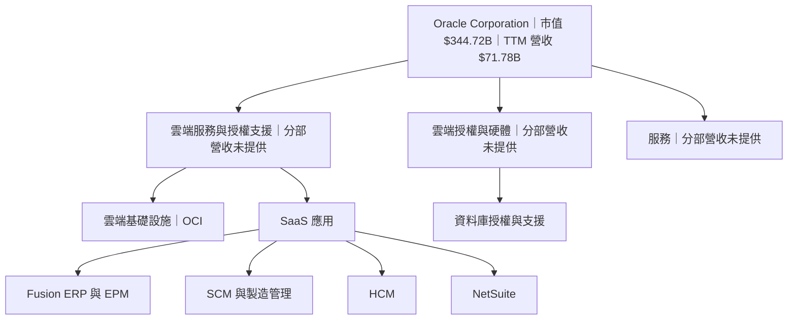
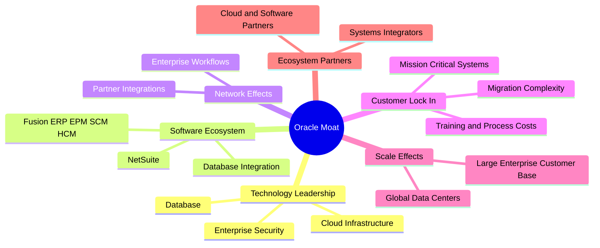
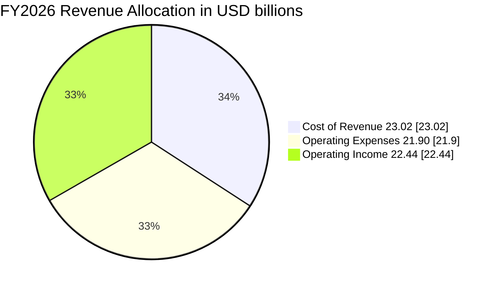
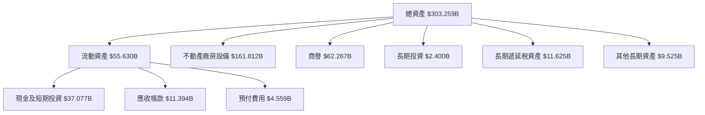
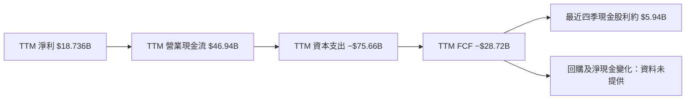
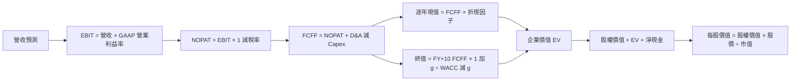
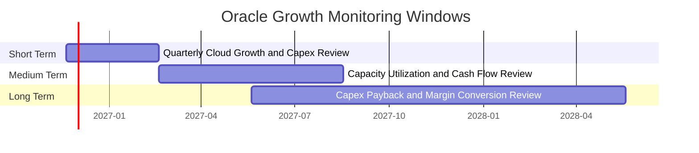
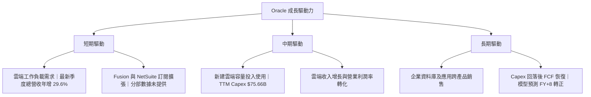
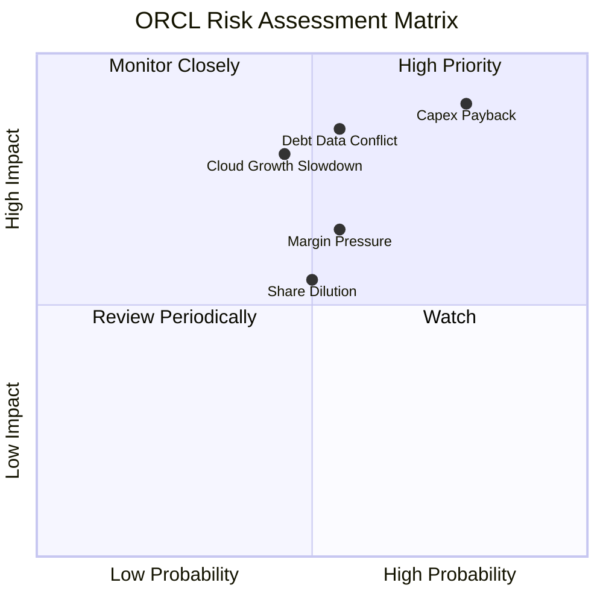
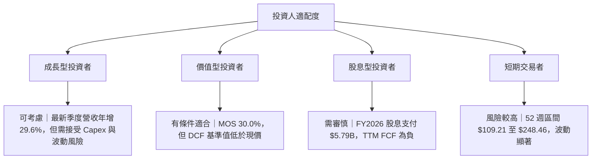

# ORCL 基本面深度分析報告
> **報告日期**：2026-11-20 ｜ **語言**：繁體中文 ｜ **數據來源**：SEC 申報資料 (XBRL)、Yahoo Finance、Finviz、StockAnalysis、Roic.ai ｜ **分析師**：CFA 級機構研究

## 目錄

| # | 章節 | 核心結論 |
|---|------|----------|
| 1 | 執行摘要 | 規則 20 評級為強烈買入；加權合理價值 $158.03；MOS +30.0% |
| 2 | 公司概覽與商業模式 | 企業資料庫、雲端基礎設施與 SaaS 黏著度構成護城河，分部營收拆分未提供 |
| 3 | 損益表深度分析 | TTM 營收 $71.78B、年增 21.6%；最新一季年增 29.6%，但高資本支出壓低現金盈餘 |
| 4 | 資產負債表分析 | VERIFIED 指標列示淨現金 $37.08B，但其他資料源列示淨負債；債務口徑需核對 |
| 5 | 現金流量深度分析 | TTM FCF −$28.72B、FCF Yield −8.33%，雲端擴建投資是主要壓力 |
| 6 | 獲利能力與資本效率 | ROIC 61.3% 高於 WACC 9.27%，惟負 FCF 與投入資本口徑值得持續核查 |
| 7 | 相對估值分析 | 估值低於 MSFT、接近 CRM；低於 ORCL 自身五年估值區間 |
| 8 | DCF 內在價值評估 | 基準 DCF $80.72/股；估值高度依賴終值，模型數值有可見算術尾差 |
| 9 | 成長催化劑 | 雲端基礎設施與 AI 工作負載有望支撐成長，TAM 數據未提供 |
| 10 | 風險矩陣 | 最大風險為 Capex 高於營業現金流、債務資料矛盾，以及雲端投資回報不確定 |
| 11 | 投資建議 | MOS 規則導出強烈買入；建議以 $142.23 以下作為達到 10% MOS 的價格上限 |

## 1. 執行摘要

2026-11-19 收盤價為 **$110.57**。ORCL 的 TTM 營收為 **$71.78B**、TTM 成長 **21.6%**，最新一季營收年增 **29.6%**；TTM ROIC **61.3%** 高於 WACC **9.27%**。另一方面，TTM 資本支出 **$75.66B** 高於營業現金流 **$46.94B**，使 TTM FCF 為 **−$28.72B**、FCF Yield 為 **−8.33%**。以程式計算的四種估值方法加權後合理價值為 **$158.03**，MOS **+30.0%**；依規則 20，且 ROIC 高於 WACC，評級為 **🟢 強烈買入**。但因 FCF 深度為負、債務資料來源相互矛盾，信心度評為**中低**，不宜只依單一估值或單季成長率建倉。

### 1.0 一頁式投資儀表板（Portfolio Manager 30 秒速讀）

| 項目 | 內容 |
|------|------|
| **投資論點（3 句）** | ① TTM 營收年增 **21.6%**、最新一季年增 **29.6%**，雲端與訂閱業務支撐成長。② TTM ROIC **61.3%** 對比 WACC **9.27%**，在採用資料口徑下有明顯正利差。③ TTM Capex **$75.66B** 高於 OCF **$46.94B**，導致 FCF **−$28.72B**，擴建投資的回報速度是核心驗證點。 |
| **綜合評分** | **7.0/10**（引用 1.1 評分卡） |
| **財務健康** | 🟡 現金與短期投資 **$37.08B**；但 TTM FCF 為負，且總債務資料口徑衝突 |
| **ROIC vs WACC** | **61.3% vs 9.27%**（依報表 ROIC 指標創造價值；相差 **52.03 個百分點**） |
| **FCF 趨勢** | 大額擴建期，TTM FCF **−$28.72B**；FCF Yield **−8.33%** |
| **估值** | Forward P/E **9.9983635x** ｜ EV/EBITDA（TTM）**13.701x** ｜ FCF Yield **−8.33%** |
| **DCF 內在價值（基準）** | **$80.72** ｜ 現價較 DCF 基準值溢價 **+37.0%**（現價 ÷ DCF 值 − 1；第 8.5 節） |
| **安全邊際（MOS）** | **+30.0%**＝(**加權合理價值 $158.03 − 現價 $110.57**) ÷ 加權合理價值 $158.03（第 8.8 節）｜ 🟢 >25% 充足 |
| **預期報酬（基準情境 12M）** | **−27.0%**（DCF 基準情境 $80.72 相對現價；模型情境不等於 12 個月共識預測） |
| **關鍵風險（前二）** | Capex 持續超過 OCF；債務資料及 DCF 終值算術需核對 |
| **評級 + 信心度** | 🟢 **強烈買入** ｜ 信心：**中低** |

> 指標口徑提醒：MOS 以第 8.8 節加權合理價值為分母；DCF 折溢價以第 8.5 節 DCF 基準內在價值為基準。兩者用途不同，不互換。

### 1.1 綜合評分卡（全報告唯一）

| 維度 | 評分（1–10） | 主要依據（引用數字與其來源章節） |
|------|--------------|----------------------------------|
| 成長性 | 8.0 | TTM 營收成長 **21.6%**、最新一季年增 **29.6%**；見第 3 章 |
| 獲利能力 | 8.5 | TTM ROIC **61.3%**、營業利益率 **32.1%**、F-Score **4/7**；見第 3、6 章 |
| 財務健康 | 4.0 | 現金與短期投資 **$37.08B**、流動比率 **1.171**，但 FCF **−$28.72B** 且債務資料衝突；見第 4、5 章 |
| 估值 | 8.0 | 加權 MOS **+30.0%**；P/E、EV/EBITDA 位於自身歷史低端；見第 7、8 章 |
| 護城河 | 8.0 | TTM 營收 **$71.78B**、最新季度成長 **29.6%**，企業資料庫及 ERP／雲端遷移提高轉換成本；見第 2 章 |
| 管理層與資本配置 | 5.5 | FY2026 Capex **$55.66B**、SBC **$4.81B**，同期 FCF **−$23.69B**；投資規模大但現金回收尚待驗證 |
| **綜合評分** | **7.0** | 六項算術平均：**(8.0 + 8.5 + 4.0 + 8.0 + 8.0 + 5.5) ÷ 6 = 7.0** |

### 1.2 五大投資論點 + 三大核心風險

| 類型 | 項目 | 具體依據 | 信心度 |
|------|------|----------|--------|
| 🟢 **投資論點①** | 雲端增長加速 | TTM 營收年增 **21.6%**，最新一季營收年增 **29.6%**；若加速由雲端需求帶動，收入基礎擴大可改善固定成本吸收 | 🟢 高 |
| 🟢 **投資論點②** | 企業系統轉換成本 | Fusion ERP、EPM、HCM、SCM、NetSuite 與資料庫形成企業工作流組合；客戶遷移及整合成本提高續約黏性 | 🟢 中高 |
| 🟢 **投資論點③** | 報表 ROIC 高於資金成本 | ROIC **61.3%** 對比 WACC **9.27%**，利差 **52.03pp**；須注意增建資產和負 FCF 對未來 ROIC 的影響 | 🟢 中 |
| 🟢 **投資論點④** | 相對自身歷史估值低 | P/E **17.3x**，低於五年中位數 **32.1x**；EV/EBITDA **9.1x**，低於中位數 **17.9x** | 🟢 中 |
| 🟢 **投資論點⑤** | 資本支出形成未來容量 | TTM Capex **$75.66B**，顯示擴建幅度大；若新增容量被雲端客戶消化，當前 FCF 谷底可能是投資週期而非永久性劣化 | 🟡 中低 |
| 🟡 **風險①** | Capex 回收不及預期 | TTM OCF **$46.94B** 對比 Capex **$75.66B**，FCF **−$28.72B**；若連續多季維持，可能增加融資與股東稀釋壓力 | 🔴 高衝擊 |
| 🔴 **風險②** | 融資與債務口徑不確定 | VERIFIED 指標的 Total debt 為 N/A、Net cash **$37.08B**；其他彙整資料列總債務 **$169.14B**、淨負債 **$132.07B**，需以同日 SEC 資產負債表核對 | 🔴 高 |
| 🟡 **風險③** | DCF 高度依賴終值 | PV 終值 **$389.29B**，模型列示為 EV 的 **181.4%**；預測期現金流現值合計為負，估值對 WACC、g 與 Capex 下降速度敏感 | 🔴 高衝擊 |

### 1.3 快速統計卡片

| 指標 | 公司實際值（期間） | 同業中位數 | 狀態 |
|------|--------------------|------------|------|
| 營收成長（TTM） | **21.6%** | — | 🟢 |
| 營收成長（最新一季年增） | **29.6%** | **13.2%**（MSFT、SAP、CRM） | 🟢 |
| 毛利率（TTM） | **64.0%**（彙整資料；不同資料表的毛利率口徑不一致） | **73.6%**（MSFT、SAP、CRM） | 🟡 |
| 營業利益率（TTM） | **32.1%**（SEC／程式計算口徑） | — | 🟢 |
| ROIC（TTM） | **61.3%** | — | 🟢 |
| Forward P/E | **9.9983635x** | **20.6x**（MSFT、SAP、CRM） | 🟢 |
| FCF Yield（TTM） | **−8.33%** | — | 🔴 |
| Piotroski F-Score | **4 / 7**（可判定測試） | — | 🟡 |

### 1.4 投資結論

```
╔══════════════════════════════════════════════════════════════════╗
║                    📊 投資結論摘要                               ║
╠══════════════════════════════════════════════════════════════════╣
║  評級：強烈買入（依規則 20；無質化調整）                         ║
║  價格（2026-11-19 收盤）：$110.57                                ║
║  DCF 內在價值（基準）：$80.72（現價溢價 +37.0%）                ║
║  安全邊際 MOS：+30.0%（＝(加權合理價值−現價)÷加權合理價值）      ║
║  加權合理價值（8.8）：$158.03                                    ║
║  DCF 情境價值：                                                   ║
║    悲觀情境：$8.16（−92.6%）                                     ║
║    基準情境：$80.72（−27.0%）                                    ║
║    樂觀情境：$241.24（+118.2%）                                  ║
║  綜合評分：7.0/10（引用 1.1）                                    ║
║  適合投資人：可承受高波動、願意追蹤雲端擴建回報的長線投資人      ║
╚══════════════════════════════════════════════════════════════════╝
```

## 2. 公司概覽與商業模式

Oracle Corporation 為美國企業軟體與基礎設施公司，員工數 **141,000**。其產品涵蓋資料庫與雲端基礎設施，以及 Fusion ERP、EPM、SCM、HCM 和 NetSuite 等 SaaS 應用。TTM 營收 **$71.78B**；目前資料未提供各分部收入與占比，因此不能據此拆出分部比例或市場份額。

### 2.1 業務結構與收入來源

下圖只呈現已知公司業務和 TTM 營收；子業務收入金額與占比未提供，故不填估算比例。



雲端基礎設施提供運算、儲存與網路服務，SaaS 則將 Oracle 的企業應用軟體轉為雲端訂閱。資料庫、ERP 等系統往往嵌入企業核心流程，因此雲端遷移可以帶來新增運算需求，也可提升客戶續約和跨產品銷售機會。財務資料沒有提供各業務的收入占比，故無法判定 29.6% 的最新季度營收年增中各業務的貢獻度。

### 2.2 市場份額

**市場份額數據未提供**，因此不呈現市占率或市場份額圖表。就規模與近期成長而言，ORCL TTM 營收 **$71.78B**、最新一季年增 **29.6%**，高於資料列出的 MSFT **18.8%**、SAP **13.2%**、CRM **10.8%**；但各公司業務範圍與雲端收入組合不同，不能將公司整體成長率直接解讀為市場份額變化。

### 2.3 競爭護城河分析



### 2.4 護城河強度

| 護城河項目 | 強度（強／中／弱） | 證據（引用數字或事實） | 會削弱它的情況 |
|------------|--------------------|------------------------|----------------|
| 技術與產品 | 中強 | 資料庫、雲端基礎設施與 ERP／HCM／SCM 應用組合；最新一季營收年增 **29.6%** | 雲端產品在效能、價格或相容性上落後；客戶轉向多雲或開源方案 |
| 軟體生態系統 | 強 | Fusion、NetSuite、資料庫與企業工作流程相互關聯 | 對手提供更完整的跨雲整合或更低總持有成本 |
| 網路效應 | 中 | 合作夥伴與第三方整合可增加系統價值，但沒有客戶或開發者網絡規模數據 | 生態夥伴轉向中立或競爭平台 |
| 客戶鎖定 | 強 | ERP、資料庫與人力、財務、供應鏈系統涉及資料轉換與流程重建，轉換成本高 | 雲端遷移工具成熟、模組化軟體降低更換成本 |
| 規模效應 | 中強 | TTM 營收 **$71.78B**，員工 **141,000**；可支應全球研發與基礎設施投資 | Capex 快速擴張但利用率低，規模轉成低回報資產 |
| 生態夥伴 | 中 | 企業軟體導入通常仰賴顧問與系統整合夥伴；特定夥伴收入貢獻未提供 | 夥伴優先投入競爭平台或多雲替代方案 |

1.1「護城河」評分 **8.0/10**，主要依據企業核心系統的切換成本與產品組合；尚未給滿分，因為分部增長、客戶留存率與雲端單位經濟數據未提供。

## 3. 損益表深度分析

### 3.1 年度收入成長趨勢（近 4 年）

FY2022 為 **$42.44B**，FY2023 **$49.95B**，FY2024 **$52.96B**，FY2025 **$57.40B**，FY2026 **$67.36B**。FY2023 至 FY2026 三年 CAGR 約 **10.5%**，算法為 \((67.357 ÷ 49.954)^{1/3} − 1\)。營收加速主要在 FY2026 出現，年度成長 **17.35%**；需以雲端及訂閱分部資料驗證加速是否具持續性。

```
╔══════════════════════════════════════════════════════════════════╗
║              Oracle 年度收入趨勢（FY2023-FY2026）                ║
╠══════════════════════════════════════════════════════════════════╣
║  FY2023  $49.95B  ███████████████░░░░░░░░░  YoY: +17.71% 🟢   ║
║  FY2024  $52.96B  █████████████████░░░░░░░  YoY:  +6.02% 🟡   ║
║  FY2025  $57.40B  ███████████████████░░░░░  YoY:  +8.38% 🟡   ║
║  FY2026  $67.36B  ███████████████████████░  YoY: +17.35% 🟢   ║
║                                                                  ║
║  FY2023–FY2026 三年收入 CAGR：約 +10.5%                          ║
╚══════════════════════════════════════════════════════════════════╝
```

### 3.2 季度收入趨勢分析

季度收入取 StockAnalysis 季度資料，金額為十億美元。QoQ 為相對前一季；YoY 為相對去年同季。

| 季度 | 營收 | QoQ | YoY | 備註 |
|------|------:|----:|----:|------|
| FY2026 Q2（2025-11） | $16.058B | +7.58% | +14.22% | 較 Q1 FY2026 成長；YoY 依 2024-11 資料 |
| FY2026 Q3（2026-02） | $17.190B | +7.05% | +21.66% | YoY 高於前季，收入動能擴大 |
| FY2026 Q4（2026-05） | $19.184B | +11.60% | +20.63% | 季度營收續增，FY 收入達 $67.36B |
| FY2027 Q1（2026-08） | $19.345B | +0.84% | +29.61% | YoY 高增包含較低基期影響；QoQ 增速較小 |

季度 QoQ 有季節性，不宜將 Q4 的增幅簡單外推。最新季度年增率 **29.6%** 與 QoQ **0.84%** 同時存在，反映 YoY 高增不代表每季收入以同等速度連續複合成長。

### 3.3 利潤率演變分析

下表以年度損益表金額計算毛利率與營業利益率；淨利率使用同一來源的年度淨利。不同資料源列示的 TTM 營業利益率有所差異，本報告涉及 TTM／DCF 時採 VERIFIED 指標 **32.1%**。

| 利潤率指標 | FY2023 | FY2024 | FY2025 | FY2026 | 趨勢 | 評估 |
|------------|-------:|-------:|-------:|-------:|------|------|
| **毛利率** | 72.9% | 71.4% | 70.5% | 65.8% | ↘️ FY2026 下滑 | 🟡 |
| **營業利益率** | 27.6% | 30.3% | 31.4% | 33.3% | ↗️ 年度逐步改善 | 🟢 |
| **淨利率** | 17.0% | 19.8% | 21.7% | 25.4% | ↗️ 利潤轉化改善 | 🟢 |

> 年度毛利率計算方式：毛利 ÷ 營收；營業利益率：營業利益 ÷ 營收。FY2026 年度收入及毛利來源為年度損益表；彙整數據另列 TTM 毛利率 64.0%，因期間不同，勿直接混用。

營業利益率從 FY2023 的 **27.6%** 升至 FY2026 的 **33.3%**，顯示營收增長伴隨營業費用槓桿或產品組合改善。但 FY2026 毛利率從 **70.5%** 降至 **65.8%**，可能反映雲端基礎設施與相關成本在收入中占比上升；缺少分部毛利、雲端運算成本與折舊明細，無法將成因精確拆解。這種「毛利承壓、營業利益率改善」亦意味營業費用控制正在抵銷部分直接成本壓力，但後續須觀察新增資料中心折舊與能源成本。

### 3.4 費用結構分析

以下以 FY2026 年度收入拆分為銷貨成本、營業費用與營業利益；三項金額合計對應收入。營業費用由毛利減營業利益推得，研發支出是其中一部分，不另外重複計入。



```
╔══════════════════════════════════════════════════════════════════╗
║                 FY2026 收入及成本結構（$B）                      ║
╠══════════════════════════════════════════════════════════════════╣
║  營收 $67.36B      ██████████████████████████████               ║
║  銷貨成本 $23.02B  ██████████                                    ║
║  營業費用 $21.90B  ██████████                                    ║
║  營業利益 $22.44B  ██████████                                    ║
║  研發費用 $10.27B  （含於營業費用中，不重複相加）               ║
╚══════════════════════════════════════════════════════════════════╝
```

營業費用相當於 FY2026 收入 **32.5%**（$21.90B ÷ $67.36B），研發費用約占收入 **15.2%**（$10.27B ÷ $67.36B）。高研發支出有助產品與平台投資，但資料未提供雲端收入、研發投資回報或資本化研發項目明細，故不能僅從研發金額判斷其增量回報。

### 3.5 季度 EPS 趨勢與盈餘品質（Quality of Earnings）

| 季度 | EPS 實際值 | EPS 年增 | EPS 預估／超預期狀態 |
|------|-----------:|---------:|----------------------|
| 2025-11-30 | $2.10 | +90.91% | 預估值為 N/A，無法判定是否超預期 |
| 2026-02-28 | $1.27 | +24.51% | 預估值為 N/A，無法判定是否超預期 |
| 2026-05-31 | $1.45 | +21.91% | 預估值為 N/A，無法判定是否超預期 |
| 2026-08-31 | $1.56 | +54.45% | 預估值為 N/A，無法判定是否超預期 |

EPS 歷史的估計值欄為缺失（nan），因此不能可靠分類「超預期／不及預期」。EPS 實際值與年度淨利資料亦可能採不同口徑，這裡只列季度 EPS 序列及其來源年增率。

| 盈餘品質項目 | 數值／佔比 | 評估 |
|--------------|-----------|------|
| 股權薪酬 SBC / 營收 | TTM SBC 約 **$4.82B** ÷ TTM 營收 **$71.78B** = **6.7%** | 🟡 股權薪酬具稀釋成本；年末稀釋股數未下降 |
| SBC / 營業現金流 | **$4.82B ÷ $46.94B = 10.3%** | 🟡 SBC 對 OCF 規模具實質占比，但非現金加回亦使 OCF 高於現金支出感受 |
| FCF / 淨利（現金轉換率） | TTM FCF **−$28.72B** ÷ TTM 淨利 **$18.736B** = **−153.3%** | 🔴 大額 Capex 使自由現金流尚未轉正 |
| 一次性／非經常性損益 | 資料未提供可核實的 TTM 調整項 | 🟡 不應假定淨利完全由經常性項目構成 |
| 有效稅率 | **12.6%**（最新年度有效稅率） | 🟡 低於一般名目稅率，估值不宜假定永久維持低稅率 |
| 資本化支出 vs 費用化 | TTM Capex **$75.66B**；資本化支出遠大於 TTM OCF | 🔴 資本化投資先以資產呈現、未來透過折舊攤銷反映；須監測利用率與減損風險 |

**盈餘品質結論：**GAAP 淨利有正向營業現金流支持，Piotroski 應計品質測試亦通過；但 TTM FCF／淨利為 **−153.3%**，顯示現階段淨利未轉化為扣除擴建支出後的自由現金。不能僅以淨利或 EPS 增長評估股東經濟報酬，估值應重視 Capex 回落、資產利用率及現金轉換改善的證據。

## 4. 資產負債表分析

### 4.1 資產結構分解

以下資產項目取 StockAnalysis TTM 資產負債表，總資產 **$303.259B**。此處只呈現來源明列的資產項目，不把缺少明細的餘額另行臆測。



不動產廠房設備由 FY2025 的 **$56.667B** 增至 TTM **$161.812B**，與近期資料列示的高 Capex 相符；但這種資產膨脹只有在雲端負載持續提升、設備利用率提高並產生可持續收入後，才能轉化為股東價值。商譽 **$62.267B** 也需納入長期減損風險考量。

### 4.2 流動性與營運資金分析

流動性歷史數據取年度資產負債表彙整；營運資金天數則照抄品質指標。

| 指標 | 最新值 | 歷史／比較 | 解讀 |
|------|------:|-------------|------|
| 流動比率 | **1.171** | FY2026 流動資產 $46.57B ÷ 流動負債 $41.76B ≈ **1.12** | 短期流動資產略高於流動負債，緩衝不算寬裕；數值期間與供應商口徑有差異 |
| Quick ratio | **1.02** | N/A（歷史序列未提供） | 接近 1，資金調度與營運現金流穩定性重要 |
| DSO 應收帳款天數 | **58 天** | 一年前 **55 天** | **+3 天**；應收回收略慢，可能與客戶組合、付款條件有關，需追蹤逾期應收 |
| DIO 存貨天數 | **N/A** | 一年前 **N/A** | 公司沒有該項存貨餘額，不能據此估算存貨週轉 |
| DPO 應付帳款天數 | **156 天** | 一年前 **N/A** | 期末付款天數偏長，但缺一年前數字，不能判斷變化方向或單獨視為議價力改善 |
| CCC 現金轉換週期 | **N/A** | 一年前 **N/A** | DIO 缺值，品質指標亦標示 CCC 為 N/A，不補推數字 |

DSO 上升 **3 天**表示公司需要關注收款週期，但不足以單獨證明信用品質轉差。DPO **156 天**可能提供營運資金來源，也可能反映付款條件、供應商結算安排或資料口徑；需配合應付帳款、合約負債與供應商付款政策判讀。

### 4.3 債務結構分析

各資料來源對總債務呈現重大差異。依 VERIFIED 指標，Total debt 為 **N/A**，Net cash 為 **$37.08B**；其他市場資料彙整則列總債務 **$169.14B**、現金 **$37.08B**、淨負債 **$132.07B**。因指標日期與負債口徑未能一致核對，本節不選擇其中一組推導 Debt/EBITDA 或利息保障倍數。

```
╔══════════════════════════════════════════════════════════════════╗
║                   Oracle 債務健康診斷                            ║
╠══════════════════════════════════════════════════════════════════╣
║  VERIFIED 總債務：      N/A（資料源未提供可核對值）              ║
║  現金及短期投資：       $37.08B                                  ║
║  VERIFIED 淨現金：      $37.08B                                  ║
║  其他彙整總債務：       $169.14B（口徑待核對）                   ║
║  其他彙整淨負債：       $132.07B（口徑待核對）                   ║
║  Debt/EBITDA：          N/A（債務口徑衝突）                      ║
║  利息保障倍數：         N/A（利息與一致負債餘額未提供）          ║
║  診斷：                 🟡 必須以 SEC 同期資產負債表核實         ║
╚══════════════════════════════════════════════════════════════════╝
```

該矛盾不能靠自行反推消除。FY2026 年度資料列總債務 **$156.19B**，另一彙整列 **$169.14B**，兩者期點亦不同；因此不將單一來源的 Debt/Equity 或槓桿率直接與 verified Net cash 混用。資產負債表核對是持倉前的重要盡職調查事項。

### 4.4 股東權益趨勢

年度股東權益由 FY2023 **$1.07B** 上升至 FY2024 **$8.70B**、FY2025 **$20.45B**，FY2026 **$42.51B**。變動幅度很大，應結合資產增長、融資與股權交易判讀，不能單純視為營運累積獲利。

```
╔══════════════════════════════════════════════════════════════════╗
║              股東權益趨勢（年度，$B）                            ║
╠══════════════════════════════════════════════════════════════════╣
║  FY2023  $1.07B   █                                              ║
║  FY2024  $8.70B   ██████                                         ║
║  FY2025  $20.45B  ██████████████                                 ║
║  FY2026  $42.51B  ██████████████████████████████                 ║
║                                                                  ║
║  注意：股東權益變動及流通股數未減少，不等於每股權益同步增長。    ║
╚══════════════════════════════════════════════════════════════════╝
```

## 5. 現金流量深度分析

### 5.1 現金流量瀑布圖

此處使用 TTM 淨利與 OCF、Capex、FCF。TTM 現金股利以最近四季股利支付資料加總，回購及淨現金變化未提供一致口徑數值。



### 5.2 FCF 轉換率趨勢

下表使用年度報表列示的 FCF 與淨利；FY2026 TTM 的自由現金流另依 VERIFIED 指標列示。FY2026 年度 FCF **−$23.69B** 是 FY 結束時的年度口徑，TTM FCF **−$28.72B** 涵蓋截至 2026-08-31 的近四季，兩者期間不同。

| 期間 | FCF | 淨利 | FCF / 淨利 | 解讀 |
|------|----:|----:|-----------:|------|
| FY2023 | $8.47B | $8.50B | 約 **99.6%** | 當年現金轉換接近淨利 |
| FY2024 | $11.81B | $10.47B | 約 **112.8%** | Capex 相對較低，現金轉換高 |
| FY2025 | −$0.394B | $12.44B | 約 **−3.2%** | 擴建支出令 FCF 接近零 |
| FY2026 | −$23.69B | $17.09B | 約 **−138.6%** | 大額 Capex 吸收 OCF |
| TTM 至 2026-08-31 | **−$28.72B** | $18.736B | 約 **−153.3%** | 最新 TTM 現金轉換仍在惡化 |

FY2025 至 FY2026 的轉變主要不是淨利下降，而是資本支出從 FY2025 **$21.21B** 上升至 FY2026 **$55.66B**。這代表未來回報依賴新增設施、伺服器及相關基礎設施形成營收與毛利，而不是當期盈餘本身已具備較高可分配現金。

### 5.3 自由現金流趨勢

| 期間 | OCF | Capex | FCF | 狀態 |
|------|----:|------:|----:|------|
| FY2023 | $17.16B | $8.70B | $8.47B | 🟢 |
| FY2024 | $18.67B | $6.87B | $11.81B | 🟢 |
| FY2025 | $20.82B | $21.21B | −$0.394B | 🟡 |
| FY2026 | $31.98B | $55.66B | −$23.69B | 🔴 |
| TTM 至 2026-08-31 | $46.94B | $75.66B | **−$28.72B** | 🔴 |

```
╔══════════════════════════════════════════════════════════════════╗
║                自由現金流趨勢（$B）                              ║
╠══════════════════════════════════════════════════════════════════╣
║  FY2023   +$8.47B   ██████████████                               ║
║  FY2024  +$11.81B   ████████████████████                         ║
║  FY2025   −$0.39B   ░                                            ║
║  FY2026  −$23.69B   ◀████████████████████████████████            ║
║  TTM      −$28.72B  ◀████████████████████████████████████        ║
╠══════════════════════════════════════════════════════════════════╣
║  TTM FCF Yield：−8.33%；現金流壓力來自 Capex 高於 OCF。          ║
╚══════════════════════════════════════════════════════════════════╝
```

FY2026 至 TTM OCF 增長，卻不足以覆蓋資本支出。負 FCF 不必然代表投資失敗，但須以雲端容量使用率、合約收入、單位毛利和日後 Capex 強度下降來驗證擴建的資本回報。

### 5.4 資本配置評估

目前可量化項目是 Capex、股息與 SBC；回購、併購及留存現金的完整同期分配未提供，故不繪製無法核實的資本配置比例圖。

| 資本配置項目 | 可核實數據 | 評估 |
|--------------|------------|------|
| Capex | FY2026 **$55.66B**；TTM **$75.66B** | 高投入形成未來容量，但需追蹤回報和利用率 |
| 股息 | FY2026 **$5.79B**；最新四季合計約 **$5.94B** | 仍維持股東現金回饋，但相對負 FCF 需仰賴現金存量或融資能力 |
| 股權薪酬 | FY2026 **$4.81B** | 非現金費用仍是股東稀釋成本；需追蹤稀釋股數 |
| 回購 | N/A（未提供可核對金額） | 不對回購是否足以抵銷 SBC 下結論 |
| 留存／淨現金變化 | N/A（資料口徑不一致） | 債務與現金餘額需同一期核對 |

## 6. 獲利能力與資本效率

### 6.1 ROE / ROA / ROIC 趨勢

| 指標 | 最新可用值 | 歷史資料 | 評估 |
|------|-----------:|----------|------|
| ROE（TTM） | **28.3%**（品質指標口徑） | 另一彙整來源列示 **41.2%**，口徑不同 | 🟡 同一期間有來源差異；採品質指標值做 DuPont |
| ROA（TTM） | **6.4%**（彙整資料） | F-Score 顯示 ROA 高於零但低於一年前 | 🟡 資產快速擴大可能壓低資產回報 |
| ROIC（TTM） | **61.3%**（VERIFIED 指標） | 10 年歷史序列未提供可直接對照的同口徑期間 | 🟢 高於資金成本，但投入資本分母需留意 |

### 6.2 ROIC vs WACC 分析（核心價值創造判斷）

WACC、β 及各資本成本組成採用成本資本指標；不自行改用其他資產負債表債務口徑重算。

```
╔══════════════════════════════════════════════════════════════════╗
║                ROIC vs WACC 深度分析                            ║
╠══════════════════════════════════════════════════════════════════╣
║  WACC（採用成本資本資料）：                                      ║
║  ├── 無風險利率 10Y 美債：      5.05%                           ║
║  ├── 市場風險溢酬 ERP：         5.00%                           ║
║  ├── 原始 Beta：                1.78                            ║
║  ├── 調整後 Beta：              1.52                            ║
║  ├── 股權成本：                 5.05% + 1.52 × 5.00% = 12.65%  ║
║  ├── 稅前債務成本：             2.72%                           ║
║  ├── 稅後債務成本：             2.72% × (1−12.6%) = 2.38%      ║
║  ├── 股權／債務權重：           67.1% / 32.9%                   ║
║  └── ✅ WACC：                  67.1%×12.65% + 32.9%×2.38%       ║
║                                      = 9.27%                     ║
║                                                                  ║
║  ROIC（TTM）：                 61.3%                            ║
║  WACC（估值折現率）：          9.27%                            ║
║  EVA 利差：                    61.3% − 9.27% = +52.03pp        ║
║                                                                  ║
║  ROIC  61.3%  ▓▓▓▓▓▓▓▓▓▓▓▓▓▓▓▓▓▓▓▓▓▓▓▓▓▓▓▓▓▓▓▓▓▓▓▓▓▓▓▓▓▓▓▓▓▓▓▓▓▓▓▓▓▓▓▓▓▓▓▓▓▓▓▓▓▓▓▓ 🟢 ║
║  WACC   9.27% ▓▓▓▓▓▓▓▓▓▓                                          ║
║                                                                  ║
║  結論：依採用 ROIC 口徑，資本回報高於資金成本；需持續驗證新增    ║
║  雲端資產回報，以及 ROIC 是否受投入資本擴張而向下收斂。          ║
╚══════════════════════════════════════════════════════════════════╝
```

其中 Beta 調整方式為 **⅔ × 1.78 + ⅓ × 1 = 1.52**。股權成本 CAPM 算式為 **5.05% + 1.52 × 5.00% = 12.65%**；稅後債務成本為 **2.72% × (1 − 12.6%) = 2.38%**；加權計算為 **67.1% × 12.65% + 32.9% × 2.38% = 9.27%**。成本資本資料未提供計算此權重所用同一期股權市值與計息負債明細，因此沿用其提供的權重及 WACC，不以互相衝突的債務數據另算。

### 6.3 杜邦三因素分解

| 因素 | 數值（TTM） | 解讀 |
|------|-------------|------|
| 淨利率 | **26.4%** | 淨利潤率提供主要獲利基礎 |
| 資產週轉率 | **0.24** | 資產基數快速擴大，資產周轉相對低 |
| 權益乘數 | **4.54** | 財務槓桿對 ROE 有放大效果 |
| **ROE** | **28.3%** | 品質指標原值：26.4% × 0.24 × 4.54 = **28.3%** |

DuPont 結果顯示 ROE 同時受淨利率與權益乘數影響；不能只以 ROE 判斷經營回報。資產週轉率 **0.24** 與大額建設投資並存，新增資產若未有效投入使用，資產周轉與 ROIC 均可能下行。

### 6.4 財務體質：Piotroski F-Score

**Piotroski F-Score：4 / 7**。測試分母為 7，是因有兩項缺少輸入而排除，另有未通過項目；不得改用九項滿分分母。

| 測試 | 結果 | 解讀 |
|------|------|------|
| ROA > 0 | ✅ 通過 | 公司保持正資產報酬 |
| 營業現金流 > 0 | ✅ 通過 | TTM OCF 為正 |
| ROA 高於一年前 | ❌ 未通過 | 資產回報同比走弱，可能受資產擴張影響 |
| 營業現金流 > 淨利（應計品質） | ✅ 通過 | 營業現金流高於淨利，當期營運獲利有現金支持 |
| 長期負債 ÷ 總資產低於一年前 | — 無法判定 | 缺少同口徑負債測試輸入 |
| 流動比率高於一年前 | ✅ 通過 | 品質指標判定通過；仍需留意現值只有約 1.17 |
| 稀釋股數未增加 | ❌ 未通過 | 流通股數增加，SBC 或股權融資可能稀釋每股價值 |
| 毛利率高於一年前 | — 無法判定 | 缺少同口徑比較輸入 |
| 資產週轉率高於一年前 | ❌ 未通過 | 資產增速可能快於收入，反映擴建資產尚待變現 |

F-Score **4/7**顯示營業現金流和流動性測試有正面訊號，但資產回報、股數與資產週轉測試未通過。這與「業務增長較快、資本投入更快」的現況相符，應優先追蹤新增資產投入使用後的營收和現金流。

## 7. 相對估值分析

### 7.1 同業估值比較表格

| 估值指標 | **ORCL** | **MSFT** | **SAP** | **CRM** | ORCL 評估 |
|----------|---------:|---------:|--------:|--------:|-----------|
| **Trailing P/E** | **17.3x** | 26.0x | 25.3x | 16.8x | 🟢 低於 MSFT、SAP，接近 CRM |
| **Forward P/E** | **9.9983635x** | 20.6x | 21.3x | 11.5x | 🟢 低於同業；需留意預估 EPS 成長能否兌現 |
| **P/S Ratio** | **4.8027887x** | 10.7x | N/A（混合幣別） | 3.4x | 🟡 高於 CRM、低於 MSFT |
| **EV/EBITDA（TTM）** | **13.701x** | 18.3x | N/A（混合幣別） | 14.1x | 🟢 低於 MSFT、略低於 CRM |
| **最新一季營收年增** | **29.6%** | 18.8% | 13.2% | 10.8% | 🟢 顯著高於所列同業 |
| **毛利率（TTM）** | **64.0%** | 67.7% | 73.6% | 77.3% | 🟡 低於同業；產品結構不同 |

同業數據來自 Yahoo Finance Peer multiples。ORCL 的低 Forward P/E 與高成長並存，但當期 FCF 為負；若市場預估盈利包含較快雲端增長而 Capex 無法及時下降，單看 P/E 可能低估再投資成本。SAP 的 P/S、EV/EBITDA 因混合幣別不列。

### 7.2 歷史估值區間分析

以下完全採用公司自身五年 TTM 估值資料。當前 P/E **17.3x** 低於提供的五年區間下限 **19.0x**；資料同時標示當前百分位 **0%**。兩項可能由估值時點或計算口徑造成差異，應視為來源資料內部不完全一致，而非自行修正區間。

```
╔══════════════════════════════════════════════════════════════════╗
║              ORCL 五年歷史估值位置（TTM）                       ║
╠══════════════════════════════════════════════════════════════════╣
║  P/E        17.3x  ●   區間 19.0x ───── 中位數 32.1x ── 52.3x ║
║  百分位：0%（資料列示）                                          ║
║                                                                  ║
║  P/S         4.6x  ●   區間 4.6x ─ 中位數 6.2x ─────── 11.1x   ║
║  百分位：5%                                                      ║
║                                                                  ║
║  EV/EBITDA   9.1x  ●   區間 12.6x ─ 中位數 17.9x ─── 28.9x    ║
║  百分位：0%                                                      ║
╚══════════════════════════════════════════════════════════════════╝
```

### 7.3 情境價值（Bear / Base / Bull，照抄 DCF Scenarios）

| 情境 | 第 1 年營收成長 | 期末營業利潤率 | WACC | 每股價值 | 相對現價 | 機率 | 會發生的條件 |
|------|----------------:|----------------:|-----:|---------:|---------:|-----:|--------------|
| 🔴 悲觀 | 10.8% | 26.0% | 10.27% | **$8.16** | −92.6% | 25% | 雲端需求減速、建設利用率低、利潤率下降且資金成本上升 |
| 🟡 基準 | 21.6% | 30.6% | 9.27% | **$80.72** | −27.0% | 50% | 成長從 TTM 水準逐步放緩，利潤率向五年中位數收斂 |
| 🟢 樂觀 | 32.4% | 33.6% | 8.27% | **$241.24** | +118.2% | 25% | AI／雲端容量需求超預期、利潤率擴張、資本成本下降 |

以上是模型給定的情境價值，不是分析師另行設定的目標價。基準情境低於現價，而估值方法加權結果高於現價，反映 DCF 與同業相對估值對高成長資產的定價差異。

### 7.4 相對估值隱含價格區間

```
╔══════════════════════════════════════════════════════════════════╗
║              估值方法隱含價格與現價（美元／股）                  ║
╠══════════════════════════════════════════════════════════════════╣
║  DCF（基準）             $80.72  ──● 現價 $110.57               ║
║  同業 EV/EBITDA         $180.81  ──────────────                 ║
║  同業 Forward P/E       $227.70  ─────────────────────          ║
║  分析師共識目標價       $236.18  ───────────────────────        ║
╚══════════════════════════════════════════════════════════════════╝
```

| 方法 | 每股價值 | 依據 |
|------|---------:|------|
| DCF（基準） | **$80.72** | 10 年 FCFF、WACC **9.27%**、永續成長率 **3.0%** |
| 同業 Forward P/E | **$227.70** | 同業中位數 **20.6x** × ORCL Forward EPS **$11.06** |
| 同業 EV/EBITDA | **$180.81** | MSFT、CRM 同業中位數 **16.2x** × TTM EBITDA，再加回淨現金 |
| 分析師共識 | **$236.18** | 40 位分析師平均目標價 |

相對估值隱含值高於 DCF 基準值，重要原因是相對方法使用同業倍數和 Forward EPS／TTM EBITDA，而 DCF 對大額近期 Capex 給予較高權重。相對估值不是對未來現金流投資回報的獨立證明。

## 8. DCF 內在價值評估（Discounted Cash Flow）

> DCF 數字沿用程式計算的基準模型，不另建模型或改動輸入。模型輸出中部分算式與列示結果存在細小算術差異，於 8.10 明確揭露；估值結論因此應以較低信心度使用。

### 8.0 估值推理鏈（Thinking Logic）

**Step 1 — 價值由哪些變數決定？**  
ORCL 的價值可拆為既有企業資料庫與 SaaS 業務的收入底盤、雲端基礎設施成長，以及大額建設投資成功後的現金流選擇權。已知總 TTM 營收 **$71.78B**，但業務分部收入占比未提供，不能為各來源填入營收比重。模型中最主導估值的變數是**資本支出相對營收的下降速度與終值現金流**：TTM Capex 為 **$75.66B**、FCF 為 **−$28.72B**，模型終值現值更占 EV **181.4%**。

**Step 2 — 模型選擇**

| 決策點 | 本報告採用 | 理由（含數字） | 曾考慮但否決 | 否決理由 |
|--------|-----------|----------------|--------------|----------|
| 現金流定義 | FCFF | 以 WACC **9.27%** 折現，先求 EV，再以淨現金調整 | FCFE | 債務口徑與現金流融資變動不清楚 |
| 預測期 N | **10 年** | 模型設定 10 年，並將營收成長由 **21.6%** 線性降至 **3.0%** | 5 年 | 雲端容量投資與回收周期可能超過五年；模型指定 10 年 |
| 終值方法 | Gordon Growth | 模型採永續成長 **3.0%**，WACC **9.27%** | 退出倍數 | DCF 輸出未提供期末 EBITDA 退出倍數估值，不能另建 |
| EBIT 基礎 | GAAP EBIT | 模型明示使用 GAAP EBIT，包含 SBC 費用 | 非 GAAP EBIT | 會涉及 SBC 加回與扣除方式變更，與既有模型不符 |

**Step 3 — 關鍵假設推導鏈**

- **營收成長**：錨點＝TTM 成長 **21.6%**；調整＝把高成長從第 1 年開始線性淡出，以反映基期擴大和競爭；**採用第 1 年 21.6%、第 10 年 3.0%**；曾考慮全期維持 21.6%，但因十年持續高成長難以由現有分部數據支持而不採用。
- **期末營業利潤率**：錨點＝TTM GAAP 營業利益率 **32.1%**；調整＝逐年淡出至近五年財年中位數（含 TTM）；**採用 FY+10 30.6%**；曾考慮維持 32.1%，但模型選擇反映成熟期利潤率收斂。
- **永續成長率 g**：錨點＝長期成熟企業需低於折現率；目前數據未提供宏觀長期名目 GDP 推估；調整＝採模型設定 **3.0%** 且低於 WACC **9.27%**；曾考慮高於 3.0% 的永續成長，但不採用，避免終值過度擴大。
- **預測期 N**：錨點＝模型設為 **10 年**，反映雲端資本投入的長期回收；調整＝模型不另增延長年數；**採用 10 年**；曾考慮縮短預測期，但會把較多價值推入終值、降低對資本回收路徑的呈現。
- **Capex／營收**：錨點＝TTM Capex／營收約 **105.4%**（模型輸入）；調整＝模型將其由第 1 年 **105.4%** 逐步降至第 10 年 **14.4%**，後者對應約 1.1 倍 D&A；**採用模型路徑**；曾考慮短期快速回落，因當前擴建仍大，不採用。
- **EBIT 基礎及 SBC**：錨點＝GAAP EBIT；調整＝模型已把 SBC 作為費用反映，不另扣 SBC；**採用組合 (A)：GAAP EBIT + 固定股數 + 年稀釋率 0%**；曾考慮非 GAAP 加回 SBC，但會改變既有 DCF。
- **年稀釋率**：錨點＝模型使用「股數不再稀釋」；調整＝不另增股數；**採用 0%**；曾考慮依實際稀釋股數增加，但模型標示組合 (A)，且不能單方面改動已計算模型。
- **終值方法**：錨點＝10 年後現金流使用 Gordon Growth；調整＝以 **3.0%** 永續成長及 **9.27%** WACC；**採用 Gordon Growth**；曾考慮退出倍數，但模型未提供該項終值結果，故不補算。
- **WACC**：錨點＝成本資本資料的 WACC **9.27%**；調整＝不再另行估算；**採用 9.27%**；曾考慮依其他債務數字重算，但債務口徑矛盾且規定須使用提供的 WACC。
- **稅率（低敏感度）**：錨點＝最新年度有效稅率 **12.6%**；採用 **12.6%**。
- **D&A／營收（低敏感度）**：錨點＝TTM **13.1%**；採用 **13.1%**，模型固定此比例。
- **營運資金變動（低敏感度）**：錨點＝模型明示未建模；採用不列 ΔWC，不以無資料的天數自行反推。

**Step 4 — 最脆弱假設**  
最脆弱的一環是 Capex／營收從第 1 年 **105.4%** 逐步降至第 10 年 **14.4%**；若雲端需求、設備利用率或建設效率不支持這種下降，負 FCFF 會延長、終值與 DCF 價值將進一步承壓。

**Step 5 — 計算路徑**



### 8.1 模型假設總表（Model Inputs）

| 假設項目 | 採用值 | 依據／來源 | 敏感度 |
|----------|--------|-------------|--------|
| 預測期長度 N | **10 年** | DCF 模型設定 | 🟡 中 |
| 營收成長 | FY+1 **21.6%**，FY+10 **3.0%**，中間線性淡出 | TTM vs prior TTM 成長 **21.6%**；終點模型設定 | 🔴 高 |
| 營業利益率 | FY+1 **32.1%** → FY+10 **30.6%** | TTM 營業利益率及近五年財年中位數 | 🔴 高 |
| 有效稅率 | **12.6%** | 最新年度有效稅率 | 🟢 低 |
| Capex／營收 | FY+1 **105.4%** → FY+10 **14.4%** | TTM 資本支出強度，逐步淡出至約 1.1×D&A | 🔴 高 |
| D&A／營收 | **13.1%** | TTM 比例，模型固定 | 🟢 低 |
| 營運資金變動／營收增額 | **未建模** | DCF 模型明示 Working capital is not modelled | 🟢 低 |
| EBIT 基礎 | **GAAP** | DCF 模型輸入 | 🟡 中 |
| SBC 處理 | **組合 (A)：不另扣 SBC** | GAAP EBIT 已含 SBC 費用 | 🟡 中 |
| 年稀釋率 | **0%** | 模型固定股數、不再稀釋 | 🟡 中 |
| 永續成長率 g | **3.0%** | DCF 模型設定；低於 WACC | 🔴 高 |
| 終值方法 | **Gordon Growth** | DCF 模型輸出 | 🔴 高 |
| WACC | **9.27%** | 成本資本資料 | 🔴 高 |

本模型採用 **(A)**，故 SBC 影響已計入一次：GAAP EBIT 已含 SBC 費用，FCFF 不再減 SBC，股數不另外逐年稀釋。DCF 使用 **FCFF = NOPAT + D&A − Capex**；營運資金不建模。

### 8.2 折現率推導（WACC）

```
╔══════════════════════════════════════════════════════════════════╗
║                    WACC 推導（折現率）                           ║
╠══════════════════════════════════════════════════════════════════╣
║  股權成本 Ke（CAPM）：                                           ║
║  ├── 無風險利率 Rf（10Y 美債）：      5.05%                     ║
║  ├── 市場風險溢酬 ERP：               5.00%                     ║
║  ├── 原始 Beta（Yahoo）：              1.78                      ║
║  ├── 調整後 Beta：                     1.52                      ║
║  ├── Beta 調整：                       ⅔×1.78 + ⅓×1 = 1.52    ║
║  └── Ke = 5.05% + 1.52×5.00% = 12.65%                          ║
║                                                                  ║
║  債務成本 Kd：                                                    ║
║  ├── 稅前 Kd：                         2.72%                     ║
║  ├── 有效稅率：                        12.6%                     ║
║  └── 稅後 Kd = 2.72%×(1−12.6%) = 2.38%                         ║
║                                                                  ║
║  資本結構（成本資本資料提供）：                                   ║
║  ├── 股權權重 E：                      67.1%                     ║
║  ├── 債務權重 D：                      32.9%                     ║
║  └── ✅ WACC = 67.1%×12.65% + 32.9%×2.38% = 9.27%              ║
╚══════════════════════════════════════════════════════════════════╝
```

逐步演算如下：

1. **Ke（CAPM）** = Rf + β × ERP = **5.05% + 1.52 × 5.00% = 12.65%**。Rf 與 ERP 的精確資料日期及 ERP 估計方法未提供；不另加規模或國別溢酬。
2. **稅前 Kd** = **2.72%**（成本資本資料提供）。利息費用及同口徑平均計息負債金額未提供，不能另行重建。
3. **稅後 Kd** = **2.72% × (1 − 12.6%) = 2.38%**。
4. **資本權重** = 股權 **67.1%**；債務 **32.9%**；**67.1% + 32.9% = 100.0%**。計算權重所用市場市值及同一期計息負債明細未提供，依資料列示值沿用。
5. **WACC** = **67.1% × 12.65% + 32.9% × 2.38% = 8.49% + 0.78% = 9.27%**。

第 6.2 節及 DCF 採用同一 WACC **9.27%**。因未提供一致的短期借款、長期借款、租賃負債及利息費用明細，Kd 的獨立可稽核性有限；此處的公式是以資料提供的成本、稅率與權重重現，而非宣稱完成了以 SEC 同期債務明細的獨立估算。

### 8.3 逐年自由現金流預測（基準情境）

金額單位為十億美元；營運資金變動未建模；FCFF 不另減 SBC。

| 年度 | FY+1 | FY+2 | FY+3 | FY+4 | FY+5 | FY+6 | FY+7 | FY+8 | FY+9 | FY+10 |
|------|-----:|-----:|-----:|-----:|-----:|-----:|-----:|-----:|-----:|------:|
| 營收 | 87.29 | 104.36 | 122.60 | 141.50 | 160.38 | 178.47 | 194.90 | 208.81 | 219.39 | 225.97 |
| 營收 YoY | 21.6% | 19.6% | 17.5% | 15.4% | 13.3% | 11.3% | 9.2% | 7.1% | 5.1% | 3.0% |
| 營業利潤率 | 32.1% | 32.0% | 31.8% | 31.6% | 31.4% | 31.3% | 31.1% | 30.9% | 30.8% | 30.6% |
| 營業利益 EBIT（GAAP） | 28.04 | 33.34 | 38.97 | 44.73 | 50.43 | 55.81 | 60.61 | 64.58 | 67.49 | 69.13 |
| − 稅（12.6%） | (3.54) | (4.21) | (4.92) | (5.64) | (6.36) | (7.04) | (7.65) | (8.15) | (8.51) | (8.72) |
| = NOPAT | 24.50 | 29.14 | 34.05 | 39.09 | 44.06 | 48.77 | 52.97 | 56.44 | 58.97 | 60.40 |
| + D&A | 11.47 | 13.71 | 16.10 | 18.59 | 21.07 | 23.44 | 25.60 | 27.43 | 28.82 | 29.68 |
| − Capex | (92.02) | (99.46) | (104.45) | (106.25) | (104.22) | (97.93) | (87.25) | (72.38) | (53.87) | (32.65) |
| **= FCFF** | **−56.05** | **−56.61** | **−54.30** | **−48.58** | **−39.09** | **−25.73** | **−8.69** | **11.49** | **33.92** | **57.44** |
| 折現因子 @WACC 9.27% | 0.915 | 0.838 | 0.767 | 0.702 | 0.642 | 0.588 | 0.538 | 0.492 | 0.450 | 0.412 |
| **FCFF 現值 PV** | **−51.30** | **−47.42** | **−41.63** | **−34.08** | **−25.10** | **−15.12** | **−4.67** | **5.65** | **15.28** | **23.68** |

模型列示預測期現值合計為 **−$174.70B**。依表內已四捨五入現值逐項相加為 **−$51.30B − $47.42B − $41.63B − $34.08B − $25.10B − $15.12B − $4.67B + $5.65B + $15.28B + $23.68B = −$174.71B**；差額 **$0.01B** 可由逐格四捨五入造成，沿用模型所列合計 **−$174.70B**。

**FY+1 逐步演算**（以下因模型行列取兩位小數，細部乘法可能有四捨五入尾差）：

1. **營收** = TTM 營收 **$71.78B × (1 + 21.6%) = $87.29B**（模型列值）。
2. **EBIT** = **$87.29B × 32.1% = $28.04B**（模型列值）。
3. **稅** = **$28.04B × 12.6% = $3.54B**（模型列值）。
4. **NOPAT** = **$28.04B − $3.54B = $24.50B**。
5. **D&A** = **$87.29B × 13.1% = $11.47B**（模型列值）。
6. **Capex** = **$87.29B × 105.4% = $92.02B**（模型列值）。
7. **ΔWC** = 模型未建模，故沒有可代入的營運資金數值，也不另行估算。
8. **FCFF** = **$24.50B + $11.47B − $92.02B = −$56.05B**。
9. **折現因子** = **1 ÷ (1 + 9.27%)^1 = 0.915**；**PV** = **−$56.05B × 0.915 = −$51.30B**（模型列值；採模型未四捨五入底層數字時與表面兩位數可能有尾差）。

**合理性自檢：**

- 預測 FCF CAGR：第 1 年 **−$56.05B**、第 10 年 **+$57.44B**，因起點為負值，傳統 CAGR **無定義**；年度歷史 FCF 由 FY2024 **$11.81B** 降至 FY2026 **−$23.69B**，方向顯示基準模型假設 Capex 強度大幅下降。
- FY+10 FCF 利潤率 = **$57.44B ÷ $225.97B = 25.4%**；TTM FCF 利潤率 = **−$28.72B ÷ $71.78B = −40.0%**。同業最佳 FCF 利潤率數據未提供，不能比較是否超過同業最佳。
- FY+1 至 FY+7 FCFF 為負；這些負現金流會拉低預測期現值合計。模型仍得到正 EV，主要由終值現值支撐，故估值高度依賴長期 Capex 回落與持續營運假設。

```
╔══════════════════════════════════════════════════════════════════╗
║            自由現金流：歷史實際 vs 模型預測（$B）                ║
╠══════════════════════════════════════════════════════════════════╣
║  FY2024(實)  +$11.81B  ████████                                  ║
║  FY2025(實)   −$0.39B  ░                                         ║
║  FY2026(實)  −$23.69B  ◀████████████████                         ║
║  FY+1 (預)   −$56.05B  ◀██████████████████████████████████████   ║
║  FY+10 (預)  +$57.44B  ██████████████████████████████████████    ║
╠══════════════════════════════════════════════════════════════════╣
║  模型 FCF 由負轉正，主要來自 Capex／營收逐年降至 FY+10 的 14.4%。║
╚══════════════════════════════════════════════════════════════════╝
```

### 8.4 終值計算（Terminal Value）

**適用性檢查：**`WACC 9.27% vs g 3.0% → WACC > g？✅`

模型列示 Gordon Growth 終值及現值如下。另須注意，將表中已四捨五入數字直接代入時，算式結果與模型列值不完全一致，詳見下列逐步檢核及 8.10。

| 方法 | 計算式 | 終值 TV | TV 現值 | 佔總 EV 比重 |
|------|--------|--------:|--------:|--------------:|
| Gordon Growth | 57.44 × (1 + 3.0%) ÷ (9.27% − 3.0%) | **$944.26B**（模型列值） | **$389.29B**（模型列值） | **181.4%**（模型列值） |
| 退出倍數法 | N/A（DCF 模型未提供期末退出倍數計算） | N/A | N/A | N/A |

模型提供的計算鏈為：FY+10 FCFF **$57.44B**；分子 **$57.44B × 1.03 = $59.1632B**；分母 **9.27% − 3.0% = 6.27%**。按顯示數字直接計算，**$59.1632B ÷ 6.27% ≈ $943.59B**，而不是模型列示的 **$944.26B**。此外，模型列示 **$944.26B × 0.412** 也不能精確重現 **$389.29B**。因此為遵守模型固定輸出，估值表保留程式列值，不自行替換；此差異降低 DCF 的可稽核性與信心度。

PV 終值占企業價值 **181.4%**，超過 75% 警戒線，表示預測期現金流現值為負、價值主要由終值假設支持。終值高度依賴長期 Capex 收斂、3.0% 永續成長和 9.27% WACC。

### 8.5 企業價值 → 每股內在價值（Bridge）

```
╔══════════════════════════════════════════════════════════════════╗
║              企業價值 → 每股內在價值 橋接表                      ║
╠══════════════════════════════════════════════════════════════════╣
║  預測期 FCF 現值合計            −$174.70B                        ║
║  終值現值 PV(TV)                +$389.29B                        ║
║  ─────────────────────────────────────────────                  ║
║  = 企業價值 EV                   $214.60B（模型列值）            ║
║  + 淨現金                       +$37.08B                         ║
║  = 股權價值                      $251.67B（模型列值）            ║
║  每股換算                       股權價值 × 股價 ÷ 市值           ║
║  ★ 每股內在價值                  $80.72                          ║
║    2026-11-19 收盤價             $110.57                         ║
║    折溢價（現價÷DCF內在價值−1）  +37.0%（溢價）                  ║
╚══════════════════════════════════════════════════════════════════╝
```

1. **EV** = 預測期 PV **−$174.70B** + PV(TV) **$389.29B** = 按模型精確列值 **$214.60B**。以顯示的兩位小數相加為 **$214.59B**，存在 **$0.01B** 四捨五入差額。
2. **股權價值** = 模型 EV **$214.60B** + 淨現金 **$37.08B** = 模型列值 **$251.67B**；按顯示數字相加為 **$251.68B**，同樣存在 **$0.01B** 尾差。總債務原值在 VERIFIED 指標中為 N/A，故不另行拆算「現金減總債務」；沿用模型的淨現金橋接值。
3. **每股內在價值** = **$251.67B × $110.57 ÷ $344.72B = $80.72**（模型指定股權價值 × 股價 ÷ 市值）。
4. **折溢價** = **$110.57 ÷ $80.72 − 1 = +37.0%**（以 DCF 基準值為分母）。
5. **本節不計算 MOS**：MOS 僅以第 8.8 節加權合理價值為分母。

模型未提供獨立稀釋股數；依每股換算方式，市值 ÷ 股價隱含股數約 **$344.72B ÷ $110.57 ≈ 3.118B 股**。這只是由市值與股價推得的隱含股數，不替代 SEC 稀釋加權平均股數。現金調整沿用模型列示淨現金 **$37.08B**，但總債務口徑另有衝突，需核實。

### 8.6 敏感性分析（WACC × 永續成長率）

下表每股價值與方向沿用 DCF 模型的 5×5 敏感度矩陣；括號為相對 **$110.57** 現價的上行／下行幅度，採報價與模型矩陣值計算並四捨五入至一位小數。

| g（列）／WACC（欄） | 7.27% | 8.27% | **9.27%（基準）** | 10.27% | 11.27% |
|-----------|------:|------:|-------------------:|-------:|-------:|
| **2.0%** | $131.54（+19.0%） | $90.74（−17.9%） | $62.49（−43.5%） | $42.14（−61.9%） | $27.05（−75.5%） |
| **2.5%** | $151.07（+36.6%） | $103.22（−6.7%） | $70.93（−35.8%） | $48.09（−56.5%） | $31.39（−71.6%） |
| **3.0%** | $175.18（+58.4%） | $118.07（+6.8%） | **$80.72（−27.0%）** | $54.87（−50.4%） | $36.25（−67.2%） |
| **3.5%** | $205.69（+86.1%） | $136.04（+23.1%） | $92.21（−16.6%） | $62.65（−43.3%） | $41.74（−62.3%） |
| **4.0%** | $245.55（+122.1%） | $158.21（+43.1%） | $105.88（−4.2%） | $71.67（−35.2%） | $47.99（−56.6%） |

**逐步演算能力限制：**敏感度模型輸出提供矩陣各格的每股價值，但未提供每一 WACC 下的逐年折現因子、預測期 PV 合計與終值中間數字。依規定不自行重新建立或替換 DCF，因此無法用來源中未列出的中間值重算指定矩陣格；矩陣以程式列值原樣保留，該格的獨立計算軌跡為 **N/A（模型未輸出中間量）**。

**三情境 DCF（照抄模型輸出）**

| 情境 | 第 1 年營收成長 | 期末營業利潤率 | 永續成長 g | WACC | 每股內在價值 | 相對現價 | 主觀機率 |
|------|----------------:|----------------:|------------:|-----:|--------------:|---------:|----------:|
| 🔴 悲觀 | 10.8% | 26.0% | DCF 模型未另列 | 10.27% | $8.16 | −92.6% | 25% |
| 🟡 基準 | 21.6% | 30.6% | 3.0% | 9.27% | $80.72 | −27.0% | 50% |
| 🟢 樂觀 | 32.4% | 33.6% | DCF 模型未另列 | 8.27% | $241.24 | +118.2% | 25% |
| **機率加權** | — | — | — | — | **$102.71** | **−7.1%** | **100%** |

模型未公開悲觀、樂觀情境的永續成長率與逐年收入、FCFF、TV 明細，故不補造各情境推導鏈。模型已列的加權結果可核對：**$8.16 × 25% + $80.72 × 50% + $241.24 × 25% = $102.71**（按顯示值四捨五入）。

敏感度可直接從矩陣比較：

- **g 由 2.5% 升至 3.5%，WACC 維持 9.27%**：價值由 **$70.93** 升至 **$92.21**，增加 **$21.28**，約 **30.0%**。
- **WACC 由 8.27% 升至 10.27%，g 維持 3.0%**：價值由 **$118.07** 降至 **$54.87**，下降 **$63.20**，約 **53.5%**。
- **期末營業利潤率每 +1pp 的獨立敏感度**：模型未提供一變數敏感度，故 **N/A**；不能以情境差額冒充單一利潤率彈性。
- 就已提供的矩陣，WACC 變動對估值影響最大；與 8.0 指出的終值及資金成本敏感性方向一致。

### 8.7 反推 DCF（Reverse DCF：市場在預期什麼）

模型只提供兩項反推結果，依要求不新增未求解變數。

| 求解的變數（一次一個） | 其餘變數設定 | 市場隱含值（令 DCF = 現價） | 公司歷史實際／基準 | 判斷 |
|------------------------|--------------|------------------------------|---------------------|------|
| 年 1 營收成長 | 其他輸入固定為基準值 | **27.4%** | TTM 成長 **21.6%**；基準年 1 **21.6%** | 市場價位若只由該基準模型解釋，需要較基準快的起始成長 |
| 固定營業利潤率 | 其他輸入固定為基準值 | **35.1%** | TTM **32.1%**；基準路徑 **32.1% → 30.6%** | 相較基準需要明顯較高且維持的利潤率 |

模型未提供反推結果的迭代軌跡、試算點或每次求解的完整設定細項，因此本報告不虛構「0.5pp 級距」求解表。反推結果顯示，若只用基準 DCF 框架解釋 **$110.57** 現價，所需營收成長或利潤率需高於基準模型；若市場估值由雲端成長、相對估值及其他選擇權共同支撐，則反推 DCF 不是完整市場預期的唯一描述。

### 8.8 估值三角驗證與安全邊際

| 估值方法 | 隱含每股價值 | 上行空間（÷現價） | 權重 | 說明 |
|----------|--------------:|-------------------:|------:|------|
| DCF（基準） | **$80.72** | −27.0% | 40% | 10 年 FCFF、WACC 9.27%、g 3.0% |
| 同業 Forward P/E | **$227.70** | +105.9% | 25% | 同業中位數 20.6x × Forward EPS $11.06 |
| 同業 EV/EBITDA | **$180.81** | +63.5% | 25% | MSFT、CRM 中位數 16.2x × TTM EBITDA，再加淨現金 |
| 分析師共識目標價 | **$236.18** | +113.6% | 10% | 40 位分析師平均目標價 |
| **加權合理價值** | **$158.03** | **+42.9%** | **100%** | — |

逐步演算：  
**$80.72 × 40% + $227.70 × 25% + $180.81 × 25% + $236.18 × 10%  
= $32.288 + $56.925 + $45.2025 + $23.618  
= $158.0335 ≈ $158.03**。

權重對應模型標示的「profitable」公司類型，權重由程式固定。模型列出的四種方法均納入；沒有額外增刪方法。依規則 16，MOS 只用此加權合理價值計算。

```
╔══════════════════════════════════════════════════════════════════╗
║                  估值區間與安全邊際                              ║
╠══════════════════════════════════════════════════════════════════╣
║  $8.16 ───── $80.72 ───── [$110.57] ───── $158.03 ───── $241.24 ║
║  悲觀DCF      基準DCF        現價         加權合理值    樂觀DCF   ║
║                                                                  ║
║  安全邊際 MOS = (加權合理價值 − 現價) ÷ 加權合理價值              ║
║              = ($158.03 − $110.57) ÷ $158.03 = +30.0%           ║
║  MOS 評估：🟢 >25% 充足 ｜ 🟡 10-25% 有限 ｜ 🔴 <10% 無         ║
║  上行空間 = ($158.03 − $110.57) ÷ $110.57 = +42.9%              ║
║                                                                  ║
║  建議買入區間上限：$142.23（MOS ≥10%的價格上限）                 ║
║  合理持有區間：$142.23 – $158.03                                 ║
║  減碼考慮區間：高於 $241.24（超過模型樂觀情境價值）              ║
╚══════════════════════════════════════════════════════════════════╝
```

買入區間上限的算式為 **$158.03 × (1 − 10%) = $142.227 ≈ $142.23**；為維持評級與現價一致，實務區間以 **$110.57–$142.23** 表示，其中現價是資料日期價格，不代表所有投資人都應立即買入。

> 🔎 **程式複算（Python，依本節各項自動重算）**
>
> 加權合理價值 = $80.72 × 40% + $227.70 × 25% + $180.81 × 25% + $236.18 × 10% = **$158.03**（權重合計 100%）
>
> 以價格 $110.57 計：MOS = **+30.0%**，上行空間 = **+42.9%**
>
> ✅ 與本節所寫數值一致。

### 8.9 DCF 模型的局限與失效條件

- **終值依賴度：**模型列示 PV(TV) **$389.29B**、EV **$214.60B**，終值占 EV **181.4%**。這超過 100% 是因預測期 FCF 現值合計 **−$174.70B**，並非計算上可解讀為一般的「終值占比」；它反映前期負現金流抵銷了終值。估值主要依賴 FY+10 以後的現金流假設。
- **最脆弱假設：**Capex／營收由 FY+1 **105.4%** 降至 FY+10 **14.4%**；若資本強度下降較慢，模型價值會低於基準。第二項脆弱假設是永續成長率 **3.0%** 與 WACC **9.27%**；敏感度矩陣顯示 WACC 只變動數個百分點即可造成顯著估值變化。
- **適用性：**ORCL TTM FCF 為負、正處高再投資期，DCF 的可靠性低於成熟穩態企業。可同步觀察 EV/EBITDA、同業 Forward P/E、雲端收入與資本回報；但不能以相對倍數完全替代現金流驗證。
- **模型算術與資料局限：**已列 TV、PV(TV)、EV 與股權價值各有約 **$0.01B** 或更大的顯示數字重算差異；DCF 未輸出情境逐年表、WACC 敏感度中間值、期末退出倍數及逐股稀釋明細。模型結果依要求保留，但需回查程式底層未四捨五入數據。
- **與風險矩陣連結：**雲端需求減速會降低收入成長；能源、設備及建設成本增加會推高 Capex；融資成本上升會提高折現率；AI／雲端競爭加劇會壓低利潤率或增加價格折讓。

### 8.10 複算檢核表（Audit Trail）

| # | 檢核項目 | 檢查方式 | 結果 |
|---|----------|----------|------|
| 1 | 所有高／中敏感度輸入有推導鏈 | 對照 8.0 Step 3 與 8.1 | ⚠️ 已逐項說明，但替代假設的歷史資料有限 |
| 2 | 每個假設都有來歷 | 檢查 8.1 依據欄 | ✅ 已列模型輸入與資料錨點；缺值明示 |
| 3 | WACC 算式與權重 | 重算 CAPM、稅後 Kd、加權 | ✅ 以列示權重計算為 9.27%；Kd 原始負債明細缺漏 |
| 4 | Kd 分母與權重 D 口徑一致 | 對照同一期計息負債明細 | ⚠️ 計息負債明細未提供，不能獨立驗證 |
| 5 | WACC 與 6.2 同值 | 比對折現率 | ✅ 均為 **9.27%** |
| 6 | 逐年欄位數等於 N | 檢查 FY+1 至 FY+10 | ✅ 共 10 年，無省略年度 |
| 7 | FY+1 FCFF 與 PV 複算 | 以列示數字計算 | ⚠️ FCFF 可重現；PV 使用四捨五入折現因子有尾差 |
| 8 | 預測期 PV 加總 | 加總表內十個 PV | ⚠️ 表內加總 −$174.71B；模型列值 −$174.70B，差 $0.01B |
| 9 | WACC > g | 9.27% 對 3.0% | ✅ |
| 10 | 終值以 FY+N 現金流及 10 期折現 | 檢查 FY+10 與折現因子 | ⚠️ 模型採 FY+10；TV 算式以顯示數字重算約 $943.59B，非列示 $944.26B |
| 11 | EV 至每股橋接 | 重算 EV、股權價值與每股值 | ⚠️ 顯示數字有約 $0.01B 尾差；每股公式沿用模型值 |
| 12 | SBC 組合相容 | GAAP EBIT、無 SBC 扣除、股數不再稀釋 | ✅ 採組合 (A) |
| 13 | 敏感性基準格等於 DCF 基準值 | 比對 9.27%／3.0% 格 | ✅ $80.72 |
| 14 | 敏感性有效格與中間值 | 矩陣沿用程式輸出 | ⚠️ 未提供逐格現值與終值中間量，未自行重算 |
| 15 | 三情境機率及加權值 | 25%+50%+25%；加權計算 | ✅ 權重 100%；顯示值加權約 $102.71 |
| 16 | 反推 DCF 變數與求解軌跡 | 查看模型提供項目 | ⚠️ 只提供兩個解，未提供疊代試算軌跡 |
| 17 | MOS 與折溢價分母 | MOS 用 $158.03；DCF 溢價用 $80.72 | ✅ 定義分開，MOS **+30.0%** |
| 18 | 報告完整輸出至第 11 章 | 檢查章節 | ✅ |
| 19 | 加權合理價值加總 | 四方法乘權重後加總 | ✅ 未事後調整，結果 $158.03 |
| 20 | 評級符合 MOS 門檻 | MOS 30.0%、ROIC 61.3% > WACC 9.27% | ✅ 強烈買入 |

差異已如實保留並標註，沒有用自行重算數字替換程式提供的 DCF 結果。因第 10、11 項算式存在顯示值不一致，DCF 單一估值的信心度為低；加權估值與規則評級仍依既定方法照列。

## 9. 成長催化劑

### 9.1 催化劑時間軸

未提供 Oracle 已公告的特定未來營收催化劑日期，以下為財報追蹤視窗，不代表公司已承諾的產品發布或收入時點。



短期重點是雲端成長是否延續最新一季 **29.6%** 的總營收增速，以及 Capex 的爬升是否仍快於 OCF。中長期則須觀察新增資產如何轉為收入、營業利潤與 FCF，而不是只用已投入的資本支出規模作為成長證據。

### 9.2 TAM 市場規模分析

**N/A（TAM 數據未提供）**。可觀察的公司級數據是 TTM 營收 **$71.78B**、TTM 年增 **21.6%**、最新季度年增 **29.6%**；這些指標顯示收入成長加速，但不能替代市場總規模或滲透率資料。需另取得雲端基礎設施、資料庫與 SaaS 各自 TAM、公司分部營收及市場份額後，才能量化滲透空間。

### 9.3 成長驅動力結構圖



## 10. 風險矩陣

### 10.1 風險評分矩陣

機率與衝擊坐標為分析師定性估計，不是公司披露的統計概率；風險項目中的財務量化衝擊未提供可靠模型，不以精確百分比偽裝。



### 10.2 風險清單詳細分析

| # | 風險項目 | 發生機率 | 財務衝擊 | 風險評分 | 緩解措施 |
|---|----------|----------|----------|----------|----------|
| 1 | 🔴 **Capex 回收與資產利用率** | 高（分析師估計 70%） | 高；TTM Capex **$75.66B** 超過 OCF **$46.94B**，TTM FCF **−$28.72B** | 🔴 9/10 | 每季檢查雲端收入增速、Capex／營收、OCF、FCF 和新增資產利用率；若 FCF 持續擴大負值，降低估值信心 |
| 2 | 🔴 **債務與現金口徑不一致** | 中（分析師估計 55%） | 高；資料一邊列淨現金 **$37.08B**，另一邊列淨負債 **$132.07B** | 🔴 8/10 | 對照 SEC 同一季度資產負債表、融資租賃負債、短長期債務與現金限制項目後再確定淨負債 |
| 3 | 🔴 **雲端增長減速** | 中（分析師估計 45%） | 高；最新一季總營收年增 **29.6%**，但缺分部增長，無法確認雲端貢獻 | 🔴 8/10 | 追蹤雲端分部收入、合約負債、剩餘履約義務及季度指引，不以總營收單一指標代替 |
| 4 | 🟡 **毛利率／雲端成本壓力** | 中（分析師估計 55%） | 中高；彙整 TTM 毛利率 **64.0%**，低於所列同業 | 🟡 7/10 | 監察毛利率、資料中心折舊、能源成本及雲端價格競爭 |
| 5 | 🟡 **SBC 及股數稀釋** | 中（分析師估計 50%） | 中；FY2026 SBC **$4.81B**，F-Score 的稀釋股數測試未通過 | 🟡 6/10 | 比較 SBC、回購與稀釋後股數淨變動，避免只看每股 EPS 增長 |

## 11. 投資建議

### 11.1 最終評級與評分

依加權合理價值 **$158.03** 與現價 **$110.57** 計算，MOS 為 **+30.0%**；ROIC **61.3%** 高於 WACC **9.27%**，因此規則 20 評級為 **🟢 強烈買入**，沒有質化調整。1.1 綜合評分為 **7.0/10**，六項分數依序為成長性 **8.0**、獲利能力 **8.5**、財務健康 **4.0**、估值 **8.0**、護城河 **8.0**、管理層與資本配置 **5.5**。由於 TTM FCF **−$28.72B**、債務資料衝突及 DCF 終值算術尾差，該評級應搭配較低信心度與分批執行。

### 11.2 合理價值與隱含報酬率

| 方法／情境 | 每股價值 | 相對 2026-11-19 收盤價 $110.57 | 機率／權重 |
|------------|---------:|-------------------------------:|------------:|
| 加權合理價值 | **$158.03** | **+42.9%** | 100% |
| DCF 悲觀情境 | $8.16 | −92.6% | 25% |
| DCF 基準情境 | $80.72 | −27.0% | 50% |
| DCF 樂觀情境 | $241.24 | +118.2% | 25% |
| DCF 機率加權（參考） | $102.71 | −7.1% | 100% |

加權合理價值高於現價，但模型 DCF 基準值和機率加權情境值低於現價。兩者差距說明投資結論仰賴同業相對估值和未來增長，而非基準 DCF 現金流折現本身提供的下檔保護。

### 11.3 買入時機與觸發因素

買入價格上限以達成至少 **10% MOS** 推導：**$158.03 × 90% = $142.23**。現價低於該上限；但由於現金流投資壓力仍高，建議以營運與現金流證據搭配價格，而非只因價格低於估值上限即一次性投入。

```
╔══════════════════════════════════════════════════════════════════╗
║                  ✅ 買入觸發因素 Checklist                      ║
╠══════════════════════════════════════════════════════════════════╣
║  目前可觀察的條件：                                              ║
║  ✅ 2026-11-19 收盤價 $110.57，低於 MOS 10% 對應上限 $142.23    ║
║  ✅ TTM 營收年增 21.6%，最新一季年增 29.6%                     ║
║  ⚠️ TTM FCF −$28.72B，需以分批建倉控制現金流風險               ║
║                                                                  ║
║  加碼觸發條件（需財報確認）：                                    ║
║  ☐ 雲端分部增長維持在管理層指引範圍且不連續兩季減速             ║
║  ☐ Capex／營收低於 TTM 105.4%，且新增雲端收入同步擴大           ║
║  ☐ TTM FCF 連續改善，Capex 不再長期高於 OCF                     ║
║  ☐ 同期 SEC 債務表核對後確認淨負債／淨現金與模型假設             ║
║                                                                  ║
║  減碼／重新評估條件（任一發生）：                                ║
║  ☐ 最新一季營收年增連續兩季低於 15%                             ║
║  ☐ TTM 營業利益率較 32.1% 基準收縮超過 3 個百分點               ║
║  ☐ TTM FCF 持續低於 −$28.72B 且沒有 Capex／收入效率改善          ║
║  ☐ ROIC 跌至 WACC 9.27% 以下                                    ║
║  ☐ SEC 同期資料確認債務負擔顯著高於目前估值使用的淨現金假設       ║
╚══════════════════════════════════════════════════════════════════╝
```

### 11.4 投資人適配度分析



**成長型投資者：**較適合願意承受雲端投資週期與估值波動的人；成長論點須由分部收入與容量利用率證實。  
**價值型投資者：**相對歷史估值較低且 MOS 達 **30.0%**，但 DCF 基準值僅 **$80.72**，價值論點需依賴相對估值。  
**股息型投資者：**FY2026 現金股利支付 **$5.79B**，但 FY2026 FCF 為負，股息安全性不能只看報表派息率。股息率彙整值顯示為 **176.0%**，明顯有口徑或資料異常可能，不作投資判斷依據。  
**短期交易者：**52 週高低為 **$248.46** 與 **$109.21**，且近期價格回落；須管理波動與跳空風險，基本面估值不是短期價格走勢預測。

### 11.5 每季財報監控清單（Quarterly Watch List）

| 監控指標 | 現有基準 | 加碼觸發 | 減碼／重新評估觸發 |
|----------|----------|----------|--------------------|
| 營收成長 | TTM **21.6%**；最新一季 YoY **29.6%** | 最新季度維持雙位數高成長並有分部數據佐證 | 連續兩季低於 **15%**（分析師監控門檻） |
| 營業利益率 | TTM **32.1%**；最新一季 **34.8%**（VERIFIED） | 持續不低於 **32.1%** 且收入增長未犧牲利潤 | TTM 低於 **29.1%**，即收縮超過 3pp |
| Capex | TTM **$75.66B**；Capex／收入模型輸入 **105.4%** | Capex 強度下降且雲端收入仍增長 | Capex 維持高於 OCF，且收入／指引未跟上 |
| OCF | TTM **$46.94B** | OCF 增長速度高於 Capex 增長 | OCF 下降或多季未能覆蓋維持性與擴張性投入 |
| FCF | TTM **−$28.72B**；Yield **−8.33%** | FCF 持續改善、負值逐步收斂 | FCF 負值繼續擴大且沒有明確投資回收里程碑 |
| 應收帳款 | DSO **58 天**，一年前 **55 天** | DSO 穩定或回落 | DSO 持續升高並伴隨收入減速 |
| 股權薪酬／股數 | SBC／營收約 **6.7%**；稀釋股數測試未通過 | SBC 占比下降或回購抵銷稀釋（需實際數據） | 稀釋股數持續增加、SBC 占收入上升 |
| 債務與流動性 | VERIFIED Net cash **$37.08B**；其他來源列淨負債 **$132.07B** | SEC 同期數據確認債務口徑並改善流動性 | 核實後淨負債顯著增加或利息成本上升 |
| EPS／指引 | 最新季度 EPS **$1.56**、YoY **54.45%**；歷史預估值缺失 | 管理層指引支持收入與現金轉換改善 | EPS 成長主要靠非經常項或指引下修 |

### 11.6 反面論證：什麼會證明論點錯誤（What Would Change My Mind）

```
╔══════════════════════════════════════════════════════════════════╗
║              ⚠️ 論點失效條件（Disconfirming Evidence）           ║
╠══════════════════════════════════════════════════════════════════╣
║  本投資論點在下列情況成立時應重新檢視或退出：                    ║
║  ☐ 最新一季營收年增連續兩季低於 15%                              ║
║  ☐ TTM 營業利益率較 32.1% 下滑超過 3 個百分點                   ║
║  ☐ TTM FCF 低於目前 −$28.72B，且未見 Capex 強度回落             ║
║  ☐ ROIC 跌破 WACC 9.27%，持續兩季以上                           ║
║  ☐ Capex／營收長期無法由模型 FY+10 的 14.4% 路徑收斂支撐        ║
║  ☐ 核實後的債務負擔使淨現金 $37.08B 假設不成立                   ║
║  ☐ 雲端擴建投資無法在後續季度轉化為收入、營業利潤及 FCF 改善     ║
╚══════════════════════════════════════════════════════════════════╝
```

> **免責聲明**：本報告為 AI 自動生成，僅供研究參考，不構成投資建議。投資有風險，入市需謹慎。

---

## 資料與來源

| 項目 | 內容 |
|------|------|
| 價格 | 110.57 USD，2026-11-19 收盤（Yahoo Finance 即時報價（該交易日已收盤）） |
| 財務報表 | SEC 10-Q filed 2026-09-11，最新季度 2026-08-31（FY2027 Q1） |
| 有回應的資料來源 | SEC 申報資料 (XBRL)、Yahoo Finance、Finviz、StockAnalysis、Roic.ai |
| 由程式計算 | TTM 數字、WACC、DCF 模型、估值方法與權重、加權合理價值、MOS、評級門檻、F-Score、杜邦分解、營運資金天數、綜合評分 |
| 撰寫模型 | openai / gpt-6-luna |

> 本區塊由產生報告的程式依實際取得的資料填寫，非模型撰寫。「由程式計算」的數字不是模型的估計；其餘判斷（評分、情境、策略）是模型的分析。
