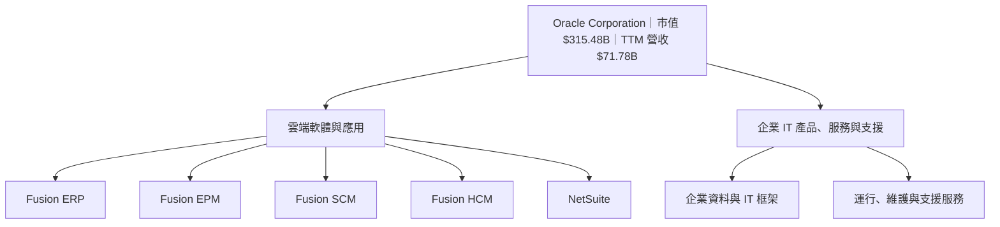
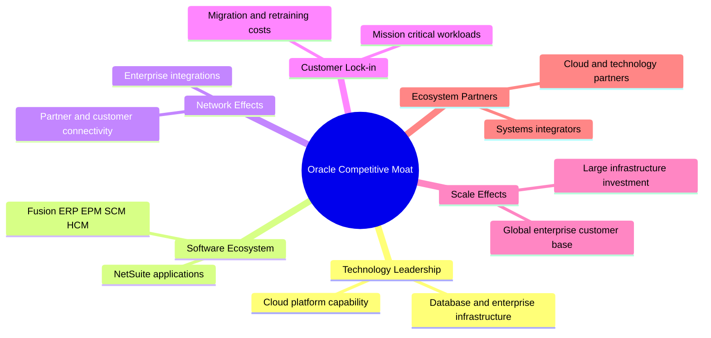
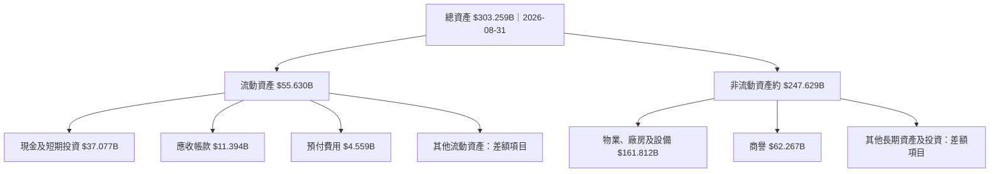
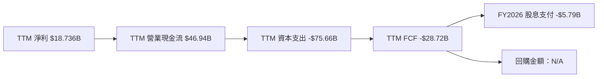
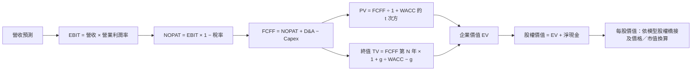
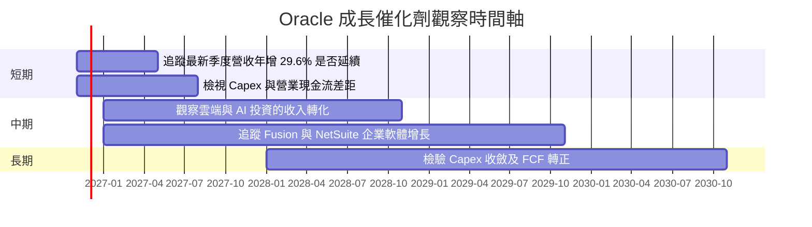
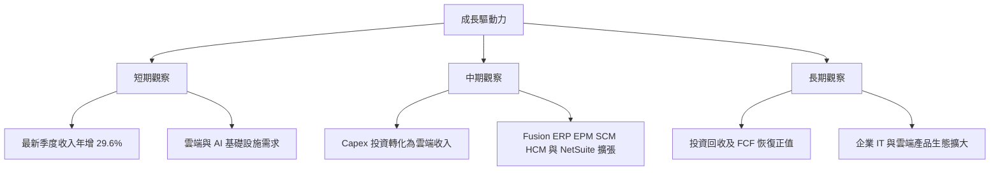
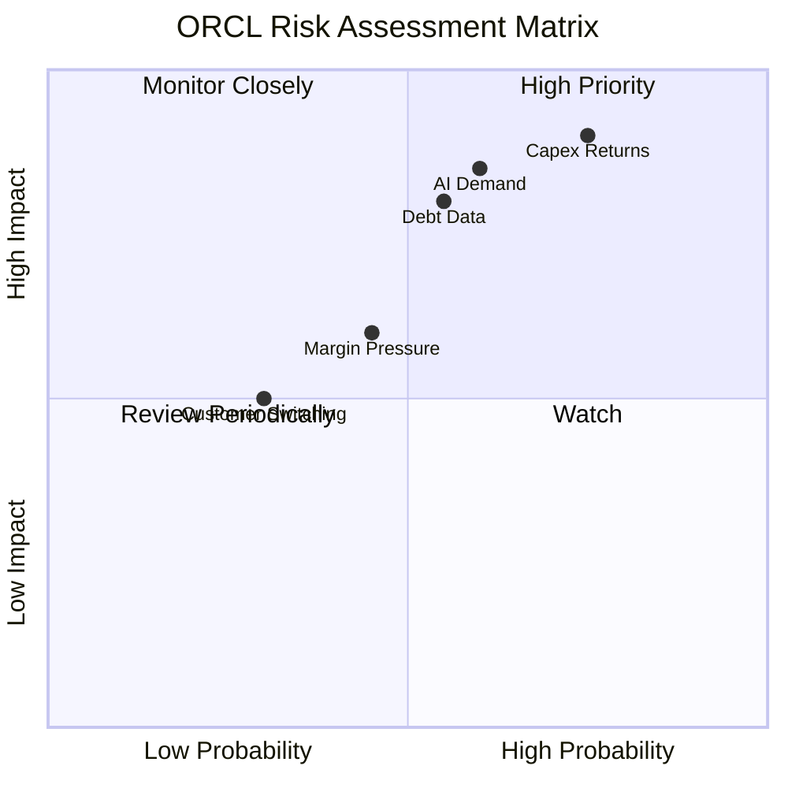
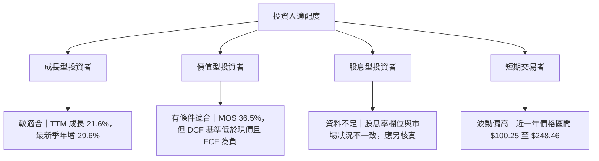

# ORCL 基本面深度分析報告
> **報告日期**：2026-11-21 ｜ **語言**：繁體中文 ｜ **數據來源**：SEC 申報資料 (XBRL)、Yahoo Finance、Finviz、StockAnalysis、Roic.ai ｜ **分析師**：CFA 級機構研究

> **資料一致性提醒**：最新收盤價採用 2026-11-20 的 **$101.19**。財務資料存在部分來源與口徑差異：例如營業利益率有 32.1% 與 34.2% 等不同讀數，總債務在核心指標中為 N/A、其他彙整資料則列有債務金額。本文對明確要求原值引用的指標優先採用程式計算的核心數據，並標示重要差異；不以缺漏項目反推或補造數字。

## 目錄

| # | 章節 | 核心結論 |
|---|------|----------|
| 1 | 執行摘要 | 強烈買入；加權合理價值 $159.43；MOS +36.5% |
| 2 | 公司概覽與商業模式 | 企業軟體黏著度高；細分營收與市場份額數據未提供 |
| 3 | 損益表深度分析 | TTM 營收 $71.78B、成長 21.6%；資本投入使自由現金流承壓 |
| 4 | 資產負債表分析 | 現金及短期投資 $37.08B；債務口徑不一致，槓桿風險需核實 |
| 5 | 現金流量深度分析 | TTM FCF -$28.72B，主因資本支出高於營業現金流 |
| 6 | 獲利能力與資本效率 | ROIC 61.3% 高於 WACC 8.97%；資本效率指標需留意口徑 |
| 7 | 相對估值分析 | ORCL 倍數低於多數同業及自身歷史中位數 |
| 8 | DCF 內在價值評估 | 基準 DCF $90.28；終值佔 EV 171.7%，對終值與資本支出假設敏感 |
| 9 | 成長催化劑 | 最新一季營收年增 29.6%；雲端與 AI 基礎設施是主要觀察方向 |
| 10 | 風險矩陣 | 資本支出／融資回報、AI 需求延續性、負自由現金流為前三大風險 |
| 11 | 投資建議 | 依 MOS 門檻為強烈買入；建議以財報現金流和債務資料作持續驗證 |

---

## 1. 執行摘要

### 1.0 一頁式投資儀表板（Portfolio Manager 30 秒速讀）

| 項目 | 內容 |
|------|------|
| **投資論點（3 句）** | ① TTM 營收 $71.78B、年增 21.6%，最新一季年增 29.6%，顯示增長仍在加速。② 核心數據 ROIC 61.3% 對照 WACC 8.97%，帳面上有高幅度資本回報利差。③ TTM FCF -$28.72B、FCF Yield -9.10%，高額資本支出令成長的現金回報尚未落地。 |
| **綜合評分** | **6.8/10**（引用 1.1 評分卡） |
| **財務健康** | 🟡 現金及短期投資 $37.08B、流動比率 1.171；但核心資料總債務為 N/A，另有資料源呈現高額債務，須核對 |
| **ROIC vs WACC** | **61.3% vs 8.97%**；依提供的 ROIC 口徑顯示價值創造，惟資本基礎及債務口徑需核實 |
| **FCF 趨勢** | TTM FCF 為 -$28.72B；FCF Yield **-9.10%**，資本支出大幅高於營業現金流 |
| **估值** | Forward P/E **9.15x** ｜ EV/EBITDA **12.878x** ｜ FCF Yield **-9.10%** |
| **DCF 內在價值（基準）** | **$90.28** ｜ 以 DCF 為基準，現價溢價 **12.1%**（現價 ÷ DCF 價值 − 1） |
| **安全邊際（MOS）** | **+36.5%**＝($159.43 加權合理價值 − $101.19 現價) ÷ $159.43；🟢 >25% |
| **預期報酬（基準情境 12M）** | DCF 基準情境相對現價 **-10.8%**；加權合理價值的隱含上行空間 **+57.6%**。兩者口徑不同，不應混為一談。 |
| **關鍵風險（前二）** | 高額資本支出使 FCF 深度為負；AI／雲端需求與融資承諾能否轉化為現金流 |
| **評級 + 信心度** | 🟢 **強烈買入** ｜ 信心：中（負 FCF、債務資料不一致及終值高度依賴降低信心） |

### 1.1 綜合評分卡（全報告唯一）

| 維度 | 評分（1–10） | 主要依據（引用數字與其來源章節） |
|------|--------------|----------------------------------|
| 成長性 | 8.5 | TTM 營收年增 21.6%，最新一季年增 29.6%；見第 3 章 |
| 獲利能力 | 8.0 | TTM 營業利益率 32.1%、ROIC 61.3%，但 F-Score 為 4/7；見第 3、6 章 |
| 財務健康 | 4.5 | 現金及短期投資 $37.08B、流動比率 1.171；總債務口徑不一致且 TTM FCF -$28.72B；見第 4、5 章 |
| 估值 | 7.0 | MOS +36.5%，P/E 15.9x 低於自身五年中位數 32.1x；但 DCF 基準低於現價；見第 7、8 章 |
| 護城河 | 8.0 | ERP、資料庫及雲端產品形成客戶切換成本；缺少可引用市場份額及分部營收占比；見第 2 章 |
| 管理層與資本配置 | 5.0 | 年度 SBC $4.81B，FY2026 資本支出 $55.66B、FCF -$23.69B；投資回報仍待現金流驗證；見第 3、5 章 |
| **綜合評分** | **6.8** | 六項算術平均：(8.5 + 8.0 + 4.5 + 7.0 + 8.0 + 5.0) ÷ 6 = 6.833，四捨五入為 **6.8/10** |

### 1.2 五大投資論點 + 三大核心風險

| 類型 | 項目 | 具體依據 | 信心度 |
|------|------|----------|--------|
| 🟢 **投資論點①** | 營收增長加速 | TTM 營收 $71.78B、年增 21.6%；最新一季營收年增 29.6% | 🟢 高 |
| 🟢 **投資論點②** | 高營業獲利能力 | TTM 營業利益率 32.1%，最新一季 34.8%；產品與服務組合支持高毛利企業軟體模式 | 🟢 高 |
| 🟢 **投資論點③** | 資本回報高於資本成本 | ROIC 61.3% 對 WACC 8.97%，差 52.33 個百分點；但須注意口徑及資本基礎的可比性 | 🟡 中 |
| 🟢 **投資論點④** | 相對自身歷史估值較低 | P/E 15.9x，低於五年中位數 32.1x；P/S 4.2x，低於中位數 6.2x | 🟡 中 |
| 🟢 **投資論點⑤** | 企業軟體客戶黏著度 | Fusion ERP、EPM、SCM、HCM 及 NetSuite 產品跨部門整合，增加替換成本；未提供量化留存率 | 🟡 中 |
| 🟡 **風險①** | 資本支出高於營運現金流 | TTM Capex $75.66B 高於 OCF $46.94B，FCF -$28.72B；若投資未能轉化成合約收入，估值與融資彈性會惡化 | 🔴 高衝擊 |
| 🔴 **風險②** | 債務與現金流資訊口徑不一致 | 核心指標總債務為 N/A，但其他市場資料列出總債務 $169.14B、淨負債 $132.07B；須以 SEC 申報及租賃負債細項核實 | 🔴 高衝擊 |
| 🟡 **風險③** | 高成長及終值假設落空 | DCF 終值現值為 EV 的 171.7%；若營收增速或終值假設下修，估值對模型變數敏感 | 🟡 中度 |

### 1.3 快速統計卡片

| 指標 | 公司實際值（期間） | 同業中位數 | 狀態 |
|------|--------------------|------------|------|
| 營收成長（TTM） | **21.6%** | — | 🟢 |
| 營收成長（最新一季年增） | **29.6%** | 13.2%（MSFT、SAP、CRM） | 🟢 |
| 毛利率（TTM） | **64.0%** | 73.6%（MSFT、SAP、CRM） | 🟡 |
| 營業利益率（TTM） | **32.1%** | — | 🟢 |
| ROIC（TTM） | **61.3%** | — | 🟢 |
| Forward P/E | **9.15x** | 20.0x（MSFT、SAP、CRM） | 🟢 |
| FCF Yield（TTM） | **-9.10%** | — | 🔴 |
| Piotroski F-Score | **4 / 7** | — | 🟡 |

### 1.4 投資結論

╔══════════════════════════════════════════════════════════════════╗  
║                    📊 投資結論摘要                               ║  
╠══════════════════════════════════════════════════════════════════╣  
║ 評級：強烈買入（MOS +36.5%，ROIC 61.3% 高於 WACC 8.97%）         ║  
║ 價格（2026-11-20 收盤）：$101.19                                 ║  
║ DCF 內在價值（基準）：$90.28（現價溢價 +12.1%）                 ║  
║ 安全邊際 MOS：+36.5%（以 $159.43 加權合理價值為分母）            ║  
║ 加權合理價值（8.8）：$159.43                                     ║  
║ DCF 情境價值：                                                    ║  
║   悲觀情境：$11.45（-88.7%）                                     ║  
║   基準情境：$90.28（-10.8%）                                     ║  
║   樂觀情境：$266.38（+163.2%）                                   ║  
║ 綜合評分：6.8/10（引用 1.1）                                     ║  
║ 適合投資人：可承受高波動、願意追蹤資本支出及現金流的長期成長型投資人 ║  
╚══════════════════════════════════════════════════════════════════╝

---

## 2. 公司概覽與商業模式

### 2.1 業務結構與收入來源

ORCL 為美國企業軟體與基礎設施公司，員工約 **141,000 人**，TTM 營收 **$71.78B**。資料列出 Oracle Cloud SaaS 產品包括 Fusion ERP、EPM、SCM、HCM 及 NetSuite，另提供企業 IT 框架建置、運行與支援服務。未提供各分部營收及占比，故不推估分部金額或比例。

### 2.2 市場份額

**市場份額數據未提供**，無法以可引用的市場份額比例比較 ORCL 與同業。以營收增長觀察，ORCL TTM 成長 21.6%、最新一季年增 29.6%，高於所列 MSFT 18.8%、SAP 13.2% 與 CRM 10.8% 的最新一季增長率；但企業規模、產品組合及季度口徑差異仍影響可比性。

### 2.3 競爭護城河分析

### 2.4 護城河強度

| 護城河項目 | 強度（強／中／弱） | 證據（引用數字或事實） | 會削弱它的情況 |
|------------|--------------------|------------------------|----------------|
| 技術與產品能力 | 中至強 | 多種企業軟體與 IT 產品並行；TTM 營業利益率 32.1% | 雲端替代技術成熟、產品更新落後或服務中斷 |
| 軟體生態系統 | 強 | Fusion ERP、EPM、SCM、HCM 與 NetSuite 覆蓋多個企業流程 | 客戶偏好模組化、多供應商或開源替代方案 |
| 網路效應 | 中 | 企業整合與合作夥伴網絡可提高產品使用價值；未提供網絡規模或留存數據 | 競爭平台互通性提升、客戶可低成本遷移 |
| 客戶鎖定 | 強 | 核心 ERP、資料庫及工作流程替換可能涉及資料遷移、流程重整與培訓 | 雲端遷移工具降低轉換成本、客戶縮短合約期限 |
| 規模效應 | 中至強 | FY2026 資本支出 $55.66B、研發費用 $10.27B；投入規模帶來技術與基礎設施能力，也增加資本回收壓力 | Capex 無法產生相應收入或競爭者投資規模更大 |
| 生態夥伴 | 中 | 企業軟體導入通常依賴整合商及技術夥伴；本資料未提供夥伴收入量化 | 夥伴轉向競品或客戶自行採用替代產品 |

**護城河評分理由**：1.1 的護城河分數為 **8.0/10**，主要依據多產品企業軟體生態及客戶切換成本；缺少分部營收、續約率與市場份額數據，限制了證據強度。

---

## 3. 損益表深度分析

### 3.1 年度收入成長趨勢（近4年）

FY2023–FY2026 收入取自年度損益資料。FY2023 至 FY2026 三年收入 CAGR 約 **10.5%**，計算為 \((67.36 ÷ 49.95)^{1/3}-1\)；FY2026 年增約 17.4%。

╔══════════════════════════════════════════════════════════════════╗  
║              Oracle 年度收入趨勢（FY2023–FY2026）                ║  
╠══════════════════════════════════════════════════════════════════╣  
║ FY2023  $49.95B  ███████████████░░░░░░░░░░  YoY：+6.0% 🟡       ║  
║ FY2024  $52.96B  █████████████████░░░░░░░░  YoY：+6.0% 🟡       ║  
║ FY2025  $57.40B  ███████████████████░░░░░░  YoY：+8.4% 🟡       ║  
║ FY2026  $67.36B  ████████████████████████  YoY：+17.4% 🟢      ║  
╠══════════════════════════════════════════════════════════════════╣  
║ FY2023–FY2026 三年收入 CAGR：約 +10.5%                           ║  
╚══════════════════════════════════════════════════════════════════╝

收入由 FY2025 的 $57.40B 升至 FY2026 的 $67.36B，增長明顯加速；最新一季年增 29.6% 又高於 TTM 年增 21.6%，若能延續，營業槓桿有望抵銷部分基礎設施投入成本。但季度表現仍須與資本支出及營業現金流一併觀察。

### 3.2 季度收入趨勢分析

QoQ 依財務表中相鄰季度收入計算；YoY 引用 StockAnalysis 季度營收增長欄，最新季度年增率亦與核心數據一致。

| 季度 | 營收 | QoQ 成長 | YoY 成長 | 備註 |
|------|------:|---------:|---------:|------|
| 2025-11-30 | $16.06B | — | 14.22% | 季度基期 |
| 2026-02-28 | $17.19B | +7.0% | 21.66% | 季度營收續增 |
| 2026-05-31 | $19.18B | +11.6% | 20.63% | QoQ 增速提高 |
| 2026-08-31 | $19.34B | +0.8% | 29.6% | 年增加速、單季 QoQ 放緩 |

QoQ 計算示例：\((19.34 ÷ 19.18)-1=0.8\%\)。最新季度年增強，但單季相對上一季僅增 0.8%，宜避免只看 YoY 而忽略短期季節性、交付時點或收入確認差異。

### 3.3 利潤率演變分析

下表年度毛利率與營業利益率依年度毛利、營業利益除以年度營收計算；TTM 及最新季度營業利益率則採用核心指標原值。因不同來源口徑有差異，歷史計算值不與核心 TTM 原值混用。

| 利潤率指標 | FY2023 | FY2024 | FY2025 | FY2026 | 趨勢 | 評估 |
|------------|-------:|-------:|-------:|-------:|------|------|
| **毛利率** | 72.9% | 71.4% | 70.5% | 65.8% | ↘️ 年度下降 | 🟡 |
| **營業利益率** | 27.6% | 30.3% | 31.4% | 33.3% | ↗️ 年度上升 | 🟢 |

年度毛利率由 FY2023 的 72.9% 降至 FY2026 的 65.8%，可能反映基礎設施與服務組合變化，但所提供資料沒有分部毛利、雲端成本或產品組合拆分，不能把變化歸因於單一因素。同期年度營業利益率由 27.6% 上升至 33.3%，說明營運費用相對收入的控制或規模效益抵銷了部分毛利率壓力。

核心資料另列 TTM 營業利益率 **32.1%**、最新季度 **34.8%**；彙整資料則列 TTM **34.2%**、最新季度 **34.3%**。本報告後續涉及核心 TTM 指標時採用 32.1%，季度核心指標採用 34.8%，差異應以 SEC 申報資料與會計口徑核對。

### 3.4 費用結構分析

**費用結構比例未完整提供，故不繪製費用結構圓餅圖。**可確認的 FY2026 研發費用為 **$10.27B**，約占年度營收 $67.36B 的 **15.2%**；股權薪酬 FY2026 為 **$4.81B**。銷售、一般行政及各分部成本明細不足，不能計算其完整占比。

### 3.5 季度 EPS 趨勢與盈餘品質（Quality of Earnings）

| 季度 | EPS 實際值 | EPS YoY | 超預期／不及預期 |
|------|-----------:|--------:|------------------|
| 2025-11-30 | $2.10 | +90.91% | N/A：分析師 EPS 預估值缺失 |
| 2026-02-28 | $1.27 | +24.51% | N/A：分析師 EPS 預估值缺失 |
| 2026-05-31 | $1.45 | +21.91% | N/A：分析師 EPS 預估值缺失 |
| 2026-08-31 | $1.56 | +54.45% | N/A：分析師 EPS 預估值缺失 |

四季 EPS 均有實際數值，但估計值欄為 nan，故無法判定四季是否超預期或不及預期。2025-11-30 的 EPS $2.10 高於相鄰季度，是否受一次性項目影響，現有資料不足以判定；不應據此推論為持續性獲利。

| 盈餘品質項目 | 數值／佔比 | 評估 |
|--------------|------------|------|
| 股權薪酬 SBC / 營收 | 約 **6.7%**；TTM SBC 約 $4.82B ÷ TTM 營收 $71.78B | 🟡 SBC 對股東有實質稀釋成本 |
| SBC / 營業現金流 | 約 **10.3%**；$4.82B ÷ $46.94B | 🟡 比重不可忽略；營業現金流含非現金 SBC 加回 |
| FCF / 淨利（現金轉換率） | 約 **-153.3%**；FCF -$28.72B ÷ TTM 淨利 $18.736B | 🔴 資本支出期間，淨利未轉化為正 FCF |
| 一次性／非經常性損益 | N/A：缺少季度調整項目明細 | 🟡 無法判定淨利是否受一次性項目拉動 |
| 有效稅率異常 | **12.6%**（最新年度有效稅率） | 🟡 有效稅率低於法定稅率的具體原因未提供 |
| 資本化支出 vs 費用化 | TTM Capex $75.66B；FY2026 SBC $4.81B、研發費用 $10.27B | 🟡 資本支出直接壓低 FCF；缺少資本化政策及資產明細，無法判斷遞延費用程度 |

**盈餘品質結論**：GAAP 淨利本身是否因一次性項目高估，資料不足以判斷；但現金轉換率受巨額 Capex 明顯壓低。DCF 使用 GAAP EBIT 且 SBC 已作為費用反映；估值的不確定性主要來自資本支出能否逐步下降並產生現金回報，而非只看 EPS 增長。

---

## 4. 資產負債表分析

### 4.1 資產結構分解

最新 TTM 資產資料列示總資產 **$303.259B**、流動資產 **$55.630B**，其中應收帳款 $11.394B、預付費用 $4.559B、現金及短期投資 $37.077B；物業、廠房及設備為 $161.812B。不同財務資料表日期及口徑可能不同，以下以 StockAnalysis 的 2026-08-31 資產數據描述結構。

### 4.2 流動性與營運資金分析

流動比率與速動比率取市場資料；營運資金天數照抄品質指標。應收帳款天數增加通常代表收款週期延長，但單憑兩個時點不能判定變化原因。

| 指標 | 最新值 | 一年前 | 變化 | 解讀 |
|------|-------:|-------:|------:|------|
| 流動比率 | 1.171 | N/A | N/A | 短期資產高於短期負債，但緩衝並不寬裕 |
| 速動比率 | 1.02 | N/A | N/A | 接近 1，流動性依賴應收款與現金管理 |
| DSO 應收帳款天數 | 58 天 | 55 天 | +3 天 | 收款天數小幅延長；需追蹤應收帳款與收入增長是否匹配 |
| DIO 存貨天數 | N/A | N/A | N/A | 公司未報告可用存貨餘額，不補推 |
| DPO 應付帳款天數 | 156 天 | N/A | N/A | 一年前數據缺失；最新付款週期較長可能支持營運資金，但不能單獨判定議價力 |
| CCC 現金轉換週期 | N/A | N/A | N/A | DIO 缺失，不能計算 CCC |

### 4.3 債務結構分析

核心指標區將 **Total debt 標為 N/A**，因此不能以其建立完整的債務健康比率。其他彙整市場資料列示總債務 $169.14B、淨負債 $132.07B，且 Roic.ai 負債明細包含借款與融資租賃；這些數字與核心數據列示 **Net cash $37.08B** 不一致，故不把兩種口徑合併，也不據此計算 Debt/EBITDA 或利息保障倍數。

╔══════════════════════════════════════════════════════════════════╗  
║                   Oracle 債務健康診斷                            ║  
╠══════════════════════════════════════════════════════════════════╣  
║ 總債務（核心指標）：N/A；其他彙整來源列 $169.14B                ║  
║ 現金及短期投資：$37.08B                                           ║  
║ 核心指標 Net cash：+$37.08B（惟與其他負債資料口徑有差異）        ║  
║ Debt/EBITDA：N/A（債務口徑尚未一致）                              ║  
║ 利息保障倍數：N/A（缺少可核實利息費用與債務同口徑資料）           ║  
║ 判斷：🟡 在核實債務及融資租賃前，不宜只依現金餘額判定資產負債表強弱 ║  
╚══════════════════════════════════════════════════════════════════╝

### 4.4 股東權益趨勢

年度股東權益由 FY2023 的 $1.07B 升至 FY2026 的 $42.51B，期間變化很大；這一增幅不能只解讀為營運獲利累積，亦可能涉及融資、回購及其他資本項目。由於本資料未提供完整權益變動表，不對來源作拆分歸因。

╔══════════════════════════════════════════════════════════════════╗  
║                 Oracle 歷年股東權益變化                           ║  
╠══════════════════════════════════════════════════════════════════╣  
║ FY2023  $1.07B   █                                                ║  
║ FY2024  $8.70B   █████                                            ║  
║ FY2025  $20.45B  █████████████                                    ║  
║ FY2026  $42.51B  █████████████████████████                        ║  
╚══════════════════════════════════════════════════════════════════╝

---

## 5. 現金流量深度分析

### 5.1 現金流量瀑布圖

以下以 TTM 核心數據呈現營業現金流、資本支出與 FCF；股息資料採年度資料，不能與 TTM 流量直接相加成同期間瀑布總額。回購金額未提供。

營業現金流高於淨利，顯示營運現金流入尚可；但 Capex 明顯高於 OCF，抵銷並超過營運現金流，令 FCF 轉負。因此現階段營運擴張的股東回報更依賴未來投資回收，而不是當期自由現金流。

### 5.2 FCF 轉換率趨勢

| 財年 | 營業現金流 | 資本支出 | FCF | 淨利 | FCF / 淨利 |
|------|-----------:|---------:|----:|-----:|-----------:|
| FY2023 | $17.16B | $8.70B | $8.47B | $8.50B | 99.6% |
| FY2024 | $18.67B | $6.87B | $11.81B | $10.47B | 112.8% |
| FY2025 | $20.82B | $21.21B | -$0.394B | $12.44B | -3.2% |
| FY2026 | $31.98B | $55.66B | -$23.69B | $17.09B | -138.6% |
| TTM 至 2026-08-31 | $46.94B | $75.66B | -$28.72B | $18.736B | -153.3% |

FY2025 至 FY2026 的轉變與資本支出從 $21.21B 升至 $55.66B 同期發生。這意味 FCF 變化主要受投資支出影響，不能單靠 OCF 增長判斷股東現金回報改善。

### 5.3 自由現金流趨勢

╔══════════════════════════════════════════════════════════════════╗  
║                   Oracle 自由現金流趨勢                           ║  
╠══════════════════════════════════════════════════════════════════╣  
║ FY2023  +$8.47B   ████████████████  FCF Yield：N/A                ║  
║ FY2024  +$11.81B  ██████████████████████  FCF Yield：N/A          ║  
║ FY2025  -$0.394B  ░  FCF Yield：N/A                              ║  
║ FY2026  -$23.69B  ░░░░░░░░░░░░░░░░░░░░░░░░                      ║  
║ TTM     -$28.72B  ░░░░░░░░░░░░░░░░░░░░░░░░░░  Yield：-9.10%    ║  
╚══════════════════════════════════════════════════════════════════╝

年度 FCF Yield 未提供，故不以市值反推或填列。TTM FCF Yield 為 -9.10%，表明現價市值對應的近期自由現金流為負，而非正現金收益。

### 5.4 資本配置評估

未提供完整的回購、再投資、股息與留存現金占比資料，故不繪製資本配置圓餅圖。可觀察到 FY2026 Capex **$55.66B**、股息支付 **$5.79B**、SBC **$4.81B**；回購金額 N/A。高 Capex 是資本配置中最重要的現金流變數，其回報應由未來營收、利用率與 FCF 改善驗證。

| 項目 | 可用數據 | 評估 |
|------|---------|------|
| 資本支出 | FY2026 $55.66B；TTM $75.66B | 🔴 大幅高於同期 OCF；需驗證投資回收 |
| 股息 | FY2026 $5.79B | 🟡 有現金分配，但低於同期 Capex |
| 股權薪酬 | FY2026 $4.81B | 🟡 持續稀釋成本 |
| 股票回購 | N/A | 無法判斷回購對股數的淨效果 |
| 留存與其他投資 | N/A | 無法按現金用途計算比例 |

---

## 6. 獲利能力與資本效率

### 6.1 ROE / ROA / ROIC 趨勢

歷史同口徑 ROE、ROA、ROIC 序列未完整提供；不把來源口徑不一致的數值拼接成趨勢。FY2026 股東權益與資產變化亦使單期比率受到分母影響。

| 指標 | 可得期間／數值 | 評估 |
|------|----------------|------|
| ROE | TTM **28.3%**（品質指標口徑） | 🟢 獲利回報高；權益乘數達 4.54，槓桿亦有影響 |
| ROA | TTM **6.4%**（彙整財務資料） | 🟡 相對 ROE 低，反映龐大資產基礎 |
| ROIC | TTM **61.3%**（核心指標口徑） | 🟢 高於 WACC；但須留意核心資料未提供總債務 |
| 行業均值比較 | N/A（缺少同口徑行業數據） | 不列推估均值 |

### 6.2 ROIC vs WACC 分析（核心價值創造判斷）

WACC 採用資本成本資料原值。Beta 原始值 1.78，採用調整後 Beta **1.52**；調整方式為 \((2/3 × 1.78)+(1/3 × 1.00)=1.52\)。

╔══════════════════════════════════════════════════════════════════╗  
║                ROIC vs WACC 深度分析                             ║  
╠══════════════════════════════════════════════════════════════════╣  
║ WACC 輸入：                                                       ║  
║ ├── 無風險利率（10Y 美債）：4.91%                                 ║  
║ ├── 市場風險溢酬（假設）：5.00%                                   ║  
║ ├── 原始 Beta：1.78；調整後 Beta：1.52                            ║  
║ ├── Ke = 4.91% + 1.52 × 5.00% = 12.51%                            ║  
║ ├── 稅前債務成本：2.72%；有效稅率：12.6%                          ║  
║ ├── 稅後 Kd = 2.72% × (1 − 12.6%) = 2.38%                         ║  
║ ├── 股權／債務權重：65.1%／34.9%                                  ║  
║ └── WACC = 8.97%                                                   ║  
║                                                                   ║  
║ ROIC（TTM）：61.3%                                                 ║  
║ EVA 利差 = ROIC − WACC = 61.3% − 8.97% = +52.33 個百分點          ║  
║ ROIC / WACC = 61.3% ÷ 8.97% = 6.83 倍                              ║  
║                                                                   ║  
║ ROIC 61.3%  ▓▓▓▓▓▓▓▓▓▓▓▓▓▓▓▓▓▓▓▓▓▓▓▓▓▓▓▓▓▓▓▓▓▓▓▓▓▓▓▓▓▓▓▓       ║  
║ WACC  8.97%  ▓▓▓▓▓▓▓▓░░░░░░░░░░░░░░░░░░░░░░░░░░░░░░░░░░       ║  
║                                                                   ║  
║ 結論：依列示 ROIC 計算，公司在會計口徑上創造股東價值；但債務及   ║  
║ 投入資本口徑需與 SEC 報表核對，避免把單期高 ROIC 外推。            ║  
╚══════════════════════════════════════════════════════════════════╝

WACC 的複算採用指定輸入：稅後債務成本 \(2.72\%×(1-12.6\%)=2.3773\%\)；股權成本按列示值 12.51% 計。加權後為 \(65.1\%×12.51\%+34.9\%×2.3773\%=8.97\%\)（四捨五入）。該組權重及債務成本是資本成本資料的計算輸入，並不等於本文已核實資產負債表總債務。

### 6.3 杜邦三因素分解

| 因素 | 數值（TTM） | 解讀 |
|------|-------------|------|
| 淨利率 | 26.4% | 淨利潤率反映企業軟體及服務盈利能力 |
| 資產週轉率 | 0.24 | 資產基礎龐大，單位資產產生營收有限 |
| 權益乘數 | 4.54 | 槓桿放大權益報酬，需與債務口徑一併看 |
| **ROE** | **28.3%** | 26.4% × 0.24 × 4.54 約為 28.3%；依品質指標原值照錄 |

杜邦拆解顯示 ROE 由高淨利率與 4.54 倍權益乘數共同支撐，資產週轉率相對低。故 ROE 不能單獨代表資本效率，還需參照 ROIC 及負債資料。

### 6.4 財務體質：Piotroski F-Score

**Piotroski F-Score：4/7**。因部分測試缺少輸入，可判定分母為 7，而非完整 9 項。

| 測試 | 結果 | 解讀 |
|------|------|------|
| ROA > 0 | ✅ 通過 | TTM 盈利為正 |
| 營業現金流 > 0 | ✅ 通過 | TTM OCF 為 $46.94B |
| ROA 高於一年前 | ❌ 未通過 | 資產回報未改善 |
| 營業現金流 > 淨利（應計品質） | ✅ 通過 | OCF 高於淨利 |
| 長期負債 ÷ 總資產低於一年前 | — 無法判定 | 缺資料 |
| 流動比率高於一年前 | ✅ 通過 | 品質指標測試通過 |
| 稀釋股數未增加 | ❌ 未通過 | 股數增加，與 SBC 稀釋相符 |
| 毛利率高於一年前 | — 無法判定 | 缺資料 |
| 資產週轉率高於一年前 | ❌ 未通過 | 資產使用效率未改善 |

---

## 7. 相對估值分析

### 7.1 同業估值比較表格

ORCL 本公司估值採財務資料所列現值；同業倍數只採指定同業資料。SAP 的 P/S、EV/EBITDA 為 N/A（混合幣別），不補填。ORCL Forward P/E 使用市場估值數據；其與估值方法所用 Forward EPS 口徑可能有差異。

| 估值指標 | **ORCL** | **MSFT** | **SAP** | **CRM** | 本公司評估 |
|----------|---------:|---------:|--------:|--------:|-----------|
| **Trailing P/E** | 15.9x | 25.3x | 24.8x | 16.5x | 🟢 低於三家同業 |
| **Forward P/E** | 9.15x | 20.0x | 20.9x | 11.3x | 🟢 顯著較低；須驗證 EPS 預估能否實現 |
| **P/S Ratio** | 4.4x | 10.4x | N/A | 3.4x | 🟡 高於 CRM、低於 MSFT |
| **EV/EBITDA** | 12.878x | 17.8x | N/A | 13.9x | 🟢 低於 MSFT、CRM |
| **最新一季營收年增** | 29.6% | 18.8% | 13.2% | 10.8% | 🟢 增長較快 |
| **毛利率（TTM）** | 64.0% | 67.7% | 73.6% | 77.3% | 🟡 低於三家同業 |

### 7.2 歷史估值區間分析

ORCL 的現值 P/E、P/S、EV/EBITDA 均低於所列自身五年區間下限；百分位數採歷史估值資料原值。這可能反映估值回落，也可能反映市場對資本支出、融資或未來現金流風險的折價。

╔══════════════════════════════════════════════════════════════════╗  
║               ORCL 五年估值區間與目前位置                        ║  
╠══════════════════════════════════════════════════════════════════╣  
║ P/E：       19.0x ─── 中位數 32.1x ─── 上限 52.3x                ║  
║             現值 15.9x；歷史百分位 0%                            ║  
║ P/S：        4.6x ─── 中位數  6.2x ─── 上限 11.1x               ║  
║             現值  4.2x；歷史百分位 0%                            ║  
║ EV/EBITDA：12.6x ─── 中位數 17.9x ─── 上限 28.9x                ║  
║             現值  8.2x；歷史百分位 0%                            ║  
╚══════════════════════════════════════════════════════════════════╝

注意：本節以歷史估值區間資料中的現值為準；同一資料包其他市場估值欄位 EV/EBITDA 為 12.878x，與歷史估值資料的 8.2x 不一致，反映計算口徑或時點差異，故不將兩者拼接。

### 7.3 情境價值（Bear / Base / Bull，照抄 DCF MODEL 的 Scenarios）

| 情境 | 第 1 年營收成長 | 期末營業利潤率 | WACC | 每股價值 | 相對現價 | 機率 | 會發生的條件 |
|------|----------------:|----------------:|-----:|---------:|---------:|-----:|--------------|
| 🔴 悲觀 | 10.8% | 26.0% | 9.97% | $11.45 | -88.7% | 25% | 雲端需求與 AI 基礎設施收入低於基準，且擴張支出未能形成相應規模經濟 |
| 🟡 基準 | 21.6% | 30.6% | 8.97% | $90.28 | -10.8% | 50% | TTM 增長延續後逐年放緩，利潤率由 32.1% 收斂至 30.6% |
| 🟢 樂觀 | 32.4% | 33.6% | 7.97% | $266.38 | +163.2% | 25% | 雲端與 AI 需求大幅超預期，營業槓桿提升，資本成本下降 |

情境數值及機率照錄模型輸出；資料未提供每個情境的逐年 FCFF 路徑，因此不另造情境現金流推導。

### 7.4 相對估值隱含價格區間

╔══════════════════════════════════════════════════════════════════╗  
║                 相對估值方法回推的每股價值                       ║  
╠══════════════════════════════════════════════════════════════════╣  
║ $90.28 ───── $101.19 ───── $177.41 ───── $221.38 ───── $236.18 ║  
║ 基準 DCF      現價          EV/EBITDA       Forward P/E   共識目標 ║  
╚══════════════════════════════════════════════════════════════════╝

| 方法 | 每股價值 | 依據 |
|------|---------:|------|
| 同業 Forward P/E | $221.38 | 同業中位數 20.0x（MSFT、SAP、CRM）× Forward EPS $11.06 |
| 同業 EV/EBITDA | $177.41 | 同業中位數 15.9x（MSFT、CRM）× TTM EBITDA，再加淨現金 |
| 分析師共識 | $236.18 | 40 位分析師平均目標價 |
| DCF 基準 | $90.28 | 10 年 FCFF、WACC 8.97%、永續成長率 3.0% |

---

## 8. DCF 內在價值評估（Discounted Cash Flow）

> 本節逐年模型、敏感度、情境與反推數字依 DCF 模型原值照錄。模型採用 GAAP EBIT、FCFF = NOPAT + D&A − Capex、不建模營運資金，並以指定橋接口徑計算每股價值。資料中的缺漏及算式口徑矛盾會明確標示，不以自建模型取代。

### 8.0 估值推理鏈（Thinking Logic）

**Step 1 — 價值由哪些變數決定？**  
ORCL 的價值可理解為既有企業軟體現金流底盤、雲端及 AI 基礎設施成長，以及高額 Capex 投資回收三部分；各部分營收占比未提供，不能量化拆分。模型最重要的變數是**投資支出由目前高位回落的速度**：TTM Capex 為 $75.66B，而模型假設 Capex/營收由 FY+1 的 105.4% 逐年降至 FY+10 的 14.4%。若此收斂不成立，FCFF 和終值均會顯著受壓。

**Step 2 — 模型選擇**

| 決策點 | 本報告採用 | 理由（含數字） | 曾考慮但否決 | 否決理由 |
|--------|-----------|----------------|--------------|----------|
| 現金流定義 | FCFF | 使用 GAAP EBIT、WACC 折現得到 EV；模型提供逐年 FCFF | FCFE | 債務明細口徑不一致，股東現金流較難獨立核實 |
| 預測期 N | 10 年 | DCF 模型固定 10 年，期間足以呈現 Capex 比率逐步收斂 | 5 年 | 無法呈現模型內 Capex 從 105.4% 收斂至 14.4% 的完整路徑 |
| 終值方法 | Gordon Growth | 模型已提供永續成長率 3.0% 及終值 | 退出倍數 | DCF 模型未提供可採用的退出 EBITDA 倍數及對應終值 |
| EBIT 基礎 | GAAP EBIT | 模型明確採 GAAP EBIT | 非 GAAP EBIT | 可能加回 SBC，與既定模型口徑不符 |

**Step 3 — 關鍵假設推導鏈**

- **預測期 10 年**：錨點＝模型預設 10 年，並涵蓋 Capex 由 105.4% 收斂至 14.4% 的期間 → 調整＝不另調整，沿用模型期數 → **採用 10 年** → 曾考慮 5 年，但會截斷模型設定的資本投入回落路徑，故不採用。
- **年 1 營收成長 21.6%、年 10 成長 3.0%**：錨點＝TTM 營收增長 21.6% → 調整＝模型以線性方式淡化增速至長期 3.0% → **採用 21.6% 起始、3.0% 結束** → 曾考慮把 29.6% 最新季度 YoY 外推全年，但單季增速不是 TTM 增速，故不採用。
- **營業利潤率 32.1% 降至 30.6%**：錨點＝核心 TTM 營業利潤率 32.1% → 調整＝模型逐步回歸包含 TTM 的近五年中位數 → **採用年 1 32.1%、年 10 30.6%** → 曾考慮延續最新季度 34.8%，但季度與 TTM 期間不同且年度資料不支持直接外推，故不採用。
- **永續成長率 g = 3.0%**：錨點＝模型指定 3.0%；屬長期成熟期假設且低於 WACC 8.97% → 調整＝不加碼長期成長假設 → **採用 3.0%** → 曾考慮更高數值，但會提高終值且接近 WACC，故不採用；未提供宏觀長期 GDP+通膨的獨立數值。
- **Capex/營收**：錨點＝TTM Capex/營收 105.4% → 調整＝模型假設投資周期逐步淡化，終值前降至 14.4%，並以 D&A 的 1.1 倍作下限規則 → **採用模型逐年數值** → 曾考慮保持 105.4%，但該值會使整個長期模型持續深度負現金流，不符合模型設定的成熟化路徑；此處是估值最敏感假設之一。
- **D&A/營收 = 13.1%**：錨點＝TTM 13.1% → **採用 13.1% 持平**；未作偏離。
- **有效稅率 = 12.6%**：錨點＝最新年度有效稅率 12.6% → **採用 12.6%**；未假設稅率下行。
- **營運資金變動**：錨點＝模型明確標示未建模 → **採用不納入模型**；不假設營運資金釋放現金。
- **EBIT 與 SBC**：錨點＝模型採 GAAP EBIT，已將 SBC 作為費用 → **採用組合 (A)：GAAP EBIT、FCFF 不再扣 SBC、股數不額外稀釋** → 不使用非 GAAP 加回 SBC 的替代方法，以免改變已提供模型。
- **年稀釋率**：錨點＝模型組合 (A) 設定為 0% 額外稀釋 → **採用固定股數處理** → 曾考慮另按 SBC 增加股數，但會與 GAAP EBIT 中已扣除 SBC 的模型組合不一致。
- **WACC = 8.97%**：錨點＝資本成本資料列示 8.97% → **採用 8.97%**；Beta、ERP、資本權重均依 8.2 原值，不另建折現率。
- **退出倍數**：DCF 模型未提供退出倍數 → **不填造退出倍數或第二個終值**，僅使用模型內 Gordon Growth 終值。

**Step 4 — 最脆弱的一環**  
最脆弱假設是 Capex/營收由 105.4% 降至 14.4%；若實際回落速度慢於模型，FCF 將低於預測，且終值占比已達 171.7%，估值可能大幅下降，方向與第 8.9 節一致。

**Step 5 — 計算路徑圖**

### 8.1 模型假設總表（Model Inputs）

| 假設項目 | 採用值 | 依據／來源 | 敏感度 |
|----------|--------|-------------|--------|
| 預測期長度 N | 10 年 | DCF 模型固定期間 | 🟡 中 |
| 營收成長 | FY+1 21.6% → FY+10 3.0% | TTM 成長 21.6%，逐年線性淡化 | 🔴 高 |
| 營業利益率 | FY+1 32.1% → FY+10 30.6% | TTM 32.1%，淡化至近五年中位數 | 🔴 高 |
| 有效稅率 | 12.6% | 最新年度有效稅率 | 🟢 低 |
| Capex/營收 | FY+1 105.4% → FY+10 14.4% | TTM 比率向 1.1×D&A 規則收斂 | 🔴 高 |
| D&A/營收 | 13.1% | TTM 比率持平 | 🟢 低 |
| 營運資金變動／營收增額 | 未建模 | 模型明確不納入 WC | 🟡 中 |
| EBIT 基礎 | GAAP | 模型指定 GAAP EBIT | 🟡 中 |
| SBC 處理 | 組合 (A)：已含於 GAAP EBIT，不再扣 SBC | 模型指定；固定股數、不另稀釋 | 🟡 中 |
| 年稀釋率 | 0%（模型不再額外稀釋） | 與組合 (A) 一致 | 🟡 中 |
| 永續成長率 g | 3.0% | DCF 模型指定，低於 WACC | 🔴 高 |
| 終值方法 | Gordon Growth | 模型指定；退出倍數未提供 | 🔴 高 |
| WACC | 8.97% | 資本成本資料指定值 | 🔴 高 |

**FCFF 定義**：模型採用 **FCFF = NOPAT + D&A − Capex**，營運資金變動不建模。模型採用 **組合 (A)**：GAAP EBIT 已含 SBC 費用，故不再扣 SBC，股數不額外稀釋；SBC 影響在此模型中只計入一次。

### 8.2 折現率推導（WACC）

╔══════════════════════════════════════════════════════════════════╗  
║                    WACC 推導（折現率）                           ║  
╠══════════════════════════════════════════════════════════════════╣  
║ 股權成本 Ke（CAPM）：                                             ║  
║ ├── 無風險利率 Rf：4.91%（10Y 美債輸入；未提供觀測日期）           ║  
║ ├── 市場風險溢酬 ERP：5.00%（資料列示的假設值）                   ║  
║ ├── 原始 Beta：1.78；調整後 Beta：1.52                            ║  
║ ├── 調整方式：(2/3 × 1.78) + (1/3 × 1.00) = 1.52                  ║  
║ └── Ke = 4.91% + 1.52 × 5.00% = 12.51%                           ║  
║                                                                   ║  
║ 債務成本：                                                        ║  
║ ├── 稅前 Kd：2.72%（資本成本資料原值）                            ║  
║ ├── 有效稅率：12.6%                                               ║  
║ └── 稅後 Kd = 2.72% × (1 − 12.6%) = 2.38%                        ║  
║                                                                   ║  
║ 資本結構：                                                        ║  
║ ├── 股權權重：65.1%                                               ║  
║ ├── 債務權重：34.9%                                               ║  
║ └── WACC = 65.1% × 12.51% + 34.9% × 2.38% = 8.97%                ║  
╚══════════════════════════════════════════════════════════════════╝

逐步演算如下：

1. **Ke（CAPM）**＝\(4.91\% + 1.52 × 5.00\% = 4.91\% + 7.60\% = 12.51\%\)。
2. **稅前 Kd**＝資本成本資料列示 **2.72%**。利息費用與平均計息負債的完整底稿未提供，故不另拆算。
3. **稅後 Kd**＝\(2.72\% × (1-12.6\%)=2.72\%×87.4\%=2.37728\%\)，四捨五入為 **2.38%**。
4. **權重**＝股權 **65.1%**、債務 **34.9%**；合計 \(65.1\%+34.9\%=100.0\%\)。權重依資本成本資料原值採用；未在本節以報價、稀釋股數及同一期計息負債重新估算，因負債口徑資料不一致。
5. **WACC**＝\(65.1\%×12.51\%+34.9\%×2.37728\%=8.14301\%+0.82968\%=8.97269\%\)，依資料列示值採用 **8.97%**。

因此，本節 WACC 與第 6.2 節使用同一數值。Rf 的觀測日期及 ERP 的外部依據未提供；債務成本及權重沿用程式計算輸入，不宣稱已由本文中未提供的利息與債務明細獨立複算。

### 8.3 逐年自由現金流預測（基準情境）

金額單位：$B；表中每一格照錄 DCF 模型。模型未納入 ΔWC，故不另增營運資金項目。

| 年度 | FY+1 | FY+2 | FY+3 | FY+4 | FY+5 | FY+6 | FY+7 | FY+8 | FY+9 | FY+10 |
|------|-----:|-----:|-----:|-----:|-----:|-----:|-----:|-----:|-----:|------:|
| 營收 | 87.29 | 104.36 | 122.60 | 141.50 | 160.38 | 178.47 | 194.90 | 208.81 | 219.39 | 225.97 |
| 營收 YoY | 21.6% | 19.6% | 17.5% | 15.4% | 13.3% | 11.3% | 9.2% | 7.1% | 5.1% | 3.0% |
| 營業利潤率 | 32.1% | 32.0% | 31.8% | 31.6% | 31.4% | 31.3% | 31.1% | 30.9% | 30.8% | 30.6% |
| EBIT（GAAP） | 28.04 | 33.34 | 38.97 | 44.73 | 50.43 | 55.81 | 60.61 | 64.58 | 67.49 | 69.13 |
| − 稅 | (3.54) | (4.21) | (4.92) | (5.64) | (6.36) | (7.04) | (7.65) | (8.15) | (8.51) | (8.72) |
| = NOPAT | 24.50 | 29.14 | 34.05 | 39.09 | 44.06 | 48.77 | 52.97 | 56.44 | 58.97 | 60.40 |
| + D&A | 11.47 | 13.71 | 16.10 | 18.59 | 21.07 | 23.44 | 25.60 | 27.43 | 28.82 | 29.68 |
| − Capex | (92.02) | (99.46) | (104.45) | (106.25) | (104.22) | (97.93) | (87.25) | (72.38) | (53.87) | (32.65) |
| − ΔWC | 未建模 | 未建模 | 未建模 | 未建模 | 未建模 | 未建模 | 未建模 | 未建模 | 未建模 | 未建模 |
| = FCFF | -56.05 | -56.61 | -54.30 | -48.58 | -39.09 | -25.73 | -8.69 | 11.49 | 33.92 | 57.44 |
| 折現因子 @8.97% | 0.918 | 0.842 | 0.773 | 0.709 | 0.651 | 0.597 | 0.548 | 0.503 | 0.462 | 0.424 |
| FCFF 現值 PV | -51.43 | -47.68 | -41.96 | -34.45 | -25.44 | -15.36 | -4.76 | 5.78 | 15.65 | 24.33 |

**預測期 FCF 現值合計**：  
\(-51.43 + (-47.68) + (-41.96) + (-34.45) + (-25.44) + (-15.36) + (-4.76) + 5.78 + 15.65 + 24.33 = -175.32B\)。  
模型原值為 **-$175.33B**；相差 $0.01B，為逐年數值取兩位小數後的四捨五入差異，採模型原值。

**FY+1 逐步演算（代表年度）**

1. **營收**＝TTM 營收 $71.78B × (1 + 21.6%)＝$87.28B；模型列值 **$87.29B**，差異來自未四捨五入底數。
2. **EBIT**＝$87.29B × 32.1%＝約 **$28.04B**。
3. **稅**＝$28.04B × 12.6%＝約 **$3.53B**；模型列值 **$3.54B**，使用未四捨五入 EBIT。
4. **NOPAT**＝$28.04B − $3.54B＝**$24.50B**。
5. **D&A**＝$87.29B × 13.1%＝約 **$11.43B**；模型列值 **$11.47B**，模型底數未四捨五入且列示比例亦四捨五入。
6. **Capex**＝$87.29B × 105.4%＝約 **$92.00B**；模型列值 **$92.02B**。
7. **ΔWC**＝模型未建模，故不納入 FCFF。
8. **FCFF**＝NOPAT + D&A − Capex＝模型列示 \(24.50+11.47-92.02=-56.05\)，結果 **-$56.05B**。
9. **折現因子與 PV**：\(1÷(1+8.97\%)^1=0.9177≈0.918\)；\(-56.05×0.918=-51.4779B\)，按模型內部未四捨五入現金流折現後列示 **-$51.43B**。

由於模型逐年輸入值只展示至兩位小數，若以顯示後數字重算，會出現數美分至數百萬美元級別的尾差；以上保留模型原值，且不以四捨五入差額改寫模型。

**合理性自檢**

- 預測期 FCFF 從 FY+1 -$56.05B 升至 FY+10 $57.44B；因前七年 FCF 為負，無法以正值起點計算有經濟意義的 FCF CAGR。歷史 FCF 從 FY2023 $8.47B、FY2024 $11.81B 轉為 FY2026 -$23.69B，波動極大。
- FY+10 FCFF 利潤率＝\(57.44÷225.97=25.4\%\)；目前 TTM FCF 利潤率＝\(-28.72÷71.78=-40.0\%\)。同業最佳 FCF 利潤率未提供，不能比較。
- FY+1 至 FY+7 FCFF 為負；會壓低預測期 PV。終值正現值高於 EV，抵銷前期負現值，令估值高度取決於後期 Capex 收斂假設。

╔══════════════════════════════════════════════════════════════════╗  
║             自由現金流：歷史實際 vs 模型預測                    ║  
╠══════════════════════════════════════════════════════════════════╣  
║ FY2023 實際  +$8.47B   ████                                      ║  
║ FY2024 實際  +$11.81B  █████                                     ║  
║ FY2025 實際  -$0.394B  ░                                         ║  
║ FY2026 實際  -$23.69B  ░░░░░░░░░░                                ║  
║ FY+1 預測    -$56.05B  ░░░░░░░░░░░░░░░░░░░░                      ║  
║ FY+10 預測   +$57.44B  ████████████████████                      ║  
╠══════════════════════════════════════════════════════════════════╣  
║ 模型假設由大額負現金流逐年轉正；關鍵是 Capex/營收快速下降。      ║  
╚══════════════════════════════════════════════════════════════════╝

### 8.4 終值計算（Terminal Value）

**適用性檢查**：\(WACC 8.97\% > g 3.0\%\) → ✅。

DCF 模型提供 Gordon Growth 終值，未提供可直接照錄的退出倍數。為遵守模型唯一性，不自行補造退出倍數。

| 方法 | 計算式 | 終值 TV | TV 現值 | 佔總 EV 比重 |
|------|--------|--------:|-------:|-------------:|
| Gordon Growth | \(57.44×(1+3.0\%)÷(8.97\%-3.0\%)\) | $990.94B | $419.74B | 171.7% |
| 退出倍數法 | N/A：模型未提供退出倍數 | N/A | N/A | N/A |

**逐步演算**

1. **FY+N FCFF**＝FY+10 FCFF **$57.44B**。
2. **分子**＝\(57.44×(1+3.0\%)=57.44×1.03=59.1632B\)。
3. **分母**＝\(8.97\%-3.0\%=5.97\%\)；\(59.1632÷5.97\%=990.84B\)。DCF 模型原值為 **$990.94B**，差異源於模型使用未四捨五入 FCFF 與折現率。
4. **PV(TV)**＝模型原值 \(990.94×0.424=\) **$419.74B**（模型使用未四捨五入折現因子）。
5. **終值佔比**＝\(419.74÷244.41=171.7\%\)。

由於預測期 FCF 現值為負，TV 現值會高於 EV。這不是一般意義上「終值占企業價值超過 100%」的正現金流模型，而是前期現金流負值使分母 EV 被抵銷；估值高度依賴終值假設及 Capex 正常化。

### 8.5 企業價值 → 每股內在價值（Bridge）

╔══════════════════════════════════════════════════════════════════╗  
║              企業價值 → 每股內在價值橋接表                      ║  
╠══════════════════════════════════════════════════════════════════╣  
║ 預測期 FCF 現值合計            -$175.33B                          ║  
║ 終值現值 PV(TV)                +$419.74B                          ║  
║ = 企業價值 EV                   $244.41B                          ║  
║ + 淨現金                       +$37.08B                           ║  
║ = 股權價值                      $281.48B（模型原值）               ║  
║ 每股價值（模型橋接）             $90.28                            ║  
║ 當前股價（2026-11-20）           $101.19                           ║  
║ 折溢價：現價÷DCF價值−1           +12.1% 溢價                       ║  
╚══════════════════════════════════════════════════════════════════╝

模型橋接逐步說明：

1. **EV**＝預測期 PV -$175.33B + PV(TV) $419.74B＝**$244.41B**。
2. **股權價值**＝EV $244.41B + 淨現金 $37.08B＝按兩位小數直接相加為 $281.49B；模型原值為 **$281.48B**，相差 $0.01B，屬未四捨五入底數差異。
3. **每股內在價值**：模型原式為「股權價值 × 價格 ÷ 市值」＝\(281.48×101.19÷315.48\)＝模型列值 **$90.28**。這不是通常以流通股數直接除法呈現的橋接公式；因模型採用該原式，本報告照錄而不自行替換。
4. **折溢價**＝\(101.19÷90.28−1=12.1\%\)，表示現價高於 DCF 基準值。
5. **本節不計算 MOS**：MOS 統一以 8.8 加權合理價值為分母。

股數、總債務與少數股東權益的獨立橋接細項未提供；模型以淨現金 $37.08B 直接橋接。核心資料總債務為 N/A，與其他市場資料列示的總債務不同，因此本處每股價值是既定模型口徑，不應視為已完成債務明細稽核的股權價值。

### 8.6 敏感性分析（WACC × 永續成長率）

以下敏感度格值照錄模型原值。括號內上行空間以每股現價 $101.19 計算；矩陣基準格為 WACC 8.97%、g 3.0%。

| g（列）／WACC（欄） | 6.97% | 7.97% | **8.97%（基準）** | 9.97% | 10.97% |
|-----------|------:|------:|------------------:|------:|-------:|
| 2.0% | $147.10（+45.4%） | $101.19（0.0%） | $69.85（-31.0%） | $47.50（-53.1%） | $31.06（-69.3%） |
| 2.5% | $169.71（+67.7%） | $115.33（+14.0%） | $79.28（-21.7%） | $54.08（-46.6%） | $35.81（-64.6%） |
| **3.0%（基準）** | $198.02（+95.7%） | $132.32（+30.8%） | **$90.28（-10.8%）** | $61.60（-39.1%） | $41.16（-59.3%） |
| 3.5% | $234.48（+131.7%） | $153.12（+51.3%） | $103.30（+2.1%） | $70.29（-30.5%） | $47.22（-53.3%） |
| 4.0% | $283.22（+179.9%） | $179.15（+77.0%） | $118.94（+17.5%） | $80.43（-20.5%） | $54.15（-46.5%） |

**有效格演算限制**：選取 WACC = 9.97%、g = 3.0%，\(9.97\%>3.0\%\) ✅。該格模型每股價值為 **$61.60**。敏感度模型未提供新 WACC 下的預測期 PV、未四捨五入終值折現因子及完整橋接底數；因此不能在不另建模型的前提下可靠重建中間 EV 與股權價值，表格格值按模型原值採用，不偽造中間算式。

**三情境 DCF**

| 情境 | 營收假設 | 期末營業利潤率 | 永續成長率 | WACC | 每股內在價值 | 相對現價 | 機率 |
|------|---------|----------------:|-----------:|-----:|-------------:|---------:|-----:|
| 🔴 悲觀 | 年 1 成長 10.8% | 26.0% | 3.0%（模型未另列情境差異） | 9.97% | $11.45 | -88.7% | 25% |
| 🟡 基準 | 年 1 成長 21.6% | 30.6% | 3.0% | 8.97% | $90.28 | -10.8% | 50% |
| 🟢 樂觀 | 年 1 成長 32.4% | 33.6% | 3.0%（模型未另列情境差異） | 7.97% | $266.38 | +163.2% | 25% |
| **機率加權** | — | — | — | — | **$114.60** | **+13.3%** | **100%** |

三情境完整逐年 FCFF、FY+10 FCFF 與情境終值未列入模型輸出，故不能另造「營收 CAGR → 終值 → 每股價值」算式。提供的機率加權結果可核對為：\(11.45×25\%+90.28×50\%+266.38×25\%=114.5975≈$114.60\)。

**敏感度方向**：基準 g 3.0% 下，WACC 由 8.97% 升至 9.97%，價值由 $90.28 降至 $61.60，減少 **$28.68，約 -31.8%**。WACC 8.97% 下，g 由 3.0% 升至 4.0%，價值由 $90.28 升至 $118.94，增加 **$28.66，約 +31.7%**。營業利潤率敏感度無單變數矩陣，故未提供可核算的每 +1pp 價值變化。這與 8.0 指出 Capex 回落與終值最主導估值的方向一致。

### 8.7 反推 DCF（Reverse DCF：市場在預期什麼）

反推 DCF 僅引用模型已提供的解；其餘沒有模型結果的未知數標示未計算。反推解答是「一次固定其他輸入，只改一個變數」的模型結果，但底層迭代軌跡未提供，故不能聲稱已獨立重現收斂過程。

| 求解的變數（一次一個） | 其餘變數設定 | 市場隱含值 | 公司歷史實際／基準 | 判斷 |
|------------------------|--------------|------------:|--------------------|------|
| 年 1 營收成長率 | 其餘固定基準 | 23.7% | 基準 21.6%；最新一季年增 29.6% | 🟡 接近基準、略高 |
| 固定營業利潤率 | 其餘固定基準 | 32.3% | TTM 32.1%，基準路徑 32.1% 至 30.6% | 🟡 約等於當前水平 |
| 永續成長率 g | 未提供反解值 | 未計算 | 基準 3.0% | N/A |
| 預測期長度 N | 未提供反解值 | 未計算 | 基準 10 年 | N/A |

市場價格所隱含的營收起始增長率 23.7%，比 TTM 成長 21.6% 高 **2.1 個百分點**；若改以固定營業利潤率反推，隱含 32.3% 與 TTM 32.1% 接近。這表示市場價格並未在所有維度都要求極高利潤率，但仍對成長延續有一定要求。底層反推試算軌跡未提供，不能補造不同 CAGR 的試算表。

### 8.8 估值三角驗證與安全邊際

| 估值方法 | 隱含每股價值 | 上行空間（÷現價） | 權重 | 說明 |
|----------|--------------:|-------------------:|-----:|------|
| DCF（基準） | $90.28 | -10.8% | 40% | 10 年 FCFF、WACC 8.97%、g 3.0% |
| 同業 Forward P/E | $221.38 | +118.8% | 25% | 同業中位數 20.0x × Forward EPS $11.06 |
| 同業 EV/EBITDA | $177.41 | +75.3% | 25% | MSFT、CRM 同業中位數 15.9x × TTM EBITDA，加淨現金 |
| 分析師共識目標價 | $236.18 | +133.4% | 10% | 40 位分析師平均目標價 |
| **加權合理價值** | **$159.43** | **+57.6%** | **100%** | 盈利型公司固定權重 |

**加權計算**：  
\(90.28×40\% + 221.38×25\% + 177.41×25\% + 236.18×10\%\)  
\(=36.112+55.345+44.3525+23.618=159.4275≈$159.43\)。  
公司類型為盈利型，權重沿用程式固定權重；四種方法均列入，無方法因缺失而剔除。相對估值可能與負 FCF 的 DCF 差距較大，應把價差視為估值方法風險，而非單純平均即可消除。

╔══════════════════════════════════════════════════════════════════╗  
║                  估值區間與安全邊際                              ║  
╠══════════════════════════════════════════════════════════════════╣  
║ $11.45 ───── $90.28 ───── $101.19 ───── [$159.43] ───── $266.38 ║  
║ 悲觀DCF       基準DCF          現價         加權合理值       樂觀DCF ║  
║                                                                   ║  
║ MOS = ($159.43 − $101.19) ÷ $159.43 = +36.5%                    ║  
║ MOS 評估：🟢 >25% 充足                                          ║  
║ 上行空間 = ($159.43 − $101.19) ÷ $101.19 = +57.6%               ║  
║ DCF 折溢價 = $101.19 ÷ $90.28 − 1 = +12.1% 溢價                 ║  
║                                                                   ║  
║ 建議買入上限：$143.49（MOS ≥10% 對應價格）                       ║  
║ 合理持有區間：$143.49–$175.37（MOS 約 -10% 至 +10%）             ║  
║ 減碼考慮區間：高於 $175.37；較樂觀情境 $266.38 仍屬高風險假設     ║  
╚══════════════════════════════════════════════════════════════════╝

買入上限計算：\(159.43×(1-10\%)=$143.487≈$143.49\)。合理持有上緣按 MOS = -10% 計算：\(159.43×(1+10\%)=$175.373≈$175.37\)。買入區間的下限不由 MOS 門檻決定，應依投資者風險承受度及公司基本面失效條件設定。

> 🔎 **程式複算（Python，依本節各項自動重算）**
>
> 加權合理價值 = $90.28 × 40% + $221.38 × 25% + $177.41 × 25% + $236.18 × 10% = **$159.43**（權重合計 100%）
>
> 以價格 $101.19 計：MOS = **+36.5%**，上行空間 = **+57.6%**
>
> ✅ 與本節所寫數值一致。

### 8.9 DCF 模型的局限與失效條件

- **終值依賴度**：PV(TV) $419.74B，約為 EV $244.41B 的 **171.7%**；前期負 FCFF 抵銷企業價值，令估值高度依賴 FY+10 之後的現金流假設。
- **最脆弱假設**：第一，Capex/營收從 105.4% 降至 14.4%；第二，收入成長從 21.6% 線性降至 3.0% 而利潤率仍維持約 31%。若資本投入長期高於模型預期，價值向下；敏感性矩陣顯示基準 g 3.0% 時，WACC 由 8.97% 上升至 9.97%，模型價值由 $90.28 降至 $61.60。
- **不適用／降低可靠度情境**：目前 TTM FCF -$28.72B，且前期模型 FCFF 連續為負，傳統正 FCF DCF 的解讀可靠度較低。應同時檢視 EV/Sales、同業 Forward P/E、雲端收入轉化及資本投資回收，而非只依單一 DCF。
- **口徑限制**：DCF 每股換算使用模型公式「股權價值 × 價格 ÷ 市值」，不是直接用稀釋股數除法；模型橋接的淨現金與其他來源債務資料亦不一致。
- **與第 10 章連結**：AI 需求或合約融資風險會衝擊營收成長；資料中心投資成本與供應限制會衝擊 Capex/營收；利率上升會透過 WACC 壓低 DCF 價值。

### 8.10 複算檢核表（Audit Trail）

| # | 檢核項目 | 檢查方式 | 結果 |
|---|----------|----------|------|
| 1 | 所有高／中敏感度輸入有推導說明 | 對照 8.0 與 8.1；部份缺少可獨立驗證的替代值資料，已明確揭露 | ⚠️ |
| 2 | 每個假設都有來歷 | 8.1 逐項列錨點或模型原值 | ✅ |
| 3 | WACC 五步算式齊全且算術相符 | 權重合計 100%，計算值 8.97% | ✅ |
| 4 | Kd 分母與債務權重為同一口徑 | 利息、平均債務明細及權重底稿未提供；沒有宣稱獨立驗證 | ⚠️ |
| 5 | WACC 與第 6.2 節一致 | 兩節均為 8.97% | ✅ |
| 6 | 逐年表格年度數等於 N，無省略 | FY+1 至 FY+10 共 10 年 | ✅ |
| 7 | FY+1 代表年度算式可複算 | 顯示值受未四捨五入模型底數影響，尾差已註明 | ⚠️ |
| 8 | 預測期 PV 加總與合計相符 | 顯示值加總 -$175.32B；模型值 -$175.33B，差 $0.01B | ✅ |
| 9 | WACC > g | 8.97% > 3.0% | ✅ |
| 10 | 終值以 FY+N 現金流並折現 10 期 | 模型以 FY+10 FCFF $57.44B 計算 | ✅ |
| 11 | 橋接 EV 至每股價值 | EV 相加相符；模型橋接有 $0.01B 四捨五入差及非一般每股換算公式 | ⚠️ |
| 12 | SBC 三要素組合相容 | GAAP EBIT、無 −SBC 列、固定股數組合 (A) | ✅ |
| 13 | 敏感度基準格等於 DCF 基準值 | 8.6 基準格與 8.5 同為 $90.28 | ✅ |
| 14 | 敏感度示範格 WACC > g | 9.97% > 3.0%，有效；中間數據未提供 | ⚠️ |
| 15 | 三情境機率合計及加權值 | 25%+50%+25%=100%；加權 $114.60 | ✅ |
| 16 | 反推逐列只放開一變數且有迭代軌跡 | 已提供解值但未提供逐步試算軌跡 | ⚠️ |
| 17 | MOS 及折溢價分母一致 | MOS 用 $159.43；折溢價用 $90.28 | ✅ |
| 18 | 已完整輸出至第 11 章 | 本報告包含全部 11 章 | ✅ |
| 19 | 加權合理價值為各項加權總和 | 加總 $159.4275，四捨五入 $159.43 | ✅ |
| 20 | 評級符合 MOS 門檻 | MOS +36.5%、ROIC 61.3% > WACC 8.97%，符合強烈買入 | ✅ |

**未能完全複算項目說明**：資料未提供敏感度情境的未四捨五入現金流、債務權重底稿、反推迭代軌跡及退出倍數；以上已標示為無法獨立核驗，並沿用模型輸出，未另造數字。另有橋接 $0.01B 的顯示精度差異，採用模型原值。

---

## 9. 成長催化劑

### 9.1 催化劑時間軸

下列為應追蹤的業務催化方向，不代表公司已公布具體交付日期或財測。

### 9.2 TAM 市場規模分析

**N/A（TAM 數據未提供）**。可引用的營收證據為 TTM $71.78B、TTM 成長 21.6%，最新一季年增 29.6%。這些數據顯示公司營收規模大且近期增長加快，但不能據此計算市場滲透率或 TAM。

### 9.3 成長驅動力結構圖

---

## 10. 風險矩陣

### 10.1 風險評分矩陣

機率與衝擊座標屬研究分析師的定性評估，不是公司披露的統計概率。圖表節點名稱使用英文以符合 Mermaid quadrantChart 語法要求。

### 10.2 風險清單詳細分析

| # | 風險項目 | 發生機率 | 財務衝擊 | 風險評分 | 緩解措施 |
|---|----------|----------|----------|----------|----------|
| 1 | 🔴 **高 Capex 未能回收** | 中高（分析師估計 60%） | 高；TTM Capex $75.66B、FCF -$28.72B，若支出維持高位將延後 FCF 轉正 | 🔴 8.5/10 | 每季比較 Capex/營收、OCF、FCF 與雲端收入；投資若未形成收入增長，降低估值權重 |
| 2 | 🔴 **AI／雲端需求與承諾變現不確定** | 中高（分析師估計 55%） | 高；若最新季度 29.6% YoY 增長回落，DCF 年 1 成長 21.6% 可能不成立 | 🔴 8.0/10 | 追蹤實際收入、合約履約、客戶集中度與資本利用率；不只依新聞或承諾 |
| 3 | 🟠 **債務、租賃與融資風險** | 中（分析師估計 45%） | 高；核心債務 N/A、其他彙整資料列總債務 $169.14B，口徑差異可能影響淨現金和 WACC | 🟠 7.5/10 | 以 SEC 申報的借款、融資租賃、到期表與利息費用重建債務口徑 |
| 4 | 🟡 **毛利率持續下降** | 中（分析師估計 45%） | 中；年度毛利率由 FY2023 72.9% 降至 FY2026 65.8% | 🟡 6.0/10 | 追蹤雲端與軟體服務毛利、資料中心折舊及電力成本 |
| 5 | 🟡 **客戶遷移與競爭加劇** | 低中（分析師估計 30%） | 中；可能侵蝕既有企業軟體續約及定價能力 | 🟡 5.5/10 | 追蹤續約、客戶流失、價格折讓及跨產品導入情況；相關量化指標目前未提供 |

---

## 11. 投資建議

### 11.1 最終評級與評分

依加權合理價值 $159.43 與現價 $101.19 計得 MOS **+36.5%**，且列示 ROIC 61.3% 高於 WACC 8.97%，規則 20 對應評級為 **強烈買入**；未作質化降級。綜合評分為 **6.8/10**，引用 1.1 六項分數：成長性 8.5、獲利能力 8.0、財務健康 4.5、估值 7.0、護城河 8.0、管理層與資本配置 5.0。

### 11.2 合理價值與隱含報酬率

| 估值項目 | 每股價值 | 相對現價 | 機率／權重 | 解讀 |
|----------|---------:|---------:|-----------:|------|
| 加權合理價值 | $159.43 | +57.6% | 權重合計 100% | 用於 MOS；不等同單一 DCF |
| DCF 悲觀情境 | $11.45 | -88.7% | 25% | 成長與利潤率下修且 WACC 上升 |
| DCF 基準情境 | $90.28 | -10.8% | 50% | 模型基準現金流路徑 |
| DCF 樂觀情境 | $266.38 | +163.2% | 25% | 成長、利潤率及 WACC 同時偏有利 |

加權合理價值與 DCF 基準情境差距大，反映相對估值及分析師共識給予的價格遠高於以現金流估算的基準價值。投資決策應重點追蹤 Capex 下降是否伴隨 FCF 改善。

### 11.3 買入時機與觸發因素

╔══════════════════════════════════════════════════════════════════╗  
║                  ✅ 買入觸發因素 Checklist                        ║  
╠══════════════════════════════════════════════════════════════════╣  
║ 目前參考價格：2026-11-20 收盤 $101.19                             ║  
║ 建議買入區間：不高於 $143.49（加權合理價值 MOS ≥10% 的價格上限）  ║  
║                                                                   ║  
║ 立即買入／持有條件（多數符合）：                                  ║  
║ ✅ TTM 營收成長維持在 20% 左右或以上                             ║  
║ ✅ TTM 營業利益率維持在 32.1% 附近或更高                         ║  
║ ✅ 債務及融資租賃明細能與淨現金口徑對帳                           ║  
║                                                                   ║  
║ 加碼觸發條件（出現以下任一）：                                    ║  
║ ☐ FCF 連續兩季改善，且 Capex/營收由 TTM 水準回落                 ║  
║ ☐ 最新季度收入年增維持 ≥20%，且營業利益率未較 32.1% 明顯收縮     ║  
║ ☐ 股價低於 $143.49，且核心成長及債務假設未惡化                   ║  
║                                                                   ║  
║ 減碼／重新評估條件（出現以下任一）：                              ║  
║ ☐ 連續兩季營收年增低於 15%                                       ║  
║ ☐ FCF 持續惡化且 Capex/營收未按模型方向下降                       ║  
║ ☐ 經核實淨負債增加，或利息成本使資本成本顯著高於 8.97%            ║  
║ ☐ TTM 營業利益率較 32.1% 收縮超過 3 個百分點                     ║  
╚══════════════════════════════════════════════════════════════════╝

### 11.4 投資人適配度分析

### 11.5 每季財報監控清單（Quarterly Watch List）

| 監控指標 | 當前基準 | 觸發加碼 | 觸發減碼／重新評估 |
|----------|----------|----------|-------------------|
| 營收增長 | TTM 21.6%；最新季 YoY 29.6% | 最新季度 YoY ≥20% 且維持增長 | 連續兩季 YoY <15% |
| 營業利益率 | TTM 32.1%；最新季 34.8%（核心指標口徑） | TTM ≥32.1% | TTM 低於 29.1%，即較 32.1% 收縮超過 3pp |
| Capex | TTM $75.66B；FY2026 $55.66B | Capex/營收下降且收入維持增長 | Capex 持續高於 OCF，且營收增長跌破 15% |
| OCF | TTM $46.94B | OCF 增長並逐步覆蓋 Capex | OCF 下滑或資本支出差額繼續擴大 |
| FCF | TTM -$28.72B、Yield -9.10% | 連續兩季改善並朝零接近 | FCF 進一步下滑且模型投資回收時間延長 |
| 應收帳款天數 | DSO 58 天；一年前 55 天 | DSO 穩定或下降 | DSO 持續上升且高於收入增速 |
| SBC／股數稀釋 | FY2026 SBC $4.81B；F-Score 稀釋股數測試未通過 | SBC/營收下降、稀釋停止 | SBC/營收高於約 6.7% 基準並持續上升 |
| 債務與融資租賃 | 核心總債務 N/A；其他來源列 $169.14B | SEC 申報可對帳且淨負債穩定 | 淨負債增加、利息保障惡化 |
| EPS 與財測 | 最新季度 EPS $1.56；估計值缺失 | 之後季度實際 EPS 與公司財測可核對且持續成長 | EPS 增長主要由非經常項目支撐或財測下修 |

### 11.6 反面論證：什麼會證明論點錯誤（What Would Change My Mind）

╔══════════════════════════════════════════════════════════════════╗  
║              ⚠️ 論點失效條件（Disconfirming Evidence）            ║  
╠══════════════════════════════════════════════════════════════════╣  
║ ☐ 最新季度營收年增連續兩季低於 15%                               ║  
║ ☐ TTM 營業利益率由 32.1% 下滑超過 3 個百分點                     ║  
║ ☐ Capex 持續高於 OCF，且 TTM FCF 未朝零改善                       ║  
║ ☐ DSO 持續高於 58 天，同時應收款增長快於營收                     ║  
║ ☐ 核實後 ROIC 跌破 WACC 8.97%                                    ║  
║ ☐ 債務及融資租賃確認的淨負債顯著高於目前市場資料所示口徑         ║  
║ ☐ Capex/營收未能由模型 FY+1 的 105.4% 朝長期 14.4% 收斂           ║  
║ ☐ GAAP EPS 增長無法轉化為正 FCF，且投資回收期限持續延後           ║  
╚══════════════════════════════════════════════════════════════════╝

> **免責聲明**：本報告為 AI 自動生成，僅供研究參考，不構成投資建議。投資有風險，入市需謹慎。

---

## 資料與來源

| 項目 | 內容 |
|------|------|
| 價格 | 101.19 USD，2026-11-20 收盤（Yahoo Finance 即時報價（該交易日已收盤）） |
| 財務報表 | SEC 10-Q filed 2026-09-11，最新季度 2026-08-31（FY2027 Q1） |
| 有回應的資料來源 | SEC 申報資料 (XBRL)、Yahoo Finance、Finviz、StockAnalysis、Roic.ai |
| 由程式計算 | TTM 數字、WACC、DCF 模型、估值方法與權重、加權合理價值、MOS、評級門檻、F-Score、杜邦分解、營運資金天數、綜合評分 |
| 撰寫模型 | openai / gpt-6-luna |

> 本區塊由產生報告的程式依實際取得的資料填寫，非模型撰寫。「由程式計算」的數字不是模型的估計；其餘判斷（評分、情境、策略）是模型的分析。
