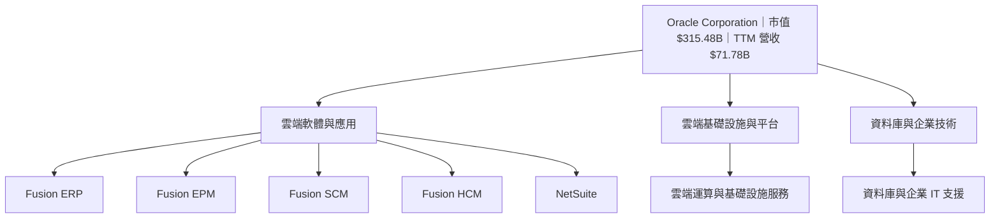
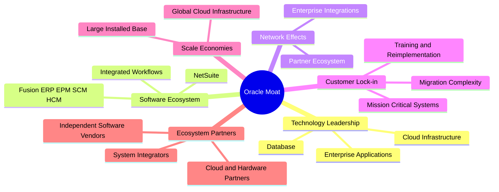
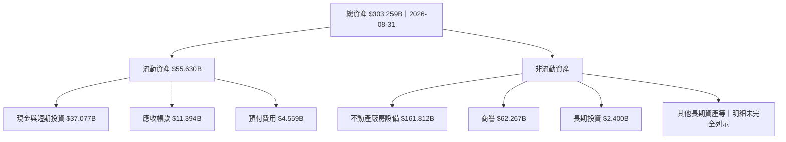
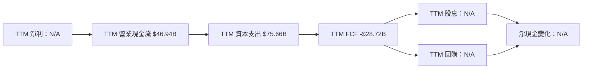
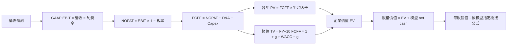
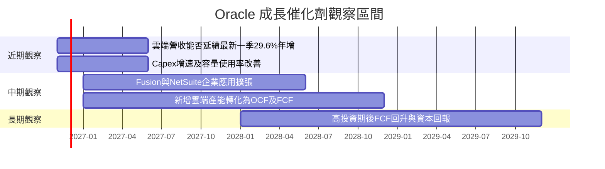
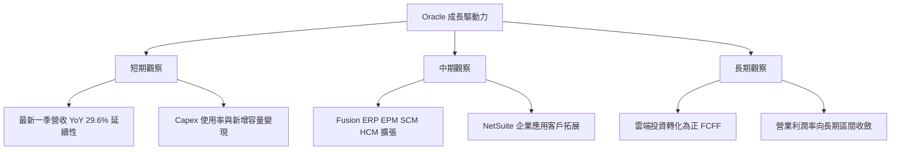
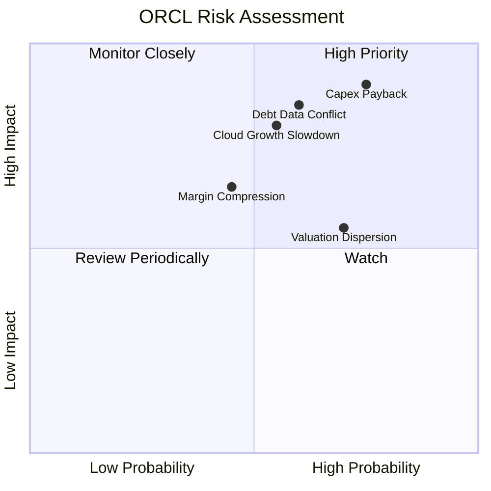
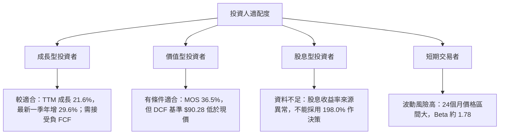

# ORCL 基本面深度分析報告
> **報告日期**：2026-11-22 ｜ **語言**：繁體中文 ｜ **數據來源**：SEC 申報資料 (XBRL)、Yahoo Finance、Finviz、StockAnalysis、Roic.ai ｜ **分析師**：CFA 級機構研究

## 目錄

| # | 章節 | 核心結論 |
|---|------|----------|
| 1 | 執行摘要 | 強烈買入；加權合理價值 $159.41；MOS +36.5%，但基準 DCF 低於現價 |
| 2 | 公司概覽與商業模式 | 企業軟體與雲端業務具客戶轉換成本；分部營收占比未提供 |
| 3 | 損益表深度分析 | TTM 營收 $71.78B、年增 21.6%；最新一季年增 29.6% |
| 4 | 資產負債表分析 | 現金與短期投資 $37.08B；Verified net cash 為 $37.08B，但債務數據存在口徑差異 |
| 5 | 現金流量深度分析 | TTM FCF 為 -$28.72B，主因資本支出高於營業現金流 |
| 6 | 獲利能力與資本效率 | ROIC 61.3% 高於 WACC 8.97%；但 FCF 與再投資風險需密切監控 |
| 7 | 相對估值分析 | 同業倍數回推價值高於現價；自身五年估值分位處於區間低端 |
| 8 | DCF 內在價值評估 | 基準 DCF $90.28；加權合理價值 $159.41；估值高度依賴終值及長期假設 |
| 9 | 成長催化劑 | 雲端與 AI 工作負載可能支撐成長，但 TAM 與分部收入數據未提供 |
| 10 | 風險矩陣 | 資本支出、融資／負債口徑、成長預期與估值落差為主要風險 |
| 11 | 投資建議 | 依 MOS 評級為強烈買入；分批買入並以 FCF、資本支出及雲端成長作監控 |

---

## 1. 執行摘要

### 1.0 一頁式投資儀表板（Portfolio Manager 30 秒速讀）

| 項目 | 內容 |
|------|------|
| **投資論點（3 句）** | ① TTM 營收 $71.78B、年增 21.6%，最新一季年增 29.6%，顯示成長動能加速。② TTM ROIC 61.3% 對照 WACC 8.97%，帳面上形成 52.33 個百分點的正利差。③ TTM 資本支出 $75.66B 高於營業現金流 $46.94B，令 FCF 為 -$28.72B，成長投資的現金回收仍待驗證。 |
| **綜合評分** | **6.6/10**（引用 1.1 評分卡） |
| **財務健康** | 🟡 現金與短期投資 $37.08B、流動比率 1.171；但 FCF 為負，且總債務來源口徑不一致。 |
| **ROIC vs WACC** | 61.3% vs 8.97%：依提供的 TTM 指標，創造股東價值；仍需留意投入資本分母與債務數據口徑。 |
| **FCF 趨勢** | 投資支出增加令 TTM FCF 為 **-$28.72B**，FCF Yield **-9.10%**。 |
| **估值** | Forward P/E 9.15x（Yahoo Finance／Finviz 彙整）；EV/EBITDA 12.878x；FCF Yield -9.10%。Peer-based估值採第 7 章專用倍數。 |
| **DCF 內在價值（基準）** | **$90.28**；現價相對 DCF 溢價 **+12.1%**（折溢價基準：DCF 基準值）。 |
| **安全邊際（MOS）** | **+36.5%**＝($159.41 − $101.19) ÷ $159.41；以 8.8 加權合理價值為基準。🟢 >25% |
| **預期報酬（基準情境 12M）** | DCF 基準情境相對現價 **-10.8%**；三情境的機率加權價值為 $114.60，僅作參考，非 8.8 加權合理價值。 |
| **關鍵風險（前二）** | Capex 遠高於營業現金流；雲端／AI 成長若放緩，將同時壓低營收預期與終值。 |
| **評級 + 信心度** | 🟢 **強烈買入**；依 MOS +36.5% 且 ROIC 61.3% > WACC 8.97%，信心：中（估值方法差異大、FCF 為負）。 |

### 1.1 綜合評分卡（全報告唯一）

| 維度 | 評分（1–10） | 主要依據（引用數字與其來源章節） |
|------|--------------|----------------------------------|
| 成長性 | 8.0 | TTM 營收年增 21.6%，最新一季年增 29.6%（第 3 章） |
| 獲利能力 | 8.0 | TTM 營業利益率 32.1%、ROIC 61.3%；Piotroski F-Score 4/7（第 3、6 章） |
| 財務健康 | 4.5 | 現金與短期投資 $37.08B、流動比率 1.171；TTM FCF -$28.72B，債務披露口徑存在差異（第 4、5 章） |
| 估值 | 7.0 | MOS +36.5%；但 DCF $90.28 低於現價，且估值方法之間分散（第 7、8 章） |
| 護城河 | 8.0 | 企業軟體工作流程、資料庫與雲端平台形成轉換成本；缺少分部營收與客戶留存量化資料（第 2 章） |
| 管理層與資本配置 | 4.0 | FY2026 Capex $55.66B、TTM Capex $75.66B；FY2026 SBC $4.81B、稀釋股數測試未通過（第 5、6 章） |
| **綜合評分** | **6.6** | 六項算術平均：(8.0 + 8.0 + 4.5 + 7.0 + 8.0 + 4.0) ÷ 6 = 6.58，四捨五入至一位小數 |

### 1.2 五大投資論點 + 三大核心風險

| 類型 | 項目 | 具體依據 | 信心度 |
|------|------|----------|--------|
| 🟢 **投資論點①** | 營收成長加速 | TTM 營收 $71.78B、TTM 年增 21.6%；最新一季營收年增 29.6%。若成長來自雲端工作負載持續擴張，具營業槓桿潛力。 | 🟢 高 |
| 🟢 **投資論點②** | 營業獲利維持高位 | TTM 營業利益率 32.1%，最新一季 34.8%；規模及產品組合可能支撐獲利，但短期季度表現未必可直接年化。 | 🟢 中高 |
| 🟢 **投資論點③** | 高 ROIC 對照資金成本 | TTM ROIC 61.3% 對照 WACC 8.97%；若投入資本口徑與未來投資回報維持，表示投資能創造經濟價值。 | 🟢 中 |
| 🟢 **投資論點④** | 估值低於自身歷史倍數 | P/E 15.9x，低於五年中位數 32.1x；P/S 4.2x，低於中位數 6.2x（第 7.2 節）。 | 🟡 中 |
| 🟢 **投資論點⑤** | 客戶切換成本與產品廣度 | ERP、EPM、SCM、HCM、資料庫與雲端基礎設施可嵌入企業核心流程；留存與轉換成本具質化支撐，惟缺客戶留存率量化資料。 | 🟡 中 |
| 🟡 **風險①** | 資本支出回收不及預期 | TTM Capex $75.66B，為 OCF $46.94B 的約 1.61 倍，FCF -$28.72B；若投資產能利用率不足，現金流可能長期受壓。 | 🔴 高衝擊 |
| 🔴 **風險②** | 槓桿與數據口徑不確定 | 市場彙整資料列總債務 $169.14B、淨負債 $132.07B；Verified Figures 則列總債務 N/A、Net cash $37.08B。需以 SEC 同期負債明細核對。 | 🔴 高 |
| 🟡 **風險③** | DCF 與相對估值落差大 | DCF 基準 $90.28、Forward P/E 法 $221.41、分析師共識 $236.18。估值依賴成長與終值，不能只看加權結果。 | 🟡 高 |

### 1.3 快速統計卡片

| 指標 | 公司實際值（期間） | 同業中位數 | 狀態 |
|------|--------------------|------------|------|
| 營收成長（TTM） | **21.6%** | — | 🟢 |
| 營收成長（最新一季年增） | **29.6%** | **13.2%**（MSFT、SAP、CRM 中位數） | 🟢 |
| 毛利率（TTM） | **64.0%** | **73.6%**（三家同業中位數） | 🟡 |
| 營業利益率（TTM） | **32.1%**（Verified Figures） | — | 🟢 |
| ROIC（TTM） | **61.3%** | — | 🟢 |
| Forward P/E | **9.15x**（市場彙整值） | **20.0x**（Peer multiples 中位數） | 🟢* |
| FCF Yield（TTM） | **-9.10%** | — | 🔴 |
| Piotroski F-Score | **4 / 7**（可判定項目） | — | 🟡 |

\*Forward P/E 來源間差異明顯：相對估值方法採同業中位數 20.0x，市場彙整頁面列 ORCL Forward P/E 9.15x。兩者可能因 EPS 定義或資料時點不同，應避免直接視作同一口徑。

### 1.4 投資結論

╔══════════════════════════════════════════════════════════════════╗  
║                    📊 投資結論摘要                               ║  
╠══════════════════════════════════════════════════════════════════╣  
║ 評級：強烈買入（MOS +36.5%，且 ROIC 61.3% > WACC 8.97%）         ║  
║ 價格（2026-11-20 收盤）：$101.19                                ║  
║ DCF 內在價值（基準）：$90.28（現價溢價 +12.1%）                  ║  
║ 安全邊際 MOS：+36.5%（以加權合理價值 $159.41 為分母）            ║  
║ 加權合理價值（8.8）：$159.41                                    ║  
║ DCF 情境價值：悲觀 $11.45（-88.7%）                              ║  
║                基準 $90.28（-10.8%）                             ║  
║                樂觀 $266.38（+163.2%）                           ║  
║ 綜合評分：6.6/10（引用 1.1）                                     ║  
║ 適合投資人：可承受高波動、願意追蹤雲端投資回收的長線投資人        ║  
╚══════════════════════════════════════════════════════════════════╝

---

## 2. 公司概覽與商業模式

### 2.1 業務結構與收入來源

公司摘要列出 Oracle Fusion ERP、EPM、SCM、HCM、NetSuite 與雲端服務；但沒有提供分部收入或各產品營收占比，因此不將收入拆分為未經證實的金額。

### 2.2 市場份額

市場份額數據未提供，故不呈現市占率圖表或自行估算比例。可觀察到 ORCL TTM 營收 $71.78B、最新一季年增 29.6%，高於 MSFT、SAP、CRM 的最新一季營收年增率中位數 13.2%；但不同公司的業務組合不同，不能據此直接推論市占變化。

### 2.3 競爭護城河分析

### 2.4 護城河強度

| 護城河項目 | 強度（強／中／弱） | 證據（引用數字或事實） | 會削弱它的情況 |
|------------|--------------------|------------------------|----------------|
| 技術與產品整合 | 強 | 產品涵蓋資料庫、雲端與 ERP、EPM、SCM、HCM；TTM 營業利益率 32.1% | 雲端架構落後、遷移工具與產品整合體驗不佳 |
| 軟體生態系統 | 強 | 企業核心流程跨財務、供應鏈、人資；替換涉及資料、流程與訓練 | 開放標準提升互通性、競品以更低成本提供整合方案 |
| 網路效應 | 中 | 合作夥伴與企業整合可降低部署成本；缺直接網路效應量化指標 | 客戶與夥伴轉向多雲、跨平台部署 |
| 客戶鎖定 | 強 | ERP、資料庫等關鍵系統遷移成本高；缺續約率或流失率數據 | 客戶採用模組化替換、雲端原生或開源系統 |
| 規模效應 | 中至強 | TTM 營收 $71.78B；雲端基礎設施需大額資本投入 | Capex 利用率低、規模不足以抵銷競爭者成本優勢 |
| 生態夥伴 | 中 | 複雜企業部署仰賴系統整合商與軟體夥伴；量化資料未提供 | 夥伴策略轉向競品，或客戶直接採用其他雲端平台 |

**1.1「護城河」評分 8.0/10 的理由**：核心企業軟體的切換成本與跨產品組合提供質化支撐，但缺乏留存、續約及分部營收資料，故不作滿分評估。

---

## 3. 損益表深度分析

### 3.1 年度收入成長趨勢（近 4 年）

下圖收入取自年度損益表。FY2026 相對 FY2025 成長 17.35%；FY2023 至 FY2026 三年 CAGR 約 10.5%（由 $49.95B 至 $67.36B）。

╔══════════════════════════════════════════════════════════════════╗  
║              Oracle 年度收入趨勢（FY2023–FY2026）                ║  
╠══════════════════════════════════════════════════════════════════╣  
║ FY2023  $49.95B  ███████████████░░░░░░░░░  YoY：+6.02%          ║  
║ FY2024  $52.96B  ████████████████░░░░░░░░  YoY：+6.02%          ║  
║ FY2025  $57.40B  █████████████████░░░░░░░  YoY：+8.38%          ║  
║ FY2026  $67.36B  ████████████████████░░░░░  YoY：+17.35%        ║  
╠══════════════════════════════════════════════════════════════════╣  
║ FY2023–FY2026 收入 CAGR：約 10.5%                                ║  
╚══════════════════════════════════════════════════════════════════╝

計算：\((67.36 ÷ 49.95)^{1/3} - 1 \approx 10.5\%\)。FY2026 的成長加速，TTM 成長進一步升至 21.6%；最新一季年增 29.6% 表示近期動能高於年度平均，但未提供分部數據，無法精確拆分雲端、應用及其他業務的貢獻。

### 3.2 季度收入趨勢分析

| 季度 | 營收 | QoQ 成長 | YoY 成長 | 備註 |
|------|------:|---------:|---------:|------|
| 2025-11-30 | $16.06B | -6.6% | 14.22% | QoQ 由 2025-08-31 的 $14.93B 計算 |
| 2026-02-28 | $17.19B | 7.0% | 21.66% | 年增率持續提高 |
| 2026-05-31 | $19.18B | 11.6% | 20.63% | QoQ 加速 |
| 2026-08-31 | $19.34B | 0.8% | 29.61% | YoY 為單季年增率，非 TTM |

QoQ 計算依據季度收入：例如最新季 \(19.34 ÷ 19.18 - 1 \approx 0.8\%\)。財季序列可能受合約認列與季節性影響，單季 QoQ 不宜單獨年化；最新季度 YoY 29.6% 則顯示較去年同期有明顯增長。

### 3.3 利潤率演變分析

| 利潤率指標 | FY2023 | FY2024 | FY2025 | FY2026 | 趨勢 | 評估 |
|------------|-------:|-------:|-------:|-------:|------|------|
| **毛利率** | 72.9% | 71.4% | 70.5% | 65.8% | 下行 | 🟡 |
| **營業利益率** | 27.6% | 30.3% | 31.4% | 33.3% | 上行 | 🟢 |
| **淨利率** | 17.0% | 19.8% | 21.7% | 25.4% | 上行 | 🟢 |

毛利率以年度毛利除以年度收入計算；FY2026 的 65.8% 與彙整頁面的 TTM 毛利率 64.0% 不同，期間及來源口徑不同。年度營業利益率以年度營業利益除以收入計算；Verified Figures 的 TTM 營業利益率為 32.1%，兩者期間並非相同。

毛利率下降而營業利益率改善，可能反映產品組合與成本分類變化、規模效率或營業費用控制；然而資料未提供分部成本，不能把毛利率下行直接歸因於某單一產品。TTM 營業利益率 32.1%、最新一季 34.8%（兩者採 Verified Figures）顯示近期營業層級利潤率仍高，但要確認是否能持續，需追蹤後續季度及雲端業務組合。

### 3.4 費用結構分析

分部成本、費用化支出與當期營收的統一期間拆分不足以建構可信的費用結構圓餅圖。可確認 FY2026 研發費用 $10.27B、SBC $4.81B、Capex $55.66B；Capex 屬資產投資，不能與損益表費用直接合併成費用占比。

╔══════════════════════════════════════════════════════════════════╗  
║ FY2026 重要支出資料（不同會計分類，不可相加視為費用率）        ║  
╠══════════════════════════════════════════════════════════════════╣  
║ 研發費用：$10.27B ｜ SBC：$4.81B ｜ Capex：$55.66B              ║  
║ Capex 為資產負債表／現金流投資，不等同當期損益費用。            ║  
╚══════════════════════════════════════════════════════════════════╝

### 3.5 季度 EPS 趨勢與盈餘品質（Quality of Earnings）

最近四季 EPS 實際值採 StockAnalysis；分析師預估值欄為 NaN，因此無法判定超預期或不及預期。季度 EPS YoY 數據與最新一季 EPS 年增 54.5% 可反映獲利成長，但不能替代 surprise 比較。

| 季度 | EPS 實際 | EPS YoY | 超預期／不及預期 |
|------|---------:|--------:|----------------|
| 2025-11-30 | $2.10 | 90.91% | N/A（EPS 預估未提供） |
| 2026-02-28 | $1.27 | 24.51% | N/A（EPS 預估未提供） |
| 2026-05-31 | $1.45 | 21.91% | N/A（EPS 預估未提供） |
| 2026-08-31 | $1.56 | 54.45% | N/A（EPS 預估未提供） |

| 盈餘品質項目 | 數值/佔比 | 評估 |
|--------------|-----------|------|
| 股權薪酬 SBC / 營收 | TTM SBC 數值 N/A；FY2026 SBC $4.81B ÷ FY2026 營收 $67.36B = 7.1% | 🟡 具稀釋成本；年度比率不可當作 TTM 比率 |
| SBC / 營業現金流 | FY2026 $4.81B ÷ FY2026 OCF $31.98B = 15.0% | 🟡 需考慮股權薪酬對股東的經濟成本 |
| FCF / 淨利（現金轉換率） | TTM FCF -$28.72B ÷ TTM 淨利 N/A = N/A；FY2026 FCF -$23.69B ÷ 淨利 $17.09B = -138.6% | 🔴 FY2026 現金轉換為負，主因高 Capex |
| 一次性／非經常性損益 | N/A（未提供可辨識明細） | 無法確認季度 EPS 是否受一次性項目影響 |
| 有效稅率異常 | 12.6%（最新年度有效稅率） | 🟡 未提供完整稅務調節表，不能斷言有稅務利益 |
| 資本化支出 vs 費用化 | FY2026 Capex $55.66B；TTM Capex $75.66B | 🔴 大額投資提高未來折舊及現金回收壓力；非直接證據顯示會計不當資本化 |

**盈餘品質結論**：GAAP 獲利有營業現金流支撐（TTM OCF $46.94B），但高 Capex 將 TTM FCF 拉至 -$28.72B，因此當期淨利不能直接等同可分配現金。SBC 也構成股東經濟成本；估值需同時檢視投資回報與股份稀釋。

---

## 4. 資產負債表分析

### 4.1 資產結構分解

採 StockAnalysis 2026-08-31 資產資料。部分資產明細與總資產可能有分類／四捨五入口徑差異，不自行調整或反推缺漏項目。

### 4.2 流動性與營運資金分析

市場彙整資料列流動比率 1.171、速動比率 1.02；StockAnalysis 年度資產負債表列 2026-05-31 流動資產 $46.57B、流動負債 $41.76B。流動性可應付近期負債，但安全緩衝不算寬裕，且資本支出對現金需求大。

| 指標 | 最新 TTM | 一年前 TTM | 變化 | 解讀 |
|------|----------|------------|------|------|
| DSO 應收帳款天數 | 58 天 | 55 天 | +3 天 | 收款週期略拉長；收入擴張與合約結構可能影響應收，應追蹤應收增速是否高於營收 |
| DIO 存貨天數 | N/A | N/A | N/A | 公司未提供該存貨餘額指標，不補估 |
| DPO 應付帳款天數 | 156 天 | N/A | N/A | 缺一年前可比數字，不能判斷是否延長付款周期 |
| CCC 現金轉換週期 | N/A | N/A | N/A | DIO 缺值，無法計算 CCC |

### 4.3 債務結構分析

財務資料存在不可忽略的口徑衝突：市場彙整資料列總債務 $169.14B、淨負債 $132.07B；Verified Figures 則列 Total debt N/A、Net cash $37.08B。不得把兩組數據合併或自行選一組反推。DCF 模型按 Verified Figures 指定的 net cash $37.08B 橋接，但此處將償債分析評為 🟡，並建議核對同一期 SEC 資產負債表及租賃負債。

╔══════════════════════════════════════════════════════════════════╗  
║                 Oracle 債務健康診斷                              ║  
╠══════════════════════════════════════════════════════════════════╣  
║ 現金與短期投資： $37.08B                                         ║  
║ 總債務（Verified Figures）：N/A                                  ║  
║ 市場彙整總債務： $169.14B（口徑待核對，非採用數）                ║  
║ Net cash（Verified Figures）：+$37.08B                           ║  
║ Debt/EBITDA：N/A（可靠同口徑總債務未提供）                       ║  
║ Interest coverage：N/A（利息費用與可靠債務口徑不足）             ║  
║ 流動比率：1.171 ｜ 速動比率：1.02                                ║  
╚══════════════════════════════════════════════════════════════════╝

### 4.4 股東權益趨勢

年度股東權益由 FY2023 的 $1.07B 升至 FY2026 的 $42.51B，變動幅度大；期間可能受盈餘累積、回購／股權交易及其他權益項目影響，資料未提供完整權益變動表，不能把增加全部歸因於單一因素。

╔══════════════════════════════════════════════════════════════════╗  
║ FY2023  股東權益 $1.07B  ░                                      ║  
║ FY2024  股東權益 $8.70B  ████                                   ║  
║ FY2025  股東權益 $20.45B ██████████                             ║  
║ FY2026  股東權益 $42.51B ████████████████████                   ║  
╚══════════════════════════════════════════════════════════════════╝

---

## 5. 現金流量深度分析

### 5.1 現金流量瀑布圖

TTM 淨利未由 Verified Figures 提供，故不將季度／年度淨利拼接；股息與回購 TTM 數據也未提供。圖中保留可核對的營業現金流、Capex 與 FCF。

### 5.2 FCF 轉換率趨勢

| 財年 | 營業現金流 | Capex | FCF | 淨利 | FCF / 淨利 |
|------|----------:|------:|----:|-----:|-----------:|
| FY2023 | $17.16B | $8.70B | $8.47B | $8.50B | 99.6% |
| FY2024 | $18.67B | $6.87B | $11.81B | $10.47B | 112.8% |
| FY2025 | $20.82B | $21.21B | -$0.394B | $12.44B | -3.2% |
| FY2026 | $31.98B | $55.66B | -$23.69B | $17.09B | -138.6% |

FY2025、FY2026 FCF 下滑主要與 Capex 急增同時發生。FY2026 OCF 增至 $31.98B，仍不足以覆蓋 $55.66B Capex，代表現階段增長投資的現金成本高於營運現金生成。表內 FCF 為年度資料列示值，因四捨五入可能與 OCF 減 Capex 相差 $0.01B。

### 5.3 自由現金流趨勢

╔══════════════════════════════════════════════════════════════════╗  
║ Oracle 自由現金流趨勢（年度 FCF）                                ║  
╠══════════════════════════════════════════════════════════════════╣  
║ FY2023  +$8.47B   ████████████████                                ║  
║ FY2024 +$11.81B   ██████████████████████                          ║  
║ FY2025  -$0.394B  ░                                               ║  
║ FY2026 -$23.69B   ◀████████████████████                           ║  
║ TTM    -$28.72B   ◀████████████████████████                       ║  
╠══════════════════════════════════════════════════════════════════╣  
║ TTM FCF Yield：-9.10%｜資本支出回收是估值關鍵                    ║  
╚══════════════════════════════════════════════════════════════════╝

### 5.4 資本配置評估

| 項目 | 可取得數據 | 評估 |
|------|------------|------|
| 資本支出 | FY2026 $55.66B；TTM $75.66B | 🔴 大幅高於歷史年份，須追蹤容量利用率與投資回收 |
| 股息 | FY2026 現金股息 $5.79B；TTM 未提供 | 🟡 現金承諾需與負 FCF 一併檢視 |
| 股權薪酬 | FY2026 $4.81B | 🟡 對員工留任有用，但稀釋股東權益 |
| 回購 | 數據未提供 | N/A；不推算 |
| 留存現金／淨現金變化 | TTM 未提供完整變動表 | N/A |

缺少同期間回購、股息、淨現金流變化的完整資料，故不繪製資本配置圓餅圖，避免將不同期間或不同類型的支出混為一談。

---

## 6. 獲利能力與資本效率

### 6.1 ROE / ROA / ROIC 趨勢

| 指標 | FY2023 | FY2024 | FY2025 | 最新 TTM | 評估 |
|------|-------:|-------:|-------:|---------:|------|
| ROE | N/A | N/A | N/A | 28.3%（QUALITY FIGURES） | 🟢 有獲利；其他彙整來源列 41.2%，口徑不同，不混用 |
| ROA | N/A | N/A | N/A | N/A（QUALITY FIGURES 未提供 ROA 數值） | N/A |
| ROIC | N/A | N/A | N/A | 61.3% | 🟢 高於 WACC 8.97% |

### 6.2 ROIC vs WACC 分析（核心價值創造判斷）

第 6.2 節採用成本資本區塊的 WACC 8.97%，與 DCF 一致；此處直接引用資料所列的成本資本輸入與組成，不另造一套 WACC。

╔══════════════════════════════════════════════════════════════════╗  
║                ROIC vs WACC 深度分析                            ║  
╠══════════════════════════════════════════════════════════════════╣  
║ 無風險利率（10Y 美債）：4.91%                                    ║  
║ ERP：5.00% ｜ 原始 Beta：1.78 ｜ 調整後 Beta：1.52               ║  
║ Ke = 4.91% + 1.52 × 5.00% = 12.51%                              ║  
║ 稅前 Kd：2.72% ｜ 有效稅率：12.6%                                ║  
║ 稅後 Kd = 2.72% × (1 - 12.6%) = 2.377%                           ║  
║ 股權／債務權重：65.1%／34.9%                                     ║  
║ WACC = 65.1% × 12.51% + 34.9% × 2.377% = 8.97%                   ║  
║ TTM ROIC：61.3% ｜ EVA 利差：61.3% - 8.97% = +52.33 個百分點     ║  
╚══════════════════════════════════════════════════════════════════╝

資料區塊直接提供資本權重、成本資本及 WACC；但總債務欄位在不同來源間有衝突，故上述為引用所列的成本資本組成，不代表已由相同負債明細重新獨立核對。按區塊指標，ROIC 高於 WACC，支持價值創造結論；若投入資本分母或債務處理方式有重大誤差，該利差需重新驗證。

### 6.3 杜邦三因素分解

以下照抄 QUALITY FIGURES 的 TTM closing-balance DuPont 數值。

| 因素 | 數值（TTM） | 解讀 |
|------|-------------|------|
| 淨利率 | 26.4% | 獲利率是 ROE 的主要正向來源 |
| 資產週轉率 | 0.24 | 資產規模大，尤其固定資產擴張後週轉效率偏低 |
| 權益乘數 | 4.54 | 槓桿對 ROE 有放大作用 |
| **ROE** | **28.3%** | 資料列示為三者組合結果；依所列各項直接相乘會有四捨五入差異 |

**判讀**：ROE 不只來自淨利率，也受到 4.54 倍權益乘數影響；固定資產擴張後資產週轉率僅 0.24，資本效率能否改善取決於新增雲端容量的收入與現金流變現。

### 6.4 財務體質：Piotroski F-Score

Piotroski F-Score **4/7**；缺輸入的測試不納入可判定分母，故不是九項全數可判定的分數。

| 測試 | 結果 | 解讀 |
|------|------|------|
| ROA > 0 | ✅ 通過 | 仍有正獲利 |
| 營業現金流 > 0 | ✅ 通過 | TTM OCF 為 $46.94B |
| ROA 高於一年前 | ❌ 未通過 | 資產成長未同步提高回報指標 |
| 營業現金流 > 淨利（應計品質） | ✅ 通過 | 營業現金流高於淨利，但高 Capex 令 FCF 仍為負 |
| 長期負債／總資產低於一年前 | — 無法判定（缺資料） | 不自行補算 |
| 流動比率高於一年前 | ✅ 通過 | 流動比率改善測試通過 |
| 稀釋股數未增加 | ❌ 未通過 | 股權稀釋可能抵消部分每股盈餘增長 |
| 毛利率高於一年前 | — 無法判定（缺資料） | 不自行補算 |
| 資產週轉率高於一年前 | ❌ 未通過 | 資產投入擴張暫未帶來更高週轉效率 |

總體 4/7 表示公司仍有正獲利與正營業現金流，但回報效率、資產周轉與稀釋項目需要監控。

---

## 7. 相對估值分析

### 7.1 同業估值比較表格

ORCL 倍數採市場估值區塊，MSFT、SAP、CRM 採 Peer multiples。不同資料源或會計口徑可能有差異；同業中位數只用提供的 peer 數據。

| 估值指標 | **ORCL** | **MSFT** | **SAP** | **CRM** | ORCL 評估 |
|----------|---------:|---------:|---------:|---------:|-----------|
| **Trailing P/E** | 15.9x | 25.3x | 24.8x | 16.5x | 🟢 低於同業中位數 24.8x |
| **Forward P/E** | 9.15x* | 20.0x | 20.9x | 11.3x | 🟢 按市場彙整值低於同業；Forward EPS 口徑須核對 |
| **P/S Ratio** | 4.40x | 10.4x | N/A | 3.4x | 🟡 ORCL 位於同業兩端之間；SAP 因幣別問題不比較 |
| **EV/EBITDA** | 12.878x | 17.8x | N/A | 13.9x | 🟢 低於 MSFT、CRM 中位數 15.85x |
| **最新一季營收 YoY** | 29.6% | 18.8% | 13.2% | 10.8% | 🟢 高於同業中位數 13.2% |
| **毛利率 TTM** | 64.0% | 67.7% | 73.6% | 77.3% | 🟡 低於三家同業中位數 73.6% |

\*ORCL Forward P/E 9.15x 為彙整估值欄；同業 Forward P/E 的中位數為 20.0x。另一方面，VALUATION METHODS 使用公司 forward EPS $11.06 與同業中位數 20.0x 回推價值。兩者口徑不一致，不應用同一欄位互相替代。SAP 的 P/S、EV/EBITDA 因混合幣別而列 N/A。

### 7.2 歷史估值區間分析

╔══════════════════════════════════════════════════════════════════╗  
║ Oracle 五年 P/E 區間（TTM）                                      ║  
╠══════════════════════════════════════════════════════════════════╣  
║ 低端 19.0x ├──────── 中位數 32.1x ─────────┤ 高端 52.3x         ║  
║ 現值 15.9x：低於提供的歷史區間低端；百分位排名 0%              ║  
║ P/S：現值 4.2x｜中位數 6.2x｜區間 4.6x–11.1x｜排名 0%          ║  
║ EV/EBITDA：現值 8.2x｜中位數 17.9x｜區間 12.6x–28.9x｜排名 0%  ║  
╚══════════════════════════════════════════════════════════════════╝

現值低於提供的五年區間下限，可能反映市場對投資回收、債務風險或成長持續性的折價；「歷史百分位 0%」是相對自身資料庫的定位，不等同股價必然均值回歸。

### 7.3 情境價值（Bear / Base / Bull）

| 情境 | 第 1 年營收成長 | 期末營業利潤率 | WACC | 每股價值 | 相對現價 | 機率 | 會發生的條件 |
|------|----------------:|----------------:|-----:|---------:|---------:|-----:|--------------|
| 🔴 悲觀 | 10.8% | 26.0% | 9.97% | $11.45 | -88.7% | 25% | 雲端需求明顯放緩、Capex 回報不足，並伴隨利潤率下滑 |
| 🟡 基準 | 21.6% | 30.6% | 8.97% | $90.28 | -10.8% | 50% | 營收成長從當前 TTM 增速逐步放緩，利潤率向五年中位數收斂 |
| 🟢 樂觀 | 32.4% | 33.6% | 7.97% | $266.38 | +163.2% | 25% | 成長加速延續、期末利潤率擴張且資金成本下行 |

情境價值照 DCF MODEL 的 Scenarios 引用。機率加權值為 $114.60（+13.3%），但不是 8.8 節估值方法的加權合理價值，亦不替代基準情境價值。

### 7.4 相對估值隱含價格區間

╔══════════════════════════════════════════════════════════════════╗  
║ 相對估值與共識目標價（每股）                                     ║  
╠══════════════════════════════════════════════════════════════════╣  
║ DCF 基準             $90.28                                      ║  
║ 現價（2026-11-20）  $101.19                                      ║  
║ 同業 EV/EBITDA      $177.32                                      ║  
║ 同業 Forward P/E    $221.41                                      ║  
║ 分析師共識           $236.18                                      ║  
╚══════════════════════════════════════════════════════════════════╝

| 方法 | 每股價值 | 依據 |
|------|---------:|------|
| 同業 Forward P/E | $221.41 | 同業中位數 20.0x × Forward EPS $11.06 |
| 同業 EV/EBITDA | $177.32 | MSFT、CRM 同業中位數 15.9x × TTM EBITDA，再加淨現金 |
| 分析師共識目標價 | $236.18 | 40 位分析師平均目標價 |
| DCF 基準 | $90.28 | 10 年 FCFF、WACC 8.97%、永續成長 3.0% |

---

## 8. DCF 內在價值評估（Discounted Cash Flow）

### 8.0 估值推理鏈（Thinking Logic：在算之前先想清楚）

**Step 1 — 價值由哪些變數決定？**  
本模型價值主要由企業應用與雲端服務的營收擴張、營業利潤率，以及高額 Capex 最終能否下降並轉化為 FCFF 決定。分部收入占比未提供，不能聲稱某一業務已占營收特定比例。模型敏感度表顯示，終值成長率與 WACC 對每股價值影響顯著；Capex 由 TTM 營收的 105.4% 逐步降至 FY+10 的 14.4%，則是現金流由負轉正的關鍵路徑。

**Step 2 — 模型選擇**

| 決策點 | 本報告採用 | 理由（含數字） | 曾考慮但否決 | 否決理由 |
|--------|-----------|----------------|--------------|----------|
| 現金流定義 | FCFF | 與 WACC 8.97% 折現並推得企業價值 | FCFE | 債務口徑有衝突，FCFF 較適合一致地使用企業折現率 |
| 預測期 N | 10 年 | 直接採用 DCF MODEL；近期 Capex 高，須保留較長轉換期 | 5 年 | 模型未採用；五年期限較難呈現 Capex 由 105.4% 收斂至 14.4% 的過程 |
| 終值方法 | Gordon Growth | 提供終值 $990.94B，並以 3.0% 永續成長率計算 | 退出倍數 | DCF MODEL 未提供退出倍數輸入或結果，不自行補建 |
| EBIT 基礎 | GAAP | 模型明確採 GAAP EBIT，首年營業利益率 32.1% | 非 GAAP | 無需另行加回 SBC，避免非 GAAP 口徑與現金成本重複混用 |

**Step 3 — 假設推導鏈**

- **營收成長**：錨點＝TTM 成長 21.6% → 最新一季年增 29.6% 支持短期需求動能，但 10 年模型需反映成長成熟 → 採用 FY+1 21.6%，線性降至 FY+10 3.0% → 否決長期維持 21.6%，因模型假設若不逐步成熟會把近期成長永久化；情境區間另列 10.8% 至 32.4%。
- **期末營業利潤率**：錨點＝TTM 32.1% → DCF 由 32.1% 緩降至過去五財年中位數 30.6% → 採用 30.6% → 否決持續維持 32.1%，因模型採歷史中位數回歸而非永續高於長期基準。
- **永續成長率 g**：錨點＝模型採 3.0%，且敏感度範圍為 2.0%–4.0% → 永續階段須低於 WACC 8.97%，避免終值公式失效 → 採用 3.0% → 否決 4.0% 作基準，因長期現金流成長需保留更大折現差距；4.0% 僅用於敏感度測試。
- **預測期 N**：錨點＝模型指定 10 年 → Capex／營收由 105.4% 逐步下降，過渡期不能簡化為短期穩態 → 採用 10 年 → 否決 5 年作基準，因無法涵蓋模型中長達 10 年的投資強度轉換。
- **Capex／營收**：錨點＝TTM 105.4% → 以 Capex 高峰逐步正常化，模型終值前降至 14.4% → 採用 105.4% 線性降至 14.4% → 否決短期立即降至穩態，因最新 TTM Capex $75.66B 顯示投入仍高。
- **EBIT、SBC 與稀釋**：錨點＝模型採 GAAP EBIT，已將 SBC 列為費用；模型固定股數、不再另計稀釋 → 採用組合 (A)，不另扣 SBC、不設股數稀釋 → 否決 GAAP EBIT 再扣 SBC，會重複計入；也不另採年稀釋率，因模型明確採固定股數。
- **WACC**：錨點＝成本資本輸入直接提供 8.97% → 使用提供的 CAPM、Kd 與權重，不另行自建 → 採用 8.97% → 不採用市場彙整資料自行替換的其他折現率；輸入已含調整後 Beta 與指定權重。
- **稅率、D&A、ΔWC**：有效稅率錨點與採用值均為 12.6%；D&A／營收 13.1% 為 TTM；營運資金變動在模型不計算。這三項依模型設定照用，不以缺資料另行估值。

**Step 4 — 最脆弱的一環**  
最脆弱的是 Capex 由營收 105.4% 降至 14.4% 並帶動 FCFF 轉正；若降幅不如模型假設，價值將下修，且終值現值已占 EV 171.7%，估值對長期假設高度敏感。

**Step 5 — 計算路徑圖**

### 8.1 模型假設總表（Model Inputs）

| 假設項目 | 採用值 | 依據／來源 | 敏感度 |
|----------|--------|-------------|--------|
| 預測期長度 N | 10 年 | DCF MODEL 固定值 | 🟡 中 |
| 營收成長 | FY+1 21.6%，FY+10 3.0%，線性遞減 | TTM 營收年增 21.6%；模型將增長逐步成熟 | 🔴 高 |
| 營業利潤率 | FY+1 32.1% → FY+10 30.6% | TTM 營業利潤率 32.1%；末年採五年財年中位數 | 🔴 高 |
| 有效稅率 | 12.6% | 最新年度有效稅率 | 🟢 低 |
| Capex／營收 | FY+1 105.4% → FY+10 14.4% | TTM Capex／營收；逐步下降至 1.1×D&A 條件 | 🔴 高 |
| D&A／營收 | 13.1% | TTM 比率，模型固定 | 🟢 低 |
| 營運資金變動 | 不建模 | DCF MODEL 明確不含營運資金變動 | 🟢 低 |
| EBIT 基礎 | GAAP EBIT | DCF MODEL 明確採 GAAP EBIT | 🟡 中 |
| SBC 處理 | GAAP EBIT 已費用化；FCFF 不再扣 SBC | 模型組合 (A) | 🟡 中 |
| 年稀釋率 | 0%；固定股數處理 | DCF MODEL 指定不再稀釋 | 🟡 中 |
| 永續成長率 g | 3.0% | DCF MODEL 指定；低於 WACC 8.97% | 🔴 高 |
| 終值方法 | Gordon Growth | DCF MODEL 已提供終值計算 | 🔴 高 |
| WACC | 8.97% | 成本資本區塊指定值 | 🔴 高 |

**FCFF 定義**：採 FCFF = NOPAT + D&A − Capex；營運資金變動未建模，故不另減 ΔWC。模型採用 **(A) GAAP EBIT + 固定股數**，SBC 已作費用處理、不再另扣；股數不再按稀釋率增加。

### 8.2 折現率推導（WACC）

╔══════════════════════════════════════════════════════════════════╗  
║                    WACC 推導（折現率）                           ║  
╠══════════════════════════════════════════════════════════════════╣  
║ Rf（10Y 美債）：4.91%｜資料未提供具體觀察日期                     ║  
║ ERP：5.00%（假設值；成本資本輸入）                               ║  
║ 原始 Beta：1.78；調整後 Beta：1.52                               ║  
║ 調整方式：⅔ × 1.78 + ⅓ × 1 = 1.52                               ║  
║ Ke = 4.91% + 1.52 × 5.00% = 12.51%                              ║  
║ 稅前 Kd：2.72%｜有效稅率：12.6%                                  ║  
║ 稅後 Kd = 2.72% × (1 − 12.6%) = 2.377%                           ║  
║ E / D 權重：65.1% / 34.9%                                        ║  
║ WACC = 65.1% × 12.51% + 34.9% × 2.377% = 8.97%                   ║  
╚══════════════════════════════════════════════════════════════════╝

逐步演算：

1. **Ke（CAPM）** = 4.91% + 1.52 × 5.00% = **12.51%**。
2. **稅前 Kd** = **2.72%**（直接引用成本資本輸入；利息費用與平均計息負債明細未提供，不能獨立重算）。
3. **稅後 Kd** = 2.72% × (1 − 12.6%) = **2.377%**。
4. **權重**：E = 65.1%，D = 34.9%；65.1% + 34.9% = **100.0%**。市場價值及債務構成數值未以同一口徑提供，故不反推權重。
5. **WACC** = 65.1% × 12.51% + 34.9% × 2.377%  
   = 8.144% + 0.830% = 8.974% ≈ **8.97%**。

限制：原始 Beta 1.78 高於 1.5，故採用區塊提供的調整後 Beta 1.52。規模／國別溢酬未另提供，未加計。WACC 與第 6.2 節一致。

### 8.3 逐年自由現金流預測（基準情境）

金額單位：$B。逐年數字照 DCF MODEL 引用；折現因子保留三位小數。模型不含 ΔWC 列。

| 年度 | FY+1 | FY+2 | FY+3 | FY+4 | FY+5 | FY+6 | FY+7 | FY+8 | FY+9 | FY+10 |
|------|-----:|-----:|-----:|-----:|-----:|-----:|-----:|-----:|-----:|------:|
| 營收 | 87.29 | 104.36 | 122.60 | 141.50 | 160.38 | 178.47 | 194.90 | 208.81 | 219.39 | 225.97 |
| 營收 YoY | 21.6% | 19.6% | 17.5% | 15.4% | 13.3% | 11.3% | 9.2% | 7.1% | 5.1% | 3.0% |
| 營業利潤率 | 32.1% | 32.0% | 31.8% | 31.6% | 31.4% | 31.3% | 31.1% | 30.9% | 30.8% | 30.6% |
| EBIT（GAAP） | 28.04 | 33.34 | 38.97 | 44.73 | 50.43 | 55.81 | 60.61 | 64.58 | 67.49 | 69.13 |
| − 稅（12.6%） | (3.54) | (4.21) | (4.92) | (5.64) | (6.36) | (7.04) | (7.65) | (8.15) | (8.51) | (8.72) |
| = NOPAT | 24.50 | 29.14 | 34.05 | 39.09 | 44.06 | 48.77 | 52.97 | 56.44 | 58.97 | 60.40 |
| + D&A | 11.47 | 13.71 | 16.10 | 18.59 | 21.07 | 23.44 | 25.60 | 27.43 | 28.82 | 29.68 |
| − Capex | (92.02) | (99.46) | (104.45) | (106.25) | (104.22) | (97.93) | (87.25) | (72.38) | (53.87) | (32.65) |
| = FCFF | **-56.05** | **-56.61** | **-54.30** | **-48.58** | **-39.09** | **-25.73** | **-8.69** | **11.49** | **33.92** | **57.44** |
| 折現因子 @8.97% | 0.918 | 0.842 | 0.773 | 0.709 | 0.651 | 0.597 | 0.548 | 0.503 | 0.462 | 0.424 |
| FCFF 現值 PV | **-51.43** | **-47.68** | **-41.96** | **-34.45** | **-25.44** | **-15.36** | **-4.76** | **5.78** | **15.65** | **24.33** |

預測期 FCF 現值合計：  
\(-51.43 + (-47.68) + (-41.96) + (-34.45) + (-25.44) + (-15.36) + (-4.76) + 5.78 + 15.65 + 24.33 = -175.32B\)。  
模型列示合計 **-$175.33B**；差異 $0.01B 來自表格金額四捨五入，採用模型列示值。

**FY+1 逐步演算**：

1. 營收 = $71.78B × (1 + 21.6%) = **$87.29B**。
2. EBIT = $87.29B × 32.1% = **$28.04B**。
3. 稅 = $28.04B × 12.6% = **$3.54B**。
4. NOPAT = $28.04B − $3.54B = **$24.50B**。
5. D&A = $87.29B × 13.1% = **$11.47B**。
6. Capex = **$92.02B**（採模型列示值）。
7. ΔWC = **不建模**。
8. FCFF = $24.50B + $11.47B − $92.02B = **-$56.05B**。
9. 折現因子 = \(1 ÷ (1+8.97\%)^1\) = **0.918**；PV = \(-$56.05B × 0.918\) = **-$51.43B**。

**合理性自檢**：

- 預測期 FCF CAGR：因 FCFF 從 FY+1 負值轉為 FY+10 正值，傳統 CAGR 無法定義；歷史 FY2023 至 FY2026 FCF 亦從正值轉負值，同樣不宜計算 CAGR。
- FY+10 FCF 利潤率：$57.44B ÷ $225.97B = **25.4%**；目前 TTM FCF 利潤率 = -$28.72B ÷ $71.78B = **-40.0%**。同業最佳值未提供，不能比較。
- FY+1 至 FY+7 FCFF 為負；這些負現金流納入折現後，使預測期 PV 合計為 -$175.33B。基準估值主要由終值支撐，不能忽略前期資金需求。

╔══════════════════════════════════════════════════════════════════╗  
║            自由現金流：歷史實際 vs 模型預測                      ║  
╠══════════════════════════════════════════════════════════════════╣  
║ FY2024（實） +$11.81B  ████████████████████                      ║  
║ FY2025（實）  -$0.394B ◀█                                         ║  
║ FY2026（實） -$23.69B  ◀████████████████████                     ║  
║ FY+1（預）   -$56.05B  ◀████████████████████████████████         ║  
║ FY+10（預）  +$57.44B  ████████████████████████████████           ║  
╠══════════════════════════════════════════════════════════════════╣  
║ 預測依賴 Capex／營收從 105.4% 下降至 14.4%，並於 FY+8 轉正。     ║  
╚══════════════════════════════════════════════════════════════════╝

### 8.4 終值計算（Terminal Value）

**適用性檢查**：WACC 8.97% vs g 3.0% → **WACC > g ✅**

| 方法 | 計算式 | 終值 TV | TV 現值 | 佔總 EV 比重 |
|------|--------|--------:|--------:|-------------:|
| Gordon Growth | 57.44 × (1 + 3.0%) ÷ (8.97% − 3.0%) | $990.94B | $419.74B | 171.7% |
| 退出倍數法 | N/A（DCF MODEL 未提供退出倍數及對應結果） | N/A | N/A | N/A |

逐步演算：

1. FY+N 的 FCFF = FY+10 FCFF **$57.44B**。
2. 分子 = $57.44B × (1 + 3.0%) = **$59.1632B**。
3. 分母 = 8.97% − 3.0% = **5.97%**；依模型列示，TV = **$990.94B**。
4. PV(TV) = $990.94B × FY+10 折現因子 0.424 = **$419.74B**（模型列示）。
5. 終值佔比 = $419.74B ÷ $244.41B = **171.7%**（模型列示）。

終值現值大於企業價值，是因預測期 PV 為負值，並非終值計算錯誤可直接推定；但這表示模型對遠期現金流假設高度敏感。退出倍數法因輸入缺漏不自行建立。

### 8.5 企業價值 → 每股內在價值（Bridge）

╔══════════════════════════════════════════════════════════════════╗  
║              企業價值 → 每股內在價值 橋接表                      ║  
╠══════════════════════════════════════════════════════════════════╣  
║ 預測期 FCF 現值合計            -$175.33B                         ║  
║ 終值現值 PV(TV)                +$419.74B                         ║  
║ = 企業價值 EV                    $244.41B                         ║  
║ + Net cash（模型輸入）           +$37.08B                         ║  
║ = 股權價值（模型列示）            $281.48B                         ║  
║ 每股內在價值（模型指定公式）       $90.28                          ║  
║ 當前股價（2026-11-20 收盤）       $101.19                         ║  
║ 折溢價                            +12.1%（現價溢價）              ║  
╚══════════════════════════════════════════════════════════════════╝

逐步演算：

1. EV = -$175.33B + $419.74B = **$244.41B**。
2. 股權價值 = $244.41B + $37.08B = **$281.49B**；DCF MODEL 列示 $281.48B，屬金額四捨五入差異，依規則照引用模型值。
3. 每股內在價值 = 模型指定「股權價值 × 價格 ÷ 市值」= **$90.28**（模型列示；不另用外部股數重建）。
4. 折溢價 = $101.19 ÷ $90.28 − 1 = **+12.1%**。
5. **本節不計算 MOS**；MOS 僅以 8.8 加權合理價值作分母。

股數來歷：DCF MODEL 使用固定股數／價格與市值比例的指定橋接方式；未提供可供本節獨立核對的 DCF 稀釋股數。現金橋接採模型 net cash $37.08B；市場彙整債務欄與此數值相衝突，須列為模型限制。

### 8.6 敏感性分析（WACC × 永續成長率）

下表每股價值照 DCF MODEL 原值引用；括號為相對 $101.19 現價的上行空間，由價值與現價比較。

| g（列）／WACC（欄） | 6.97% | 7.97% | **8.97%（基準）** | 9.97% | 10.97% |
|-----------|------:|------:|------------------:|------:|-------:|
| 2.0% | $147.10（+45.4%） | $101.19（0.0%） | $69.85（-30.9%） | $47.50（-53.1%） | $31.06（-69.3%） |
| 2.5% | $169.71（+67.7%） | $115.33（+14.0%） | $79.28（-21.7%） | $54.08（-46.6%） | $35.81（-64.6%） |
| 3.0% | $198.02（+95.7%） | $132.32（+30.8%） | **$90.28（-10.8%）** | $61.60（-39.1%） | $41.16（-59.3%） |
| 3.5% | $234.48（+131.7%） | $153.12（+51.3%） | $103.30（+2.1%） | $70.29（-30.5%） | $47.22（-53.3%） |
| 4.0% | $283.22（+179.9%） | $179.15（+77.1%） | $118.94（+17.5%） | $80.43（-20.5%） | $54.15（-46.5%） |

**矩陣重算限制**：敏感度矩陣逐格照抄 DCF MODEL，依要求不自行另建模型。示例可直接核對一格：所選格 **WACC 8.97% > g 2.5% ✅**；該格模型列示每股價值 **$79.28**。由於模型未提供該格新的預測期 PV 與 TV 分項，不能在不重建模型的前提下提供完整重新折現算式，故不偽造中間值。

**三情境 DCF**：各情境的每股價值、假設與機率照 7.3 原值。模型沒有列示每個情境的 FY+10 營收、FCFF 及 TV 中間值；不在此重新建模或補寫未提供數字。

| 情境 | 第 1 年成長 | FY+10 利潤率 | WACC | 每股價值 | 相對現價 | 機率 |
|------|------------:|-------------:|-----:|---------:|---------:|-----:|
| 🔴 悲觀 | 10.8% | 26.0% | 9.97% | $11.45 | -88.7% | 25% |
| 🟡 基準 | 21.6% | 30.6% | 8.97% | $90.28 | -10.8% | 50% |
| 🟢 樂觀 | 32.4% | 33.6% | 7.97% | $266.38 | +163.2% | 25% |
| **機率加權** | — | — | — | **$114.60** | **+13.3%** | **100%** |

機率加權的模型列示結果為 $114.60；由於各情境價值經四捨五入，直接用顯示值相乘可能有尾差，採用模型提供的加權結果。

**敏感度結論（模型格值差異）**：

- g 由 2.0% 升至 3.0%、WACC 固定 8.97%：$69.85 → $90.28，增加 **$20.43**。
- WACC 由 8.97% 升至 9.97%、g 固定 3.0%：$90.28 → $61.60，減少 **$28.68**。
- 期末營業利潤率每 +1pp：DCF MODEL 未提供逐點利潤率敏感度矩陣，**N/A（不可自行另建模型）**。
- 在已列示的兩項單位變動比較中，WACC 1pp 變化造成的價值差額較大；與 8.0 所述估值對終值折現條件高度敏感一致。

### 8.7 反推 DCF（Reverse DCF：市場在預期什麼）

固定輸入採模型基準：WACC 8.97%、稅率 12.6%、Capex／營收採模型逐年路徑、ΔWC 不建模、預測期 10 年、固定股數處理。

| 求解的變數（一次一個） | 其餘變數設定 | 市場隱含值 | 參照基準 | 判斷 |
|------------------------|--------------|-----------:|----------|------|
| 第 1 年營收成長 | 其他變數固定為基準 | 23.7% | 基準 21.6% | 🟡 現價要求稍高於基準，但低於最新一季 29.6% YoY |
| 固定營業利潤率 | 其餘輸入固定為基準 | 32.3% | 基準由 32.1% 降至 30.6% | 🟡 現價隱含利潤率大致持平於當前、未充分反映長期回歸 |
| 永續成長率 g | 其餘輸入固定為基準 | 未計算 | — | DCF MODEL 未提供此變數反解結果 |
| 預測期 N | 其餘輸入固定為基準 | 未計算 | — | DCF MODEL 未提供此變數反解結果 |

營收成長的反推試算軌跡未由 DCF MODEL 提供；區塊僅列最終反推值 23.7%，因此不能另造逐級試算表。結論是，以模型其他基準假設固定時，市場價格約要求首年營收成長高於基準 2.1 個百分點；這一要求未必極端，但需由雲端需求持續與 Capex 轉化成收入來驗證。

### 8.8 估值三角驗證與安全邊際

| 估值方法 | 隱含每股價值 | 上行空間（÷現價） | 權重 | 說明 |
|----------|--------------:|-------------------:|------:|------|
| DCF（基準） | $90.28 | -10.8% | 40% | 10 年 FCFF、WACC 8.97%、g 3.0% |
| 同業 Forward P/E | $221.41 | +118.8% | 25% | 同業中位數 20.0x × Forward EPS $11.06 |
| 同業 EV/EBITDA | $177.32 | +75.2% | 25% | MSFT、CRM 中位數 15.9x × TTM EBITDA，加回 net cash |
| 分析師共識目標價 | $236.18 | +133.4% | 10% | 40 位分析師平均目標價 |
| **加權合理價值** | **$159.41** | **+57.5%** | **100%** | Profitable 公司固定權重 |

逐步演算：  
\(90.28 × 40\% + 221.41 × 25\% + 177.32 × 25\% + 236.18 × 10\%\)  
\(= 36.112 + 55.3525 + 44.33 + 23.618 = 159.4125 \approx \mathbf{\$159.41}\)。  
公司類型為 profitable，權重照估值方法區塊固定；未提供方法未納入，不另增方法。

安全邊際 MOS：  
\((\$159.41 - \$101.19) ÷ \$159.41 = \$58.22 ÷ \$159.41 = \mathbf{36.5\%}\)。

上行空間：  
\((\$159.41 - \$101.19) ÷ \$101.19 = \$58.22 ÷ \$101.19 = \mathbf{57.5\%}\)。

折溢價（以 DCF 基準價值 $90.28 為基準）：  
\(\$101.19 ÷ \$90.28 - 1 = \mathbf{+12.1\%}\)，即現價相對 DCF 基準價值有溢價。

╔══════════════════════════════════════════════════════════════════╗  
║                  估值區間與安全邊際                              ║  
╠══════════════════════════════════════════════════════════════════╣  
║ 悲觀 DCF $11.45 ─ 現價 $101.19 ─ 加權合理值 $159.41              ║  
║ 基準 DCF $90.28 ─ 樂觀 DCF $266.38                               ║  
║ 安全邊際 MOS = (159.41 − 101.19) ÷ 159.41 = 36.5%               ║  
║ MOS 評估：🟢 >25% 充足                                            ║  
║ 上行空間 = (159.41 − 101.19) ÷ 101.19 = 57.5%                   ║  
║ 建議買入區間：$101.19 – $143.47（相對合理價值 MOS 至少 10%）     ║  
║ 合理持有區間：$143.47 – $159.41                                  ║  
║ 減碼考慮區間：高於 $266.38；須視基本面及樂觀情境是否成立          ║  
╚══════════════════════════════════════════════════════════════════╝

> 🔎 **程式複算（Python，依本節各項自動重算）**
>
> 加權合理價值 = $90.28 × 40% + $221.41 × 25% + $177.32 × 25% + $236.18 × 10% = **$159.41**（權重合計 100%）
>
> 以價格 $101.19 計：MOS = **+36.5%**，上行空間 = **+57.5%**
>
> ✅ 與本節所寫數值一致。

### 8.9 DCF 模型的局限與失效條件

- **終值依賴度**：終值現值 $419.74B，占 EV $244.41B 的 171.7%；預測期 PV 為負，代表短期現金流貢獻有限，模型主要仰賴第 10 年後現金流。
- **最脆弱假設**：Capex／營收從 105.4% 降至 14.4%；若實際支出維持高檔，FCFF 轉正延後，估值下修。WACC 由 8.97% 升至 9.97% 時，基準 g 3.0% 的每股價值由 $90.28 降至 $61.60。
- **FCF 為負的限制**：公司仍在高再投資階段，DCF 的遠期預測比成熟企業更依賴投資時程假設；可搭配 EV/Sales、同業倍數及雲端單位經濟性驗證，惟本報告不補造缺漏指標。
- **債務與現金橋接限制**：Verified net cash $37.08B 與市場彙整總債務 $169.14B、淨負債 $132.07B 不一致；若橋接淨現金假設錯誤，DCF 股權價值會受到重大影響。
- **連結第 10 章**：雲端投資回收延遲直接影響 Capex 假設；需求放緩影響營收成長；融資成本上升影響 WACC；競爭導致定價壓力影響營業利潤率。

### 8.10 複算檢核表（Audit Trail）

| # | 檢核項目 | 檢查方式 | 結果 |
|---|----------|----------|------|
| 1 | 所有高／中敏感度輸入都有推導 | 對照 8.0、8.1；缺漏數據已明示 | ✅ |
| 2 | 每個假設都有來歷 | 8.1 逐項列來源或模型設定 | ✅ |
| 3 | WACC 五步算式與權重 | 權重 65.1% + 34.9% = 100%；按所列輸入重算約 8.97% | ✅ |
| 4 | Kd 分母與債務權重範圍一致 | 債務明細未提供；引用成本資本給定值，未偽稱獨立核對 | ⚠️ |
| 5 | WACC 與第 6.2 節相同 | 兩處均為 8.97% | ✅ |
| 6 | 逐年表格年度數等於 N | 10 年，FY+1 至 FY+10，無省略 | ✅ |
| 7 | FY+1 代表年度算式可複算 | 以列示營收、EBIT、稅、NOPAT、D&A、Capex、PV 示範 | ✅ |
| 8 | 預測期 PV 加總 | 顯示值相加 -$175.32B；模型列示 -$175.33B，$0.01B 四捨五入差 | ⚠️ |
| 9 | WACC > g | 8.97% > 3.0% | ✅ |
| 10 | 終值基於 FY+N 並折現 N 期 | FY+10 FCFF $57.44B，因子 0.424 | ✅ |
| 11 | 橋接 EV 至每股價值 | 模型橋接值照抄；EV 加 net cash 與列示 equity 有 $0.01B 四捨五入差 | ⚠️ |
| 12 | SBC 三要素組合相容 | GAAP EBIT、無 −SBC 列、固定股數 | ✅ |
| 13 | 敏感矩陣基準格與 DCF 基準值一致 | 8.97%／3.0% 格為 $90.28 | ✅ |
| 14 | 矩陣有效性 | WACC 欄位均高於 g 列，皆為有效格 | ✅ |
| 15 | 三情境機率合計 | 25% + 50% + 25% = 100% | ✅ |
| 16 | 反推每列只放開一個變數 | 引用模型已解出之兩項；其他未計算 | ✅ |
| 17 | MOS 與折溢價基準 | MOS 用 $159.41；折溢價用 DCF $90.28 | ✅ |
| 18 | 報告完整至第 11 章 | 章節 1–11 均列出 | ✅ |
| 19 | 加權合理價值等於逐項加權和 | $159.4125，四捨五入 $159.41 | ✅ |
| 20 | 評級符合 MOS 門檻 | MOS 36.5%、ROIC 61.3% > WACC 8.97%，強烈買入 | ✅ |

**修正與限制說明**：PV 合計及橋接中的 $0.01B 差異來自模型列示金額四捨五入；依規則採用 DCF MODEL 原值，不另改模型結果。Kd／債務明細及反推逐次試算路徑未提供，故明確列為未獨立驗證，不以猜測補齊。

---

## 9. 成長催化劑

### 9.1 催化劑時間軸

財務資料沒有提供各催化劑的正式預計日期，以下用近期、中期、長期表示投資觀察期間，不代表公司已公布具體時程。

### 9.2 TAM 市場規模分析

N/A（TAM 數據未提供）。ORCL TTM 營收 $71.78B、TTM 成長 21.6%，最新一季年增 29.6%，顯示業務仍有擴張動能；但缺少可引用的市場規模、分部收入及滲透率數據，故不估算 TAM 或市占率。

### 9.3 成長驅動力結構圖

---

## 10. 風險矩陣

### 10.1 風險評分矩陣

圖中座標屬分析師定性風險定位，不是公司財務數字或量化機率；不應被視作精確機率估計。

### 10.2 風險清單詳細分析

| # | 風險項目 | 發生機率 | 財務衝擊 | 風險評分 | 緩解措施 |
|---|----------|----------|----------|----------|----------|
| 1 | 🔴 **Capex 回收不及預期** | 中高；非統計機率 | TTM Capex $75.66B，FCF -$28.72B；若高投入未形成收入，現金流及估值受壓 | 🔴 高 | 按季追蹤 Capex、OCF、FCF；若收入成長無法吸收新增折舊與資本成本，降低估值假設 |
| 2 | 🔴 **總債務與 net cash 數據衝突** | 中；資料披露口徑風險 | 一組列總債務 $169.14B、淨負債 $132.07B；Verified Figures 列債務 N/A、Net cash $37.08B | 🔴 高 | 以同一期間 SEC 10-Q 的借款、租賃負債、現金逐項核對；核對前避免把 net cash 作確定事實 |
| 3 | 🔴 **雲端成長放緩** | 中 | 最新一季營收年增 29.6%，若回落並拖低 TTM 成長，Forward 倍數及 DCF 成長假設下調 | 🔴 高 | 監控各季營收 YoY、管理層財測與新增容量變現 |
| 4 | 🟡 **毛利率及產品組合壓力** | 中 | TTM 毛利率 64.0%，低於同業中位數 73.6%；成本或組合不利會抵銷規模效益 | 🟡 中高 | 比較毛利率與營業利潤率走勢，檢視新增雲端收入的單位經濟性 |
| 5 | 🟡 **估值方法分歧** | 高 | DCF $90.28、相對估值 $177.32–$221.41、分析師共識 $236.18 | 🟡 中高 | 以現金流轉正與投資回報作估值驗證，不只依賴分析師目標價 |
| 6 | 🟡 **SBC 與股份稀釋** | 中 | FY2026 SBC $4.81B；Piotroski 的稀釋股數測試未通過 | 🟡 中 | 追蹤稀釋股數、SBC／營收與回購抵銷程度 |

---

## 11. 投資建議

### 11.1 最終評級與評分

按 MOS +36.5% 且 ROIC 61.3% 高於 WACC 8.97%，評級為 **強烈買入**，沒有作質化降級。公司綜合評分為 **6.6/10**，六項分數依序為成長性 8.0、獲利能力 8.0、財務健康 4.5、估值 7.0、護城河 8.0、管理層與資本配置 4.0；投資建議的主要保留在於負 FCF、Capex 回收及債務資料口徑。

### 11.2 合理價值與隱含報酬率

| 估值參考 | 每股價值 | 相對現價 | 權重／機率 | 解讀 |
|----------|---------:|---------:|-----------:|------|
| 加權合理價值（8.8） | $159.41 | +57.5% | 估值方法權重 100% | 依固定方法權重計算；MOS +36.5% |
| 悲觀 DCF | $11.45 | -88.7% | 25% | Capex 回收差、成長與利潤率下滑情境 |
| 基準 DCF | $90.28 | -10.8% | 50% | 以 10 年 FCFF、WACC 8.97%、g 3.0% 計算 |
| 樂觀 DCF | $266.38 | +163.2% | 25% | 成長、期末利潤率與 WACC 同時偏有利 |
| DCF 機率加權（參考） | $114.60 | +13.3% | 100% | 非 8.8 加權合理價值，不用於 MOS 分母 |

### 11.3 買入時機與觸發因素

╔══════════════════════════════════════════════════════════════════╗  
║                  ✅ 買入觸發因素 Checklist                      ║  
╠══════════════════════════════════════════════════════════════════╣  
║ 立即／分批買入考量：                                             ║  
║ ✅ 2026-11-20 收盤 $101.19，低於加權合理價值 $159.41             ║  
║ ✅ MOS +36.5%，高於強烈買入 25% 門檻                             ║  
║ ✅ ROIC 61.3% 高於 WACC 8.97%                                    ║  
║                                                                  ║  
║ 加碼觸發條件：                                                   ║  
║ ☐ TTM 營收成長維持 ≥21.6%，且最新季年增沒有連續明顯下滑          ║  
║ ☐ FCF 由 -$28.72B 朝損益兩平改善，且不是以延後必要投資達成       ║  
║ ☐ Capex／營收依趨勢下降，新增投資能轉化為 OCF                   ║  
║ ☐ SEC 同期債務與現金明細核對後，net cash／net debt 口徑清楚       ║  
║                                                                  ║  
║ 減碼／重新評估條件：                                             ║  
║ ☐ 連續兩季營收年增低於 21.6%，且管理層財測同步下修               ║  
║ ☐ TTM 營業利益率由 32.1% 下滑，並伴隨毛利率惡化                 ║  
║ ☐ FCF 持續惡化，或 Capex 長期高於 OCF 且產能利用率未改善          ║  
║ ☐ ROIC 跌至 WACC 8.97% 以下，表示投資回報不足以覆蓋資金成本       ║  
╚══════════════════════════════════════════════════════════════════╝

依加權合理價值計算，MOS 至少 10% 對應的價格上限為 **$143.47**（$159.41 × 90%）；目前 $101.19 低於該價位。該價格門檻只反映估值，不代表基本面風險已消失。

### 11.4 投資人適配度分析

股息收益率欄列示 198.0%，明顯與一般收益率口徑不相稱，且未能從其他提供資料驗證，因此不據此推薦股息型投資人。

### 11.5 每季財報監控清單（Quarterly Watch List）

| 指標 | 最新基準 | 加碼觀察門檻 | 減碼／重新檢視門檻 | 為何重要 |
|------|----------|--------------|--------------------|----------|
| 營收成長 | TTM 21.6%；最新一季 YoY 29.6% | 最新季 YoY 維持 21.6% 以上 | 連續兩季低於 21.6% 且財測下修 | 驗證成長假設 |
| 營業利益率 | TTM 32.1%；最新季 34.8% | 維持 TTM 32.1% 附近或以上 | 連續下滑並低於 30.6% | 30.6% 為模型期末利潤率參考 |
| OCF | TTM $46.94B | 隨營收增加而成長 | OCF 明顯低於獲利成長或轉負 | 確認盈餘現金含量 |
| Capex | TTM $75.66B | Capex 增加伴隨收入／OCF 回升 | Capex 持續高於 OCF，且收入成長放緩 | 評估雲端投資回報 |
| FCF | TTM -$28.72B | 連續改善並逐步接近零 | FCF 進一步惡化且無回收時程 | 核心估值驗證變數 |
| SBC／稀釋股數 | FY2026 SBC $4.81B；稀釋股數測試未通過 | SBC 占比下降或股數穩定 | 稀釋持續超過 EPS 成長帶來的利益 | 衡量每股價值是否被稀釋 |
| 應收帳款與 DSO | DSO 58 天，一年前 55 天 | DSO 趨穩或回落 | DSO 持續上升且高於收入增速 | 監控收款品質 |
| 債務與現金口徑 | 債務資料來源衝突 | SEC 同期明細可核對 | 淨負債被確認且融資成本上升 | 影響 WACC、估值橋接及償債風險 |
| 財測與雲端需求 | 最新季收入 YoY 29.6% | 財測支持成長持續 | 管理層下修成長或投資回收期 | 驗證 DCF 的營收路徑 |

### 11.6 反面論證：什麼會證明論點錯誤（What Would Change My Mind）

╔══════════════════════════════════════════════════════════════════╗  
║              ⚠️ 論點失效條件（Disconfirming Evidence）           ║  
╠══════════════════════════════════════════════════════════════════╣  
║ ☐ 最新一季營收 YoY 連續兩季低於 TTM 成長 21.6%，且財測下修       ║  
║ ☐ TTM 營業利益率低於 DCF FY+10 參考值 30.6% 且趨勢仍下行        ║  
║ ☐ FCF 低於目前 -$28.72B，且 Capex 下降並未改善營業現金流         ║  
║ ☐ ROIC 跌破 WACC 8.97%，公司投資回報不再覆蓋資金成本             ║  
║ ☐ DSO 持續高於目前 58 天，且應收增長快於營收                     ║  
║ ☐ SEC 核對確認淨負債大幅高於模型使用的 net cash $37.08B           ║  
║ ☐ SBC 持續上升、稀釋股數增加，且每股盈餘成長因此被抵銷            ║  
╚══════════════════════════════════════════════════════════════════╝

> **免責聲明**：本報告為 AI 自動生成，僅供研究參考，不構成投資建議。投資有風險，入市需謹慎。

---

## 資料與來源

| 項目 | 內容 |
|------|------|
| 價格 | 101.19 USD，2026-11-20 收盤（Yahoo Finance 日線） |
| 財務報表 | SEC 10-Q filed 2026-09-11，最新季度 2026-08-31（FY2027 Q1） |
| 有回應的資料來源 | SEC 申報資料 (XBRL)、Yahoo Finance、Finviz、StockAnalysis、Roic.ai |
| 由程式計算 | TTM 數字、WACC、DCF 模型、估值方法與權重、加權合理價值、MOS、評級門檻、F-Score、杜邦分解、營運資金天數、綜合評分 |
| 撰寫模型 | openai / gpt-6-luna |

> 本區塊由產生報告的程式依實際取得的資料填寫，非模型撰寫。「由程式計算」的數字不是模型的估計；其餘判斷（評分、情境、策略）是模型的分析。
