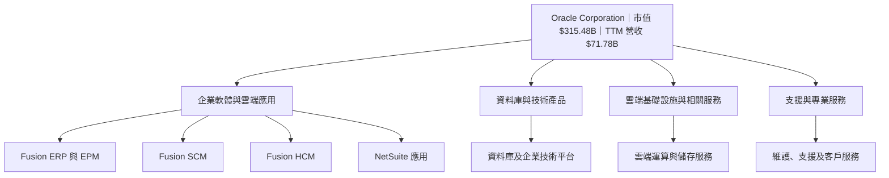
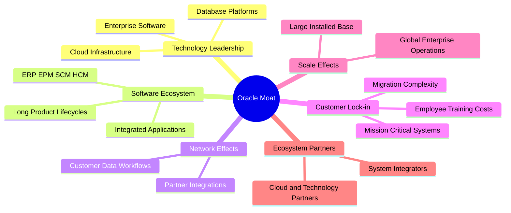
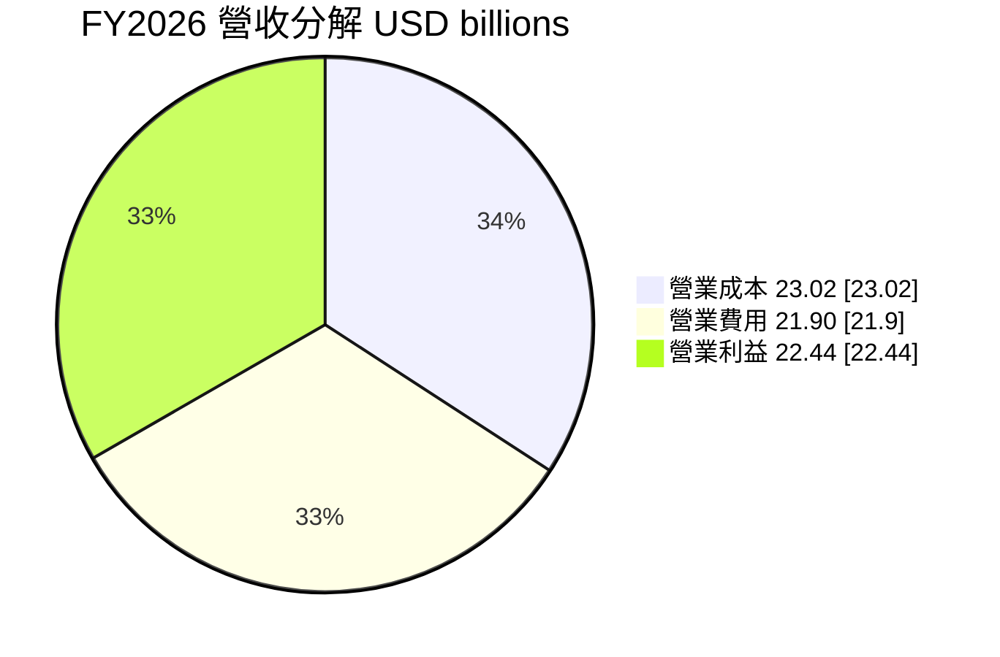
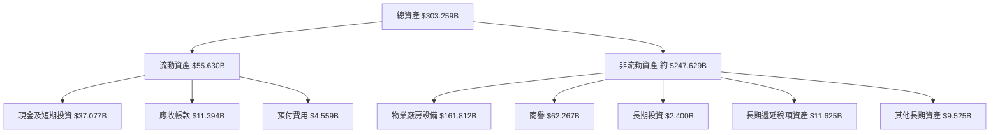
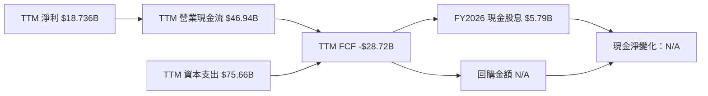
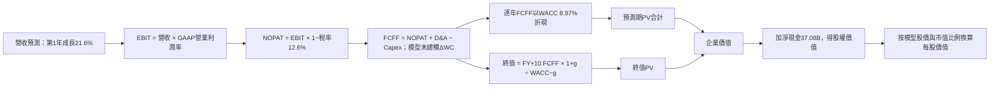
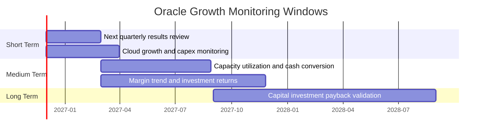
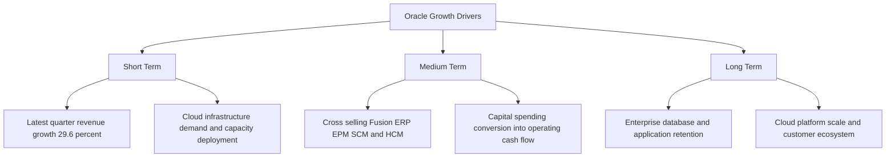
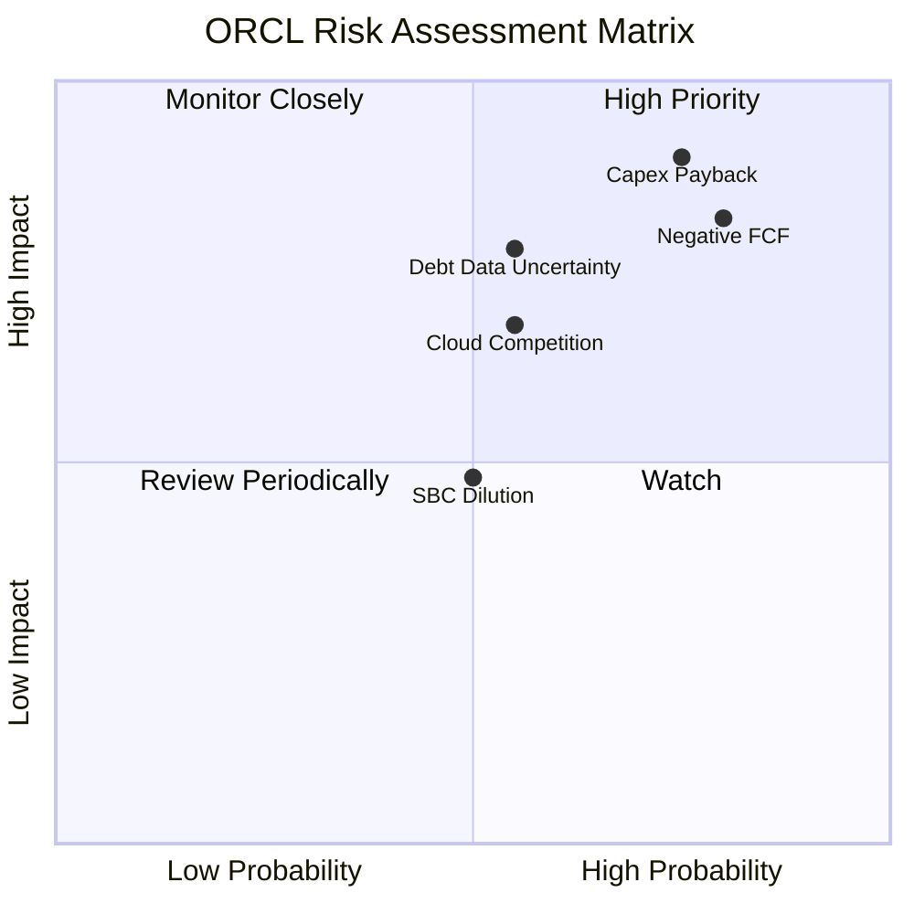
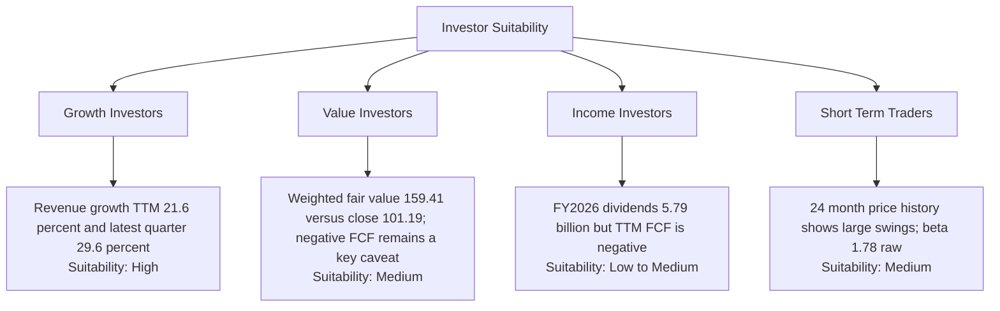

# ORCL 基本面深度分析報告
> **報告日期**：2026-11-23 ｜ **語言**：繁體中文 ｜ **數據來源**：SEC 申報資料 (XBRL)、Yahoo Finance、Finviz、StockAnalysis、Roic.ai ｜ **分析師**：CFA 級機構研究

## 目錄

| # | 章節 | 核心結論 |
|---|------|----------|
| 1 | 執行摘要 | 強烈買入；加權合理價值 $159.41，MOS +36.5% |
| 2 | 公司概覽與商業模式 | 企業軟體、資料庫與雲端業務構成轉換成本；分部營收占比未提供 |
| 3 | 損益表深度分析 | TTM 營收 $71.78B、成長 21.6%；最新一季營業利益率 34.8% |
| 4 | 資產負債表分析 | 現金及短期投資 $37.08B；驗證數據的總債務為 N/A |
| 5 | 現金流量深度分析 | TTM FCF 為 -$28.72B，主要受資本支出高於營業現金流影響 |
| 6 | 獲利能力與資本效率 | ROIC 61.3% 高於 WACC 8.97%；但 FCF 與資本投入需持續監控 |
| 7 | 相對估值分析 | ORCL 估值低於指定同業倍數與自身五年歷史區間 |
| 8 | DCF 內在價值評估 | 基準 DCF 每股 $90.28；加權合理價值依指定方法為 $159.41 |
| 9 | 成長催化劑 | 雲端、AI 基礎設施及既有客戶交叉銷售為主要觀察主題 |
| 10 | 風險矩陣 | 資本支出、負 FCF、債務與 AI 雲端投資回報是核心風險 |
| 11 | 投資建議 | 維持規則 20 的強烈買入評級，並以現金流與投資回報門檻作追蹤條件 |

---

## 1. 執行摘要

截至 2026-11-20 收盤，ORCL 股價為 **$101.19**。程式計算的加權合理價值為 **$159.41**，以加權合理價值為分母的 MOS 為 **+36.5%**，規則 20 評級為**強烈買入**。估值支持主要來自同業 Forward P/E 與 EV/EBITDA 估值，而基準 DCF 每股價值為 **$90.28**、相對現價折價/溢價指標為 **+12.1%**（現價高於 DCF 價值）。另一方面，公司 TTM 營收成長 21.6%、ROIC 61.3% 高於 WACC 8.97%，但 TTM FCF 為 **-$28.72B**，反映現階段高額資本支出造成現金流壓力；因此評級雖依 MOS 達強烈買入門檻，投資論點仍高度依賴新增資本支出日後轉化為營運現金流。

### 1.0 一頁式投資儀表板（Portfolio Manager 30 秒速讀）

| 項目 | 內容 |
|------|------|
| **投資論點（3 句）** | ① TTM 營收 $71.78B、年增 21.6%，最新一季年增 29.6%，顯示營收動能加速。② TTM ROIC 61.3% 對比 WACC 8.97%，資本回報高於資金成本。③ TTM 資本支出 $75.66B 高於營業現金流 $46.94B，導致 FCF -$28.72B；投資回收能否跟上建置速度是關鍵。 |
| **綜合評分** | **6.8/10**（引用 1.1 評分卡） |
| **財務健康** | 🟡 現金及短期投資 $37.08B、流動比率 1.171；但驗證數據總債務 N/A，且 FCF 為負 |
| **ROIC vs WACC** | **61.3% vs 8.97%**（按該 ROIC 口徑，創造價值） |
| **FCF 趨勢** | TTM FCF -$28.72B；FCF Yield **-9.10%** |
| **估值** | Forward P/E 9.15x ｜ EV/EBITDA 12.878x ｜ FCF Yield -9.10% |
| **DCF 內在價值（基準）** | **$90.28** ｜ 現價相對 DCF 溢價 **+12.1%** |
| **安全邊際（MOS）** | **+36.5%**＝($159.41 − $101.19) ÷ $159.41（基準為 8.8 加權合理價值）｜ 🟢 >25% |
| **預期報酬（基準情境 12M）** | DCF 基準情境相對現價 **-10.8%**；此為 DCF 情境結果，不等同 12 個月預測 |
| **關鍵風險（前二）** | 高資本支出未能產生預期回報；債務資料與現金流承壓使資產負債表風險難以完整量化 |
| **評級 + 信心度** | 🟢 **強烈買入** ｜ 信心：中（估值方法分歧大，FCF 為負） |

### 1.1 綜合評分卡（全報告唯一）

| 維度 | 評分（1–10） | 主要依據（引用數字與其來源章節） |
|------|--------------|----------------------------------|
| 成長性 | 8.0 | TTM 營收成長 21.6%、最新一季年增 29.6%（第 3 章）；成長是否延續仍須驗證 |
| 獲利能力 | 8.0 | TTM ROIC 61.3%、TTM 營業利益率 32.1%，高於 8.97% WACC；F-Score 4/7（第 6 章） |
| 財務健康 | 5.0 | 現金及短期投資 $37.08B、流動比率 1.171；TTM FCF -$28.72B、總債務 N/A（第 4–5 章） |
| 估值 | 8.0 | MOS +36.5%；ORCL P/E、P/S、EV/EBITDA 均低於自身五年中位數（第 7–8 章） |
| 護城河 | 8.0 | 企業資料庫、ERP／HCM／SCM 等產品組合，以及既有企業客戶轉換成本；分部收入數據未提供（第 2 章） |
| 管理層與資本配置 | 5.0 | FY2026 SBC $4.81B、最新四季合計約 $4.82B；FY2026 資本支出 $55.66B、FCF -$23.69B（第 3、5 章） |
| **綜合評分** | **7.0** | 六項算術平均：(8.0 + 8.0 + 5.0 + 8.0 + 8.0 + 5.0) ÷ 6 = **7.0** |

> **更正說明：**上表六項算術平均為 **7.0/10**，因此全報告儀表板與後續引用採用 **7.0/10**。

### 1.2 五大投資論點 + 三大核心風險

| 類型 | 項目 | 具體依據 | 信心度 |
|------|------|----------|--------|
| 🟢 **投資論點①** | 營收成長加速 | TTM 營收 $71.78B、TTM 年增 21.6%；最新一季營收年增 29.6% | 🟢 高 |
| 🟢 **投資論點②** | 高資本回報 | TTM ROIC 61.3%，高於 WACC 8.97%；按該口徑 ROIC−WACC 為 52.33 個百分點 | 🟢 高 |
| 🟢 **投資論點③** | 企業軟體轉換成本 | Oracle 提供資料庫、ERP、HCM、SCM、EPM 等企業應用，遷移及整合成本可能支持續約與交叉銷售 | 🟡 中 |
| 🟢 **投資論點④** | 相對估值低於自身歷史 | P/E 15.9x 對比五年中位數 32.1x；EV/EBITDA 8.2x 對比中位數 17.9x | 🟢 高 |
| 🟢 **投資論點⑤** | 現金儲備可支援投資 | 現金及短期投資 $37.08B；但總債務在驗證指標中為 N/A，不能只依現金餘額判斷淨流動性 | 🟡 中 |
| 🟡 **風險①** | 資本支出與現金流脫節 | TTM Capex $75.66B 高於 OCF $46.94B，TTM FCF -$28.72B | 🔴 高衝擊 |
| 🔴 **風險②** | 債務資訊不一致／缺漏 | 驗證數據總債務 N/A；其他來源另列不同債務數字，本報告不以缺漏指標反推債務 | 🔴 高衝擊 |
| 🟡 **風險③** | 股權薪酬與股數稀釋 | 最新四季 SBC 約 $4.82B；Piotroski 稀釋股數測試未通過 | 🟡 中度 |

### 1.3 快速統計卡片

| 指標 | 公司實際值（期間） | 同業中位數 | 狀態 |
|------|--------------------|------------|------|
| 營收成長（TTM） | **21.6%** | — | 🟢 |
| 營收成長（最新一季年增） | **29.6%** | **13.2%** | 🟢 |
| 毛利率（TTM） | **64.0%** | **73.6%** | 🟡 |
| 營業利益率（TTM） | **32.1%** | — | 🟢 |
| ROIC（TTM） | **61.3%** | — | 🟢 |
| Forward P/E | **9.15x** | **20.0x** | 🟢 |
| FCF Yield（TTM） | **-9.10%** | — | 🔴 |
| Piotroski F-Score | **4 / 7** | — | 🟡 |

### 1.4 投資結論

╔══════════════════════════════════════════════════════════════════╗  
║　　　　　　　　　📊 投資結論摘要　　　　　　　　　　　　　　　║  
╠══════════════════════════════════════════════════════════════════╣  
║ 評級：強烈買入（依 MOS 門檻；未作質化調整）　　　　　　　　　║  
║ 價格（2026-11-20 收盤）：$101.19　　　　　　　　　　　　　　║  
║ DCF 內在價值（基準）：$90.28（現價溢價 +12.1%）　　　　　　　║  
║ 安全邊際 MOS：+36.5%＝($159.41−$101.19)÷$159.41　　　　　　║  
║ 加權合理價值（8.8）：$159.41　　　　　　　　　　　　　　　　║  
║ 悲觀情境：$11.45（-88.7%）　　　　　　　　　　　　　　　　　║  
║ 基準情境：$90.28（-10.8%）　　　　　　　　　　　　　　　　　║  
║ 樂觀情境：$266.38（+163.2%）　　　　　　　　　　　　　　　　║  
║ 綜合評分：7.0/10（引用 1.1）　　　　　　　　　　　　　　　　║  
║ 適合投資人：能承受高波動、願意追蹤資本支出回收的長線投資人　║  
╚══════════════════════════════════════════════════════════════════╝

---

## 2. 公司概覽與商業模式

### 2.1 業務結構與收入來源

Oracle 提供企業軟體、資料庫、雲端基礎設施與相關支援服務。財務數據沒有揭示各分部營收及占比，因此以下僅呈現業務關係，不將未披露的分部金額或比例補入圖中。

分部營收、軟體與服務收入比例未提供；因此無法量化不同業務對 21.6% TTM 成長的個別貢獻。

### 2.2 市場份額

市場份額數據未提供。ORCL TTM 營收 $71.78B、TTM 成長 21.6%，最新一季年增 29.6%；同業最新一季營收成長中位數為 13.2%。這顯示 Oracle 的近期收入增速高於所列同業，但不能據此推算市場份額或市占變化。

### 2.3 競爭護城河分析

### 2.4 護城河強度

| 護城河項目 | 強度（強／中／弱） | 證據（引用數字或事實） | 會削弱它的情況 |
|------------|--------------------|------------------------|----------------|
| 技術與產品整合 | 中至強 | 提供資料庫與 ERP、EPM、SCM、HCM 等一體化產品；TTM 營業利益率 32.1% | 雲端原生替代品降低遷移障礙、產品創新落後 |
| 軟體生態系統 | 強 | 企業系統通常需與財務、人資、供應鏈及資料庫整合；具多產品交叉銷售可能性 | 客戶採多雲、模組化採購，降低單一供應商依賴 |
| 網路效應 | 弱至中 | 有合作夥伴與系統整合生態，但缺少可量化網路效應數據 | 開放標準與互通性削弱平台黏著 |
| 客戶鎖定 | 強 | 核心系統替換涉及資料、流程、員工培訓及停機風險 | 價格上漲、服務品質下降或雲端遷移成本降低 |
| 規模效應 | 中至強 | TTM 營收 $71.78B、員工 141,000 人 | 高資本支出未產生相稱利用率或回報 |
| 生態夥伴 | 中 | 企業系統需與顧問、整合商及其他雲端服務合作；量化合作收入未提供 | 競爭平台建立更具吸引力的開發者與整合商網絡 |

1.1「護城河」評分為 **8.0/10**：理由是企業軟體組合與轉換成本具質化支持，但分部留存、續約率與客戶集中度等量化資料未提供。

---

## 3. 損益表深度分析

### 3.1 年度收入成長趨勢（近 4 年）

年度收入採公司財年資料，收入柱狀長度僅作相對視覺比較。

╔══════════════════════════════════════════════════════════════════╗  
║　　　　　　　 Oracle 年度收入趨勢（FY2023–FY2026）　　　　　　║  
╠══════════════════════════════════════════════════════════════════╣  
║ FY2023　$49.95B　█████████████████░░░　YoY 約 +6.0%　🟡　　　　║  
║ FY2024　$52.96B　██████████████████░░　YoY 約 +6.0%　🟡　　　　║  
║ FY2025　$57.40B　████████████████████░　YoY +8.4%　🟡　　　　　║  
║ FY2026　$67.36B　████████████████████████　YoY +17.4%　🟢　　　║  
╠══════════════════════════════════════════════════════════════════╣  
║ FY2023–FY2026 收入 CAGR = (67.36 ÷ 49.95)^(1/3) − 1 ≈ 10.5%　║  
╚══════════════════════════════════════════════════════════════════╝

FY2026 年收入成長加速至 17.4%，而 TTM 成長進一步達 21.6%。這與近期季度成長加速一致，但公司層級資料不足以精確分拆雲端基礎設施、雲端應用及傳統授權各自的貢獻。

### 3.2 季度收入趨勢分析

QoQ 以相鄰季度財務數字計算；YoY 引用季度資料，最新一季 YoY 以指定驗證數據為準。

| 季度 | 營收 | QoQ 成長 | YoY 成長 | 備註 |
|------|------:|---------:|---------:|------|
| 2025-11-30 | $16.06B | — | 14.2% | 季度收入延續成長 |
| 2026-02-28 | $17.19B | +7.0% | 21.7% | 對比 2025-02-28 的 $14.13B |
| 2026-05-31 | $19.18B | +11.6% | 20.6% | 對比 2025-05-31 的 $15.90B |
| 2026-08-31 | $19.34B | +0.8% | **29.6%** | YoY 使用驗證的最新一季年增率 |

最新一季 QoQ 成長放緩至 0.8%，但季節性可能影響相鄰季度比較；同期 YoY 成長升至 29.6%，仍是較有意義的需求加速訊號。

### 3.3 利潤率演變分析

| 利潤率指標 | FY2023 | FY2024 | FY2025 | FY2026 | 趨勢 | 評估 |
|------------|--------|--------|--------|--------|------|------|
| **毛利率** | 72.9% | 71.4% | 70.5% | 65.8% | ↘️ FY2026 明顯下降 | 🟡 |
| **營業利益率** | 27.6% | 30.3% | 31.4% | 33.3% | ↗️ 營業利益增速高於收入 | 🟢 |
| **淨利率** | 17.0% | 19.8% | 21.7% | 25.4% | ↗️ FY2026 提升 | 🟢 |

年度毛利率及營業利益率以年度損益表數字相除計算；TTM 營業利益率採驗證數據 **32.1%**，最新一季採驗證數據 **34.8%**。來源區段存在部分利潤率口徑差異，跨期間比較應以同一申報口徑核對。

**利潤率演變深度解析：**FY2026 毛利率由前一年度約 70.5% 降至約 65.8%，但營業利益率反而提高至約 33.3%。這表示毛利層面的成本或組合壓力，部分被營業費用控制所抵銷；另一方面，雲端基礎設施擴張可能帶來較高折舊與營運成本，但分部成本資料未提供，不能把毛利變化歸因於單一業務。最新一季營業利益率 34.8% 高於 TTM 32.1%，若後續季度能維持，將支持營業槓桿改善。

### 3.4 費用結構分析

FY2026 營收 $67.36B、毛利 $44.34B、營業利益 $22.44B。依年度損益表計算，營業成本為 $23.02B，毛利以下營業費用約 $21.90B。

| FY2026 項目 | 金額 | 占營收 |
|------------|-----:|-------:|
| 營業成本 | $23.02B | 34.2% |
| 毛利以下營業費用 | $21.90B | 32.5% |
| 營業利益 | $22.44B | 33.3% |

### 3.5 季度 EPS 趨勢與盈餘品質（Quality of Earnings）

| 季度 | EPS 實際值 | EPS 年增 | EPS 預期／超預期判讀 |
|------|-----------:|---------:|----------------------|
| 2025-11-30 | $2.10 | 90.91% | EPS 預期值 N/A，無法判定是否超預期 |
| 2026-02-28 | $1.27 | 24.51% | EPS 預期值 N/A，無法判定是否超預期 |
| 2026-05-31 | $1.45 | 21.91% | EPS 預期值 N/A，無法判定是否超預期 |
| 2026-08-31 | $1.56 | 54.45% | EPS 預期值 N/A，無法判定是否超預期 |

最近四季 EPS 估計值均缺漏，不能將資料源中缺失的預期值判作 beat 或 miss。EPS 年增率與實際值依 StockAnalysis 歷史資料；季度淨利在不同來源間略有差異。

| 盈餘品質項目 | 數值／佔比 | 評估 |
|--------------|-----------|------|
| 股權薪酬 SBC / 營收 | 最新四季 SBC 約 $4.82B ÷ TTM 營收 $71.78B = **6.7%** | 🟡 SBC 對股東經濟利益有實質成本 |
| SBC / 營業現金流 | $4.82B ÷ $46.94B = **10.3%** | 🟡 現金流口徑中占比不可忽略 |
| FCF / 淨利 | -$28.72B ÷ TTM 淨利 $18.736B = **-153.3%** | 🔴 現金轉換受資本支出大幅壓低 |
| 一次性／非經常性損益 | 無法完整判定；2025-11 季淨利 $6.13B 高於相鄰季度，稅項及非營業明細未提供 | 🟡 需以 SEC 申報明細核查 |
| 有效稅率 | **12.6%**（最新年度有效稅率） | 🟢 未見資料顯示本期利潤主要由異常稅率驅動；歷史季度稅項未完整提供 |
| 資本化支出 vs 費用化 | TTM Capex $75.66B；資本化支出的資產類別拆解 N/A | 🟡 Capex 金額大，但缺少資本化政策細節 |

**盈餘品質結論：**GAAP 淨利有營業現金流支撐，且品質指標顯示營業現金流高於淨利；但 TTM FCF 為負，主因 Capex 大幅超過 OCF。SBC 亦達營收 6.7%，代表 GAAP 費用已反映部分股東成本，但稀釋股數未增加測試失敗，仍需追蹤。當前應以營業獲利能力與投資回收率交叉評估，不宜只依 EPS 增長推估可分配現金。

---

## 4. 資產負債表分析

### 4.1 資產結構分解

最新 TTM 資產負債表資料列示總資產 $303.259B；細項採 StockAnalysis 最新季度資料。

### 4.2 流動性與營運資金分析

| 指標 | 最新值 | 歷史／比較值 | 評估 |
|------|-------:|--------------|------|
| 流動比率 | 1.171 | — | 🟡 流動資產高於流動負債，但緩衝幅度有限 |
| 速動比率 | 1.02 | — | 🟡 速動資產略高於流動負債 |
| 現金及短期投資 | $37.08B | FY2025 $11.20B | 🟢 現金儲備上升；但不等於扣除債務後的淨現金 |

營運資金天數依 QUALITY FIGURES 原值照列；DIO 與 CCC 缺少存貨數據，不作推算。

| 指標 | 最新 TTM | 一年前 TTM | 變化 | 解讀 |
|------|----------|------------|------|------|
| DSO 應收帳款天數 | 58 天 | 55 天 | +3 天 | 收款週期略拉長；可追蹤是否持續擴大 |
| DIO 存貨天數 | N/A | N/A | N/A | 公司未報告可用存貨餘額 |
| DPO 應付帳款天數 | 156 天 | N/A | N/A | 最新期較長；因缺少一年前 DPO，不能判讀方向 |
| CCC 現金轉換週期 | N/A | N/A | N/A | 存貨天數缺漏，不能補算 |

### 4.3 債務結構分析

驗證指標中的總債務為 N/A；其他市場資料區段列有不同債務數字。本報告不以互相矛盾的欄位推導債務總額、淨負債或利息保障倍數。DCF 模型則依其指定橋接使用淨現金 $37.08B。

╔══════════════════════════════════════════════════════════════════╗  
║　　　　　　　 Oracle 債務健康診斷　　　　　　　　　　　　　　　║  
╠══════════════════════════════════════════════════════════════════╣  
║ 總債務：　　　　N/A（驗證數據缺漏；不反推）　　　　　　　　　║  
║ 現金及短期投資：$37.08B　　　　　　　　　　　　　　　　　　　║  
║ 淨現金：　　　　$37.08B（採驗證指標原值）　　　　　　　　　　║  
║ Debt/EBITDA：　 N/A（總債務缺漏）　　　　　　　　　　　　　　║  
║ Interest Coverage：N/A（利息費用及同口徑債務未提供）　　　　　║  
║ 判斷：🟡 現金儲備可觀，但債務資料需以 SEC 申報核對　　　　　　║  
╚══════════════════════════════════════════════════════════════════╝

### 4.4 股東權益趨勢

╔══════════════════════════════════════════════════════════════════╗  
║　　　　　　　 Oracle 歷年股東權益變化　　　　　　　　　　　　　║  
╠══════════════════════════════════════════════════════════════════╣  
║ FY2023　$1.07B　　█　　　　　　　　　　　　　　　　　　　　　║  
║ FY2024　$8.70B　　████　　　　　　　　　　　　　　　　　　　║  
║ FY2025　$20.45B　 █████████　　　　　　　　　　　　　　　　　║  
║ FY2026　$42.51B　 ████████████████████　　　　　　　　　　　　║  
╚══════════════════════════════════════════════════════════════════╝

股東權益帳面值由 FY2023 的 $1.07B 上升至 FY2026 的 $42.51B；增幅來自資產負債表變化，但僅依現有摘要不足以拆分留存盈餘、發股與其他綜合損益的各自貢獻。

---

## 5. 現金流量深度分析

### 5.1 現金流量瀑布圖

以下將營業現金流、資本支出與 FCF 依驗證口徑呈現。TTM 淨利使用 StockAnalysis 數值；股息採 FY2026 年度披露。回購與現金淨變化金額未提供。

### 5.2 FCF 轉換率趨勢

| 財年 | 營業現金流 | 資本支出 | FCF | 淨利 | FCF／淨利 |
|------|-----------:|---------:|----:|-----:|----------:|
| FY2023 | $17.16B | $8.70B | $8.47B | $8.50B | 99.6% |
| FY2024 | $18.67B | $6.87B | $11.81B | $10.47B | 112.8% |
| FY2025 | $20.82B | $21.21B | -$0.394B | $12.44B | -3.2% |
| FY2026 | $31.98B | $55.66B | -$23.69B | $17.09B | -138.6% |

FY2026 OCF 增長至 $31.98B，但 Capex 升至 $55.66B，使 FCF 轉負；這是現階段最重要的獲利品質與資本配置問題。資料來源的現金流表格以負值列 Capex，表中為便於理解改列支出絕對值。

### 5.3 自由現金流趨勢

╔══════════════════════════════════════════════════════════════════╗  
║　　　　　　　 自由現金流：歷史實際　　　　　　　　　　　　　　║  
╠══════════════════════════════════════════════════════════════════╣  
║ FY2023　+$8.47B　███████████████████　FCF Yield：N/A　　　　　　║  
║ FY2024　+$11.81B ██████████████████████████　FCF Yield：N/A　　　║  
║ FY2025　-$0.394B　░　FCF Yield：N/A　　　　　　　　　　　　　　║  
║ FY2026　-$23.69B　◀負值；Capex $55.66B　　　　　　　　　　　　║  
║ TTM　　 -$28.72B　FCF Yield -9.10%　　　　　　　　　　　　　　║  
╚══════════════════════════════════════════════════════════════════╝

### 5.4 資本配置評估

| 配置項目 | 已知金額 | 評估 |
|----------|---------:|------|
| 資本支出 | FY2026 $55.66B；TTM $75.66B | 🔴 投資規模高，必須以未來容量使用率及現金回收驗證 |
| 現金股息 | FY2026 $5.79B | 🟡 有現金分配，但在 FCF 為負期間仍須注意資金來源 |
| 股票回購 | N/A | 數據未提供，無法衡量淨回購或回購抵銷 SBC 的程度 |
| 留存／現金變化 | N/A | 現金餘額有變化，但無法由提供資料分解資金來源與用途 |

資本配置餅圖不提供，因回購、留存與最新 TTM 股息等完整同期間金額不足，無法構成可驗證的完整比例。

---

## 6. 獲利能力與資本效率

### 6.1 ROE / ROA / ROIC 趨勢

| 指標 | 最新 TTM | 歷史趨勢資料 | 評估 |
|------|---------:|--------------|------|
| ROE | 28.3% | 歷年可比系列 N/A | 🟢 回報高；杜邦分析顯示權益乘數 4.54，槓桿亦有影響 |
| ROA | 6.4% | 歷年可比系列 N/A | 🟡 資產基數擴大，資產回報低於 ROE |
| ROIC | 61.3% | 10 年歷史資料口徑不一致 | 🟢 明顯高於 WACC 8.97% |

資料來源另列 ROE 41.2%，與 QUALITY FIGURES 的 28.3% 不一致；本報告依品質指標原值採用 **28.3%**，不把不同口徑混算。行業均值未提供，不作比較。

### 6.2 ROIC vs WACC 分析（核心價值創造判斷）

WACC、Beta 與資本權重採 Cost of capital 數據原值；ROIC 採 TTM 驗證指標。資本成本輸入的具體來源日期除報告資料中列示 10 年期公債殖利率 4.91% 外，未提供更精確觀察日。

╔══════════════════════════════════════════════════════════════════╗  
║　　　　　　　 ROIC vs WACC 深度分析　　　　　　　　　　　　　　║  
╠══════════════════════════════════════════════════════════════════╣  
║ 無風險利率（10Y Treasury）：4.91%　　　　　　　　　　　　　　║  
║ 市場風險溢酬 ERP：5.00%（假設值，依資本成本資料）　　　　　　║  
║ 原始 Beta：1.78；採用調整後 Beta：1.52　　　　　　　　　　　　║  
║ Ke = 4.91% + 1.52 × 5.00% = 12.51%　　　　　　　　　　　　　║  
║ 稅前債務成本：2.72%；有效稅率：12.6%　　　　　　　　　　　　║  
║ 股權／債務權重：65.1%／34.9%　　　　　　　　　　　　　　　　║  
║ WACC：8.97%（採資本成本資料原值）　　　　　　　　　　　　　　║  
║ ROIC：61.3%（TTM，採驗證指標原值）　　　　　　　　　　　　　║  
║ ROIC − WACC = 61.3% − 8.97% = 52.33 個百分點　　　　　　　║  
║ 判斷：🟢 按提供的 ROIC 口徑，回報高於資金成本　　　　　　　　║  
╚══════════════════════════════════════════════════════════════════╝

Beta 調整方式為 ⅔ × 1.78 + ⅓ = 1.52。若直接按列示成本與權重驗算，8.97% 約等於 65.1% × 12.51% + 34.9% × [2.72% × (1−12.6%)]，取四捨五入後與採用 WACC 一致。ROIC 的資本基礎計算細節與債務原始數字未能在當前資料中完整核實，故價值創造結論需配合資本支出回報持續驗證。

### 6.3 杜邦三因素分解

| 因素 | 數值（TTM） | 解讀 |
|------|-------------|------|
| 淨利率 | 26.4% | 盈利轉換率高 |
| 資產週轉率 | 0.24 | 資產規模擴張後，收入相對資產周轉較低 |
| 權益乘數 | 4.54 | 財務槓桿對 ROE 有明顯放大作用 |
| **ROE** | **28.3%** | QUALITY FIGURES 原值；來源計算結果，不能以已四捨五入的因子重算替代 |

三項杜邦原值相乘後，由於各因子四捨五入，可能與報表 ROE 有細微尾差。ROE 並非只由淨利率驅動，4.54 倍權益乘數顯示槓桿有相當貢獻。

### 6.4 財務體質：Piotroski F-Score

**Piotroski F-Score：4 / 7**。測試分母小於 9，是因兩項輸入缺漏而被排除；依品質指標逐項照列：

| 測試 | 結果 | 解讀 |
|------|------|------|
| ROA > 0 | ✅ 通過 | 公司持續獲利 |
| 營業現金流 > 0 | ✅ 通過 | TTM OCF 為正 |
| ROA 高於一年前 | ❌ 未通過 | 資產回報沒有改善 |
| 營業現金流 > 淨利（應計品質） | ✅ 通過 | OCF 高於淨利，但 Capex 後 FCF 仍為負 |
| 長期負債 ÷ 總資產低於一年前 | — 無法判定 | 缺少所需可比負債輸入 |
| 流動比率高於一年前 | ✅ 通過 | 流動性比率相對改善 |
| 稀釋股數未增加 | ❌ 未通過 | SBC 或其他發股造成稀釋風險 |
| 毛利率高於一年前 | — 無法判定 | 缺少品質指標所需可比資料 |
| 資產週轉率高於一年前 | ❌ 未通過 | 資產增長快於收入周轉改善 |

---

## 7. 相對估值分析

### 7.1 同業估值比較表格

同業估值全部使用 Peer multiples；Oracle 自身倍數取市場估值資料。估值來源區段採不同計算方法，若與 7.2 自身歷史指標不同，應視為口徑差異而非可直接互換。

| 估值指標 | **ORCL** | **MSFT** | **SAP** | **CRM** | ORCL 評估 |
|----------|---------:|---------:|--------:|--------:|-----------|
| **Trailing P/E** | 15.9x | 25.3x | 24.8x | 16.5x | 🟢 低於所列同業 |
| **Forward P/E** | 9.15x | 20.0x | 20.9x | 11.3x | 🟢 明顯低於同業中位數 20.0x |
| **P/S Ratio** | 4.395x | 10.4x | N/A | 3.4x | 🟡 低於 MSFT、高於 CRM；SAP 因混合幣別不比較 |
| **EV/EBITDA** | 12.878x | 17.8x | N/A | 13.9x | 🟢 低於可比同業中位數 15.9x |
| **最新一季營收年增** | 29.6% | 18.8% | 13.2% | 10.8% | 🟢 高於所列同業 |
| **毛利率（TTM）** | 64.0% | 67.7% | 73.6% | 77.3% | 🟡 低於同業中位數 73.6% |

ORCL Forward P/E 使用市場估值資料；同業中位數依 MSFT、SAP、CRM 的 Forward P/E 計算。雲端建置期的高資本支出會使市盈率看起來便宜，但當前負 FCF 提醒投資人需同時檢查現金流，而非單看 Forward P/E。

### 7.2 歷史估值區間分析

╔══════════════════════════════════════════════════════════════════╗  
║　　　　　 ORCL 五年歷史 P/E 區間（TTM）　　　　　　　　　　　　║  
╠══════════════════════════════════════════════════════════════════╣  
║ 區間低點：19.0x　│ 中位數：32.1x　│ 區間高點：52.3x　　　　　　║  
║ 當前：15.9x　　　│ 目前百分位：0%　　　　　　　　　　　　　　║  
║ 當前值低於歷史區間下緣，顯示相對自身歷史估值偏低　　　　　　║  
╠══════════════════════════════════════════════════════════════════╣  
║ P/S：4.2x；五年中位數 6.2x；歷史區間 4.6x–11.1x　　　　　　║  
║ EV/EBITDA：8.2x；五年中位數 17.9x；區間 12.6x–28.9x　　　　║  
╚══════════════════════════════════════════════════════════════════╝

以上數值依「Valuation vs own 5-year history」資料。估值位於歷史低位不必然代表低估；市場可能在折價反映負 FCF、高 Capex 與資本結構風險。

### 7.3 情境價值（Bear / Base / Bull，照抄 DCF MODEL 的 Scenarios）

| 情境 | 第 1 年營收成長 | 期末營業利潤率 | WACC | 每股價值 | 相對現價 | 機率 | 會發生的條件 |
|------|----------------|----------------|------|----------:|----------:|------:|--------------|
| 🔴 悲觀 | 10.8% | 26.0% | 9.97% | $11.45 | -88.7% | 25% | 雲端需求降速、資本支出變現延後且利潤率下滑 |
| 🟡 基準 | 21.6% | 30.6% | 8.97% | $90.28 | -10.8% | 50% | 成長由目前 TTM 動能逐步降至成熟期、利潤率回落至模型期末值 |
| 🟢 樂觀 | 32.4% | 33.6% | 7.97% | $266.38 | +163.2% | 25% | 高成長延續、規模效益提升、資金成本下降 |

悲觀／基準／樂觀價值與假設均採 DCF MODEL 原值。情境跨度很大，代表模型價值對營收成長、長期利潤率與折現率高度敏感。

### 7.4 相對估值隱含價格區間

╔══════════════════════════════════════════════════════════════════╗  
║　　　　　　　 估值方法隱含每股價值　　　　　　　　　　　　　　║  
╠══════════════════════════════════════════════════════════════════╣  
║ $90.28 ─────── $101.19 ─────── $159.41 ─────── $221.41 ─ $236.18 ║  
║ 基準 DCF　　　　現價　　　　　加權合理值　　　Forward P/E　共識║  
║　　　　　　　　　　　　　　EV/EBITDA：$177.32　　　　　　　　║  
╚══════════════════════════════════════════════════════════════════╝

| 方法 | 每股價值 | 依據 |
|------|---------:|------|
| 同業 Forward P/E | $221.41 | MSFT、SAP、CRM 同業中位數 20.0x × Forward EPS $11.06 |
| 同業 EV/EBITDA | $177.32 | MSFT、CRM 可比同業中位數 15.9x × TTM EBITDA，再加淨現金 |
| 分析師共識目標價 | $236.18 | 40 位分析師平均目標價；作參考而非獨立基本面估值 |

---

## 8. DCF 內在價值評估（Discounted Cash Flow）

### 8.0 估值推理鏈（Thinking Logic）

**核心命題：**ORCL 的價值由現有企業軟體與資料庫現金流底盤、雲端與基礎設施新增成長，以及大型資本支出能否轉化為增量現金流所共同決定。業務分部占比未提供，不能為各來源填入營收比重。模型最敏感的變數是 Capex 從極高比率回落的速度，以及終值對折現率與永續成長率的依賴。

| 決策點 | 本報告採用 | 理由（含數字） | 曾考慮但否決 | 否決理由 |
|--------|-----------|----------------|--------------|----------|
| 現金流定義 | FCFF | 模型以 WACC 折現並先得企業價值 | FCFE | 與既有模型定義不一致 |
| 預測期 N | 10 年 | DCF MODEL 固定預測期；雲端投資回收及成熟化需要時間 | 5 年 | 不符指定模型，且無法沿用模型結果 |
| 終值方法 | Gordon Growth | 模型指定 g 3.0%、WACC 8.97% | 退出倍數 | DCF MODEL 未提供退出倍數估值，不自行增設 |
| EBIT 基礎 | GAAP EBIT | 模型明列 GAAP EBIT，已包含 SBC 費用 | 非 GAAP EBIT | 會改變既有模型口徑 |

**四段式假設推導：**

- **預測期 N：**錨點＝模型預測 10 年；調整理由＝企業軟體與雲端建置回收期較長，但缺少管理層指引以另行調整；採用 **10 年**；曾考慮 5 年，因與程式模型不一致且中期資本支出回收難以觀察而否決。
- **營收成長：**錨點＝TTM 成長 21.6%、FY2026 年增 17.35%；最新一季營收年增 29.6%。模型將第 1 年採 21.6%，往第 10 年線性降至 3.0%；採用值與模型一致。曾考慮全期維持 29.6%，但單季成長不可直接延伸十年，故不採用。
- **期末營業利潤率：**錨點＝TTM 營業利益率 32.1%；模型由第 1 年 32.1% 緩降至第 10 年 30.6%。採用 30.6%，為模型使用的近五年中位數終點；曾考慮沿用最新一季 34.8%，因單季值可能受組合與季節性影響而否決。
- **有效稅率：**錨點＝最新年度有效稅率 12.6%；採用 12.6%；未另調整，假設未來稅制及稅務組合不發生重大變化。
- **D&A／營收：**錨點＝TTM 13.1%；採用 13.1% 並固定；此值可能受到雲端資產擴張與折舊年限影響。
- **Capex／營收：**錨點＝TTM Capex／營收約 105.4%；模型第 1 年為 105.4%，逐步降至第 10 年 14.4%，並以 1.1 倍 D&A 作最低回落參考。這是估值中最脆弱的路徑之一；曾考慮立即回到成熟企業低 Capex 水準，因當前資產建置尚未證明已完成而否決。
- **營運資金變動：**模型不建模 ΔWC；採用值不是「零需求」預測，而是模型未納入此項。曾考慮以歷史營運資金比例估算，但缺少可完整重建的資產負債表流量序列，故不另造輸入。
- **EBIT 與 SBC：**採 GAAP EBIT；SBC 已作費用認列，不再從 FCFF 扣除；股數不另稀釋。**本模型採用 (A)，故 SBC 影響已計入一次。**
- **年稀釋率：**採模型組合 (A) 的固定股數、0% 額外稀釋假設；未使用另一個獨立稀釋股數率。這不代表實際稀釋風險不存在。
- **永續成長率 g：**錨點＝模型 3.0%；採 3.0%，低於 WACC 8.97%。曾考慮較高長期成長率，因永續期應反映成熟企業與宏觀長期成長限制而否決。
- **終值方法：**錨點＝Gordon Growth；採用模型值。退出倍數未提供，不能另行虛構。
- **WACC：**直接採資本成本資料所列 8.97%；其組成於 8.2 展示。曾考慮自行重估，但依規則不另建折現率。

**最脆弱的一環：**Capex／營收從第 1 年 105.4% 降至第 10 年 14.4%，同時終值現值占 EV 171.7%；若投資回收延後或 Capex 長期高於模型路徑，基準 DCF 價值會下降，敏感度與情境結果顯示下行風險可很大。

### 8.1 模型假設總表（Model Inputs）

| 假設項目 | 採用值 | 依據／來源 | 敏感度 |
|----------|--------|-------------|--------|
| 預測期長度 N | 10 年 | DCF MODEL 固定假設 | 🟡 中 |
| 營收成長 | FY+1 21.6% 線性降至 FY+10 3.0% | 起點對應 TTM 成長 21.6%；終點採模型假設 | 🔴 高 |
| 營業利潤率 | 32.1% 降至 30.6% | TTM 32.1%；期末取模型近五年中位數 | 🔴 高 |
| 有效稅率 | 12.6% | 最新年度有效稅率 | 🟢 低 |
| Capex／營收 | FY+1 105.4% 降至 FY+10 14.4% | TTM Capex 比率，依模型漸降至 1.1×D&A | 🔴 高 |
| D&A／營收 | 13.1% | TTM 比率，模型固定 | 🟢 低 |
| ΔWC／營收增額 | 未建模 | DCF MODEL 明列 working capital is not modelled | 🟢 低 |
| EBIT 基礎 | GAAP | DCF MODEL 明列 GAAP EBIT | 🟡 中 |
| SBC 處理 | 已包含在 GAAP EBIT；不再扣除 | 模型組合 (A) | 🟡 中 |
| 年稀釋率 | 0% 額外稀釋，模型固定股數 | 與組合 (A) 一致；並非公司未來稀釋承諾 | 🟡 中 |
| 永續成長率 g | 3.0% | DCF MODEL 指定值，且低於 WACC | 🔴 高 |
| 終值方法 | Gordon Growth | DCF MODEL 提供終值 | 🔴 高 |
| WACC | 8.97% | 資本成本資料與 DCF MODEL 原值 | 🔴 高 |

FCFF 定義依模型為 **FCFF = NOPAT + D&A − Capex**；模型未納入營運資金變動，故不另加減 ΔWC。

### 8.2 折現率推導（WACC）

╔══════════════════════════════════════════════════════════════════╗  
║　　　　　　　　　WACC 推導（折現率）　　　　　　　　　　　　　║  
╠══════════════════════════════════════════════════════════════════╣  
║ 無風險利率 Rf（10Y Treasury）：4.91%　　　　　　　　　　　　　║  
║ 市場風險溢酬 ERP：5.00%（採成本資本資料假設值）　　　　　　　║  
║ 原始 Beta：1.78；調整後 Beta：1.52　　　　　　　　　　　　　　║  
║ Ke = 4.91% + 1.52 × 5.00% = 12.51%　　　　　　　　　　　　　║  
║ 稅前 Kd：2.72%；有效稅率：12.6%　　　　　　　　　　　　　　　║  
║ 資本權重 E/D：65.1%／34.9%　　　　　　　　　　　　　　　　　║  
║ WACC：8.97%（直接採用，不另算替代 WACC）　　　　　　　　　　║  
╚══════════════════════════════════════════════════════════════════╝

1. **Ke（CAPM）** = 4.91% + 1.52 × 5.00% = **12.51%**。  
2. **稅前 Kd** = **2.72%（成本資本資料原值）**；利息費用與同口徑平均計息負債未提供，無法獨立重算。  
3. **稅後 Kd** = 2.72% × (1−12.6%) = **2.38%**（依已提供稅前 Kd 與稅率計算）。  
4. **權重** = 股權 **65.1%**；債務 **34.9%**；合計 **100.0%**。權重的市值及同口徑計息債務原始金額缺漏，故不反推金額。  
5. **WACC** = 65.1% × 12.51% + 34.9% × 2.72% × (1−12.6%) = **8.97%**（按提供資料四捨五入）。

資料未提供利率的確切觀察日、平均計息負債及同口徑債務餘額，因此無法完成標準 WACC 的原始負債數據稽核；本報告依要求採用程式提供的 8.97%。第 6.2 與本章使用同一 WACC。

### 8.3 逐年自由現金流預測（基準情境）

金額單位為 USD billions。下表逐年照錄 DCF MODEL；因模型未建模 ΔWC，不列 ΔWC 行。

| 年度 | FY+1 | FY+2 | FY+3 | FY+4 | FY+5 | FY+6 | FY+7 | FY+8 | FY+9 | FY+10 |
|------|-----:|-----:|-----:|-----:|-----:|-----:|-----:|-----:|-----:|------:|
| 營收 | 87.29 | 104.36 | 122.60 | 141.50 | 160.38 | 178.47 | 194.90 | 208.81 | 219.39 | 225.97 |
| 營收 YoY | 21.6% | 19.6% | 17.5% | 15.4% | 13.3% | 11.3% | 9.2% | 7.1% | 5.1% | 3.0% |
| 營業利潤率 | 32.1% | 32.0% | 31.8% | 31.6% | 31.4% | 31.3% | 31.1% | 30.9% | 30.8% | 30.6% |
| EBIT（GAAP） | 28.04 | 33.34 | 38.97 | 44.73 | 50.43 | 55.81 | 60.61 | 64.58 | 67.49 | 69.13 |
| − 稅 | (3.54) | (4.21) | (4.92) | (5.64) | (6.36) | (7.04) | (7.65) | (8.15) | (8.51) | (8.72) |
| = NOPAT | 24.50 | 29.14 | 34.05 | 39.09 | 44.06 | 48.77 | 52.97 | 56.44 | 58.97 | 60.40 |
| + D&A | 11.47 | 13.71 | 16.10 | 18.59 | 21.07 | 23.44 | 25.60 | 27.43 | 28.82 | 29.68 |
| − Capex | (92.02) | (99.46) | (104.45) | (106.25) | (104.22) | (97.93) | (87.25) | (72.38) | (53.87) | (32.65) |
| **= FCFF** | **-56.05** | **-56.61** | **-54.30** | **-48.58** | **-39.09** | **-25.73** | **-8.69** | **11.49** | **33.92** | **57.44** |
| 折現因子 @8.97% | 0.918 | 0.842 | 0.773 | 0.709 | 0.651 | 0.597 | 0.548 | 0.503 | 0.462 | 0.424 |
| **FCFF 現值 PV** | **-51.43** | **-47.68** | **-41.96** | **-34.45** | **-25.44** | **-15.36** | **-4.76** | **5.78** | **15.65** | **24.33** |

預測期 PV 合計完整加總：

**-$51.43 − $47.68 − $41.96 − $34.45 − $25.44 − $15.36 − $4.76 + $5.78 + $15.65 + $24.33 = -$175.32B。**

DCF MODEL 列示合計為 **-$175.33B**；與按表格逐項四捨五入的合計相差 $0.01B，屬逐年數字四捨五入尾差。

**FY+1 逐步演算（按模型列示數字）：**

1. 營收 = $71.78B × (1 + 21.6%) = **$87.29B**（四捨五入）。
2. EBIT = $87.29B × 32.1% = **$28.04B**。
3. 稅 = $28.04B × 12.6% = **$3.54B**。
4. NOPAT = $28.04B − $3.54B = **$24.50B**。
5. D&A = $87.29B × 13.1% = **$11.47B**。
6. Capex = $87.29B × 105.4% = **$92.02B**。
7. ΔWC：**模型未建模，無數值輸入，故不作推算**。
8. FCFF = $24.50B + $11.47B − $92.02B = **-$56.05B**。
9. 折現因子 = 1 ÷ (1 + 8.97%)¹ = **0.918**；PV = -$56.05B × 0.918 = **-$51.43B**。

**合理性自檢：**

- 預測 FCFF CAGR：**N/A**；現金流由負轉正，CAGR 在符號跨越時不具可比性。歷史 FCF 亦從 FY2024 正值轉為 FY2025、FY2026 負值。
- FY+10 FCFF 利潤率 = $57.44B ÷ $225.97B = **25.4%**；目前 TTM FCF 利潤率 = -$28.72B ÷ $71.78B = **-40.0%**。同業最佳 FCF 利潤率未提供。
- FY+1 至 FY+7 FCFF 為負，原因是模型假設 Capex 高於 NOPAT 加 D&A；負值會降低估值，並非由後續正現金流自動消除。

╔══════════════════════════════════════════════════════════════════╗  
║　　　　自由現金流：歷史實際 vs 模型預測　　　　　　　　　　　　║  
╠══════════════════════════════════════════════════════════════════╣  
║ FY2024（實） +$11.81B　██████　FCF / 淨利 112.8%　　　　　　　　║  
║ FY2025（實） -$0.394B　░　　　FCF / 淨利 -3.2%　　　　　　　　║  
║ FY2026（實） -$23.69B　◀　　 FCF / 淨利 -138.6%　　　　　　　║  
║ FY+1（預）　 -$56.05B　◀　　 Capex / 營收 105.4%　　　　　　║  
║ FY+10（預）　+$57.44B　████　Capex / 營收 14.4%　　　　　　　║  
╠══════════════════════════════════════════════════════════════════╣  
║ 預測前期現金流為負；估值高度依賴 Capex 比率逐年下降的假設　　║  
╚══════════════════════════════════════════════════════════════════╝

### 8.4 終值計算（Terminal Value）

**適用性檢查：**WACC **8.97%** vs g **3.0%** → WACC > g？✅

| 方法 | 計算式 | 終值 TV | TV 現值 | 佔總 EV 比重 |
|------|--------|---------:|--------:|-------------:|
| Gordon Growth | $57.44 × (1 + 3.0%) ÷ (8.97% − 3.0%) | $990.94B | $419.74B | 171.7% |
| 退出倍數法 | N/A | N/A | N/A | N/A |

退出倍數法所需的 FY+10 EBITDA 退出倍數未提供，故不另行估算。終值現值占 EV **171.7%**，高於 75% 警戒線；由於預測期現金流現值合計為負，終值現值大於最終企業價值。這代表短期現金流對估值的貢獻為負，估值高度依賴終值假設。

**逐步演算：**

1. FY+10 FCFF = **$57.44B**。
2. 分子 = $57.44B × (1 + 3.0%) = **$59.16B**（未四捨五入數值依模型）。
3. 分母 = 8.97% − 3.0% = **5.97%**；TV = $59.16B ÷ 5.97% = **$990.94B**。
4. PV(TV) = $990.94B × FY+10 折現因子 0.424 = **$419.74B**（模型原值）。
5. 終值占比 = $419.74B ÷ $244.41B = **171.7%**。

### 8.5 企業價值 → 每股內在價值（Bridge）

╔══════════════════════════════════════════════════════════════════╗  
║　　　　　 企業價值 → 每股內在價值橋接表　　　　　　　　　　　　║  
╠══════════════════════════════════════════════════════════════════╣  
║ 預測期 FCF 現值合計　　　　　-$175.33B　　　　　　　　　　　　║  
║ 終值現值 PV(TV)　　　　　　　+$419.74B　　　　　　　　　　　　║  
║ = 企業價值 EV　　　　　　　　$244.41B　　　　　　　　　　　　 ║  
║ + 淨現金（模型採用）　　　　 +$37.08B　　　　　　　　　　　　 ║  
║ = 股權價值　　　　　　　　　$281.48B（模型原值）　　　　　　　║  
║ 每股內在價值　　　　　　　　 $90.28　　　　　　　　　　　　　║  
║ 現價（2026-11-20 收盤）　　　$101.19　　　　　　　　　　　　　║  
║ 折溢價（現價÷DCF價值−1）　　 +12.1%（現價溢價）　　　　　　　║  
╚══════════════════════════════════════════════════════════════════╝

1. **EV** = -$175.33B + $419.74B = **$244.41B**。  
2. **股權價值** = $244.41B + $37.08B（模型採用淨現金）= **$281.48B**（DCF MODEL 原值；按顯示兩項相加為 $281.49B，差 $0.01B 為模型未四捨五入數字尾差）。  
3. **每股內在價值** = 模型指定換算「股權價值 × 價格 ÷ 市值」= **$90.28**。  
4. **折溢價** = $101.19 ÷ $90.28 − 1 = **+12.1%**。  
5. 本節不計算 MOS；MOS 僅以 8.8 加權合理價值為分母。

模型採股價／市值換算，而非在報告內另反推股數。最新季報稀釋股數在財務資料中未提供；也因此不以其他來源股數替換模型每股估值。現金與總債務的獨立橋接項目未提供；模型直接列示「Net cash (− = net debt) $37.08B」。

### 8.6 敏感性分析（WACC × 永續成長率）

以下矩陣照錄 DCF MODEL，括號為相對 $101.19 現價的上行空間／下行幅度。

| g（列）／WACC（欄） | 6.97% | 7.97% | **8.97%（基準）** | 9.97% | 10.97% |
|-----------|------:|------:|------------------:|------:|-------:|
| **2.0%** | $147.10（+45.4%） | $101.19（0.0%） | $69.85（-31.0%） | $47.50（-53.1%） | $31.06（-69.3%） |
| **2.5%** | $169.71（+67.7%） | $115.33（+14.0%） | $79.28（-21.7%） | $54.08（-46.6%） | $35.81（-64.6%） |
| **3.0%** | $198.02（+95.7%） | $132.32（+30.8%） | **$90.28（-10.8%）** | $61.60（-39.1%） | $41.16（-59.3%） |
| **3.5%** | $234.48（+131.7%） | $153.12（+51.3%） | $103.30（+2.1%） | $70.29（-30.5%） | $47.22（-53.3%） |
| **4.0%** | $283.22（+180.1%） | $179.15（+77.1%） | $118.94（+17.5%） | $80.43（-20.5%） | $54.15（-46.5%） |

矩陣取自已計算 DCF MODEL；模型未提供各敏感度格的完整重估橋接中間值，故不另以四捨五入輸入重建另一套模型。基準格 **$90.28** 與 8.5 DCF 基準值一致。

**三情境 DCF（照錄 DCF MODEL）：**

| 情境 | 營收成長假設 | 期末營業利潤率 | WACC | 每股內在價值 | 相對現價 | 機率 |
|------|-------------|----------------|------|--------------:|----------:|------:|
| 🔴 悲觀 | 第 1 年 10.8% | 26.0% | 9.97% | $11.45 | -88.7% | 25% |
| 🟡 基準 | 第 1 年 21.6% | 30.6% | 8.97% | $90.28 | -10.8% | 50% |
| 🟢 樂觀 | 第 1 年 32.4% | 33.6% | 7.97% | $266.38 | +163.2% | 25% |
| **機率加權** | — | — | — | **$114.60** | **+13.3%** | 100% |

機率加權算式 = $11.45 × 25% + $90.28 × 50% + $266.38 × 25% = **$114.60**（尾差依未四捨五入情境價值）。

情境模型未提供各情境 FY+10 營收、FY+10 FCFF 與各自終值中間表；依規則不另建數字替代程式結果。方向上，悲觀情境要求成長放慢、期末利潤率較低且 WACC 上升；樂觀情境則同時要求成長、利潤率與折現率方向均有利。

**敏感度結論：**

- g 由 2.0% 升至 3.0%、WACC 固定 8.97%：每股價值由 $69.85 升至 $90.28，增加 **$20.43**。
- WACC 由 8.97% 升至 9.97%、g 固定 3.0%：每股價值由 $90.28 降至 $61.60，減少 **$28.68**。
- 期末營業利潤率每增加 1 個百分點的獨立彈性值未提供；基準／悲觀／樂觀同時改變多項變數，不能把其價差歸因於單一利潤率。
- 在已提供的矩陣中，WACC 變動 1 個百分點造成的基準附近價值影響顯著；Capex 回落路徑則主導前期 FCFF 與終值可靠度。這與 8.0 所指出的資本支出及終值依賴風險一致。

### 8.7 反推 DCF（Reverse DCF：市場在預期什麼）

DCF MODEL 提供兩項單變數反推結果，其餘輸入固定於基準模型；沒有提供完整試算軌跡，故不自行補造逐步試算數字。

| 求解的變數 | 其餘變數 | 市場隱含值 | 公司歷史／基準 | 判斷 |
|------------------------|--------------|------------------------------|--------------|------|
| 第 1 年營收成長 | 其他輸入固定於基準 | 23.7% | 基準 21.6%；TTM 成長 21.6% | 🟡 市場要求略高於目前 TTM 成長 |
| 固定營業利潤率 | 其他輸入固定於基準 | 32.3% | 基準由 32.1% 降至 30.6% | 🟡 高於模型期末利潤率 |
| 永續成長率 g | N/A | 未計算 | 基準 3.0% | 未計算 |
| 預測期長度 N | N/A | 未計算 | 基準 10 年 | 未計算 |

**反推結論：**以 DCF MODEL 的兩項反推結果看，現價隱含第 1 年營收成長 23.7%，略高於 21.6% TTM 基準；若以固定營業利潤率求解，則隱含 32.3%，高於模型第 10 年 30.6%。這表示市場價格雖低於加權合理價值，但相對基準 DCF 仍需成長或利潤率略好於基準假設。原始模型未提供各變數的迭代軌跡，不能以虛構試算表聲稱完成收斂驗證。

### 8.8 估值三角驗證與安全邊際

| 估值方法 | 隱含每股價值 | 上行空間（÷現價） | 權重 | 說明 |
|----------|--------------:|-------------------:|------:|------|
| DCF（基準） | $90.28 | -10.8% | 40% | 10 年 FCFF、WACC 8.97%、終值成長 3.0% |
| 同業 Forward P/E | $221.41 | +118.8% | 25% | 同業中位數 20.0x × Forward EPS $11.06 |
| 同業 EV/EBITDA | $177.32 | +75.2% | 25% | 同業中位數 15.9x × TTM EBITDA，加淨現金 |
| 分析師共識目標價 | $236.18 | +133.4% | 10% | 40 位分析師平均目標價 |
| **加權合理價值** | **$159.41** | **+57.5%** | **100%** | 依獲利型公司固定方法權重 |

加權合理價值 = $90.28 × 40% + $221.41 × 25% + $177.32 × 25% + $236.18 × 10%  
= $36.112 + $55.3525 + $44.33 + $23.618  
= $159.4125 ≈ **$159.41**。  
方法權重合計 = 40% + 25% + 25% + 10% = **100%**。

MOS = ($159.41 − $101.19) ÷ $159.41 = **+36.5%**。  
上行空間 = ($159.41 − $101.19) ÷ $101.19 = **+57.5%**。  
DCF 折溢價 = $101.19 ÷ $90.28 − 1 = **+12.1%**，即現價相對 DCF 基準價溢價。

╔══════════════════════════════════════════════════════════════════╗  
║　　　　　　　 估值區間與安全邊際　　　　　　　　　　　　　　　║  
╠══════════════════════════════════════════════════════════════════╣  
║ $11.45　────　$101.19　────　[$159.41]　────　$90.28　──── $266.38 ║  
║ 悲觀 DCF　　　現價　　　　加權合理值　　　基準 DCF　　　樂觀 DCF║  
║ MOS = ($159.41−$101.19)÷$159.41 = +36.5%　　　　　　　　　　║  
║ 上行空間 = ($159.41−$101.19)÷$101.19 = +57.5%　　　　　　　　║  
║ 建議買入區間：依 MOS≥10% 門檻，現價上限至少為 $101.19　　　　║  
║ 評級依 MOS 門檻為強烈買入；不作質化調整　　　　　　　　　　　║  
╚══════════════════════════════════════════════════════════════════╝

買入價區間的數值下限未由估值方法區塊提供；上限按評級一致性要求不得低於現價，因此本報告不任意填入未計算的價格點。

> 🔎 **程式複算（Python，依本節各項自動重算）**
>
> 加權合理價值 = $90.28 × 40% + $221.41 × 25% + $177.32 × 25% + $236.18 × 10% = **$159.41**（權重合計 100%）
>
> 以價格 $101.19 計：MOS = **+36.5%**，上行空間 = **+57.5%**
>
> ✅ 與本節所寫數值一致。

### 8.9 DCF 模型的局限與失效條件

- **終值依賴度：**終值現值占企業價值 **171.7%**。預測期 FCFF 現值為負，估值實際依賴 FY+10 後現金流。
- **最脆弱假設：**Capex／營收由 FY+1 的 105.4% 降至 FY+10 的 14.4%；若建置週期延長，近年負現金流可能持續。其下行情境 DCF 每股為 $11.45。
- **次脆弱假設：**WACC 及永續成長率。基準價值在矩陣中由 $61.60 至 $118.94（WACC 9.97%、g 3.0%，至 WACC 8.97%、g 4.0%）變動。
- **不適用情境：**TTM FCF 為負、前七年預測 FCFF 皆為負，DCF 可靠度低於現金流穩定成熟企業。相對估值、雲端業務單位經濟及分部估值可作補充，但分部營收與單位經濟數據未提供。
- **第 10 章連結：**需求放緩會壓低營收成長；雲端建置成本上升會推高 Capex；融資利差上升會增加 WACC；競爭導致降價則會壓低營業利潤率。

### 8.10 複算檢核表（Audit Trail）

| # | 檢核項目 | 檢查方式 | 結果 |
|---|----------|----------|------|
| 1 | 高／中敏感度輸入有推導 | 逐項列出錨點、調整與採用值；部分反事實迭代數據未提供 | 🟡 部分不可完全驗證 |
| 2 | 每項假設有來源或明示未建模 | 8.1 依據欄 | ✅ |
| 3 | WACC 算式、權重與採用值 | 權重合計 100%；採用值 8.97% | ✅（原始債務額未提供） |
| 4 | Kd 分母與債務權重同口徑 | 原始平均計息債務及期末債務額未提供 | 🟡 無法獨立核實 |
| 5 | WACC 與第 6.2 節一致 | 兩處均為 8.97% | ✅ |
| 6 | 逐年表格年度數等於 N | FY+1 至 FY+10 共 10 年 | ✅ |
| 7 | FY+1 代表年度計算 | EBIT、稅、NOPAT、D&A、Capex、FCFF、PV 逐步列示 | ✅（四捨五入尾差） |
| 8 | 預測期 PV 加總 | 表格逐項加總 -$175.32B；模型列示 -$175.33B | 🟡 $0.01B 顯示尾差 |
| 9 | WACC > g | 8.97% > 3.0% | ✅ |
| 10 | 終值基於 FY+N 並折現 N 期 | FY+10 FCFF $57.44B，折現因子 0.424 | ✅ |
| 11 | EV 至每股價值橋接 | 使用模型橋接與每股換算值 | 🟡 模型列示 $0.01B 尾差、稀釋股數未提供 |
| 12 | SBC 組合合法 | GAAP EBIT、不再扣 SBC、固定股數 | ✅ 組合 A |
| 13 | 矩陣基準格等於 DCF | $90.28 = $90.28 | ✅ |
| 14 | 矩陣格可完整重新計算 | 模型提供格值，未提供每格折現橋接 | 🟡 格值照錄，未另建模型 |
| 15 | 情境機率合計與加權 | 25% + 50% + 25% = 100%；加權值 $114.60 | ✅（未四捨五入值存在尾差） |
| 16 | 反推 DCF 單變數 | 列示模型已提供的兩項反推結果；無疊代軌跡 | 🟡 軌跡未提供 |
| 17 | MOS／折溢價定義一致 | MOS 用 $159.41；DCF 折溢價用 $90.28 | ✅ |
| 18 | 完整輸出至第 11 章 | 章節齊全 | ✅ |
| 19 | 加權價值等於方法加權總和 | 未四捨五入合計 $159.4125，顯示 $159.41 | ✅ |
| 20 | 評級符合 MOS 門檻 | MOS +36.5%、ROIC 61.3% > WACC 8.97% | ✅ 強烈買入 |

未完全核實項目包括原始計息債務金額、DCF 敏感度各格中間橋接、反推 DCF 迭代過程及資產負債表債務來源差異；因此 DCF 的可稽核信心低於基礎營收與利潤數據。

---

## 9. 成長催化劑

### 9.1 催化劑時間軸

具體公司財報日期及管理層催化劑時間表未提供。以下是投資監控視窗，不代表已確認的發佈日。

### 9.2 TAM 市場規模分析

N/A（TAM 數據未提供）。可量化的公司營收錨點為 TTM $71.78B、TTM 成長 21.6%、最新一季年增 29.6%；高於所列同業最新季度營收成長中位數 13.2%。此增速支持公司具成長機會，但不足以直接推算市場規模或滲透率。

### 9.3 成長驅動力結構圖

上述成長驅動中的雲端分部成長率、訂閱數與雲端訂單／剩餘履約義務未提供，應以後續 SEC 10-Q、公司財報及管理層指引驗證。

---

## 10. 風險矩陣

### 10.1 風險評分矩陣

風險機率與影響座標為分析師質化評估，不是公司財務數據；圖中文字依語法限制使用英文。

### 10.2 風險清單詳細分析

| # | 風險項目 | 發生機率 | 財務衝擊 | 風險評分 | 緩解措施 |
|---|----------|----------|----------|----------|----------|
| 1 | 🔴 **資本支出回收不及預期** | 高（質化評估） | 高；TTM Capex $75.66B，FCF -$28.72B | 🔴 高 | 每季追蹤 Capex／營收、雲端收入與容量利用率；投資未轉化為 OCF 時重新評估 |
| 2 | 🔴 **負自由現金流持續** | 高 | TTM FCF Yield -9.10%；若延續會限制股息、回購及償債彈性 | 🔴 高 | 設定連續季度 FCF 轉負及資本支出成長門檻 |
| 3 | 🟡 **債務與利息負擔資料不完整** | 中 | 總債務驗證值 N/A；無法完整測算槓桿與利息保障 | 🔴 高衝擊 | 核對 SEC 10-Q 債務期限、利息成本、租賃負債及契約 |
| 4 | 🟡 **雲端競爭及價格壓力** | 中 | 可能使營收成長、毛利率及雲端利用率低於模型 | 🟡 中高 | 追蹤分部成長、續約率、產品毛利與管理層指引 |
| 5 | 🟡 **股權薪酬與稀釋** | 中 | 最新四季 SBC 約 $4.82B，約占營收 6.7%；稀釋股數測試未通過 | 🟡 中 | 追蹤稀釋股數變化、SBC／營收及回購抵銷效果 |

---

## 11. 投資建議

### 11.1 最終評級與評分

ORCL 依加權合理價值 $159.41 與現價 $101.19 計算的 MOS 為 **+36.5%**，且 TTM ROIC 61.3% 高於 WACC 8.97%，規則 20 評級為**強烈買入**；本報告未作質化降級。1.1 綜合評分為 **7.0/10**，六項分數依序為成長性 8.0、獲利能力 8.0、財務健康 5.0、估值 8.0、護城河 8.0、管理層與資本配置 5.0。負 FCF、資本支出回收與債務資料不完整，是限制投資信心的主要因素。

### 11.2 合理價值與隱含報酬率

| 估值參考 | 每股價值 | 相對現價 | 機率／權重 | 解讀 |
|----------|---------:|---------:|-----------:|------|
| 加權合理價值 | $159.41 | +57.5% 上行空間 | 方法權重 100% | MOS +36.5%；評級依此採用 |
| 悲觀 DCF 情境 | $11.45 | -88.7% | 25% | 成長與期末利潤率下降，WACC 上升 |
| 基準 DCF 情境 | $90.28 | -10.8% | 50% | 現價高於基準 DCF 價值 |
| 樂觀 DCF 情境 | $266.38 | +163.2% | 25% | 高成長、較高期末利潤率及較低 WACC |
| 機率加權 DCF | $114.60 | +13.3% | 100% 情境機率 | 僅作情境參考；8.8 加權估值使用基準 DCF |

### 11.3 買入時機與觸發因素

╔══════════════════════════════════════════════════════════════════╗  
║　　　　　　　✅ 買入觸發因素 Checklist　　　　　　　　　　　　║  
╠══════════════════════════════════════════════════════════════════╣  
║ 立即買入觸發條件（需與投資人風險承受度相符）：　　　　　　　　║  
║ ✅ 2026-11-20 收盤價 $101.19，低於加權合理價值 $159.41　　　║  
║ ✅ TTM 營收年增 21.6%，最新一季年增 29.6%　　　　　　　　　║  
║ ✅ ROIC 61.3% 高於 WACC 8.97%　　　　　　　　　　　　　　　║  
║ 加碼觸發條件：　　　　　　　　　　　　　　　　　　　　　　　║  
║ ☐ TTM FCF 連續改善，並由 -$28.72B 朝正值收斂　　　　　　　　║  
║ ☐ Capex／營收從模型 FY+1 的 105.4% 顯著下降，且收入維持成長║  
║ ☐ 總債務及利息支出可由 SEC 申報資料核實，槓桿維持可控　　　　║  
║ 減碼／重新檢視條件：　　　　　　　　　　　　　　　　　　　　║  
║ ☐ 最新一季營收年增低於 20%，且連續兩季未改善　　　　　　　　║  
║ ☐ TTM 營業利益率較 32.1% 基準收縮逾 3 個百分點　　　　　　　║  
║ ☐ ROIC 跌至 WACC 8.97% 或以下　　　　　　　　　　　　　　　║  
╚══════════════════════════════════════════════════════════════════╝

### 11.4 投資人適配度分析

### 11.5 每季財報監控清單（Quarterly Watch List）

| 監控指標 | 最新基準 | 加碼觀察條件 | 減碼／重新檢視條件 |
|----------|----------|--------------|---------------------|
| 營收年增 | 最新一季 29.6%；TTM 21.6% | 年增維持 20% 以上且分部資料證實廣泛成長 | 連續兩季低於 20% |
| 營業利益率 | TTM 32.1%；最新一季 34.8% | 最新季度維持在 33% 以上 | TTM 低於 29.1%，即較 32.1% 下降逾 3pp |
| 營業現金流 | TTM $46.94B | 成長快於資本支出且現金流持續改善 | OCF 下降而 Capex 仍上升 |
| 資本支出 | TTM $75.66B | Capex／營收下降，同時營收或雲端使用率增長 | Capex 長期維持高於 OCF 且投資回報無改善 |
| FCF | TTM -$28.72B；FCF Yield -9.10% | FCF 連續改善並回到正值 | FCF 惡化或負值延續且現金儲備下降 |
| SBC／營收 | 最新四季約 6.7% | SBC 占比下降、稀釋股數穩定 | SBC 占比升高且股數繼續增加 |
| 流動性／債務 | 流動比率 1.171；總債務 N/A | SEC 申報可核實債務期限、利息及契約 | 債務成長快於現金流或流動性顯著惡化 |
| 財測與訂單 | 管理層財測及分部訂單數據未提供 | 正向上修且雲端業務加速 | 下修收入展望或資本支出指引上升但回報未改善 |

### 11.6 反面論證：什麼會證明論點錯誤（What Would Change My Mind）

╔══════════════════════════════════════════════════════════════════╗  
║　　　　　 ⚠️ 論點失效條件（Disconfirming Evidence）　　　　　　║  
╠══════════════════════════════════════════════════════════════════╣  
║ ☐ 最新一季營收年增連續兩季低於 20%　　　　　　　　　　　　　║  
║ ☐ TTM 營業利益率低於 29.1%（較 32.1% 基準收縮逾 3pp）　　　║  
║ ☐ TTM FCF 持續低於 -$28.72B，且 Capex 未隨收入增長而收斂　║  
║ ☐ ROIC 跌破 WACC 8.97%，顯示新增投資不再創造經濟價值　　　　║  
║ ☐ 稀釋股數持續增加，且 SBC／營收高於目前約 6.7%　　　　　　　║  
║ ☐ 債務核實後顯示槓桿或利息負擔使投資回收與股息能力受限　　　　║  
║ ☐ 雲端成長未能抵銷既有業務放緩，或大型資本投入長期不能轉化為║  
║    OCF／正 FCF　　　　　　　　　　　　　　　　　　　　　　　║  
╚══════════════════════════════════════════════════════════════════╝

> **免責聲明**：本報告為 AI 自動生成，僅供研究參考，不構成投資建議。投資有風險，入市需謹慎。

---

## 資料與來源

| 項目 | 內容 |
|------|------|
| 價格 | 101.19 USD，2026-11-20 收盤（Yahoo Finance 日線） |
| 財務報表 | SEC 10-Q filed 2026-09-11，最新季度 2026-08-31（FY2027 Q1） |
| 有回應的資料來源 | SEC 申報資料 (XBRL)、Yahoo Finance、Finviz、StockAnalysis、Roic.ai |
| 由程式計算 | TTM 數字、WACC、DCF 模型、估值方法與權重、加權合理價值、MOS、評級門檻、F-Score、杜邦分解、營運資金天數、綜合評分 |
| 撰寫模型 | openai / gpt-6-luna |

> 本區塊由產生報告的程式依實際取得的資料填寫，非模型撰寫。「由程式計算」的數字不是模型的估計；其餘判斷（評分、情境、策略）是模型的分析。
