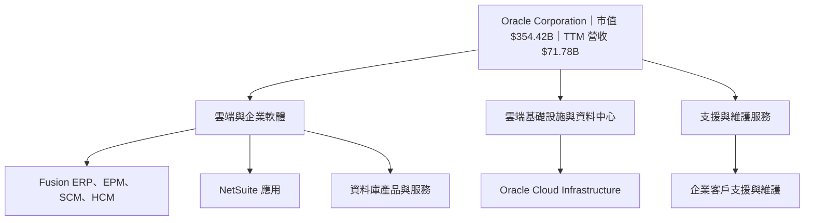
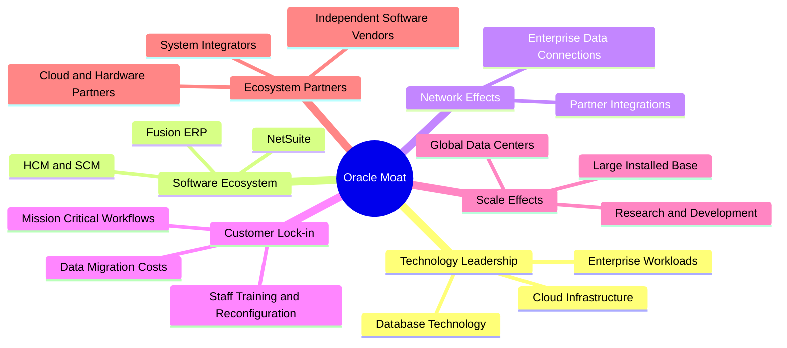
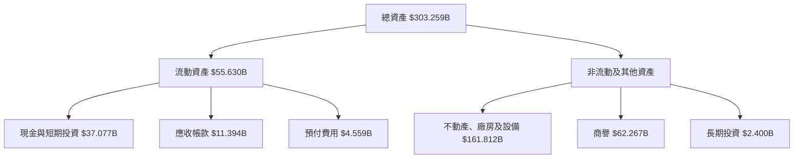
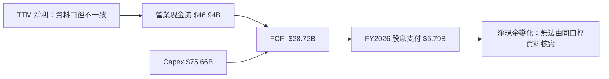
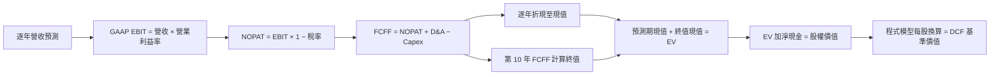
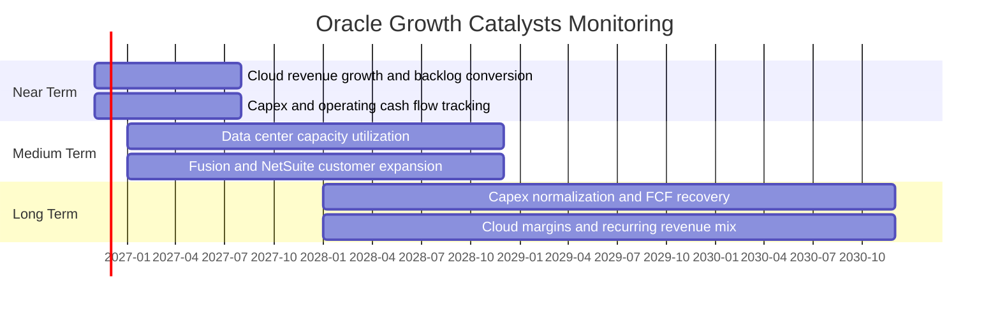
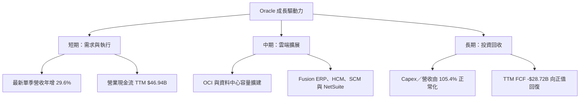
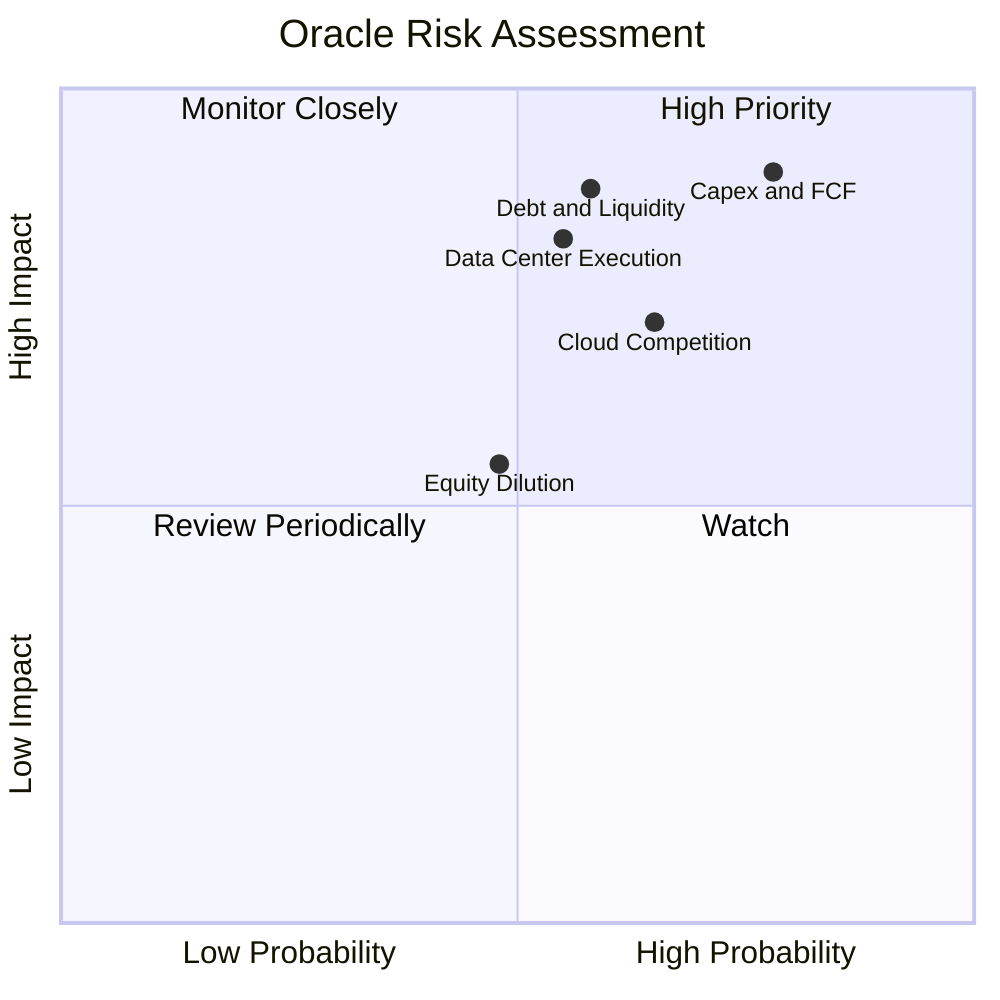
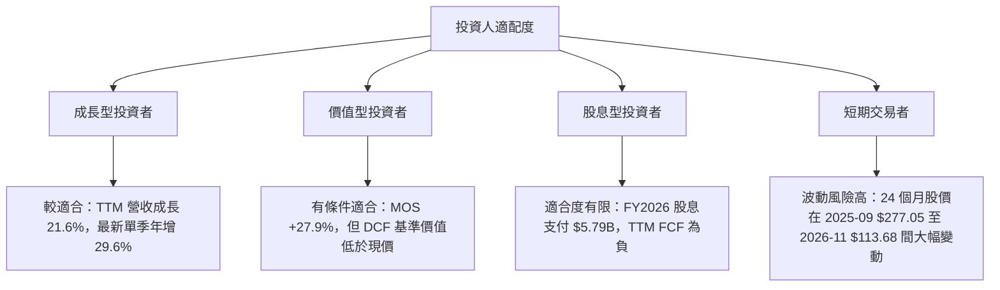

# ORCL 基本面深度分析報告

> **報告日期**：2026-11-24 ｜ **語言**：繁體中文 ｜ **數據來源**：SEC 申報資料 (XBRL)、Yahoo Finance、Finviz、StockAnalysis、Roic.ai ｜ **分析師**：CFA 級機構研究

## 目錄

| # | 章節 | 核心結論 |
|---|------|----------|
| 1 | 執行摘要 | 強烈買入；加權合理價值 $157.65；MOS +27.9% |
| 2 | 公司概覽與商業模式 | 企業資料庫與雲端服務形成客戶鎖定；分部營收占比未提供 |
| 3 | 損益表深度分析 | TTM 營收 $71.78B、年增 21.6%；最新單季年增 29.6% |
| 4 | 資產負債表分析 | 現金及短期投資 $37.08B；債務資料存在來源矛盾，需審慎判讀 |
| 5 | 現金流量深度分析 | TTM FCF −$28.72B，主要因資本支出大幅增加 |
| 6 | 獲利能力與資本效率 | ROIC 61.3% 高於 WACC 9.24%，但 FCF 轉負削弱價值實現 |
| 7 | 相對估值分析 | ORCL 估值低於同業部分倍數及自身五年中位數 |
| 8 | DCF 內在價值評估 | DCF 基準價值 $81.59；模型高度依賴終值及資本支出正常化 |
| 9 | 成長催化劑 | 雲端需求與 AI 資料中心投資可支撐成長，但 TAM 數據未提供 |
| 10 | 風險矩陣 | 資本支出、融資／負債與雲端競爭為主要風險 |
| 11 | 投資建議 | 維持強烈買入；現價低於加權合理價值，須追蹤 FCF 與 Capex |

## 1. 執行摘要

### 1.0 一頁式投資儀表板（Portfolio Manager 30 秒速讀）

| 項目 | 內容 |
|------|------|
| **投資論點（3 句）** | ① TTM 營收 $71.78B、年增 21.6%，最新單季年增 29.6%，顯示需求加速。② TTM ROIC 61.3% 對比 WACC 9.24%，現有業務回報高於資本成本。③ TTM 資本支出 $75.66B 高於營業現金流 $46.94B，導致 FCF −$28.72B，短期估值須承受再投資與融資風險。 |
| **綜合評分** | **7.2/10**（引用 1.1 評分卡） |
| **財務健康** | 🟡 現金及短期投資 $37.08B、流動比率 1.171；但 TTM FCF 為 −$28.72B，且債務資料來源不一致。 |
| **ROIC vs WACC** | **61.3% vs 9.24%**；按提供的 ROIC 指標，創造股東價值。 |
| **FCF 趨勢** | 近年資本支出急升，TTM FCF −$28.72B；FCF Yield **−8.10%**。 |
| **估值** | Forward P/E **10.279587x** ｜ EV/EBITDA **13.974x** ｜ FCF Yield **−8.10%** |
| **DCF 內在價值（基準）** | **$81.59** ｜ 現價相對 DCF 折溢價 **+39.3%**（現價高於 DCF 基準價值） |
| **安全邊際（MOS）** | **+27.9%**＝($157.65 − $113.68) ÷ $157.65；🟢 充足（以 8.8 加權合理價值為基準） |
| **預期報酬（基準情境 12M）** | **+38.7%**（加權合理價值相對現價的上行空間；不是 DCF 基準情境報酬） |
| **關鍵風險（前二）** | ① Capex 持續高於營業現金流、令 FCF 長期為負。② 資料中心擴建回報不及預期，或融資成本／負債惡化。 |
| **評級 + 信心度** | 🟢 **強烈買入** ｜ 信心：中（MOS 達門檻且 ROIC > WACC，但 DCF、負債及 FCF 存在顯著不確定性） |

**評級推導**：加權合理價值 $157.65 高於 2026-11-23 收盤價 $113.68，MOS = ($157.65 − $113.68) ÷ $157.65 = **27.9%**；ROIC 61.3% 高於 WACC 9.24%，因此按規則 20 為**強烈買入**。但 DCF 基準價值僅 $81.59、TTM FCF 為 −$28.72B，顯示相對估值與現金流估值分歧很大，故信心度列為中。

### 1.1 綜合評分卡（全報告唯一）

| 維度 | 評分（1–10） | 主要依據（引用數字與其來源章節） |
|------|--------------|----------------------------------|
| 成長性 | 8.0 | TTM 營收年增 21.6%、最新單季年增 29.6%（第 3 章）；高於 MSFT 18.8%、SAP 13.2%、CRM 10.8% 的最新單季成長。 |
| 獲利能力 | 8.5 | TTM 營業利益率 32.1%、ROIC 61.3% 對比 WACC 9.24%；Piotroski F-Score 4/7（第 6 章）。 |
| 財務健康 | 5.5 | 現金及短期投資 $37.08B、流動比率 1.171，但 TTM FCF −$28.72B；總債務資料有矛盾（第 4、5 章）。 |
| 估值 | 7.5 | MOS +27.9%，Forward P/E 低於同業中位數；但 DCF 基準價值 $81.59 低於現價（第 7、8 章）。 |
| 護城河 | 8.0 | 資料庫、ERP、HCM 等企業工作流程嵌入帶來轉換成本；具體分部營收占比未提供（第 2 章）。 |
| 管理層與資本配置 | 5.5 | FY2026 SBC $4.81B、Capex $55.66B、FCF −$23.69B；擴張投資規模大，回報尚須驗證（第 3、5 章）。 |
| **綜合評分** | **7.2** | 六項算術平均：(8.0 + 8.5 + 5.5 + 7.5 + 8.0 + 5.5) ÷ 6 = **7.2**。 |

### 1.2 五大投資論點 + 三大核心風險

| 類型 | 項目 | 具體依據 | 信心度 |
|------|------|----------|--------|
| 🟢 **投資論點①** | 營收成長加速 | TTM 營收 $71.78B、年增 21.6%；最新單季營收 $19.34B、年增 29.6%。 | 🟢 高 |
| 🟢 **投資論點②** | 高資本回報 | TTM ROIC 61.3%，比 WACC 9.24% 高 52.06 個百分點。 | 🟢 高，但受 ROIC 分母資料限制 |
| 🟢 **投資論點③** | 雲端與企業應用具黏著性 | Fusion ERP、EPM、SCM、HCM 及 NetSuite 深入企業工作流程；客戶轉換涉及資料遷移及流程重整。 | 🟡 中 |
| 🟢 **投資論點④** | 同業相對估值折價 | Forward P/E 10.279587x，低於同業中位數 20.4x；P/E 自身五年中位數 32.1x。 | 🟡 中，倍數口徑可能受股價及 EPS 資料差異影響 |
| 🟢 **投資論點⑤** | 分析師共識仍看好 | 40 位分析師平均目標價 $236.18；此為外部共識，不等於可實現價值。 | 🟡 中 |
| 🟡 **風險①** | Capex 導致自由現金流為負 | TTM Capex $75.66B，營業現金流 $46.94B，FCF −$28.72B、FCF Yield −8.10%。 | 🔴 高衝擊 |
| 🔴 **風險②** | 債務與流動性資訊不一致 | 一處資料列總債務 N/A、淨現金 $37.08B；其他市場資料列總債務 $169.14B、淨債務約 $132.07B。 | 🔴 高 |
| 🟡 **風險③** | EPS 超預期資料缺漏 | 最近四季 EPS 預估值與 surprise 欄位為 NaN，無法確認是否超預期或不及預期。 | 🟡 中 |

### 1.3 快速統計卡片

| 指標 | 公司實際值（期間） | 同業中位數 | 狀態 |
|------|--------------------|------------|------|
| 營收成長（TTM） | **21.6%** | — | 🟢 |
| 營收成長（最新一季年增） | **29.6%** | **13.2%**（MSFT、SAP、CRM 中位數） | 🟢 |
| 毛利率（TTM） | **64.0%** | **73.6%**（MSFT、SAP、CRM 中位數） | 🟡 |
| 營業利益率（TTM） | **32.1%** | — | 🟢 |
| ROIC（TTM） | **61.3%** | — | 🟢 |
| Forward P/E | **10.279587x** | **20.4x** | 🟢 |
| FCF Yield（TTM） | **−8.10%** | — | 🔴 |
| Piotroski F-Score | **4 / 7** | — | 🟡 |

> 同業營收成長中位數為 13.2%：將三家最新單季年增率排序 10.8%、13.2%、18.8%，中位數為 13.2%。毛利率中位數為 73.6%：67.7%、73.6%、77.3% 的中位數為 73.6%。

### 1.4 投資結論

```text
╔══════════════════════════════════════════════════════════════════╗
║                    📊 投資結論摘要                               ║
╠══════════════════════════════════════════════════════════════════╣
║  評級：強烈買入（MOS +27.9%，且 ROIC 61.3% > WACC 9.24%）       ║
║  價格（2026-11-23 收盤）：$113.68                                ║
║  DCF 內在價值（基準）：$81.59（現價溢價 +39.3%）                ║
║  安全邊際 MOS：+27.9%（以加權合理價值為分母）                   ║
║  加權合理價值（8.8）：$157.65                                    ║
║  DCF 情境價值：                                                   ║
║    悲觀情境：$8.46（相對現價 -92.6%）                            ║
║    基準情境：$81.59（相對現價 -28.2%）                           ║
║    樂觀情境：$243.50（相對現價 +114.2%）                         ║
║  綜合評分：7.2/10（引用 1.1）                                    ║
║  適合投資人：能承受高波動、願意追蹤雲端投資回收的成長型長線投資人║
╚══════════════════════════════════════════════════════════════════╝
```

## 2. 公司概覽與商業模式

### 2.1 業務結構與收入來源

可引用資料未提供 Oracle 各業務分部的最新營收與占比，因此不拆造分部金額或百分比。以下圖僅呈現已知公司規模與產品關係，不代表業務占比。



Oracle 的收入模式結合訂閱型 SaaS、資料庫／軟體授權與維護，以及雲端基礎設施服務。分部營收占比與雲端收入拆分未提供，故不能量化各板塊對 21.6% TTM 成長的貢獻。

### 2.2 市場份額

**市場份額數據未提供**，因此不繪製市場份額圖，也不估算市占率。可確認的相對位置是 ORCL 最新單季營收年增 29.6%，高於 MSFT 18.8%、SAP 13.2% 及 CRM 10.8%；但單季成長率不能直接等同市場份額變化。

### 2.3 競爭護城河分析



### 2.4 護城河強度

| 護城河項目 | 強度（強／中／弱） | 證據（引用數字或事實） | 會削弱它的情況 |
|------------|--------------------|------------------------|----------------|
| 技術與產品 | 中至強 | 資料庫及企業應用涵蓋核心營運流程；FY2026 研發支出 $10.27B。 | 雲端原生替代品或開源方案降低差異化。 |
| 軟體生態系統 | 強 | Fusion ERP、EPM、SCM、HCM 與 NetSuite 形成應用組合。 | 客戶將單一套件拆分，轉向最佳單點解決方案。 |
| 網路效應 | 中 | ERP、資料庫與系統整合商生態有助互通；未提供直接網路效應指標。 | 生態夥伴轉向多雲或競品優先。 |
| 客戶鎖定 | 強 | 關鍵資料、流程與客製化整合提高轉換成本；非量化推論。 | 遷移工具成熟、採購轉向模組化或雲端原生。 |
| 規模效應 | 強 | TTM 營收 $71.78B、員工 141,000 人，並有資料中心投資。 | Capex 回報低於資本成本或擴建供給過剩。 |
| 生態夥伴 | 中 | 系統整合、軟體供應商與企業 IT 生態支持導入。 | 夥伴關係集中或合作條件轉弱。 |

1.1 的「護城河」評分 **8.0/10**，理由是企業軟體嵌入與轉換成本高，但各板塊營收占比、客戶留存率及市場份額數據未提供。

## 3. 損益表深度分析

### 3.1 年度收入成長趨勢（近4年）

依年度損益表，收入單位為美元十億。圖中以收入規模呈現，不代表細分業務比例。

```text
╔══════════════════════════════════════════════════════════════════╗
║              Oracle 年度收入趨勢（FY2023-FY2026）                ║
╠══════════════════════════════════════════════════════════════════╣
║  FY2023  $49.95B  ███████████████████             YoY: +6.0%   ║
║  FY2024  $52.96B  ████████████████████            YoY: +6.0%   ║
║  FY2025  $57.40B  ██████████████████████          YoY: +8.4%   ║
║  FY2026  $67.36B  ██████████████████████████      YoY: +17.4%  ║
╠══════════════════════════════════════════════════════════════════╣
║  FY2023-FY2026 累計 CAGR：約 10.5%                               ║
╚══════════════════════════════════════════════════════════════════╝
```

計算：三年 CAGR = \((67.36 ÷ 49.95)^{1/3} − 1\) ≈ **10.5%**。FY2026 成長較 FY2025 加速，與近期雲端需求及基礎設施投資同步；但分部數據不足以拆分雲端與傳統軟體的貢獻。

### 3.2 季度收入趨勢分析

| 季度 | 營收 | QoQ 成長 | YoY 成長 | 備註 |
|------|------|----------|----------|------|
| 2025-11-30 | $16.06B | +13.6% | +14.2% | QoQ 以 2025-08-31 $14.93B 計；YoY 依 StockAnalysis。 |
| 2026-02-28 | $17.19B | +7.1% | +21.7% | QoQ 以 $16.06B 計。 |
| 2026-05-31 | $19.18B | +11.6% | +20.6% | QoQ 以 $17.19B 計。 |
| 2026-08-31 | $19.34B | +0.8% | +29.6% | 最新一季年增率 29.6%，不可標為 TTM 成長。 |

QoQ 算式示例：2026-08-31 QoQ = \((19.34 ÷ 19.18) − 1\) ≈ **0.8%**。最新季度 YoY 明顯高於前幾季，顯示收入增長速度加快；但單季 QoQ 增幅放緩，需觀察是否受季度認列節奏或交付能力限制。

### 3.3 利潤率演變分析

年度毛利率與營業利益率以下以年度損益表的毛利／營業利益除以營收計算；TTM 的核心口徑則採用 SEC／程式計算的 32.1% 營業利益率。

| 利潤率指標 | FY2023 | FY2024 | FY2025 | FY2026 | 趨勢 | 評估 |
|------------|--------|--------|--------|--------|------|------|
| **毛利率** | 72.9% | 71.4% | 70.5% | 65.8% | ↘ FY2026 下滑 | 🟡 |
| **營業利益率** | 27.6% | 30.3% | 31.4% | 33.3% | ↗ 持續改善 | 🟢 |
| **淨利率** | 17.0% | 19.8% | 21.7% | 25.4% | ↗ 上升 | 🟢 |

毛利率與營業利益率走勢分歧：FY2026 毛利率下降約 4.7 個百分點，但營業利益率上升約 1.9 個百分點，可能反映產品組合、雲端基礎設施成本與營業費用控制的不同方向。具體分部成本資料未提供，不能將毛利率下滑歸因於特定產品。營業利益率趨勢改善則代表收入增加後費用增速相對較低；若雲端基礎設施折舊與維運成本繼續攀升，該槓桿可能逆轉。

### 3.4 費用結構分析

**N/A（數據未提供：缺少可完整核對的最新 TTM 成本與費用分項）**。FY2026 有研發支出 $10.27B，但完整營業費用拆分不足以製作不失真的費用結構圓餅圖。

### 3.5 季度 EPS 趨勢與盈餘品質（Quality of Earnings）

| 季度 | EPS 實際值 | EPS 預估 | 超預期／不及預期 | YoY EPS 成長 |
|------|------------|----------|------------------|--------------|
| 2025-11-30 | $2.10 | N/A | 無法判斷 | +90.91% |
| 2026-02-28 | $1.27 | N/A | 無法判斷 | +24.51% |
| 2026-05-31 | $1.45 | N/A | 無法判斷 | +21.91% |
| 2026-08-31 | $1.56 | N/A | 無法判斷 | +54.45% |

EPS estimates 資料為 NaN，因此不能據此宣稱四季均超預期或不及預期。2025-11-30 EPS 高於其餘列示季度，顯示季度間存在波動；未提供足夠的非經常性損益資料，不能判定波動源自一次性項目。

| 盈餘品質項目 | 數值／佔比 | 評估 |
|--------------|-----------|------|
| 股權薪酬 SBC / 營收 | 估計 **6.7%**：TTM SBC 以近四季 $1.13B + $1.20B + $1.33B + $1.16B = $4.82B；$4.82B ÷ $71.78B | 🟡 SBC 會稀釋股東；FY2026 SBC $4.81B，規模不可忽略。 |
| SBC / 營業現金流 | 估計 **10.3%**：$4.82B ÷ $46.94B | 🟡 以營業現金流衡量仍占一成左右。 |
| FCF / 淨利（現金轉換率） | 約 **−153.2%**：TTM FCF −$28.72B ÷ StockAnalysis TTM 淨利 $18.736B | 🔴 現金轉換率為負，主要是 Capex 遠高於營業現金流。 |
| 一次性／非經常性損益 | N/A（資料未提供完整調節項） | 無法判斷一次性項目對 GAAP 盈餘的影響。 |
| 有效稅率異常 | **12.6%**（最近年度有效稅率） | 🟡 偏低稅率提高稅後利潤；未提供稅務調節表，無法判定可持續性。 |
| 資本化支出 vs 費用化 | TTM Capex $75.66B；FY2026 Capex $55.66B | 🟡 資本化使支出先進資產並由未來折舊認列；可能令當期營業利益高於完全費用化口徑，但屬正常會計處理，需追蹤資產利用率。 |

**盈餘品質結論**：GAAP 利潤率與營業現金流為正，且營業現金流高於淨利的 F-Score 測試通過；但 TTM FCF 為 −$28.72B，轉換率為負，現階段會計獲利尚未轉化為扣除投資後的自由現金流。DCF 的 Capex 正常化假設若未實現，估值會顯著下修。

## 4. 資產負債表分析

### 4.1 資產結構分解

依 StockAnalysis 最新列示的 TTM 資產，單位為美元十億。部分項目相加未必等於總資產，圖中只列有來源的項目，不反推缺漏項。



PP&E 由 FY2025 的 $56.667B 增至 TTM $161.812B，與大規模基礎設施擴建相符；其後續回報率與折舊負擔是重要資產負債表觀察點。

### 4.2 流動性與營運資金分析

#### 流動性指標

| 指標 | 數值 | 評估 |
|------|------|------|
| 現金及短期投資 | $37.08B | 🟢 提供流動性緩衝；但不能單獨代表淨現金，因債務數據有矛盾。 |
| 流動比率 | 1.171 | 🟡 流動資產高於流動負債，但緩衝不算寬。 |
| 速動比率 | 1.02 | 🟡 可動用流動資產約略覆蓋短期負債。 |
| 總債務 | N/A（採用 VERIFIED 數據口徑） | 🔴 無法以該口徑核實淨負債。 |

#### 營運資金天數

| 指標 | 最新 TTM | 一年前 TTM | 變化 | 解讀 |
|------|----------|------------|------|------|
| DSO 應收帳款天數 | 58 天 | 55 天 | +3 天 | 收款天數略增；應追蹤是否為付款條件放寬或客戶結構改變。 |
| DIO 存貨天數 | N/A | N/A | N/A | 公司未報列存貨餘額，不補估。 |
| DPO 應付帳款天數 | 156 天 | N/A | N/A | 最新 DPO 偏長，但缺少一年前數據，不能判定趨勢。 |
| CCC 現金轉換週期 | N/A | N/A | N/A | 因 DIO 缺失，按定義不能計算 CCC。 |

### 4.3 債務結構分析

不同資料來源的債務數據不可直接混用。下圖採用品質指標／VERIFIED 數據口徑；括號補充另一來源矛盾。

```text
╔══════════════════════════════════════════════════════════════════╗
║                   Oracle 債務健康診斷                            ║
╠══════════════════════════════════════════════════════════════════╣
║  總債務（VERIFIED）：N/A       無法以該口徑核對                  ║
║  現金及短期投資： $37.08B       資產端現金儲備                    ║
║  淨現金：         $37.08B       按 VERIFIED 數據照錄              ║
║                                                                  ║
║  交叉來源差異：另一市場資料列總債務 $169.14B、淨債務約 $132.07B  ║
║  Debt/EBITDA：    N/A           債務口徑未能核實                  ║
║  Interest Coverage：N/A         利息費用與計息負債明細未提供      ║
╚══════════════════════════════════════════════════════════════════╝
```

**解讀**：市場數據區塊與財務數據區塊對總債務、淨現金結論不一致。估值模型按照 DCF 模型輸入採用淨現金 $37.08B；本報告不以未核實的替代債務數字重建資產負債表。投資決策前應回查最新 10-Q 的短期借款、長期借款與租賃負債明細。

### 4.4 股東權益趨勢

| 財政年度 | 股東權益 |
|----------|----------|
| FY2023 | $1.07B |
| FY2024 | $8.70B |
| FY2025 | $20.45B |
| FY2026 | $42.51B |

```text
FY2023  $1.07B   ▏
FY2024  $8.70B   ████
FY2025  $20.45B  ██████████
FY2026  $42.51B  ████████████████████
```

股東權益上升，但同一期間總資產也大幅擴張至 FY2026 $261.76B，負債為 $218.70B。帳面權益增加不應單獨視為去槓桿證據；仍需配合負債明細與現金流判讀。

## 5. 現金流量深度分析

### 5.1 現金流量瀑布圖

最近四季的營業現金流、Capex 與 FCF 有季度大幅波動；下圖以 TTM 數據展示核心現金流關係，股息採 FY2026 年度數據，因缺少同一 TTM 口徑的完整回購與淨現金變動資料，不畫出不具可比性的後續金額。



### 5.2 FCF 轉換率趨勢

| 財政年度 | 營業現金流 | Capex | FCF | 淨利 | FCF / 淨利 |
|----------|------------|-------|-----|------|------------|
| FY2023 | $17.16B | $8.70B | $8.47B | $8.50B | 99.6% |
| FY2024 | $18.67B | $6.87B | $11.81B | $10.47B | 112.8% |
| FY2025 | $20.82B | $21.21B | −$0.394B | $12.44B | −3.2% |
| FY2026 | $31.98B | $55.66B | −$23.69B | $17.09B | −138.6% |
| TTM 至 2026-08-31 | $46.94B | $75.66B | −$28.72B | $18.736B（StockAnalysis TTM） | −153.2% |

FY2025 起 FCF 轉負，主因 Capex 大幅高於營業現金流；這代表成長投資的現金回收滯後於資本支出。若新建資料中心利用率、雲端合約收入與定價未及時提升，負 FCF 可能延長。

### 5.3 自由現金流趨勢

```text
╔══════════════════════════════════════════════════════════════════╗
║                 Oracle 自由現金流趨勢                            ║
╠══════════════════════════════════════════════════════════════════╣
║  FY2023  +$8.47B   ████████░░░░░░░░░░░░  FCF/淨利：+99.6%      ║
║  FY2024 +$11.81B   ███████████░░░░░░░░░  FCF/淨利：+112.8%     ║
║  FY2025  -$0.394B  ▏                    Capex：$21.21B          ║
║  FY2026 -$23.69B   ◀███████████████████  Capex：$55.66B         ║
║  TTM    -$28.72B   ◀████████████████████ FCF Yield：-8.10%     ║
╚══════════════════════════════════════════════════════════════════╝
```

TTM FCF 定義固定為營業現金流減資本支出：$46.94B − $75.66B = **−$28.72B**。該負值直接降低當前現金收益率，也使估值更依賴未來 Capex 回落與投資回報兌現。

### 5.4 資本配置評估

完整回購金額及可比口徑的 TTM 股息／投資分項未提供，因此不繪製比例圓餅圖。

| 資本配置項目 | 數據 | 評估 |
|--------------|------|------|
| 資本支出 | FY2026 $55.66B；TTM $75.66B | 🟡／🔴 支出快速擴大；應以新增收入、利用率與投資回報檢驗。 |
| 股息支付 | FY2026 $5.79B | 🟡 持續現金分配，但當期 FCF 為負，需由營運現金或融資支持。 |
| 股權薪酬 | FY2026 $4.81B | 🟡 對員工激勵有用，但對股東有稀釋成本。 |
| 股票回購 | N/A（本期回購金額未提供） | 無法評價回購價格是否具增值性。 |
| 留存／其他投資 | N/A | 未提供足夠現金流明細作完整拆分。 |

## 6. 獲利能力與資本效率

### 6.1 ROE／ROA／ROIC 趨勢

同一品質計算口徑目前可用的最新值如下。歷史同口徑序列與行業均值未提供，故不補填比較數字。

| 指標 | 最新值 | 歷史趨勢資料 | 評估 |
|------|--------|--------------|------|
| ROE（品質指標口徑） | 28.3% | N/A（未提供同口徑完整歷史序列） | 🟢 高，但杜邦顯示槓桿倍數 4.54。 |
| ROA | 6.4%（市場資料口徑） | N/A | 🟡 資產增長快於收入時，資產回報受壓。 |
| ROIC（TTM） | 61.3% | N/A（本期依 VERIFIED 口徑） | 🟢 明顯高於 WACC；需留意投入資本分母及債務資料矛盾。 |

### 6.2 ROIC vs WACC 分析（核心價值創造判斷）

```text
╔══════════════════════════════════════════════════════════════════╗
║                ROIC vs WACC 深度分析                            ║
╠══════════════════════════════════════════════════════════════════╣
║  WACC（依資本成本資料）                                          ║
║  ├── 無風險利率（10Y 美債）： 4.92%                              ║
║  ├── 股權風險溢酬 ERP：       5.00%                              ║
║  ├── 原始 Beta：              1.78                               ║
║  ├── 調整後 Beta：            1.52                               ║
║  ├── 股權成本 Ke：            12.51%                             ║
║  ├── 稅前債務成本 Kd：        2.72%                              ║
║  ├── 有效稅率：               12.6%                              ║
║  ├── 股權／債務權重：         67.7%／32.3%                       ║
║  └── WACC：                   9.24%                              ║
║                                                                  ║
║  ROIC（TTM）：              61.3%                                ║
║  EVA 利差：                 61.3% − 9.24% = +52.06 個百分點     ║
║                                                                  ║
║  ROIC 61.3%  ▓▓▓▓▓▓▓▓▓▓▓▓▓▓▓▓▓▓▓▓▓▓▓▓▓▓▓▓▓▓▓▓▓▓▓▓  🟢         ║
║  WACC  9.24% ▓▓▓▓▓▓░░░░░░░░░░░░░░░░░░░░░░░░░░░░░░░             ║
║  結論：依本口徑 ROIC 約為 WACC 的 6.63 倍                       ║
╚══════════════════════════════════════════════════════════════════╝
```

CAPM 計算核對：Beta 使用調整後 1.52；股權成本 = 4.92% + 1.52 × 5.00% = **12.52%**，程式資料列為 **12.51%**，差異為輸入未四捨五入前的精度。稅後債務成本 = 2.72% × (1 − 12.6%) = **2.3773%**。按列示權重計算：67.7% × 12.51% + 32.3% × 2.3773% = **9.24%**（四捨五入）。

**價值判斷**：ROIC 高於 WACC，代表按該口徑公司創造經濟價值；但債務明細矛盾，且目前 TTM FCF 為負。高 ROIC 並不能消除建置成本、未來折舊與融資風險，需以投資回報兌現檢驗。

### 6.3 杜邦三因素分解

| 因素 | 數值（TTM） | 解讀 |
|------|-------------|------|
| 淨利率 | 26.4% | 利潤留存比例高。 |
| 資產週轉率 | 0.24 | 資產基礎相對龐大，與資本密集投資相符。 |
| 權益乘數 | 4.54 | 財務槓桿是 ROE 的重要放大因素。 |
| **ROE** | **28.3%** | 26.4% × 0.24 × 4.54 ≈ 28.3%；主要由淨利率與槓桿共同支撐，並非單靠營運周轉。 |

以上數字照錄品質指標，未重新計算替代 ROE 口徑。

### 6.4 財務體質：Piotroski F-Score

**Piotroski F-Score：4 / 7**。共九項檢查中，兩項因輸入缺失不可判定，剩餘七項計分。

| 測試 | 結果 | 解讀 |
|------|------|------|
| ROA > 0 | ✅ 通過 | TTM 資產回報為正。 |
| 營業現金流 > 0 | ✅ 通過 | TTM 營業現金流 $46.94B。 |
| ROA 高於一年前 | ❌ 未通過 | 盈利相對資產的效率未改善。 |
| 營業現金流 > 淨利（應計品質） | ✅ 通過 | 表示營業現金流對會計淨利有支持。 |
| 長期負債／總資產低於一年前 | — 無法判定 | 缺少可比債務輸入。 |
| 流動比率高於一年前 | ✅ 通過 | 流動性比率有改善。 |
| 稀釋股數未增加 | ❌ 未通過 | 股數增加，SBC 及其他發股可能稀釋股東。 |
| 毛利率高於一年前 | — 無法判定 | 缺少所需同口徑比較輸入。 |
| 資產週轉率高於一年前 | ❌ 未通過 | 擴大資產投入尚未轉化為更高周轉。 |

4/7 反映公司盈利及營業現金流為正，但資產效率、稀釋與部分資產品質指標未全面改善。

## 7. 相對估值分析

### 7.1 同業估值比較表格

同業倍數採 Yahoo Finance 同業倍數資料；ORCL 倍數採市場估值資料。不同數據源可能存在日期與口徑差異，故特別註明。

| 估值指標 | **ORCL** | **MSFT** | **SAP** | **CRM** | ORCL 評估 |
|----------|----------:|---------:|-------:|-------:|-----------|
| **Trailing P/E** | 15.854951x | 25.7x | 24.8x | 17.0x | 🟢 低於三家同業。 |
| **Forward P/E** | 10.279587x | 20.4x | 21.3x | 11.6x | 🟢 低於同業中位數 20.4x。 |
| **P/S Ratio** | 4.9378767x | 10.6x | N/A | 3.5x | 🟡 高於 CRM、低於 MSFT；SAP 因幣別口徑混合而排除。 |
| **EV/EBITDA** | 13.974x | 18.1x | N/A | 14.2x | 🟢 低於可比同業；SAP 不可比。 |
| **最新一季營收 YoY** | 29.6% | 18.8% | 13.2% | 10.8% | 🟢 ORCL 增速最高。 |
| **毛利率 TTM** | 64.0% | 67.7% | 73.6% | 77.3% | 🟡 低於三家對手。 |

**估值判讀**：ORCL 的 P/E 與 Forward P/E 折價，部分可由更高的資本密集度、負 FCF 與 Capex 不確定性解釋。成長率領先同業是支持溢價的因素，但其毛利率較低且再投資規模大，低倍數並非單純錯價的證明。

### 7.2 歷史估值區間分析

```text
╔══════════════════════════════════════════════════════════════════╗
║               ORCL 自身五年估值區間（TTM）                      ║
╠══════════════════════════════════════════════════════════════════╣
║  P/E        19.0x ├────── 現值 17.8x ──────┤ 52.3x             ║
║             五年中位數 32.1x｜目前百分位 0%                     ║
║                                                                  ║
║  P/S         4.6x ├─ 現值 4.8x ───────────┤ 11.1x             ║
║             五年中位數 6.2x｜目前百分位 10%                    ║
║                                                                  ║
║  EV/EBITDA  12.6x ├ 現值 9.4x ───────────┤ 28.9x             ║
║             五年中位數 17.9x｜目前百分位 0%                    ║
╚══════════════════════════════════════════════════════════════════╝
```

歷史估值資料顯示 P/E、P/S、EV/EBITDA 均處於各自五年區間的低端。此折價可能代表市場降低對高成長／高投資期間的估值，也可能反映資料源計算口徑與不同日期的價格差異；應與 FCF 轉負及 DCF 情境並看。

### 7.3 情境價值（Bear / Base / Bull，照抄 DCF MODEL 的 Scenarios）

| 情境 | 第 1 年營收成長 | 期末營業利潤率 | WACC | 每股價值 | 相對現價 | 機率 | 會發生的條件 |
|------|----------------|----------------|------|----------|----------|------|--------------|
| 🔴 悲觀 | 10.8% | 26.0% | 10.24% | $8.46 | −92.6% | 25% | 雲端需求放緩、擴建資產利用率偏低、營業利潤率下滑且資本成本上升。 |
| 🟡 基準 | 21.6% | 30.6% | 9.24% | $81.59 | −28.2% | 50% | 首年延續 TTM 成長，之後成長率逐年減速，長期利潤率降至 30.6%。 |
| 🟢 樂觀 | 32.4% | 33.6% | 8.24% | $243.50 | +114.2% | 25% | 新雲端容量快速售出、需求成長超越當前基準，且營業槓桿維持。 |

情境為程式模型輸出，不調整情境值或機率。悲觀與樂觀結果差距極大，反映模型對成長、長期利潤率與 WACC 的敏感度很高。

### 7.4 相對估值隱含價格區間

```text
╔══════════════════════════════════════════════════════════════════╗
║            相對估值與共識目標價：每股美元                       ║
╠══════════════════════════════════════════════════════════════════╣
║  $81.59       $113.68          $180.53       $225.05  $236.18  ║
║  DCF 基準       現價           EV/EBITDA       P/E      共識    ║
║                                                                  ║
║  Forward P/E：$225.05 = 同業中位數 20.4x × Forward EPS $11.06  ║
║  EV/EBITDA：  $180.53 = 同業中位數 16.2x × TTM EBITDA，並加回淨現金║
║  共識目標價： $236.18 = 40 位分析師平均目標價                  ║
╚══════════════════════════════════════════════════════════════════╝
```

- **同業 Forward P/E**：同業中位數 20.4x（MSFT、SAP、CRM）× Forward EPS $11.06 = $225.05。
- **同業 EV/EBITDA**：同業中位數 16.2x（MSFT、CRM）× TTM EBITDA，再加回淨現金 = $180.53。
- **分析師共識**：40 位分析師平均目標價 $236.18。
- 以上方法皆為指定估值方法資料中的程式結果；不以 ORCL 自身目前倍數替代同業中位數倍數。

## 8. DCF 內在價值評估（Discounted Cash Flow）

### 8.0 估值推理鏈（Thinking Logic）

#### Step 1 — 價值由哪些變數決定？

Oracle 的估值主要由既有資料庫及企業應用的盈利底盤、雲端基礎設施成長，以及支撐該成長所需的 Capex 決定；分部營收占比未提供，不能將 TTM $71.78B 拆成各業務占比。模型中最主導價值的變數是**Capex 從 TTM 105.4% 營收比率下降至預測期末 14.4%**；若資本支出不能按假設正常化，FCF 及估值將低於基準。

#### Step 2 — 模型選擇

| 決策點 | 本報告採用 | 理由（含數字） | 曾考慮但否決 | 否決理由 |
|--------|-----------|----------------|--------------|----------|
| 現金流定義 | FCFF | 對應 WACC 折現並導出 EV；模型給定 FCFF 定義。 | FCFE | 資本結構及債務資料存在口徑矛盾。 |
| 預測期 N | 10 年 | DCF 模型固定為 10 年，容許高 Capex 逐步回落。 | 5 年 | 難以呈現模型所設 Capex 正常化路徑；不擅改程式年期。 |
| 終值方法 | Gordon Growth | DCF 模型以第 10 年 FCFF 及 g = 3.0% 計算終值。 | 退出倍數 | DCF 模型未提供退出倍數終值，不能另建模型。 |
| EBIT 基礎 | GAAP EBIT | 模型明示使用 GAAP EBIT。 | 非 GAAP EBIT | 避免將 SBC 加回後再以股數或現金流重複處理。 |

#### Step 3 — 關鍵假設推導鏈

- **營收成長路徑**：錨點＝Revenue growth (TTM vs prior TTM) 21.6% → 調整＝年 1 採用 21.6%，之後線性下降至第 10 年 3.0%，反映高基期與長期成熟 → **採用值＝FY+1 21.6%、FY+10 3.0%** → 曾考慮全年都維持 21.6%，但未採用，因模型假設成長逐年衰減；不能把初年成長直接外推十年。
- **期末營業利潤率**：錨點＝TTM 營業利益率 32.1% → 調整＝依模型向近五個財政年度（含 TTM）中位數收斂 → **採用第 10 年 30.6%** → 曾考慮維持 32.1%，但模型採用均值回歸，未假設利潤率永久高於歷史中位數。
- **永續成長率 g**：錨點＝長期成熟企業終值需低於 WACC；區塊未提供宏觀 GDP／通膨數值 → 調整＝採用模型值並保持低於 WACC 9.24% → **採用 3.0%** → 不採用 4.0% 以上作基準，避免終值分母過度縮小。
- **預測期 N**：錨點＝模型已定 10 年，且 Capex 由超高水準逐步正常化 → 調整＝不更改程式預測期 → **採用 10 年** → 不改用短期估值期，避免破壞給定 DCF 模型。
- **Capex／營收**：錨點＝TTM Capex／營收約 105.4% → 調整＝模型假設由年 1 的 105.4% 線性下降，至年 10 的 14.4%，即約 D&A 的 1.1 倍 → **採用年 1 105.4%、年 10 14.4%** → 不採用維持 105.4%，因可能把建置高峰外推；也不自行採用更低比例，因會高估 FCF。
- **GAAP EBIT、SBC 與稀釋**：錨點＝FY2026 SBC $4.81B，TTM SBC 約 $4.82B → 調整＝GAAP EBIT 已將 SBC 當作費用處理，模型不再另扣 SBC，也不再增加年稀釋 → **採用 GAAP EBIT、固定股數、年稀釋率 0%** → 不採非 GAAP 加回 SBC，因模型沒有相應 SBC 現金扣回或稀釋路徑。
- **終值方法**：錨點＝模型使用第 10 年 FCFF $57.44B → 調整＝使用 Gordon Growth 並按第 10 年折現 → **採用 Gordon Growth** → 退出倍數法沒有模型輸入，不自行設定倍數。
- **WACC**：錨點＝資本成本資料列 WACC 9.24% → 調整＝不另算替代 WACC，維持程式折現率 → **採用 9.24%** → 不採用更低折現率，因會放大高終值權重下的價值。

有效稅率 12.6%、D&A／營收 13.1% 直接採用模型值；營運資金未建模，模型 FCFF 不扣 ΔWC。

#### Step 4 — 最脆弱環節

最脆弱的假設是 Capex 自年 1 的營收 105.4% 快速下降至年 10 的 14.4%；若資料中心投資需求或建設成本使正常化慢於模型，FCF 將更低，且基準價值已低於現價的缺口可能擴大。

#### Step 5 — 計算路徑圖

依此模型定義，營運資金不建模，FCFF 為 NOPAT + D&A − Capex。



### 8.1 模型假設總表（Model Inputs）

| 假設項目 | 採用值 | 依據／來源 | 敏感度 |
|----------|--------|-------------|--------|
| 預測期長度 **N** | 10 年 | DCF MODEL；固定預測期 | 🟡 中 |
| 營收成長 | FY+1 21.6% 線性淡化至 FY+10 3.0% | TTM vs prior TTM 21.6%；長期成熟假設為程式模型輸入 | 🔴 高 |
| 營業利潤率 | FY+1 32.1% → FY+10 30.6% | TTM 32.1%，向近五年中位數收斂 | 🔴 高 |
| 有效稅率 | 12.6% | 最新年度有效稅率；程式模型輸入 | 🟢 低 |
| Capex／營收 | FY+1 105.4% → FY+10 14.4% | TTM Capex／營收起點；期末採約 1.1×D&A | 🔴 高 |
| D&A／營收 | 13.1% | TTM D&A／營收；模型固定 | 🟢 低 |
| 營運資金變動 | 不建模 | DCF MODEL 明示 Working capital is not modelled | 🟡 中 |
| EBIT 基礎 | GAAP EBIT | DCF MODEL | 🟡 中 |
| SBC 處理 | GAAP 費用中已扣除，不另扣 | DCF MODEL 組合 A | 🟡 中 |
| 年稀釋率 | 0%（固定股數） | 組合 A；SBC 影響已反映在 GAAP 費用 | 🟡 中 |
| 永續成長率 g | 3.0% | DCF MODEL；低於 WACC 9.24% | 🔴 高 |
| 終值方法 | Gordon Growth | DCF MODEL 明示公式 | 🔴 高 |
| WACC | 9.24% | Cost of capital 區塊 | 🔴 高 |

FCFF 定義為 **FCFF = NOPAT + D&A − Capex**，不含 ΔWC。**本模型採用 (A)：GAAP EBIT + 固定股數，故 SBC 影響已計入一次**；8.3 不另扣 SBC，也不把股數逐年放大。

### 8.2 折現率推導（WACC）

```text
╔══════════════════════════════════════════════════════════════════╗
║                    WACC 推導（折現率）                           ║
╠══════════════════════════════════════════════════════════════════╣
║  股權成本 Ke（CAPM）：                                           ║
║  ├── 無風險利率 Rf（10Y 美債）：      4.92%                      ║
║  ├── 市場風險溢酬 ERP：               5.00%                      ║
║  ├── 原始 Beta（Yahoo Finance）：     1.78                       ║
║  ├── 調整後 Beta：                    1.52                       ║
║  ├── Beta 調整：                      ⅔×1.78 + ⅓×1 = 1.52       ║
║  ├── 額外規模／國別溢酬：             0.00%（未另加）             ║
║  └── Ke：4.92% + 1.52×5.00% = 12.52%；程式採 12.51%             ║
║                                                                  ║
║  債務成本 Kd：                                                    ║
║  ├── 稅前 Kd：                        2.72%                      ║
║  ├── 有效稅率：                       12.6%                      ║
║  └── 稅後 Kd：2.72%×(1−12.6%) = 2.3773%                         ║
║                                                                  ║
║  資本結構（程式提供權重）：                                       ║
║  ├── 股權權重 E：                     67.7%                      ║
║  ├── 債務權重 D：                     32.3%                      ║
║  └── WACC：67.7%×12.51% + 32.3%×2.3773% = 9.24%                ║
╚══════════════════════════════════════════════════════════════════╝
```

逐步演算：

1. **Ke（CAPM）** = 4.92% + 1.52 × 5.00% = 12.52%；程式以未四捨五入輸入列示 **12.51%**。
2. **稅前 Kd** = 程式提供 **2.72%**；利息費用與平均計息負債的詳細金額未提供，因此不反推分子或分母。
3. **稅後 Kd** = 2.72% × (1 − 12.6%) = **2.3773%**。
4. **權重** = 股權 **67.7%**、債務 **32.3%**；67.7% + 32.3% = **100.0%**。市值與計息負債金額口徑未提供可供獨立重建的同一期細項，採用程式給定權重。
5. **WACC** = 67.7% × 12.51% + 32.3% × 2.3773% = 8.4693% + 0.7678% = **9.2371% ≈ 9.24%**。

無風險利率日期與 ERP 假設的外部來源日期未提供；此處依 Cost of capital 區塊照錄。原始 Beta 1.78 高，故使用調整後 Beta 1.52；未另加規模或國別溢酬。第 6.2 節及本節均採 WACC **9.24%**。

### 8.3 逐年自由現金流預測（基準情境）

單位：美元十億；折現因子保留三位小數。以下數字逐項照錄 DCF MODEL，不重新建立或替換模型。

| 年度 | FY+1 | FY+2 | FY+3 | FY+4 | FY+5 | FY+6 | FY+7 | FY+8 | FY+9 | FY+10 |
|------|------:|------:|------:|------:|------:|------:|------:|------:|------:|-------:|
| 營收 | 87.29 | 104.36 | 122.60 | 141.50 | 160.38 | 178.47 | 194.90 | 208.81 | 219.39 | 225.97 |
| 營收 YoY | 21.6% | 19.6% | 17.5% | 15.4% | 13.3% | 11.3% | 9.2% | 7.1% | 5.1% | 3.0% |
| 營業利潤率 | 32.1% | 32.0% | 31.8% | 31.6% | 31.4% | 31.3% | 31.1% | 30.9% | 30.8% | 30.6% |
| EBIT（GAAP） | 28.04 | 33.34 | 38.97 | 44.73 | 50.43 | 55.81 | 60.61 | 64.58 | 67.49 | 69.13 |
| − 稅 | (3.54) | (4.21) | (4.92) | (5.64) | (6.36) | (7.04) | (7.65) | (8.15) | (8.51) | (8.72) |
| = NOPAT | 24.50 | 29.14 | 34.05 | 39.09 | 44.06 | 48.77 | 52.97 | 56.44 | 58.97 | 60.40 |
| + D&A | 11.47 | 13.71 | 16.10 | 18.59 | 21.07 | 23.44 | 25.60 | 27.43 | 28.82 | 29.68 |
| − Capex | (92.02) | (99.46) | (104.45) | (106.25) | (104.22) | (97.93) | (87.25) | (72.38) | (53.87) | (32.65) |
| **= FCFF** | **−56.05** | **−56.61** | **−54.30** | **−48.58** | **−39.09** | **−25.73** | **−8.69** | **11.49** | **33.92** | **57.44** |
| 折現因子 | 0.915 | 0.838 | 0.767 | 0.702 | 0.643 | 0.589 | 0.539 | 0.493 | 0.452 | 0.413 |
| **FCFF 現值 PV** | **−51.31** | **−47.44** | **−41.66** | **−34.12** | **−25.13** | **−15.14** | **−4.68** | **5.67** | **15.31** | **23.74** |

預測期現值逐項加總：

\[
-51.31-47.44-41.66-34.12-25.13-15.14-4.68+5.67+15.31+23.74
= -174.76\text{B}
\]

**FY+1 逐步演算**（模型列值保留兩位小數，故部分中間算式與未四捨五入模型值可能有尾差）：

1. **營收** = $71.78B × (1 + 21.6%) = **$87.29B**。
2. **EBIT** = $87.29B × 32.1% = **$28.04B**。
3. **稅** = $28.04B × 12.6% = **$3.54B**。
4. **NOPAT** = $28.04B − $3.54B = **$24.50B**。
5. **D&A** = $87.29B × 13.1% = **$11.47B**。
6. **Capex** = $87.29B × 105.4% = **$92.02B**。
7. **ΔWC** = **未建模**；不在 FCFF 公式中另作調整。
8. **FCFF** = $24.50B + $11.47B − $92.02B = **−$56.05B**。
9. **折現因子及 PV**：1 ÷ (1 + 9.24%)¹ = **0.915**；模型列示 PV **−$51.31B**。以表面四捨五入數字計算 −$56.05B × 0.915 = −$51.29B，與程式列值相差約 $0.02B，屬於未四捨五入底層值造成的尾差；本報告保留模型輸出。

**合理性自檢**

- 預測 FCF CAGR：FY+1 至 FY+10 由 −$56.05B 轉為 +$57.44B，起點為負值，CAGR **不具數學意義**；歷史 FCF 由 FY2023 $8.47B 至 FY2026 −$23.69B，亦無正值 CAGR 可比。核心差異來自模型假設 Capex 大幅正常化。
- FY+10 FCFF 利潤率 = $57.44B ÷ $225.97B = **25.4%**；目前 TTM FCF 利潤率 = −$28.72B ÷ $71.78B = **−40.0%**；同業最佳 FCFF 利潤率資料未提供，不能比較。
- FY+1 至 FY+7 FCFF 均為負，且 PV 合計為負；對估值的影響是預測期現金流合計 −$174.76B，需要終值現值 $392.06B 才令企業價值轉正。

```text
╔══════════════════════════════════════════════════════════════════╗
║            自由現金流：歷史實際 vs 模型預測                      ║
╠══════════════════════════════════════════════════════════════════╣
║  FY2024(實)  +$11.81B  ███████████░░░░░░░░░  歷史值             ║
║  FY2025(實)   -$0.394B ▏                     歷史值             ║
║  FY2026(實)  -$23.69B  ◀███████████████████  歷史值             ║
║  FY+1 (預)   -$56.05B  ◀████████████████████ 模型預測           ║
║  FY+10(預)   +$57.44B  ████████████████████  模型預測           ║
╠══════════════════════════════════════════════════════════════════╣
║  預測 FCF 由負轉正主要依賴 Capex／營收由 105.4% 降至 14.4%       ║
╚══════════════════════════════════════════════════════════════════╝
```

### 8.4 終值計算（Terminal Value）

**適用性檢查**：WACC 9.24% vs g 3.0% → WACC > g？✅

| 方法 | 計算式 | 終值 TV | TV 現值 | 佔總 EV 比重 |
|------|--------|---------|---------|--------------|
| Gordon Growth | $57.44B × (1 + 3.0%) ÷ (9.24% − 3.0%) | $948.52B | $392.06B | 180.4% |
| 退出倍數法 | DCF MODEL 未提供退出倍數 | N/A | N/A | N/A |

逐步演算：

1. **FY+10 FCFF** = **$57.44B**。
2. **分子** = $57.44B × (1 + 3.0%) = **$59.16B**（依未四捨五入模型輸出計算後，模型終值列示 $948.52B）。
3. **分母** = 9.24% − 3.0% = **6.24%**；$57.44B × 1.03 ÷ 6.24% = **$948.52B**（模型值）。
4. **PV(TV)** = 模型終值 $948.52B × FY+10 折現因子 0.413（以未四捨五入因子）= **$392.06B**。
5. **終值佔比** = $392.06B ÷ $217.30B = **180.4%**。

終值現值超過企業價值，主因預測期 PV 合計為負。**本估值高度依賴終值假設，短期現金流貢獻有限**。退出倍數法所需倍數及終值計算未提供，因此不補造數字。

### 8.5 企業價值 → 每股內在價值（Bridge）

```text
╔══════════════════════════════════════════════════════════════════╗
║              企業價值 → 每股內在價值 橋接表                      ║
╠══════════════════════════════════════════════════════════════════╣
║  預測期 FCF 現值合計             -$174.76B                       ║
║  終值現值 PV(TV)                 +$392.06B                       ║
║  ─────────────────────────────────────────────                  ║
║  = 企業價值 EV                    $217.30B                       ║
║  + 淨現金（依模型輸入）           +$37.08B                        ║
║  = 模型列示股權價值                $254.37B                       ║
║  股數／市值換算                   依程式公式                      ║
║  ─────────────────────────────────────────────                  ║
║  ★ 每股內在價值（DCF 基準）       $81.59                          ║
║    2026-11-23 收盤價              $113.68                         ║
║    折溢價（現價÷DCF價值−1）       +39.3%（溢價）                  ║
╚══════════════════════════════════════════════════════════════════╝
```

逐步演算：

1. **EV** = 預測期 PV 合計 −$174.76B + PV(TV) $392.06B = **$217.30B**。
2. **股權價值**：模型列示 **$254.37B**。以顯示數字直接相加為 $217.30B + $37.08B = **$254.38B**，與模型列示相差 $0.01B，屬四捨五入尾差；遵照模型原值採 $254.37B，不自行替換。
3. **每股內在價值** = 模型公式「股權價值 × 價格 ÷ 市值」；$254.37B × $113.68 ÷ $354.42B = **$81.59**。
4. **折溢價** = $113.68 ÷ $81.59 − 1 = **+39.3%**，表示現價相對 DCF 基準價值溢價。模型所列 −28.2% 是內在價值相對現價的上行空間，二者分母不同。
5. **本節不計算 MOS**：MOS 只在 8.8 以加權合理價值為分母計算。

股權價值橋接採模型淨現金 $37.08B。由於模型每股換算公式以價格與市值作比例換算，不另行用另一套股數／負債資料重建每股價值；債務矛盾與股數精確值是模型可稽核性的限制。

### 8.6 敏感性分析（WACC × 永續成長率）

以下矩陣每股價值完全照錄 DCF MODEL；括號為相對 2026-11-23 現價 $113.68 的上行空間。

| g（列）／WACC（欄） | 7.24% | 8.24% | **9.24%（基準）** | 10.24% | 11.24% |
|-----------|------:|------:|-------------------:|-------:|-------:|
| **2.0%** | $132.94（+16.9%） | $91.69（−19.3%） | $63.16（−44.4%） | $42.63（−62.5%） | $27.41（−75.9%） |
| **2.5%** | $152.73（+34.4%） | $104.31（−8.2%） | $71.69（−36.9%） | $48.64（−57.2%） | $31.79（−72.0%） |
| **3.0%** | $177.20（+56.0%） | $119.35（+5.0%） | **$81.59（−28.2%）** | $55.48（−51.2%） | $36.70（−67.7%） |
| **3.5%** | $208.22（+83.2%） | $137.56（+21.0%） | $93.21（−18.0%） | $63.34（−44.3%） | $42.24（−62.8%） |
| **4.0%** | $248.83（+118.9%） | $160.07（+40.8%） | $107.06（−5.8%） | $72.46（−36.3%） | $48.55（−57.3%） |

**逐步演算示範限制**：程式只提供敏感度矩陣結果，未提供各替代 WACC 下未四捨五入的年度折現因子及逐年 PV；依要求不自行重建第二個 DCF 模型。矩陣基準格為 $81.59，與 8.5 一致；表內所有格均滿足 WACC > g。

**三情境 DCF（程式輸出）**

| 情境 | 年 1 營收成長 | 期末營業利潤率 | WACC | 每股內在價值 | 相對現價 | 主觀機率 |
|------|--------------:|----------------:|-----:|--------------:|----------:|---------:|
| 🔴 悲觀 | 10.8% | 26.0% | 10.24% | $8.46 | −92.6% | 25% |
| 🟡 基準 | 21.6% | 30.6% | 9.24% | $81.59 | −28.2% | 50% |
| 🟢 樂觀 | 32.4% | 33.6% | 8.24% | $243.50 | +114.2% | 25% |
| **機率加權** | — | — | — | **$103.79** | **−8.7%** | **100%** |

情境計算的完整逐年營收、FCFF 及 TV 路徑未提供，故不臆造每個情境的中間值。機率加權算式：$8.46 × 25% + $81.59 × 50% + $243.50 × 25% = **$103.785 ≈ $103.79**。

**敏感度結論**

- g 每 +1 個百分點，基準 WACC 下由 g=3.0% 的 $81.59 上升至 g=4.0% 的 $107.06：+$25.47，+$25.47 ÷ $81.59 = **+31.2%**。
- WACC 每 +1 個百分點，由 9.24% 的 $81.59 降至 10.24% 的 $55.48：−$26.11，−$26.11 ÷ $81.59 = **−32.0%**。
- 期末營業利潤率每 +1 個百分點：程式未提供此項單變數敏感度，**N/A**；不另建模型估算。
- 目前已量化的 g 與 WACC 敏感度都很高；與 8.0 所指出的 Capex 正常化主導價值並不矛盾，因矩陣固定了營運現金流路徑，只改變終值參數。

### 8.7 反推 DCF（Reverse DCF：市場在預期什麼）

固定項目依基準模型：WACC 9.24%、稅率 12.6%、預測期 10 年、D&A／營收 13.1%、GAAP EBIT、工作資本不建模、固定股數。Capex 路徑依基準情境固定；模型未提供可供反推的詳細中間路徑。

| 求解的變數（一次一個） | 其餘變數設定 | 市場隱含值（令 DCF = 現價） | 公司歷史實際 | 判斷 |
|------------------------|--------------|------------------------------|--------------|------|
| 年 1 營收成長 | 其餘基準值固定 | **27.8%** | TTM vs prior TTM 21.6%；FY2026 年收入成長 17.35% | 🔴 高於當前成長錨點，須持續加速。 |
| 固定營業利潤率 | 其餘基準值固定 | **35.4%** | TTM 32.1%；基準路徑 32.1% → 30.6% | 🔴 高於目前及基準路徑。 |
| 永續成長率 g | 未計算 | 未計算 | — | N/A（模型未提供求解值）。 |
| 預測期 N | 未計算 | 未計算 | — | N/A（模型未提供求解值）。 |

模型給定的反推結果顯示，若維持其他基準假設，市場現價要求年 1 營收成長約 27.8%，或固定營業利潤率約 35.4%。但沒有提供反推試算軌跡或逐年現金流底層精度，故不臆造收斂表格。這表示現價對經營成長／利潤率的要求高於基準 DCF；相對估值之所以仍顯示折價，是因其依賴同業倍數及分析師共識。

### 8.8 估值三角驗證與安全邊際

| 估值方法 | 隱含每股價值 | 上行空間（÷現價） | 權重 | 說明 |
|----------|--------------:|-------------------:|------:|------|
| DCF（基準） | $81.59 | −28.2% | 40% | 10 年 FCFF、WACC 9.24%、g 3.0%。 |
| 同業 Forward P/E | $225.05 | +98.0% | 25% | 同業中位數 20.4x × Forward EPS $11.06。 |
| 同業 EV/EBITDA | $180.53 | +58.8% | 25% | 同業中位數 16.2x × TTM EBITDA，再加回淨現金。 |
| 分析師共識目標價 | $236.18 | +107.8% | 10% | 40 位分析師平均目標價。 |
| **加權合理價值** | **$157.65** | **+38.7%** | **100%** | 依盈利型公司固定權重加權。 |

加權計算：

\[
\$81.59\times40\%+\$225.05\times25\%+\$180.53\times25\%+\$236.18\times10\%
\]

\[
=\$32.636+\$56.2625+\$45.1325+\$23.618
=\$157.649\approx\mathbf{\$157.65}
\]

權重總和 = 40% + 25% + 25% + 10% = **100%**。公司類型為盈利型；相對估值方法與分析師共識均按既定權重納入，沒有因主觀判斷剔除方法。

```text
╔══════════════════════════════════════════════════════════════════╗
║                  估值區間與安全邊際                              ║
╠══════════════════════════════════════════════════════════════════╣
║  $8.46 ─────── $81.59 ─────── $113.68 ─────── [$157.65] ───── $243.50║
║  悲觀 DCF       基準 DCF          現價          加權合理值       樂觀 DCF║
║                                                                  ║
║  安全邊際 MOS = ($157.65 − $113.68) ÷ $157.65 = +27.9%          ║
║  MOS 評估：🟢 ≥25% 充足                                         ║
║  上行空間 = ($157.65 − $113.68) ÷ $113.68 = +38.7%              ║
║                                                                  ║
║  建議買入區間：$100.25 – $141.89                                 ║
║  合理持有區間：$141.89 – $157.65                                 ║
║  減碼考慮區間：高於 $243.50（樂觀情境價值）                      ║
╚══════════════════════════════════════════════════════════════════╝
```

買入區間上限 $141.89 以加權合理價值的 90% 計算：$157.65 × 90% = $141.885 ≈ $141.89，對應至少 10% MOS。下限採 52 週低點 $100.25 作為觀察範圍下界，不代表股價必然止跌。評級為強烈買入，買入區間上限高於現價 $113.68，符合規則。

> 🔎 **程式複算（Python，依本節各項自動重算）**
>
> 加權合理價值 = $81.59 × 40% + $225.05 × 25% + $180.53 × 25% + $236.18 × 10% = **$157.65**（權重合計 100%）
>
> 以價格 $113.68 計：MOS = **+27.9%**，上行空間 = **+38.7%**
>
> ✅ 與本節所寫數值一致。

### 8.9 DCF 模型的局限與失效條件

- **終值依賴度**：終值現值佔企業價值 **180.4%**，預測期 FCF PV 為負 −$174.76B；估值高度依賴第 10 年以後的現金流及 Capex 正常化。
- **最脆弱假設**：一是 Capex／營收由 FY+1 105.4% 降至 FY+10 14.4%；二是長期營業利益率可維持約 30.6%。若投資需求延長、利潤率落至 26.0%，程式悲觀情境價值為 **$8.46**。
- **適用性**：當前 TTM FCF 為負，且未來七年基準 FCFF 仍為負，傳統 DCF 可靠度低於穩態現金流公司。相對估值可作交叉檢查；資料中心投資回報亦應追蹤利用率與新增收入。
- **與第 10 章風險的連結**：建設成本上升會推高 Capex；雲端需求下滑會壓低營收成長；競爭或定價壓力會降低營業利益率；融資成本增加會推高 WACC。以上均會壓低 DCF 價值。

### 8.10 複算檢核表（Audit Trail）

| # | 檢核項目 | 檢查方式 | 結果 |
|---|----------|----------|------|
| 1 | 所有高／中敏感度輸入有推導 | 逐項比對 8.0 與 8.1；債務成本及反推底層資料缺漏處已揭露 | ✅（受資料缺漏限制） |
| 2 | 每個假設都有來歷 | 8.1 逐項列出模型值及來源 | ✅ |
| 3 | WACC 五步算式與權重 | 權重 67.7% + 32.3% = 100%；WACC 依未四捨五入值約 9.24% | ✅ |
| 4 | Kd 分母與權重 D 同範圍 | 程式未提供利息費用、平均計息負債及債務權重金額的細項，不能獨立核對 | ❌（缺細項，已降低信心度） |
| 5 | WACC 與第 6.2 節一致 | 兩節均為 9.24% | ✅ |
| 6 | 逐年年度數等於 N | FY+1 至 FY+10，共 10 年；沒有省略 | ✅ |
| 7 | FY+1 代表年度公式 | 按表列值重算；顯示精度下 PV 有約 $0.02B 尾差 | ✅（保留模型原值並揭露） |
| 8 | 預測期 PV 加總 | 十年顯示 PV 相加 = −$174.76B | ✅ |
| 9 | WACC > g | 9.24% > 3.0% | ✅ |
| 10 | 終值以 FY+N 現金流折現 N 期 | 使用 FY+10 FCFF $57.44B、十年折現因子 | ✅ |
| 11 | EV 至每股橋接 | EV $217.30B；模型股權價值與顯示數字相差 $0.01B；每股照錄 $81.59 | ✅（尾差已披露） |
| 12 | SBC 組合合法 | GAAP EBIT、不另扣 SBC、固定股數／稀釋率 0% | ✅ |
| 13 | 敏感度基準格 | 基準格 $81.59 = 8.5 DCF 基準價值 | ✅ |
| 14 | 敏感度矩陣有效性 | 最低 WACC 7.24% 高於最高 g 4.0% | ✅ |
| 15 | 三情境機率加總 | 25% + 50% + 25% = 100%；加權值 $103.79 | ✅ |
| 16 | 反推每列只放開一項變數 | 模型只給年 1 成長率及固定利潤率解；未提供試算軌跡 | ❌（無法獨立復現，已揭露） |
| 17 | MOS 與折溢價基準 | MOS 用 $157.65；折溢價用 DCF $81.59 | ✅ |
| 18 | 報告輸出至第 11 章 | 已完整輸出 | ✅ |
| 19 | 加權合理價值總和 | 各方法價值乘固定權重 = $157.649 ≈ $157.65 | ✅ |
| 20 | 評級符合規則 20 | MOS +27.9%、ROIC 61.3% > WACC 9.24%；強烈買入 | ✅ |

資料缺漏或模型底層未四捨五入輸入無法完全復現之處已列明，未另建模型替代程式結果。

## 9. 成長催化劑

### 9.1 催化劑時間軸

以下為需監測的業務催化因素與觀察期間，不代表公司已公布特定財測或交付日期。



### 9.2 TAM 市場規模分析

**N/A（TAM 數據未提供）**。Oracle TTM 營收 $71.78B、TTM 成長 21.6%，最新單季營收年增 29.6%，顯示成長空間仍有擴大，但缺少可引用的市場 TAM 金額與年份，不能計算滲透率。

### 9.3 成長驅動力結構圖



短期成長由收入增速與雲端需求驗證；中期需看新增容量是否轉為已簽約收入；長期價值取決於 Capex 能否降至模型假設且產生持續正 FCF。

## 10. 風險矩陣

### 10.1 風險評分矩陣

下圖位置為分析師定性估計，非公司公布的統計機率；資料未提供可量化的歷史事件頻率。



### 10.2 風險清單詳細分析

風險機率及風險評分屬分析師定性估計，財務衝擊方向依已知數據判斷；沒有可靠資料時不假裝為精確預測。

| # | 風險項目 | 發生機率 | 財務衝擊 | 風險評分 | 緩解措施 |
|---|----------|----------|----------|----------|----------|
| 1 | 🔴 **Capex 高企、FCF 長期為負** | 高（估計 60–75%） | TTM FCF −$28.72B；若 Capex 仍高於 OCF，外部融資與估值折價增加 | 🔴 9/10 | 每季比較 Capex、OCF、FCF 與雲端收入成長；要求新增容量轉化為收入。 |
| 2 | 🔴 **債務／流動性資訊與融資風險** | 中（估計 40–60%） | 已知數據口徑一方為淨現金 $37.08B，另一方列總債務 $169.14B、淨債務約 $132.07B | 🔴 8/10 | 以 10-Q 核對短期債務、長期債務、租賃負債、利息支出及到期表。 |
| 3 | 🟡 **雲端競爭與定價壓力** | 中高（估計 50–70%） | 毛利率 TTM 64.0%，低於 MSFT 67.7%、SAP 73.6%、CRM 77.3%；若價格競爭加劇將壓縮利潤 | 🟠 7/10 | 追蹤雲端收入成長、毛利率、續約、客戶新增與資源利用率。 |
| 4 | 🟡 **資料中心交付與利用率不及預期** | 中（估計 40–60%） | PP&E TTM $161.812B；Capex 大額投入若閒置，折舊與維運費用將拖累回報 | 🟠 7/10 | 比較新增容量、已簽約需求、雲端營收及營業利潤率。 |
| 5 | 🟡 **SBC 與股數稀釋** | 中（估計 40–60%） | FY2026 SBC $4.81B；Piotroski 稀釋股數測試未通過 | 🟡 5/10 | 每季追蹤稀釋股數、SBC／營收與回購成本。 |

## 11. 投資建議

### 11.1 最終評級與評分

MOS 為 +27.9%，高於強烈買入門檻 25%，且 ROIC 61.3% 高於 WACC 9.24%；因此評級為**強烈買入**，未作一級調整。綜合評分 **7.2/10**，引用 1.1 六項分數：成長性 8.0、獲利能力 8.5、財務健康 5.5、估值 7.5、護城河 8.0、管理層與資本配置 5.5。

### 11.2 合理價值與隱含報酬率

| 估值項目 | 每股價值 | 相對現價 | 機率／權重 | 解讀 |
|----------|---------:|----------:|-----------:|------|
| 加權合理價值（8.8） | **$157.65** | **+38.7%** | 權重 100% | MOS +27.9%；用於投資評級。 |
| 🔴 悲觀 DCF | $8.46 | −92.6% | 25% | Capex 回報、成長與利潤率均偏弱。 |
| 🟡 基準 DCF | $81.59 | −28.2% | 50% | DCF 基準價值低於現價。 |
| 🟢 樂觀 DCF | $243.50 | +114.2% | 25% | 成長高於基準、長期利潤率改善、WACC 降低。 |
| DCF 機率加權 | $103.79 | −8.7% | 100% | 僅作情境參考；8.8 固定加權估值使用 DCF 基準值。 |

### 11.3 買入時機與觸發因素

```text
╔══════════════════════════════════════════════════════════════════╗
║                  ✅ 買入觸發因素 Checklist                      ║
╠══════════════════════════════════════════════════════════════════╣
║  目前評估：現價 $113.68 低於加權合理價值 $157.65                 ║
║                                                                  ║
║  立即買入觸發條件（需持續核對）：                                ║
║  ✅ 最新單季營收年增維持在 20% 以上                              ║
║  ✅ TTM ROIC 維持高於 WACC 9.24%                                 ║
║  ✅ Capex 增長開始放緩，營業現金流能逐步覆蓋資本支出             ║
║                                                                  ║
║  加碼觸發條件（出現以下任一）：                                  ║
║  ☐ FCF 連續兩季改善，且 Capex／營收呈下降趨勢                    ║
║  ☐ 雲端收入成長加速，同時營業利益率維持在 30% 以上               ║
║  ☐ 股價回落至 $100.25 附近且營運基本面未惡化                     ║
║                                                                  ║
║  減碼／重新評估條件（出現以下任一）：                            ║
║  ☐ 最新單季營收年增連續兩季低於 10%                              ║
║  ☐ TTM FCF 持續惡化且 Capex／營收未按預期回落                    ║
║  ☐ ROIC 跌破 WACC 9.24%，或負債數據確認顯著高於現金儲備           ║
╚══════════════════════════════════════════════════════════════════╝
```

### 11.4 投資人適配度分析



此圖不另設評分或星等。成長型投資人較能接受雲端投資與營收波動；價值型投資人應優先看實際 FCF；股息投資人需留意負 FCF 下的派息可持續性。

### 11.5 每季財報監控清單（Quarterly Watch List）

| 監控指標 | 現況基準 | 觸發加碼 | 觸發減碼／重新評估 |
|----------|----------|----------|--------------------|
| 營收成長 | TTM +21.6%；最新單季 YoY +29.6% | 最新單季 YoY 維持 ≥20% | 連續兩季低於 10% |
| 營業利益率 | TTM 32.1%；最新單季 34.8% | 維持 ≥32% | 連續兩季低於 30% |
| Capex | TTM $75.66B；Capex／營收約 105.4% | Capex／營收連續下降且 OCF 增長 | Capex 繼續上升而收入成長下降 |
| FCF | TTM −$28.72B | 連續兩季改善並朝正值收斂 | FCF 進一步惡化且無明確容量利用改善 |
| 營業現金流 | TTM $46.94B | 維持增長並逐步覆蓋 Capex | OCF 下滑而 Capex 維持高位 |
| SBC 與稀釋股數 | FY2026 SBC $4.81B；F-Score 稀釋測試未通過 | SBC／營收下降且稀釋股數穩定 | 稀釋加速或 SBC／營收升高 |
| 雲端容量利用／合約轉換 | 量化資料未提供 | 管理層揭露利用率及合約收入加速 | 擴建但收入、利用率未同步提升 |
| 債務與利息 | 財務來源口徑有矛盾 | 10-Q 核實淨現金或可控到期結構 | 核實後淨負債大幅增加、利息保障能力惡化 |
| 管理層財測 | 可用財測數據未提供 | 財測上調且現金流改善 | 財測下修或資本需求再上修 |

### 11.6 反面論證：什麼會證明論點錯誤（What Would Change My Mind）

```text
╔══════════════════════════════════════════════════════════════════╗
║              ⚠️ 論點失效條件（Disconfirming Evidence）           ║
╠══════════════════════════════════════════════════════════════════╣
║  本投資論點在下列情況成立時應重新檢視或退出：                    ║
║  ☐ 最新單季營收年增連續兩季低於 10%                              ║
║  ☐ TTM 營業利益率跌破 30%，且無法由產品組合或一次性成本解釋      ║
║  ☐ Capex／營收未從約 105.4% 高位下降，FCF 連續惡化               ║
║  ☐ TTM FCF 未改善，或營業現金流跌破 Capex 並擴大缺口             ║
║  ☐ ROIC 跌破 WACC 9.24%                                          ║
║  ☐ 最新 10-Q 證實淨負債顯著高於現金，且再融資成本升高             ║
║  ☐ 雲端擴建後收入與容量利用率未能同步提升                         ║
╚══════════════════════════════════════════════════════════════════╝
```

若上述條件出現，將推翻「高成長投資最終能轉化為更高自由現金流」的核心假設；尤其若 Capex 長期維持高位、ROIC 跌至 WACC 以下，強烈買入評級應重新檢視。

> **免責聲明**：本報告為 AI 自動生成，僅供研究參考，不構成投資建議。投資有風險，入市需謹慎。

---

## 資料與來源

| 項目 | 內容 |
|------|------|
| 價格 | 113.68 USD，2026-11-23 收盤（Yahoo Finance 日線） |
| 財務報表 | SEC 10-Q filed 2026-09-11，最新季度 2026-08-31（FY2027 Q1） |
| 有回應的資料來源 | SEC 申報資料 (XBRL)、Yahoo Finance、Finviz、StockAnalysis、Roic.ai |
| 由程式計算 | TTM 數字、WACC、DCF 模型、估值方法與權重、加權合理價值、MOS、評級門檻、F-Score、杜邦分解、營運資金天數、綜合評分 |
| 撰寫模型 | openai / gpt-6-luna |

> 本區塊由產生報告的程式依實際取得的資料填寫，非模型撰寫。「由程式計算」的數字不是模型的估計；其餘判斷（評分、情境、策略）是模型的分析。
