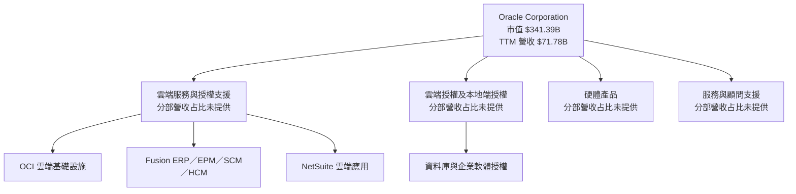
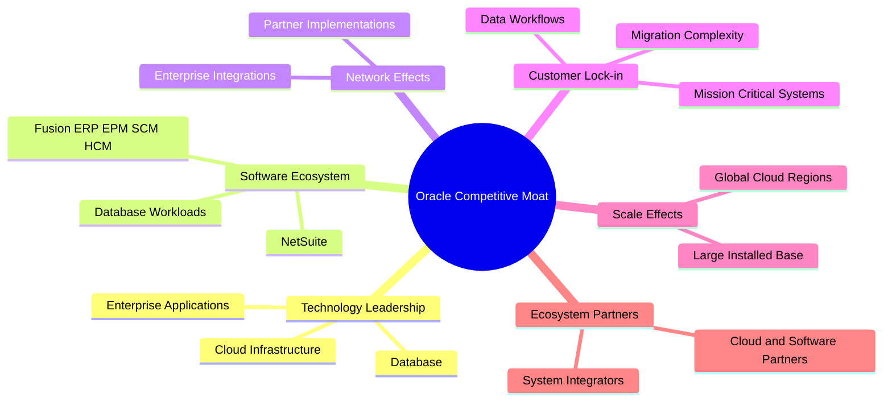
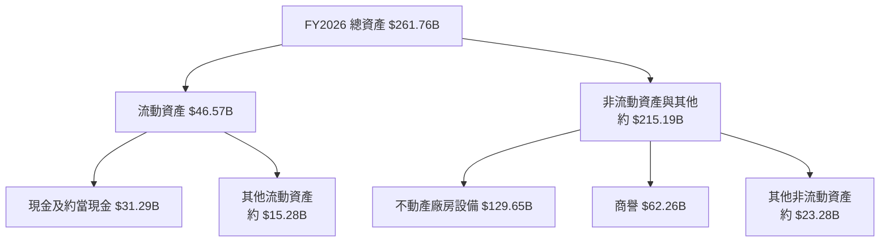
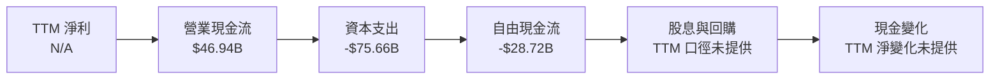
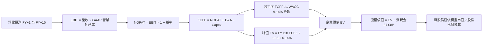
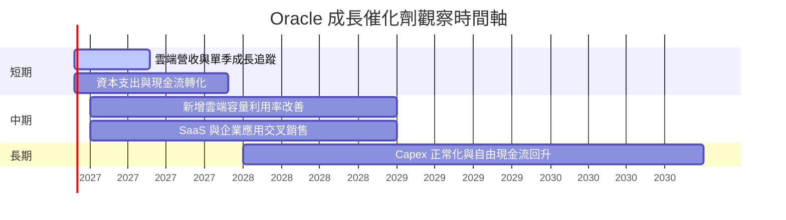
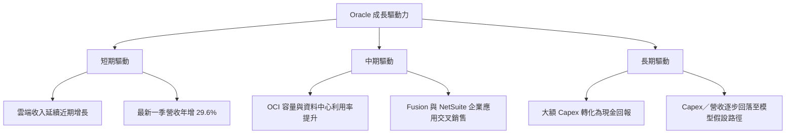
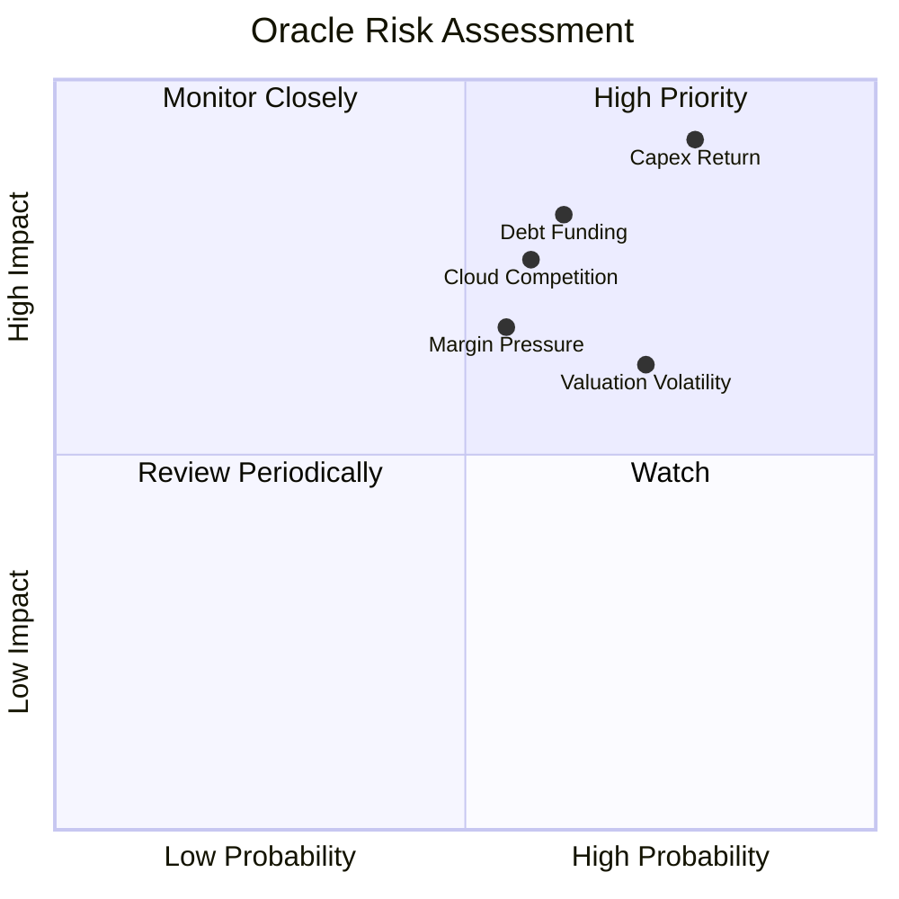
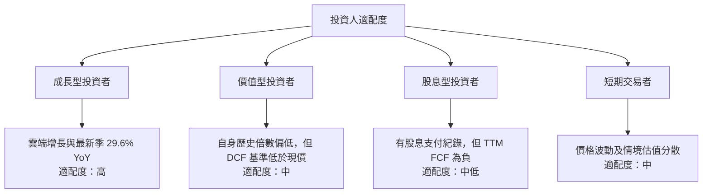

# ORCL 基本面深度分析報告
> **報告日期**：2026-11-25 ｜ **語言**：繁體中文 ｜ **數據來源**：SEC 申報資料 (XBRL)、Yahoo Finance、Finviz、StockAnalysis、Roic.ai ｜ **分析師**：CFA 級機構研究

## 目錄

| # | 章節 | 核心結論 |
|---|------|----------|
| 1 | 執行摘要 | 強烈買入；加權合理價值 $160.03；MOS +31.6% |
| 2 | 公司概覽與商業模式 | 企業軟體及雲端基礎設施具客戶鎖定；分部營收未提供 |
| 3 | 損益表深度分析 | TTM 營收 $71.78B、成長 21.6%；最新一季年增 29.6% |
| 4 | 資產負債表分析 | 現金及短期投資 $37.08B；總債務依核心口徑為 N/A |
| 5 | 現金流量深度分析 | TTM FCF −$28.72B，主要受高額資本支出拖累 |
| 6 | 獲利能力與資本效率 | ROIC 61.3% 高於 WACC 9.14%，但資本密集度升高 |
| 7 | 相對估值分析 | ORCL 估值低於多數自身歷史區間；同業估值分歧大 |
| 8 | DCF 內在價值評估 | 基準 DCF $84.52；加權合理價值 $160.03 |
| 9 | 成長催化劑 | 雲端與 AI 基建需求可能延續成長；TAM 數據未提供 |
| 10 | 風險矩陣 | 首要風險為資本支出回報、債務與估值假設 |
| 11 | 投資建議 | 依 MOS 評級為強烈買入；須嚴格追蹤 Capex 與 FCF |

---

## 1. 執行摘要

截至 **2026-11-24 收盤價 $109.50**，Oracle 的 TTM 營收為 **$71.78B、年增 21.6%**，最新一季營收年增 **29.6%**，TTM 營業利益率 **32.1%**，ROIC **61.3%**，高於 **9.14% WACC**。但同期營業現金流 **$46.94B**、資本支出 **$75.66B**，使 TTM FCF 降至 **−$28.72B**。估值模型給出的 DCF 基準價為 **$84.52**，而 DCF、同業估值及分析師共識加權後合理價值為 **$160.03**；MOS 為 **+31.6%**。依規則 20，MOS ≥25% 且 ROIC > WACC，評級為 **強烈買入**；未作質化調整。主要矛盾是高增長及高 ROIC 尚未轉化為正自由現金流，估值結論對資本支出回落與終值假設高度敏感。

### 1.0 一頁式投資儀表板

| 項目 | 內容 |
|------|------|
| **投資論點（3 句）** | ① TTM 營收成長 21.6%、最新一季年增 29.6%，需求動能仍強。② TTM ROIC 61.3% 對比 WACC 9.14%，目前帳面資本回報顯著高於資金成本。③ TTM Capex $75.66B 高於 OCF $46.94B，FCF −$28.72B，投資回收是估值能否兌現的關鍵。 |
| **綜合評分** | **7.1/10**（引用 1.1 評分卡） |
| **財務健康** | 🟡 現金及短期投資 $37.08B、流動比率 1.171；總債務核心數據 N/A，另有來源口徑差異 |
| **ROIC vs WACC** | **61.3% vs 9.14%**（表面上創造價值；需留意資本投入擴張） |
| **FCF 趨勢** | 明顯受 Capex 拖累；TTM FCF Yield **−8.41%** |
| **估值** | Forward P/E **9.9016075x** ｜ EV/EBITDA（TTM）**13.607x** ｜ FCF Yield **−8.41%** |
| **DCF 內在價值（基準）** | **$84.52** ｜ 相對 DCF 折價/溢價：現價溢價 **+29.6%** |
| **安全邊際（MOS）** | **+31.6%＝($160.03 − $109.50) ÷ $160.03**；🟢 充足 |
| **預期報酬（基準情境 12M）** | **−22.8%**（DCF 基準情境 $84.52 相對現價；非加權估值預測） |
| **關鍵風險（前二）** | Capex 長期高於 OCF、FCF 深度為負；槓桿及市場對 AI 基建回報的預期 |
| **評級 + 信心度** | 🟢 **強烈買入** ｜ 信心：中（估值方法分歧及 DCF 終值依賴度高） |

> MOS 以第 8.8 節加權合理價值為基準；DCF 折溢價則以第 8.5 節 DCF 基準價為基準，兩者分母不同。

### 1.1 綜合評分卡

| 維度 | 評分（1–10） | 主要依據（引用數字與其來源章節） |
|------|--------------|----------------------------------|
| 成長性 | 8.5 | TTM 營收年增 21.6%、最新一季年增 29.6%（第 3 章） |
| 獲利能力 | 8.0 | TTM 營業利益率 32.1%；ROIC 61.3% 高於 WACC 9.14%；F-Score 4/7（第 6 章） |
| 財務健康 | 5.5 | 現金及短期投資 $37.08B、流動比率 1.171，但 FCF −$28.72B 且債務數據口徑不一致（第 4、5 章） |
| 估值 | 7.0 | MOS +31.6%；ORCL P/E 17.2x，低於自身五年中位數 32.1x；DCF 基準價低於現價（第 7、8 章） |
| 護城河 | 8.0 | ERP、資料庫與雲端服務形成整合及轉換成本；TTM 營收 $71.78B，但分部與客戶留存數據未提供（第 2 章） |
| 管理層與資本配置 | 6.0 | FY2026 Capex $55.66B、TTM Capex $75.66B，投入擴張但稀釋股數測試未通過（第 5、6 章） |
| **綜合評分** | **7.2** | 六項算術平均：(8.5 + 8.0 + 5.5 + 7.0 + 8.0 + 6.0) ÷ 6 = **7.2** |

### 1.2 五大投資論點 + 三大核心風險

| 類型 | 項目 | 具體依據 | 信心度 |
|------|------|----------|--------|
| 🟢 **投資論點①** | 雲端與企業服務需求推動成長 | TTM 營收 $71.78B、年增 21.6%；最新一季營收年增 29.6% | 🟢 高 |
| 🟢 **投資論點②** | 資本回報高於資金成本 | ROIC 61.3% 對比 WACC 9.14%；差距 52.16 個百分點 | 🟢 中高 |
| 🟢 **投資論點③** | 核心營業利潤率維持高位 | TTM 營業利益率 32.1%，最新一季 34.8% | 🟢 中高 |
| 🟢 **投資論點④** | 自身歷史估值已大幅回落 | P/E 17.2x，低於五年中位數 32.1x；EV/EBITDA 9.0x，低於中位數 17.9x | 🟢 中 |
| 🟢 **投資論點⑤** | 現金部位增加 | 現金及短期投資 $37.08B；較 FY2025 年末 $11.203B 高 | 🟡 中 |
| 🟡 **風險①** | AI／雲端資本支出變現不及預期 | TTM Capex $75.66B、FCF −$28.72B；投入資本若不能迅速轉成收入，估值與現金流均承壓 | 🔴 高衝擊 |
| 🔴 **風險②** | 資產負債與債務資料口徑不一致 | 核心欄位總債務 N/A；其他市場資料列示總債務 $169.14B、淨負債 $132.07B | 🔴 高衝擊 |
| 🟡 **風險③** | DCF 終值依賴高 | 終值現值佔企業價值 177.3%；短期預測 FCF 現值合計為負 | 🔴 高衝擊 |

### 1.3 快速統計卡片

| 指標 | 公司實際值（期間） | 同業中位數 | 狀態 |
|------|--------------------|------------|------|
| 營收成長（TTM） | **21.6%** | — | 🟢 |
| 營收成長（最新一季年增） | **29.6%** | **13.2%**（MSFT、SAP、CRM 三者中位數） | 🟢 |
| 毛利率（TTM） | **64.0%** | **73.6%**（MSFT、SAP、CRM 中位數） | 🟡 |
| 營業利益率（TTM） | **32.1%** | — | 🟢 |
| ROIC（TTM） | **61.3%** | — | 🟢 |
| Forward P/E | **9.9016075x** | **20.5x**（同業中位數） | 🟢 |
| FCF Yield（TTM） | **−8.41%** | — | 🔴 |
| Piotroski F-Score | **4 / 7** | — | 🟡 |

### 1.4 投資結論

```text
╔══════════════════════════════════════════════════════════════════╗
║                    📊 投資結論摘要                               ║
╠══════════════════════════════════════════════════════════════════╣
║  評級：強烈買入（MOS +31.6%，ROIC 61.3% > WACC 9.14%）           ║
║  價格（2026-11-24 收盤）：$109.50                                ║
║  DCF 內在價值（基準）：$84.52（現價溢價 +29.6%）                 ║
║  安全邊際 MOS：+31.6%（以加權合理價值 $160.03 為基準）           ║
║  加權合理價值（8.8）：$160.03                                    ║
║  DCF 情境價值：                                                   ║
║    悲觀情境：$9.47（−91.3%）                                     ║
║    基準情境：$84.52（−22.8%）                                    ║
║    樂觀情境：$251.17（+129.4%）                                  ║
║  綜合評分：7.2/10（引用 1.1）                                    ║
║  適合投資人：可承受波動、重視企業雲端成長且投資期間較長者        ║
╚══════════════════════════════════════════════════════════════════╝
```

---

## 2. 公司概覽與商業模式

### 2.1 業務結構與收入來源

Oracle 向全球企業提供資料庫、企業應用軟體、雲端基礎設施及技術支援。現有資料沒有分部營收及各業務佔比，因此不臆測業務金額或百分比。



Oracle 的收入組合同時包含雲端訂閱、授權、支援與服務，訂閱及支援通常較有持續性，但目前缺少各板塊收入、遞延收入與雲端訂閱細分數據，無法量化收入組合轉型速度。

### 2.2 市場份額

市場份額數據未提供，故不以圖表或比例推估。Oracle 的 TTM 營收為 $71.78B，最新一季營收年增 29.6%；同業 MSFT、SAP、CRM 最新季度營收年增分別為 18.8%、13.2%、10.8%，反映 Oracle 的近期增速較快，但不能單憑增速推導市場份額。

### 2.3 競爭護城河分析



### 2.4 護城河強度

| 護城河項目 | 強度（強／中／弱） | 證據（引用數字或事實） | 會削弱它的情況 |
|------------|--------------------|------------------------|----------------|
| 技術與產品 | 強 | 資料庫、ERP、HCM、SCM 與雲端基礎設施產品線並存；TTM 營收 $71.78B | 雲端架構快速演進，產品性能或成本落後 |
| 軟體生態系統 | 強 | Fusion、NetSuite、資料庫與企業流程整合，可降低多系統切換誘因 | 客戶改採多雲、開源或模組化替代方案 |
| 客戶鎖定 | 強 | 核心資料庫及 ERP 系統牽涉資料遷移、營運流程與人員訓練 | 轉換工具成熟、合約續約議價壓力上升 |
| 網路效應 | 中 | 顧問、系統整合及企業軟體相容性形成間接網絡；缺少可量化網絡指標 | 競爭平台建立更大的開發者與夥伴生態 |
| 規模效應 | 中至強 | TTM 營收 $71.78B；雲端建置需大量資本與全球營運 | 高額 Capex 未能帶來相應利用率及毛利 |
| 生態夥伴 | 中 | 企業系統整合商與顧問可協助部署；夥伴收入或數量未提供 | 夥伴轉向 AWS、Azure、Google Cloud 或 SAP |

1.1 評分卡的護城河評分 **8.0/10**，主要基於企業核心系統的遷移成本、產品整合及大型營收基礎；因缺少客戶留存、續約率與分部成長數據，評分不取更高。

---

## 3. 損益表深度分析

### 3.1 年度收入成長趨勢（近4年）

年度營收採公司年度損益表數據；年度 YoY 為以前一年度營收計算，金額四捨五入至 $0.01B。

```text
╔══════════════════════════════════════════════════════════════════╗
║             Oracle 年度收入趨勢（FY2023–FY2026）                 ║
╠══════════════════════════════════════════════════════════════════╣
║  FY2023  $49.95B  ███████████████░░░░░░░░░░░░░  YoY：+6.0% 🟡   ║
║  FY2024  $52.96B  ████████████████░░░░░░░░░░░░  YoY：+6.0% 🟡   ║
║  FY2025  $57.40B  █████████████████░░░░░░░░░░░  YoY：+8.4% 🟢   ║
║  FY2026  $67.36B  ████████████████████░░░░░░░░  YoY：+17.4% 🟢  ║
║                                                                  ║
║  FY2023–FY2026 營收 CAGR：約 10.5%                                ║
╚══════════════════════════════════════════════════════════════════╝
```

FY2026 營收年增加速至 17.4%，而 TTM 增速進一步達 21.6%。這與近期雲端服務及基礎設施需求加速相符，但可用資料沒有分部收入，不能把全部增量歸因於單一產品。

### 3.2 季度收入趨勢分析

| 季度 | 營收（$B） | QoQ 成長 | YoY 成長 | 備註 |
|------|-----------:|---------:|---------:|------|
| 2025-11-30 | 16.06 | — | 14.22% | YoY 取季度資料 |
| 2026-02-28 | 17.19 | +7.05% | 21.66% | QoQ = 17.19 ÷ 16.06 − 1 |
| 2026-05-31 | 19.18 | +11.60% | 20.63% | QoQ = 19.18 ÷ 17.19 − 1 |
| 2026-08-31 | 19.34 | +0.84% | 29.6% | 最新一季單季年增率；不得與 TTM 成長率混用 |

最新季營收 QoQ 增幅放緩至 0.84%，但因比較基期和季度認列節奏會影響單季比較，單季 QoQ 不能直接視為需求反轉。最新一季 YoY 仍達 29.6%，為更清晰的年度比較訊號。

### 3.3 利潤率演變分析

| 利潤率指標 | FY2023 | FY2024 | FY2025 | FY2026 | 趨勢 | 評估 |
|------------|--------:|--------:|--------:|--------:|------|------|
| **毛利率** | 72.9% | 71.4% | 70.5% | 65.8% | 近期下行 | 🟡 |
| **營業利益率** | 27.6% | 30.3% | 31.4% | 33.3% | 上升 | 🟢 |
| **淨利率** | 17.0% | 19.8% | 21.7% | 25.4% | 上升 | 🟢 |

*年度毛利率＝年度毛利 ÷ 年度營收；營業利益率＝年度營業利益 ÷ 年度營收；淨利率＝年度淨利 ÷ 年度營收，依年度損益表計算。與 TTM 官方口徑不同者，不替代 VERIFIED FIGURES。*

FY2026 毛利率下降而營業利益率上升，可能反映雲端基礎設施成本及產品組合改變，同時營運費用控制改善；缺少各業務板塊毛利數據，無法精確分辨產品組合、折舊及成本效率各自的影響。TTM 營業利益率依核心口徑為 32.1%，最新一季為 34.8%，顯示近期營運槓桿表現仍具韌性。

### 3.4 費用結構分析

費用明細不足以可靠拆分營業成本、研發、銷售與管理費用各自佔營收比重，故不繪製比例圓餅圖。已知 FY2026 研發費用為 **$10.27B**，約為該年度營收 $67.36B 的 **15.3%**（$10.27B ÷ $67.36B）；研發投入支持產品與雲端能力，但短期會限制費用槓桿。

### 3.5 季度 EPS 趨勢與盈餘品質（Quality of Earnings）

Earnings History 的四季 EPS 預估與實際值均為 NaN，因此不能判定「超預期／不及預期」。StockAnalysis 列示各季 EPS 實際值及年增率，可分析增長趨勢，但不等同市場預期差。

| 季度 | EPS 實際值 | EPS YoY | 超預期／不及預期 |
|------|-----------:|--------:|----------------|
| 2025-11-30 | $2.10 | +90.91% | N/A（估計與驚喜值缺資料） |
| 2026-02-28 | $1.27 | +24.51% | N/A（估計與驚喜值缺資料） |
| 2026-05-31 | $1.45 | +21.91% | N/A（估計與驚喜值缺資料） |
| 2026-08-31 | $1.56 | +54.45% | N/A（估計與驚喜值缺資料） |

| 盈餘品質項目 | 數值/佔比 | 評估 |
|--------------|-----------|------|
| 股權薪酬 SBC / 營收 | FY2026：$4.81B ÷ $67.36B = **7.1%** | 🟡 具稀釋成本；規模不低，股東應追蹤股數變化 |
| SBC / 營業現金流 | FY2026：$4.81B ÷ $31.98B = **15.0%** | 🟡 SBC 是非現金費用，但代表股權成本 |
| FCF / 淨利（現金轉換率） | TTM：−$28.72B ÷ TTM 淨利 N/A = **N/A** | 🔴 淨利口徑未在核心數據提供；年度 FCF 已轉負 |
| 一次性/非經常性損益 | N/A（缺少調節明細） | 無法確認季 EPS 增長是否受一次性項目影響 |
| 有效稅率異常 | **12.6%**（最新年度有效稅率） | 🟡 低於美國法定稅率；估值沿用提供的稅率，需觀察稅項是否正常化 |
| 資本化支出 vs 費用化 | TTM Capex **$75.66B**；資本化支出明顯增加 | 🟡 Capex 增加會推高未來折舊；資產化不等於沒有經濟成本 |

**盈餘品質結論：**會計營業獲利仍具規模，但現金轉換受到大額資本支出壓抑。TTM OCF 為正且營業現金流高於淨利的測試通過，但 FCF 為負，說明當前自由現金盈餘含金量偏弱。GAAP 盈餘未必被高估，然而若市場只以 EPS 衡量而忽視基建投資與 SBC，可能高估可分配給股東的現金。

---

## 4. 資產負債表分析

### 4.1 資產結構分解

最新可用資產負債表為 FY2026 年末，總資產 **$261.76B**；StockAnalysis 的 TTM 資產數據為 $303.259B，期間不同。下圖使用 FY2026 年末的已列示項目，其細項不必然涵蓋全部資產。



*「其他」為總額減已列示項目計算值，並非財報單一科目；非流動項目亦為總資產扣除流動資產的差額。*

### 4.2 流動性與營運資金分析

| 指標 | 最新值 | 歷史值 | 評估 |
|------|-------:|-------:|------|
| 流動比率 | **1.171** | FY2026 年末：46.57 ÷ 41.76 ≈ 1.12 | 🟡 短期資產略高於流動負債 |
| 速動比率 | **1.02** | — | 🟡 仍有一定短期流動性，但緩衝有限 |
| 現金及短期投資 | **$37.08B** | FY2025 年末 $11.203B | 🟢 現金水位提升 |
| 總債務 | **N/A**（核心資本成本資料） | 其他市場資料列示 $169.14B | 🟡 來源口徑需核對 |

**營運資金天數（照錄品質指標）：**

| 指標 | 最新 TTM | 一年前 TTM | 變化 | 解讀 |
|------|----------|------------|------|------|
| DSO 應收帳款天數 | 58 天 | 55 天 | +3 天 | 收款週期略延長；應追蹤是否因大型合約或付款條款改變 |
| DIO 存貨天數 | N/A | N/A | N/A | 公司未報告可用存貨餘額，不推估 |
| DPO 應付帳款天數 | 156 天 | N/A | N/A | 目前數值顯示付款週期較長，但缺一年前比較值 |
| CCC 現金轉換週期 | N/A | N/A | N/A | DIO 缺值，故不推算 CCC |

### 4.3 債務結構分析

總債務在核心 VERIFIED FIGURES 中為 N/A，不能將其他來源的總債務值當作同口徑已驗證值；因此不以推算結果冒充正式淨債務或覆蓋倍數。

```text
╔══════════════════════════════════════════════════════════════════╗
║                   Oracle 債務健康診斷                            ║
╠══════════════════════════════════════════════════════════════════╣
║  總債務（核心口徑）：N/A；其他市場資料列示 $169.14B              ║
║  現金及短期投資：  $37.08B                                        ║
║  淨現金（核心口徑）：$37.08B（債務缺值，不能視為扣債後淨現金）  ║
║  Debt/EBITDA：N/A（核心債務口徑缺值）                            ║
║  Interest Coverage：N/A（利息支出數據不足）                      ║
║  風險判讀：市場資料另列淨負債 $132.07B；需以 SEC 申報科目核對    ║
╚══════════════════════════════════════════════════════════════════╝
```

### 4.4 股東權益趨勢

| 年度 | 股東權益（$B） | 年增 | 觀察 |
|------|---------------:|-----:|------|
| FY2023 | 1.07 | — | 權益基數偏低 |
| FY2024 | 8.70 | +713.1% | 基期效應顯著 |
| FY2025 | 20.45 | +135.1% | 權益上升 |
| FY2026 | 42.51 | +107.9% | 權益繼續增加 |

```text
╔══════════════════════════════════════════════════════════════════╗
║                   股東權益趨勢（年度）                            ║
╠══════════════════════════════════════════════════════════════════╣
║  FY2023  $1.07B   █                                               ║
║  FY2024  $8.70B   █████                                           ║
║  FY2025  $20.45B  ███████████                                     ║
║  FY2026  $42.51B  █████████████████████                           ║
╚══════════════════════════════════════════════════════════════════╝
```

股東權益上升有助於改善帳面資本基礎，但 ROE 同時受到較高權益乘數影響，不能只以權益成長推斷資本結構已去槓桿。

---

## 5. 現金流量深度分析

### 5.1 現金流量瀑布圖

最新 TTM 的股息支付及回購金額沒有與 TTM 同期完全一致的可核對數據，因此圖中不填入未提供金額。



### 5.2 FCF 轉換率趨勢

| 年度 | OCF（$B） | Capex（$B） | FCF（$B） | 淨利（$B） | FCF/淨利 |
|------|----------:|------------:|----------:|-----------:|---------:|
| FY2023 | 17.16 | 8.70 | 8.47 | 8.50 | 99.6% |
| FY2024 | 18.67 | 6.87 | 11.81 | 10.47 | 112.8% |
| FY2025 | 20.82 | 21.21 | −0.394 | 12.44 | −3.2% |
| FY2026 | 31.98 | 55.66 | −23.69 | 17.09 | −138.6% |
| TTM 至 2026-08-31 | 46.94 | 75.66 | −28.72 | N/A | N/A |

年度 FCF 與淨利比率採資料表列示值計算。FY2025 起資本支出大幅高於過去水準，導致 FCF 由正轉負；這不必然意味核心營運惡化，但要求未來容量利用率及雲端收入增加足以吸收新增折舊及融資成本。

### 5.3 自由現金流趨勢

```text
╔══════════════════════════════════════════════════════════════════╗
║                 自由現金流趨勢（營業現金流 − Capex）              ║
╠══════════════════════════════════════════════════════════════════╣
║  FY2023   +$8.47B   ██████████████                               ║
║  FY2024  +$11.81B   ████████████████████                         ║
║  FY2025   −$0.394B  ░                                            ║
║  FY2026  −$23.69B   ◀████████████████████                        ║
║  TTM     −$28.72B   ◀████████████████████████                    ║
║                                                                  ║
║  TTM FCF Yield：−8.41%                                           ║
╚══════════════════════════════════════════════════════════════════╝
```

### 5.4 資本配置評估

| 配置項目 | 已知金額 | 判斷 |
|----------|----------|------|
| Capex | TTM $75.66B；FY2026 $55.66B | 最大現金用途；若投資回報延遲，FCF 與信用指標承壓 |
| 股息 | FY2026 現金股息支付 $5.79B | 現金流為負時，股息由既有現金或融資支應的可能性增加 |
| SBC | FY2026 $4.81B | 非現金會計費用，但形成股東稀釋成本 |
| 回購 | 可比同期金額 N/A | 不補推，也不把未提供金額納入配置比例 |
| 留存現金 | N/A | 缺少同期完整資金流向拆分 |

資本配置目前由擴建雲端及資料中心設施主導，回報評估應由收入增長、利用率、毛利率和營運現金流共同判斷，而非只看營收增速。

---

## 6. 獲利能力與資本效率

### 6.1 ROE / ROA / ROIC 趨勢

| 指標 | 最新可用值 | 歷史可比值 | 評估 |
|------|-----------:|-------------:|------|
| ROE（TTM） | 28.3%（品質指標口徑） | 另一來源列示 41.2%，口徑不一致 | 🟡 需以一致期間及平均權益口徑核對 |
| ROA（TTM） | 6.4%（市場資料） | 年度趨勢未完整提供 | 🟡 資產擴張快於獲利時會壓低 ROA |
| ROIC（TTM） | 61.3% | 可比歷史序列 N/A | 🟢 顯著高於資金成本，但受投入資本口徑影響 |
| WACC | 9.14% | 同一成本資本口徑 | 作為估值折現率 |

### 6.2 ROIC vs WACC 分析（核心價值創造判斷）

```text
╔══════════════════════════════════════════════════════════════════╗
║                ROIC vs WACC 深度分析                            ║
╠══════════════════════════════════════════════════════════════════╣
║  WACC 輸入（依成本資本資料照錄）：                               ║
║  ├── 無風險利率（10Y美債）：       4.90%                         ║
║  ├── 市場風險溢酬 ERP：            5.00%                         ║
║  ├── 原始 Beta：                   1.78                          ║
║  ├── 調整後 Beta（採用）：         1.52                          ║
║  ├── 股權成本 Ke：                 12.50%                        ║
║  ├── 稅前債務成本 Kd：             2.72%                         ║
║  ├── 有效稅率：                    12.6%                         ║
║  ├── 權重 E / D：                  66.9% / 33.1%                  ║
║  └── ✅ WACC（直接採用）：         9.14%                         ║
║                                                                  ║
║  ROIC（TTM，稅後營業利益 ÷ 投入資本）：61.3%                    ║
║  ROIC − WACC = 61.3% − 9.14% = +52.16 個百分點                 ║
║                                                                  ║
║  ROIC  61.3%  ▓▓▓▓▓▓▓▓▓▓▓▓▓▓▓▓▓▓▓▓▓▓▓▓▓▓▓▓▓▓▓▓▓▓▓▓ 🟢        ║
║  WACC   9.14% ▓▓▓▓▓░░░░░░░░░░░░░░░░░░░░░░░░░░░░░░ ──          ║
║                                                                  ║
║  結論：按提供的 ROIC 定義，Oracle 目前創造股東價值；            ║
║  但 Capex 推升投入資本，需檢查新增資本的邊際 ROIC 是否維持。     ║
╚══════════════════════════════════════════════════════════════════╝
```

ROIC **61.3%** 與 WACC **9.14%** 使用規定口徑及同一折現率。成本資本資料列示的股權成本、債務成本及權重為模型輸入；因總債務核心欄位缺值，未另行重建 WACC。ROIC 顯著高於 WACC，代表現有資本回報具有價值創造，但新建資料中心的前期資本投入可能使邊際回報低於歷史／TTM 水準。

### 6.3 杜邦三因素分解

| 因素 | 數值（TTM） | 解讀 |
|------|-------------|------|
| 淨利率 | 26.4% | 每一美元營收約有 26.4 美分淨利 |
| 資產週轉率 | 0.24 | 資產基礎較大，營收週轉率偏低 |
| 權益乘數 | 4.54 | 槓桿放大 ROE，須配合負債資料解讀 |
| **ROE** | **28.3%** | 26.4% × 0.24 × 4.54 = 約 28.3%（按品質指標照錄） |

ROE 受到權益乘數支撐；同時資產週轉率僅 0.24，反映大規模固定資產及雲端基建投入。這與 ROIC 高企並不必然矛盾，兩者分母與資本結構口徑不同。

### 6.4 財務體質：Piotroski F-Score

**Piotroski F-Score：4 / 7**。測試總數低於九項，是因部分輸入缺失而排除。

| 測試 | 結果 | 解讀 |
|------|------|------|
| ROA > 0 | ✅ 通過 | 獲利為正 |
| 營業現金流 > 0 | ✅ 通過 | TTM OCF 為正 |
| ROA 高於一年前 | ❌ 未通過 | 資產回報改善未能確認 |
| 營業現金流 > 淨利（應計品質） | ✅ 通過 | 現金營運流入高於淨利 |
| 長期負債 ÷ 總資產低於一年前 | — 無法判定 | 缺資料 |
| 流動比率高於一年前 | ✅ 通過 | 短期流動性趨勢改善 |
| 稀釋股數未增加 | ❌ 未通過 | 股數增加可能攤薄每股價值 |
| 毛利率高於一年前 | — 無法判定 | 缺資料 |
| 資產週轉率高於一年前 | ❌ 未通過 | 資產增加未完全轉化為銷售效率 |

---

## 7. 相對估值分析

### 7.1 同業估值比較表格

同業倍數依 Yahoo Finance 同業資料；ORCL 的市價估值倍數採市場資料區段。SAP 的 P/S 與 EV/EBITDA 因幣別混合標為 N/A。

| 估值指標 | **ORCL** | **MSFT** | **SAP** | **CRM** | ORCL 評估 |
|----------|---------:|---------:|--------:|--------:|-----------|
| **Trailing P/E** | 17.804878x | 25.9x | 26.0x | 17.7x | 🟢 約與 CRM 相當、低於 MSFT/SAP |
| **Forward P/E** | 9.9016075x | 20.5x | 21.9x | 12.1x | 🟢 明顯低於同業；須確認 EPS 預測可達成 |
| **P/S Ratio** | 4.7563114x | 10.6x | N/A | 3.6x | 🟡 介於 MSFT 與 CRM；SAP 混合幣別不比較 |
| **EV/EBITDA** | 13.607x | 18.2x | N/A | 14.7x | 🟢 低於 MSFT、略低於 CRM |
| **最新一季營收年增** | 29.6% | 18.8% | 13.2% | 10.8% | 🟢 增速高於同業 |
| **毛利率（TTM）** | 64.0% | 67.7% | 73.6% | 77.3% | 🟡 低於同業，雲端基建組合可能拖累 |

同業相對估值顯示 ORCL 市盈率與 EV/EBITDA 不高，但毛利率較低且資本支出更突出；低倍數可能部分反映市場對資本密集度及 FCF 轉負的折價。

### 7.2 歷史估值區間分析

```text
╔══════════════════════════════════════════════════════════════════╗
║             ORCL 自身五年估值區間（TTM 倍數）                    ║
╠══════════════════════════════════════════════════════════════════╣
║  P/E        19.0x ├────────中位數 32.1x────────┤ 52.3x          ║
║  現值：17.2x；百分位：0%（低於五年區間下緣）                    ║
║                                                                  ║
║  P/S         4.6x ├────────中位數 6.2x─────────┤ 11.1x          ║
║  現值：4.6x；百分位：0%（位於五年區間下緣）                     ║
║                                                                  ║
║  EV/EBITDA  12.6x ├──────中位數 17.9x──────────┤ 28.9x          ║
║  現值：9.0x；百分位：0%（低於五年區間下緣）                     ║
╚══════════════════════════════════════════════════════════════════╝
```

此處只採用自身歷史估值資料的原值。市場數據另一處列示 P/E 17.804878x、P/S 4.7563114x、EV/EBITDA 13.607x，計算期間或資料源不同；不以其替代歷史序列。

### 7.3 情境價值（Bear / Base / Bull）

| 情境 | 第 1 年營收成長 | 期末營業利潤率 | WACC | 每股價值 | 相對現價 | 機率 | 會發生的條件 |
|------|----------------:|----------------:|-----:|----------:|----------:|-----:|--------------|
| 🔴 悲觀 | 10.8% | 26.0% | 10.14% | $9.47 | −91.3% | 25% | 雲端投資需求放緩、資本回收延後，利潤率受競爭與折舊侵蝕 |
| 🟡 基準 | 21.6% | 30.6% | 9.14% | $84.52 | −22.8% | 50% | 初期延續現有營收增長，之後逐步回落至成熟期增長 |
| 🟢 樂觀 | 32.4% | 33.6% | 8.14% | $251.17 | +129.4% | 25% | 雲端與 AI 工作負載加速，新增容量有效利用且利潤率擴張 |

機率加權 DCF 為 **$107.42**（−1.9%），但估值方法權重規定第 8.8 節採基準 DCF，不用此機率加權值取代。

### 7.4 相對估值隱含價格區間

```text
╔══════════════════════════════════════════════════════════════════╗
║                 估值方法隱含每股價值                              ║
╠══════════════════════════════════════════════════════════════════╣
║  $84.52 DCF 基準                                                  ║
║  $109.50 現價                                                     ║
║  $183.72 同業 EV/EBITDA                                           ║
║  $226.71 同業 Forward P/E                                         ║
║  $236.18 分析師共識                                               ║
╚══════════════════════════════════════════════════════════════════╝
```

| 方法 | 每股價值 | 依據 |
|------|---------:|------|
| 同業 Forward P/E | $226.71 | MSFT、SAP、CRM 同業 Forward P/E 中位數 20.5x × ORCL Forward EPS $11.06 |
| 同業 EV/EBITDA | $183.72 | MSFT、CRM 同業 EV/EBITDA 中位數 16.5x × TTM EBITDA，再加淨現金 |
| DCF 基準 | $84.52 | 10 年 FCFF、WACC 9.14%、永續成長率 3.0% |

同業倍數法高於 DCF，反映其採用的市場定價倍數；DCF 對高額 Capex 的處理更直接，因此兩類方法的差距應視為資本支出回落假設的主要估值風險。

---

## 8. DCF 內在價值評估（Discounted Cash Flow）

> 本節採用程式模型既有輸入與輸出，不另建模型或改動模型數字。表格及算式依模型資料照錄；模型輸出存在部分四捨五入或輸入欄位不完整之處，會在 8.10 明確披露。

### 8.0 估值推理鏈（Thinking Logic）

**Step 1 — 價值來源與主導變數**

模型把 Oracle 價值拆為：既有企業軟體與授權支援的現金流底盤、雲端與 SaaS 成長，以及新增資料中心／AI 基建帶來的成長選擇權。財務資料沒有各分部營收占比，因此無法為這三項配置營收比例。就已提供模型看，**Capex／營收回落幅度與終值 FCFF**是關鍵主導變數：TTM Capex／營收約 105.4%，模型至第 10 年降至 14.4%，而終值現值佔 EV 177.3%。

**Step 2 — 模型選擇**

| 決策點 | 本報告採用 | 理由（含數字） | 曾考慮但否決 | 否決理由 |
|--------|-----------|----------------|--------------|----------|
| 現金流定義 | FCFF | 以 WACC 9.14% 折現，得企業價值，再加淨現金 | FCFE | 債務結構及負債金額口徑存在缺值／衝突 |
| 預測期 N | 10 年 | 模型依據成長由 21.6% 線性回落至 3.0% | 5 年 | 無法完整呈現模型設定的資本支出正常化路徑 |
| 終值方法 | Gordon Growth | 模型採永續成長率 3.0%，低於 WACC 9.14% | 退出倍數 | DCF 模型沒有提供退出倍數終值結果，不自行補算 |
| EBIT 基礎 | GAAP EBIT | TTM 營業利益率 32.1%，模型明示採 GAAP | 非 GAAP EBIT | 會加回 SBC，需另有 SBC 扣回與股數處理，非模型設計 |

**Step 3 — 關鍵假設推導鏈**

- **營收增長**：錨點＝TTM 營收成長 21.6%、最新一季單季年增 29.6%；調整＝以 TTM 成長作第一年起點，假設增長線性回落至成熟期 3.0%；**採用第 1 年 21.6%、第 10 年 3.0%**；曾考慮直接用最新一季年增 29.6%，但單季年增不等同全年可持續 CAGR，故不採。
- **期末營業利潤率**：錨點＝TTM 32.1%，模型取近五個財年中位數（含 TTM）30.6%；調整＝雲端資本與折舊壓力抵銷營運槓桿；**採用第 10 年 30.6%**；曾考慮維持 32.1%，因模型假設長期成熟化而否決。
- **永續成長率 g**：錨點＝模型給定 3.0%；調整＝以成熟企業長期名目增長約 3% 為假設；**採用 3.0%**；不採高於 3.0% 的長期增長值，以避免終值佔比進一步擴大，且必須低於 WACC。
- **預測期 N**：錨點＝模型指定 10 年；調整＝讓雲端高速增長與 Capex 正常化逐步過渡至成熟期；**採用 10 年**；不改成較短期，避免偏離既定模型輸出。
- **Capex／營收**：錨點＝TTM Capex／營收 105.4%；調整＝假設資料中心建置高峰之後逐步收斂，長期降至 D&A 的 1.1 倍；**第 1 年 105.4%、第 10 年 14.4%**；曾考慮長期維持 TTM 水準，但這會與模型明確規定的漸進正常化假設衝突，故不採。
- **EBIT 基礎、SBC 與股數**：錨點＝GAAP 營業利益率 32.1%，FY2026 SBC $4.81B；模型明示 SBC 已列入 GAAP EBIT；**採用組合 (A)：GAAP EBIT、FCFF 不再減 SBC、股數不再另行稀釋**；不採非 GAAP 加回 SBC，避免重複處理。
- **WACC**：錨點＝成本資本資料給定 9.14%；**採用 9.14%**；不自行另算或調整，詳見 8.2。
- **稅率**：錨點＝最新年度有效稅率 12.6%；**採用 12.6%**。
- **D&A／營收**：錨點＝TTM 比率 13.1%；**採用 13.1% 並持平**。
- **營運資金變動**：模型明示 Working capital is not modelled；故不設 ΔWC 數值，也不以零值冒充實際歷史比率。

**Step 4 — 最脆弱環節**

最脆弱假設是 Capex／營收從 105.4% 大幅回落至第 10 年 14.4%；若資料中心投資強度長期高於模型路徑，FCFF 及終值會下降，DCF 對 WACC 與 g 的敏感度矩陣顯示估值可由基準 $84.52 大幅變動。

**Step 5 — 計算路徑**



### 8.1 模型假設總表（Model Inputs）

| 假設項目 | 採用值 | 依據 / 來源 | 敏感度 |
|----------|--------|-------------|--------|
| 預測期長度 N | 10 年 | DCF 模型給定；由高增長過渡至成熟期 | 🟡 中 |
| 營收增長 | 第 1 年 21.6% → 第 10 年 3.0% | TTM 營收增長 21.6%；長期收斂設定 | 🔴 高 |
| 營業利潤率 | 第 1 年 32.1% → 第 10 年 30.6% | TTM 32.1%；終值採近五年中位數 30.6% | 🔴 高 |
| 有效稅率 | 12.6% | 最新年度有效稅率 | 🟢 低 |
| Capex／營收 | 第 1 年 105.4% → 第 10 年 14.4% | TTM 比率起始，逐步降至 1.1× D&A | 🔴 高 |
| D&A／營收 | 13.1% | TTM 比率，持平 | 🟢 低 |
| 營運資金變動 | 未建模 | 模型明確不建模營運資金 | 🟢 低 |
| EBIT 基礎 | GAAP EBIT | 模型指定 GAAP EBIT | 🟡 中 |
| SBC 處理 | GAAP EBIT 已含 SBC，不再扣減 | FY2026 SBC $4.81B；模型組合 A | 🟡 中 |
| 年稀釋率 | 模型不另行稀釋 | 與組合 A 配套；每股換算按模型原式 | 🟡 中 |
| 永續成長率 g | 3.0% | 模型指定；低於 WACC | 🔴 高 |
| 終值方法 | Gordon Growth | DCF 模型給定 | 🔴 高 |
| WACC | 9.14% | 成本資本資料給定 | 🔴 高 |

**SBC 組合聲明：**本模型採用 **(A) GAAP EBIT + 不再扣 SBC + 不另計年稀釋率**，SBC 影響按模型設計計入一次。  
**FCFF 定義：**模型採 FCFF = NOPAT + D&A − Capex；營運資金未建模。

### 8.2 折現率推導（WACC）

```text
╔══════════════════════════════════════════════════════════════════╗
║                    WACC 推導（折現率）                           ║
╠══════════════════════════════════════════════════════════════════╣
║  股權成本 Ke（CAPM，原值採用成本資本資料）：                     ║
║  ├── 無風險利率 Rf（10Y 美債）：      4.90%                      ║
║  ├── 市場風險溢酬 ERP：               5.00%（假設輸入）          ║
║  ├── 原始 Beta（Yahoo）：             1.78                       ║
║  ├── 調整後 Beta：                    1.52                       ║
║  ├── Beta 調整：                      ⅔ × 1.78 + ⅓ = 1.52       ║
║  ├── 額外規模／國別溢酬：             未加計                     ║
║  └── Ke = 4.90% + 1.52 × 5.00% = 12.50%                         ║
║                                                                  ║
║  債務成本 Kd：                                                  ║
║  ├── 稅前 Kd：                         2.72%                     ║
║  ├── 有效稅率：                        12.6%                     ║
║  └── 稅後 Kd = 2.72% × (1 − 12.6%) = 2.38%                     ║
║                                                                  ║
║  資本結構權重（成本資本資料原值）：                               ║
║  ├── 股權 E 權重：                     66.9%                     ║
║  ├── 債務 D 權重：                     33.1%                     ║
║  └── ✅ WACC（程式提供採用值）：     9.14%                      ║
╚══════════════════════════════════════════════════════════════════╝
```

**逐步演算（依規定直接採用來源 WACC，不另行重建）：**

1. **Ke（CAPM）** = Rf + β × ERP = 4.90% + 1.52 × 5.00% = **12.50%**。
2. **稅前 Kd** = 成本資本資料列示 **2.72%**；利息費用及平均計息負債未分別提供，故不能用原始金額重建。
3. **稅後 Kd** = 2.72% × (1 − 12.6%) = 2.72% × 0.874 = **2.37728%**，約 **2.38%**。
4. **權重**：股權 66.9%；債務 33.1%；66.9% + 33.1% = **100.0%**。市值與計息債務的原始計算分母未完整提供，故照錄成本資本資料權重。
5. **WACC**：資料提供採用值 **9.14%**。按顯示至兩位小數的組成數字直接計算，66.9% × 12.50% + 33.1% × 2.37728% = **9.1549%**；與來源 WACC 的 9.14% 有約 0.015 個百分點差異，屬輸入精度／底層未四捨五入數值差異。本報告按規則使用來源 WACC 9.14%，並與第 6.2 節一致。

10Y 美債資料未列出具體觀測日，故不虛構日期。ERP 5.00% 為成本資本資料中的假設值。Beta 原始值 1.78，依提供調整公式取調整後 1.52。由於總債務與計息負債口徑資料不完整，不另行計算市值股權與負債權重，以免與指定 WACC 衝突。

### 8.3 逐年自由現金流預測（基準情境）

單位：$B；金額取一位小數呈現表格外分析，以下逐年模型值照錄至兩位小數，折現因子保留三位小數。模型未列 ΔWC，故不另造數值。

| 年度 | FY+1 | FY+2 | FY+3 | FY+4 | FY+5 | FY+6 | FY+7 | FY+8 | FY+9 | FY+10 |
|------|-----:|-----:|-----:|-----:|-----:|-----:|-----:|-----:|-----:|------:|
| 營收 | 87.29 | 104.36 | 122.60 | 141.50 | 160.38 | 178.47 | 194.90 | 208.81 | 219.39 | 225.97 |
| 營收 YoY | 21.6% | 19.6% | 17.5% | 15.4% | 13.3% | 11.3% | 9.2% | 7.1% | 5.1% | 3.0% |
| 營業利潤率 | 32.1% | 32.0% | 31.8% | 31.6% | 31.4% | 31.3% | 31.1% | 30.9% | 30.8% | 30.6% |
| EBIT（GAAP） | 28.04 | 33.34 | 38.97 | 44.73 | 50.43 | 55.81 | 60.61 | 64.58 | 67.49 | 69.13 |
| − 稅 | (3.54) | (4.21) | (4.92) | (5.64) | (6.36) | (7.04) | (7.65) | (8.15) | (8.51) | (8.72) |
| = NOPAT | 24.50 | 29.14 | 34.05 | 39.09 | 44.06 | 48.77 | 52.97 | 56.44 | 58.97 | 60.40 |
| + D&A | 11.47 | 13.71 | 16.10 | 18.59 | 21.07 | 23.44 | 25.60 | 27.43 | 28.82 | 29.68 |
| − Capex | (92.02) | (99.46) | (104.45) | (106.25) | (104.22) | (97.93) | (87.25) | (72.38) | (53.87) | (32.65) |
| **= FCFF** | **−56.05** | **−56.61** | **−54.30** | **−48.58** | **−39.09** | **−25.73** | **−8.69** | **11.49** | **33.92** | **57.44** |
| 折現因子 @9.14% | 0.916 | 0.839 | 0.769 | 0.705 | 0.646 | 0.592 | 0.542 | 0.497 | 0.455 | 0.417 |
| **FCFF 現值 PV** | **−51.35** | **−47.52** | **−41.76** | **−34.23** | **−25.24** | **−15.22** | **−4.71** | **5.70** | **15.43** | **23.94** |

**預測期 FCF 現值合計：**

−51.35 + (−47.52) + (−41.76) + (−34.23) + (−25.24) + (−15.22) + (−4.71) + 5.70 + 15.43 + 23.94 = **−174.96B**

**逐步演算（FY+1，按模型列值示範）：**

1. **營收** = $71.78B × (1 + 21.6%) = $87.29B（按模型列值照錄）。
2. **EBIT** = $87.29B × 32.1% = $28.04B（模型列值照錄）。
3. **稅** = $28.04B × 12.6% = $3.53B；模型列示 **$3.54B**，差異來自底層未四捨五入 EBIT／稅率。
4. **NOPAT** = $28.04B − $3.54B = $24.50B。
5. **D&A** = $87.29B × 13.1% = $11.43B；模型列示 **$11.47B**，採模型列值。
6. **Capex** = $87.29B × 105.4% = $92.00B；模型列示 **$92.02B**，採模型列值。
7. **ΔWC** = 模型未建模，故此列不加入。
8. **FCFF** = $24.50B + $11.47B − $92.02B = **−$56.05B**。
9. **折現因子** = 1 ÷ (1 + 9.14%)¹ = 0.916；按未四捨五入因子折現後模型 PV 為 **−$51.35B**。

**合理性自檢：**
- FY+1 至 FY+10 FCFF 由 −$56.05B 改善至 $57.44B；因前七年 FCF 為負，通常意義的正值 FCF CAGR 不適用。歷史 FCF CAGR 亦因由正轉負而無法作為穩定比較值。
- FY+10 FCFF 利潤率 = $57.44B ÷ $225.97B = **25.4%**；目前 TTM FCF 利潤率 = −$28.72B ÷ $71.78B = **−40.0%**；同業最佳值未提供，不能比較。
- FY+1 至 FY+7 FCFF 均為負；負值現值降低企業價值，但終值仍為正且佔比極高。

```text
╔══════════════════════════════════════════════════════════════════╗
║            自由現金流：歷史實際 vs 模型預測                      ║
╠══════════════════════════════════════════════════════════════════╣
║  FY2024（實） +$11.81B  ██████████                              ║
║  FY2025（實） −$0.394B  ░                                        ║
║  FY2026（實） −$23.69B  ◀████████████████████                   ║
║  TTM（實）    −$28.72B  ◀████████████████████████               ║
║  FY+1（預）   −$56.05B  ◀████████████████████████████████       ║
║  FY+10（預）  +$57.44B  ████████████████████████████████        ║
╠══════════════════════════════════════════════════════════════════╣
║  模型從多年負 FCF 轉至正 FCF，關鍵取決於 Capex 正常化假設。      ║
╚══════════════════════════════════════════════════════════════════╝
```

### 8.4 終值計算（Terminal Value）

**適用性檢查：**WACC **9.14%** vs g **3.0%** → WACC > g？✅

| 方法 | 計算式 | 終值 TV | TV 現值 | 佔總 EV 比重 |
|------|--------|---------|---------|--------------|
| Gordon Growth | 模型原值：57.44 × (1 + 3.0%) ÷ (9.14% − 3.0%) | $962.87B | $401.39B | 177.3% |
| 退出倍數法 | N/A（DCF 模型未提供退出倍數假設與估值） | N/A | N/A | N/A |

**逐步演算：**

1. **FY+N 的 FCFF** = FY+10 FCFF **$57.44B**。
2. **分子** = $57.44B × (1 + 3.0%) = **$59.1632B**。
3. **分母** = 9.14% − 3.0% = **6.14%**；模型列示 TV **$962.87B**。直接用顯示精度計算 $59.1632B ÷ 6.14% 約為 $963.57B，與模型因底層精度／輸入列值差異約 $0.70B；DCF 模型原值照錄。
4. **PV(TV)** = 模型原值 **$401.39B**；以顯示值 $962.87B × 0.417 得 $401.52B，差異來自折現因子只顯示三位小數；模型 PV 原值照錄。
5. **終值佔比** = $401.39B ÷ $226.43B = **177.3%**。

終值現值佔企業價值超過 100%，原因是預測期 FCFF 現值合計為負。這表示本估值高度依賴終值假設，短期現金流貢獻為負。

### 8.5 企業價值 → 每股內在價值（Bridge）

```text
╔══════════════════════════════════════════════════════════════════╗
║              企業價值 → 每股內在價值 橋接表                      ║
╠══════════════════════════════════════════════════════════════════╣
║  預測期 FCF 現值合計             −$174.96B                       ║
║  終值現值 PV(TV)                 +$401.39B                       ║
║  ─────────────────────────────────────────────                   ║
║  = 企業價值 EV                    $226.43B                       ║
║  + 淨現金（模型輸入）             +$37.08B                        ║
║  − 總債務（以淨現金口徑處理）      N/A；模型未單列債務             ║
║  = 股權價值                       $263.51B                       ║
║  每股換算：股權價值 × 價格 ÷ 市值                               ║
║  = DCF 每股內在價值                 $84.52                        ║
║  當前股價（2026-11-24 收盤）        $109.50                       ║
║  折溢價（現價÷DCF價值−1）           +29.6%（溢價）                ║
╚══════════════════════════════════════════════════════════════════╝
```

**逐步演算（依模型原式）：**

1. **EV** = 預測期 PV 合計 −$174.96B + PV(TV) $401.39B = **$226.43B**。
2. **股權價值** = EV $226.43B + 模型淨現金 $37.08B = **$263.51B**。
3. **每股內在價值** = 股權價值 × 價格 ÷ 市值 = $263.51B × $109.50 ÷ $341.39B = **$84.52**。
4. **折溢價** = $109.50 ÷ $84.52 − 1 = **+29.6%**，代表現價較 DCF 基準值溢價。
5. **本節不計算 MOS**；安全邊際以第 8.8 節加權合理價值為分母。

股數與橋接：模型按「股權價值 × 股價 ÷ 市值」換算，並未直接用 3.12B 股數除法；市場資料列示流通股數 3.12B。模型橋接採核心現金 $37.08B 並未分列總債務，與核心總債務 N/A 的資料狀態一致，但應注意其他來源總債務數據並不相符。

### 8.6 敏感性分析（WACC × 永續成長率）

以下敏感度矩陣直接照錄 DCF 模型原值；括號內上行空間依現價 $109.50 計算，為顯示結果四捨五入。基準格按模型值 **$84.52** 標示。

| g（列）／WACC（欄） | 7.14% | 8.14% | **9.14%（基準）** | 10.14% | 11.14% |
|-----------|------:|------:|------------------:|-------:|-------:|
| 2.0% | $137.68（+25.7%） | $94.89（−13.3%） | $65.42（−40.3%） | $44.28（−59.6%） | $28.65（−73.8%） |
| 2.5% | $158.40（+44.7%） | $108.02（−1.4%） | $74.25（−32.2%） | $50.48（−53.9%） | $33.16（−69.7%） |
| 3.0% | $184.12（+68.1%） | $123.70（+13.0%） | **$84.52（−22.8%）** | $57.55（−47.4%） | $38.21（−65.1%） |
| 3.5% | $216.90（+98.1%） | $142.76（+30.4%） | $96.61（−11.8%） | $65.69（−40.0%） | $43.93（−59.9%） |
| 4.0% | $260.11（+137.5%） | $166.42（+52.0%） | $111.04（+1.4%） | $75.14（−31.4%） | $50.45（−53.9%） |

**逐步演算代表格：**所選格 WACC **8.14% > g 3.0% ✅**。模型給出的每股價值為 **$123.70**；敏感度矩陣沒有附該格逐年折現現值、終值及股權橋接的原始中間項，因此不能在不重建模型的前提下完整重算，只照錄模型結果。

**三情境 DCF（模型原值）：**

| 情境 | 第 1 年營收成長 | 期末營業利潤率 | WACC | 每股內在價值 | 相對現價 | 主觀機率 |
|------|----------------:|----------------:|-----:|--------------:|----------:|---------:|
| 🔴 悲觀 | 10.8% | 26.0% | 10.14% | $9.47 | −91.3% | 25% |
| 🟡 基準 | 21.6% | 30.6% | 9.14% | $84.52 | −22.8% | 50% |
| 🟢 樂觀 | 32.4% | 33.6% | 8.14% | $251.17 | +129.4% | 25% |
| **機率加權** | — | — | — | **$107.42** | **−1.9%** | 100% |

DCF MODEL 未提供悲觀及樂觀情境的逐年營收、FY+10 FCFF 與 TV，因此不虛構完整推導鏈；情境假設及價值直接照錄模型。

- **g 敏感度**：基準 WACC 9.14% 下，g 由 2.0% 升至 3.0%，價值由 $65.42 升至 $84.52，增加 **$19.10／29.2%**；由 3.0% 升至 4.0%，增加 **$26.52／31.4%**。
- **WACC 敏感度**：g 3.0% 下，WACC 由 9.14% 降至 8.14%，價值由 $84.52 升至 $123.70，增加 $39.18；WACC 升至 10.14%，價值降至 $57.55，減少 **$26.97／31.9%**。
- **營業利潤率每 +1pp 的影響**：模型未提供單變數利潤率敏感度，故為 **N/A**，不以情境價值倒推。
- **結論**：WACC 與終值假設具顯著敏感度；這與 8.0 指出的終值及資本支出正常化為主導變數一致。

### 8.7 反推 DCF（Reverse DCF：市場在預期什麼）

固定基準輸入原則上應包括 WACC 9.14%、稅率 12.6%、Capex 路徑、預測期 10 年及模型股數換算方式。模型實際只提供兩項反推結果；其餘項目不提供解，故不補出額外隱含值。

| 求解的變數（一次一個） | 其餘變數設定 | 市場隱含值（令 DCF = 現價） | 公司歷史實際 | 判斷 |
|------------------------|--------------|------------------------------|--------------|------|
| 第 1 年營收成長 | 其餘採基準模型 | **26.4%** | TTM 21.6%；最新一季 YoY 29.6% | 🟡 高於 TTM、低於最新單季年增 |
| 固定營業利潤率 | 其餘採基準模型 | **34.4%** | TTM 32.1%，模型由 32.1% 降至 30.6% | 🔴 要求利潤率高於現有 TTM |
| 永續成長率 g | 未提供反解 | 未計算 | — | N/A |
| 預測期長度 N | 未提供反解 | 未計算 | — | N/A |

反推模型未附數值迭代軌跡及求解誤差，因此不能宣稱已由可重複的逐格試算重現。依模型已給結果，若把其他基準輸入固定，現價隱含第 1 年營收成長 **26.4%** 或固定營業利潤率 **34.4%**；其中前者接近最新一季單季增速，但後者高於 TTM 營業利益率，說明現價並非單靠目前基準 DCF 假設即可支持。

### 8.8 估值三角驗證與安全邊際

| 估值方法 | 隱含每股價值 | 上行空間（÷現價） | 權重 | 說明 |
|----------|--------------:|-------------------:|------:|------|
| DCF（基準） | $84.52 | −22.8% | 40% | 10 年 FCFF、WACC 9.14%、g 3.0% |
| 同業 Forward P/E | $226.71 | +107.0% | 25% | 同業中位數 20.5x × Forward EPS 11.06 |
| 同業 EV/EBITDA | $183.72 | +67.8% | 25% | 同業中位數 16.5x × TTM EBITDA，再加淨現金 |
| 分析師共識目標價 | $236.18 | +115.7% | 10% | 40 位分析師平均目標價 |
| **加權合理價值** | **$160.03** | **+46.1%** | **100%** | 公司類型：獲利型；按固定權重加權 |

**逐步演算：**

$84.52 × 40% + $226.71 × 25% + $183.72 × 25% + $236.18 × 10%  
= $33.808 + $56.6775 + $45.93 + $23.618  
= $160.0335 ≈ **$160.03**。

MOS = ($160.03 − $109.50) ÷ $160.03 = **+31.6%**。  
上行空間 = ($160.03 − $109.50) ÷ $109.50 = **+46.1%**。

```text
╔══════════════════════════════════════════════════════════════════╗
║                  估值區間與安全邊際                              ║
╠══════════════════════════════════════════════════════════════════╣
║  $9.47 ───── $84.52 ───── $109.50 ───── [$160.03] ─── $251.17 ║
║  悲觀DCF      基準DCF       現價          加權合理值       樂觀DCF ║
║                                                                  ║
║  MOS = ($160.03 − $109.50) ÷ $160.03 = +31.6%                  ║
║  MOS 評估：🟢 充足                                               ║
║  上行空間 = ($160.03 − $109.50) ÷ $109.50 = +46.1%             ║
║                                                                  ║
║  建議買入區間：$109.50 – $144.03（加權合理值的 90%）             ║
║  合理持有區間：$144.03 – $160.03                                 ║
║  減碼考慮區間：高於 $251.17（超過樂觀 DCF 情境值）               ║
╚══════════════════════════════════════════════════════════════════╝
```

建議買入區間上緣計算：$160.03 × (1 − 10%) = **$144.027 ≈ $144.03**。相對評價法與分析師共識提供較高價值，DCF 基準則較低；權重為獲利型公司固定規則，未自行改動。沒有方法因缺值而剔除；SAP 的部分同業倍數缺值只影響同業比較本身。

> 🔎 **程式複算（Python，依本節各項自動重算）**
>
> 加權合理價值 = $84.52 × 40% + $226.71 × 25% + $183.72 × 25% + $236.18 × 10% = **$160.03**（權重合計 100%）
>
> 以價格 $109.50 計：MOS = **+31.6%**，上行空間 = **+46.1%**
>
> ✅ 與本節所寫數值一致。

### 8.9 DCF 模型的局限與失效條件

- **終值依賴度：**PV(TV) 佔 EV **177.3%**，超過 100% 是預測期負 FCF 抵銷終值所致，估值主要由第 10 年後假設決定。
- **最脆弱假設：**Capex／營收由 105.4% 降至 14.4%；若未能正常化，FCF 會低於模型。其次為終值 g 與 WACC；g 3.0%、WACC 9.14% 下 DCF 為 $84.52，敏感度矩陣顯示 WACC 10.14% 時價值降至 $57.55。
- **不適用情境：**當前 TTM FCF 為 −$28.72B，且前七年模型 FCFF 仍為負，傳統 DCF 可靠度下降；應同步追蹤 EV/EBITDA、收入倍數、資料中心利用率與新增資本回報。
- **與第 10 章風險矩陣連結：**雲端需求減速會壓低收入增長；供應、能源或建置成本上升會推高 Capex／營收；融資成本提高會使 WACC 上升；競爭導致價格壓力會壓低營業利潤率。

### 8.10 複算檢核表（Audit Trail）

| # | 檢核項目 | 檢查方式 | 結果 |
|---|----------|----------|------|
| 1 | 所有高／中敏感度輸入都有四段式推導 | 對照 8.0 Step 3 | ✅ 已逐項列出；部分原始歷史比較資料缺失已披露 |
| 2 | 每個假設都有來歷 | 檢查 8.1 依據欄 | ✅ |
| 3 | WACC 五步算式及組成相符 | 依顯示數字重算 | ⚠️ 顯示組成算出 9.1549%，來源採用 9.14%；保留來源值並揭露精度差 |
| 4 | Kd 分母與債務權重範圍一致 | 核對計息負債範圍 | ⚠️ 原始利息／平均債務與期末計息負債未提供，不能獨立核驗；照用來源 WACC |
| 5 | WACC 與第 6.2 節同值 | 比對 | ✅ 均為 9.14% |
| 6 | 逐年年度數等於 N 且無省略 | 核對表格 | ✅ 10 年 |
| 7 | FY+1 算式可複算 | 依顯示值重算 | ⚠️ 模型 EBIT、D&A、Capex 與稅金含未顯示精度，列值存在小額差異；FCFF 算式可對上 |
| 8 | 預測期 PV 逐項加總 | 將十項 PV 相加 | ✅ −174.96B |
| 9 | WACC > g | 9.14% > 3.0% | ✅ |
| 10 | 終值以 FY+10 FCFF 為基礎、折現 10 期 | 核對模型 | ✅；模型終值及 PV 因顯示精度有小額尾差 |
| 11 | EV 至每股價值橋接 | 重算模型原式 | ✅ 依模型價格／市值比例換算；未用股數直接除法 |
| 12 | SBC 三要素組合相容 | GAAP、無 SBC 重扣、無另行稀釋 | ✅ 組合 A |
| 13 | 矩陣基準格等於 DCF 基準值 | 比對 9.14%／3.0% 格 | ✅ $84.52 |
| 14 | 敏感矩陣有效格 | WACC 均高於列示 g | ✅ |
| 15 | 三情境機率加總 | 25% + 50% + 25% | ✅ 100%；加權值照錄 |
| 16 | 反推每列只放開一個變數且有迭代軌跡 | 檢查模型輸出 | ⚠️ 模型只提供兩個反推結果，未提供迭代軌跡；不自行補造 |
| 17 | MOS 與折溢價分母正確 | 對照 1.0、8.5、8.8 | ✅ MOS 以 $160.03；DCF 折溢價以 $84.52 |
| 18 | 報告完整至第 11 章 | 核對章節 | ✅ |
| 19 | 加權價值等於加權項目總和 | 重新加總 | ✅ $160.0335 ≈ $160.03 |
| 20 | 評級符合 MOS 門檻 | MOS +31.6%、ROIC 61.3% > WACC | ✅ 強烈買入 |

---

## 9. 成長催化劑

### 9.1 催化劑時間軸

可用資料沒有提供催化劑的正式預計日期，以下僅按觀察期間分類，不代表公司財測時間表。



### 9.2 TAM 市場規模分析

**N/A（TAM 數據未提供）。**Oracle TTM 營收 $71.78B，TTM 成長 21.6%，最新一季營收年增 29.6%，顯示營收擴張仍在加速。沒有可引用市場規模與年份資料，故不推算市場滲透率或 TAM。

### 9.3 成長驅動力結構圖



---

## 10. 風險矩陣

### 10.1 風險評分矩陣

以下機率與衝擊位置為分析師質化評估，不是公司財報數值；機率未有公開可計量統計，故不虛構百分比。



### 10.2 風險清單詳細分析

| # | 風險項目 | 發生機率 | 財務衝擊 | 風險評分 | 緩解措施 |
|---|----------|----------|----------|----------|----------|
| 1 | 🔴 **資本支出回報不及預期** | 中高；機率無可靠統計 | TTM FCF 已為 −$28.72B；若 Capex 持續高於 OCF，現金流壓力延長 | 🔴 9/10 | 每季比較新增容量、雲端收入增速、OCF 與 Capex；若 FCF 持續惡化，降低估值權重 |
| 2 | 🔴 **債務與融資成本風險** | 中；債務口徑需核對 | 核心債務欄位 N/A；其他資料列示 $169.14B 總債務 | 🔴 8/10 | 以 SEC 申報核對到期結構、利息費用、租賃負債與債務融資需求 |
| 3 | 🟠 **雲端競爭與價格壓力** | 中高；質化估計 | 若營收增速下降，模型基準 DCF $84.52 可能仍偏高 | 🟠 8/10 | 追蹤最新一季雲端相關增長、客戶留存、價格及續約條款 |
| 4 | 🟡 **毛利率與折舊壓力** | 中 | ORCL TTM 毛利率 64.0%，低於 MSFT 67.7%、SAP 73.6%、CRM 77.3% | 🟡 7/10 | 監控毛利率、折舊、雲端容量利用率及單位成本 |
| 5 | 🟡 **估值模型終值敏感度** | 高 | TV 現值佔 EV 177.3%；WACC 變動 1pp 可大幅改變 DCF 價值 | 🟡 8/10 | 以相對估值交叉檢驗，避免單用終值 DCF 作倉位依據 |
| 6 | 🟡 **股權薪酬及股數稀釋** | 中 | FY2026 SBC $4.81B，約營收 7.1%；F-Score 股數未增加測試失敗 | 🟡 6/10 | 持續檢查稀釋後股數、SBC／營收及每股營業現金流 |

---

## 11. 投資建議

### 11.1 最終評級與評分

依 MOS **+31.6%** 且 ROIC **61.3%** 高於 WACC **9.14%**，規則 20 評級為 **強烈買入**，未作一級調整。公司品質與估值綜合評分為 **7.2/10**；六項分數依序為成長性 8.5、獲利能力 8.0、財務健康 5.5、估值 7.0、護城河 8.0、管理層與資本配置 6.0。

### 11.2 合理價值與隱含報酬率

| 估值情境 | 每股價值 | 相對 2026-11-24 收盤價 $109.50 | 機率 |
|----------|---------:|--------------------------------:|-----:|
| 加權合理價值 | $160.03 | +46.1% | 固定方法權重 |
| 🔴 悲觀 DCF | $9.47 | −91.3% | 25% |
| 🟡 基準 DCF | $84.52 | −22.8% | 50% |
| 🟢 樂觀 DCF | $251.17 | +129.4% | 25% |
| DCF 機率加權（參考） | $107.42 | −1.9% | 100% |

加權合理價值 $160.03 與 DCF 基準價 $84.52 的差距很大，投資論點依賴相對估值倍數與營運改善，而非只依賴保守 DCF。部位管理應反映此估值方法分歧。

### 11.3 買入時機與觸發因素

```text
╔══════════════════════════════════════════════════════════════════╗
║                  ✅ 買入觸發因素 Checklist                       ║
╠══════════════════════════════════════════════════════════════════╣
║  立即買入觸發條件（多數符合）：                                  ║
║  ✅ 股價位於加權合理價值 $160.03 的 90% 以下                    ║
║  ✅ 最新一季營收年增維持在 20% 以上，且營業利益率不下滑         ║
║  ✅ Capex 增速開始低於營收增速，FCF 連續改善                    ║
║                                                                  ║
║  加碼觸發條件（出現以下任一）：                                  ║
║  ☐ TTM FCF 由 −$28.72B 明確改善，且連續兩季趨勢向上            ║
║  ☐ 最新一季營業利益率維持或高於 34.8%                           ║
║  ☐ 核對後債務到期與利息成本可控，現金部位仍高於 $37.08B         ║
║                                                                  ║
║  減碼/停損觸發條件（出現以下任一）：                             ║
║  ☐ 最新一季營收年增連續兩季低於 15%                              ║
║  ☐ Capex 長期高於 OCF，且 FCF 惡化至低於 −$28.72B               ║
║  ☐ ROIC 跌至 WACC 9.14% 以下                                    ║
║  ☐ 核實總債務後發現融資需求或再融資成本明顯高於預期             ║
╚══════════════════════════════════════════════════════════════════╝
```

### 11.4 投資人適配度分析



### 11.5 每季財報監控清單（Quarterly Watch List）

| 監控指標 | 最新參考值 | 加碼觸發 | 減碼／重新評估 |
|----------|-----------:|----------|----------------|
| 營收 YoY | 最新一季 29.6% | 維持 >20%，並有多季延續 | 連續兩季 <15% |
| 營業利益率 | 最新一季 34.8% | 維持或改善 | 連續兩季較 34.8% 下降超過 3 個百分點 |
| OCF | TTM $46.94B | 持續高於前一年度同期 | OCF 明顯回落或轉負 |
| Capex | TTM $75.66B | Capex 增速低於營收增速 | Capex 持續上升、收入未同步增長 |
| FCF | TTM −$28.72B | 連續改善並縮小負值 | 惡化至低於 −$28.72B |
| FCF Yield | −8.41% | 回升至零以上 | 維持深度負值且融資依賴增加 |
| SBC／營收 | FY2026 約 7.1% | 比率下降且稀釋股數穩定 | 比率上升、股數持續增加 |
| 毛利率 | TTM 64.0% | 雲端增長同時毛利率企穩 | 毛利率下滑並伴隨價格競爭 |
| 債務與利息 | 核心總債務 N/A | SEC 口徑確認債務及利息可控 | 到期集中、利息成本或再融資需求上升 |
| EPS 預期差 | 近四季預估／實際缺值 | 後續財報提供可核對 beat/miss | 不以缺失數據推論超預期 |

### 11.6 反面論證：什麼會證明論點錯誤（What Would Change My Mind）

```text
╔══════════════════════════════════════════════════════════════════╗
║              ⚠️ 論點失效條件（Disconfirming Evidence）           ║
╠══════════════════════════════════════════════════════════════════╣
║  本投資論點在下列情況成立時應重新檢視或退出：                    ║
║  ☐ 最新一季營收年增連續兩季低於 15%                              ║
║  ☐ TTM 營業利益率由 32.1% 下滑超過 3 個百分點且未回升            ║
║  ☐ TTM FCF 持續低於 −$28.72B，或 OCF 轉為負數                    ║
║  ☐ ROIC 跌破 WACC 9.14%                                          ║
║  ☐ Capex／營收無法朝 DCF 第 10 年 14.4% 的模型路徑收斂           ║
║  ☐ SBC／營收高於 FY2026 約 7.1%，且稀釋股數持續增加              ║
║  ☐ SEC 申報確認的債務與融資需求明顯高於目前市場預期              ║
╚══════════════════════════════════════════════════════════════════╝
```

> **免責聲明**：本報告為 AI 自動生成，僅供研究參考，不構成投資建議。投資有風險，入市需謹慎。

---

## 資料與來源

| 項目 | 內容 |
|------|------|
| 價格 | 109.50 USD，2026-11-24 收盤（Yahoo Finance 日線） |
| 財務報表 | SEC 10-Q filed 2026-09-11，最新季度 2026-08-31（FY2027 Q1） |
| 有回應的資料來源 | SEC 申報資料 (XBRL)、Yahoo Finance、Finviz、StockAnalysis、Roic.ai |
| 由程式計算 | TTM 數字、WACC、DCF 模型、估值方法與權重、加權合理價值、MOS、評級門檻、F-Score、杜邦分解、營運資金天數、綜合評分 |
| 撰寫模型 | openai / gpt-6-luna |

> 本區塊由產生報告的程式依實際取得的資料填寫，非模型撰寫。「由程式計算」的數字不是模型的估計；其餘判斷（評分、情境、策略）是模型的分析。
