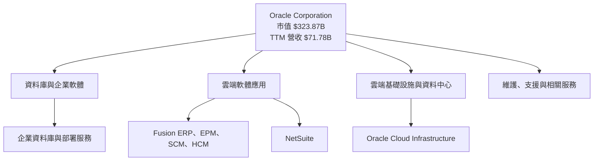
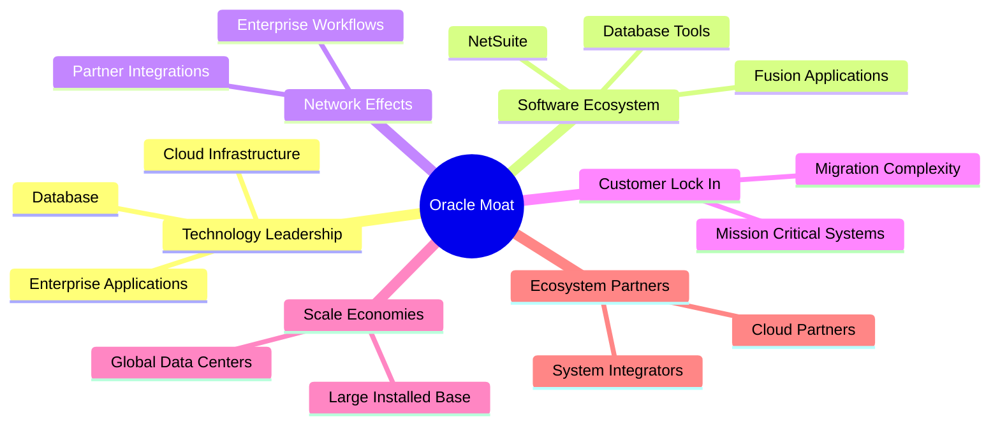
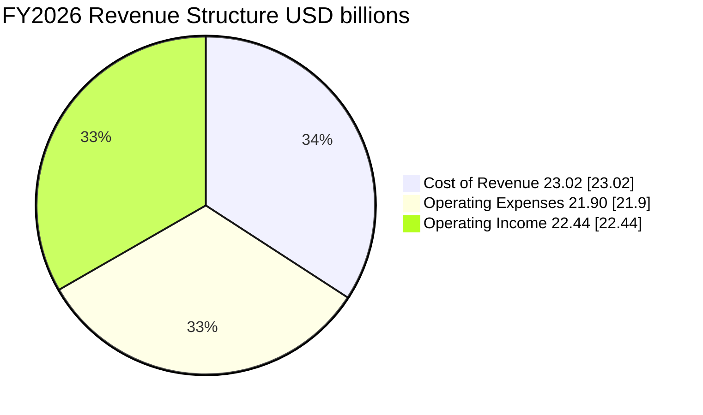
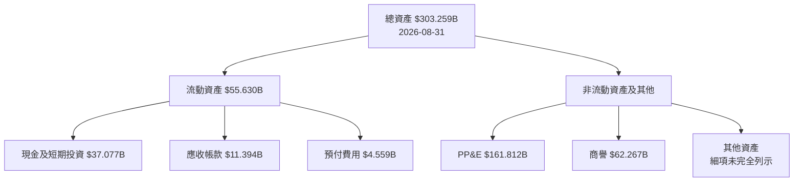
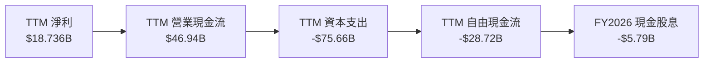
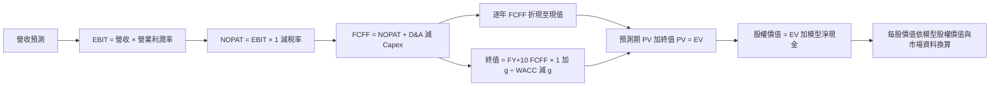
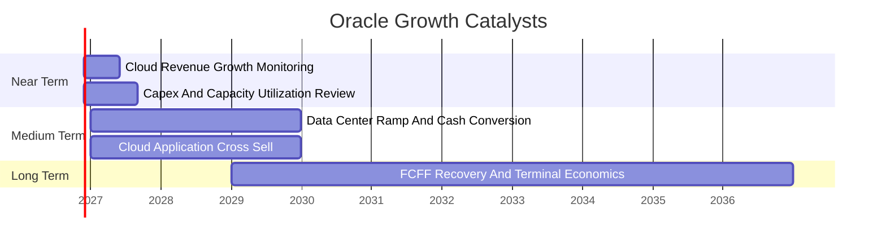
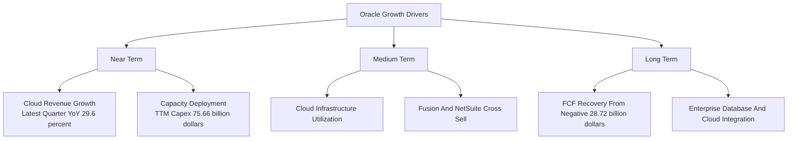
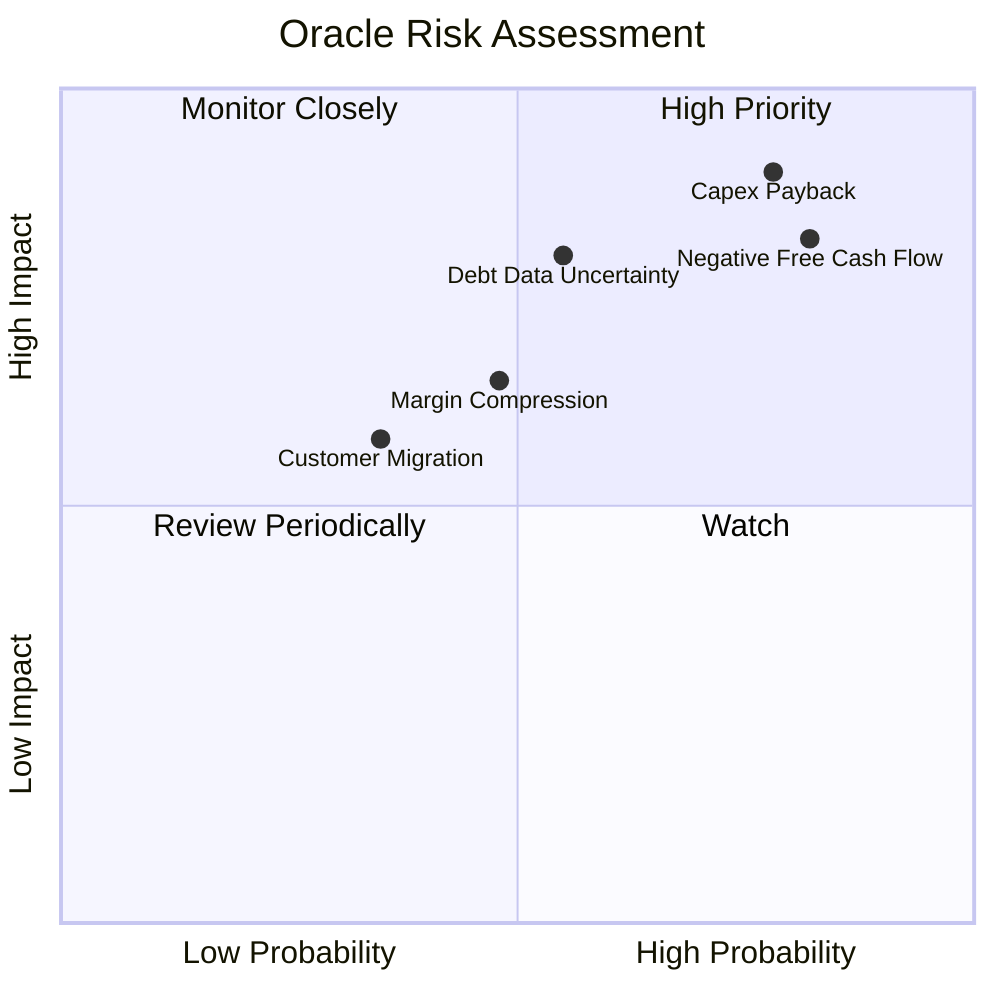
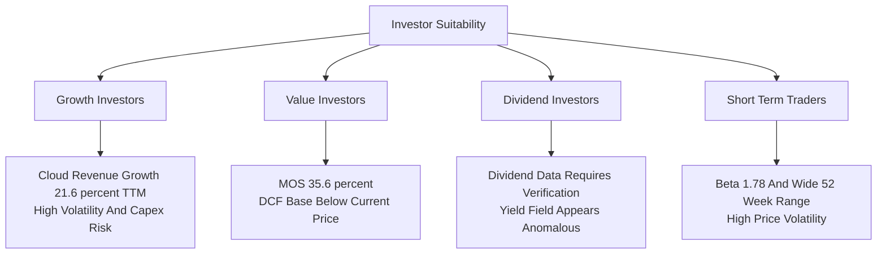

# ORCL 基本面深度分析報告
> **報告日期**：2026-11-26 ｜ **語言**：繁體中文 ｜ **數據來源**：SEC 申報資料 (XBRL)、Yahoo Finance、Finviz、StockAnalysis、Roic.ai ｜ **分析師**：CFA 級機構研究

## 目錄

| # | 章節 | 核心結論 |
|---|------|----------|
| 1 | 執行摘要 | 強烈買入；加權合理價值 $161.40；MOS +35.6% |
| 2 | 公司概覽與商業模式 | 企業軟體、雲端與資料中心業務形成轉換成本；分部收入占比未提供 |
| 3 | 損益表深度分析 | TTM 營收 $71.78B、成長 21.6%；雲端相關需求推升最近一季營收年增 |
| 4 | 資產負債表分析 | 可用口徑顯示淨現金 $37.08B；總債務在核實指標中為 N/A |
| 5 | 現金流量深度分析 | TTM FCF 為 -$28.72B，主要受資料中心資本支出大幅增加影響 |
| 6 | 獲利能力與資本效率 | ROIC 61.3% 高於 WACC 8.99%；但投資擴張期間現金回報需持續驗證 |
| 7 | 相對估值分析 | 現有估值倍數低於自身五年區間，DCF 與相對估值所示價值差距很大 |
| 8 | DCF 內在價值評估 | 基準 DCF 每股 $89.67；終值現值占 EV 172.3%，模型對長期假設高度敏感 |
| 9 | 成長催化劑 | 雲端、資料中心與 AI 工作負載是主要增長來源；TAM 數字未提供 |
| 10 | 風險矩陣 | 資本支出回收、負自由現金流、融資與債務風險最需關注 |
| 11 | 投資建議 | 評級依 MOS 為強烈買入；建議以現金流與資本支出里程碑動態驗證 |

---

## 1. 執行摘要

截至 **2026-11-25 收盤價 $103.88**，ORCL 的加權合理價值為 **$161.40**，MOS 為 **+35.6%**，依估值門檻為強烈買入；這項結論同時受益於 TTM 營收成長 **21.6%**、ROIC **61.3%** 高於 WACC **8.99%**，以及自身估值倍數位於五年歷史區間最低百分位。不過，TTM FCF 為 **-$28.72B**、資本支出為 **$75.66B**，且基準 DCF 僅得 **$89.67/股**，低於現價；因此投資論點的關鍵不是單看營收，而是新建資料中心能否轉化為持續現金流。依 MOS 門檻應為強烈買入，未作質化調整；但應把現金流執行風險視為主要監控項目。

### 1.0 一頁式投資儀表板（Portfolio Manager 30 秒速讀）

| 項目 | 內容 |
|------|------|
| **投資論點（3 句）** | ① TTM 營收 $71.78B、年增 21.6%，最新一季營收年增 29.6%，顯示需求加速。② ROIC 61.3% 對比 WACC 8.99%，帳面上有明顯正利差。③ TTM Capex $75.66B 高於 OCF $46.94B，造成 FCF -$28.72B；資本回收是多頭論點的必要條件。 |
| **綜合評分** | **6.8/10**（引用 1.1 評分卡） |
| **財務健康** | 🟡 現金及短期投資 $37.08B、流動比率 1.171；但核實指標的總債務為 N/A，不能把淨現金視為已完整核對債務口徑。 |
| **ROIC vs WACC** | **61.3% vs 8.99%**；依該 ROIC 口徑，創造價值。 |
| **FCF 趨勢** | 因資料中心投資而轉負；TTM FCF Yield **-8.87%**。 |
| **估值** | Forward P/E **9.393x**（報價資料）；EV/EBITDA **13.114x**（報價資料）；FCF Yield **-8.87%**。Peer multiples 區塊另列 ORCL 未提供 Forward P/E，故同業比較不以此數替代。 |
| **DCF 內在價值（基準）** | **$89.67**；現價相對 DCF 溢價 **15.9%**。 |
| **安全邊際（MOS）** | **+35.6%**＝($161.40 − $103.88) ÷ $161.40；🟢 >25% 充足。分母為 8.8 加權合理價值。 |
| **預期報酬（基準情境 12M）** | DCF 基準情境相對現價 **-13.7%**；另 8.8 加權合理價值隱含上行空間 **+55.4%**，兩者是不同估值口徑。 |
| **關鍵風險（前二）** | 資料中心 Capex 長期高於營運現金流；融資及債務資料口徑不一致、總債務核實值缺失。 |
| **評級 + 信心度** | 🟢 **強烈買入**（依 MOS 門檻）；信心：中。 |

### 1.1 綜合評分卡（全報告唯一）

| 維度 | 評分（1–10） | 主要依據（引用數字與其來源章節） |
|------|--------------|----------------------------------|
| 成長性 | 8.0 | TTM 營收成長 21.6%、最新一季年增 29.6%（第 3 章）；雲端與資料中心增長的分部拆分未提供。 |
| 獲利能力 | 8.0 | TTM 營業利益率 32.1%、ROIC 61.3%，高於 8.99% WACC；但 TTM FCF 為負（第 5、6 章）。 |
| 財務健康 | 4.0 | 現金及短期投資 $37.08B、流動比率 1.171；但核實指標總債務 N/A、FCF 為 -$28.72B（第 4、5 章）。 |
| 估值 | 8.0 | MOS +35.6%；P/E、P/S、EV/EBITDA 均處於自身五年歷史最低百分位，但 DCF 基準價 $89.67 低於市價（第 7、8 章）。 |
| 護城河 | 8.0 | ERP、資料庫與雲端產品嵌入企業工作流程，切換成本高；但分部收入及市占率資料未提供（第 2 章）。 |
| 管理層與資本配置 | 5.0 | SBC FY2026 $4.81B、近年 Capex 急增，FY2026 FCF -$23.69B；投資回收仍待驗證（第 3、5 章）。 |
| **綜合評分** | **6.8** | 六項算術平均：(8.0 + 8.0 + 4.0 + 8.0 + 8.0 + 5.0) ÷ 6 = 6.833，四捨五入為 **6.8**。 |

### 1.2 五大投資論點 + 三大核心風險

| 類型 | 項目 | 具體依據 | 信心度 |
|------|------|----------|--------|
| 🟢 **投資論點①** | 營收成長加速 | TTM 營收 $71.78B、年增 21.6%；最新一季營收 $19.34B、單季年增 29.6%。若主要來自持續性雲端服務，將提高未來收入可見度。 | 🟢 高 |
| 🟢 **投資論點②** | 獲利能力仍具規模效應 | TTM 營業利益率 32.1%、最新一季 34.8%；高毛利軟體及訂閱收入有助吸收固定成本。 | 🟢 中高 |
| 🟢 **投資論點③** | 投入資本回報高於資本成本 | ROIC 61.3% 對比 WACC 8.99%，差距 52.31 個百分點；若計算口徑穩定，擴張仍可能創造價值。 | 🟡 中 |
| 🟢 **投資論點④** | 自身估值低於歷史區間 | P/E 16.3x、P/S 4.3x、EV/EBITDA 8.5x，均低於所列五年區間下限，歷史百分位均為 0%。 | 🟡 中 |
| 🟢 **投資論點⑤** | 企業軟體與雲端整合提高留存 | Fusion、NetSuite、資料庫與基礎架構服務跨流程運作，遷移需承擔系統整合及營運風險；但客戶留存數據未提供。 | 🟡 中 |
| 🟡 **風險①** | AI／雲端投資回收期延長 | TTM Capex $75.66B，較 OCF $46.94B 多 $28.72B，FCF 因而為負。若新增產能使用率或定價不足，資產回報下滑。 | 🔴 高衝擊 |
| 🔴 **風險②** | 融資與債務承受能力難以完全核實 | 市場資料列總債務 $169.14B，但 VERIFIED FIGURES 的 Total debt 為 N/A；分析不可混用兩種口徑。 | 🔴 高 |
| 🟡 **風險③** | 現金流及股東稀釋 | Piotroski 稀釋股數測試未通過，FY2026 SBC $4.81B；若股數增加而投資未帶來相應 FCF，股東每股價值會被稀釋。 | 🟡 中高 |

### 1.3 快速統計卡片

| 指標 | 公司實際值（期間） | 同業中位數 | 狀態 |
|------|--------------------|------------|------|
| 營收成長（TTM） | **21.6%** | — | 🟢 |
| 營收成長（最新一季年增） | **29.6%** | **13.2%** | 🟢 |
| 毛利率（TTM） | **64.0%** | **73.6%** | 🟡 |
| 營業利益率（TTM） | **32.1%** | — | 🟢 |
| ROIC（TTM） | **61.3%** | — | 🟢 |
| Forward P/E | **9.393x**（市場估值資料） | — | 🟢 |
| FCF Yield（TTM） | **-8.87%** | — | 🔴 |
| Piotroski F-Score | **4 / 7** | — | 🟡 |

同業中位數僅依 Peer multiples 區塊可直接取得的數字計算：最新一季營收成長中位數為 SAP 13.2%、MSFT 18.8%、CRM 10.8% 的中位數 **13.2%**；毛利率中位數為 67.7%、73.6%、77.3% 的中位數 **73.6%**。ORCL 自身財務數字依 VERIFIED FIGURES 優先。

### 1.4 投資結論

```
╔══════════════════════════════════════════════════════════════════╗
║                    📊 投資結論摘要                               ║
╠══════════════════════════════════════════════════════════════════╣
║  評級：強烈買入（MOS +35.6%，ROIC 61.3% > WACC 8.99%）            ║
║  價格（2026-11-25 收盤）：$103.88                                 ║
║  DCF 內在價值（基準）：$89.67（現價溢價 +15.9%）                  ║
║  安全邊際 MOS：+35.6%（＝(加權合理價值−現價)÷加權合理價值）      ║
║  加權合理價值（8.8）：$161.40                                     ║
║  DCF 情境價值：                                                   ║
║    悲觀情境：$11.24（-89.2%）                                     ║
║    基準情境：$89.67（-13.7%）                                     ║
║    樂觀情境：$264.74（+154.9%）                                   ║
║  綜合評分：6.8/10（引用 1.1）                                     ║
║  適合投資人：可承受高波動、看好雲端與 AI 基礎設施長期需求者       ║
╚══════════════════════════════════════════════════════════════════╝
```

---

## 2. 公司概覽與商業模式

### 2.1 業務結構與收入來源

Oracle 提供資料庫與企業軟體、雲端應用及雲端基礎設施，並以維護、支援與訂閱服務延續客戶關係。最新 TTM 營收為 **$71.78B**；目前資料沒有提供可核實的分部收入與各分部占比，因此不以估計比例繪製業務收入圓餅圖。



Oracle 的商業模式結合授權、訂閱、雲端使用量與支援收入。傳統資料庫及 ERP 客戶把核心營運流程建在 Oracle 平台上，為公司提供升級、維護與跨產品銷售的機會；另一方面，雲端基礎設施需投入大量資本，現階段 TTM Capex $75.66B 已高於 OCF $46.94B，擴張能否轉化為增量現金流是模式轉型的驗證點。

### 2.2 市場份額

市場份額的可引用數值、來源與年份未提供，因此不繪製市占率圖表。ORCL TTM 營收 $71.78B、最新一季營收年增 29.6%，高於 Peer multiples 中 MSFT、SAP、CRM 的最新一季年增率；但不同公司的產品組合與收入基數不同，不能單憑成長率推導市占變化。

### 2.3 競爭護城河分析



### 2.4 護城河強度

| 護城河項目 | 強度（強／中／弱） | 證據（引用數字或事實） | 會削弱它的情況 |
|------------|--------------------|------------------------|----------------|
| 技術與產品整合 | 強 | 資料庫、ERP、HCM、SCM 等涵蓋企業核心工作流程；FY2026 R&D $10.27B。 | 客戶轉向多雲、開源資料庫或模組化應用，削弱整合優勢。 |
| 軟體生態系統 | 強 | Fusion 與 NetSuite 等應用可與既有資料庫及支援服務連接。 | 新平台相容性與遷移工具成熟，降低更換成本。 |
| 網路效應 | 中 | 企業顧問、系統整合商與應用介面可增加部署便利性，但量化夥伴或開發者數據未提供。 | 客戶及開發者轉向其他雲端生態系。 |
| 客戶鎖定 | 強 | 核心資料與交易流程遷移涉及停機、合規及重建成本；量化續約率未提供。 | 長期合約到期、雲端遷移工具降低轉換成本。 |
| 規模效應 | 中 | 市值 $323.87B、TTM 營收 $71.78B；新資料中心投資規模大，但經濟回報仍須觀察。 | 資本成本上升、產能閒置或競爭者以更低成本供應算力。 |
| 生態夥伴 | 中 | 系統整合與企業顧問網絡可支援部署；合作夥伴收入貢獻未提供。 | 夥伴優先推廣競品或大型客戶自行建置。 |

**1.1 護城河評分 8.0/10**，理由是企業核心系統的高切換成本與產品廣度具質化支撐，但缺乏客戶留存率、市占率及分部收入數據，故不採更高分。

---

## 3. 損益表深度分析

### 3.1 年度收入成長趨勢（近 4 年）

年度收入採 FY2023–FY2026，YoY 依相鄰年度收入計算；年度收入數據來自財務報表資料。

```
╔══════════════════════════════════════════════════════════════════╗
║                 Oracle 年度收入趨勢（FY2023–FY2026）             ║
╠══════════════════════════════════════════════════════════════════╣
║  FY2023  $49.95B  ███████████████░░░░░░░░░  YoY: +6.0%   🟡     ║
║  FY2024  $52.96B  ████████████████░░░░░░░░  YoY: +6.0%   🟡     ║
║  FY2025  $57.40B  █████████████████░░░░░░░  YoY: +8.4%   🟡     ║
║  FY2026  $67.36B  ████████████████████░░░░░  YoY: +17.4%  🟢     ║
╠══════════════════════════════════════════════════════════════════╣
║  FY2023–FY2026 CAGR = (67.36 ÷ 49.95)^(1/3) − 1 = 約 10.5%      ║
╚══════════════════════════════════════════════════════════════════╝
```

FY2026 營收成長高於 FY2024、FY2025，與雲端服務及基礎設施需求增加一致；但上述年度營收增長仍低於最新 TTM 21.6%，表示近期成長加速，亦提高市場對新增資料中心交付與客戶需求持續性的期待。

### 3.2 季度收入趨勢分析

以下按季度由早至晚排列；QoQ 為本季相對上一季，YoY 使用同季年度數據。FY2027 Q1 的單季年增率 29.6% 是季度指標，不是 TTM 成長率。

| 季度 | 營收 | QoQ 成長 | YoY 成長 | 備註 |
|------|------:|----------:|----------:|------|
| 2025-11-30 | $16.06B | +13.6% | +14.2% | 相較 2025-08-31 的 $14.93B；季度成長動能抬升。 |
| 2026-02-28 | $17.19B | +7.1% | +21.7% | 較前季增長放緩，但年增加速。 |
| 2026-05-31 | $19.18B | +11.6% | +20.6% | 收入提升與雲端需求擴大相符。 |
| 2026-08-31 | $19.34B | +0.8% | +29.6% | YoY 加速；QoQ 增幅較小，需觀察後續新增產能是否帶動連續季增。 |

季度收入來自 StockAnalysis；年增率以單季資料計算或引用提供的季度年增欄。季度數字與經核實 TTM 指標的報表口徑不同時，以 VERIFIED FIGURES 的 TTM 指標為準。

### 3.3 利潤率演變分析

下表以年度損益數據計算年度毛利率、營業利益率及淨利率；TTM 利潤率另採核實指標。

| 利潤率指標 | FY2023 | FY2024 | FY2025 | FY2026 | 趨勢 | 評估 |
|------------|--------|--------|--------|--------|------|------|
| **毛利率** | 72.9% | 71.4% | 70.5% | 65.8% | 年度數據下降 | 🟡 |
| **營業利益率** | 27.6% | 30.3% | 31.4% | 33.3% | 逐年提高 | 🟢 |
| **淨利率** | 17.0% | 19.8% | 21.7% | 25.4% | 逐年提高 | 🟢 |

FY2026 毛利率按 FY2026 毛利 $44.34B ÷ 營收 $67.36B 計算為 65.8%，與 TTM 毛利率 64.0% 的期間和口徑不同。毛利率下降而營業利益率上升，表示毛利以下的費用吸收、產品組合或營運效率改善抵銷部分毛利壓力；不過，資料未提供分部毛利或成本明細，無法將改善精確歸因於雲端、授權或人力成本。核實 TTM 營業利益率為 32.1%，最新一季為 34.8%，兩者均高於年度早期水準。

### 3.4 費用結構分析

FY2026 年度收入 $67.36B、毛利 $44.34B、營業利益 $22.44B，因此收入可拆成銷貨成本 $23.02B、毛利以下營業費用 $21.90B、營業利益 $22.44B。這是損益表金額結構，不代表完整現金成本結構。



```
╔══════════════════════════════════════════════════════════════════╗
║                  FY2026 收入與營業成本結構                       ║
╠══════════════════════════════════════════════════════════════════╣
║  收入             $67.36B  ████████████████████                 ║
║  銷貨成本         $23.02B  ███████                              ║
║  毛利以下營業費用 $21.90B  ███████                              ║
║  營業利益         $22.44B  ███████                              ║
║  R&D              $10.27B  （已包含於營業費用之內，不重複加總） ║
╚══════════════════════════════════════════════════════════════════╝
```

R&D FY2026 為 $10.27B，約占年度營收 15.2%；持續投入有利於產品迭代及雲端服務能力，但其收益需由訂閱續約與雲端收入成長驗證。

### 3.5 季度 EPS 趨勢與盈餘品質（Quality of Earnings）

EPS beat/miss 資料中最近四季 EPS estimate 均為 NaN，故無法可靠判斷超預期或不及預期。StockAnalysis 列示的季度實際 EPS 與年增率如下；不同來源季度 EPS 和淨利數字存在小幅差異，以下不混合推算分析師預期差額。

| 季度 | EPS 實際 | EPS 年增率 | 超預期／不及預期 |
|------|---------:|-----------:|------------------|
| 2025-11-30 | $2.10 | +90.91% | N/A（EPS 預估值缺漏） |
| 2026-02-28 | $1.27 | +24.51% | N/A（EPS 預估值缺漏） |
| 2026-05-31 | $1.45 | +21.91% | N/A（EPS 預估值缺漏） |
| 2026-08-31 | $1.56 | +54.45% | N/A（EPS 預估值缺漏） |

| 盈餘品質項目 | 數值/佔比 | 評估 |
|--------------|-----------|------|
| 股權薪酬 SBC / 營收 | FY2026：$4.81B ÷ $67.36B = **7.1%** | 🟡 SBC 是實質股東成本；Piotroski 稀釋股數測試未通過。 |
| SBC / 營業現金流 | FY2026：$4.81B ÷ $31.98B = **15.0%** | 🟡 占營運現金流比重不低，應同時檢視每股營收與股數變化。 |
| FCF / 淨利（現金轉換率） | TTM：-$28.72B ÷ TTM 淨利 $18.736B = **-153.3%** | 🔴 現金流低於會計獲利，主因巨額 Capex；短期不宜以淨利代替股東可分配現金。 |
| 一次性／非經常性損益 | 季度 EPS 2025-11-30 為 $2.10，與相鄰季度差距大；具體一次性項目未提供 | 🟡 無法確認異常季度是否由一次性損益造成。 |
| 有效稅率異常 | 12.6%（最新年度有效稅率） | 🟡 DCF 採此稅率；缺乏多年同期稅率拆解，不能判定是否可持續。 |
| 資本化支出 vs 費用化 | TTM Capex $75.66B；資本化支出的細分項與會計政策變化未提供 | 🟡 資料中心資產支出會先進入資產再折舊；應追蹤折舊與利用率，避免只看當期營業利益。 |

**盈餘品質結論**：GAAP 獲利有實際營運現金流支持，但資本支出遠高於 OCF，使 TTM FCF 為負；因此以淨利或 EPS 直接衡量可分配現金會高估當期現金盈餘。SBC 已費用化於 GAAP 盈餘，但仍透過股數稀釋影響每股回報。

---

## 4. 資產負債表分析

### 4.1 資產結構分解

2026-08-31 資產負債表資料列示總資產 $303.259B、流動資產 $55.630B、PP&E $161.812B、商譽 $62.267B。項目未列完整的非流動資產拆分，故不將剩餘項目臆測成特定資產。



### 4.2 流動性與營運資金分析

| 指標 | 最新 TTM | 一年前 TTM | 變化 | 解讀 |
|------|----------|------------|------|------|
| DSO 應收帳款天數 | 58 天 | 55 天 | +3 天 | 收款時間略延長；可能與收入結構或付款條件相關，需追蹤應收帳款增速是否高於營收。 |
| DIO 存貨天數 | N/A | N/A | N/A | 公司未報存貨餘額；不推估存貨天數。 |
| DPO 應付帳款天數 | 156 天 | N/A | N/A | 前期無可比數據；單期數值顯示公司使用供應商付款週期，但不能據此斷言議價能力。 |
| CCC 現金轉換週期 | N/A | N/A | N/A | DIO 缺漏，CCC 依定義無法計算。 |

流動資產表列 FY2026 $46.57B，市場財務資料列流動比率 **1.171**、速動比率 **1.02**。流動性指標顯示短期資產對短期負債有覆蓋，但沒有把流動比率和另一來源的不同期資產負債數字混算。

### 4.3 債務結構分析

核實指標中 Total debt 為 **N/A**，因此不使用另一組資料所列的總債務 $169.14B 來推算 Debt/EBITDA 或利息保障倍數。核實口徑列示現金及短期投資 $37.08B、Net cash $37.08B；但這不表示已驗證所有債務為零，而是原核實數據的 debt 欄缺值。市場資料另列 Total Debt $169.14B、Net Cash/Debt -$132.07B，兩個口徑互相矛盾，故須分開呈現。

```
╔══════════════════════════════════════════════════════════════════╗
║                   Oracle 債務健康診斷                            ║
╠══════════════════════════════════════════════════════════════════╣
║  核實總債務：      N/A       不推算 Debt/EBITDA                  ║
║  現金及短期投資：  $37.08B   可用流動資金                        ║
║  核實淨現金：      $37.08B   按核實指標原值引用                  ║
║  其他市場資料債務：$169.14B  與核實口徑不同，不混用              ║
║  Debt/EBITDA：     N/A       債務分母資料口徑不一致              ║
║  Interest Coverage：N/A     未提供可一致核實的利息費用與債務    ║
╚══════════════════════════════════════════════════════════════════╝
```

### 4.4 股東權益趨勢

| 財年 | 股東權益 | 年增變化 |
|------|---------:|---------:|
| FY2023 | $1.07B | — |
| FY2024 | $8.70B | +$7.63B |
| FY2025 | $20.45B | +$11.75B |
| FY2026 | $42.51B | +$22.06B |

```
╔══════════════════════════════════════════════════════════════════╗
║                  股東權益變化（年度）                            ║
╠══════════════════════════════════════════════════════════════════╣
║  FY2023  $1.07B   █                                             ║
║  FY2024  $8.70B   ████                                          ║
║  FY2025  $20.45B  ██████████                                    ║
║  FY2026  $42.51B  ████████████████████                          ║
╚══════════════════════════════════════════════════════════════════╝
```

股東權益連續上升，但權益上升本身並不等於現金回報改善；FY2026 Capex 擴張和負 FCF 要一併考慮。

---

## 5. 現金流量深度分析

### 5.1 現金流量瀑布圖

以下呈現已知現金流關係；各項金額期間不同時不拼接成單一年度瀑布，亦不虛構回購金額或淨現金變化。



淨利到 OCF 的轉換包含非現金費用、營運資金與其他調整，不能將兩者差額直接視為某一種單一項目。TTM FCF 定義固定為 OCF 減 Capex。

### 5.2 FCF 轉換率趨勢

| 財年 | OCF | Capex | FCF | 淨利 | FCF / 淨利 |
|------|----:|------:|----:|-----:|-----------:|
| FY2023 | $17.16B | $8.70B | $8.47B | $8.50B | 99.6% |
| FY2024 | $18.67B | $6.87B | $11.81B | $10.47B | 112.8% |
| FY2025 | $20.82B | $21.21B | -$0.394B | $12.44B | -3.2% |
| FY2026 | $31.98B | $55.66B | -$23.69B | $17.09B | -138.6% |
| TTM 至 2026-08-31 | $46.94B | $75.66B | -$28.72B | $18.736B | -153.3% |

FY2025 起 Capex 增幅使 FCF 從正值轉為接近零，FY2026 進一步大幅轉負。營運現金流增加是正面因素，但現階段增加的 OCF 尚不足以覆蓋投資支出。

### 5.3 自由現金流趨勢

```
╔══════════════════════════════════════════════════════════════════╗
║                自由現金流：年度實際與 TTM                        ║
╠══════════════════════════════════════════════════════════════════╣
║  FY2023  +$8.47B   ███████                                       ║
║  FY2024  +$11.81B  ██████████                                    ║
║  FY2025  -$0.394B  ░                                             ║
║  FY2026  -$23.69B  ◀████████████████████                         ║
║  TTM     -$28.72B  ◀████████████████████████                     ║
║                                                                  ║
║  TTM FCF Yield = -8.87%（以核實數值引用）                        ║
╚══════════════════════════════════════════════════════════════════╝
```

負 FCF 不必然意味投資失敗，但需要由已建成容量、雲端收入、毛利及資產利用率證明回報。若 Capex 仍以高於 OCF 的速度增加，企業價值將更依賴外部融資與終值假設。

### 5.4 資本配置評估

FY2026 有可用資本配置數字：Capex $55.66B、股息支付 $5.79B、SBC $4.81B；現金回購資料未提供，不能製作資本配置比例圓餅圖。

| 項目 | FY2026 金額 | 評估 |
|------|-----------:|------|
| 資本支出 | $55.66B | 顯著高於 OCF $31.98B，需追蹤投產進度與使用率。 |
| 現金股息 | $5.79B | OCF 可覆蓋股息，但扣除 Capex 後整體 FCF 為負。 |
| SBC | $4.81B | 需與股數變化和每股獲利共同檢視。 |
| 股票回購 | N/A | 可用資料未提供一致的回購金額。 |
| 留存現金／淨現金變化 | N/A | 無法由不同期間餘額推算。 |

---

## 6. 獲利能力與資本效率

### 6.1 ROE / ROA / ROIC 趨勢

目前缺乏統一口徑的多年 ROIC、ROA 與 ROE 序列；下表列示可直接引用的最新值，不以不一致資料來源拼接歷史趨勢。

| 指標 | 最新數值 | 評估 |
|------|---------:|------|
| ROE（TTM，核實品質指標） | 28.3% | 可觀，但杜邦分解顯示權益乘數 4.54，槓桿對 ROE 有貢獻。 |
| ROA（TTM，市場資料） | 6.4% | 資產基數擴張使資產回報低於權益回報。 |
| ROIC（TTM，核實口徑） | 61.3% | 大幅高於 WACC，但須留意公司現金、負債及資本基數口徑。 |

### 6.2 ROIC vs WACC 分析（核心價值創造判斷）

**先給證據**：核實 TTM ROIC 為 **61.3%**，核實 WACC 為 **8.99%**，兩者差額為 **52.31 個百分點**。按此指標，公司在該核實口徑下創造股東價值；但不應把高 ROIC 直接外推為新增資料中心投資也有相同回報，因投資週期與新增資產回報尚未完整成熟。

```
╔══════════════════════════════════════════════════════════════════╗
║                ROIC vs WACC 深度分析                             ║
╠══════════════════════════════════════════════════════════════════╣
║  WACC（核實值）：8.99%                                           ║
║  ├── 無風險利率 Rf：4.85%                                        ║
║  ├── 股權風險溢酬 ERP：5.00%                                     ║
║  ├── 原始 Beta：1.78；調整後 Beta：1.52                          ║
║  ├── 股權成本 Ke（核實值）：12.44%                               ║
║  ├── 稅前債務成本：2.72%；有效稅率：12.6%                        ║
║  ├── E / D 權重：65.7% / 34.3%                                  ║
║  └── 核實 WACC：8.99%                                            ║
║                                                                  ║
║  ROIC（TTM，核實值）：61.3%                                      ║
║  EVA 利差 = 61.3% − 8.99% = +52.31 個百分點                     ║
║                                                                  ║
║  ROIC  61.3%  ▓▓▓▓▓▓▓▓▓▓▓▓▓▓▓▓▓▓▓▓▓▓▓▓▓▓▓▓▓▓▓  🟢             ║
║  WACC   8.99% ▓▓▓▓░░░░░░░░░░░░░░░░░░░░░░░░░░░░░                ║
║                                                                  ║
║  結論：核實 ROIC 為 WACC 約 6.8 倍，指標顯示價值創造；           ║
║        新增資本投資回報仍需以未來 FCF 驗證。                     ║
╚══════════════════════════════════════════════════════════════════╝
```

原始 Beta 1.78 按常見調整方式向 1 收斂，核實調整後 Beta 為 1.52。成本資本來源列示 Ke 12.44%、稅前 Kd 2.72%、權重 65.7%／34.3% 及 WACC 8.99%；依要求以核實 WACC 作為折現率。以表中已四捨五入的輸入重算 WACC 會有小幅差異，故不另行替換核實 WACC，完整一致性限制於第 8.2 節說明。

### 6.3 杜邦三因素分解

| 因素 | 數值（TTM） | 解讀 |
|------|-------------|------|
| 淨利率 | 26.4% | 反映收入轉化為淨利的能力。 |
| 資產週轉率 | 0.24 | 資產相對營收的周轉偏低，與資料中心資產擴張相符。 |
| 權益乘數 | 4.54 | 槓桿放大 ROE，故 ROE 不宜只歸因於營運利潤。 |
| **ROE** | **28.3%** | 核實杜邦：26.4% × 0.24 × 4.54 = 28.3%（採原核實值，四捨五入有尾差）。 |

### 6.4 財務體質：Piotroski F-Score

F-Score 為 **4 / 7**；九項中有兩項因輸入缺漏而無法判定，因此可判定測試的分母為 7。

| 測試 | 結果 | 解讀 |
|------|------|------|
| ROA > 0 | ✅ 通過 | TTM 資產回報為正。 |
| 營業現金流 > 0 | ✅ 通過 | TTM OCF $46.94B。 |
| ROA 高於一年前 | ❌ 未通過 | 資產回報未較前期改善。 |
| 營業現金流 > 淨利（應計品質） | ✅ 通過 | 依該品質測試通過。 |
| 長期負債 ÷ 總資產低於一年前 | — 無法判定（缺資料） | 不自行補值。 |
| 流動比率高於一年前 | ✅ 通過 | 相較前期提高。 |
| 稀釋股數未增加 | ❌ 未通過 | 股數增加會稀釋每股經濟利益。 |
| 毛利率高於一年前 | — 無法判定（缺資料） | 該測試缺少一致輸入。 |
| 資產週轉率高於一年前 | ❌ 未通過 | 資產擴張快於營收周轉改善。 |

F-Score 顯示現金流與流動性有通過項目，但資產效率、ROA 走勢及股數稀釋是需監控的薄弱面。

---

## 7. 相對估值分析

### 7.1 同業估值比較表格

同業估值倍數依 Yahoo Finance Peer multiples 區塊；本公司倍數依對應核實歷史估值區塊。SAP 的 P/S、EV/EBITDA 為 N/A（混合幣別），不做換算。

| 估值指標 | **ORCL** | **MSFT** | **SAP** | **CRM** | 本公司評估 |
|----------|---------:|---------:|--------:|--------:|-----------|
| **Trailing P/E** | 16.3x | 25.6x | 26.1x | 18.0x | 🟢 低於三家同業；但仍受 FCF 為負影響。 |
| **Forward P/E** | N/A（Peer 區塊未列） | 20.2x | 22.0x | 12.3x | 🟡 不以另一來源的倍數混入 peer 表格。 |
| **P/S Ratio** | 4.3x | 10.5x | N/A | 3.7x | 🟢 低於 MSFT，略高 CRM；業務組合差異大。 |
| **EV/EBITDA** | 8.5x | 18.0x | N/A | 15.0x | 🟢 低於可比同業；負 FCF 令 EBITDA 倍數須謹慎解讀。 |
| **最新一季營收年增** | 29.6% | 18.8% | 13.2% | 10.8% | 🟢 成長較快，但 Capex 與現金回收亦需比較。 |
| **毛利率（TTM）** | 64.0% | 67.7% | 73.6% | 77.3% | 🟡 低於三家同業。 |

### 7.2 歷史估值區間分析

| 倍數 | 現值 | 五年中位數 | 五年區間 | 現值百分位 |
|------|-----:|-----------:|---------:|-----------:|
| P/E | 16.3x | 32.1x | 19.0x–52.3x | 0% |
| P/S | 4.3x | 6.2x | 4.6x–11.1x | 0% |
| EV/EBITDA | 8.5x | 17.9x | 12.6x–28.9x | 0% |

```
╔══════════════════════════════════════════════════════════════════╗
║                 ORCL 五年估值區間與目前位置                      ║
╠══════════════════════════════════════════════════════════════════╣
║  P/E        16.3x  ● ├──── 19.0x ───────── 中位數 32.1x ── 52.3x║
║  P/S         4.3x  ● ├────  4.6x ──────── 中位數  6.2x ── 11.1x║
║  EV/EBITDA   8.5x  ● ├──── 12.6x ──────── 中位數 17.9x ── 28.9x║
║  三項現值均低於各自歷史區間下限；歷史百分位均為 0%。            ║
╚══════════════════════════════════════════════════════════════════╝
```

低歷史倍數可能反映市場對 Capex、債務、利率及投資回收的不確定性；不能只以低於歷史中位數推論必然均值回歸。

### 7.3 情境價值（Bear / Base / Bull，照抄 DCF MODEL 的 Scenarios）

| 情境 | 第 1 年營收成長 | 期末營業利潤率 | WACC | 每股價值 | 相對現價 | 機率 | 會發生的條件 |
|------|----------------|----------------|------|----------|----------|------|--------------|
| 🔴 悲觀 | 10.8% | 26.0% | 9.99% | $11.24 | -89.2% | 25% | 雲端增速回落、資本支出高檔維持、利潤率被新建成本或競爭壓低。 |
| 🟡 基準 | 21.6% | 30.6% | 8.99% | $89.67 | -13.7% | 50% | 成長由 21.6% 線性降至 3.0%，營業利潤率收斂至 30.6%。 |
| 🟢 樂觀 | 32.4% | 33.6% | 7.99% | $264.74 | +154.9% | 25% | 雲端需求超出基準、規模效應維持利潤率，資本成本下降。 |

三情境數值直接採模型輸出；各情境逐年營收與 FCFF 明細未另提供，故不另行反推或重建。

### 7.4 相對估值隱含價格區間

| 方法 | 每股價值 | 相對現價 | 依據 |
|------|---------:|---------:|------|
| 同業 Forward P/E | $223.85 | +115.5% | MSFT、SAP、CRM 同業中位數 20.2x × ORCL Forward EPS $11.06。 |
| 同業 EV/EBITDA | $183.80 | +76.9% | MSFT、CRM 同業中位數 16.5x × TTM EBITDA，再加淨現金。 |
| 分析師共識目標價 | $236.18 | +127.4% | 40 位分析師平均目標價。 |

```
╔══════════════════════════════════════════════════════════════════╗
║                    相對估值方法價格位置                          ║
╠══════════════════════════════════════════════════════════════════╣
║  $103.88 現價 ── $183.80 EV/EBITDA ── $223.85 Forward P/E ── $236.18 共識║
╚══════════════════════════════════════════════════════════════════╝
```

相對估值高於 DCF 基準 $89.67，顯示估值結論對方法選擇高度敏感。分析師目標價只占加權方法權重 10%，不代表獨立驗證的現金流價值。

---

## 8. DCF 內在價值評估（Discounted Cash Flow）

> 本節採用程式計算的 DCF 模型數值，不更改模型假設與結果。金額單位為美元十億，除每股價格外皆為 $B；呈現金額四捨五入至小數兩位、比率至一位或兩位，折現因子至三位。由顯示值四捨五入造成的加總尾差可達 $0.01B。

### 8.0 估值推理鏈（Thinking Logic：在算之前先想清楚）

**Step 1 — 價值來源與主導變數**

Oracle 的價值由既有企業軟體及資料庫現金流、雲端應用訂閱，以及雲端基礎設施／資料中心擴張構成；最新資料只提供公司整體 TTM 營收 $71.78B，未提供各業務收入占比，不能為這些來源編造拆分比例。模型中最可能主導估值的是**資本支出回落後的 FCFF 與終值**：FY+1 Capex/Revenue 為 105.4%，FY+10 降至 14.4%，而終值現值占企業價值 172.3%。

**Step 2 — 模型選擇**

| 決策點 | 本報告採用 | 理由（含數字） | 曾考慮但否決 | 否決理由 |
|--------|-----------|----------------|--------------|----------|
| 現金流定義 | FCFF | 與 WACC 折現並先求 EV 相配；模型公式為 NOPAT + D&A − Capex | FCFE | 資本結構資料有缺漏，FCFF 較適合企業價值橋接。 |
| 預測期 N | 10 年 | 模型提供 FY+1 至 FY+10 的逐年預測；讓投資支出逐步收斂 | 5 年 | 未涵蓋 Capex 由 105.4% Revenue 降至 14.4% 的完整過程。 |
| 終值方法 | Gordon Growth | DCF 模型使用 g=3.0%，且 WACC=8.99% > g | 退出倍數 | 模型未提供退出倍數終值，不能自行添加。 |
| EBIT 基礎 | GAAP EBIT | 模型明確採 GAAP EBIT | 非 GAAP EBIT | 非 GAAP 會改變 SBC 與 FCFF 處理，與既定模型不符。 |

**Step 3 — 主要假設推導鏈**

- **營收成長**：錨點＝TTM 營收成長 21.6%，最新一季營收年增 29.6% → 最新季度增速高於 TTM，但不直接把單季增速外推十年 → 採用第 1 年 21.6%，線性降至第 10 年 3.0% → 否決十年固定 21.6%，因會忽略成熟期成長趨緩。
- **期末營業利潤率**：錨點＝TTM 32.1%；近年年度營業利益率約 27.6% 至 33.3% → 大型資料中心投資可能帶來折舊與營運成本，但規模亦可能支持利潤率 → 採用第 1 年 32.1%、第 10 年 30.6% → 否決持續擴張至更高水準，因模型無法證明新增投資可提升單位利潤。
- **預測期 N**：錨點＝模型已提供 10 年逐年預測 → Capex 需跨多期逐步回落 → 採用 10 年 → 否決較短期，因會過早進入終值；更長期則無模型輸出支援。
- **永續成長率 g**：錨點＝模型指定 3.0%，低於長期成熟企業的名目成長假設上限，且低於 WACC 8.99% → 避免終值數學失效 → 採用 3.0% → 否決高於 8.99% 的設定，因 Gordon Growth 分母將小於或等於零。
- **Capex/Revenue**：錨點＝TTM Capex/Revenue 約 105.4% → 對應目前大規模建置階段，假設投資強度逐步下降但不在短期立即回常態 → 採用 FY+1 105.4%、FY+10 14.4% → 否決永久維持 105.4%，因長期將使現金流持續受壓；也不假定短期立即降至成熟期水準。
- **EBIT 基礎與 SBC**：錨點＝模型使用 GAAP EBIT，且財報 SBC 已列為費用 → 不再另行扣減 SBC，也不另行稀釋股數 → 採用模型組合 A → 否決同時扣 SBC 或再計股數稀釋，避免重複計算。
- **年稀釋率**：錨點＝DCF 模型固定股數處理，採組合 A → SBC 已在 GAAP 費用中反映，為遵守模型固定股數 → 採用 0% 額外稀釋 → 否決另加稀釋率，因違反模型設定及重複計入。
- **終值方法**：錨點＝模型明列 Gordon Growth 終值 $987.95B → WACC 大於 g，公式可用 → 採用 Gordon Growth → 否決退出倍數作為另一終值，因原模型未提供其數值，不能另建。
- **WACC**：錨點＝核實資金成本區塊指定 8.99% → 依規則採用原值，不以四捨五入輸入重算取代 → 採用 8.99% → 否決另建 WACC，因核實資料已指定模型折現率。

**Step 4 — 最脆弱環節**

最脆弱假設是 Capex 由 FY+1 的 105.4% Revenue 逐步收斂到 FY+10 的 14.4%；若回落速度較慢，FCFF 與終值都會下降。模型敏感度顯示基準每股價值 $89.67；在 WACC 8.99% 下，g 由 3.0% 降至 2.0% 時價值降至 $69.38。

**Step 5 — 計算路徑圖**



### 8.1 模型假設總表（Model Inputs）

| 假設項目 | 採用值 | 依據／來源 | 敏感度 |
|----------|--------|-------------|--------|
| 預測期長度 N | 10 年 | DCF MODEL 逐年表列 FY+1 至 FY+10 | 🟡 中 |
| 營收成長 | FY+1 21.6% → FY+10 3.0% | FY+1 取 TTM 成長；線性淡出至模型終值增速 | 🔴 高 |
| 營業利潤率（GAAP EBIT） | FY+1 32.1% → FY+10 30.6% | FY+1 取 TTM 營業利益率；期末收斂到模型五年中位數 | 🔴 高 |
| 有效稅率 | 12.6% | 最新年度有效稅率 | 🟢 低 |
| Capex / Revenue | FY+1 105.4% → FY+10 14.4% | TTM 資本支出密集度逐步淡出；模型原值 | 🔴 高 |
| D&A / Revenue | 13.1% | TTM 模型輸入，固定 | 🟢 低 |
| 營運資金變動 | 未建模 | DCF 模型明確不含營運資金變動 | 🟢 低 |
| EBIT 基礎 | GAAP | 模型指定 | 🟡 中 |
| SBC 處理 | 組合 A：GAAP EBIT，不再另扣 SBC | SBC 已費用化於 GAAP EBIT；固定股數處理 | 🟡 中 |
| 年稀釋率 | 0% 額外稀釋 | 固定股數、與組合 A 相容 | 🟡 中 |
| 永續成長率 g | 3.0% | DCF 模型指定；低於 8.99% WACC | 🔴 高 |
| 終值方法 | Gordon Growth | DCF 模型指定 | 🔴 高 |
| WACC | 8.99% | 核實資金成本資料指定值 | 🔴 高 |

**SBC 防呆聲明**：本模型採用 **(A) GAAP EBIT + 固定股數**；SBC 影響已經由 GAAP 費用計入一次，因此 FCFF 不再扣 SBC，股數亦不另加年度稀釋。

本模型使用 FCFF = NOPAT + D&A − Capex；ΔWC 未建模，不額外填入數值或假設。

### 8.2 折現率推導（WACC）

```
╔══════════════════════════════════════════════════════════════════╗
║                    WACC 推導（核實資金成本）                     ║
╠══════════════════════════════════════════════════════════════════╣
║  無風險利率 Rf（10Y 美債）：4.85%                                ║
║  ERP：5.00%                                                      ║
║  原始 Beta：1.78；調整方式：⅔ × 1.78 + ⅓ × 1 = 1.52              ║
║  核實調整後 Beta：1.52                                           ║
║  核實股權成本 Ke：12.44%                                         ║
║  稅前債務成本 Kd：2.72%；稅率：12.6%                             ║
║  股權／債務權重：65.7%／34.3%                                    ║
║  核實 WACC：8.99%                                                ║
╚══════════════════════════════════════════════════════════════════╝
```

資料所列 Ke 及 WACC 為核實值；以已四捨五入數字驗算會有尾差：

1. **Ke**：4.85% + 1.52 × 5.00% = 4.85% + 7.60% = 12.45%；核實 Ke 為 **12.44%**，差異來自底層精度。
2. **稅前 Kd**：核實資料列 **2.72%**；利息費用及可一致匹配的平均計息負債明細未提供，無法獨立重建其分子與分母。
3. **稅後 Kd**：2.72% × (1 − 12.6%) = 2.72% × 87.4% = **2.3773%**（四捨五入為 2.38%）。
4. **權重**：E/D 權重依核實資金成本資料為 **65.7% / 34.3%**，相加為 100%。用以獨立重建 E、D 的一致市值與同口徑計息負債金額未完整提供。
5. **WACC**：直接採用核實值 **8.99%**。以已顯示的四捨五入數字重算為 65.7% × 12.44% + 34.3% × 2.3773% = 8.1731% + 0.8154% = **8.9885%**，四捨五入至兩位小數為 **8.99%**。使用核實 Ke 12.44% 可吻合；若改用 CAPM 顯示值 12.45%，會產生約 0.01 個百分點的尾差，故不更改指定 WACC。

WACC 與第 6.2 節均採 **8.99%**。由於核實 Total debt 為 N/A，而成本資本區塊另提供債務成本及權重，本報告照用該 WACC，但無法以本報告可見的債務餘額和利息費用完整獨立重建債務權重。

### 8.3 逐年自由現金流預測（基準情境）

| 年度 | FY+1 | FY+2 | FY+3 | FY+4 | FY+5 | FY+6 | FY+7 | FY+8 | FY+9 | FY+10 |
|------|------:|------:|------:|------:|------:|------:|------:|------:|------:|-------:|
| 營收 | 87.29 | 104.36 | 122.60 | 141.50 | 160.38 | 178.47 | 194.90 | 208.81 | 219.39 | 225.97 |
| 營收 YoY | 21.6% | 19.6% | 17.5% | 15.4% | 13.3% | 11.3% | 9.2% | 7.1% | 5.1% | 3.0% |
| 營業利潤率 | 32.1% | 32.0% | 31.8% | 31.6% | 31.4% | 31.3% | 31.1% | 30.9% | 30.8% | 30.6% |
| EBIT（GAAP） | 28.04 | 33.34 | 38.97 | 44.73 | 50.43 | 55.81 | 60.61 | 64.58 | 67.49 | 69.13 |
| − 稅 | (3.54) | (4.21) | (4.92) | (5.64) | (6.36) | (7.04) | (7.65) | (8.15) | (8.51) | (8.72) |
| NOPAT | 24.50 | 29.14 | 34.05 | 39.09 | 44.06 | 48.77 | 52.97 | 56.44 | 58.97 | 60.40 |
| + D&A | 11.47 | 13.71 | 16.10 | 18.59 | 21.07 | 23.44 | 25.60 | 27.43 | 28.82 | 29.68 |
| − Capex | (92.02) | (99.46) | (104.45) | (106.25) | (104.22) | (97.93) | (87.25) | (72.38) | (53.87) | (32.65) |
| − ΔWC | 未建模 | 未建模 | 未建模 | 未建模 | 未建模 | 未建模 | 未建模 | 未建模 | 未建模 | 未建模 |
| **FCFF** | **-56.05** | **-56.61** | **-54.30** | **-48.58** | **-39.09** | **-25.73** | **-8.69** | **11.49** | **33.92** | **57.44** |
| 折現因子 @8.99% | 0.918 | 0.842 | 0.772 | 0.709 | 0.650 | 0.597 | 0.547 | 0.502 | 0.461 | 0.423 |
| **FCFF 現值 PV** | **-51.43** | **-47.66** | **-41.94** | **-34.43** | **-25.42** | **-15.35** | **-4.76** | **5.77** | **15.63** | **24.29** |

預測期 PV 逐項相加：

**-$51.43 − $47.66 − $41.94 − $34.43 − $25.42 − $15.35 − $4.76 + $5.77 + $15.63 + $24.29 = -$175.30B**

DCF 模型列示的未四捨五入預測期 PV 合計為 **-$175.29B**，與顯示值逐項相加的差額 **$0.01B**，屬逐年顯示值四捨五入尾差。

**FY+1 逐步演算**（採模型列示值；各分項金額四捨五入至 $0.01B）：

1. **營收** = $71.78B × (1 + 21.6%) = $87.28B，模型列示 **$87.29B**（未四捨五入底層輸入造成 $0.01B 顯示差）。
2. **EBIT** = 模型營收 $87.29B × 模型營業利潤率約 32.1% = **$28.04B**（模型列值；兩個輸入顯示精度不足以重建底層小數）。
3. **稅** = $28.04B × 12.6% = $3.533B ≈ **$3.54B**。
4. **NOPAT** = $28.04B − $3.54B = **$24.50B**。
5. **D&A** = 模型按 D&A/Revenue 13.1% 計算，列示 **$11.47B**。
6. **Capex** = 模型按 Capex/Revenue 約 105.4% 計算，列示 **$92.02B**。
7. **ΔWC** = 模型未建模，故不列數值。
8. **FCFF** = $24.50B + $11.47B − $92.02B = **-$56.05B**。
9. **折現因子** = 1 ÷ (1 + 8.99%)¹ = 0.9175 ≈ **0.918**；PV = -$56.05B × 0.918 ≈ **-$51.43B**（採模型未四捨五入值）。

**合理性自檢**：
- 模型 FY+1 至 FY+10 FCFF 從 -$56.05B 轉為 $57.44B；因前段為負，傳統正值 FCF CAGR 不具適當意義，不能與歷史 CAGR 作有效比較。
- FY+10 FCFF 利潤率 = $57.44B ÷ $225.97B = **25.4%**；TTM FCF 利潤率 = -$28.72B ÷ $71.78B = **-40.0%**。同業最佳 FCF 利潤率未提供，不能判斷是否超越同業最佳。
- FY+1 至 FY+7 FCFF 為負，反映模型假設投資前置；負現金流現值拖低預測期 PV，價值主要依賴 FY+8 後轉正與終值。

```
╔══════════════════════════════════════════════════════════════════╗
║            自由現金流：歷史實際 vs 模型預測                      ║
╠══════════════════════════════════════════════════════════════════╣
║  FY2024（實）  +$11.81B  ██████████                              ║
║  FY2025（實）  -$0.394B  ░                                       ║
║  FY2026（實）  -$23.69B  ◀████████████████████                   ║
║  FY+1（預）    -$56.05B  ◀██████████████████████████████         ║
║  FY+10（預）   +$57.44B  ███████████████████████████████         ║
╠══════════════════════════════════════════════════════════════════╣
║  模型由前期大量負 FCFF 轉為末期正 FCFF；價值對 Capex 收斂敏感。  ║
╚══════════════════════════════════════════════════════════════════╝
```

### 8.4 終值計算（Terminal Value）

**適用性檢查**：WACC **8.99%** vs g **3.0%** → WACC > g？✅

| 方法 | 計算式 | 終值 TV | TV 現值 | 佔總 EV 比重 |
|------|--------|---------|---------|--------------|
| Gordon Growth | FY+10 FCFF × (1 + g) ÷ (WACC − g) | $987.95B | $417.78B | 172.3% |
| 退出倍數法 | N/A（DCF 模型未提供退出倍數終值） | N/A | N/A | N/A |

逐步演算：

1. **FY+N FCFF** = FY+10 FCFF **$57.44B**。
2. **分子** = $57.44B × (1 + 3.0%) = **$59.1632B**（模型未四捨五入計算後列終值）。
3. **分母** = 8.99% − 3.0% = **5.99%**；$59.1632B ÷ 5.99% = **$987.95B**（採模型原值）。
4. **PV(TV)** = $987.95B × 0.423 = **$417.78B**（採未四捨五入折現因子）。
5. **終值占比** = $417.78B ÷ $242.48B = **172.3%**（採模型所列比率）。

終值現值超過企業價值，因預測期 FCFF 現值合計為負；這表示估值高度依賴第十年以後的假設，短期現金流貢獻有限。模型未提供退出倍數法，不另建交叉驗證數字。

### 8.5 企業價值 → 每股內在價值（Bridge）

```
╔══════════════════════════════════════════════════════════════════╗
║              企業價值 → 每股內在價值 橋接表                      ║
╠══════════════════════════════════════════════════════════════════╣
║  預測期 FCF 現值合計            -$175.29B                        ║
║  終值現值 PV(TV)                +$417.78B                        ║
║  ─────────────────────────────────────────────                  ║
║  = 企業價值 EV                   $242.48B                        ║
║  + 淨現金（核實口徑）            +$37.08B                         ║
║  = 股權價值                      $279.56B                        ║
║  每股換算                        依模型公式                       ║
║  ★ DCF 基準每股內在價值          $89.67                           ║
║    2026-11-25 收盤價             $103.88                          ║
║    折溢價（現價÷DCF價值−1）      +15.9% 溢價                     ║
╚══════════════════════════════════════════════════════════════════╝
```

逐步演算：

1. 模型 EV = 預測期 PV 合計 -$175.29B + PV(TV) $417.78B = **$242.48B**（模型未四捨五入底層值；顯示值相加為 $242.49B，差額為 $0.01B 顯示尾差）。
2. 股權價值 = EV $242.48B + 核實淨現金 $37.08B = **$279.56B**。
3. 每股價值依模型指定公式：股權價值 × 價格 ÷ 市值 = $279.56B × $103.88 ÷ $323.87B = **$89.67**（模型列值；報價日為 2026-11-25）。
4. 折溢價 = $103.88 ÷ $89.67 − 1 = **+15.9%**；此處分母為 DCF 基準內在價值。
5. 本節不計算 MOS；MOS 僅以 8.8 加權合理價值為分母。

股數口徑：DCF 模型採固定股數處理並以其規定的價格／市值換算公式計算每股值；市場資料另列流通股數 3.12B 股。由於模型明確要求照抄每股換算方法，不以 3.12B 另行替換模型結果。現金及淨現金依 2026-08-31 核實值 $37.08B；核實總債務為 N/A，模型橋接採淨現金原值。

### 8.6 敏感性分析（WACC × 永續成長率）

下表每股價值照錄模型；括號為相對 2026-11-25 收盤價 $103.88 的上行空間，依「每股價值 ÷ $103.88 − 1」計算。基準格粗體。

| g（列）／WACC（欄） | 6.99% | 7.99% | **8.99%（基準）** | 9.99% | 10.99% |
|-----------|------|------|----------------|------|-------|
| 2.0% | $146.09（+40.6%） | $100.51（-3.2%） | $69.38（-33.2%） | $47.16（-54.6%） | $30.80（-70.4%） |
| 2.5% | $168.49（+62.2%） | $114.55（+10.3%） | $78.74（-24.2%） | $53.70（-48.3%） | $35.53（-65.8%） |
| 3.0% | $196.51（+89.2%） | $131.40（+26.5%） | **$89.67（-13.7%）** | $61.17（-41.1%） | $40.85（-60.7%） |
| 3.5% | $232.57（+123.9%） | $152.00（+46.3%） | $102.59（-1.2%） | $69.80（-32.8%） | $46.87（-54.9%） |
| 4.0% | $280.69（+170.2%） | $177.77（+71.1%） | $118.09（+13.7%） | $79.86（-23.1%） | $53.76（-48.2%） |

逐步演算示範有效非基準格：**所選格 WACC 9.99% > g 3.0% ✅**。模型矩陣直接列出該格每股價值 **$61.17**；預測期逐年 FCFF 與該 WACC 下完整未四捨五入折現表未提供，故不重新構建折現 PV 或終值，避免另建模型。基準格為 **$89.67**，與 8.5 DCF 基準每股價值相同。

#### 三情境 DCF（模型情境值）

| 情境 | 年 1 營收成長 | 期末營業利潤率 | WACC | 每股內在價值 | 相對現價 | 主觀機率 |
|------|-------------:|----------------:|-----:|--------------:|---------:|---------:|
| 🔴 悲觀 | 10.8% | 26.0% | 9.99% | $11.24 | -89.2% | 25% |
| 🟡 基準 | 21.6% | 30.6% | 8.99% | $89.67 | -13.7% | 50% |
| 🟢 樂觀 | 32.4% | 33.6% | 7.99% | $264.74 | +154.9% | 25% |
| **機率加權** | — | — | — | **$113.83** | **+9.6%** | 100% |

機率加權：$11.24 × 25% + $89.67 × 50% + $264.74 × 25% = **$113.83**（模型原值；顯示值計算有四捨五入尾差）。依要求，8.8 使用基準值，不以機率加權值取代。

#### 敏感度結論

- **g 每 +1 個百分點**：在 WACC 8.99% 下，g 由 2.0% 至 3.0%，每股價值由 $69.38 升至 $89.67，增加 **$20.29**，約 **+29.2%**；g 由 3.0% 至 4.0%，價值由 $89.67 升至 $118.09，增加 **$28.42**，約 **+31.7%**。
- **WACC 每 +1 個百分點**：g=3.0% 時，WACC 8.99% 升至 9.99%，價值由 $89.67 降至 $61.17，減少 **$28.50**，約 **-31.8%**。
- **營業利潤率每 +1 個百分點**：基準 DCF 敏感度矩陣沒有提供期末利潤率敏感度，故無法給出可核實的每股變動額。
- WACC 與 g 的影響均大；終值現值占 EV 172.3%，與 8.0 Step 1 所指出「末期 FCFF、Capex 收斂及終值」主導估值一致。

### 8.7 反推 DCF（Reverse DCF：市場在預期什麼）

以下為模型直接提供的單變數反推結果。其他輸入固定於基準模型；DCF 模型沒有提供所有反推變數的完整逐格搜尋軌跡，故不自行生成未提供的試算表。

| 求解的變數（一次一個） | 固定基準輸入 | 市場隱含值 | 對照值 | 判斷 |
|------------------------|--------------|------------:|------:|------|
| Year-1 營收成長 | 其餘營運假設與 WACC 依基準 | 24.3% | 基準 21.6% | 市價要求稍高於基準成長假設。 |
| 固定營業利潤率 | 成長及其他輸入依基準 | 32.8% | 基準由 32.1% 降至 30.6% | 市價隱含利潤率需高於基準路徑。 |
| 永續成長率 g | N/A | N/A（未提供反推值） | — | 不另求解。 |
| 預測期長度 N | N/A | N/A（未提供反推值） | — | 不另求解。 |

**反推結論**：以基準 DCF 看，現價並未要求極端增長，但要求第 1 年成長約 24.3%（高於 21.6% 基準），或固定營業利潤率達 32.8%。公司須持續證明營收增長與利潤率並存，而不只是以更高 Capex 換取收入。

### 8.8 估值三角驗證與安全邊際

| 估值方法 | 隱含每股價值 | 上行空間（÷現價） | 權重 | 說明 |
|----------|--------------:|-------------------:|------:|------|
| DCF（基準） | $89.67 | -13.7% | 40% | 十年 FCFF、WACC 8.99%、永續成長 3.0%。 |
| 同業 Forward P/E | $223.85 | +115.5% | 25% | 同業中位數 20.2x × Forward EPS $11.06。 |
| 同業 EV/EBITDA | $183.80 | +76.9% | 25% | 同業中位數 16.5x × TTM EBITDA，再加淨現金。 |
| 分析師共識目標價 | $236.18 | +127.4% | 10% | 40 位分析師平均目標價。 |
| **加權合理價值** | **$161.40** | **+55.4%** | **100%** | Profitable 公司類型固定權重；方法數值與權重按核實估值表。 |

逐步演算：  
**$89.67 × 40% + $223.85 × 25% + $183.80 × 25% + $236.18 × 10%**  
= $35.868 + $55.9625 + $45.950 + $23.618  
= **$161.3985 ≈ $161.40**。

MOS = ($161.40 − $103.88) ÷ $161.40 = $57.52 ÷ $161.40 = **35.6%**。  
上行空間 = ($161.40 − $103.88) ÷ $103.88 = $57.52 ÷ $103.88 = **55.4%**。  
權重合計 40% + 25% + 25% + 10% = **100%**。各方法均可計算，沒有剔除項目；估值公司類型為 profitable。權重固定，不代表本分析認為分析師共識與 DCF 具有同等現金流證據強度。

```
╔══════════════════════════════════════════════════════════════════╗
║                  估值區間與安全邊際                              ║
╠══════════════════════════════════════════════════════════════════╣
║  $11.24 ───── $89.67 ───── $103.88 ───── [$161.40] ─── $264.74 ║
║  悲觀DCF       基準DCF       現價         加權合理值     樂觀DCF ║
║                                                                  ║
║  安全邊際 MOS = (161.40 − 103.88) ÷ 161.40 = +35.6%             ║
║  MOS 評估：🟢 >25% 充足 ｜ 🟡 10–25% 有限 ｜ 🔴 <10% 無          ║
║  上行空間 = (161.40 − 103.88) ÷ 103.88 = +55.4%                 ║
║  MOS 分母為加權合理價值；DCF 折溢價分母另採 8.5 的 $89.67。      ║
╚══════════════════════════════════════════════════════════════════╝
```

按 MOS≥10% 對應的最高買入價計算：價位 P 滿足 (161.40 − P) ÷ 161.40 ≥ 10%，即 P ≤ **$145.26**。為符合強烈買入建議區間上限不得低於現價，建議觀察買入區間 **$103.88–$145.26**；此區間上緣仍保有 10% MOS。若買入價低於現價，須待市場回落至區間再執行。

> 🔎 **程式複算（Python，依本節各項自動重算）**
>
> 加權合理價值 = $89.67 × 40% + $223.85 × 25% + $183.80 × 25% + $236.18 × 10% = **$161.40**（權重合計 100%）
>
> 以價格 $103.88 計：MOS = **+35.6%**，上行空間 = **+55.4%**
>
> ✅ 與本節所寫數值一致。

### 8.9 DCF 模型的局限與失效條件

- **終值依賴度**：終值現值 $417.78B，占模型 EV 172.3%；預測期現值合計為負值，估值主要依賴第十年後的假設。
- **最脆弱假設**：Capex/Revenue 從 FY+1 105.4% 降至 FY+10 14.4%；若降幅不及預期，現金流價值下降。基準折現率下，g 2.0% 的每股價值為 $69.38，低於基準 $89.67。
- **負 FCF 期間**：TTM FCF -$28.72B，FY+1 至 FY+7 模型 FCFF 亦為負，故 DCF 對投資週期及資產使用率的預測不確定性高。相對估值、雲端單位經濟性及資料中心利用率應作交叉檢視。
- **未建模營運資金**：模型明確不包含 ΔWC；若營收擴張需要更多應收款或其他營運資金，模型現金流可能偏高。
- **SBC 與股數**：模型採 GAAP EBIT、固定股數組合 A；實際稀釋股數測試未通過，長期每股價值可能因此低於模型。
- **風險連結**：資料中心需求弱於預期會削弱營收成長假設；電力、設備或建置成本上升會延緩 Capex 收斂；利率與信用風險上升會推高 WACC；上述事件均可能使 DCF 低於 $89.67。

### 8.10 複算檢核表（Audit Trail：輸出前自我驗算）

| # | 檢核項目 | 檢查方式 | 結果 |
|---|----------|----------|------|
| 1 | 高／中敏感度輸入都有推導 | 逐項核對 8.0 Step 3 與 8.1 | ✅ 已列出模型錨點、調整、採用值及替代值；受限項目有說明。 |
| 2 | 每個假設都有來歷 | 8.1 依據欄檢查 | ✅ 缺少歷史資料的地方標示模型輸入或未建模。 |
| 3 | WACC 五步算式及權重 | 核對權重合計、CAPM 與稅後 Kd | ✅ 核實 WACC 8.99%；CAPM 顯示值有底層精度尾差說明。 |
| 4 | Kd 分母與 D 範圍可重建 | 檢查利息及計息負債資料 | ⚠️ 總債務核實值 N/A、利息與平均負債明細未提供；未假造分母，採核實 WACC。 |
| 5 | WACC 與第 6.2 同值 | 比較兩節 | ✅ 均為 8.99%。 |
| 6 | 逐年欄數等於 N | 核對年度欄 | ✅ FY+1 至 FY+10 共 10 年，沒有省略年度。 |
| 7 | FY+1 計算可複核 | 核對 FCFF 與 PV | ⚠️ 模型中間輸入只提供一位小數比例及兩位小數金額，底層精度造成 $0.01B 尾差；已標示。 |
| 8 | 預測 PV 逐項相加 | 加總顯示 PV | ✅ 顯示值 -$175.30B；模型未四捨五入值 -$175.29B，差 $0.01B。 |
| 9 | WACC > g | 8.99% 比 3.0% | ✅ |
| 10 | 終值以 FY+N FCFF 折現 N 期 | 核對 FY+10 與折現因子 | ✅ 使用 FY+10，折現因子模型列 0.423。 |
| 11 | EV 至每股價值橋接 | 核對模型橋接 | ⚠️ 顯示 PV 相加有 $0.01B 尾差；每股值依模型指定換算式引用。 |
| 12 | SBC 組合相容 | 檢查 EBIT、FCFF 列與股數 | ✅ 組合 A：GAAP、無額外 SBC 扣除、固定股數。 |
| 13 | 敏感度基準格等於 DCF | 核對基準格 | ✅ 均為 $89.67。 |
| 14 | 敏感性矩陣有效格 | WACC 與 g 比較 | ✅ 最低 WACC 6.99% 仍高於最高 g 4.0%。 |
| 15 | 三情境機率合計 | 25% + 50% + 25% | ✅ 100%；機率加權模型值 $113.83。 |
| 16 | 反推 DCF 一次只解一個變數 | 檢查模型反推結果 | ✅ 僅引用模型提供的營收成長與固定利潤率反推值；未自行補其餘解。 |
| 17 | MOS 與折溢價分母 | 8.8、1.0、8.5 核對 | ✅ MOS 以 $161.40；DCF 折溢價以 $89.67。 |
| 18 | 報告完整至第 11 章 | 檢查章節 | ✅ |
| 19 | 加權合理價值加總 | 逐項相乘後加總 | ✅ $161.3985 ≈ $161.40，無事後調整。 |
| 20 | 評級符合 MOS 門檻 | MOS 35.6%、ROIC 61.3% > WACC 8.99% | ✅ 強烈買入，未作一級調整。 |

---

## 9. 成長催化劑

### 9.1 催化劑時間軸

下列時間為分析框架，非公司已承諾的具體交付日期；財報追蹤以季度披露為準。



### 9.2 TAM 市場規模分析

**N/A（TAM 數據未提供）**。Oracle 可服務市場涵蓋企業資料庫、ERP、雲端應用及雲端基礎設施，但沒有可引用的市場規模與年份，故不填入 TAM 或滲透率。公司 TTM 營收 $71.78B、TTM 年增 21.6%，最新一季單季年增 29.6%，提供成長動能證據，但不能取代市場規模數據。

### 9.3 成長驅動力結構圖



短期催化劑是收入增長能否延續，以及已投入資本能否轉化為有效產能；中期需觀察雲端服務及企業應用交叉銷售；長期則是負 FCF 能否因投資回收而轉正。

---

## 10. 風險矩陣

### 10.1 風險評分矩陣

機率與衝擊座標為定性分析評估，非歷史統計機率；風險項目本身均由財務數字與業務暴露推導。



### 10.2 風險清單詳細分析

| # | 風險項目 | 發生機率 | 財務衝擊 | 風險評分 | 緩解措施 |
|---|----------|----------|----------|----------|----------|
| 1 | 🔴 **Capex 回收延遲** | 高（定性評估） | 高；TTM Capex $75.66B，若產能利用不足會壓低 FCF 與終值 | 🔴 9/10 | 逐季監控 Capex、雲端收入、毛利率及新增產能使用情況；要求 OCF 增長逐步接近 Capex。 |
| 2 | 🔴 **FCF 長期維持負值** | 高（已發生） | 高；TTM FCF -$28.72B、FCF Yield -8.87% | 🔴 9/10 | 監控 Capex/Revenue、FCF、折舊與租賃／融資需求；若投資增長沒有收入回報，重新評估估值。 |
| 3 | 🔴 **債務與融資資訊口徑不一致** | 中 | 高；核實 Total debt N/A，其他市場資料列 $169.14B | 🔴 8/10 | 以正式 SEC 申報資料核對債務到期、利息費用及租賃負債；在核對前避免以淨現金單一數字判定槓桿安全。 |
| 4 | 🟡 **營業利潤率受折舊與競爭壓力** | 中 | 中高；TTM 營業利益率 32.1%，最新一季 34.8%，但新增資產折舊或價格競爭可能抵銷營運槓桿 | 🟡 7/10 | 追蹤 GAAP 營業利益率、毛利率與營業費用增速。 |
| 5 | 🟡 **股數稀釋與 SBC** | 中 | 中；FY2026 SBC $4.81B，Piotroski 稀釋股數測試未通過 | 🟡 6/10 | 對照稀釋股數增幅、SBC/營收及每股營收成長。 |

---

## 11. 投資建議

### 11.1 最終評級與評分

依加權合理價值 $161.40、收盤價 $103.88 計算，MOS 為 **+35.6%**；ROIC 61.3% 高於 WACC 8.99%，故依規則 20 評為**強烈買入**，未作質化調整。公司品質綜合評分為 **6.8/10**，六項分數依序為成長性 8.0、獲利能力 8.0、財務健康 4.0、估值 8.0、護城河 8.0、管理層與資本配置 5.0；負 FCF 與債務資料不一致限制了財務健康與整體信心。

### 11.2 合理價值與隱含報酬率

| 估值情境 | 每股價值 | 相對現價 | 機率／權重 | 解讀 |
|----------|---------:|---------:|-----------:|------|
| 加權合理價值 | $161.40 | +55.4% | 估值方法權重合計 100% | MOS +35.6%，依此決定評級。 |
| DCF 悲觀 | $11.24 | -89.2% | 25% | 成長及利潤率低於基準，WACC 升至 9.99%。 |
| DCF 基準 | $89.67 | -13.7% | 50% | 模型基準；現價高於其內在價值。 |
| DCF 樂觀 | $264.74 | +154.9% | 25% | 高增長、較高期末利潤率及較低 WACC。 |
| DCF 機率加權（參考） | $113.83 | +9.6% | 100% | 不取代 8.8 加權合理價值或基準 DCF。 |

### 11.3 買入時機與觸發因素

MOS≥10% 對應的最高價格為 $145.26；以評級規則與現價相容性為原則，分批操作須優先看每季現金流執行，而非單看分析師目標價。

```
╔══════════════════════════════════════════════════════════════════╗
║                  ✅ 買入觸發因素 Checklist                       ║
╠══════════════════════════════════════════════════════════════════╣
║  立即／分批買入條件（多數符合）：                                ║
║  ✅ 價格低於 $145.26，對 $161.40 加權價值仍至少保有 10% MOS       ║
║  ✅ 單季營收年增維持雙位數，且營業利益率未顯著收縮               ║
║  ✅ OCF 增長逐步縮小與 Capex 的差距                              ║
║                                                                  ║
║  加碼觸發條件（出現以下任一）：                                  ║
║  ☐ TTM FCF 連續改善，且 Capex/Revenue 持續下降                   ║
║  ☐ 雲端收入增長延續，沒有以毛利率大幅下滑換取營收                 ║
║  ☐ SEC 申報債務、利息及租賃口徑可核實，融資風險下降              ║
║                                                                  ║
║  減碼／停損觸發條件（出現以下任一）：                            ║
║  ☐ 營收成長連續兩季低於 10%                                      ║
║  ☐ TTM FCF 持續惡化，Capex 長期高於 OCF 且產能利用不足           ║
║  ☐ ROIC 降至 WACC 8.99% 以下                                     ║
║  ☐ 核實債務或利息負擔顯著高於目前估值所能承受                   ║
╚══════════════════════════════════════════════════════════════════╝
```

### 11.4 投資人適配度分析



- **成長型投資者**：較適合能承受高資本支出與估值波動者；TTM 成長 21.6%、最新一季年增 29.6%，但 FCF 為負。
- **價值型投資者**：歷史倍數處於自身五年區間低位、加權 MOS 35.6%；但 DCF 基準低於現價，需接受估值方法分歧。
- **股息型投資者**：現有資料列 Dividend Yield 183.0%，與一般股息率口徑顯著不尋常，且分紅資料來源存在異常可能；在確認前不宜依賴該數值作投資決策。
- **短期交易者**：Beta 約 1.78，且過去 24 個月價格波動大；須把倉位與風險控制列為優先。

### 11.5 每季財報監控清單（Quarterly Watch List）

| 監控指標 | 最新參考值 | 加碼觀察門檻 | 減碼／重新檢視門檻 |
|----------|-----------:|--------------|-------------------|
| 營收年增 | TTM 21.6%；最新一季 29.6% | 維持雙位數，且後續季度未顯著減速 | 連續兩季低於 10% |
| 營業利益率 | TTM 32.1%；最新一季 34.8% | 維持在 30% 以上且未持續下滑 | 較目前 TTM 收縮超過 5 個百分點 |
| 營業現金流 | TTM $46.94B | 增長且逐步接近 Capex 支出規模 | OCF 連續下降，同時 Capex 未降 |
| Capex | TTM $75.66B | Capex 增速低於雲端收入增速，並逐步回落 | Capex 持續高於 OCF 且收入增長轉弱 |
| FCF | TTM -$28.72B | 連續季度改善、負值收斂 | TTM FCF 更負且沒有產能／收入改善證據 |
| 稀釋股數與 SBC | FY2026 SBC $4.81B；稀釋股數測試未通過 | SBC/營收下降、股數增速放緩 | 稀釋股數持續增加而每股營收停滯 |
| 應收帳款天數 DSO | 58 天；一年前 55 天 | DSO 穩定或下降 | DSO 繼續上升且快於營收增長 |
| 債務及利息口徑 | 核實 Total debt N/A | SEC 申報資料清楚列出債務與到期結構 | 淨負債大幅增加或利息成本上升 |
| 財測／雲端容量利用 | 公司財測、利用率數字未提供 | 後續披露能證明新增容量被收入吸收 | Capex 擴張但利用率、訂單或雲端收入未跟上 |

### 11.6 反面論證：什麼會證明論點錯誤（What Would Change My Mind）

```
╔══════════════════════════════════════════════════════════════════╗
║              ⚠️ 論點失效條件（Disconfirming Evidence）           ║
╠══════════════════════════════════════════════════════════════════╣
║  本投資論點在下列情況成立時應重新檢視或退出：                    ║
║  ☐ 最新一季營收年增連續兩季低於 10%                              ║
║  ☐ TTM 營業利益率低於 27.1%（較核實 TTM 32.1% 收縮 5 個百分點）  ║
║  ☐ TTM FCF 惡化至低於 -$28.72B，且 Capex 未出現收斂             ║
║  ☐ ROIC 跌破 WACC 8.99%                                          ║
║  ☐ 稀釋股數持續增加，且每股營收或每股 FCF 未同步改善             ║
║  ☐ 資料中心投資回收延遲，令模型 Capex/Revenue 無法向 14.4% 收斂  ║
║  ☐ SEC 申報顯示債務及利息負擔明顯高於目前估值承受能力            ║
╚══════════════════════════════════════════════════════════════════╝
```

> **免責聲明**：本報告為 AI 自動生成，僅供研究參考，不構成投資建議。投資有風險，入市需謹慎。

---

## 資料與來源

| 項目 | 內容 |
|------|------|
| 價格 | 103.88 USD，2026-11-25 收盤（Yahoo Finance 日線） |
| 財務報表 | SEC 10-Q filed 2026-09-11，最新季度 2026-08-31（FY2027 Q1） |
| 有回應的資料來源 | SEC 申報資料 (XBRL)、Yahoo Finance、Finviz、StockAnalysis、Roic.ai |
| 由程式計算 | TTM 數字、WACC、DCF 模型、估值方法與權重、加權合理價值、MOS、評級門檻、F-Score、杜邦分解、營運資金天數、綜合評分 |
| 撰寫模型 | openai / gpt-6-luna |

> 本區塊由產生報告的程式依實際取得的資料填寫，非模型撰寫。「由程式計算」的數字不是模型的估計；其餘判斷（評分、情境、策略）是模型的分析。
