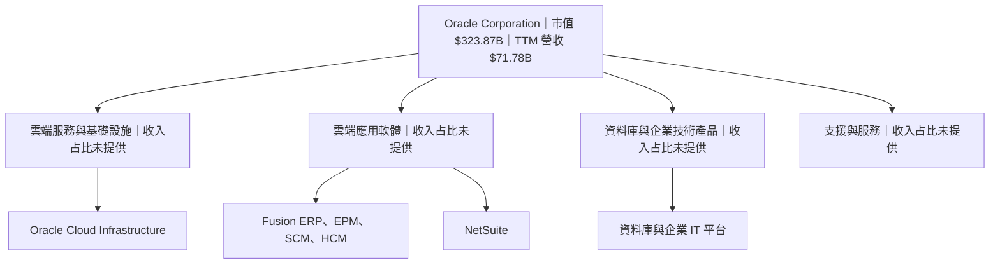
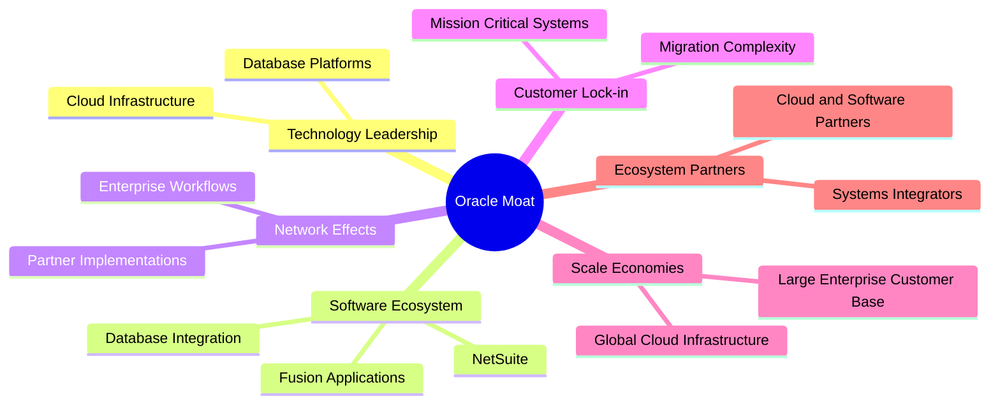
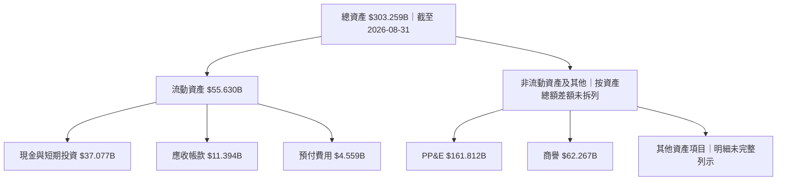
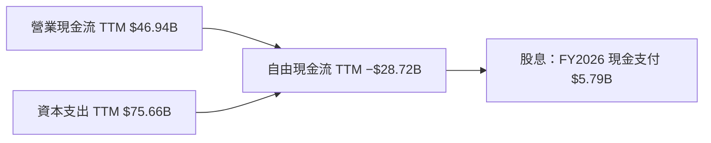
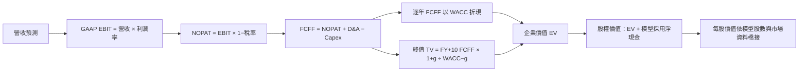
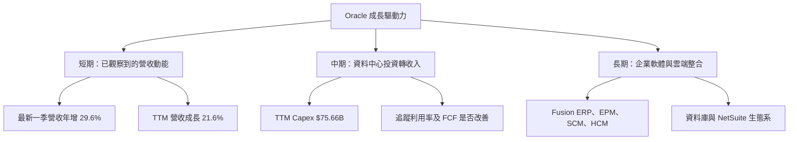
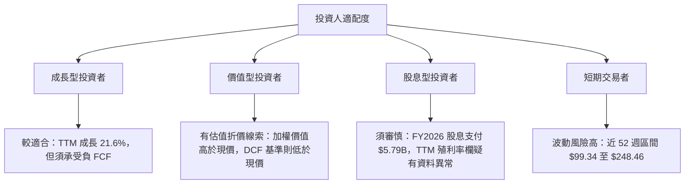

# ORCL 基本面深度分析報告
> **報告日期**：2026-11-27 ｜ **語言**：繁體中文 ｜ **數據來源**：SEC 申報資料 (XBRL)、Yahoo Finance、Finviz、StockAnalysis、Roic.ai ｜ **分析師**：CFA 級機構研究

## 目錄

| # | 章節 | 核心結論 |
|---|------|----------|
| 1 | 執行摘要 | 規則 20 評級為強烈買入；加權合理價值 $161.41，MOS +35.6% |
| 2 | 公司概覽與商業模式 | ERP、資料庫與雲端服務形成高轉換成本；業務別收入占比未提供 |
| 3 | 損益表深度分析 | TTM 營收 $71.78B、TTM 成長 21.6%；資本密集投資使現金流落後於盈餘 |
| 4 | 資產負債表分析 | 現金與短期投資 $37.08B；總債務資料口徑衝突，流動性尚可但需核實 |
| 5 | 現金流量深度分析 | TTM FCF −$28.72B、FCF Yield −8.87%；資本支出急升為核心風險 |
| 6 | 獲利能力與資本效率 | ROIC 61.3% 高於 WACC 8.99%，但高 ROIC 與高資本支出並存 |
| 7 | 相對估值分析 | 估值低於所列同業倍數及自身五年歷史區間；公司數據來源存在差異 |
| 8 | DCF 內在價值評估 | 基準 DCF 每股 $89.67；加權合理價值 $161.41，兩種估值口徑需分辨 |
| 9 | 成長催化劑 | 雲端與 AI 工作負載可能推升需求；TAM 與市場份額數字未提供 |
| 10 | 風險矩陣 | 最大風險為資本支出、融資／負債資料不確定性，以及雲端投資回報未及時落地 |
| 11 | 投資建議 | 依 MOS 門檻為強烈買入；建議分批布局並以 FCF、Capex、利潤率作追蹤條件 |

---

## 1. 執行摘要

截至 2026-11-25 收盤，ORCL 股價為 **$103.88**。TTM 營收 **$71.78B**、TTM 營收成長 **21.6%**，最新一季年增 **29.6%**，TTM 營業利益率 **32.1%**，ROIC **61.3%**，明顯高於 WACC **8.99%**；但 TTM FCF 為 **−$28.72B**、FCF Yield **−8.87%**，主要反映資本支出 TTM **$75.66B**。程式計算的估值方法加權結果為每股 **$161.41**，MOS **+35.6%**，按規則 20 評級為 **🟢 強烈買入**。此結論倚賴相對估值與分析師共識，因基準 DCF 僅 **$89.67**、低於現價；因此評級不代表現金流風險已消失。

### 1.0 一頁式投資儀表板（Portfolio Manager 30 秒速讀）

| 項目 | 內容 |
|------|------|
| **投資論點（3 句）** | ① TTM 營收成長 21.6%、最新一季年增 29.6%，顯示需求仍在加速。② ROIC 61.3% 高於 WACC 8.99%，按提供的 ROIC 口徑，公司目前創造正經濟價值。③ TTM FCF −$28.72B、資本支出 $75.66B，意味成長投資尚未轉成正自由現金流。 |
| **綜合評分** | **6.6/10**（引用 1.1 六項平均） |
| **財務健康** | 🟡 現金與短期投資 $37.08B、流動比率 1.171；但總債務欄位資料互相矛盾，需核實。 |
| **ROIC vs WACC** | **61.3% vs 8.99%**：按該口徑創造價值，差距 52.31 個百分點。 |
| **FCF 趨勢** | 近年因 Capex 大增而轉負；TTM FCF Yield **−8.87%**。 |
| **估值** | Forward P/E **9.393x** ｜ EV/EBITDA **13.114x**（Yahoo Finance 補充欄位）｜ FCF Yield **−8.87%**。 |
| **DCF 內在價值（基準）** | **$89.67** ｜ 現價相對 DCF 溢價 **+15.9%**（按現價 ÷ DCF 價值 − 1）。 |
| **安全邊際（MOS）** | **+35.6%**＝($161.41 − $103.88) ÷ $161.41；基準為 8.8 加權合理價值。🟢 >25% 充足。 |
| **預期報酬（基準情境 12M）** | **−13.7%**（DCF 基準情境 $89.67 相對現價；與加權合理價值上行空間不同）。 |
| **關鍵風險（前二）** | Capex 高於營業現金流；債務與淨現金資料存在口徑衝突。 |
| **評級 + 信心度** | 🟢 **強烈買入** ｜ 信心：**中**；依 MOS 門檻評級，惟基準 DCF 與現金流構成反向證據。 |

### 1.1 綜合評分卡（全報告唯一）

| 維度 | 評分（1–10） | 主要依據（引用數字與其來源章節） |
|------|--------------|----------------------------------|
| 成長性 | 8.0 | TTM 營收成長 21.6%、最新一季年增 29.6%（第 3 章）；季度營收呈加速趨勢。 |
| 獲利能力 | 8.0 | TTM 營業利益率 32.1%、ROIC 61.3% 對 WACC 8.99%；Piotroski 4/7（第 6 章）。 |
| 財務健康 | 4.5 | 現金與短期投資 $37.08B、流動比率 1.171；但總債務資訊不一致，TTM FCF 為負。 |
| 估值 | 7.0 | MOS +35.6%；但基準 DCF $89.67 低於現價，且估值方法結果分歧（第 7–8 章）。 |
| 護城河 | 7.5 | ERP、資料庫與雲端生態具高轉換成本；業務別收入與市場份額未提供（第 2 章）。 |
| 管理層與資本配置 | 5.5 | FY2026 Capex $55.66B、TTM Capex $75.66B，SBC TTM 約 $4.82B；投資回報及股數稀釋仍需觀察。 |
| **綜合評分** | **6.8** | 六項算術平均： (8.0 + 8.0 + 4.5 + 7.0 + 7.5 + 5.5) ÷ 6 = **6.75，四捨五入 6.8**。 |

### 1.2 五大投資論點 + 三大核心風險

| 類型 | 項目 | 具體依據 | 信心度 |
|------|------|----------|--------|
| 🟢 **投資論點①** | 雲端與企業軟體需求帶動成長 | TTM 營收 $71.78B、TTM 成長 21.6%；最新一季年增 29.6%。 | 🟢 高 |
| 🟢 **投資論點②** | 盈利能力有規模優勢 | TTM 營業利益率 32.1%；最新一季營業利益率 34.8%。 | 🟢 高 |
| 🟢 **投資論點③** | 資本回報高於資金成本 | ROIC 61.3% 對 WACC 8.99%；但須留意分母與負債資料口徑。 | 🟡 中 |
| 🟢 **投資論點④** | 相對估值偏低 | Forward P/E 9.393x，低於所列 MSFT 20.2x、SAP 22.0x、CRM 12.3x。 | 🟡 中 |
| 🟢 **投資論點⑤** | 客戶系統轉換成本高 | ERP、資料庫、HCM、SCM 與雲端產品互相整合；具體客戶留存率未提供。 | 🟡 中 |
| 🟡 **風險①** | 資本支出超過營業現金流 | TTM Capex $75.66B 高於營業現金流 $46.94B，FCF 因而為 −$28.72B。 | 🔴 高衝擊 |
| 🔴 **風險②** | 債務與淨現金數據不一致 | Verified Figures 的總債務為 N/A、淨現金 $37.08B；補充財務資料卻列總債務 $169.14B、淨負債約 $132.07B。 | 🔴 高衝擊 |
| 🟡 **風險③** | 資本投資回收與稀釋 | TTM SBC 約 $4.82B，股數未增加測試未通過；若雲端設施利用率不及預期，回報與每股價值都受壓。 | 🟡 中高 |

### 1.3 快速統計卡片

| 指標 | 公司實際值（期間） | 同業中位數 | 狀態 |
|------|--------------------|------------|------|
| 營收成長（TTM） | **21.6%** | — | 🟢 |
| 營收成長（最新一季年增） | **29.6%** | **13.2%** | 🟢 |
| 毛利率（TTM） | **64.0%** | **73.6%** | 🟡 |
| 營業利益率（TTM） | **32.1%** | — | 🟢 |
| ROIC（TTM） | **61.3%** | — | 🟢 |
| Forward P/E | **9.393x** | **20.2x**（三家中位數） | 🟢 |
| FCF Yield（TTM） | **−8.87%** | — | 🔴 |
| Piotroski F-Score | **4 / 7** | — | 🟡 |

同業中位數按可用資料計算：Forward P/E 三家公司中位數 20.2x；毛利率三家公司中位數 73.6%；最新一季營收成長中位數 13.2%。

### 1.4 投資結論

```text
╔══════════════════════════════════════════════════════════════════╗
║                    📊 投資結論摘要                               ║
╠══════════════════════════════════════════════════════════════════╣
║  評級：強烈買入（按規則 20 的 MOS 門檻；未作質化上調或下調）     ║
║  價格（2026-11-25 收盤）：$103.88                               ║
║  DCF 內在價值（基準）：$89.67（現價溢價 +15.9%）                ║
║  安全邊際 MOS：+35.6%（＝(加權合理價值−現價)÷加權合理價值）      ║
║  加權合理價值（8.8）：$161.41                                    ║
║  DCF 情境價值：                                                  ║
║    悲觀情境：$11.24（−89.2%）                                    ║
║    基準情境：$89.67（−13.7%）                                    ║
║    樂觀情境：$264.74（+154.9%）                                  ║
║  綜合評分：6.8/10（引用 1.1）                                    ║
║  適合投資人：能承受高波動、願意分批布局並追蹤 Capex 與 FCF 者    ║
╚══════════════════════════════════════════════════════════════════╝
```

---

## 2. 公司概覽與商業模式

### 2.1 業務結構與收入來源

Oracle 提供資料庫、企業應用軟體、雲端基礎設施及支援服務。公司摘要列出 Fusion ERP、EPM、SCM、HCM 與 NetSuite；但沒有提供各業務線營收及占比，故不推算或繪製收入比例圖。公司 TTM 營收為 **$71.78B**，FY2026 年度收入為 **$67.36B**。



### 2.2 市場份額

市場份額資料未提供，亦無足以計算市場占比的產業總額與 Oracle 各產品營收。相對規模方面，Oracle TTM 營收為 $71.78B，TTM 成長 21.6%，高於所列 MSFT、SAP、CRM 最新一季營收年增率中位數 13.2%；不過單季與 TTM 成長口徑不同，不能視為完全同口徑比較。

### 2.3 競爭護城河分析



### 2.4 護城河強度

| 護城河項目 | 強度（強／中／弱） | 證據（引用數字或事實） | 會削弱它的情況 |
|------------|--------------------|------------------------|----------------|
| 企業軟體生態 | 強 | Fusion ERP、EPM、SCM、HCM、NetSuite 覆蓋企業核心流程；客戶替換需處理資料與工作流程遷移。 | 競品功能差距縮小、雲端轉換工具降低遷移成本。 |
| 資料庫與技術 | 中至強 | 資料庫是企業 IT 核心系統之一；本資料未列客戶數、留存率或資料庫市占，量化證據有限。 | 開源替代方案成熟、雲端原生架構改變資料庫選擇。 |
| 客戶鎖定 | 強 | ERP、HCM、供應鏈與資料庫涉及長期部署與流程整合；營收規模 TTM $71.78B。 | 多雲策略、模組化系統及更低轉換成本。 |
| 規模效應 | 中至強 | TTM 營收 $71.78B，最新一季年增 29.6%，有能力承擔大型雲端投資。 | Capex 回收期過長、設施利用率不足，或規模投資未帶動單位成本下降。 |
| 網路效應 | 中 | 導入、維運與顧問合作夥伴可擴大產品部署；合作夥伴數及網路效應指標未提供。 | 競爭平台增加整合與開發工具吸引力。 |
| 生態夥伴 | 中 | 企業軟體常依賴系統整合商與顧問服務；本資料未提供合作夥伴收入或數量。 | 夥伴轉向競品、客戶自行開發或採用多供應商架構。 |

**1.1 護城河 7.5 分的理由**：產品嵌入企業核心流程，轉換成本具經濟意義；但缺少留存率、市占及業務別營收等直接驗證資料。

---

## 3. 損益表深度分析

### 3.1 年度收入成長趨勢（近 4 年）

FY2023–FY2026 收入分別為 $49.95B、$52.96B、$57.40B、$67.36B；FY2023 至 FY2026 三年 CAGR 約 10.5%。

```text
╔══════════════════════════════════════════════════════════════════╗
║              Oracle 年度收入趨勢（FY2023–FY2026）                ║
╠══════════════════════════════════════════════════════════════════╣
║ FY2023  $49.95B  ███████████████       YoY：基期             ║
║ FY2024  $52.96B  ████████████████      YoY：+6.0%  🟡        ║
║ FY2025  $57.40B  █████████████████     YoY：+8.4%  🟡        ║
║ FY2026  $67.36B  ████████████████████  YoY：+17.4% 🟢        ║
╠══════════════════════════════════════════════════════════════════╣
║ FY2023–FY2026 三年營收 CAGR：(67.357 ÷ 49.954)^(1/3)−1 ≈ 10.5% ║
╚══════════════════════════════════════════════════════════════════╝
```

FY2026 年營收成長 17.35%，高於前兩年，可能反映雲端及企業服務需求擴張；但營收分部資料缺失，無法將增幅精確歸因至某一產品線。

### 3.2 季度收入趨勢分析

| 季度 | 營收（$B） | QoQ 成長 | YoY 成長 | 備註 |
|------|-----------:|---------:|---------:|------|
| FY2026 Q2（2025-11） | 16.058 | +13.6% | +14.2% | QoQ 對 FY2026 Q1 $14.926B。 |
| FY2026 Q3（2026-02） | 17.190 | +7.1% | +21.7% | YoY 對 FY2025 Q3 $14.130B。 |
| FY2026 Q4（2026-05） | 19.184 | +11.6% | +20.6% | YoY 對 FY2025 Q4 $15.903B。 |
| FY2027 Q1（2026-08） | 19.345 | +0.8% | +29.6% | 最新一季成長加速；較前季增速放慢。 |

QoQ 為未季節調整的季度間變化，不能直接等同於有季節調整的成長率。最新一季收入年增 29.6%，較上一季年增 20.6% 加速；代表需求動能改善，但應同時觀察 Capex 與現金回收。

### 3.3 利潤率演變分析

| 利潤率指標 | FY2023 | FY2024 | FY2025 | FY2026 | 趨勢 | 評估 |
|------------|-------:|-------:|-------:|-------:|------|------|
| **毛利率** | 72.9% | 71.4% | 70.5% | 65.8% | ↘️ 年度下降 | 🟡 |
| **營業利益率** | 27.6% | 30.3% | 31.4% | 33.3% | ↗️ 逐年改善 | 🟢 |
| **淨利率** | 17.0% | 19.8% | 21.7% | 25.4% | ↗️ 持續改善 | 🟢 |

年度利潤率以年度收入、毛利、營業利益及淨利計算；與程式提供的 TTM 營業利益率 **32.1%** 不完全一致，應視期間不同而非互相替代。毛利率由 FY2023 72.9% 降至 FY2026 65.8%，可能與雲端基礎設施收入組合、資料中心折舊與運營成本上升有關；但現有資料沒有分部成本，不能確認各因素的量化貢獻。相對地，營業利益率從 27.6% 升至 33.3%，顯示營業費用相對收入的槓桿改善或業務組合變化抵銷部分毛利壓力。

### 3.4 費用結構分析

收入成本、研發費用、銷售與行政費用的完整同期間明細未提供，故不畫費用結構圓餅圖，以免把不完整資料轉成比例。已知 FY2026 研發支出 **$10.27B**，約占 FY2026 收入 $67.36B 的 **15.3%**；研發投入支撐產品與雲端競爭力，但其回報仍需以增量收入、毛利及現金流檢驗。

### 3.5 季度 EPS 趨勢與盈餘品質（Quality of Earnings）

EPS 預估值欄為 NaN，因此無法可靠判斷過去四季是否超預期或不及預期。可觀察實際 EPS：2025-11 為 $2.10、2026-02 為 $1.27、2026-05 為 $1.45、2026-08 為 $1.56；StockAnalysis 列示最新一季 EPS 年增 54.45%。上一季較高的 $2.10 令季對季比較受稅務及季度組合影響，不能將單季 EPS 波動直接解讀為持續性盈餘趨勢。

| 盈餘品質項目 | 數值／佔比 | 評估 |
|--------------|-----------|------|
| 股權薪酬 SBC / 營收 | TTM SBC 約 $4.82B ÷ $71.78B = **6.7%** | 🟡 SBC 對每股經濟回報有稀釋成本；Piotroski 股數未增加測試未通過。 |
| SBC / 營業現金流 | $4.82B ÷ $46.94B = **10.3%** | 🟡 SBC 是非現金費用，但並非沒有股東成本。 |
| FCF / 淨利（現金轉換率） | −$28.72B ÷ TTM 淨利 $18.736B = **−153.2%** | 🔴 FCF 為負，主因 Capex 大幅高於營業現金流。 |
| 一次性／非經常性損益 | 完整拆分 **N/A** | 無法判斷是否存在重大一次性盈餘項目。 |
| 有效稅率異常 | 12.6%（最新年度有效稅率） | 🟡 稅率低於常見名目稅率，但資料不足以判斷稅務利益的可持續性。 |
| 資本化支出 vs 費用化 | TTM Capex $75.66B；折舊攤銷率假設 13.1% | 🔴 大額資本支出當期不直接全數列為費用，未來折舊與利用率會影響利潤及資產回報。 |

**盈餘品質結論**：營收與營業利潤成長具實際損益表支持，但 TTM FCF 轉換率為負，反映當期盈餘尚未轉成可分配現金。SBC 約占營收 6.7%，亦需視為股東成本。對估值而言，應降低只依 EPS 成長外推的信心，並要求 Capex 逐步回落、現金流轉正作為驗證。

---

## 4. 資產負債表分析

### 4.1 資產結構分解

最新 TTM 資產資料列示總資產 $303.259B；現金與短期投資 $37.077B、應收帳款 $11.394B、PP&E $161.812B、商譽 $62.267B。各項為資料所列帳面金額，未以剩餘項目反推其他資產。



### 4.2 流動性與營運資金分析

| 指標 | 最新 TTM | 一年前 TTM | 變化 | 解讀 |
|------|----------|------------|------|------|
| DSO 應收帳款天數 | 58 天 | 55 天 | +3 天 | 收款天數略增；需留意是否因大型企業合約付款條件拉長。 |
| DIO 存貨天數 | N/A | N/A | N/A | 公司未列存貨餘額，不推算。 |
| DPO 應付帳款天數 | 156 天 | N/A | N/A | 一年前缺資料，無法判斷方向；目前 DPO 較長可能反映付款條件與供應商融資。 |
| CCC 現金轉換週期 | N/A | N/A | N/A | 因 DIO 缺資料，不計算。 |

補充流動比率為 **1.171**、速動比率 **1.02**，表示短期流動資產略高於流動負債，但緩衝並不寬裕。現金與短期投資 TTM **$37.08B**；由於總債務欄位有資料衝突，不將現金額直接解讀為公司淨現金。

### 4.3 債務結構分析

```text
╔══════════════════════════════════════════════════════════════════╗
║                   Oracle 債務健康診斷                            ║
╠══════════════════════════════════════════════════════════════════╣
║  現金與短期投資： $37.08B  （截至 2026-08-31）                   ║
║  Verified 總債務：N/A      （程式核驗欄位未提供）                ║
║  補充資料總債務：$169.14B  （來源欄位，與核驗欄位口徑衝突）      ║
║  淨現金／淨負債：核驗欄列 +$37.08B；補充資料列約 −$132.07B       ║
║  Debt/EBITDA：N/A；利息保障倍數：N/A（負債與利息分母未核實）     ║
║  評估：🔴 必須先核對債務定義、租賃負債及資產負債表期間。         ║
╚══════════════════════════════════════════════════════════════════╝
```

不得把資料包標示的「淨現金 +$37.08B」與補充資料總債務 $169.14B 靜默合併。前者在總債務為 N/A 的條件下不等同已驗證的淨現金；補充資料則列出負債，兩者可能口徑或期間不同。

### 4.4 股東權益趨勢

| 年度 | 股東權益（$B） | 年變化 |
|------|----------------:|-------:|
| FY2023 | 1.07 | — |
| FY2024 | 8.70 | +7.63 |
| FY2025 | 20.45 | +11.75 |
| FY2026 | 42.51 | +22.06 |

FY2026 股東權益增加至 $42.51B，但資產同年增加至 $261.76B，且補充 TTM 資產資料達 $303.259B。權益增加有助提高帳面緩衝，但仍須與負債擴張、資本投資及股數變化一起判斷。

---

## 5. 現金流量深度分析

### 5.1 現金流量瀑布圖

淨利到 FCF 的逐項現金流調節未完整提供，故不以淨利數字假裝精確銜接；以下只列核驗的 TTM 營業現金流、Capex 與 FCF。



### 5.2 FCF 轉換率趨勢

| 財年 | FCF（$B） | 淨利（$B） | FCF / 淨利 | 趨勢 |
|------|---------:|-----------:|-----------:|------|
| FY2023 | 8.47 | 8.50 | 99.6% | 🟢 現金轉換接近淨利 |
| FY2024 | 11.81 | 10.47 | 112.8% | 🟢 高於淨利 |
| FY2025 | −0.394 | 12.44 | −3.2% | 🔴 Capex 大幅增加後轉弱 |
| FY2026 | −23.69 | 17.09 | −138.6% | 🔴 投資支出壓過營業現金流 |
| TTM 至 2026-08-31 | −28.72 | 18.736 | −153.2% | 🔴 持續處於高投資、負 FCF 階段 |

### 5.3 自由現金流趨勢

```text
╔══════════════════════════════════════════════════════════════════╗
║              自由現金流趨勢（年度，美元）                        ║
╠══════════════════════════════════════════════════════════════════╣
║ FY2023  +$8.47B   ████████░░░░░░░░░░░░  🟢                     ║
║ FY2024 +$11.81B   ███████████░░░░░░░░░  🟢                     ║
║ FY2025  −$0.394B  ░░░░░░░░░░░░░░░░░░░░  🔴                     ║
║ FY2026 −$23.69B   ░░░░░░░░░░░░░░░░░░░░  🔴                     ║
║ TTM    −$28.72B   FCF Yield：−8.87%                             ║
╠══════════════════════════════════════════════════════════════════╣
║ FCF = 營業現金流 − 資本支出；TTM Capex $75.66B 高於 OCF $46.94B ║
╚══════════════════════════════════════════════════════════════════╝
```

Capex 由 FY2024 的 $6.87B 升至 FY2025 的 $21.21B、FY2026 的 $55.66B，反映建置雲端基礎設施的投入顯著增加。投資若能形成可計費容量，長期可支撐收入；若利用率、定價或需求不符預期，則會以折舊、融資需求與低 FCF 的形式損害股東回報。

### 5.4 資本配置評估

完整回購金額及 TTM 分類資本配置資料未提供，不繪製資本配置圓餅圖。

| 項目 | 已知資料 | 評估 |
|------|----------|------|
| Capex | FY2026 $55.66B；TTM $75.66B | 🔴 遠高於營業現金流，投資回收是首要監控項目。 |
| 股息 | FY2026 支付 $5.79B；TTM 股息支付未提供 | 🟡 已知股息金額上升，但負 FCF 期間仍需檢視融資來源。 |
| SBC | FY2026 $4.81B；TTM 約 $4.82B | 🟡 形成股東稀釋成本。 |
| 股票回購 | 金額未提供 | N/A；不推算。 |
| 留存與併購 | 分項數據未提供 | N/A；無法量化。 |

---

## 6. 獲利能力與資本效率

### 6.1 ROE / ROA / ROIC 趨勢

| 指標 | 最新數值 | 歷史資料 | 評估 |
|------|---------:|----------|------|
| ROE（TTM，QUALITY FIGURES） | 28.3% | 長期比較口徑未提供 | 🟢 正向；但杜邦權益乘數 4.54，槓桿對 ROE 有影響。 |
| ROA | TTM 測試顯示為正；精確核驗數值 N/A | 補充欄位列 6.4%，不同來源口徑 | 🟡 不混用來源不一致數值。 |
| ROIC（TTM） | 61.3% | TTM 口徑 | 🟢 明顯高於 8.99% WACC；但仍需留意計算所用投入資本與負債欄位衝突。 |

### 6.2 ROIC vs WACC 分析（核心價值創造判斷）

WACC 及各組成採用 Cost of capital 區塊提供值，不另行建立另一個 WACC。原始 Beta **1.78**，調整後 Beta **1.52 = ⅔ × 1.78 + ⅓**；使用調整後 Beta。

```text
╔══════════════════════════════════════════════════════════════════╗
║                ROIC vs WACC 深度分析                            ║
╠══════════════════════════════════════════════════════════════════╣
║  WACC 輸入（程式計算值，直接採用）：                              ║
║  ├── 無風險利率（10Y 美債）：4.85%                               ║
║  ├── ERP：5.00%                                                  ║
║  ├── 原始 Beta：1.78；調整 Beta：1.52                            ║
║  ├── 股權成本：12.44%（依 Cost of capital 輸入）                 ║
║  ├── 稅前債務成本：2.72%；有效稅率：12.6%                        ║
║  ├── 股權／債務權重：65.7%／34.3%                               ║
║  └── WACC：8.99%                                                ║
║                                                                  ║
║  ROIC vs WACC：                                                  ║
║  ├── ROIC（TTM）：61.3%                                          ║
║  ├── WACC：8.99%                                                 ║
║  ├── ROIC − WACC = 61.3% − 8.99% = 52.31 個百分點               ║
║  └── ROIC / WACC = 61.3 ÷ 8.99 ≈ 6.82 倍                        ║
║                                                                  ║
║  結論：按程式提供的 ROIC 口徑，現有回報高於資本成本。             ║
║  但資本支出快速上升、總債務資料不一致，降低該結論的信心。         ║
╚══════════════════════════════════════════════════════════════════╝
```

Cost of capital 輸入沒有提供可一致對應的利息費用、平均計息負債及市場資本金額，故不以其他資料自行重算 WACC。當前估值與 ROIC 間的價值創造判斷是依核驗的 ROIC 與 WACC 數字，而不是對未提供的債務明細作推導。

### 6.3 杜邦三因素分解

| 因素 | 數值（TTM） | 解讀 |
|------|-------------|------|
| 淨利率 | 26.4% | 每美元營收轉成約 26.4 美分淨利。 |
| 資產週轉率 | 0.24 | 資產規模大，資產週轉偏低，符合重資產投資階段的特徵。 |
| 權益乘數 | 4.54 | 槓桿提高 ROE，但也放大資金與利率風險。 |
| **ROE** | **28.3%** | 26.4% × 0.24 × 4.54 = 28.8%，與核驗的 28.3% 有四捨五入及口徑尾差；本報告以核驗 ROE 為準。 |

### 6.4 財務體質：Piotroski F-Score

Piotroski F-Score 為 **4/7**。分母低於九，是因兩個測試缺乏必要輸入而不納入計分。

| 測試 | 結果 | 解讀 |
|------|------|------|
| ROA > 0 | ✅ 通過 | 盈利為正。 |
| 營業現金流 > 0 | ✅ 通過 | TTM 營業現金流 $46.94B。 |
| ROA 高於一年前 | ❌ 未通過 | 資產回報未改善。 |
| 營業現金流 > 淨利 | ✅ 通過 | 單看營業現金流，應計品質測試通過；但 Capex 使 FCF 仍為負。 |
| 長期負債 ÷ 總資產低於一年前 | — 無法判定 | 缺乏相同口徑負債資料。 |
| 流動比率高於一年前 | ✅ 通過 | 按品質指標測試結果通過。 |
| 稀釋股數未增加 | ❌ 未通過 | 股數變化不利於每股股東回報。 |
| 毛利率高於一年前 | — 無法判定 | 缺少該測試所需可比資料。 |
| 資產週轉率高於一年前 | ❌ 未通過 | 資產增長快於收入效率改善。 |

---

## 7. 相對估值分析

### 7.1 同業估值比較表格

本表同業倍數採 Peer multiples；Oracle 倍數來自市場估值補充欄位。Oracle 自身數據與自身歷史資料區塊略有差異，故同業比較和歷史比較分開呈現。

| 估值指標 | **ORCL** | **MSFT** | **SAP** | **CRM** | 本公司評估 |
|----------|---------:|---------:|---------:|---------:|-----------|
| **Trailing P/E** | 16.282x | 25.6x | 26.1x | 18.0x | 🟢 低於三家同業中位數 25.6x；可能反映市場對資本支出及融資風險折價。 |
| **Forward P/E** | 9.393x | 20.2x | 22.0x | 12.3x | 🟢 明顯低於同業中位數 20.2x；須確認預期 EPS 是否可持續。 |
| **P/S Ratio** | 4.512x | 10.5x | N/A | 3.7x | 🟡 可比較公司中位數 7.1x；SAP 因混合幣別不可比。 |
| **EV / EBITDA** | 13.114x | 18.0x | N/A | 15.0x | 🟢 ORCL 低於可比同業中位數 16.5x；SAP 倍數不可比。 |
| **最新一季營收成長** | 29.6% | 18.8% | 13.2% | 10.8% | 🟢 ORCL 高於所列同業。 |
| **毛利率（TTM）** | 64.0% | 67.7% | 73.6% | 77.3% | 🔴 低於三家中位數 73.6%；可能反映業務組合與雲端運營成本。 |

### 7.2 歷史估值區間分析

```text
╔══════════════════════════════════════════════════════════════════╗
║                 ORCL 自身五年估值區間                            ║
╠══════════════════════════════════════════════════════════════════╣
║ TTM P/E：     現值 16.3x｜區間 19.0x–52.3x｜中位數 32.1x       ║
║ TTM P/S：     現值  4.3x｜區間  4.6x–11.1x｜中位數  6.2x       ║
║ TTM EV/EBITDA：現值 8.5x｜區間 12.6x–28.9x｜中位數 17.9x       ║
║ 三項當前百分位排名均列 0%（來源：Valuation vs own history）      ║
║ 評估：🟢 歷史相對估值偏低；但低估值可能部分反映資本支出與負 FCF。║
╚══════════════════════════════════════════════════════════════════╝
```

自身歷史 P/E、P/S、EV/EBITDA 分別為 16.3x、4.3x、8.5x；補充估值表另列 EV/EBITDA 13.114x、P/S 4.512x。數據來源及計算口徑不一致，不將兩套倍數混為單一現值。歷史百分位排名照錄來源，並不代表價格必然回到中位數。

### 7.3 情境價值（Bear / Base / Bull）

情境估值照 DCF MODEL 所列數值；「營收成長」欄為第 1 年成長假設，並非整段預測期 CAGR。

| 情境 | 第 1 年營收成長 | 期末營業利潤率 | WACC | 每股價值 | 相對現價 | 機率 | 會發生的條件 |
|------|----------------:|----------------:|-----:|----------:|---------:|-----:|--------------|
| 🔴 悲觀 | 10.8% | 26.0% | 9.99% | $11.24 | −89.2% | 25% | 雲端需求放緩、Capex 未能轉成足夠收入，且長期利潤率下滑。 |
| 🟡 基準 | 21.6% | 30.6% | 8.99% | $89.67 | −13.7% | 50% | 營收以 TTM 成長率起步並逐步降至長期成熟成長，利潤率小幅下降。 |
| 🟢 樂觀 | 32.4% | 33.6% | 7.99% | $264.74 | +154.9% | 25% | 雲端與 AI 工作負載增長超出基準，規模效應帶動期末利潤率上升。 |

### 7.4 相對估值隱含價格區間

```text
╔══════════════════════════════════════════════════════════════════╗
║             程式計算估值方法與每股價值                            ║
╠══════════════════════════════════════════════════════════════════╣
║ DCF 基準：             $89.67  ── 現價 $103.88 ──────────────  ║
║ 同業 EV/EBITDA：       $183.86                                  ║
║ 同業 Forward P/E：     $223.85                                  ║
║ 分析師共識目標價：     $236.18                                  ║
╠══════════════════════════════════════════════════════════════════╣
║ Forward P/E：同業中位數 20.2x × Forward EPS $11.06              ║
║ EV/EBITDA：同業中位數 16.5x（MSFT、CRM）× TTM EBITDA，加回淨現金 ║
║ 共識：40 位分析師平均目標價 $236.18                             ║
╚══════════════════════════════════════════════════════════════════╝
```

同業相對估值結果高於現價，但股價推導依賴同業倍數適用性及公司 EBITDA、淨現金資料口徑。尤其債務數據存在衝突，EV/EBITDA 回推值不應脫離其假設單獨解讀。

---

## 8. DCF 內在價值評估（Discounted Cash Flow）

> 本章逐年假設、現金流、終值、橋接、敏感度與情境值均採用程式計算結果，不另建模型。美元金額以 $B 表示，金額取兩位小數，折現因子取三位小數，百分比取一位小數，尾差可能來自顯示位數。

### 8.0 估值推理鏈（Thinking Logic）

**Step 1 — 價值由哪些變數決定？**  
Oracle 的估值主要受既有企業軟體與資料庫收入底盤、雲端／基礎設施增長，以及新建資料中心的投資回收影響；但各業務營收占比未提供，不能量化拆分。基準 DCF 中 Capex/營收由第一年 **105.4%** 逐步降至第十年 **14.4%**，因此資本支出路徑是最可能主導估值的變數。敏感度矩陣亦顯示 WACC 與永續成長率對每股價值影響顯著。

**Step 2 — 模型選擇**

| 決策點 | 本報告採用 | 理由（含數字） | 曾考慮但否決 | 否決理由 |
|--------|-----------|----------------|--------------|----------|
| 現金流定義 | FCFF | 用 WACC 8.99% 折現並先求 EV，再橋接至股權價值。 | FCFE | WACC 與企業價值方法的模型設定已固定為 FCFF。 |
| 預測期 N | 10 年 | DCF 模型預測期固定 10 年，並逐年淡化營收成長。 | 5 年 | 會與已計算的程式模型不一致。 |
| 終值方法 | Gordon Growth | g 3.0%，低於 WACC 8.99%。 | 退出倍數作主要終值 | 提供模型沒有計算退出倍數終值，不能另造數字。 |
| EBIT 基礎 | GAAP EBIT | 依 DCF 模型設定，GAAP EBIT 已含 SBC 費用。 | 非 GAAP EBIT | 會改變既有模型口徑。 |

**Step 3 — 關鍵假設推導鏈**

- **營收成長**：錨點＝TTM 營收成長 21.6%；調整＝第一年沿用近期 TTM 成長，之後線性淡化至第十年 3.0%；**採用第一年 21.6%、第十年 3.0%**；曾考慮固定 21.6% 十年，但在成熟企業長期維持相同成長過於樂觀，予以否決。
- **期末營業利潤率**：錨點＝TTM 營業利益率 32.1%；調整＝模型依近五財年中位水準淡化；**採用第十年 30.6%**；曾考慮以最新一季 34.8% 作長期利潤率，但單季水準不宜直接外推至成熟期，予以否決。
- **永續成長率 g**：錨點＝模型設定長期成長 3.0%；調整＝用較長期成熟假設，且低於 WACC；**採用 3.0%**；不採用接近或高於 WACC 的成長率，避免終值失效。
- **預測期 N**：錨點＝程式模型固定 10 年；調整＝使用逐年淡化而非永久延續高成長；**採用 10 年**；不縮短為 5 年，以免與提供的模型不一致。
- **Capex/營收**：錨點＝TTM Capex/營收 105.4%；調整＝模型逐年淡化至第十年 14.4%，即 D&A 的 1.1 倍；**採用模型列示路徑**；若將 105.4% 永久外推，將不符合成熟期投資收斂假設，因此否決。
- **WACC**：錨點＝Cost of capital 提供 WACC 8.99%；調整＝不另調整；**採用 8.99%**；不自行另估，以免與核驗折現率脫節。
- **EBIT 基礎與 SBC**：錨點＝GAAP EBIT；調整＝SBC 已計入 GAAP 費用；**採用 (A) GAAP EBIT + 固定股數，不另扣 SBC、年稀釋率設 0%**；否決再扣 SBC 或再放大股數，避免重複計入同一成本。
- **年稀釋率**：模型採用固定股數，**採用 0% 額外稀釋**，與組合 (A) 一致；另須注意稀釋股數未增加測試未通過，這是模型假設的不確定性。
- **終值方法**：採 Gordon Growth；退出倍數沒有程式輸出，故不自行編造。
- **有效稅率、D&A/營收**：採用 12.6% 與 13.1%，錨點分別為最新年度有效稅率及 TTM 比率。
- **營運資金變動**：模型未建模；DCF FCFF 依公式為 NOPAT + D&A − Capex，不另填 ΔWC。

**Step 4 — 最脆弱環節**  
Capex 由 105.4% 營收逐步下降至 14.4% 是最脆弱假設；若資料中心投資不能按預期收斂，價值將低於基準 DCF $89.67，且終值占 EV 172.3% 會放大長期假設偏差。

**Step 5 — 計算路徑圖**



### 8.1 模型假設總表（Model Inputs）

| 假設項目 | 採用值 | 依據／來源 | 敏感度 |
|----------|--------|-------------|--------|
| 預測期長度 **N** | 10 年 | DCF MODEL 固定預測期。 | 🟡 中 |
| 營收成長路徑 | FY+1 21.6% 線性淡化至 FY+10 3.0% | TTM 成長 21.6%；終年成熟成長 3.0%。 | 🔴 高 |
| 營業利潤率 | 32.1%（FY+1）至 30.6%（FY+10） | TTM 營業利益率 32.1%；模型淡化至近五財年中位數。 | 🔴 高 |
| 有效稅率 | 12.6% | 最新年度有效稅率。 | 🟢 低 |
| Capex / 營收 | 105.4%（FY+1）至 14.4%（FY+10） | TTM Capex/營收，逐年淡化至 1.1×D&A。 | 🔴 高 |
| D&A / 營收 | 13.1% | TTM D&A/營收。 | 🟢 低 |
| 營運資金變動 | 不建模 | DCF MODEL 明列 working capital is not modelled；不補入假設值。 | 🟡 中 |
| EBIT 基礎 | GAAP | DCF MODEL 使用 GAAP EBIT。 | 🟡 中 |
| 股權薪酬 SBC 處理 | 組合 (A)：GAAP EBIT 已含 SBC，不再扣 SBC | 模型說明 SBC 已作為費用，固定股數不另稀釋。 | 🟡 中 |
| 年稀釋率 | 0%（固定股數） | 與組合 (A) 的模型處理一致。 | 🟡 中 |
| 永續成長率 g | 3.0% | DCF MODEL 終值假設；低於 WACC 8.99%。 | 🔴 高 |
| 終值方法 | Gordon Growth | DCF MODEL 已提供 TV；退出倍數未計算。 | 🔴 高 |
| WACC | 8.99% | Cost of capital 區塊直接提供。 | 🔴 高 |

**FCFF 定義**：採 FCFF，按模型公式 **FCFF = NOPAT + D&A − Capex**；營運資金未納入。  
**SBC 說明**：本模型採用 **(A) GAAP EBIT + 固定股數**，故 SBC 影響已計入一次；不另設 −SBC 列、不再增加稀釋股數。

### 8.2 折現率推導（WACC）

```text
╔══════════════════════════════════════════════════════════════════╗
║                    WACC 推導（折現率）                           ║
╠══════════════════════════════════════════════════════════════════╣
║ 股權成本 Ke（CAPM，直接採 Cost of capital 數值）：                ║
║ ├── 無風險利率 Rf：4.85%                                        ║
║ ├── ERP：5.00%                                                   ║
║ ├── 原始 Beta（Yahoo）：1.78                                     ║
║ ├── 調整 Beta：1.52 = ⅔ × 1.78 + ⅓                              ║
║ └── Ke：12.44%（依程式提供值，不另重算）                        ║
║                                                                  ║
║ 債務成本與權重（依程式提供值）：                                 ║
║ ├── 稅前 Kd：2.72%                                              ║
║ ├── 有效稅率：12.6%                                             ║
║ ├── 股權／債務權重：65.7%／34.3%                                ║
║ └── WACC：8.99%                                                  ║
║                                                                  ║
║ 注意：利息費用、平均計息負債及市值金額未提供完整一致明細，       ║
║ 因此不以補充負債數據自行重算 WACC；直接採用核驗值 8.99%。         ║
╚══════════════════════════════════════════════════════════════════╝
```

**逐步演算（依可核驗的輸入）**

1. **Ke（CAPM）**：已提供 Ke **12.44%**；原始 Beta 1.78 調整為 1.52。若以輸入的 4.85% + 1.52 × 5.00% 計算，結果為 12.45%，與列示 Ke 12.44% 有 0.01 個百分點顯示尾差；依規則採用程式值 12.44%。
2. **稅前 Kd**：程式列示 **2.72%**；利息費用及平均計息負債金額未提供，無法展示金額除法。
3. **稅後 Kd**：2.72% × (1 − 12.6%) = **2.377%**，四捨五入為 2.38%。
4. **權重**：股權 65.7% + 債務 34.3% = **100.0%**；E、D 的金額未提供一致口徑，不反推。
5. **WACC**：65.7% × 12.44% + 34.3% × 2.377% = 8.173% + 0.815% = **8.988% ≈ 8.99%**。

Rf 的具體觀測日期未提供；ERP 為資料列示假設值 5.00%。由於 WACC 權重依程式值直接採用，本報告不使用股東權益帳面值或有衝突的債務欄位另行重算。第 6.2 節與本節均使用 **8.99%**。

### 8.3 逐年自由現金流預測（基準情境）

下表逐年照錄 DCF MODEL；金額為 $B。模型未列 ΔWC，亦不另加計。

| 年度 | FY+1 | FY+2 | FY+3 | FY+4 | FY+5 | FY+6 | FY+7 | FY+8 | FY+9 | FY+10 |
|------|-----:|-----:|-----:|-----:|-----:|-----:|-----:|-----:|-----:|------:|
| 營收 | 87.29 | 104.36 | 122.60 | 141.50 | 160.38 | 178.47 | 194.90 | 208.81 | 219.39 | 225.97 |
| 營收 YoY | 21.6% | 19.6% | 17.5% | 15.4% | 13.3% | 11.3% | 9.2% | 7.1% | 5.1% | 3.0% |
| 營業利潤率 | 32.1% | 32.0% | 31.8% | 31.6% | 31.4% | 31.3% | 31.1% | 30.9% | 30.8% | 30.6% |
| GAAP EBIT | 28.04 | 33.34 | 38.97 | 44.73 | 50.43 | 55.81 | 60.61 | 64.58 | 67.49 | 69.13 |
| − 稅 | (3.54) | (4.21) | (4.92) | (5.64) | (6.36) | (7.04) | (7.65) | (8.15) | (8.51) | (8.72) |
| = NOPAT | 24.50 | 29.14 | 34.05 | 39.09 | 44.06 | 48.77 | 52.97 | 56.44 | 58.97 | 60.40 |
| + D&A | 11.47 | 13.71 | 16.10 | 18.59 | 21.07 | 23.44 | 25.60 | 27.43 | 28.82 | 29.68 |
| − Capex | (92.02) | (99.46) | (104.45) | (106.25) | (104.22) | (97.93) | (87.25) | (72.38) | (53.87) | (32.65) |
| **= FCFF** | **−56.05** | **−56.61** | **−54.30** | **−48.58** | **−39.09** | **−25.73** | **−8.69** | **11.49** | **33.92** | **57.44** |
| 折現因子 @8.99% | 0.918 | 0.842 | 0.772 | 0.709 | 0.650 | 0.597 | 0.547 | 0.502 | 0.461 | 0.423 |
| **FCFF 現值 PV** | **−51.43** | **−47.66** | **−41.94** | **−34.43** | **−25.42** | **−15.35** | **−4.76** | **5.77** | **15.63** | **24.29** |

**預測期 PV 合計**：  
−51.43 + (−47.66) + (−41.94) + (−34.43) + (−25.42) + (−15.35) + (−4.76) + 5.77 + 15.63 + 24.29 = **−175.30B**。  
模型列示合計 **−$175.29B**，兩者相差 $0.01B，屬逐年金額顯示四捨五入尾差。

**逐步演算（FY+1，按模型所列數字）**

1. 營收 = $71.78B × (1 + 21.6%) = **$87.29B**（模型列示值）。
2. EBIT = $87.29B × 32.1% = **$28.04B**。
3. 稅 = $28.04B × 12.6% = **$3.53B**，模型列示 **$3.54B**（因未顯示底層未四捨五入輸入）。
4. NOPAT = $28.04B − $3.54B = **$24.50B**。
5. D&A = $87.29B × 13.1% = **$11.43B**；模型列示 **$11.47B**，顯示模型採用未四捨五入收入或比例。
6. Capex = $87.29B × 105.4% = **$92.00B**；模型列示 **$92.02B**。
7. ΔWC = **未建模**。
8. FCFF = $24.50B + $11.47B − $92.02B = **−$56.05B**。
9. 折現因子 = 1 ÷ (1 + 8.99%)¹ = **0.918**；PV = −$56.05B × 0.918 = **−$51.46B**，模型列示 **−$51.43B**，差異來自底層未四捨五入輸入。

**合理性自檢**

- FY+1 至 FY+10 FCFF 由 −$56.05B 轉至 +$57.44B，跨越零點，不能用傳統正值 FCF CAGR 作有意義比較；歷史年度 FCF 亦從 FY2024 +$11.81B 降至 FY2026 −$23.69B。
- FY+10 FCFF 利潤率 = $57.44B ÷ $225.97B = **25.4%**；目前 TTM FCF 利潤率 = −$28.72B ÷ $71.78B = **−40.0%**。同業最佳 FCFF 利潤率未提供。
- FY+1 至 FY+7 FCFF 為負；其 PV 仍納入估值，並使預測期 PV 合計為負，顯示前期投資消耗現金。

```text
╔══════════════════════════════════════════════════════════════════╗
║            自由現金流：歷史實際 vs 模型預測                      ║
╠══════════════════════════════════════════════════════════════════╣
║ FY2024（實） +$11.81B   歷史正 FCF                               ║
║ FY2025（實）  −$0.39B   接近損益兩平                             ║
║ FY2026（實） −$23.69B   Capex 大增                               ║
║ FY+1（預）   −$56.05B   模型假設 Capex/營收 105.4%               ║
║ FY+10（預）  +$57.44B   模型假設 Capex/營收降至 14.4%            ║
╠══════════════════════════════════════════════════════════════════╣
║ 模型轉正依賴 Capex 比例下降；與歷史 FCF 趨勢相比，回收路徑不確定。║
╚══════════════════════════════════════════════════════════════════╝
```

### 8.4 終值計算（Terminal Value）

**適用性檢查**：WACC **8.99%** vs g **3.0%** → WACC > g？✅

| 方法 | 計算式 | 終值 TV | TV 現值 | 佔總 EV 比重 |
|------|--------|---------:|--------:|-------------:|
| Gordon Growth | $57.44 × (1 + 3.0%) ÷ (8.99% − 3.0%) | $987.95B | $417.78B | 172.3% |
| 退出倍數法 | N/A（DCF MODEL 未提供退出倍數終值） | N/A | N/A | N/A |

**逐步演算（Gordon Growth）**

1. FY+N FCFF = **$57.44B**。
2. 分子 = $57.44B × (1 + 3.0%) = **$59.16B**（按顯示值計算）。
3. 分母 = 8.99% − 3.0% = **5.99%**；TV = $59.16B ÷ 5.99% = **約 $987.6B**，模型未四捨五入結果列為 **$987.95B**。
4. PV(TV) = 模型終值 $987.95B × 終值折現因子 0.423（顯示值）= **模型列示 $417.78B**；精確折現因子未提供，故以程式列值為準。
5. 終值佔比 = $417.78B ÷ $242.48B = **172.3%**。

終值現值高於 EV，是因預測期 PV 合計為負。這表示估值高度依賴終值假設，前期現金流對 EV 的淨貢獻為負。

### 8.5 企業價值 → 每股內在價值（Bridge）

```text
╔══════════════════════════════════════════════════════════════════╗
║              企業價值 → 每股內在價值 橋接表                      ║
╠══════════════════════════════════════════════════════════════════╣
║  預測期 FCF 現值合計             −$175.29B                       ║
║  終值現值 PV(TV)                  +$417.78B                       ║
║  = 企業價值 EV                     $242.48B                       ║
║  + 淨現金（程式輸入）               +$37.08B                       ║
║  = 股權價值                         $279.56B                       ║
║  每股內在價值（模型結果）             $89.67                       ║
║  當前股價（2026-11-25 收盤）          $103.88                      ║
║  折溢價（現價÷DCF價值−1）            +15.9%（溢價）                ║
╚══════════════════════════════════════════════════════════════════╝
```

**逐步演算（橋接）**

1. EV = −$175.29B + $417.78B = **$242.49B**；模型列示 **$242.48B**，有 $0.01B 顯示尾差。
2. 股權價值 = $242.48B + $37.08B = **$279.56B**。
3. 模型每股價值依原列公式：股權價值 × 股價 ÷ 市值；數值採模型列示 **$89.67**。稀釋股數、股價與市值的底層精確輸入未完全一致披露，因此不另以不同股數重算。
4. 折溢價 = $103.88 ÷ $89.67 − 1 = **+15.85% ≈ +15.9%**。
5. **本節不計算 MOS**；MOS 一律以 8.8 加權合理價值為分母。

股權價值橋接採用模型中的淨現金 **$37.08B**，其總債務核驗欄為 N/A。模型所用資產負債表期間為最新季度截至 2026-08-31。由於債務欄位來源不一致，這項橋接輸入是重大限制。

### 8.6 敏感性分析（WACC × 永續成長率）

以下每股價值照錄 DCF MODEL 敏感度矩陣；括號為相對現價 $103.88 的上行空間，按（價值 ÷ 現價 − 1）計算並四捨五入。

| g（列）／WACC（欄） | 6.99% | 7.99% | **8.99% 基準** | 9.99% | 10.99% |
|-----------|------:|------:|----------------:|------:|-------:|
| **2.0%** | $146.09 (+40.6%) | $100.51 (−3.2%) | $69.38 (−33.2%) | $47.16 (−54.6%) | $30.80 (−70.4%) |
| **2.5%** | $168.49 (+62.2%) | $114.55 (+10.3%) | $78.74 (−24.2%) | $53.70 (−48.3%) | $35.53 (−65.8%) |
| **3.0%** | $196.51 (+89.1%) | $131.40 (+26.5%) | **$89.67 (−13.7%)** | $61.17 (−41.1%) | $40.85 (−60.7%) |
| **3.5%** | $232.57 (+123.9%) | $152.00 (+46.3%) | $102.59 (−1.2%) | $69.80 (−32.8%) | $46.87 (−54.9%) |
| **4.0%** | $280.69 (+170.2%) | $177.77 (+71.1%) | $118.09 (+13.7%) | $79.86 (−23.1%) | $53.76 (−48.2%) |

**逐步演算示範：WACC 7.99%、g 3.0%（非基準格）**  
所選格 WACC **7.99% > g 3.0% ✅**。程式給出此格每股價值 **$131.40**；重新折現需逐年未四捨五入 FCFF、折現因子及橋接輸入，資料未提供完整精度，因此不另造中間結果。該格數值照錄矩陣，讀者可用模型底層資料複算。

**三情境 DCF（營運假設與折現率同時變動）**

| 情境 | 營收成長假設 | 期末營業利潤率 | g | WACC | 每股內在價值 | 相對現價 | 主觀機率 |
|------|--------------|----------------:|--:|-----:|--------------:|---------:|---------:|
| 🔴 悲觀 | 第 1 年 10.8% | 26.0% | 3.0%（模型未另列，沿用基準 g） | 9.99% | $11.24 | −89.2% | 25% |
| 🟡 基準 | 第 1 年 21.6% | 30.6% | 3.0% | 8.99% | $89.67 | −13.7% | 50% |
| 🟢 樂觀 | 第 1 年 32.4% | 33.6% | 3.0%（模型未另列，沿用基準 g） | 7.99% | $264.74 | +154.9% | 25% |
| **機率加權** | — | — | — | — | **$113.83** | **+9.6%** | **100%** |

模型未提供悲觀及樂觀情境的逐年營收、FY+10 FCFF、TV 中間值，不能補造完整算式鏈。可核對的機率加權式為：  
$11.24 × 25% + $89.67 × 50% + $264.74 × 25% = **$113.83**（使用未四捨五入情境值計算）。

**敏感度結論**：在 WACC 8.99% 下，g 由 2.5% 升至 3.5%，每股價值由 $78.74 升至 $102.59，增加 **$23.85**；在 g 3.0% 下，WACC 由 7.99% 升至 9.99%，價值由 $131.40 降至 $61.17，減少 **$70.23**。因此 WACC 與再投資／Capex 收斂路徑均具重大影響；模型沒有提供利潤率單獨每增加 1 個百分點的敏感度數字，故不虛構該彈性。

### 8.7 反推 DCF（Reverse DCF：市場在預期什麼）

固定輸入包括 WACC 8.99%、稅率 12.6%、預測期 10 年、股數及其餘基準模型假設。Capex 假設依原模型逐年淡化；營運資金不建模。程式只提供兩個單變數反推結果，其他變數沒有解，不另作試算。

| 求解的變數（一次一個） | 其餘變數設定 | 市場隱含值 | 公司歷史／基準錨點 | 判斷 |
|------------------------|--------------|-----------:|---------------------|------|
| 第 1 年營收成長 | 利潤率、g 及其餘假設固定基準 | 24.3% | 基準 21.6%；TTM 21.6% | 🟡 現價隱含略高於近期 TTM 成長。 |
| 固定營業利潤率 | 營收成長路徑、g 及其餘假設固定 | 32.8% | 目前 TTM 32.1%，基準期末 30.6% | 🟡 隱含利潤率略高於當前 TTM。 |
| 永續成長率 g | 其他變數固定基準 | 未計算 | — | N/A（程式未提供反解）。 |
| 預測期長度 N | 其他變數固定基準 | 未計算 | 基準 10 年 | N/A（程式未提供反解）。 |

程式未提供營收成長率反推的逐級迭代軌跡，故不虛構不同試算點。可用結論是：在其餘基準假設不變時，令 DCF 等於現價所需的第一年成長率為 24.3%，高於基準 21.6%；或採固定營業利潤率 32.8%，高於 TTM 32.1%。市場價格並非只反映保守成長假設。

### 8.8 估值三角驗證與安全邊際

| 估值方法 | 隱含每股價值 | 上行空間（÷現價） | 權重 | 說明 |
|----------|--------------:|------------------:|-----:|------|
| DCF（基準） | $89.67 | −13.7% | 40% | 10 年 FCFF、WACC 8.99%、g 3.0%。 |
| 同業 Forward P/E | $223.85 | +115.5% | 25% | 同業中位數 20.2x × Forward EPS $11.06。 |
| 同業 EV/EBITDA | $183.86 | +77.0% | 25% | 同業中位數 16.5x（MSFT、CRM）× TTM EBITDA，並加回淨現金。 |
| 分析師共識目標價 | $236.18 | +127.4% | 10% | 40 位分析師平均目標價。 |
| **加權合理價值** | **$161.41** | **+55.4%** | **100%** | 依獲利公司類型固定權重。 |

**逐步演算（權重外顯）**：  
$89.67 × 40% + $223.85 × 25% + $183.86 × 25% + $236.18 × 10%  
= $35.868 + $55.9625 + $45.965 + $23.618  
= $161.4135 ≈ **$161.41**。  
權重 40% + 25% + 25% + 10% = **100%**。公司類型為 profitable；以上列出所有已計算方法，沒有另行剔除方法。

**安全邊際 MOS** = ($161.41 − $103.88) ÷ $161.41 = $57.53 ÷ $161.41 = **35.6%**。  
**上行空間** = ($161.41 − $103.88) ÷ $103.88 = $57.53 ÷ $103.88 = **55.4%**。

```text
╔══════════════════════════════════════════════════════════════════╗
║                  估值區間與安全邊際                              ║
╠══════════════════════════════════════════════════════════════════╣
║ 悲觀 DCF $11.24 ─ 現價 $103.88 ─ 基準 DCF $89.67 ─ 加權值 $161.41 ║
║                                                樂觀 DCF $264.74  ║
║                                                                  ║
║ MOS = (加權合理價值 − 現價) ÷ 加權合理價值 = 35.6%               ║
║ 上行空間 = (合理價值 − 現價) ÷ 現價 = 55.4%                     ║
║                                                                  ║
║ 建議買入區間：$103.88–$145.27（以 MOS ≥10% 的加權價值推導）       ║
║ 合理持有區間：$145.27–$177.55（MOS 約 10% 至 −10%）              ║
║ 減碼考慮區間：高於 $177.55；不是單一模型的目標價                 ║
╚══════════════════════════════════════════════════════════════════╝
```

買入區間上限 $145.27 依 $161.41 × (1 − 10%) 計算；持有區間上緣 $177.55 依 $161.41 × (1 + 10%) 計算。現價 $103.88 位於買入區間內。

> 🔎 **程式複算（Python，依本節各項自動重算）**
>
> 加權合理價值 = $89.67 × 40% + $223.85 × 25% + $183.86 × 25% + $236.18 × 10% = **$161.41**（權重合計 100%）
>
> 以價格 $103.88 計：MOS = **+35.6%**，上行空間 = **+55.4%**
>
> ✅ 與本節所寫數值一致。

### 8.9 DCF 模型的局限與失效條件

- **終值依賴度**：PV(TV) 為 $417.78B、EV 為 $242.48B，終值佔 172.3%；預測期現金流 PV 為負，模型高度依賴第十年後假設。
- **最脆弱假設**：Capex/營收從 FY+1 的 105.4% 降至 FY+10 的 14.4%；若下降較慢，短中期 FCFF 會更低。另一個脆弱點是營收成長與利潤率持續性，基準 DCF $89.67 低於現價。
- **適用性**：目前 TTM FCF 為負，且 FY+1 至 FY+7 基準 FCFF 均為負，DCF 對高再投資階段可靠度下降。可搭配同業倍數、營收倍數及投資回報率追蹤，但不得以未提供的分部數據自建 SOTP。
- **與第 10 章風險連結**：資料中心需求或利用率下降會衝擊營收成長；建設與設備成本上升會提高 Capex/營收；融資成本上升會推升 WACC；定價競爭會壓低營業利潤率。

### 8.10 複算檢核表（Audit Trail）

| # | 檢核項目 | 檢查方式 | 結果 |
|---|----------|----------|------|
| 1 | 高／中敏感度假設均有推導 | 對照 8.0 Step 3 與 8.1 | ✅ 已列示；部分模型未公開的細節已標明未提供。 |
| 2 | 每個假設都有來歷 | 逐項檢查 8.1 依據欄 | ✅ |
| 3 | WACC 組成與計算 | 使用程式列示權重、Ke、Kd、稅率 | ⚠️ 金額級利息與負債分母未提供；採用 WACC 8.99%。 |
| 4 | Kd 分母與權重 D 同一範圍 | 比較負債定義 | ⚠️ 負債金額及範圍未提供一致資料，未自行重算。 |
| 5 | WACC 與第 6.2 節同值 | 比對 | ✅ 8.99%。 |
| 6 | 年度數與 N 一致 | 核對 FY+1 至 FY+10 | ✅ 10 年完整列示。 |
| 7 | FY+1 FCFF 與 PV 可複算 | 用顯示位數重算 | ⚠️ 未四捨五入輸入未提供，出現小幅尾差；採用模型列值。 |
| 8 | 預測期 PV 加總 | 加總顯示年度 PV | ✅ −$175.30B，與模型 −$175.29B 差 $0.01B。 |
| 9 | WACC > g | 8.99% 對 3.0% | ✅ |
| 10 | 終值以 FY+10 現金流為基礎 | 檢查 TV 與折現期間 | ✅ 模型採 FY+10 FCFF、折現 10 期。 |
| 11 | EV 至每股價值橋接 | 檢查模型列值及公式 | ⚠️ 顯示值有 $0.01B 尾差，股數底層輸入未完整披露。 |
| 12 | SBC 組合相容 | GAAP、SBC 列、股數處理 | ✅ 組合 (A)：GAAP、不再扣 SBC、固定股數。 |
| 13 | 敏感度基準格 = DCF 基準價 | 比對 | ✅ $89.67。 |
| 14 | 矩陣有效格條件 | 所列矩陣 WACC 均高於 g | ✅ |
| 15 | 情境機率與加權值 | 25% + 50% + 25% | ✅ 100%；模型加權值 $113.83。 |
| 16 | 反推 DCF 逐列只解一個變數 | 比對已提供反推值 | ✅ 僅列可用的兩個反推結果；未提供疊代軌跡。 |
| 17 | MOS 與折溢價口徑 | 對照 1.0、8.5、8.8 | ✅ MOS 35.6% 以加權價值為基準；DCF 溢價 15.9%。 |
| 18 | 報告完整至第 11 章 | 檢查章節 | ✅ |
| 19 | 加權估值總和 | 逐項相乘加總 | ✅ $161.4135 ≈ $161.41，未作事後調整。 |
| 20 | 評級符合 MOS 門檻 | MOS 35.6% 且 ROIC > WACC | ✅ 強烈買入，未作一級調整。 |

---

## 9. 成長催化劑

### 9.1 催化劑時間軸

無法從現有數字確定產品推出日程或管理層指引日期，故不將未提供時間表畫成甘特圖。

| 時間範圍 | 可能催化劑 | 可驗證指標 |
|----------|------------|------------|
| 短期：未來 1–4 季 | 最新一季營收年增 29.6% 若持續，可能延續市場對雲端業務的預期 | 季度營收年增、營業利益率、Capex、OCF |
| 中期：1–3 年 | 新增雲端容量能否轉成利用率與收入 | Capex/營收變化、FCF 轉正速度、收入成長 |
| 長期：3 年以上 | 資料庫及企業應用交叉銷售、雲端設施的規模化回報 | 營業利潤率、ROIC、FCF Yield、客戶留存 |

### 9.2 TAM 市場規模分析

**N/A（TAM 數據未提供）**。公司收入和營收成長可作為自身規模與成長動能的觀察指標：TTM 營收 $71.78B、TTM 成長 21.6%，最新一季年增 29.6%。但沒有可引用的市場總額、來源年份或分部營收，不能計算滲透率或自行補入 TAM。

### 9.3 成長驅動力結構圖



---

## 10. 風險矩陣

### 10.1 風險評分矩陣

發生機率缺乏可直接計量的歷史事件頻率，且圖表要求的量化座標將屬主觀估計，不以未有來源的機率數字繪製 quadrantChart。以下以高／中風險分類呈現，並列出可量化監控指標。

| 風險 | 發生可能性 | 衝擊程度 | 可量化觀察點 |
|------|------------|----------|--------------|
| Capex 回報不足／FCF 長期為負 | 高 | 高 | TTM Capex $75.66B、FCF −$28.72B。 |
| 債務與資金成本不確定 | 中高 | 高 | 核驗總債務 N/A；補充來源列 $169.14B。 |
| 雲端成長與利潤率放緩 | 中 | 高 | 最新一季年增 29.6%、營業利益率 34.8%；若下降須重新評估。 |
| SBC 與稀釋 | 中 | 中 | TTM SBC 約 $4.82B，約占收入 6.7%；股數未增加測試未通過。 |
| 估值假設偏離 | 中 | 高 | DCF 終值現值為 EV 的 172.3%。 |

### 10.2 風險清單詳細分析

| # | 風險項目 | 發生機率 | 財務衝擊 | 風險評估 | 緩解措施 |
|---|----------|----------|----------|----------|----------|
| 1 | 🔴 **Capex 投資回收不如預期** | 高（定性） | 若持續高於 OCF，FCF 可能持續為負；目前 TTM −$28.72B | 🔴 高 | 逐季追蹤 Capex/營收、OCF、FCF 與雲端收入成長；若 Capex 未降而收入放緩，降低估值假設。 |
| 2 | 🔴 **債務口徑與融資風險** | 中高（定性） | 債務資料由 N/A 到 $169.14B 不一，實際淨負債及利息保障倍數未能可靠核實 | 🔴 高 | 核對最新 10-Q 債務、租賃負債、到期結構與利息費用，再更新 WACC 及 EV 橋接。 |
| 3 | 🟡 **雲端成長與利潤率回落** | 中（定性） | 若成長低於基準，DCF 現值下降；基準第 1 年成長 21.6%，第 10 年利潤率 30.6% | 🟡 高衝擊 | 追蹤季度收入年增與營業利益率；確認成長不是以過高 Capex 換取。 |
| 4 | 🟡 **股權薪酬及稀釋** | 中（定性） | SBC 約為 TTM 營收 6.7%，股數未增加測試未通過 | 🟡 中 | 追蹤稀釋股數、SBC/營收、回購與每股 FCF。 |
| 5 | 🟡 **DCF 終值依賴與估值波動** | 中（模型風險） | 終值現值占 EV 172.3%；WACC 與 g 對結果敏感 | 🟡 高 | 以實際 FCF、Capex 趨勢及多方法估值交叉檢驗，不單獨依賴 DCF。 |

---

## 11. 投資建議

### 11.1 最終評級與評分

在加權合理價值 $161.41、MOS +35.6% 且 ROIC 61.3% 高於 WACC 8.99% 的條件下，規則 20 對應 **🟢 強烈買入**；本報告未因質化因素調整一級。1.1 綜合評分為 **6.8/10**，六項分數依序為成長性 8.0、獲利能力 8.0、財務健康 4.5、估值 7.0、護城河 7.5、管理層與資本配置 5.5。評級信心為中，因基準 DCF $89.67 低於現價且 TTM FCF 為負。

### 11.2 合理價值與隱含報酬率

| 方法／情境 | 每股價值 | 相對現價 | 機率 |
|------------|---------:|---------:|------:|
| 加權合理價值 | $161.41 | +55.4% | — |
| DCF 悲觀情境 | $11.24 | −89.2% | 25% |
| DCF 基準情境 | $89.67 | −13.7% | 50% |
| DCF 樂觀情境 | $264.74 | +154.9% | 25% |
| DCF 機率加權值（參考） | $113.83 | +9.6% | 100% |

DCF 機率加權值只作參考；8.8 MOS 與評級採用固定估值方法的加權合理價值 **$161.41**，兩者不可混用。

### 11.3 買入時機與觸發因素

```text
╔══════════════════════════════════════════════════════════════════╗
║                  ✅ 買入觸發因素 Checklist                      ║
╠══════════════════════════════════════════════════════════════════╣
║  可分批布局的條件：                                              ║
║  ✅ 現價 $103.88 低於加權合理價值 $161.41                        ║
║  ✅ TTM 營收成長 21.6%，最新一季年增 29.6%                      ║
║  ✅ ROIC 61.3% 高於 WACC 8.99%                                  ║
║                                                                  ║
║  加碼觸發條件：                                                  ║
║  ☐ 營收成長維持 20% 以上，同時營業利益率不低於 32.1%            ║
║  ☐ Capex/營收連續改善，且 TTM FCF 收斂至零或轉正                ║
║  ☐ 最新 SEC 申報資料核實債務與租賃負債，估值橋接不再有重大差異  ║
║                                                                  ║
║  減碼／重新評估條件：                                            ║
║  ☐ 最新一季營收年增低於 15%                                     ║
║  ☐ TTM 營業利益率低於 30% 或連續兩季下滑                         ║
║  ☐ Capex 持續高於營業現金流，且 FCF 未見改善                    ║
║  ☐ ROIC 跌至 WACC 8.99% 以下                                    ║
╚══════════════════════════════════════════════════════════════════╝
```

### 11.4 投資人適配度分析



### 11.5 每季財報監控清單（Quarterly Watch List）

| 指標 | 目前基準 | 加碼觀察條件 | 減碼／重新評估條件 |
|------|----------|--------------|-------------------|
| 營收成長 | TTM 21.6%；最新一季年增 29.6% | 年增維持 ≥20% | 連續兩季低於 15% |
| 營業利益率 | TTM 32.1%；最新一季 34.8% | 不低於 32.1% | 低於 30% 或連續兩季下降 |
| 營業現金流 | TTM $46.94B | 成長且高於 Capex 增速 | OCF 下滑、Capex 仍高 |
| Capex | TTM $75.66B | Capex/營收逐季下降且收入保持成長 | Capex 長期高於 OCF、需求增速放緩 |
| FCF | TTM −$28.72B | 逐季收斂至零、再轉正 | FCF 擴大為負且無明確回收路徑 |
| SBC | TTM 約 $4.82B | SBC/營收下降、稀釋股數穩定 | SBC 占比上升且股數持續增加 |
| 債務與流動性 | 債務資料有衝突；流動比率 1.171 | 最新 10-Q 債務口徑明確、流動性穩定 | 債務增長快於現金流、融資成本上升 |
| EPS／財測 | 最新一季 EPS 年增 54.5%；預估 beats/misses 缺資料 | 實際 EPS 與管理層前瞻指引同步提升 | EPS 受稅率或一次性項目支撐、營業現金流未跟上 |

### 11.6 反面論證：什麼會證明論點錯誤（What Would Change My Mind）

```text
╔══════════════════════════════════════════════════════════════════╗
║              ⚠️ 論點失效條件（Disconfirming Evidence）           ║
╠══════════════════════════════════════════════════════════════════╣
║ 本投資論點在下列任一情況出現時應重新檢視或降低曝險：             ║
║ ☐ 核心營收年增連續兩季低於 15%                                  ║
║ ☐ TTM 營業利益率跌破 30%，或由目前 32.1% 持續收縮               ║
║ ☐ Capex 長期高於營業現金流，且 TTM FCF 未朝零收斂               ║
║ ☐ ROIC 跌至 WACC 8.99% 以下                                     ║
║ ☐ SBC/營收高於目前約 6.7%，且稀釋股數持續增加                   ║
║ ☐ 最新 10-Q 證實的淨負債顯著高於估值橋接採用的 $37.08B 淨現金值 ║
║ ☐ 雲端投入未能轉化為收入及利用率，迫使模型 Capex 假設上修       ║
╚══════════════════════════════════════════════════════════════════╝
```

> **免責聲明**：本報告為 AI 自動生成，僅供研究參考，不構成投資建議。投資有風險，入市需謹慎。

---

## 資料與來源

| 項目 | 內容 |
|------|------|
| 價格 | 103.88 USD，2026-11-25 收盤（Yahoo Finance 日線） |
| 財務報表 | SEC 10-Q filed 2026-09-11，最新季度 2026-08-31（FY2027 Q1） |
| 有回應的資料來源 | SEC 申報資料 (XBRL)、Yahoo Finance、Finviz、StockAnalysis、Roic.ai |
| 由程式計算 | TTM 數字、WACC、DCF 模型、估值方法與權重、加權合理價值、MOS、評級門檻、F-Score、杜邦分解、營運資金天數、綜合評分 |
| 撰寫模型 | openai / gpt-6-luna |

> 本區塊由產生報告的程式依實際取得的資料填寫，非模型撰寫。「由程式計算」的數字不是模型的估計；其餘判斷（評分、情境、策略）是模型的分析。
