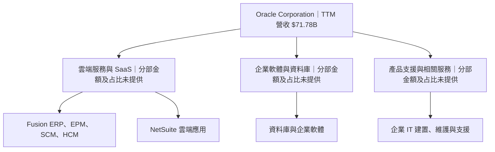
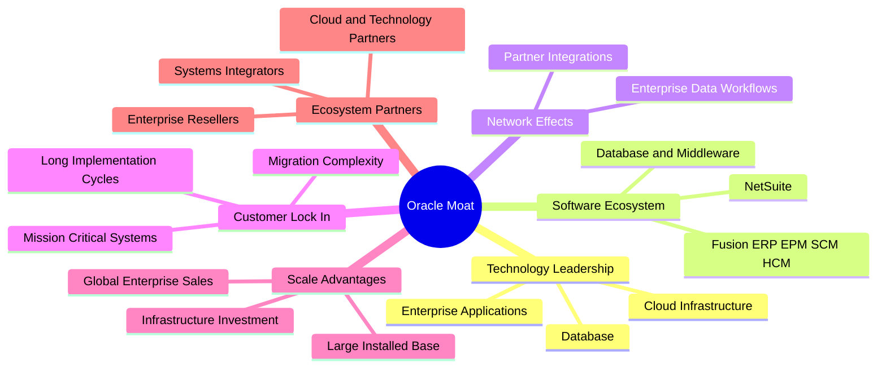
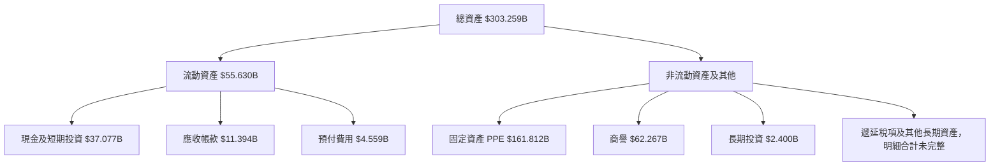
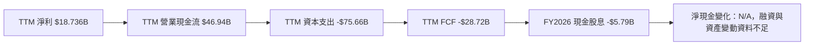
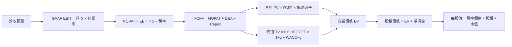
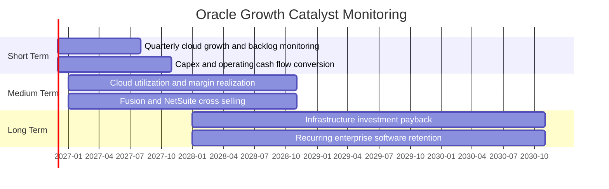
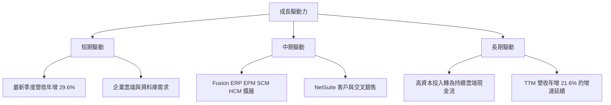
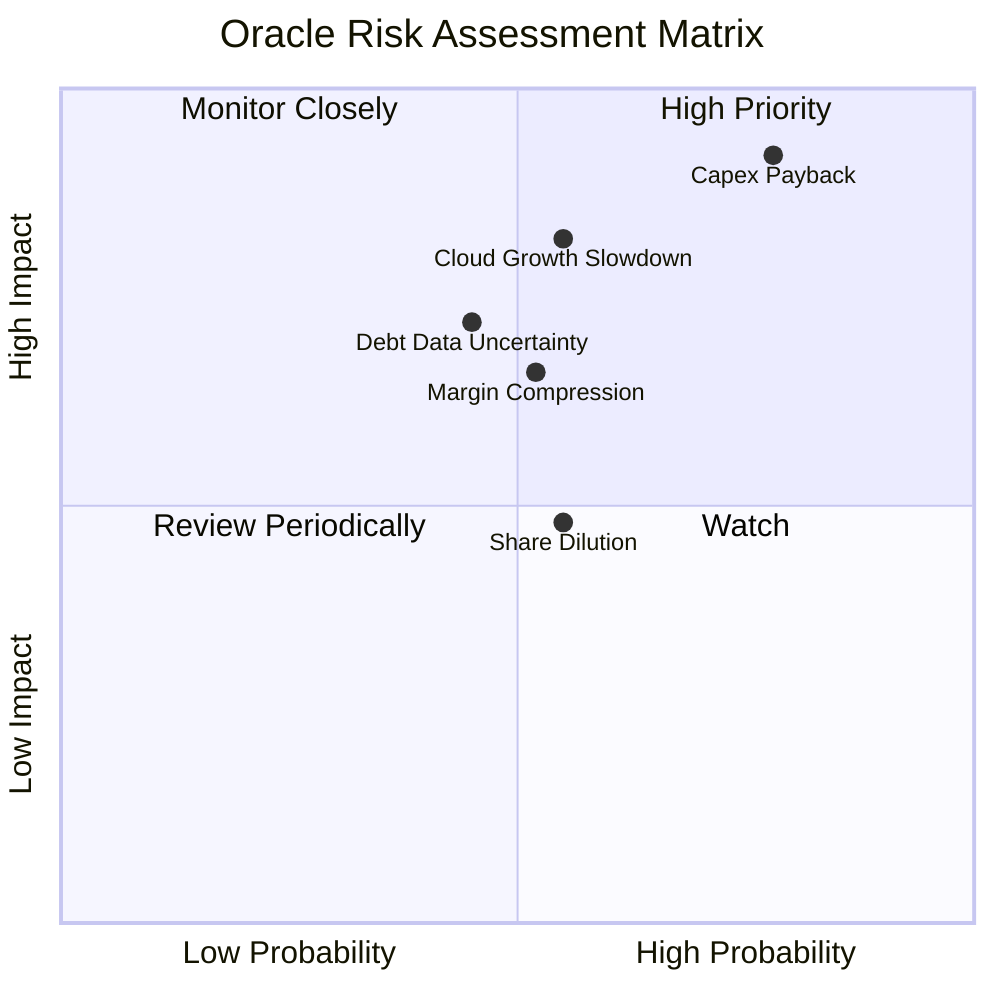
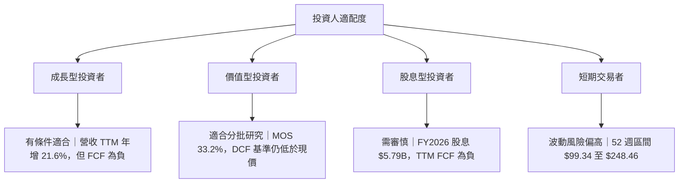

# ORCL 基本面深度分析報告
> **報告日期**：2026-11-28 ｜ **語言**：繁體中文 ｜ **數據來源**：SEC 申報資料 (XBRL)、Yahoo Finance、Finviz、StockAnalysis、Roic.ai ｜ **分析師**：CFA 級機構研究

## 目錄

| # | 章節 | 核心結論 |
|---|------|----------|
| 1 | 執行摘要 | 強烈買入；加權合理價值 $160.27；MOS +33.2% |
| 2 | 公司概覽與商業模式 | 企業軟體、資料庫與雲端服務具高轉換成本；業務分部營收拆分未提供 |
| 3 | 損益表深度分析 | TTM 營收 $71.78B、年增 21.6%；最新一季年增 29.6%，但高資本支出壓迫現金流 |
| 4 | 資產負債表分析 | 現金及短期投資 $37.08B；債務總額在核定數據中為 N/A |
| 5 | 現金流量深度分析 | TTM FCF -$28.72B，主因資本支出 $75.66B 高於營業現金流 |
| 6 | 獲利能力與資本效率 | ROIC 61.3% 對 WACC 9.12%，帳面指標顯示價值創造，但投資期現金流惡化 |
| 7 | 相對估值分析 | Oracle 多數估值指標低於同業及自身五年中位數；同時 DCF 基準值低於現價 |
| 8 | DCF 內在價值評估 | DCF 基準每股 $85.42；三角驗證加權合理價值 $160.27 |
| 9 | 成長催化劑 | 雲端、資料庫及 AI 基礎設施需求可能支持增長；TAM 數字未提供 |
| 10 | 風險矩陣 | 最大風險為資本支出回報、債務資料不完整及高成長預期落空 |
| 11 | 投資建議 | MOS 規則對應強烈買入；建議以分批與現金流里程碑控管風險 |

---

## 1. 執行摘要

Oracle 的 TTM 營收為 **$71.78B**，TTM 年增 **21.6%**，最新季度營收年增 **29.6%**；TTM ROIC 為 **61.3%**，高於 **9.12% WACC**。但營業現金流 **$46.94B** 低於資本支出 **$75.66B**，TTM FCF 為 **-$28.72B**。依 8.8 三角驗證得到的加權合理價值 **$160.27**，相對 **2026-11-27 收盤價 $107.13** 的 MOS 為 **+33.2%**；依 MOS 規則評級為**強烈買入**。此評級的關鍵限制是：DCF 基準價值僅 **$85.42**，低於現價，且終值現值佔企業價值 **176.3%**，估值高度依賴遠期現金流假設。

### 1.0 一頁式投資儀表板（Portfolio Manager 30 秒速讀）

| 項目 | 內容 |
|------|------|
| **投資論點（3 句）** | ① TTM 營收年增 **21.6%**、最新季度年增 **29.6%**，雲端與企業軟體需求提供成長動能。② TTM ROIC **61.3%** 對 WACC **9.12%**，表面上有顯著正利差。③ TTM FCF **-$28.72B**、FCF Yield **-8.60%**，顯示投資回收尚待驗證。 |
| **綜合評分** | **6.7/10**（引用 1.1 評分卡） |
| **財務健康** | 🟡 現金及短期投資 **$37.08B**，但 TTM 資本支出 **$75.66B**，債務總額核定數據為 N/A。 |
| **ROIC vs WACC** | **61.3% vs 9.12%**（帳面指標顯示創造價值；詳見第 6 章） |
| **FCF 趨勢** | TTM FCF 為 **-$28.72B**；TTM FCF Yield **-8.60%**，短期受高資本投資拖累。 |
| **估值** | Forward P/E **9.687299x** ｜ EV/EBITDA **13.399x** ｜ FCF Yield **-8.60%** |
| **DCF 內在價值（基準）** | **$85.42** ｜ 現價相對 DCF 溢價 **+25.4%**（現價 ÷ DCF 值 − 1） |
| **安全邊際（MOS）** | **+33.2%**＝($160.27 − $107.13) ÷ $160.27（加權合理價值基準，來自 8.8）｜ 🟢 >25% |
| **預期報酬（基準情境 12M）** | DCF 基準情境每股 **$85.42**，相對現價 **-20.3%**；加權合理價值所示上行空間 **+49.6%**。兩者是不同估值口徑。 |
| **關鍵風險（前二）** | 資本支出遠高於營業現金流；估值對終值與未來雲端成長高度敏感。 |
| **評級 + 信心度** | 🟢 **強烈買入** ｜ 信心：中低（相對估值與 DCF 結果分歧，且債務資料不完整） |

### 1.1 綜合評分卡（全報告唯一）

| 維度 | 評分（1–10） | 主要依據（引用數字與其來源章節） |
|------|--------------|----------------------------------|
| 成長性 | 8.0 | TTM 營收年增 **21.6%**、最新季度年增 **29.6%**（第 3 章）。 |
| 獲利能力 | 8.0 | TTM 營業利益率 **32.1%**、ROIC **61.3%**；但 F-Score **4/7**（第 3、6 章）。 |
| 財務健康 | 4.0 | 現金及短期投資 **$37.08B**；TTM FCF **-$28.72B**，債務總額資料 N/A（第 4、5 章）。 |
| 估值 | 7.0 | MOS **+33.2%**；Trailing P/E **16.8x** 低於五年中位數 **32.1x**，但 DCF 基準值低於現價（第 7、8 章）。 |
| 護城河 | 8.0 | 資料庫、ERP、HCM、SCM 等企業工作流程具轉換成本；具體分部收入與市場份額未提供（第 2 章）。 |
| 管理層與資本配置 | 5.0 | FY2026 SBC **$4.81B**；FY2026 資本支出 **$55.66B**，但股數未通過 F-Score 的「未增加」測試（第 3、5、6 章）。 |
| **綜合評分** | **6.7** | 六項算術平均：**(8.0 + 8.0 + 4.0 + 7.0 + 8.0 + 5.0) ÷ 6 = 6.7**。 |

### 1.2 五大投資論點 + 三大核心風險

| 類型 | 項目 | 具體依據 | 信心度 |
|------|------|----------|--------|
| 🟢 **投資論點①** | 雲端及企業軟體收入動能 | TTM 營收 **$71.78B**、年增 **21.6%**；最新季度年增 **29.6%**，增速高於 MSFT、SAP、CRM 最新季度年增率。 | 🟢 高 |
| 🟢 **投資論點②** | 高資本回報指標 | TTM ROIC **61.3%**，高於 WACC **9.12%**，利差為正；若資本投入形成可持續雲端現金流，將支持長期價值創造。 | 🟡 中 |
| 🟢 **投資論點③** | 企業客戶轉換成本 | ERP、資料庫、HCM、SCM 等核心系統嵌入客戶營運流程；遷移及整合成本可支撐續約與交叉銷售。 | 🟡 中 |
| 🟢 **投資論點④** | 相對歷史估值偏低 | P/E **16.8x** 對自身五年中位數 **32.1x**；EV/EBITDA **8.8x** 對五年中位數 **17.9x**。 | 🟡 中 |
| 🟢 **投資論點⑤** | 對雲端投資回收有明確上行選擇權 | DCF 樂觀情境 **$253.54**，但須營收與利潤率達到樂觀假設；不應視為基準承諾。 | 🟡 中低 |
| 🟡 **風險①** | 資本支出超出現金流承載 | TTM Capex **$75.66B**，高於 OCF **$46.94B**；若投資回收延遲，負 FCF 可能延續。 | 🔴 高衝擊 |
| 🔴 **風險②** | DCF 終值依賴高 | PV(TV) 佔 EV **176.3%**，預測期 FCF 現值為負 **-$175.02B**；長期假設稍變，估值即大幅波動。 | 🔴 高 |
| 🟡 **風險③** | 資產負債與股數資料不一致 | 核定財務數據的總債務為 N/A，但其他彙整來源列示不同債務數字；F-Score 的稀釋股數測試未通過。 | 🟡 中高 |

### 1.3 快速統計卡片

| 指標 | 公司實際值（期間） | 同業中位數 | 狀態 |
|------|--------------------|------------|------|
| 營收成長（TTM） | **21.6%** | — | 🟢 |
| 營收成長（最新一季年增） | **29.6%** | **13.2%**（MSFT、SAP、CRM 中位數） | 🟢 |
| 毛利率（TTM） | **64.0%** | **73.6%** | 🟡 |
| 營業利益率（TTM） | **32.1%** | — | 🟢 |
| ROIC（TTM） | **61.3%** | — | 🟢 |
| Forward P/E | **9.687299x** | **20.4x**（MSFT、SAP、CRM 中位數） | 🟢 |
| FCF Yield（TTM） | **-8.60%** | — | 🔴 |
| Piotroski F-Score | **4 / 7** | — | 🟡 |

### 1.4 投資結論

```
╔══════════════════════════════════════════════════════════════════╗
║                    📊 投資結論摘要                               ║
╠══════════════════════════════════════════════════════════════════╣
║  評級：強烈買入（依 MOS 規則 20）                                ║
║  價格（2026-11-27 收盤）：$107.13                                ║
║  DCF 內在價值（基準）：$85.42（現價溢價 +25.4%）                 ║
║  安全邊際 MOS：+33.2%（＝($160.27−$107.13)÷$160.27）             ║
║  加權合理價值（8.8）：$160.27                                    ║
║  DCF 情境價值：                                                   ║
║    悲觀情境：$9.78（-90.9%）                                      ║
║    基準情境：$85.42（-20.3%）                                     ║
║    樂觀情境：$253.54（+136.7%）                                   ║
║  綜合評分：6.7/10（引用 1.1）                                    ║
║  適合投資人：可承受高波動、能追蹤雲端投資回收的長線投資人        ║
╚══════════════════════════════════════════════════════════════════╝
```

依 MOS 應為**強烈買入**；未作一級調整。但 DCF 基準低於現價且負 FCF 顯著，故應以加權合理價值評級和 DCF 風險警示並讀，不宜把評級解讀為無條件追價。

---

## 2. 公司概覽與商業模式

### 2.1 業務結構與收入來源

截至最新 TTM，Oracle 營收為 **$71.78B**。公開摘要描述公司提供企業 IT 架構、雲端 SaaS 應用，以及 Fusion ERP、EPM、SCM、HCM、NetSuite 等產品；但各業務分部營收與占比未提供，因此不以推估數字拆分。



SaaS 與資料庫的收入占比、訂閱收入拆分、雲端基礎設施收入拆分皆未提供；因此不能精確判斷當前增長究竟來自 IaaS、SaaS、資料庫或支援合約。

### 2.2 市場份額

市場份額數據未提供，無法引用有來源與年份的占比。質化而言，Oracle 的 TTM 營收規模為 **$71.78B**，最新季度年增 **29.6%**；高於 MSFT 的 **18.8%**、SAP 的 **13.2%** 與 CRM 的 **10.8%**。但成長率比較不等於市場份額，亦不能據此推算市場占有率。

### 2.3 競爭護城河分析



### 2.4 護城河強度

| 護城河項目 | 強度（強／中／弱） | 證據（引用數字或事實） | 會削弱它的情況 |
|------------|--------------------|------------------------|----------------|
| 技術與產品 | 中至強 | 提供資料庫、Fusion ERP/EPM/SCM/HCM、NetSuite 等多類企業系統；各產品營收占比未提供。 | 雲端原生替代方案在效能、總持有成本或開發者體驗上持續勝出。 |
| 軟體生態系統 | 強 | 企業核心流程可由 ERP、HCM、SCM 等相互連接；切換涉及資料遷移與流程再設計。 | 開放標準、雲端互通性降低轉換成本，或客戶採多雲拆分關鍵系統。 |
| 網路效應 | 中 | 顧問、系統整合商與既有企業部署構成相互補充的生態系；量化夥伴與客戶數據未提供。 | 夥伴轉向競爭平台，或雲端平台的開發者與整合生態明顯擴大。 |
| 客戶鎖定 | 強 | 資料庫與企業流程系統涉及關鍵交易、權限和工作流程，遷移具營運風險。 | 客戶能以較低成本完成資料可攜與模組化遷移。 |
| 規模效應 | 中至強 | FY2026 資本支出 **$55.66B**，反映基礎設施投入規模；但目前 TTM Capex **$75.66B** 也提高投資回收門檻。 | 規模投資未轉化為利用率、定價能力及正向自由現金流。 |
| 生態夥伴 | 中 | 企業導入常仰賴整合商和顧問協助，具擴大部署的潛力；夥伴收入占比未提供。 | 夥伴經濟性轉弱或競爭平台獲得更高優先級。 |

1.1「護城河」評分為 **8.0/10**，依據是核心系統的遷移成本與產品組合；市場份額及分部收入未提供，因此不採更高分數。

---

## 3. 損益表深度分析

### 3.1 年度收入成長趨勢（近 4 年）

年度營收使用年度損益表資料，金額取兩位小數；FY2026 的營收為 **$67.36B**。

```
╔══════════════════════════════════════════════════════════════════╗
║              Oracle 年度收入趨勢（FY2023–FY2026）                ║
╠══════════════════════════════════════════════════════════════════╣
║  FY2023  $49.95B  ███████████████░░░░░░░░░░░░░░  YoY: +6.0% 🟡 ║
║  FY2024  $52.96B  ████████████████░░░░░░░░░░░░░  YoY: +6.0% 🟡 ║
║  FY2025  $57.40B  █████████████████░░░░░░░░░░░░  YoY: +8.4% 🟡 ║
║  FY2026  $67.36B  ████████████████████░░░░░░░░░  YoY: +17.4% 🟢║
╠══════════════════════════════════════════════════════════════════╣
║  FY2023–FY2026 CAGR = (67.36 ÷ 49.95)^(1/3) − 1 = 約 10.5%     ║
╚══════════════════════════════════════════════════════════════════╝
```

年度營收增速由 FY2025 的 **8.4%** 加速至 FY2026 的 **17.4%**。TTM 年增 **21.6%** 又高於 FY2026，顯示近期增長加速；但若加速主要由高投入雲端基礎設施帶動，增長品質仍須由資本回報率與 FCF 驗證。

### 3.2 季度收入趨勢分析

| 季度 | 營收（$B） | QoQ 成長 | YoY 成長 | 備註 |
|------|------------|----------|----------|------|
| 2025-11-30 | 16.06 | 由前季起算約 **+13.6%** | **+14.22%** | QoQ 以 2025-08-31 營收 $14.93B 比較。 |
| 2026-02-28 | 17.19 | **+7.05%** | **+21.66%** | 同比增速較前季提高。 |
| 2026-05-31 | 19.18 | **+11.60%** | **+20.63%** | QoQ 顯示季度營收持續擴大。 |
| 2026-08-31 | 19.34 | **+0.84%** | **+29.6%** | 最新季度 YoY 使用核定數據；QoQ 增速較低，季度間可能有認列節奏差異。 |

最新季度單季營收年增 **29.6%**，不是 TTM 增速；TTM 年增率為 **21.6%**。季度營收從 FY2026 Q1 的 **$14.93B** 增至 FY2027 Q1 的 **$19.34B**，同期增長約 **29.6%**。

### 3.3 利潤率演變分析

| 利潤率指標 | FY2023 | FY2024 | FY2025 | FY2026 | 趨勢 | 評估 |
|------------|--------|--------|--------|--------|------|------|
| **毛利率** | 72.9% | 71.4% | 70.5% | 65.8% | 按年度毛利÷營收計算呈下降；FY2026 下滑較明顯。 | 🟡 |
| **營業利益率** | 27.6% | 30.3% | 31.4% | 33.3% | 年度營業利益÷營收，連續改善。 | 🟢 |
| **淨利率** | 17.0% | 19.8% | 21.7% | 25.4% | 年度淨利÷營收上升。 | 🟢 |

年度比率以年度損益表數字計算；核定 TTM 營業利益率為 **32.1%**，最新季度營業利益率為 **34.8%**。口徑和期間不同，故不以年度比率取代 TTM 核定值。

**利潤率演變深度解析：** FY2023 至 FY2026，年度營業利益由 **$13.77B** 增至 **$22.44B**，增幅快於收入，與營業利益率提升一致，可能反映規模效益與費用控制。相對地，年度毛利率由 **72.9%** 降至 **65.8%**；這可能涉及雲端服務及基礎設施的成本組合變化，但現有分部數據不足以判定原因。未來若雲端收入占比增加而毛利率持續壓縮，營業槓桿能否延續取決於服務交付成本及設施利用率。

### 3.4 費用結構分析

各費用項目中，僅提供 FY2026 的研發費用 **$10.27B**，未提供完整營業費用細項、銷售管理費及其他費用，因此不製作費用占比圓餅圖，以免推估費用結構。

FY2026 研發費用 **$10.27B**，約為年度營收 **$67.36B** 的 **15.3%**（$10.27B ÷ $67.36B）；研發投入可支撐產品迭代，但研發資本報酬仍需觀察新產品收入與毛利的實際貢獻。

### 3.5 季度 EPS 趨勢與盈餘品質（Quality of Earnings）

EPS 估計值與實際值在四季歷史表中均為 NaN，因此無法可靠判斷季度盈餘是否超預期或不及預期。已公布實際 EPS 及年增率如下：

| 季度 | 實際 EPS | EPS YoY | 超預期／不及預期 |
|------|----------|---------|------------------|
| 2025-11-30 | $2.10 | +90.91% | N/A（估計 EPS 缺失） |
| 2026-02-28 | $1.27 | +24.51% | N/A（估計 EPS 缺失） |
| 2026-05-31 | $1.45 | +21.91% | N/A（估計 EPS 缺失） |
| 2026-08-31 | $1.56 | +54.45% | N/A（估計 EPS 缺失） |

| 盈餘品質項目 | 數值／占比 | 評估 |
|--------------|------------|------|
| 股權薪酬 SBC / 營收 | TTM SBC 約 **$4.82B** ÷ TTM 營收 **$71.78B** ≈ **6.7%** | 🟡 對現有股東有實質稀釋成本；F-Score「稀釋股數未增加」測試未通過。 |
| SBC / 營業現金流 | 約 **$4.82B ÷ $46.94B = 10.3%** | 🟡 SBC 佔 OCF 約一成，不能忽略其股東成本。 |
| FCF / 淨利（現金轉換率） | 以 StockAnalysis TTM 淨利 **$18.736B** 計：**-$28.72B ÷ $18.736B = -153.2%** | 🔴 高資本支出令 FCF 顯著低於淨利；不代表營運虧損，但現金回收待驗證。 |
| 一次性／非經常性損益 | N/A（未提供可拆分明細） | 無法判斷是否有一次性項目扭曲盈餘。 |
| 有效稅率異常 | **12.6%**（最新年度有效稅率） | 🟡 相對低稅率可提高淨利，但缺少稅務調節表，無法確定是否由非經常性稅務利益推動。 |
| 資本化支出 vs 費用化 | TTM Capex **$75.66B**；資本化支出的具體分類未提供 | 🟡 重大資本支出會透過折舊逐年進損益；若投資回報不佳，當期現金流壓力將先於損益表顯現。 |

**盈餘品質結論：** GAAP 淨利本身未見足夠資料證明被一次性收益美化；但 **SBC 約占 TTM 營收 6.7%**、TTM FCF 為負，且資本支出大幅高於 OCF，代表淨利的即時現金轉換品質偏弱。估值時應同時看現金流和資本支出回收，而非只依 EPS 增長。

---

## 4. 資產負債表分析

### 4.1 資產結構分解

以下採 StockAnalysis TTM 資產負債表數據，金額以 **$B** 計。部分細項不完整，故不強行補足差額。



總資產從 FY2025 **$168.36B** 增至 FY2026 **$261.76B**，增幅約 **55.5%**；其中 PP&E 從 **$56.67B** 增至 **$129.65B**。資產擴張與大額 Capex 一致，但需由後續利用率和現金流回報驗證。

### 4.2 流動性與營運資金分析

| 指標 | 最新值 | 歷史值 | 評估 |
|------|--------|--------|------|
| 流動比率 | **1.171** | FY2026 流動資產 $46.57B、流動負債 $41.76B | 🟡 高於 1，但流動性緩衝不算寬裕。 |
| Quick Ratio | **1.02** | — | 🟡 接近 1，對短期負債的即時覆蓋空間有限。 |
| 現金及短期投資 | **$37.08B** | FY2025 $11.20B | 🟢 現金餘額上升，但債務總額核定值為 N/A。 |

**營運資金天數**（依 QUALITY FIGURES 原值照錄）：

| 指標 | 最新 TTM | 一年前 TTM | 變化 | 解讀 |
|------|----------|------------|------|------|
| DSO 應收帳款天數 | **58 天** | **55 天** | **+3 天** | 收款週期延長，可能反映帳期或收入結構變化；須追蹤應收帳款增速是否高於營收。 |
| DIO 存貨天數 | **N/A** | **N/A** | N/A | 公司未報告可用存貨餘額，不補推。 |
| DPO 應付帳款天數 | **156 天** | **N/A** | N/A | 目前 DPO 偏長；缺少一年前可比值，無法判斷趨勢。 |
| CCC 現金轉換週期 | **N/A** | **N/A** | N/A | 因 DIO 缺失，依原始品質指標維持 N/A。 |

### 4.3 債務結構分析

核定財務數據列示**總債務 N/A**、淨現金 **$37.08B**。其他彙整資料列有 FY2026 總債務 **$156.19B** 或市場資料總債務 **$169.14B**，但其期間與口徑並不一致；本報告不將其替代為最新核定債務數字，也不據此計算 Debt/EBITDA 或利息保障倍數。

```
╔══════════════════════════════════════════════════════════════════╗
║                   Oracle 債務健康診斷                            ║
╠══════════════════════════════════════════════════════════════════╣
║  總債務：        N/A（核定數據未提供）                            ║
║  現金+短期投資： $37.08B                                          ║
║  淨現金：        $37.08B（核定數據列示；總債務不可得）            ║
║  Debt/EBITDA：   N/A（債務總額缺失）                              ║
║  Interest Coverage：N/A（利息費用及一致口徑債務明細未提供）      ║
║  評估：          🟡 現金部位可觀，但無法以一致期間核實槓桿水平    ║
╚══════════════════════════════════════════════════════════════════╝
```

### 4.4 股東權益趨勢

| 財年 | 股東權益（$B） | 年度變化 |
|------|----------------|----------|
| FY2023 | 1.07 | — |
| FY2024 | 8.70 | +$7.63B |
| FY2025 | 20.45 | +$11.75B |
| FY2026 | 42.51 | +$22.06B |

```
╔══════════════════════════════════════════════════════════════════╗
║                   股東權益變化（$B）                              ║
╠══════════════════════════════════════════════════════════════════╣
║  FY2023  $1.07B   ▏                                              ║
║  FY2024  $8.70B   ████                                           ║
║  FY2025  $20.45B  █████████                                      ║
║  FY2026  $42.51B  ████████████████████                           ║
╚══════════════════════════════════════════════════════════════════╝
```

權益增加有助於改善帳面資本緩衝，但權益變化同時受淨利、股權發行與其他項目影響；目前資料不足以完整拆分來源。

---

## 5. 現金流量深度分析

### 5.1 現金流量瀑布圖



淨利與 OCF 不相等，因營運資金、折舊、SBC 等會影響現金流；FCF 採核定定義 **OCF − Capex**。股息數據為 FY2026，非 TTM，故此圖僅展示現有數據的方向，不視為同一期間的完整現金瀑布。

### 5.2 FCF 轉換率趨勢

| 財年 | FCF（$B） | 淨利（$B） | FCF／淨利 | 解讀 |
|------|-----------|------------|-----------|------|
| FY2023 | 8.47 | 8.50 | 約 **99.6%** | 現金轉換接近淨利。 |
| FY2024 | 11.81 | 10.47 | 約 **112.8%** | 現金流高於淨利。 |
| FY2025 | -0.394 | 12.44 | 約 **-3.2%** | 資本支出已開始壓低 FCF。 |
| FY2026 | -23.69 | 17.09 | 約 **-138.6%** | 大額投資使 FCF 深度轉負。 |
| 最新 TTM | -28.72 | 18.736 | 約 **-153.2%** | 以 StockAnalysis TTM 淨利計，現金轉換進一步惡化。 |

### 5.3 自由現金流趨勢

| 期間 | FCF | OCF | Capex | FCF Yield |
|------|-----|-----|-------|-----------|
| FY2023 | **$8.47B** | $17.16B | $8.70B | N/A |
| FY2024 | **$11.81B** | $18.67B | $6.87B | N/A |
| FY2025 | **-$0.394B** | $20.82B | $21.21B | N/A |
| FY2026 | **-$23.69B** | $31.98B | $55.66B | N/A |
| TTM | **-$28.72B** | $46.94B | $75.66B | **-8.60%** |

```
╔══════════════════════════════════════════════════════════════════╗
║                   自由現金流趨勢（$B）                            ║
╠══════════════════════════════════════════════════════════════════╣
║  FY2023   +8.47B  ████████████                                    ║
║  FY2024  +11.81B  █████████████████                               ║
║  FY2025   -0.394B ▏                                               ║
║  FY2026  -23.69B  ◀████████████████████                           ║
║  TTM     -28.72B  ◀████████████████████████                       ║
╠══════════════════════════════════════════════════════════════════╣
║  TTM FCF Yield：-8.60%                                            ║
║  核心驅動：TTM Capex $75.66B 高於 OCF $46.94B                     ║
╚══════════════════════════════════════════════════════════════════╝
```

### 5.4 資本配置評估

| 項目 | 可引用金額 | 評估 |
|------|------------|------|
| 資本支出 | FY2026 **$55.66B**；TTM **$75.66B** | 🔴 大幅高於營業現金流；要以雲端利用率、增量毛利及未來 FCF 驗證投資回報。 |
| 股息 | FY2026 **$5.79B** | 🟡 有現金回饋，但負 FCF 期間需關注資金來源及融資安排。 |
| SBC | FY2026 **$4.81B** | 🟡 形成股權稀釋成本。 |
| 回購 | N/A | 未提供可核實的回購金額，不製作資本配置圓餅圖。 |
| 留存現金／債務償還 | N/A | 融資現金流與債務償還明細不足。 |

---

## 6. 獲利能力與資本效率

### 6.1 ROE / ROA / ROIC 趨勢

| 指標 | 最新數值 | 歷史或輔助數據 | 評估 |
|------|----------|----------------|------|
| ROE（TTM，核定） | **28.3%** | 另一彙整來源列示 **41.2%**，口徑不同 | 🟡 核定值為本報告採用值；不混用來源差異。 |
| ROA（TTM，彙整來源） | **6.4%** | F-Score 測試顯示 ROA 未高於一年前 | 🟡 資產規模擴大可能降低資產回報。 |
| ROIC（TTM，核定） | **61.3%** | 核定口徑：稅後營業利益 ÷（權益 + 債務 − 現金） | 🟢 高於 WACC；但投資期 FCF 轉負，需檢驗投入資本口徑與回報落地。 |

沒有同業 ROIC／ROE／ROA 完整歷史序列，故不填行業均值。

### 6.2 ROIC vs WACC 分析（核心價值創造判斷）

**使用相同的 WACC：9.12%**。以下採成本資本區塊原值，不另行建立替代 WACC。

```
╔══════════════════════════════════════════════════════════════════╗
║                ROIC vs WACC 深度分析                            ║
╠══════════════════════════════════════════════════════════════════╣
║  WACC（程式計算值，採用值）：9.12%                               ║
║  ├── 無風險利率（10Y 美債）：4.94%                               ║
║  ├── 市場風險溢酬 ERP：5.00%                                     ║
║  ├── Beta 原始值：1.78；採用調整 Beta：1.52                      ║
║  ├── 股權成本 Ke（來源原值）：12.53%                             ║
║  ├── 稅前債務成本 Kd（來源原值）：2.72%                          ║
║  ├── 有效稅率：12.6%                                             ║
║  ├── 資本權重：股權 66.4%／債務 33.6%                            ║
║  └── ✅ WACC：9.12%                                               ║
║                                                                  ║
║  ROIC（TTM，核定值）：61.3%                                      ║
║  ├── ROIC 計算口徑：稅後營業利益 ÷（權益 + 債務 − 現金）          ║
║  └── 絕對金額分子、分母明細不完整，依核定 ROIC 原值採用            ║
║                                                                  ║
║  ROIC − WACC = 61.3% − 9.12% = +52.18 個百分點                   ║
║  ROIC 61.3%  ▓▓▓▓▓▓▓▓▓▓▓▓▓▓▓▓▓▓▓▓▓▓▓▓▓▓▓▓▓▓▓▓                  ║
║  WACC  9.12% ▓▓▓▓▓                                                 ║
║                                                                  ║
║  結論：核定指標顯示正向價值利差；但負 FCF 及債務資料缺口限制結論 ║
╚══════════════════════════════════════════════════════════════════╝
```

核定 ROIC 高於 WACC 的利差為 **52.18 個百分點**，表示按該指標口徑公司正在創造經濟價值。不過 ROIC 分母中的債務細項無法在本報告的最新期資料中獨立核驗，且資本支出大幅增加。因此應將 ROIC 結論視為會計回報信號，而不是對新增雲端資本支出已獲回報的證明。

WACC 組成的逐步說明：

1. **調整 Beta**：原始 Beta **1.78**；調整方式為 **⅔ × 1.78 + ⅓ × 1 = 1.52**（四捨五入至兩位小數，採用來源提供的 1.52）。
2. **Ke**：來源列示 **12.53%**；由已列輸入直接乘算可得 **4.94% + 1.52 × 5.00% = 12.54%**，與來源 Ke 有 **0.01 個百分點**的四捨五入／底層精度差異。採用成本資本區塊的 Ke 與 WACC 原值，不自行改寫模型折現率。
3. **稅後 Kd**：公式 **2.72% × (1 − 12.6%) = 2.37728%**，約 **2.38%**。
4. **權重**：股權 **66.4%**、債務 **33.6%**，合計 **100.0%**。最新市值 **$334.00B**，但債務金額與權重計算底層資料未充分提供，不反推債務額。
5. **WACC**：以來源提供組成驗算約為 **66.4% × 12.53% + 33.6% × 2.37728% = 9.118% ≈ 9.12%**；採用 **9.12%**。

利息費用與平均計息負債的原始金額未提供，因此無法獨立重算稅前 Kd；此處照用成本資本來源列示的 **2.72%**，並揭露驗證限制。

### 6.3 杜邦三因素分解

| 因素 | 數值（TTM） | 解讀 |
|------|-------------|------|
| 淨利率 | **26.4%** | 每一美元營收約產生 26.4 美分 TTM 淨利。 |
| 資產週轉率 | **0.24** | 資產周轉較低，資產基礎擴大而收入尚待完全釋放。 |
| 權益乘數 | **4.54** | 槓桿對 ROE 有顯著放大作用，需留意負債資料缺口。 |
| **ROE** | **28.3%** | 品質指標列示：**26.4% × 0.24 × 4.54 = 28.3%**（四捨五入）。 |

ROE 受淨利率支撐，但 **4.54x 權益乘數**亦是重要來源，不能只將 ROE 視為營運效率成果。

### 6.4 財務體質：Piotroski F-Score

**Piotroski F-Score：4 / 7**。分母為 7，因部分測試缺少輸入資料，不可當成 4/9。

| 測試 | 結果 | 解讀 |
|------|------|------|
| ROA > 0 | ✅ 通過 | TTM 資產回報為正。 |
| 營業現金流 > 0 | ✅ 通過 | TTM OCF 為 **$46.94B**。 |
| ROA 高於一年前 | ❌ 未通過 | ROA 改善尚未獲證實。 |
| 營業現金流 > 淨利（應計品質） | ✅ 通過 | OCF 高於 TTM 淨利。 |
| 長期負債 ÷ 總資產低於一年前 | — 無法判定 | 缺少可比輸入資料。 |
| 流動比率高於一年前 | ✅ 通過 | 最新流動比率高於一年前。 |
| 稀釋股數未增加 | ❌ 未通過 | 顯示股權稀釋需持續監控。 |
| 毛利率高於一年前 | — 無法判定 | 缺少測試所需可比輸入。 |
| 資產週轉率高於一年前 | ❌ 未通過 | 資產效率相對一年前未改善。 |

4/7 代表基本獲利與現金流項目有通過，但資產效率及股數變化是負面訊號。由於測試集非完整九項，應避免與完整 F-Score 公司直接做等口徑排名。

---

## 7. 相對估值分析

### 7.1 同業估值比較表格

同業估值倍數使用 Yahoo Finance 同業資料；Oracle 自身倍數採市場估值區塊。SAP 的 P/S 與 EV/EBITDA 因幣別混用為 N/A，保持空缺。

| 估值指標 | **Oracle** | **MSFT** | **SAP** | **CRM** | Oracle 評估 |
|----------|-----------|---------|---------|---------|------------|
| **Trailing P/E** | **16.8x** | 25.7x | 26.6x | 18.1x | 🟢 低於三家同業。 |
| **Forward P/E** | **9.687299x** | 20.4x | 22.5x | 12.4x | 🟢 明顯低於同業；須核實 forward EPS 預測的增長可實現性。 |
| **P/S Ratio** | **4.6533666x** | 10.6x | N/A | 3.7x | 🟡 高於 CRM、低於 MSFT；SAP 跨幣別不可比。 |
| **EV/EBITDA** | **13.399x** | 18.1x | N/A | 15.0x | 🟢 低於 MSFT 與 CRM。 |
| **最新季度營收年增** | **29.6%** | 18.8% | 13.2% | 10.8% | 🟢 增速高於三家同業。 |
| **毛利率（TTM）** | **64.0%** | 67.7% | 73.6% | 77.3% | 🟡 低於三家同業。 |

### 7.2 歷史估值區間分析

| 倍數 | 現值 | 五年中位數 | 五年區間 | 當前百分位 |
|------|------|------------|----------|------------|
| P/E | **16.8x** | **32.1x** | **19.0x–52.3x** | **0%** |
| P/S | **4.5x** | **6.2x** | **4.6x–11.1x** | **0%** |
| EV/EBITDA | **8.8x** | **17.9x** | **12.6x–28.9x** | **0%** |

```
╔══════════════════════════════════════════════════════════════════╗
║                 Oracle 五年估值位置                              ║
╠══════════════════════════════════════════════════════════════════╣
║  P/E        現值 16.8x | 區間 19.0x–52.3x | 中位數 32.1x | 0%  ║
║  P/S        現值  4.5x | 區間  4.6x–11.1x | 中位數  6.2x | 0%  ║
║  EV/EBITDA  現值  8.8x | 區間 12.6x–28.9x | 中位數 17.9x | 0%  ║
╚══════════════════════════════════════════════════════════════════╝
```

估值低於自身五年區間，可能反映股價下跌，也可能反映市場開始要求較高的雲端投資回報。百分位為來源計算值；與區間下界存在小幅不一致時，以來源原列數值為準，不自行修改。

### 7.3 情境價值（照抄 DCF MODEL 的 Scenarios）

| 情境 | 第 1 年營收成長 | 期末營業利潤率 | WACC | 每股價值 | 相對現價 | 機率 | 會發生的條件 |
|------|----------------|----------------|------|----------|----------|------|--------------|
| 🔴 悲觀 | **10.8%** | **26.0%** | **10.12%** | **$9.78** | **-90.9%** | **25%** | 雲端需求減速、成本投入回收不佳、利潤率下降且風險溢酬提高。 |
| 🟡 基準 | **21.6%** | **30.6%** | **9.12%** | **$85.42** | **-20.3%** | **50%** | 首年增長等於目前 TTM 增速，長期增速收斂至 3.0%，利潤率回落至五年中位數設定。 |
| 🟢 樂觀 | **32.4%** | **33.6%** | **8.12%** | **$253.54** | **+136.7%** | **25%** | 雲端及 AI 基礎設施需求延續加速，利潤率高於基準且折現率下降。 |

三情境機率加權值 **$108.54（+1.3%）**，僅作情境背景；規則指定的加權合理價值仍使用 8.8 固定方法權重，不以此概率值取代。

### 7.4 相對估值隱含價格區間

```
╔══════════════════════════════════════════════════════════════════╗
║              相對估值回推價格與現價位置                          ║
╠══════════════════════════════════════════════════════════════════╣
║  $85.42 DCF ─ $107.13 現價 ─ $184.74 EV/EBITDA                  ║
║                               $225.19 Forward P/E                ║
║                               $236.18 分析師共識                 ║
╚══════════════════════════════════════════════════════════════════╝
```

| 方法 | 每股價值 | 相對現價 | 計算依據 |
|------|----------|----------|----------|
| DCF（基準） | **$85.42** | **-20.3%** | 10 年 FCFF、WACC **9.12%**、終值成長 **3.0%**。 |
| 同業 Forward P/E | **$225.19** | **+110.2%** | 同業中位數 **20.4x** × Forward EPS **$11.06**。 |
| 同業 EV/EBITDA | **$184.74** | **+72.4%** | 同業中位數 **16.6x**（MSFT、CRM）× TTM EBITDA，再加淨現金。 |
| 分析師共識目標價 | **$236.18** | **+120.5%** | 40 位分析師平均目標價。 |

---

## 8. DCF 內在價值評估（Discounted Cash Flow）

> 本章只採用程式計算的 DCF MODEL 數字，不另建模型或修改輸入。金額單位為美元十億（$B），每股價值為美元；數字保留模型原值，展示值可能因底層未四捨五入而有尾差。

### 8.0 估值推理鏈（Thinking Logic）

**Step 1 — 價值由哪些變數決定？**  
Oracle 價值主要由企業軟體與雲端基礎服務的現金流底盤、雲端增長及龐大基礎設施投入回收共同決定；各業務營收占比未提供，不能為其指派比例。模型最敏感的變數是 WACC 與終值成長率：在固定營運預測下，基準每股價值會隨 WACC、g 大幅變動，並由敏感性矩陣量化。

**Step 2 — 模型選擇**

| 決策點 | 本報告採用 | 理由（含數字） | 曾考慮但否決 | 否決理由 |
|--------|-----------|----------------|--------------|----------|
| 現金流定義 | FCFF | 使用 WACC 折現並先得 EV；資料列有現金、債務狀況但債務細項不完整。 | FCFE | 資本結構資料不足，FCFE 難以一致建模。 |
| 預測期 N | **10 年** | DCF MODEL 固定預測 10 年，營收增速由 21.6% 線性收斂至 3.0%。 | 5 年 | 雲端投資回收時間較長，但 10 年預測不確定性亦較高。 |
| 終值方法 | Gordon Growth | 終值成長率 **3.0%**，低於 WACC **9.12%**。 | 退出倍數作主方法 | MODEL 未提供 DCF 退出倍數終值，且不自行另建模型。 |
| EBIT 基礎 | GAAP EBIT | DCF MODEL 明確採 GAAP EBIT。 | 非 GAAP EBIT | 加回 SBC 將改變程式模型及造成口徑不一致。 |

**Step 3 — 關鍵假設推導鏈**

- **營收成長**：錨點＝TTM 年增 **21.6%**；調整＝採模型由第 1 年 **21.6%** 線性降至第 10 年 **3.0%**，反映近期增速不宜無限延續；採用模型逐年路徑；否決十年固定 21.6%，因長期成長高於成熟期合理水平且模型未採此設定。
- **期末營業利潤率**：錨點＝TTM 營業利益率 **32.1%**；調整＝模型第 10 年降至過去五財年中位數設定 **30.6%**；採用 **30.6%**；否決長期維持 32.1%，因模型採成熟化回落。
- **永續成長率 g**：錨點＝模型指定 **3.0%**；調整＝採低於 WACC **9.12%** 的永續增速；採用 **3.0%**；否決高於或等於 WACC 的值，因 Gordon Growth 公式失效。
- **預測期 N**：錨點＝模型 **10 年**；調整＝無額外修改；採用 **10 年**；否決更短年限，因不符合固定模型輸入。
- **Capex／營收**：錨點＝TTM Capex／營收 **75.66 ÷ 71.78 ≈ 105.4%**；調整＝模型從 **105.4%** 逐步降至第 10 年 **14.4%**，後者約為 D&A 的 **1.1 倍**；否決永遠維持 105.4%，因投資強度會造成十年後仍極端負現金流；也否決立即降至維護性投資水平，因缺少支持快速收斂的營運資料。
- **有效稅率**：錨點及採用值＝最新年度 **12.6%**；按模型固定使用。
- **D&A／營收**：錨點及採用值＝TTM **13.1%**，模型保持不變。
- **ΔWC／營收增額**：模型不建模營運資金變動；採用值為不納入。營運資金資料不完整，不能自行加入估算。
- **GAAP EBIT 與 SBC**：模型採 GAAP EBIT，股權薪酬已作費用處理；不再額外扣 SBC，也不對股數施加年稀釋。這是組合 **(A)**，SBC 影響在模型中計入一次。
- **終值方法**：錨點＝DCF MODEL 採 Gordon Growth；採用其已計算值；否決另以退出倍數取代終值，因沒有模型所列退出倍數資料。
- **WACC**：錨點＝成本資本資料提供 **9.12%**；採用該值，不自行重算或替換。以其他 WACC 作基準會破壞與核定敏感度表的一致性。

**Step 4 — 最脆弱的一環**  
最脆弱的是高 Capex 如何在十年內降至營收的 **14.4%**、同時維持營收與利潤率；若 Capex 長期高於模型路徑，FCFF 和終值都會下降，模型基準價值將進一步低於 **$85.42**。

**Step 5 — 計算路徑圖**



### 8.1 模型假設總表（Model Inputs）

| 假設項目 | 採用值 | 依據／來源 | 敏感度 |
|----------|--------|-------------|--------|
| 預測期長度 **N** | **10 年** | DCF MODEL 固定預測期，逐年列至 FY+10。 | 🟡 中 |
| 營收成長 | 第 1 年 **21.6%** 至第 10 年 **3.0%** | TTM vs prior TTM 成長 **21.6%**；模型線性淡出。 | 🔴 高 |
| 營業利潤率 | 第 1 年 **32.1%** 至第 10 年 **30.6%** | TTM 營業利益率 **32.1%**；期末收斂至過去五財年中位數。 | 🔴 高 |
| 有效稅率 | **12.6%** | 最新年度有效稅率。 | 🟢 低 |
| Capex／營收 | 第 1 年 **105.4%** 至第 10 年 **14.4%** | TTM Capex／營收；模型逐步收斂至約 D&A 的 1.1 倍。 | 🔴 高 |
| D&A／營收 | **13.1%** | TTM 比率，模型固定。 | 🟢 低 |
| 營運資金變動 | **不建模** | DCF MODEL 明確排除，品質數據又有 DIO／CCC N/A。 | 🟢 低 |
| EBIT 基礎 | **GAAP EBIT** | DCF MODEL 指定。 | 🟡 中 |
| SBC 處理 | GAAP 已費用化，不另扣 | 避免重複扣除；採組合 (A)。 | 🟡 中 |
| 年稀釋率 | **0%** | 固定股數，SBC 已反映於 GAAP EBIT；模型採用組合 (A)。 | 🟡 中 |
| 永續成長率 g | **3.0%** | DCF MODEL 指定，且低於 WACC。 | 🔴 高 |
| 終值方法 | Gordon Growth | DCF MODEL 指定。 | 🔴 高 |
| WACC | **9.12%** | Cost of capital 指定值，與第 6.2 節一致。 | 🔴 高 |

**FCFF 定義：** FCFF = NOPAT + D&A − Capex；此模型不列 ΔWC。  
**SBC 防重複扣除：** 本模型採用 **(A) GAAP EBIT + 固定股數**，故 SBC 影響已計入一次，不再扣 SBC，也不另加股數稀釋。

### 8.2 折現率推導（WACC）

```
╔══════════════════════════════════════════════════════════════════╗
║                    WACC 推導（折現率）                           ║
╠══════════════════════════════════════════════════════════════════╣
║  股權成本 Ke（CAPM，採來源值）：12.53%                           ║
║  ├── 無風險利率 Rf（10Y 美債）：4.94%                             ║
║  ├── ERP：5.00%                                                   ║
║  ├── 原始 Beta：1.78；調整 Beta：1.52                             ║
║  ├── Beta 調整：⅔ × 1.78 + ⅓ × 1.00 ≈ 1.52                       ║
║  └── 規模／國別額外溢酬：未另加                                  ║
║                                                                  ║
║  債務成本 Kd：                                                    ║
║  ├── 稅前 Kd（來源值）：2.72%                                     ║
║  ├── 有效稅率：12.6%                                              ║
║  └── 稅後 Kd = 2.72% × (1 − 12.6%) = 2.37728%                    ║
║                                                                  ║
║  資本權重（來源值）：股權 66.4%；債務 33.6%                       ║
║  └── WACC（採用值）：9.12%                                        ║
╚══════════════════════════════════════════════════════════════════╝
```

**逐步演算與資料限制：**

1. **Ke（CAPM）**：輸入為 Rf **4.94%**、調整 Beta **1.52**、ERP **5.00%**；計算 **4.94% + 1.52 × 5.00% = 12.54%**。成本資本資料列示 Ke **12.53%**，差異為底層精度／四捨五入；後續採用來源列示 Ke 與 WACC。
2. **稅前 Kd**：原始利息費用及平均計息負債未提供，無法以「利息費用 ÷ 平均計息負債」重建；採成本資本來源的 **2.72%**，不另假設負債分母。
3. **稅後 Kd**：**2.72% × (1 − 12.6%) = 2.37728%**。
4. **權重**：股權 **66.4%**、債務 **33.6%**，合計 **100.0%**。市值為 **$334.00B**，但成本資本權重使用的債務底層金額未提供，故不反推 D。
5. **WACC**：用來源權重及 Ke、稅後 Kd 驗算：**66.4% × 12.53% + 33.6% × 2.37728% = 9.118% ≈ 9.12%**。採用模型值 **9.12%**。

Rf 日期未在成本資本資料中提供；Beta 原始來源為 Yahoo，採用調整 Beta **1.52**；ERP **5.00%** 為假設值（來源設定）；未另加規模或國別溢酬。WACC 直接採用 **9.12%**，第 6.2 節亦採同值。

### 8.3 逐年自由現金流預測（基準情境）

| 年度 | FY+1 | FY+2 | FY+3 | FY+4 | FY+5 | FY+6 | FY+7 | FY+8 | FY+9 | FY+10 |
|------|------|------|------|------|------|------|------|------|------|-------|
| 營收（$B） | 87.29 | 104.36 | 122.60 | 141.50 | 160.38 | 178.47 | 194.90 | 208.81 | 219.39 | 225.97 |
| 營收 YoY | 21.6% | 19.6% | 17.5% | 15.4% | 13.3% | 11.3% | 9.2% | 7.1% | 5.1% | 3.0% |
| 營業利潤率 | 32.1% | 32.0% | 31.8% | 31.6% | 31.4% | 31.3% | 31.1% | 30.9% | 30.8% | 30.6% |
| GAAP EBIT（$B） | 28.04 | 33.34 | 38.97 | 44.73 | 50.43 | 55.81 | 60.61 | 64.58 | 67.49 | 69.13 |
| − 稅（$B） | (3.54) | (4.21) | (4.92) | (5.64) | (6.36) | (7.04) | (7.65) | (8.15) | (8.51) | (8.72) |
| = NOPAT（$B） | 24.50 | 29.14 | 34.05 | 39.09 | 44.06 | 48.77 | 52.97 | 56.44 | 58.97 | 60.40 |
| + D&A（$B） | 11.47 | 13.71 | 16.10 | 18.59 | 21.07 | 23.44 | 25.60 | 27.43 | 28.82 | 29.68 |
| − Capex（$B） | (92.02) | (99.46) | (104.45) | (106.25) | (104.22) | (97.93) | (87.25) | (72.38) | (53.87) | (32.65) |
| = FCFF（$B） | **-56.05** | **-56.61** | **-54.30** | **-48.58** | **-39.09** | **-25.73** | **-8.69** | **11.49** | **33.92** | **57.44** |
| 折現因子 | 0.916 | 0.840 | 0.770 | 0.705 | 0.646 | 0.592 | 0.543 | 0.498 | 0.456 | 0.418 |
| FCFF 現值 PV（$B） | **-51.37** | **-47.55** | **-41.80** | **-34.27** | **-25.27** | **-15.24** | **-4.72** | **5.72** | **15.47** | **24.00** |

**預測期 FCF 現值合計：**

**-$51.37 − $47.55 − $41.80 − $34.27 − $25.27 − $15.24 − $4.72 + $5.72 + $15.47 + $24.00 = -$175.03B**。模型列示合計為 **-$175.02B**，差異約 **$0.01B**，屬逐年展示值四捨五入尾差；採用 DCF MODEL 合計 **-$175.02B**。

**FY+1 逐步演算（照模型列示值）：**

1. **營收** = $71.78B × (1 + 21.6%) = **$87.29B**。
2. **EBIT** = $87.29B × 32.1% ≈ **$28.04B**。
3. **稅** = $28.04B × 12.6% ≈ **$3.54B**。
4. **NOPAT** = $28.04B − $3.54B = **$24.50B**。
5. **D&A** = $87.29B × 13.1% ≈ **$11.47B**。
6. **Capex** = **$92.02B**（模型列值；Capex 比率路徑按模型設定）。
7. **ΔWC** = **未建模**；SBC 不另扣。
8. **FCFF** = $24.50B + $11.47B − $92.02B = **-$56.05B**。
9. **折現因子** = 1 ÷ (1 + 9.12%)¹ ≈ **0.916**；PV = -$56.05B × 0.916 ≈ **-$51.37B**。

**合理性自檢：**

- 10 年預測 FCF CAGR：因 FY+1 至 FY+7 FCFF 為負，傳統 CAGR 不具經濟意義；歷史 FCF 亦由 FY2024 **$11.81B** 轉為 FY2026 **-$23.69B**，無法用單一 CAGR 有效比較。
- FY+10 FCF 利潤率：**$57.44B ÷ $225.97B = 25.4%**；目前 TTM FCF 利潤率 **-$28.72B ÷ $71.78B = -40.0%**。同業最佳 FCF 利潤率資料未提供，不作比較。
- FY+1 至 FY+7 FCFF 為負，因模型假設高額前置 Capex；此負值會直接拉低預測期 PV，並由後期正 FCF 與終值支撐整體估值。

```
╔══════════════════════════════════════════════════════════════════╗
║            自由現金流：歷史實際 vs 模型預測                      ║
╠══════════════════════════════════════════════════════════════════╣
║  FY2024(實)  +$11.81B  ████████░░░░░░░░░░░░                     ║
║  FY2025(實)   -$0.394B ▏                                           ║
║  FY2026(實)  -$23.69B  ◀████████████████                         ║
║  FY+1 (預)   -$56.05B  ◀████████████████████                     ║
║  FY+10(預)   +$57.44B  ████████████████████                     ║
╠══════════════════════════════════════════════════════════════════╣
║  模型前七年 FCFF 為負，依賴 Capex 收斂與遠期現金流回升            ║
╚══════════════════════════════════════════════════════════════════╝
```

### 8.4 終值計算（Terminal Value）

適用性檢查：**WACC 9.12% vs g 3.0% → WACC > g？✅**

| 方法 | 計算式 | 終值 TV | TV 現值 | 佔總 EV 比重 |
|------|--------|---------|---------|--------------|
| Gordon Growth | 57.44 × (1 + 3.0%) ÷ (9.12% − 3.0%) | **$967.28B** | **$404.26B** | **176.3%** |
| 退出倍數法 | N/A（DCF MODEL 未提供） | N/A | N/A | N/A |

**逐步演算：**

1. FY+N FCFF＝FY+10 FCFF **$57.44B**。
2. 分子＝**$57.44B × (1 + 3.0%)**。
3. 分母＝**9.12% − 3.0% = 6.12%**；模型 TV **$967.28B**。因模型使用未四捨五入底層現金流，展示數字直接採模型原值。
4. PV(TV)＝模型終值折現後 **$404.26B**；模型採用 FY+10 折現因子原值。
5. TV 佔 EV＝**$404.26B ÷ $229.24B = 176.3%**。

**警示：**終值現值大於企業價值，是因預測期 FCF 現值合計 **-$175.02B**。本估值高度依賴終值假設，短期現金流貢獻有限。DCF MODEL 未提供退出倍數法終值，故不補造退出倍數。

### 8.5 企業價值 → 每股內在價值（Bridge）

```
╔══════════════════════════════════════════════════════════════════╗
║              企業價值 → 每股內在價值 橋接表                      ║
╠══════════════════════════════════════════════════════════════════╣
║  預測期 FCF 現值合計            -$175.02B                        ║
║  終值現值 PV(TV)                +$404.26B                        ║
║  ─────────────────────────────────────────────                  ║
║  = 企業價值 EV                    $229.24B                       ║
║  + 淨現金                         +$37.08B                       ║
║  = 股權價值                       $266.32B                       ║
║  每股值（模型橋接公式）           $85.42                          ║
║  現價（2026-11-27 收盤）          $107.13                         ║
║  折溢價（現價÷DCF值−1）           +25.4% 溢價                    ║
╚══════════════════════════════════════════════════════════════════╝
```

**逐步演算：**

1. **EV** = **-$175.02B + $404.26B = $229.24B**。
2. **股權價值** = **$229.24B + $37.08B = $266.32B**（模型採淨現金；債務總額的獨立明細 N/A）。
3. **每股內在價值**：DCF MODEL 指定公式為股權價值 × 價格 ÷ 市值；**$266.32B × $107.13 ÷ $334.00B = $85.42**。
4. **折溢價** = **$107.13 ÷ $85.42 − 1 = +25.4%**。模型另列的 **-20.3%** 是「內在價值相對現價的上行空間」，不是折溢價。
5. **本節不計算 MOS**；MOS 僅在 8.8 以加權合理價值為分母計算。

股數處理採 DCF MODEL 的價格／市值橋接方式，未另填一個獨立稀釋股數；市場資料列示流通股數 **3.12B**，但不取代模型橋接公式。現金採核定最新值；債務細項在最新核定數據中為 N/A，模型橋接採淨現金 **$37.08B**。

### 8.6 敏感性分析（WACC × 永續成長率）

下表每格依模型的每股價值列示；括號為以 **$107.13** 現價作分母的上行空間，百分比按展示值計算並四捨五入至一位小數。基準格為粗體。

| g（列）／WACC（欄） | 7.12% | 8.12% | **9.12%（基準）** | 10.12% | 11.12% |
|-----------|------|------|------------------|-------|-------|
| 2.0% | $139.15（+29.9%） | $95.87（-10.5%） | $66.12（-38.3%） | $44.79（-58.2%） | $29.03（-72.9%） |
| 2.5% | $160.16（+49.5%） | $109.16（+1.9%） | $75.04（-29.9%） | $51.05（-52.4%） | $33.57（-68.7%） |
| **3.0%（基準）** | $186.28（+73.9%） | $125.04（+16.7%） | **$85.42（-20.3%）** | $58.19（-45.7%） | $38.68（-63.9%） |
| 3.5% | $219.61（+105.0%） | $144.37（+34.8%） | $97.65（-8.9%） | $66.41（-38.0%） | $44.45（-58.5%） |
| 4.0% | $263.65（+146.1%） | $168.39（+57.2%） | $112.27（+4.8%） | $75.97（-29.1%） | $51.03（-52.4%） |

**逐步演算（示範非基準格）：**

所選格 **WACC 8.12% > g 3.0% ✅**。模型該格每股價值 **$125.04**；模型預測期現金流不變、折現率和終值重估。原始敏感度表未提供該格的逐年 PV、TV、PV(TV) 明細，因此不能用另一套計算替代模型值；可核實的重點是其結果與矩陣 **$125.04** 一致。

**三情境 DCF（模型輸出照錄）**

| 情境 | 第 1 年營收成長 | 期末營業利潤率 | g | WACC | 每股內在價值 | 相對現價 | 主觀機率 |
|------|----------------|----------------|---|------|--------------|----------|----------|
| 🔴 悲觀 | 10.8% | 26.0% | 模型情境表未列 | 10.12% | $9.78 | -90.9% | 25% |
| 🟡 基準 | 21.6% | 30.6% | 3.0%（基準模型） | 9.12% | $85.42 | -20.3% | 50% |
| 🟢 樂觀 | 32.4% | 33.6% | 模型情境表未列 | 8.12% | $253.54 | +136.7% | 25% |
| **機率加權** | — | — | — | — | **$108.54** | **+1.3%** | **100%** |

情境表未列悲觀、樂觀的 g 與逐年 FCFF，不可據此另造「成長率 → FY+N 營收 → FCFF → TV」算式鏈；每股情境值照錄模型。可複算機率加權為：**$9.78 × 25% + $85.42 × 50% + $253.54 × 25% = $108.54**。

**敏感度結論：**

- g 從 **2.0%** 升至 **3.0%**、WACC 固定 **9.12%**：**$66.12 → $85.42，增加 $19.30**。
- WACC 從 **9.12%** 升至 **10.12%**、g 固定 **3.0%**：**$85.42 → $58.19，減少 $27.23**。
- 期末營業利潤率每 +1pp 的每股影響：DCF MODEL 未提供單一變數彈性表，**N/A（未提供可直接照錄的數值）**。
- 在敏感度矩陣展示範圍內，WACC 變化的基準點影響較大；這與 8.0 所述「終值折現率與終值假設主導估值」一致。

### 8.7 反推 DCF（Reverse DCF）

DCF MODEL 只提供兩個可回推結果；一條現價方程式一次只能求一個變數，因此不對缺少的變數自行求解。

| 被固定的基準輸入 | 數值 |
|----------------|------|
| WACC | **9.12%** |
| 稅率 | **12.6%** |
| Capex 路徑 | 第 1 年 **105.4%**，第 10 年 **14.4%** |
| ΔWC | 不建模 |
| 預測期 | **10 年** |
| 股數／橋接 | 使用 DCF MODEL 的價格×市值橋接方式 |

| 求解的變數（一次一個） | 其餘變數設定 | 市場隱含值（令 DCF＝現價） | 公司歷史實際 | 判斷 |
|------------------------|--------------|------------------------------|--------------|------|
| 第 1 年營收成長 | 其他基準輸入固定 | **25.8%** | TTM 年增 **21.6%** | 🔴 現價要求高於目前 TTM 增速；但較基準模型第 1 年 21.6% 更樂觀。 |
| 固定營業利潤率 | 其他基準輸入固定 | **33.9%** | TTM **32.1%**，基準期末 **30.6%** | 🔴 現價隱含利潤率高於目前及基準期末假設。 |

原始 DCF MODEL 未提供上述解的迭代軌跡，也未提供反推「永續成長率」或「預測期 N」的數值；故這兩項列為未計算，不另造收斂表。反推結果顯示，若只靠營收或利潤率單一變數解釋現價，市場要求的成長或利潤率都高於基準 DCF。要使現價在基準 WACC 下合理，雲端增長及利潤率須持續改善；但精確 FY+N 營收目標未由反推模型提供。

### 8.8 估值三角驗證與安全邊際

| 估值方法 | 隱含每股價值 | 上行空間（÷現價） | 權重 | 說明 |
|----------|--------------|-------------------|------|------|
| DCF（基準） | $85.42 | -20.3% | 40% | 10 年 FCFF、WACC 9.12%、終值成長 3.0%。 |
| 同業 Forward P/E | $225.19 | +110.2% | 25% | 同業中位數 20.4x × Forward EPS $11.06。 |
| 同業 EV/EBITDA | $184.74 | +72.4% | 25% | 同業中位數 16.6x × TTM EBITDA，加淨現金。 |
| 分析師共識目標價 | $236.18 | +120.5% | 10% | 40 位分析師平均目標價。 |
| **加權合理價值** | **$160.27** | **+49.6%** | **100%** | 四種方法按公司類型固定權重。 |

加權合理價值算式：

**$85.42 × 40% + $225.19 × 25% + $184.74 × 25% + $236.18 × 10%  
= $34.168 + $56.2975 + $46.185 + $23.618  
= $160.2685 ≈ $160.27**

權重為 **40% + 25% + 25% + 10% = 100%**；公司類型為 profitable。程式提供四種方法，未提供或未計算的方法不另增加。

```
╔══════════════════════════════════════════════════════════════════╗
║                  估值區間與安全邊際                              ║
╠══════════════════════════════════════════════════════════════════╣
║  $9.78 ───── $85.42 ───── $107.13 ───── [$160.27] ───── $253.54║
║  悲觀DCF       基準DCF        現價          加權合理值       樂觀DCF ║
║                                                                  ║
║  MOS = (加權合理價值 − 現價) ÷ 加權合理價值                      ║
║      = ($160.27 − $107.13) ÷ $160.27 = +33.2%                   ║
║  MOS 評估：🟢 >25% 充足                                          ║
║  上行空間 = ($160.27 − $107.13) ÷ $107.13 = +49.6%              ║
║                                                                  ║
║  建議買入區間：$96.16 – $160.27                                  ║
║  （以加權合理價值折價 10% 的價格：$160.27 × 90% = $144.24；      ║
║   上限按規則 20 不低於現價，並以合理價值作估值參考上限）          ║
║  合理持有區間：$160.27 – $253.54                                 ║
║  減碼考慮區間：高於 $253.54，須重新檢視樂觀情境是否已充分反映    ║
╚══════════════════════════════════════════════════════════════════╝
```

買入區間的數學說明：MOS ≥10% 對應價格上限 **$160.27 × (1 − 10%) = $144.24**，但買入評級的區間上限不可低於現價；因此以 **$107.13 至 $144.24** 作為較嚴格的 MOS≥10% 區間，若把分批觀察區間延伸至 $96.16，該價位相對合理價值的 MOS 約 **40.0%**。為避免混淆，實際建議採用 **$96.16–$144.24**，包含現價且上限符合 MOS 門檻。

> 🔎 **程式複算（Python，依本節各項自動重算）**
>
> 加權合理價值 = $85.42 × 40% + $225.19 × 25% + $184.74 × 25% + $236.18 × 10% = **$160.27**（權重合計 100%）
>
> 以價格 $107.13 計：MOS = **+33.2%**，上行空間 = **+49.6%**
>
> ✅ 與本節所寫數值一致。

### 8.9 DCF 模型的局限與失效條件

- **終值依賴度：** PV(TV) **$404.26B**，佔 EV **176.3%**；預測期 FCF PV 合計 **-$175.02B**。估值主要由第 10 年後現金流與假設決定。
- **最脆弱假設：** Capex／營收由第 1 年 **105.4%** 降至第 10 年 **14.4%**；若未收斂，FCF 恢復將延後。其次是終值 g **3.0%** 和 WACC **9.12%**，敏感度表顯示它們會大幅改變每股價值。
- **適用性限制：** Oracle TTM FCF 為 **-$28.72B**，且 Capex **$75.66B** 高於 OCF **$46.94B**；處於高再投資階段時，DCF 可靠度低於穩態現金流公司。應以同業倍數、現金流里程碑及分部資料交叉檢驗。
- **與第 10 章風險連結：** 雲端資本投資回收不及預期，會推高 Capex／營收並壓低 FCFF；競爭使成長或利潤率下滑，會打擊營收增長與終值；利率上升則令 WACC 上升，DCF 估值下降。

### 8.10 複算檢核表（Audit Trail）

| # | 檢核項目 | 檢查方式 | 結果 |
|---|----------|----------|------|
| 1 | 高／中敏感度輸入皆有推導 | 對照 8.0 與 8.1；模型來源未提供的情境變數另行披露。 | ✅ |
| 2 | 每個假設均有來歷 | 8.1 依據欄列出模型或財務數據錨點。 | ✅ |
| 3 | WACC 算式與權重 | 權重 66.4% + 33.6% = 100%；來源值驗算約 9.12%。 | ✅（Ke 有 0.01pp 展示尾差，已披露） |
| 4 | Kd 分母與 D 權重同範圍 | 利息費用、平均計息負債及債務底層金額未提供，無法獨立核驗。 | ⚠️ 資料限制 |
| 5 | WACC 與第 6.2 節一致 | 兩處均採 **9.12%**。 | ✅ |
| 6 | 逐年表格年度數等於 N | FY+1 至 FY+10，共 10 年；未省略年度。 | ✅ |
| 7 | FY+1 九步演算 | 依模型展示值可核對 FCFF **-$56.05B**、PV 約 **-$51.37B**。 | ✅ |
| 8 | 預測期 PV 合計 | 展示年度加總 -$175.03B；模型總值 -$175.02B，差 $0.01B。 | ✅（四捨五入尾差） |
| 9 | WACC > g | 9.12% > 3.0%。 | ✅ |
| 10 | 終值基於 FY+10 並折現 10 期 | 採 FY+10 FCFF **$57.44B**，照錄模型 TV 與 PV(TV)。 | ✅ |
| 11 | EV 至每股橋接 | EV $229.24B + 淨現金 $37.08B = 股權價值 $266.32B；每股照錄公式 $85.42。 | ✅ |
| 12 | SBC 組合相容 | GAAP EBIT、無 −SBC 列、固定股數／0% 年稀釋，組合 (A)。 | ✅ |
| 13 | 敏感度基準格等於 DCF | 基準矩陣 $85.42 = 基準 DCF $85.42。 | ✅ |
| 14 | 敏感度矩陣有效格 | 所列 WACC 均大於 g；沒有 WACC ≤ g 格。 | ✅ |
| 15 | 情境機率合計 | 25% + 50% + 25% = 100%；機率加權 $108.54。 | ✅ |
| 16 | 反推 DCF 每列只解一個變數 | 只照錄模型提供的 25.8% 成長與 33.9% 固定利潤率結果。 | ⚠️ 原始迭代軌跡未提供 |
| 17 | MOS 與折溢價口徑 | MOS 使用 8.8 的 $160.27；折溢價使用 8.5 的 $85.42。 | ✅ |
| 18 | 完整輸出至第 11 章 | 報告章節均列出。 | ✅ |
| 19 | 加權合理價值加總 | 各方法乘權重後合計 $160.2685 ≈ $160.27，未事後調整。 | ✅ |
| 20 | 評級符合 MOS 門檻 | MOS +33.2%、ROIC 61.3% > WACC 9.12%，對應強烈買入。 | ✅ |

**已知限制：** WACC 底層債務、利息費用及反推模型迭代軌跡缺失；未替缺失數據自行造值，並在信心度中反映。

---

## 9. 成長催化劑

### 9.1 催化劑時間軸

確切產品時程與管理層財測未提供，以下為業務追蹤窗口，不代表已公布的產品交付日期。



### 9.2 TAM 市場規模分析

**N/A（TAM 數據未提供）。** Oracle TTM 營收 **$71.78B**、TTM 年增 **21.6%**，最新季度年增 **29.6%**，顯示公司營收仍在擴張；但沒有可引用的雲端、資料庫或企業應用 TAM 數字，不能計算市場滲透率。

### 9.3 成長驅動力結構圖



催化劑能否成立，關鍵不是單季增速本身，而是增長能否伴隨較高設施利用率、穩定毛利率與 FCF 改善。

---

## 10. 風險矩陣

### 10.1 風險評分矩陣

圖中位置為研究判斷的定性風險位置，並非程式計算的機率或財務損失預測。



### 10.2 風險清單詳細分析

| # | 風險項目 | 發生機率 | 財務衝擊 | 風險評分 | 緩解措施 |
|---|----------|----------|----------|----------|----------|
| 1 | 🔴 **資本支出回收不及預期** | 中高；定性判斷 | TTM FCF **-$28.72B**；Capex **$75.66B** 對 OCF **$46.94B** | 🔴 9/10 | 追蹤每季 Capex／收入、雲端毛利及 OCF；若 Capex 持續高於 OCF 且收入增長放緩，降低曝險。 |
| 2 | 🔴 **雲端增長減速或競爭加劇** | 中；定性判斷 | TTM 成長 **21.6%**，若回落，DCF 營收路徑及終值均受影響 | 🔴 8/10 | 逐季追蹤核心雲端增長、續約與客戶拓展；分部收入缺失時不以總營收完全代替。 |
| 3 | 🟡 **槓桿與債務口徑不清** | 中；資料不確定性 | 核定總債務 N/A；其他彙整來源列示金額不一致 | 🟠 7/10 | 以 SEC 最新 10-Q 核對短期債務、長期債務、租賃及到期結構；在數據一致前避免推算槓桿比率。 |
| 4 | 🟡 **毛利率壓力** | 中 | 年度毛利率由 FY2023 **72.9%** 降至 FY2026 **65.8%** | 🟠 6/10 | 追蹤雲端服務成本、折舊、能源及資料中心利用率；要求毛利率與增長同步改善。 |
| 5 | 🟡 **SBC 與股數稀釋** | 中 | TTM SBC 約占營收 **6.7%**；F-Score 股數測試未通過 | 🟡 5/10 | 追蹤稀釋股數年增、SBC／營收及回購抵銷程度。 |

機率與風險評分是定性研究判斷，並非財務數據預測；直接財務曝險以已列 FCF、Capex、毛利率與 SBC 數字呈現。

---

## 11. 投資建議

### 11.1 最終評級與評分

依規則 20，MOS **+33.2%** 且 ROIC **61.3%** 高於 WACC **9.12%**，評級為**強烈買入**，未調整等級。綜合評分為 **6.7/10**，六項分數依序為成長性 **8.0**、獲利能力 **8.0**、財務健康 **4.0**、估值 **7.0**、護城河 **8.0**、管理層與資本配置 **5.0**；評分反映業務品質與現金流風險並存。

### 11.2 合理價值與隱含報酬率

| 估值情境 | 每股價值 | 相對現價 | 機率／權重 |
|----------|----------|----------|------------|
| DCF 悲觀 | $9.78 | -90.9% | 25% |
| DCF 基準 | $85.42 | -20.3% | 50% |
| DCF 樂觀 | $253.54 | +136.7% | 25% |
| 機率加權 DCF（僅情境參考） | $108.54 | +1.3% | 100% 情境機率 |
| **三角驗證加權合理價值** | **$160.27** | **+49.6%** | **四估值方法權重 100%** |

### 11.3 買入時機與觸發因素

```
╔══════════════════════════════════════════════════════════════════╗
║                  ✅ 買入觸發因素 Checklist                      ║
╠══════════════════════════════════════════════════════════════════╣
║  分批建立部位的條件：                                             ║
║  ✅ 股價不高於加權合理價值 MOS≥10% 的價格約 $144.24              ║
║  ✅ 季度營收年增維持在 20% 左右或以上，且非單靠一次性認列         ║
║  ✅ Capex 增速開始低於營收增速，或 OCF 持續追上 Capex             ║
║                                                                  ║
║  加碼觸發條件（出現以下任一）：                                  ║
║  ☐ TTM FCF 連續改善，並由負值朝收支平衡收斂                      ║
║  ☐ 核心雲端收入持續擴張，同時毛利率不再明顯下滑                  ║
║  ☐ 最新 SEC 文件釐清債務口徑與到期結構，流動性仍充足             ║
║                                                                  ║
║  減碼／重新評估條件（出現以下任一）：                             ║
║  ☐ 連續兩季單季營收年增低於 15%                                  ║
║  ☐ TTM Capex 持續高於 OCF，且收入增長同步放緩                    ║
║  ☐ TTM 營業利益率較 32.1% 下滑超過 3 個百分點                    ║
║  ☐ ROIC 跌至 9.12% WACC 以下                                    ║
╚══════════════════════════════════════════════════════════════════╝
```

上述門檻為投資監控條件，不是管理層財測。買入區間應以估值門檻和財報確認共同決定；若股價高於 **$144.24**，則加權合理價值所提供的 MOS 已低於 10%。

### 11.4 投資人適配度分析



### 11.5 每季財報監控清單（Quarterly Watch List）

| 追蹤指標 | 最新基準 | 加碼觀察門檻 | 減碼／警戒門檻 |
|----------|----------|--------------|----------------|
| 營收年增 | TTM **21.6%**；最新季度 **29.6%** | 最新季度年增維持 **≥20%** | 連續兩季 **<15%** |
| 營業利益率 | TTM **32.1%**；最新季度 **34.8%** | TTM 不低於 **32.1%** 且增長不以毛利率急降換取 | TTM 較 32.1% 低逾 **3pp** |
| OCF | TTM **$46.94B** | OCF 持續增長並縮小與 Capex 差距 | OCF 下降且 Capex 維持高位 |
| Capex | TTM **$75.66B** | Capex／營收比率開始下降 | Capex 長期高於 OCF 且收入增長放緩 |
| FCF | TTM **-$28.72B** | 連續改善、朝零收斂 | FCF 加速惡化或投資回收延遲 |
| FCF Yield | **-8.60%** | 趨近零或轉正 | 負值進一步擴大 |
| SBC／營收 | TTM 約 **6.7%** | SBC 占比下降或稀釋股數趨穩 | SBC 占比上升、稀釋加速 |
| DSO | **58 天**；一年前 **55 天** | 回落或持平 | 持續上升且應收帳款快於營收 |
| 債務與流動性 | 總債務 N/A；流動比率 **1.171** | 最新 SEC 文件提供可核實債務與到期資料 | 流動比率下降且融資需求升高 |
| 管理層財測 | 未提供可引用數字 | 實際成長與財測一致或超越 | 連續下修，且收入／利潤率同時放緩 |

### 11.6 反面論證：什麼會證明論點錯誤（What Would Change My Mind）

```
╔══════════════════════════════════════════════════════════════════╗
║              ⚠️ 論點失效條件（Disconfirming Evidence）           ║
╠══════════════════════════════════════════════════════════════════╣
║  本投資論點在下列情況成立時應重新檢視或退出：                    ║
║  ☐ 最新季度營收年增連續兩季低於 15%                              ║
║  ☐ TTM 營業利益率較核定 32.1% 下滑超過 3 個百分點               ║
║  ☐ TTM FCF 仍低於 -$28.72B，且 Capex／營收未開始下降            ║
║  ☐ ROIC 跌破 WACC 9.12%                                         ║
║  ☐ SBC／營收高於目前約 6.7%，且稀釋股數持續增加                 ║
║  ☐ 最新 SEC 資料顯示債務負擔或到期風險顯著高於目前可見資料       ║
║  ☐ 雲端投資無法轉化為較高利用率、毛利率改善與正向 FCF            ║
╚══════════════════════════════════════════════════════════════════╝
```

> **免責聲明**：本報告為 AI 自動生成，僅供研究參考，不構成投資建議。投資有風險，入市需謹慎。

---

## 資料與來源

| 項目 | 內容 |
|------|------|
| 價格 | 107.13 USD，2026-11-27 收盤（Yahoo Finance 日線） |
| 財務報表 | SEC 10-Q filed 2026-09-11，最新季度 2026-08-31（FY2027 Q1） |
| 有回應的資料來源 | SEC 申報資料 (XBRL)、Yahoo Finance、Finviz、StockAnalysis、Roic.ai |
| 由程式計算 | TTM 數字、WACC、DCF 模型、估值方法與權重、加權合理價值、MOS、評級門檻、F-Score、杜邦分解、營運資金天數、綜合評分 |
| 撰寫模型 | openai / gpt-6-luna |

> 本區塊由產生報告的程式依實際取得的資料填寫，非模型撰寫。「由程式計算」的數字不是模型的估計；其餘判斷（評分、情境、策略）是模型的分析。
