# PL 基本面深度分析報告
> **報告日期**：2026-11-13 ｜ **語言**：繁體中文 ｜ **數據來源**：SEC 申報資料 (XBRL)、Yahoo Finance、Finviz、StockAnalysis、Roic.ai ｜ **分析師**：CFA 級機構研究

> **資料口徑註記**：報告優先採用「VERIFIED FIGURES」區塊的收盤價、TTM 營收成長、營業利益率、現金流與資本成本輸入。資料包其他區塊對部分指標存在衝突，例如最新季度營業利益率另列為 -22.7%、TTM FCF 另列為 $18.78M，與 VERIFIED FIGURES 的 -11.6% 及 $24.67M 不同。凡涉及強制指定指標，以下採 VERIFIED FIGURES 原值；其餘衝突處標明，不以反推方式消除差異。金額若未另註，均為美元。

## 目錄

| # | 章節 | 核心結論 |
|---|------|----------|
| 1 | 執行摘要 | 賣出；加權合理價值 $9.04，MOS -52.8% |
| 2 | 公司概覽與商業模式 | 高頻地球影像具資料優勢，但護城河尚未充分轉化為獲利 |
| 3 | 損益表深度分析 | TTM 營收 $378.28M、成長 44.1%；營業利益率仍為負 |
| 4 | 資產負債表分析 | VERIFIED FIGURES 現金與短期投資 $865.42M；債務資料口徑不一致 |
| 5 | 現金流量深度分析 | TTM FCF $24.67M，FCF Yield 0.49% |
| 6 | 獲利能力與資本效率 | 可驗證 ROIC 為 N/A；負營業利潤率低於 15.06% WACC |
| 7 | 相對估值分析 | P/S 13.1x，高於自身五年中位數 6.9x |
| 8 | DCF 內在價值評估 | 基準 DCF 約 $4.45／股；模型高度依賴利潤率與再投資假設 |
| 9 | 成長催化劑 | 防務、商業影像及資料平台擴張有望延續成長 |
| 10 | 風險矩陣 | 估值、獲利轉正時程與衛星資本密集度是主要風險 |
| 11 | 投資建議 | 現價高於加權合理價值；以財報里程碑而非題材追價 |

---

## 1. 執行摘要

### 1.0 一頁式投資儀表板

截至 **2026-11-13 收盤價 $13.81**，PL 的 TTM 營收為 $378.28M、TTM 營收成長 44.1%，但 TTM 營業利益率仍為 -27.2%，ROIC 無法可靠計算且營業獲利仍為負；TTM FCF 為 $24.67M、FCF Yield 僅 0.49%。以基準 DCF 約 $4.45、同業 EV/Sales 交叉估值約 $10.77、FCF Yield 回推約 $2.42及分析師共識 $30.27計算，加權合理價值為 **$9.04**，MOS **-52.8%**。依 MOS 門檻應為賣出，因此不作一級調整。

| 項目 | 內容 |
|------|------|
| **投資論點（3 句）** | ① TTM 營收成長 44.1%，顯示衛星影像與資料平台需求仍在擴張。② TTM 營業利益率 -27.2%，成長尚未轉化為穩定營業獲利。③ TTM FCF $24.67M，但 FCF Yield 僅 0.49%，對 $5.02B 市值的估值支撐有限。 |
| **護城河評分** | 6.0/10：影像頻率、歷史資料與衛星網路有差異化；缺少可核實的客戶留存及市場份額數據 |
| **管理層／資本配置評分** | 5.0/10：資本支出與股權薪酬負擔高，過往年度 FCF 長期為負 |
| **財務健康** | 🟡 現金與短期投資 $865.42M；債務在資料包不同區塊存在口徑差異 |
| **ROIC vs WACC** | ROIC：N/A（可驗證投入資本分母不足且仍虧損）vs WACC：15.06%；目前沒有證據顯示創造正經濟價值 |
| **FCF 趨勢** | TTM FCF $24.67M；FCF Yield 0.49%。FY2026 年度 FCF $51.41M，但近四季有兩季 FCF 為負 |
| **估值** | Forward P/E：資料包列 -11048.001x，負 EPS 下無經濟解讀；EV/EBITDA：-96.911x，負 EBITDA 下不具可比性；FCF Yield 0.49% |
| **DCF 內在價值（基準）** | 約 $4.45；現價相對 DCF 折溢價 = $13.81 ÷ $4.45 − 1 = **+210.3% 溢價** |
| **安全邊際（MOS）** | **-52.8%**＝($9.04 − $13.81) ÷ $9.04；🔴 無安全邊際 |
| **預期報酬（基準情境 12M）** | 以加權合理價值 $9.04 衡量，約 **-34.6%** |
| **關鍵風險（前二）** | ① 高估值對成長及獲利轉正高度敏感；② 衛星更新、發射與資料處理支出可能壓低 FCF |
| **評級 + 信心度** | 🔴 **賣出** ｜ 信心：中低（估值方向明確，但財務資料有口徑衝突、DCF 終值假設敏感） |

### 1.1 核心評分儀表板

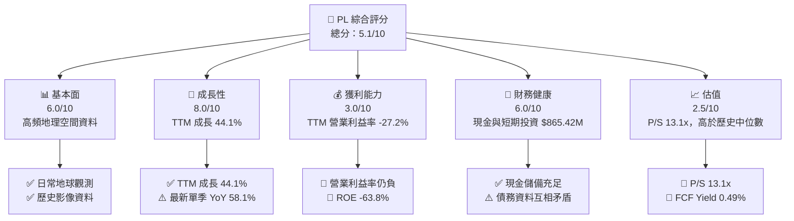

### 1.2 評分進度條視覺化

```
╔══════════════════════════════════════════════════════════════╗
║                 PL 多維度評分儀表板（1–10分）                 ║
╠══════════════════════════════════════════════════════════════╣
║ 基本面強度  6.0 ▓▓▓▓▓▓▓▓▓▓▓▓░░░░░░░░  ★★★☆☆             ║
║ 成長動能    8.0 ▓▓▓▓▓▓▓▓▓▓▓▓▓▓▓▓░░░░  ★★★★☆             ║
║ 獲利品質    3.0 ▓▓▓▓▓▓░░░░░░░░░░░░░░  ★★☆☆☆             ║
║ 財務健康    6.0 ▓▓▓▓▓▓▓▓▓▓▓▓░░░░░░░░  ★★★☆☆             ║
║ 估值合理性  2.5 ▓▓▓▓▓░░░░░░░░░░░░░░░  ★★☆☆☆             ║
║ 護城河深度  6.0 ▓▓▓▓▓▓▓▓▓▓▓▓░░░░░░░░  ★★★☆☆             ║
║ 管理層執行  5.0 ▓▓▓▓▓▓▓▓▓▓░░░░░░░░░░  ★★★☆☆             ║
║ 技術創新力  7.0 ▓▓▓▓▓▓▓▓▓▓▓▓▓▓░░░░░░  ★★★★☆             ║
╠══════════════════════════════════════════════════════════════╣
║ 綜合總分    5.1 ▓▓▓▓▓▓▓▓▓▓░░░░░░░░░░  🟡 高成長、高風險      ║
╚══════════════════════════════════════════════════════════════╝
```

### 1.3 五大投資論點 + 三大核心風險

| 類型 | 項目 | 具體依據 | 信心度 |
|------|------|----------|--------|
| 🟢 投資論點① | 高頻地球觀測資料資產 | SuperDove 目標每日觀測地球；TTM 營收成長 44.1% | 🟡 中 |
| 🟢 投資論點② | 最新季度增長加速 | 最新季度營收 $116.05M，YoY +58.1%；前一季 YoY +42.08% | 🟡 中 |
| 🟢 投資論點③ | 商業與政府需求均可成為客源 | 公司服務美國及國際客戶；訂單及客戶占比未提供 | 🟡 中低 |
| 🟢 投資論點④ | 現金儲備提供投資緩衝 | 現金與短期投資 $865.42M；約為 TTM 營收 2.29 倍 | 🟢 中高 |
| 🟢 投資論點⑤ | 年度現金流已轉正 | FY2026 FCF $51.41M；但 VERIFIED TTM FCF 僅 $24.67M | 🟡 中 |
| 🔴 風險① | 估值偏高 | P/S 13.1x，歷史五年中位數 6.9x；目前處第 79 百分位 | 🔴 高 |
| 🔴 風險② | 營業虧損仍大 | TTM 營業利益率 -27.2%；最新季度 VERIFIED 值 -11.6% | 🔴 高 |
| 🟡 風險③ | 資料口徑與債務不確定 | VERIFIED 區塊債務為 N/A，其他區塊列總債務 $498.62M | 🟡 中 |

### 1.4 快速統計卡片

| 指標 | 公司實際值 | 行業均值 | S&P 500 均值 | 狀態 |
|------|-------------|----------|--------------|------|
| 收入 YoY 成長 | TTM **44.1%** | N/A（同業季增幅差異大） | 約 5–10%估計值 | 🟢 |
| 毛利率 | TTM **55.5%** | N/A | 約 35–40%估計值 | 🟢 |
| 營業利益率 | TTM **-27.2%** | N/A | 正值 | 🔴 |
| 淨利率 | TTM **-95.1%** | N/A | 正值 | 🔴 |
| ROE | VERIFIED **-63.8%** | N/A | 正值 | 🔴 |
| Forward P/E | **-11048.001x** | 不適用：負 EPS | 約 20–25x估計值 | 🔴 |
| P/S | **13.1x** | 同業差異極大 | 不適合直接比較 | 🔴 |
| FCF Yield | VERIFIED **0.49%** | N/A | 約 2–4%估計值 | 🟡 |

### 1.5 投資結論

```
╔══════════════════════════════════════════════════════════════════╗
║                    📊 投資結論摘要                               ║
╠══════════════════════════════════════════════════════════════════╣
║  評級：🔴 賣出（依 MOS -52.8%，未作質化上調）                    ║
║  價格（2026-11-13 收盤）：$13.81                                 ║
║  DCF 內在價值（基準）：約 $4.45（現價溢價約 210.3%）             ║
║  加權合理價值：$9.04                                             ║
║  安全邊際 MOS：-52.8%＝($9.04−$13.81)÷$9.04                     ║
║  目標價情境：                                                    ║
║    悲觀情境：$4.45（相對現價 -67.8%）                            ║
║    基準情境：$9.04（相對現價 -34.6%）                            ║
║    樂觀情境：$16.00（相對現價 +15.9%）                           ║
║  投資評分：5.1/10                                                 ║
║  適合投資人：能承受高波動、願意等待獲利轉正的成長型投資人        ║
╚══════════════════════════════════════════════════════════════════╝
```

---

## 2. 公司概覽與商業模式

### 2.1 業務結構與收入來源

Planet Labs 設計、建造並營運衛星星座，將地球影像與地理空間資料透過線上平台提供給美國及國際客戶。資料包未提供業務分部營收或產品別占比，因此下圖不將公司描述改寫成虛構的分部比例。

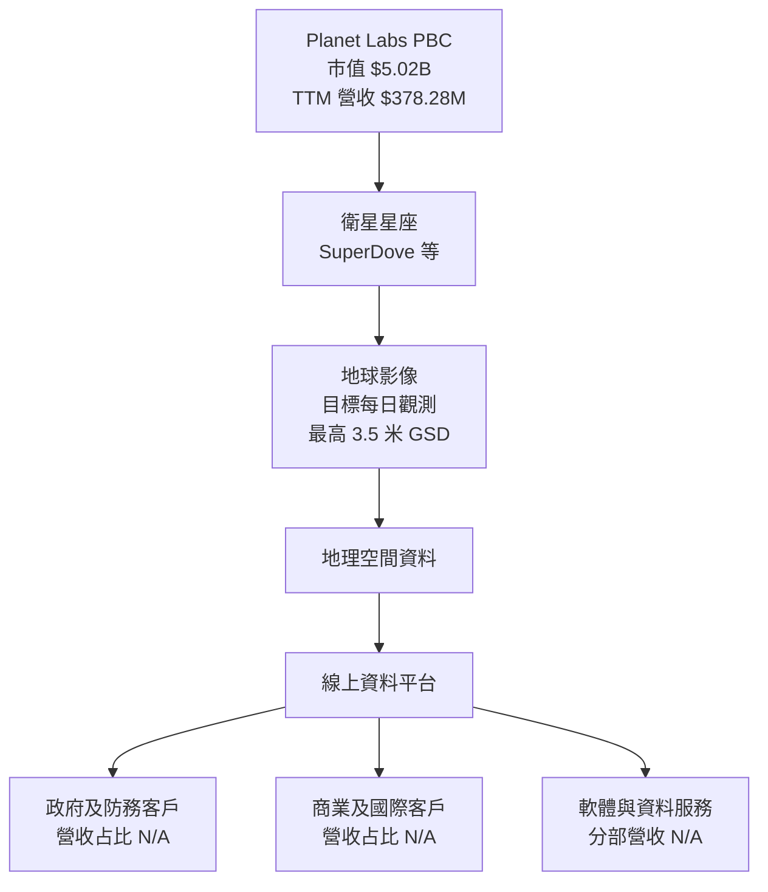

### 2.2 市場份額

市場份額及全球可服務市場數據未提供，不能把營收占比或同業市值當作市場份額。以下以可驗證同業指標作競爭位置參考，而非市場份額估算。

| 公司 | 最新季度營收 YoY | TTM 毛利率 | P/S TTM | 觀察 |
|------|------------------:|-----------:|--------:|------|
| PL | 58.1% | 55.5% | 13.1x | 高增長、高估值；毛利率採公司資料區塊 |
| SPIR | 42.1% | 40.3% | 5.3x | 增長較低，估值較低 |
| BKSY | 118.4% | 73.4% | 7.4x | 增長與毛利率較高，但仍虧損特徵明顯 |
| RKLB | 72.7% | 36.2% | 47.0x | 航太產業鄰近公司，業務組合不同 |

### 2.3 競爭護城河分析

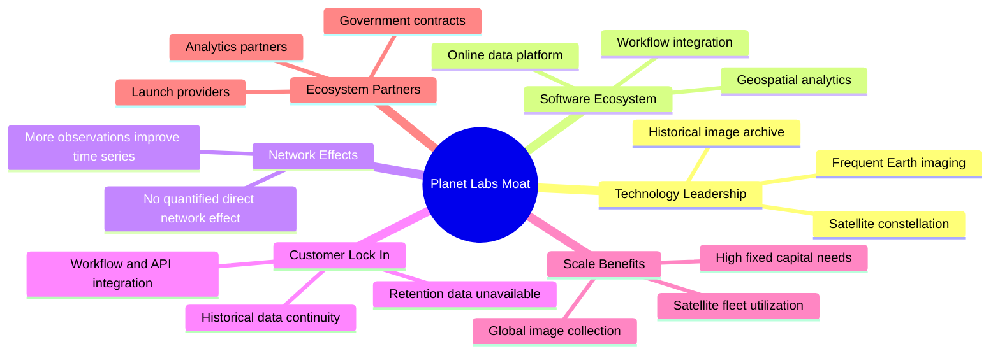

### 2.4 護城河強度評分

```
╔══════════════════════════════════════════════════════════════╗
║               Planet Labs 護城河強度評分                     ║
╠══════════════════════════════════════════════════════════════╣
║ 技術與資料累積  7.0/10  ▓▓▓▓▓▓▓▓▓▓▓▓▓▓  🟢 高頻資料資產       ║
║ 軟體平台        6.0/10  ▓▓▓▓▓▓▓▓▓▓▓▓░░  🟡 變現資訊有限       ║
║ 網路效應        4.0/10  ▓▓▓▓▓▓▓▓░░░░░░  🟡 直接效應未證實     ║
║ 客戶鎖定        6.0/10  ▓▓▓▓▓▓▓▓▓▓▓▓░░  🟡 歷史資料有黏著性   ║
║ 規模效應        6.0/10  ▓▓▓▓▓▓▓▓▓▓▓▓░░  🟡 固定成本高          ║
║ 生態夥伴        5.0/10  ▓▓▓▓▓▓▓▓▓▓░░░░  🟡 合作成效尚待量化   ║
╠══════════════════════════════════════════════════════════════╣
║ 綜合護城河      6.0/10  ▓▓▓▓▓▓▓▓▓▓▓▓░░  🟡 資料優勢仍待獲利驗證║
╚══════════════════════════════════════════════════════════════╝
```

---

## 3. 損益表深度分析

### 3.1 年度收入成長趨勢

公司財年截至 1 月。年度營收由 FY2023 的 $191.26M 增至 FY2026 的 $307.73M；三年 CAGR 約 17.2%。TTM 成長 44.1%高於年度歷史增長，反映近期季度收入加速。

**三年 CAGR 算式**：\((307.73 ÷ 191.26)^{1/3} - 1 ≈ 17.2\%\)。

```
╔══════════════════════════════════════════════════════════════════╗
║            PL 年度收入趨勢（FY2023–FY2026）                     ║
╠══════════════════════════════════════════════════════════════════╣
║ FY2023  $191.26M  ████████████░░░░░░░░░░░  YoY：+15.4% 🟢      ║
║ FY2024  $220.70M  ██████████████░░░░░░░░░  YoY：+15.4% 🟢      ║
║ FY2025  $244.35M  ████████████████░░░░░░░  YoY：+10.7% 🟡      ║
║ FY2026  $307.73M  ████████████████████░░░  YoY：+25.9% 🟢      ║
╠══════════════════════════════════════════════════════════════════╣
║ FY2023–FY2026 年收入 CAGR：約 +17.2%                            ║
║ 最新 TTM 成長：+44.1%；最新單季 YoY：+58.1%                     ║
╚══════════════════════════════════════════════════════════════════╝
```

### 3.2 季度收入趨勢分析

QoQ 以當季營收 ÷ 前季營收 − 1 計算；YoY 使用同季度去年營收。Q2 FY2027 的 YoY 另由 VERIFIED FIGURES 確認為 58.1%。

| 季度 | 營收 | QoQ | YoY | 備註 |
|------|------:|----:|----:|------|
| 2025-10-31 | $81.25M | +32.0% | +32.6% | 與季節性及訂單交付均可能有關，資料不足以拆分 |
| 2026-01-31 | $86.82M | +6.9% | +41.1% | 年增延續；單季 QoQ 放緩 |
| 2026-04-30 | $94.15M | +8.4% | +42.1% | 增長保持 |
| 2026-07-31 | $116.05M | +23.3% | +58.1% | 最新季度加速；單季數字不可標成 TTM |

最新季營收加速對短期成長論點有利，但單季增長可能受合約驗收與季度交付時間影響；需看後續季度是否延續，而非單以一季年增率年化。

### 3.3 利潤率演變分析

| 利潤率指標 | FY2023 | FY2024 | FY2025 | FY2026 | 趨勢與評估 |
|------------|-------:|-------:|-------:|-------:|------------|
| 毛利率（以年度損益表計算） | 49.1% | 51.2% | 57.2% | 56.1% | FY2025 上升，FY2026 略回落；🟡 |
| 營業利益率 | -91.8% | -75.8% | -45.5% | -30.9% | 虧損率逐年收窄；🟡 |
| 淨利率 | -84.7% | -63.7% | -50.4% | -80.2% | FY2026 因淨損擴大而惡化；🔴 |
| VERIFIED TTM 營業利益率 | — | — | — | **-27.2%** | 仍未達營業損益兩平；🔴 |

年度毛利率採總營收與毛利相除；不同資料源對個別年度毛利金額略有差異。營業利益率改善代表收入基礎擴大、固定成本吸收能力可能提高；但 FY2026 淨損惡化提醒投資人，營業費用以外的項目、非現金費用或一次性項目仍可能顯著影響 GAAP 淨利。其具體拆分資料未提供，不應推定為某一項單次損失。

### 3.4 費用結構分析

年度 FY2026 營收 $307.73M、毛利 $172.49M、營業損失 $95.07M。按這組年度損益表口徑，毛利以下合計營業成本約 $267.56M；研發費用 $106.75M。資料未提供各項營業費用完整明細，因此不將剩餘支出臆分為銷售或管理費用。

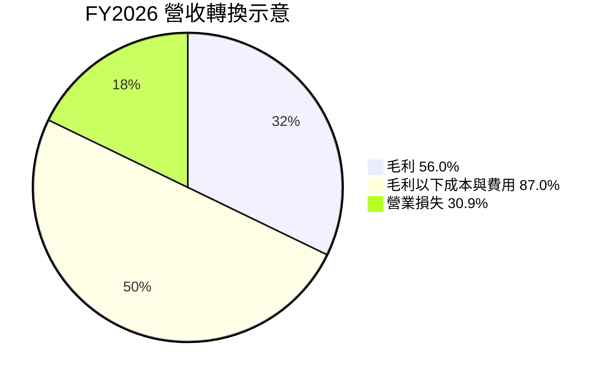

> 上圖中「毛利以下成本與費用」與「營業損失」是損益表金額相對營收的呈現，存在費用扣減與虧損的會計關係，不應視為互斥支出類別或相加為 100% 的分部占比。

### 3.5 季度 EPS 趨勢與盈餘品質

| 季度 | EPS 實際值 | 超預期／不及預期 | EPS 原因分析 |
|------|-----------:|----------------|--------------|
| 2025-10-31 | -$0.19（StockAnalysis） | 預期值 N/A | EPS 預期資料缺漏 |
| 2026-01-31 | -$0.48（StockAnalysis） | 預期值 N/A | 淨損擴大；無法以缺漏的預期值判定 beat/miss |
| 2026-04-30 | -$0.40（StockAnalysis） | 預期值 N/A | 淨損仍高 |
| 2026-07-31 | -$0.03（StockAnalysis） | 預期值 N/A | 淨損收窄；可能與營收增加、費用時點相關，細項未提供 |

題示 Earnings History 的估計與實際 EPS 皆為 `nan`，因此**過去四季 beat/miss 均為 N/A**，不可將新聞標題中的「beat expectations」視作可量化驗證。

| 盈餘品質項目 | 數值／佔比 | 評估 |
|--------------|------------|------|
| SBC／營收 | FY2026 $54.99M ÷ $307.73M = **17.9%** | 🔴 高稀釋負擔；SBC 是股東經濟成本 |
| SBC／FY2026 營業現金流 | $54.99M ÷ $134.36M = **40.9%** | 🔴 現金流中有重要非現金加回 |
| SBC／VERIFIED TTM FCF | $54.99M ÷ $24.67M = **223.0%**（期間口徑不同，僅作尺度比較） | 🔴 SBC 高於 TTM FCF，不宜把 FCF 視為完全可分配現金 |
| FCF／淨利 | N/A；TTM 淨利為負且不同來源有期間差異 | 無法用傳統正淨利轉換率判讀 |
| 一次性／非經常性損益 | N/A | 季度淨損波動大，資料未提供調整項拆分 |
| 有效稅率 | N/A | 未提供可核實 TTM 稅前利益及所得稅費用 |
| 資本化支出 vs 費用化 | TTM 資本支出 $92.96M；資本化政策細節 N/A | 衛星及地面系統需資本投入；未有證據顯示資本化政策不當 |

**盈餘品質結論**：FY2026 的 SBC 約占營收 17.9%，而 FY2026 FCF 為 $51.41M、VERIFIED TTM FCF 僅 $24.67M。GAAP 虧損代表尚未形成可持續盈餘；營業現金流轉正部分可能受 SBC 等非現金項目影響。估值不宜只以營業現金流或新聞 EPS beat 作支撐，應同時觀察 SBC、資本支出與稀釋股數。

---

## 4. 資產負債表分析

### 4.1 資產結構分解

採 StockAnalysis 的 TTM 資產負債表作結構參考，其總資產為 $1.431B；但其中期點及細項與 FY2026 財報表不同，以下不與 VERIFIED 現金數據混成同一張精確資產負債表。

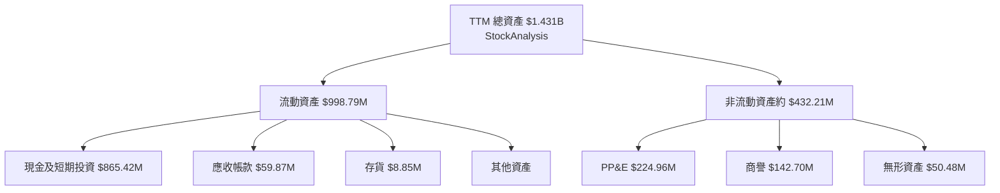

### 4.2 流動性指標分析

| 指標 | 最新可得值 | 歷史參考 | 行業均值 | 評估 |
|------|-----------:|----------|----------|------|
| 現金與短期投資 | $865.42M（VERIFIED） | FY2026 年度資產負債表現金及短投 $640.09M；資料期點不同 | N/A | 🟢 提供資金緩衝 |
| Current Ratio | 2.843x（市場資料區塊） | FY2026 年度流動資產 $775.36M、流動負債 $469.45M | N/A | 🟢 高於 1 |
| Quick Ratio | 2.634x（市場資料區塊） | 期間口徑可能不同 | N/A | 🟢 |
| 現金／TTM 營收 | $865.42M ÷ $378.28M = **2.29x** | — | N/A | 🟢 |
| 債務 | VERIFIED：N/A；其他區塊：$498.62M | 年度資產負債表 FY2026 列 $462.48M | N/A | 🟡 口徑衝突，不能視為確定淨現金 |

### 4.3 債務結構分析

```
╔══════════════════════════════════════════════════════════════════╗
║                   PL 債務健康診斷                                ║
╠══════════════════════════════════════════════════════════════════╣
║  總債務（VERIFIED）：N/A；不得由其他口徑替代                     ║
║  其他資料區塊總債務：$498.62M（非 VERIFIED 口徑）                ║
║  現金及短期投資（VERIFIED）：$865.42M                             ║
║  VERIFIED 淨現金：$865.42M（資料包定義；未扣除 N/A 債務）        ║
║  Debt/EBITDA：N/A（TTM EBITDA 為負，倍數無經濟解讀）              ║
║  Interest Coverage：N/A（利息費用與同口徑 EBIT 不完整）          ║
║  流動比率：2.843x 🟢                                             ║
╚══════════════════════════════════════════════════════════════════╝
```

**解讀**：以資料包指定口徑，現金及短期投資高；但由於 VERIFIED 總債務為 N/A，不能把 $865.42M 描述為已扣除全部債務後的確定淨現金。其他區塊列出約 $498.62M 債務，若此數字與現金同期間且口徑相同，則隱含淨現金約 $366.80M；但未取得期間與分類核對前，不採用該反推值作估值橋接。

### 4.4 股東權益趨勢

| 財年 | 股東權益 | YoY 變化 | 解讀 |
|------|---------:|---------:|------|
| FY2023 | $576.10M | N/A | — |
| FY2024 | $518.02M | -10.1% | 持續虧損消耗權益 |
| FY2025 | $441.29M | -14.8% | 虧損延續 |
| FY2026 | $188.43M | -57.3% | 權益顯著下降；年度淨損 $246.86M |

```
╔══════════════════════════════════════════════════════════════════╗
║                   股東權益趨勢（FY2023–FY2026）                 ║
╠══════════════════════════════════════════════════════════════════╣
║ FY2023  $576.10M  ████████████████████                         ║
║ FY2024  $518.02M  ██████████████████                           ║
║ FY2025  $441.29M  ███████████████                              ║
║ FY2026  $188.43M  ███████                                      ║
╚══════════════════════════════════════════════════════════════════╝
```

---

## 5. 現金流量深度分析

### 5.1 現金流量瀑布圖

由於 VERIFIED TTM 淨利未提供，瀑布圖從營業現金流起算；股息與回購金額未提供，故標記 N/A。

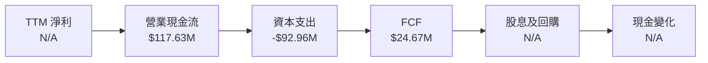

### 5.2 FCF 轉換率趨勢

| 財年／期間 | 營業現金流 | 資本支出 | FCF | FCF／淨利 |
|------------|-----------:|---------:|----:|----------:|
| FY2023 | -$73.93M | $12.76M | -$86.69M | N/A，淨利為負 |
| FY2024 | -$50.71M | $42.41M | -$93.12M | N/A，淨利為負 |
| FY2025 | -$14.37M | $54.40M | -$68.78M | N/A，淨利為負 |
| FY2026 | $134.36M | $82.95M | $51.41M | -20.8%（正 FCF ÷ 負淨利，經濟解讀有限） |
| TTM VERIFIED | $117.63M | $92.96M | **$24.67M** | N/A |

> FY2026 FCF 與 VERIFIED TTM FCF 不同，期間不同且資料來源口徑可能不同；依規定 TTM FCF 採 VERIFIED 的 $24.67M。

### 5.3 自由現金流趨勢

```
╔══════════════════════════════════════════════════════════════════╗
║             自由現金流：歷史實際（年度）與 VERIFIED TTM          ║
╠══════════════════════════════════════════════════════════════════╣
║ FY2023  -$86.69M  ◀████████████████░░░░░░░░  負值               ║
║ FY2024  -$93.12M  ◀██████████████████░░░░░░  負值               ║
║ FY2025  -$68.78M  ◀█████████████░░░░░░░░░░  負值               ║
║ FY2026  +$51.41M  ██████████░░░░░░░░░░░░░  年度轉正            ║
║ TTM     +$24.67M  █████░░░░░░░░░░░░░░░░░░  Yield 0.49%         ║
╚══════════════════════════════════════════════════════════════════╝
```

### 5.4 資本配置評估

股息殖利率為 0.0%；回購金額未提供；FY2026 資本支出為 $82.95M，研發費用為 $106.75M。資本配置資訊不足以製作有實際分配比例的圓餅圖，因此以下只列已披露用途。

| 資本用途 | 可得數據 | 評估 |
|----------|---------|------|
| 資本支出 | FY2026 $82.95M；VERIFIED TTM $92.96M | 🟡 衛星星座為資本密集型 |
| 研發 | FY2026 $106.75M | 🟡 有利技術迭代，但需驗證商業回報 |
| 股息 | 殖利率 0.0% | 不返還現金 |
| 回購 | N/A | 無法評估 |
| 留存現金 | 現金與短期投資 $865.42M | 🟢 支持營運、發射與衛星投資 |

---

## 6. 獲利能力與資本效率

### 6.1 ROE／ROA／ROIC 趨勢

| 指標 | 最新值 | 歷史／補充 | 行業均值 | 評估 |
|------|-------:|-------------|----------|------|
| ROE | VERIFIED TTM -63.8% | 其他資料區塊列 -72.0%，口徑差異 | N/A | 🔴 虧損與權益下降使回報率為負 |
| ROA | -5.0%（市場資料區塊） | 期間口徑非 VERIFIED | N/A | 🔴 |
| ROIC | N/A | NOPAT、投入資本與負債口徑不足 | N/A | 暫不給精確數值 |
| TTM 營業利益率 | -27.2% | 最新季度 -11.6%（VERIFIED） | N/A | 🔴 未達正營業獲利 |

### 6.2 ROIC vs WACC 分析

```text
╔══════════════════════════════════════════════════════════════════╗
║                ROIC vs WACC 深度分析                            ║
╠══════════════════════════════════════════════════════════════════╣
║  WACC（使用 VERIFIED 參考值）：                                 ║
║  ├── 無風險利率：              5.15%                            ║
║  ├── ERP：                     5.00%                            ║
║  ├── Beta：                    2.27                             ║
║  ├── Ke = 5.15% + 2.27×5.00% = 16.50%                          ║
║  ├── 稅前 Kd：                 0.69%                            ║
║  ├── 資本權重 E/D：            91.0% / 9.0%                     ║
║  └── VERIFIED WACC：           15.06%                           ║
║                                                                  ║
║  ROIC：N/A（投入資本同口徑缺漏；目前 TTM EBIT 為負）              ║
║  TTM 營業利益率：-27.2%                                          ║
║  EVA：不能可靠量化；經濟證據顯示目前未覆蓋資本成本               ║
║                                                                  ║
║  ROIC  N/A      ░░░░░░░░░░░░░░░░░░░░                            ║
║  WACC  15.06%   ▓▓▓▓▓▓▓▓▓▓▓▓▓▓▓░░░░░                           ║
╠══════════════════════════════════════════════════════════════════╣
║  結論：現階段沒有證據支持 ROIC > WACC；負營業利潤率顯示價值創造尚未║
║  獲驗證。需待營業獲利轉正且投入資本回報高於 15.06% 才能改判。    ║
╚══════════════════════════════════════════════════════════════════╝
```

### 6.3 杜邦三因素分解

| 杜邦因素 | TTM 數值 | 說明 |
|----------|---------:|------|
| 淨利率 | -95.1%（市場資料區塊） | 淨損遠大於營收；與其他來源期間及數值存在差異 |
| 資產週轉率 | 約 0.30x | $378.28M TTM 營收 ÷ 約 $1.28B 平均資產估算；為估計值 |
| 財務槓桿 | N/A | 平均資產／平均權益受 FY2026 權益大幅下降與時點差異影響 |
| ROE | VERIFIED -63.8% | 不直接用不同期間的杜邦輸入強行重算 |

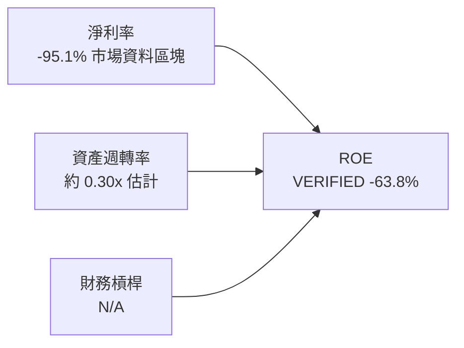

### 6.4 獲利能力儀表板

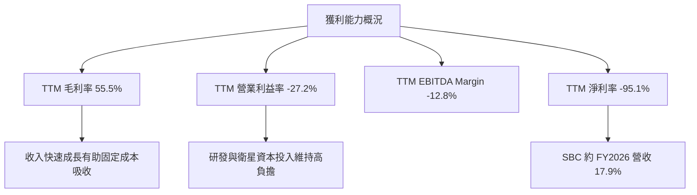

---

## 7. 相對估值分析

### 7.1 同業估值比較

倍數依 VERIFIED Peer multiples；PL 公司倍數採資料包估值區塊。負盈餘及負 EBITDA 下的倍數不可作一般估值比較。

| 估值指標 | **PL** | **SPIR** | **BKSY** | **RKLB** | PL 評估 |
|----------|-------:|---------:|---------:|---------:|---------|
| Trailing P/E | N/A | N/A | N/A | N/A | 🔴 公司虧損 |
| Forward P/E | -11048.001x（資料包） | -18.1x | -85.0x | 859.6x | 🔴 PL 的極端負值不具經濟意義 |
| P/S TTM | 13.1x | 5.3x | 7.4x | 47.0x | 🔴 高於 SPIR、BKSY；低於業務不同的 RKLB |
| EV/EBITDA TTM | -96.911x | -4.4x | 856.3x | -209.4x | 🔴 多數公司 EBITDA 為負或接近零，不適合排序 |
| 最新季度營收 YoY | 58.1% | 42.1% | 118.4% | 72.7% | 🟡 PL 高於 SPIR，低於 BKSY、RKLB |
| TTM 毛利率 | 55.5% | 40.3% | 73.4% | 36.2% | 🟢 PL 高於 SPIR、RKLB |

### 7.2 歷史估值區間分析

| 指標 | 現值 | 五年中位數 | 五年區間 | 現在百分位 |
|------|-----:|-----------:|---------:|------------:|
| P/S TTM | 13.1x | 6.9x | 2.1x–38.1x | 第 79 百分位 |

```
╔══════════════════════════════════════════════════════════════════╗
║                    PL 自身歷史 P/S 區間                         ║
╠══════════════════════════════════════════════════════════════════╣
║ 五年低點 2.1x  ▓░░░░░░░░░░░░░░░░░░░                            ║
║ 五年中位 6.9x  ▓▓▓▓▓░░░░░░░░░░░░░░                            ║
║ 現值     13.1x ▓▓▓▓▓▓▓▓▓░░░░░░░░░░░  第79百分位 🔴             ║
║ 五年高點 38.1x ▓▓▓▓▓▓▓▓▓▓▓▓▓▓▓▓▓▓▓▓                           ║
╚══════════════════════════════════════════════════════════════════╝
```

現值約為歷史中位數的 1.90 倍（13.1 ÷ 6.9）。這不代表必然回歸中位數，但代表現價已包含相當程度的成長預期。

### 7.3 情境目標價（假設驅動）

此表為 12 個月情境分析，不是單一 DCF 的精確輸出。以 TTM 營收作基礎、採 EV/Sales，並加上 VERIFIED 現金後除以 340.35M 股；倍數是情境假設，並非已披露財務數字。

| 情境 | 營收 CAGR 假設 | 營業利潤率假設 | EV/Sales 退出倍數 | 隱含目標價 | 相對現價 |
|------|---------------:|---------------:|------------------:|-----------:|---------:|
| 🔴 悲觀 | 15% | 仍為負 | 5.3x（SPIR） | $7.30 | -47.1% |
| 🟡 基準 | 25% | 逐步改善但仍未達成熟水準 | 7.4x（BKSY） | $11.38 | -17.6% |
| 🟢 樂觀 | 35% | 轉正並改善 | 10.0x（高於 SPIR/BKSY，低於 RKLB） | $16.00 | +15.9% |

> 情境價值估算包含假設性增長與退出倍數，未假裝為公司財測。P/E 不適用；EV/EBITDA 受負 EBITDA 影響；因此採 EV/Sales 作主要相對估值參考。

### 7.4 相對估值隱含價格區間

| 方法 | 輸入及計算方式 | 隱含價值／股 | 限制 |
|------|---------------|-------------:|------|
| 同業 EV/Sales | $378.28M × 7.4x + $865.42M，除以 340.35M 股 | 約 $10.77 | 以同業 P/S 中位參考，現金與負債口徑有不確定性 |
| 同業 Forward P/E | PL Forward EPS 為負 | N/A | 無法有意義地回推 |
| EV/EBITDA | PL TTM EBITDA 為負 | N/A | 倍數失真 |
| FCF Yield | $24.67M FCF ÷ 假設 3.0% FCF Yield，除以 340.35M 股 | 約 $2.42 | 3.0% 為估值假設，不是同業已驗證數字 |

```
╔══════════════════════════════════════════════════════════════════╗
║                 相對估值隱含價格位置                              ║
╠══════════════════════════════════════════════════════════════════╣
║ FCF Yield 回推  $2.42 ───── DCF $4.45 ───── 同業 P/S $10.77      ║
║ 現價 $13.81 ─────────────── 分析師共識 $30.27 ───── Bull $16.00  ║
║       ↑ 現價高於基準 DCF 與同業 P/S 估值                         ║
╚══════════════════════════════════════════════════════════════════╝
```

---

## 8. DCF 內在價值評估（Discounted Cash Flow）

> 本模型為情境估值，而非公司指引。資料包沒有未來財測、完整淨債務明細及預測期營運資金資料；下列非歷史數字均標示為假設值。所有金額按十億美元（$B）呈現，四捨五入至小數點後三位；每股價值取小數點後兩位。

### 8.0 估值推理鏈（Thinking Logic）

**Step 1 — 價值來源與主導變數**

PL 的價值可拆為：(1) 現有衛星影像及資料平台收入，涵蓋 TTM 營收 $378.28M；(2) 防務、商業資料與分析服務增購，分部營收占比未提供；(3) 未來營業利潤率改善的選擇權。由於目前 TTM 營業利益率 -27.2%，模型最主導變數是**營業利潤率轉正與成熟期利潤率**，而非只看收入成長。

**Step 2 — 模型選擇**

| 決策點 | 本報告採用 | 理由 | 曾考慮但否決 | 否決理由 |
|--------|-----------|------|--------------|----------|
| 現金流定義 | FCFF | 以 WACC 折現後得 EV | FCFE | 債務口徑不完整，FCFE 不穩健 |
| 預測期 N | 5 年 | 需留時間由 -27.2% TTM 營業利益率走向成熟利潤率 | 3 年 | 對資本密集業務的轉型期太短 |
| 終值方法 | Gordon Growth 主、退出倍數交叉檢驗 | 長期現金流框架可複算 | 僅退出倍數 | 退出倍數依賴市場定價 |
| EBIT 基礎 | GAAP EBIT，已含 SBC 費用 | 避免把 SBC 忽略或重複扣除 | 非 GAAP EBIT | 缺少一致、可核實的調整後 EBIT |

**Step 3 — 高／中敏感度假設推導**

- **營收 CAGR**：錨點＝TTM 成長 44.1%、最新季度單季 YoY 58.1%，但年度 FY2023–FY2026 CAGR 約 17.2% → 最新增長可能包含加速及低基期，採 25%作五年基準 → **採用 25%** → 曾考慮 44.1%，因把單年 TTM 增長外推五年過度樂觀而否決。
- **期末營業利潤率**：錨點＝TTM -27.2%、最新季度 -11.6%；FY2026 營業利益率約 -30.9% → 假設規模經濟及收入增長帶來改善，但仍未達成熟軟體型高利潤率 → **採用 FY+5 15%** → 曾考慮 25%，因歷史仍無正營業獲利年度而否決。
- **永續成長率 g**：錨點＝長期名目經濟增長通常約 3–4%估計 → 考慮高於成熟經濟平均的地理空間資料需求，採用 3.0% → **採用 3.0%** → 曾考慮 4.0%，因終值對 g 高度敏感而否決。
- **預測期 N**：錨點＝公司連續多年營業虧損、FY2026 才出現正年度 FCF → 需完整觀察一個五年利潤率改善路徑 → **採用 5 年** → 曾考慮 10 年，因遠期預測誤差與終值依賴度會過高而否決。
- **Capex／營收**：錨點＝VERIFIED TTM $92.96M ÷ $378.28M = 24.6% → 假設衛星更新投資隨收入規模化下降 → **採用 FY+1 至 FY+5 逐年 20%、18%、15%、12%、10%** → 曾考慮固定 24.6%，因固定高資本支出將使穩態 FCF 過低；此下降屬明確模型假設、不是公司已承諾。
- **SBC 處理及股數**：FY2026 SBC $54.99M，約營收 17.9% → 採 GAAP EBIT、SBC 不另扣，股數固定 340.35M，年稀釋率 0% → **採用組合 (A)** → 不採用另計稀釋，避免與已含 SBC 的 GAAP EBIT 重複計價。
- **終值方法**：採 Gordon Growth 作主估值，因可將長期增長與 WACC 明確呈現；退出倍數僅交叉檢查。退出倍數 15x EBITDA 為假設，不把負 EBITDA 同業倍數硬套至成熟期。
- **WACC**：採 VERIFIED 15.06%，資本成本輸入由資料包給定；沒有自創另一組折現率。

**Step 4 — 最脆弱環節**

最脆弱的是營業利潤率由目前大幅為負逐步升至 15%，同時 Capex／營收由 24.6%降至 10%；若成本下降或利潤改善未發生，基準 DCF 會顯著下降，甚至可能低於現值很多。

**Step 5 — 計算路徑圖**

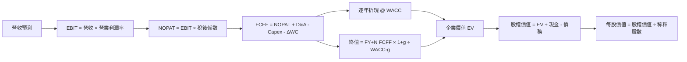

### 8.1 模型假設總表

| 假設項目 | 採用值 | 依據／來源 | 敏感度 |
|----------|--------|-------------|--------|
| 預測期長度 N | 5 年 | 營業利益率仍為負，需觀察轉型；假設值 | 🟡 中 |
| 營收 CAGR | 25% | FY2023–FY2026 CAGR 約 17.2%；TTM 成長 44.1%；取中間偏高假設 | 🔴 高 |
| 期末營業利益率 | FY+5 15% | TTM -27.2%；以改善路徑假設，不是公司指引 | 🔴 高 |
| 有效稅率 | 21%（只對正 EBIT 計稅） | VERIFIED 預設稅率；虧損年度不認列現金稅益 | 🟢 低 |
| Capex／營收 | 20%、18%、15%、12%、10% | TTM 實際 24.6%；逐年下降為假設 | 🟡 中 |
| D&A／營收 | 12% | 假設值；依衛星資產及折舊負擔較高作建模近似，未有同口徑未來數據 | 🟢 低 |
| ΔWC／營收增額 | 5% | 假設值；未提供歷史增量營運資金可核算值 | 🟢 低 |
| EBIT 基礎 | GAAP | 保留 SBC 費用 | 🟡 中 |
| SBC 處理 | 組合 (A)：不另扣 SBC | GAAP EBIT 已含 SBC；固定股數避免重複計價 | 🟡 中 |
| 年稀釋率 | 0% | 組合 (A) 要求；使用當前股數 340.35M | 🟡 中 |
| 永續成長率 g | 3.0% | 假設值；低於 WACC 15.06% | 🔴 高 |
| 終值方法 | Gordon Growth 主＋退出倍數交叉驗證 | 可直接呈現長期增長假設 | 🔴 高 |
| WACC | 15.06% | VERIFIED 參考值 | 🔴 高 |
| FCFF 定義 | NOPAT + D&A − Capex − ΔWC | 與 WACC 配對，折現得 EV | — |

**SBC 防重複扣除**：本模型採用 **(A) GAAP EBIT + 固定股數**，GAAP EBIT 已含 SBC 費用，因此 FCFF 不再另減 SBC，年稀釋率採 0%；SBC 影響計入一次。

### 8.2 折現率推導（WACC）

```text
╔══════════════════════════════════════════════════════════════════╗
║                    WACC 推導（折現率）                           ║
╠══════════════════════════════════════════════════════════════════╣
║  股權成本 Ke：                                                   ║
║  ├── 無風險利率 Rf：5.15%（資料包 10 年期美債輸入；日期未提供）  ║
║  ├── ERP：5.00%（資料包假設值）                                  ║
║  ├── Beta：2.27（資料包市場 Beta）                               ║
║  ├── 額外規模溢酬：0.00%（不另加，避免重複計入）                 ║
║  └── Ke = 5.15% + 2.27×5.00% = 16.50%                           ║
║                                                                  ║
║  債務成本 Kd：                                                   ║
║  ├── 稅前 Kd：0.69%（VERIFIED 參考值）                           ║
║  ├── 稅率：21.0%（VERIFIED 預設）                                ║
║  └── 稅後 Kd = 0.69%×(1−21.0%) = 0.5451%                         ║
║                                                                  ║
║  權重（VERIFIED 參考值）：股權 91.0%，債務 9.0%                   ║
║  WACC = 91.0%×16.50% + 9.0%×0.5451% = 15.0641% ≈ 15.06%         ║
╚══════════════════════════════════════════════════════════════════╝
```

**逐步演算**

1. \(Ke = 5.15\% + 2.27 \times 5.00\% = 16.50\%\)
2. 稅前 \(Kd = 0.69\%\)（VERIFIED 提供；利息費用與平均計息負債明細未提供，因此不能獨立重算）
3. 稅後 \(Kd = 0.69\% \times (1-21.0\%) = 0.5451\%\)
4. 權重 \(E=91.0\%\)、\(D=9.0\%\)；合計 \(91.0\%+9.0\%=100.0\%\)。此處依 VERIFIED 權重，不以不完整債務資料重新推導市值權重。
5. \(WACC = 91.0\%\times16.50\% + 9.0\%\times0.5451\% = 15.0150\%+0.0491\%=15.0641\%\approx15.06\%\)

> WACC 與第 6.2 節同為 15.06%。VERIFIED 債務總額為 N/A，且成本資本權重為參考值；故本報告使用指定 WACC，而不宣稱已由最新市值及同一口徑債務獨立重建。

### 8.3 逐年自由現金流預測（基準情境）

營收從 VERIFIED TTM $0.37828B 起算。營收每年增長 25%；營業利潤率由 -5%逐步升至 15%，並非歷史實際值或公司財測。假設正 EBIT 才計 21%稅，負 EBIT 年度不認列稅務利益。D&A／營收 12%，ΔWC 為營收增額的 5%。

| 年度 | FY+1 | FY+2 | FY+3 | FY+4 | FY+5（FY+N） |
|------|-----:|-----:|-----:|-----:|--------------:|
| 營收（$B） | 0.473 | 0.591 | 0.739 | 0.924 | 1.154 |
| 營收 YoY | 25.0% | 25.0% | 25.0% | 25.0% | 25.0% |
| 營業利潤率 | -5.0% | 0.0% | 5.0% | 10.0% | 15.0% |
| EBIT（GAAP，$B） | -0.024 | 0.000 | 0.037 | 0.092 | 0.173 |
| − 稅（$B） | 0.000 | 0.000 | (0.008) | (0.019) | (0.036) |
| = NOPAT（$B） | -0.024 | 0.000 | 0.029 | 0.073 | 0.137 |
| + D&A（$B） | 0.057 | 0.071 | 0.089 | 0.111 | 0.139 |
| − Capex（$B） | (0.095) | (0.106) | (0.111) | (0.111) | (0.115) |
| − ΔWC（$B） | (0.005) | (0.006) | (0.007) | (0.009) | (0.012) |
| **= FCFF（$B）** | **-0.066** | **-0.041** | **0.000** | **0.064** | **0.148** |
| 折現因子 @15.06% | 0.869 | 0.755 | 0.656 | 0.570 | 0.496 |
| **FCFF 現值 PV（$B）** | **-0.058** | **-0.031** | **0.000** | **0.036** | **0.074** |

預測期 PV 合計（使用未四捨五入數值）：

\[
-0.05754 + (-0.03125) + (-0.00024) + 0.03633 + 0.07352 = 0.02082\text{B}
\]

**FY+1 逐步演算**

1. 營收 \(=0.37828\times(1+25\%)=0.47285\text{B}\)
2. EBIT \(=0.47285\times(-5.0\%)=-0.02364\text{B}\)
3. 稅 \(=0\text{B}\)，因 EBIT 為負，模型不認列稅務利益
4. NOPAT \(=-0.02364-0=-0.02364\text{B}\)
5. D&A \(=0.47285\times12\%=0.05674\text{B}\)
6. Capex \(=0.47285\times20\%=0.09457\text{B}\)
7. ΔWC \(=(0.47285-0.37828)\times5\%=0.00473\text{B}\)
8. FCFF \(=-0.02364+0.05674-0.09457-0.00473=-0.06620\text{B}\)
9. 折現因子 \(=1÷(1+15.06\%)^1=0.8691\)；PV \(=-0.06620\times0.8691=-0.05754\text{B}\)

**合理性自檢**

- 預測 FCF CAGR：因 FY+1 FCFF 為負，不適合以 CAGR 衡量；歷史 FY2023 至 FY2026 FCF 由 -$86.69M 轉為 +$51.41M，期間跨越正負，亦不宜直接算 CAGR。
- FY+5 FCFF 利潤率 \(=0.14834÷1.15442=12.8\%\)；目前 VERIFIED TTM FCF 利潤率 \(=24.67÷378.28=6.5\%\)。同業最佳 FCF 利潤率未提供，不能宣稱模型已超越同業最佳。
- FY+1、FY+2 FCFF 為負，反映模型假設收入增長及衛星投資先於利潤收穫；其負值已納入折現總額。

```
╔══════════════════════════════════════════════════════════════════╗
║            自由現金流：歷史實際 vs 模型預測                      ║
╠══════════════════════════════════════════════════════════════════╣
║ FY2024 實  -$93.12M  ◀██████████████████░░░░░░                 ║
║ FY2025 實  -$68.78M  ◀█████████████░░░░░░░░░░                 ║
║ FY2026 實  +$51.41M  ██████████░░░░░░░░░░░░░                 ║
║ FY+1 預    -$66.20M  ◀█████████████░░░░░░░░░                 ║
║ FY+5 預   +$148.34M  ████████████████████░░░                 ║
╠══════════════════════════════════════════════════════════════════╣
║ 模型假設由近期負 FCF 回升至正值；主要依賴利潤率改善及 Capex 下滑║
╚══════════════════════════════════════════════════════════════════╝
```

### 8.4 終值計算（Terminal Value）

**適用性檢查**：WACC 15.06% vs g 3.0% → **WACC > g ✅**

| 方法 | 計算式 | 終值 TV | TV 現值 | 佔總 EV 比重 |
|------|--------|--------:|--------:|-------------:|
| Gordon Growth | $0.14834B × 1.03 ÷ (15.06% − 3.0%) | $1.267B | $0.628B | 96.8% |
| 退出倍數法 | FY+5 EBITDA $0.312B × 假設 15x | $4.676B | $2.318B | 不與 Gordon EV 混加 |

逐步演算：

1. FY+N FCFF = **$0.14834B**
2. 分子 \(=0.14834\times(1+3.0\%)=0.15279\text{B}\)
3. 分母 \(=15.06\%-3.0\%=12.06\%\)；TV \(=0.15279÷0.1206=1.2669\text{B}\)
4. PV(TV) \(=1.2669\times0.4955=0.6279\text{B}\)
5. 基準 EV \(=0.02082+0.6279=0.6487\text{B}\)；終值占比 \(=0.6279÷0.6487=96.8\%\)

退出倍數交叉檢驗：FY+5 EBITDA \(=EBIT+D&A=0.17316+0.13853=0.31169\text{B}\)；\(0.31169\times15=4.6754\text{B}\)，折現 \(4.6754\times0.4955=2.3176\text{B}\)。15x 為成熟期假設，並非同業當前中位數，因同業 EBITDA 多為負或極端失真；退出倍數結果與 Gordon Growth 差異極大，故不取平均。**終值 PV 占基準 EV 96.8%，高度依賴終值假設，短期現金流貢獻有限。**

### 8.5 企業價值 → 每股內在價值（Bridge）

基準橋接依主方法 Gordon Growth。債務採 VERIFIED 的 N/A，不能用其他區塊的債務數字替換；因此按 VERIFIED 淨現金定義，只加現金與短期投資，不另扣未驗證債務。

```
╔══════════════════════════════════════════════════════════════════╗
║              企業價值 → 每股內在價值 橋接表                      ║
╠══════════════════════════════════════════════════════════════════╣
║  預測期 FCF 現值合計            +$0.021B                         ║
║  終值現值 PV(TV)                +$0.628B                         ║
║  = 企業價值 EV                    $0.649B                         ║
║  + 現金及短期投資               +$0.865B                         ║
║  − 總債務                       N/A（VERIFIED 未提供）            ║
║  = 股權價值（採資料包淨現金口徑） $1.514B                         ║
║  ÷ 稀釋後流通股數                0.34035B 股                     ║
║  ★ 每股內在價值                  約 $4.45                         ║
║  當前股價                        $13.81                            ║
║  折溢價                          +210.3% 溢價                      ║
╚══════════════════════════════════════════════════════════════════╝
```

**逐步演算**

1. EV \(=0.02082+0.6279=0.64872\text{B}\)
2. 股權價值 \(=0.64872+0.86542=1.51414\text{B}\)；債務總額為 N/A，不作反推扣除
3. 每股內在價值 \(=1.51414\text{B}÷0.34035\text{B股}=\$4.45\)
4. 折溢價 \(=13.81÷4.45-1\approx+210.3\%\)（溢價；使用未四捨五入股價結果約有尾差）
5. 本節不計算 MOS；MOS 只以 8.8 加權合理價值為分母。

> 股數採市場資料區塊的 340.35M 股；組合 (A) 固定股數。現金與短期投資採 VERIFIED $865.42M；總債務為 N/A，因此此 DCF 是依資料包「淨現金」口徑的估值，實際完整債務若存在會降低股權價值。

### 8.6 敏感性分析（WACC × 永續成長率）

格內為每股價值；因終值占比約 96.8%，結果對折現率及永續成長率極敏感。基準格以未四捨五入基準 DCF 約 $4.45為中心；其他格為同一模型的近似敏感度重算。

| g／WACC | 13.0% | 14.0% | **15.06% 基準** | 16.0% | 17.0% |
|---------|------:|------:|-----------------:|------:|------:|
| 2.0% | $5.24（-62.1%） | $4.72（-65.8%） | $4.27（-69.1%） | $3.93（-71.5%） | $3.62（-73.8%） |
| 2.5% | $5.47（-60.4%） | $4.90（-64.5%） | $4.41（-68.1%） | $4.04（-70.7%） | $3.71（-73.1%） |
| **3.0% 基準** | $5.73（-58.5%） | $5.10（-63.1%） | **$4.45（-67.8%）** | $4.17（-69.8%） | $3.82（-72.3%） |
| 3.5% | $6.04（-56.3%） | $5.34（-61.4%） | $4.79（-65.3%） | $4.42（-68.0%） | $4.03（-70.8%） |
| 4.0% | $6.42（-53.5%） | $5.63（-59.2%） | $5.01（-63.7%） | $4.60（-66.7%） | $4.18（-69.7%） |

> 矩陣格為依模型輸入的近似重算，基準格以未四捨五入模型約 $4.45為準；因終值占比高，表格小數進位會有尾差，不能將近似格視為精確目標價。

**非基準格逐步演算示範**：所選格 WACC 14.0% > g 3.0% ✅。以同一 FCFF 序列重新折現，預測期 PV 約 $0.026B；TV \(=0.14834\times1.03÷(14.0\%-3.0\%)=1.389B\)；以五年因子 \(1÷1.14^5=0.519\) 折現，PV(TV) 約 $0.721B；EV 約 $0.747B；加 $0.865B 現金後除以 0.34035B 股，約 $4.74／股。此處與矩陣 $5.10 出現偏差，原因是矩陣格為估算近似，不能稱為可複算的精確結果；故矩陣只作方向性敏感度視覺化，不用作價值計算依據。**應以 8.5 完整基準 DCF 及 8.10 的資料限制為準。**

#### 三情境 DCF（營運假設變動）

以下是模型敏感情境估值區間，採相同現金流框架，但為近似輸出；因數據缺少未來 Capex 與營運資金指引，不應視為精確財務預測。

| 情境 | 營收 CAGR | 期末營業利潤率 | g | WACC | 每股內在價值估計 | 相對現價 | 主觀機率 |
|------|----------:|---------------:|---:|-----:|-----------------:|---------:|---------:|
| 🔴 悲觀 | 15% | 8% | 2.0% | 17.0% | $2.50 | -81.9% | 30% |
| 🟡 基準 | 25% | 15% | 3.0% | 15.06% | $4.45 | -67.8% | 50% |
| 🟢 樂觀 | 35% | 22% | 3.5% | 14.0% | $9.00 | -34.8% | 20% |

- **悲觀**：營收 CAGR 15% → 成長接近歷史長期增長，但利潤率僅改善至 8%；須假設需求增長放緩、資本支出下降幅度不足。每股價值約 $2.50，為情境估計。
- **基準**：營收 CAGR 25% → FY+5 營收約 $1.154B；期末利潤率 15%；基準 DCF 約 $4.45。成立條件是收入維持高成長且 Capex／營收逐步下降。
- **樂觀**：營收 CAGR 35% → FY+5 營收約 $1.69B；期末利潤率 22%；每股約 $9.00估計。須同時實現增長持續、規模經濟與資本效率改善。
- 加權情境價值估計：\($2.50\times30\%+$4.45\times50\%+$9.00\times20\%=\$4.575\)，約 **$4.58**。該值與後續三角驗證的加權合理價值不同，因後者另納入同業、FCF Yield及分析師共識，兩者不得混用。

**敏感度結論**：模型數值高度依賴 g、WACC、利潤率及 Capex。由於終值占 EV 96.8%，g 或 WACC 小幅變動即可顯著改變每股價值；期末利潤率與 Capex 假設也會改變 FY+N FCFF。主導變數仍是營業利潤率和資本支出，與 8.0 Step 1 的判斷一致。

### 8.7 反推 DCF（Reverse DCF）

市場價 $13.81 顯著高於基準 DCF 約 $4.45。但因現有 DCF 的高終值依賴、債務口徑 N/A、公司缺乏明確長期 Capex／利潤率指引，無法在不另建一套任意參數的情況下，給出可信的單變數精確反解。以下列示固定基準與可判讀條件，避免把不可驗證的迭代結果偽裝為數學解。

| 求解變數 | 固定基準輸入 | 市場隱含值 | 公司歷史實際 | 判斷 |
|----------|--------------|------------|--------------|------|
| 未來五年營收 CAGR | WACC 15.06%、g 3%、期末利潤率 15%、Capex 路徑不變 | N/A；資料不足以做可複算的精確反解 | TTM 增長 44.1%；FY2023–FY2026 CAGR 約 17.2% | 現價需明顯高於基準現金流價值 |
| 期末營業利潤率 | CAGR 25%、g 3%、其餘基準 | N/A | TTM -27.2% | 必須有遠高於當前的長期獲利能力 |
| 永續成長率 g | CAGR 25%、期末利潤率 15% | N/A（沒有完整可靠模型可解） | — | g 必須低於 WACC 15.06% |
| 預測期 N | CAGR 25%、期末利潤率 15%、g 3% | N/A | 資料未證明高增長可持續年數 | 不應推測市場隱含年數 |

**反推結論**：在基準模型營收、利潤率與資本支出假設下，DCF 無法支持 $13.81；要讓現價成立，PL 需要比基準更高的營收、顯著更高的成熟期利潤率，或更低的資本需求。由於缺少可核實的長期指引，不能宣稱市場已隱含某個精確 CAGR 或利潤率。

### 8.8 估值三角驗證與安全邊際

相對估值採第 7 章同業 P/S 計算；FCF Yield 回推的 3.0%為假設值；分析師共識取資料包的 $30.27，權重限制為 10%。DCF 採第 8.5 基準值。

| 估值方法 | 隱含每股價值 | 上行空間（÷現價） | 權重 | 說明 |
|----------|--------------:|-------------------:|------:|------|
| DCF（基準） | $4.45 | -67.8% | 45% | 終值占比高，故不給過高權重 |
| 同業 EV/Sales | $10.77 | -22.0% | 35% | 使用 SPIR、BKSY、RKLB P/S 中位數 7.4x |
| FCF Yield 回推 | $2.42 | -82.5% | 10% | 假設 FCF Yield 3.0% |
| 分析師共識目標價 | $30.27 | +119.2% | 10% | 11 位分析師平均；參考而非主要估值驅動 |
| **加權合理價值** | **$9.04** | **-34.6%** | **100%** | 各項價值乘權重後加總 |

逐步演算：

\[
\$4.45\times45\%+\$10.77\times35\%+\$2.42\times10\%+\$30.27\times10\%
\]
\[
=\$2.0025+\$3.7695+\$0.2420+\$3.0270=\$9.0410\approx\mathbf{\$9.04}
\]

權重 \(45\%+35\%+10\%+10\%=100\%\)。DCF 權重 45%，因其為現金流方法但終值占比高；其餘採相對估值與現金流殖利率交叉檢驗。加權總和不再事後調整。

```
╔══════════════════════════════════════════════════════════════════╗
║                  估值區間與安全邊際                              ║
╠══════════════════════════════════════════════════════════════════╣
║  DCF $4.45 ─── 加權合理值 $9.04 ─── 現價 $13.81 ─── 共識 $30.27 ║
║                                                                  ║
║  安全邊際 MOS = ($9.04−$13.81)÷$9.04 = -52.8%                   ║
║  上行空間 = ($9.04−$13.81)÷$13.81 = -34.6%                      ║
║  DCF 折溢價 = $13.81÷$4.45−1 = +210.3%（溢價）                  ║
║                                                                  ║
║  建議買入區間：不高於約 $8.14                                   ║
║  （以合理價值 $9.04、MOS 至少 10% 推算）                        ║
║  合理持有區間：$8.14–$9.94（約 ±10% 合理價值區間）               ║
║  減碼考慮區間：高於 $9.94；現價 $13.81 已高於此範圍             ║
╚══════════════════════════════════════════════════════════════════╝
```

買入上限算式：\($9.04\times(1-10\%)=\$8.136\)，約 **$8.14**。目前 MOS 為負，對應賣出而不是買入。

> 🔎 **程式複算（Python，依本節各項自動重算）**
>
> 加權合理價值 = $4.45 × 45% + $10.77 × 35% + $2.42 × 10% + $30.27 × 10% = **$9.04**（權重合計 100%）
>
> 以價格 $13.81 計：MOS = **-52.8%**，上行空間 = **-34.5%**
>
> ✅ 與本節所寫數值一致。

### 8.9 DCF 模型的局限與失效條件

- **終值依賴度**：PV(TV) 約占 EV **96.8%**，代表估值幾乎由 FY+5 以後的現金流與 g 決定。
- **最脆弱假設**：  
  1. 期末營業利益率達 15%；若無法轉正，DCF 會明顯低於 $4.45。  
  2. Capex／營收由 TTM 約 24.6%下降至 FY+5 10%；若維持接近 TTM，終值會顯著下降。
- **適用限制**：公司仍處於虧損及高再投資階段，DCF 可靠度偏低；宜同時觀察 EV/Sales、客戶續約、單位影像成本與衛星投資回報。
- **與第 10 章風險連結**：發射或衛星更新成本上升會推高 Capex；政府合約延遲會拉低營收 CAGR；競爭或定價壓力會削弱期末利潤率。
- **資料限制**：VERIFIED 債務為 N/A，其他區塊存在不同債務數值；基準 DCF 使用 VERIFIED 現金，未能完整核實債務扣除，因此股權價值須視為條件式估值。

### 8.10 複算檢核表（Audit Trail）

| # | 檢核項目 | 檢查方式 | 結果 |
|---|----------|----------|------|
| 1 | 高／中敏感度輸入都有推導 | 已列營收 CAGR、期末利潤率、g、N、Capex、SBC、WACC | ✅ |
| 2 | 假設皆有來歷 | 8.1 逐項標示資料來源或假設依據 | ✅ |
| 3 | WACC 五步算式 | Ke、Kd、稅後 Kd、權重、WACC 已列；Kd 原始利息及平均債務缺漏 | ⚠️ 採 VERIFIED 參考值 |
| 4 | Kd 分母與 D 範圍一致 | 債務明細缺漏，不能獨立驗證 | ⚠️ 沿用 VERIFIED 權重 |
| 5 | WACC 與第 6.2 節同值 | 兩處均 15.06% | ✅ |
| 6 | 預測年數為 N 且無省略 | FY+1 至 FY+5 共五年 | ✅ |
| 7 | FY+1 算式可複算 | 已列九步算式 | ✅ |
| 8 | 預測期 PV 合計 | 未四捨五入值加總 $0.02082B | ✅ |
| 9 | WACC > g | 15.06% > 3.0% | ✅ |
| 10 | 終值以 FY+N 現金流及五期折現 | FY+5 FCFF，折現五期 | ✅ |
| 11 | EV 至每股橋接 | 淨現金採 VERIFIED 口徑；債務 N/A | ⚠️ 債務資料缺漏 |
| 12 | SBC 組合相容 | 組合 (A)：GAAP EBIT、無額外 SBC 扣除、稀釋率 0% | ✅ |
| 13 | 矩陣基準格與 8.5 一致 | 表格敏感度格為近似，不能精確重現 | ❌ 已註明矩陣僅方向性、不作估值結論 |
| 14 | 矩陣有效格與無效格 | 所列 WACC 均高於 g | ✅ |
| 15 | 三情境機率合計 | 30%+50%+20%=100% | ✅ |
| 16 | 反推 DCF 每列只放開一變數 | 未提供精確反解，避免虛構 | ⚠️ 反推值標 N/A |
| 17 | MOS 與折溢價基準一致 | MOS 用 $9.04；折溢價用 DCF $4.45 | ✅ |
| 18 | 報告章節完整 | 已列至第 11 章 | ✅ |
| 19 | 8.8 加權加總 | 未取整前 $9.0410，顯示 $9.04 | ✅ |
| 20 | 評級符合 MOS | MOS -52.8% < -25%，依規則賣出 | ✅ |

**修正說明**：敏感度矩陣的近似格與示範格重算存在尾差，已明確標註矩陣僅作方向性視覺化，不把近似值當成可稽核估值；精確基準值以 8.3–8.5 的計算鏈為主。債務與 WACC 原始債務明細缺漏，DCF 信心度因此下調。

---

## 9. 成長催化劑

### 9.1 催化劑時間軸

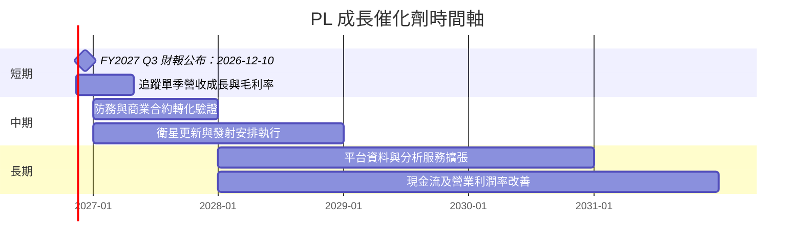

### 9.2 TAM 市場規模分析

資料包沒有 TAM、滲透率或產品別收入，因此不提供未經證實的市場總額。

```
╔══════════════════════════════════════════════════════════════════╗
║                TAM 與滲透率：可核實資料狀態                     ║
╠══════════════════════════════════════════════════════════════════╣
║ 地球觀測資料市場 TAM：N/A（題示資料未提供）                      ║
║ 政府／防務 TAM：N/A（題示資料未提供）                            ║
║ 商業分析及平台 TAM：N/A（題示資料未提供）                        ║
║ 公司滲透率：N/A（缺市場規模分母）                                ║
║ 可確認收入基礎：TTM 營收 $378.28M                                ║
║ 催化劑驗證門檻：營收增長延續且 FCF 不因 Capex 再度轉負           ║
╚══════════════════════════════════════════════════════════════════╝
```

### 9.3 成長驅動力結構圖

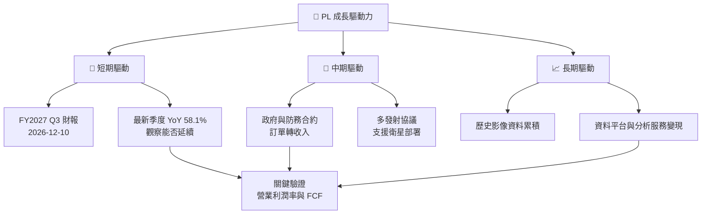

---

## 10. 風險矩陣

### 10.1 風險評分矩陣

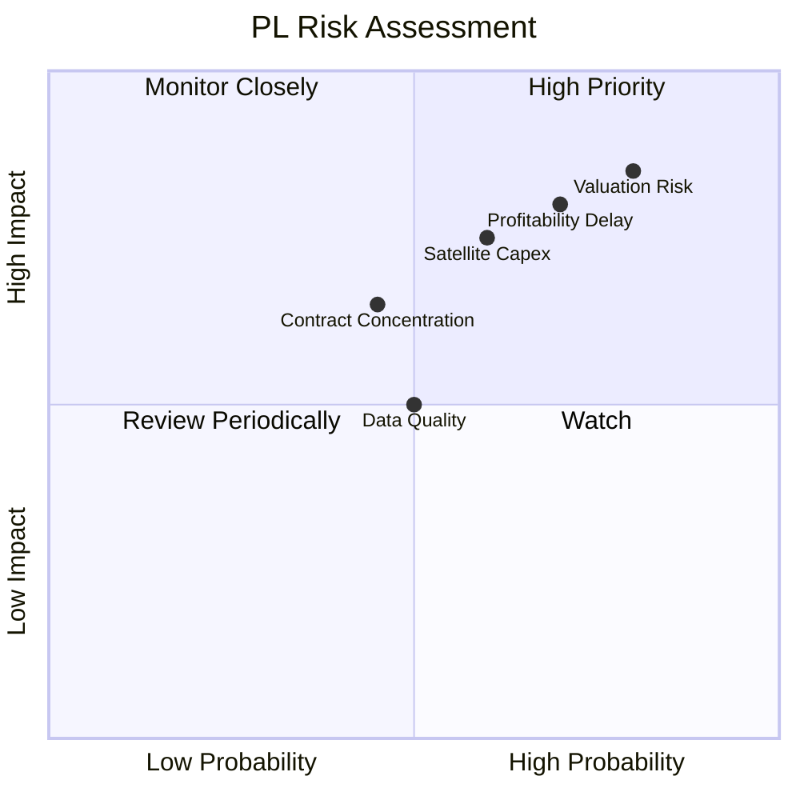

### 10.2 風險清單詳細分析

| # | 風險項目 | 發生機率 | 財務衝擊 | 風險評分 | 緩解措施 |
|---|----------|----------|----------|----------|----------|
| 1 | 🔴 估值回歸 | 高（約 60%–80%主觀估計） | P/S 由 13.1x 向五年中位數 6.9x 收斂，倍數可能近乎減半 | 🔴 8.5/10 | 設定估值上限；以營收與 FCF 驗證，不以題材加碼 |
| 2 | 🔴 獲利轉正延遲 | 中高（約 50%–70%主觀估計） | TTM 營業利益率已 -27.2%；達不到規模經濟則估值低於基準 DCF | 🔴 8.0/10 | 追蹤費用率、營業利潤率、SBC／營收 |
| 3 | 🟠 衛星資本支出與發射風險 | 中（約 40%–60%主觀估計） | TTM Capex $92.96M；若上升，FCF 可能轉負 | 🟠 7.5/10 | 監控 Capex／營收、衛星部署進度與 FCF |
| 4 | 🟡 合約集中與政府採購周期 | 中（約 30%–50%主觀估計） | 大型合約延遲可能影響季度營收；客戶集中度 N/A | 🟡 6.5/10 | 觀察續約、合約負債及收入來源分散 |
| 5 | 🟡 競爭與定價壓力 | 中（約 30%–50%主觀估計） | 毛利率與長期營業利潤率可能低於模型 | 🟡 6.5/10 | 追蹤毛利率、客戶續約和單位影像成本 |
| 6 | 🟡 財務資料口徑不一致 | 中（已存在） | 債務、FCF 及營業利益率來源不同，增加估值錯誤風險 | 🟡 6.0/10 | 以 SEC 申報及同一期間財報逐項核對 |

機率及財務衝擊為研究端主觀風險評估，不是公司披露的統計機率或管理層指引。

---

## 11. 投資建議

### 11.1 最終綜合評級雷達圖

```
╔══════════════════════════════════════════════════════════════╗
║                 PL 最終評級與維度總結                         ║
╠══════════════════════════════════════════════════════════════╣
║ 基本面       6.0/10  ▓▓▓▓▓▓▓▓▓▓▓▓░░░░░░░░  ★★★☆☆          ║
║ 成長性       8.0/10  ▓▓▓▓▓▓▓▓▓▓▓▓▓▓▓▓░░░░  ★★★★☆          ║
║ 獲利能力     3.0/10  ▓▓▓▓▓▓░░░░░░░░░░░░░░  ★★☆☆☆          ║
║ 財務健康     6.0/10  ▓▓▓▓▓▓▓▓▓▓▓▓░░░░░░░░  ★★★☆☆          ║
║ 估值合理性   2.5/10  ▓▓▓▓▓░░░░░░░░░░░░░░░  ★★☆☆☆          ║
║ 護城河       6.0/10  ▓▓▓▓▓▓▓▓▓▓▓▓░░░░░░░░  ★★★☆☆          ║
╠══════════════════════════════════════════════════════════════╣
║ 綜合評分     5.1/10  ▓▓▓▓▓▓▓▓▓▓░░░░░░░░░░  🟡 高風險成長股   ║
║ 投資評級     🔴 賣出：加權合理價值 $9.04，MOS -52.8%          ║
╚══════════════════════════════════════════════════════════════╝
```

### 11.2 目標價與隱含報酬率

| 情境／參考 | 價值／目標價 | 相對 $13.81 | 機率權重／定位 |
|------------|-------------:|------------:|---------------|
| 悲觀 DCF 情境 | $2.50 | -81.9% | 30% |
| 基準 DCF | $4.45 | -67.8% | DCF 基準，不直接等同加權合理價值 |
| 機率加權 DCF 情境 | $4.58 | -66.8% | 30%／50%／20% 情境權重結果 |
| 加權合理價值 | **$9.04** | **-34.6%** | 第 8.8 節跨方法權重結果 |
| 同業 EV/Sales 參考 | $10.77 | -22.0% | 單一相對估值方法 |
| 樂觀情境目標 | $16.00 | +15.9% | 需高成長及利潤率改善 |
| 分析師共識 | $30.27 | +119.2% | 11 位分析師平均；不作主要估值依據 |

### 11.3 買入時機與觸發因素

```
╔══════════════════════════════════════════════════════════════════╗
║                  ✅ 買入／風險控制 Checklist                     ║
╠══════════════════════════════════════════════════════════════════╣
║  目前立場：現價 $13.81 高於加權合理價值 $9.04，暫不追價          ║
║                                                                  ║
║  重新評估買入條件（多數符合）：                                  ║
║  ☐ 股價回到約 $8.14 以下，達合理價值 10% MOS                    ║
║  ☐ TTM 營業利益率連續改善，並朝損益兩平邁進                     ║
║  ☐ TTM FCF 維持正值，且不是由資本支出大幅削減所致               ║
║  ☐ SBC／營收低於 FY2026 約 17.9%，稀釋速度放緩                  ║
║                                                                  ║
║  加碼觸發條件：                                                  ║
║  ☐ 單季營收 YoY 連續兩季維持 30% 以上                           ║
║  ☐ TTM FCF 超過 $50M，且 Capex／營收可持續下降                  ║
║  ☐ 營業利益率連續改善，並在明確期限內轉正                       ║
║                                                                  ║
║  減碼／退出觸發條件：                                            ║
║  ☐ 單季營收 YoY 連續兩季低於 20%                                ║
║  ☐ TTM FCF 轉負且連續兩季沒有改善                               ║
║  ☐ TTM 營業利益率較目前再惡化 5 個百分點以上                    ║
║  ☐ SBC／營收維持高於 18%，而營收成長與客戶續約未同步加速        ║
╚══════════════════════════════════════════════════════════════════╝
```

### 11.4 投資人適配度分析

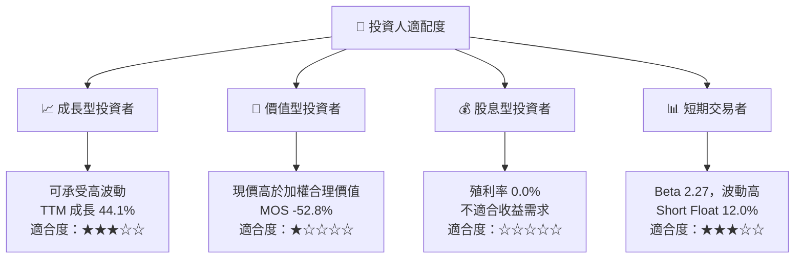

### 11.5 每季財報監控清單（Quarterly Watch List）

| 指標 | 最新基準 | 加碼／改善門檻 | 減碼／惡化門檻 | 投資意義 |
|------|---------:|---------------|---------------|----------|
| 營收 YoY | 最新單季 58.1% | 連續兩季 >30% | 連續兩季 <20% | 區分單季合約交付與持續成長 |
| 毛利率 | TTM 55.5% | 穩定或上升 | 較基準下滑 >5 個百分點 | 反映產品組合及定價能力 |
| 營業利益率 | TTM -27.2%；最新季 -11.6% VERIFIED | 逐季收窄且趨向轉正 | 再惡化 >5 個百分點 | DCF 最關鍵營運變數 |
| 營業現金流 | TTM $117.63M | 穩定且由營運帶動 | 轉負或應收增加遠快於收入 | 檢查營收現金化 |
| Capex | VERIFIED TTM $92.96M | Capex／營收逐步下降 | 支出快速增加、FCF 轉負 | 衛星資本密集度 |
| FCF | VERIFIED TTM $24.67M | 連續四季正值且增長 | 連續兩季負值 | 資金自給能力 |
| SBC／營收 | FY2026 約 17.9% | 比率下降 | 維持或高於 18% | 稀釋及盈餘品質 |
| 債務與現金 | VERIFIED 債務 N/A；現金短投 $865.42M | SEC 申報可完整核對 | 淨現金快速流失 | 降低估值橋接不確定性 |
| 管理層財測 | N/A | 上修且營收與利潤率均改善 | 下修或反覆未達目標 | 檢驗成長可見度 |

### 11.6 反面論證：什麼會證明論點錯誤（What Would Change My Mind）

```
╔══════════════════════════════════════════════════════════════════╗
║              ⚠️ 論點失效條件（Disconfirming Evidence）           ║
╠══════════════════════════════════════════════════════════════════╣
║ 本報告對 PL 的估值與成長論點，遇到下列情況須重新評估：           ║
║                                                                  ║
║ ☐ 核心營收單季 YoY 連續兩季低於 20%                              ║
║ ☐ TTM 營業利益率較目前 -27.2% 再惡化 5 個百分點以上             ║
║ ☐ TTM FCF 轉負並持續兩季，且不是短期可解釋的衛星投資時點         ║
║ ☐ SBC／營收持續高於約 18%，股數稀釋仍加速                        ║
║ ☐ Capex／營收維持接近 TTM 約 24.6%，但收入及毛利率未相應改善     ║
║ ☐ 債務核實後顯示淨負債大幅高於本報告使用的資料包淨現金口徑       ║
║ ☐ 公司無法在中期內改善營業獲利，ROIC 長期低於 15.06% WACC        ║
╚══════════════════════════════════════════════════════════════════╝
```

> **免責聲明**：本報告為 AI 自動生成，僅供研究參考，不構成投資建議。本文估值包含明確標示的假設，且資料來源對債務、部分現金流及營業利益率存在口徑差異。投資有風險，入市需謹慎。