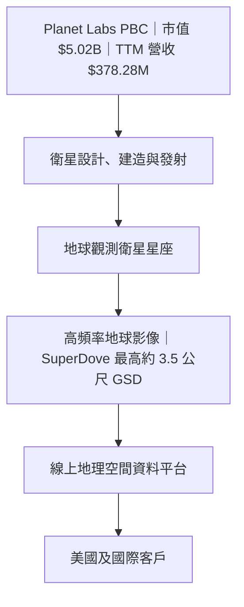
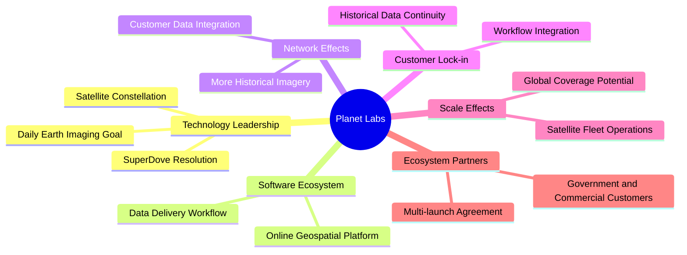
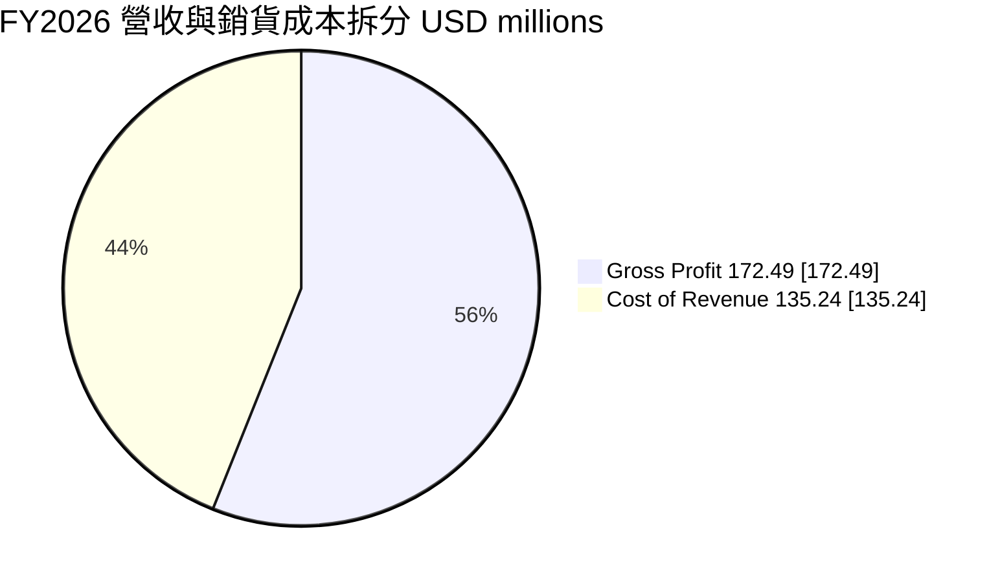
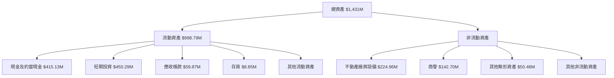
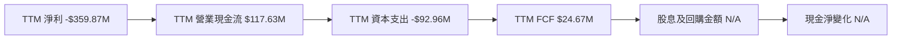
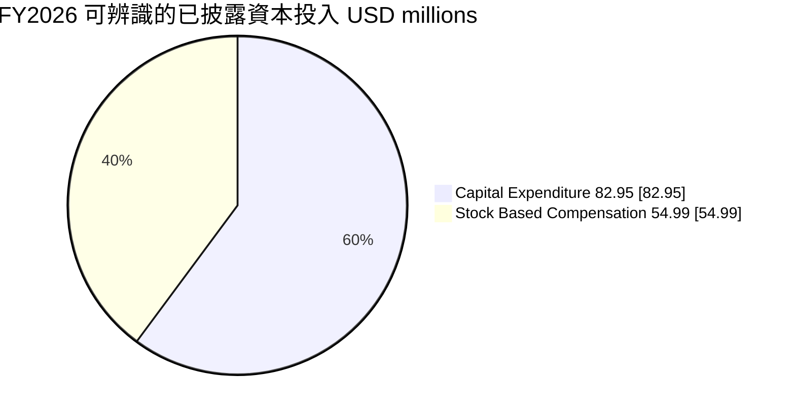
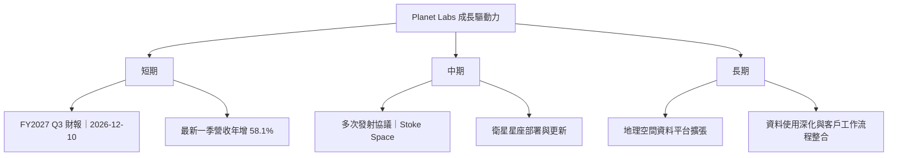
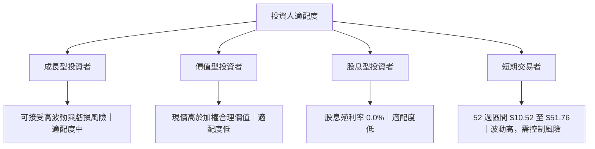

# PL 基本面深度分析報告
> **報告日期**：2026-11-14 ｜ **語言**：繁體中文 ｜ **數據來源**：SEC 申報資料 (XBRL)、Yahoo Finance、Finviz、StockAnalysis、Roic.ai ｜ **分析師**：CFA 級機構研究

---

## 目錄

| # | 章節 | 核心結論 |
|---|------|----------|
| 1 | 執行摘要 | 賣出；加權合理價值 $8.98，MOS -53.8% |
| 2 | 公司概覽與商業模式 | 日常地球影像與線上地理空間資料平台具差異化，但市場份額資料未提供 |
| 3 | 損益表深度分析 | TTM 營收 $378.28M、年增 44.1%；TTM 營業利益率 -27.2% |
| 4 | 資產負債表分析 | 現金及短期投資 $865.42M；總債務資料 N/A |
| 5 | 現金流量深度分析 | TTM FCF $24.67M，但資本支出高且股權薪酬稀釋顯著 |
| 6 | 獲利能力與資本效率 | ROIC N/A，無法確認價值創造；WACC 為 13.14% |
| 7 | 相對估值分析 | PL 的 P/S 13.1x，高於自身五年中位數 6.9x |
| 8 | DCF 內在價值評估 | DCF N/A：TTM 營業利益為負，不能以虧損營業利益建立可靠 DCF |
| 9 | 成長催化劑 | 最新一季營收年增 58.1%；FY2027 Q3 財報預計 2026-12-10 公布 |
| 10 | 風險矩陣 | 虧損、估值溢價、股權薪酬稀釋為主要風險 |
| 11 | 投資建議 | 現價 $13.81 高於加權合理價值；以 $8.08 以下作為具 10% MOS 的觀察買入區 |

---

## 1. 執行摘要

Planet Labs 的 TTM 營收為 **$378.28M**，TTM 成長率 **44.1%**，最新一季年增率 **58.1%**；但 TTM 營業利益率仍為 **-27.2%**，且 ROIC 未提供，無法證明公司已跨越資本成本。以同業 P/S 法及分析師共識加權後，合理價值為 **$8.98**；對照 **2026-11-13 收盤價 $13.81**，MOS 為 **-53.8%**、上行空間為 **-35.0%**。因此依 MOS 規則評級為 **🔴 賣出**；現價的高營收成長尚未轉化為可持續營業獲利，而估值仍高於自身五年 P/S 中位數。

### 1.0 一頁式投資儀表板（Portfolio Manager 30 秒速讀）

| 項目 | 內容 |
|------|------|
| **投資論點（3 句）** | ① TTM 營收年增 **44.1%**，最新一季年增 **58.1%**，收入增速加快。② TTM 營業利益率 **-27.2%**，尚未證明規模成長可轉化為營業獲利。③ TTM FCF **$24.67M**，但 FCF Yield 僅 **0.49%**，相對市值的現金回報有限。 |
| **綜合評分** | **4.8/10**（引用 1.1 評分卡） |
| **財務健康** | 🟡 現金及短期投資 **$865.42M**；總債務為 N/A，無法獨立核驗淨債務結構。 |
| **ROIC vs WACC** | ROIC：**N/A**；WACC：**13.14%**。缺少 ROIC，不能判定經濟利潤差額。 |
| **FCF 趨勢** | FY2026 年 FCF 為 **$51.41M**；最新 TTM FCF **$24.67M**、FCF Yield **0.49%**。年度與 TTM 口徑不同，不應直接視作同一期間趨勢。 |
| **估值** | Forward P/E **-11,048.001x**；EV/EBITDA **-96.235x**；FCF Yield **0.49%**。負盈餘倍數參考價值有限。 |
| **DCF 內在價值（基準）** | **N/A**；TTM 營業利益為負，DCF MODEL 未計算，無法提供 DCF 折溢價。 |
| **安全邊際（MOS）** | **-53.8%＝($8.98 − $13.81) ÷ $8.98**；以 8.8 加權合理價值為基準。🔴 <10%：無安全邊際。 |
| **預期報酬（基準情境 12M）** | **-35.0%**，以加權合理價值相對現價計算；不是 DCF 情境報酬。 |
| **關鍵風險（前二）** | ① TTM 營業利益率 -27.2%，營收成長尚未轉為營業獲利。② P/S 13.1x，高於五年中位數 6.9x。 |
| **評級 + 信心度** | 🔴 **賣出** ｜ 信心：中。估值及虧損數據明確；惟總債務、ROIC、EPS 預期差等資料不足。 |

### 1.1 綜合評分卡（全報告唯一）

| 維度 | 評分（1–10） | 主要依據（引用數字與其來源章節） |
|------|--------------|----------------------------------|
| 成長性 | 8 | TTM 營收成長 **44.1%**、最新一季年增 **58.1%**（第 3 章）；成長快，但不能單獨證明獲利品質。 |
| 獲利能力 | 2 | TTM 營業利益率 **-27.2%**，Piotroski F-Score **3/8**；ROIC 為 N/A（第 3、6 章）。 |
| 財務健康 | 7 | 現金及短期投資 **$865.42M**、流動比率 **2.843**；但總債務在核驗數據中為 N/A（第 4 章）。 |
| 估值 | 1 | MOS **-53.8%**，P/S **13.1x** 對比自身五年中位數 **6.9x**（第 7、8 章）。 |
| 護城河 | 7 | 每日地球影像、衛星星座及線上地理空間平台具差異化；但市場份額及客戶留存數字未提供（第 2 章）。 |
| 管理層與資本配置 | 4 | FY2026 SBC **$54.99M**，約為該年營收的 **17.9%**；稀釋股數測試未通過（第 3、6 章）。 |
| **綜合評分** | **4.8** | 六項算術平均：**(8 + 2 + 7 + 1 + 7 + 4) ÷ 6 = 4.833… ≈ 4.8**。 |

### 1.2 五大投資論點 + 三大核心風險

| 類型 | 項目 | 具體依據 | 信心度 |
|------|------|----------|--------|
| 🟢 **投資論點①** | 收入成長加速 | TTM 營收 **$378.28M**、TTM 年增 **44.1%**；最新一季營收年增 **58.1%**，高於最近四季中較早季度的年增率。 | 🟢 高 |
| 🟢 **投資論點②** | 衛星星座及資料平台整合 | 公司設計、建造、發射衛星並透過線上平台交付地理空間資料；自有星座可支持高頻率影像供應。 | 🟡 中 |
| 🟢 **投資論點③** | TTM 營業現金流為正 | TTM 營業現金流 **$117.63M**，扣除 TTM 資本支出 **$92.96M** 後，FCF **$24.67M**。 | 🟡 中 |
| 🟢 **投資論點④** | 流動性具緩衝 | 現金及短期投資 **$865.42M**，流動比率 **2.843**；可支援短期營運與衛星投入，但不代表已達自我融資的成熟期。 | 🟡 中 |
| 🟢 **投資論點⑤** | 最新季度營業虧損較前季收窄 | FY2027 Q2 營業利益 **-$13.51M**，相較 FY2027 Q1 **-$34.89M**；可能反映收入擴大與營業槓桿改善，仍須觀察能否延續。 | 🟡 中 |
| 🟡 **風險①** | 高成長未轉為獲利 | TTM 營業利益率 **-27.2%**；若規模擴大仍無法降低營業費用率，成長將無法支撐估值。 | 🔴 高衝擊 |
| 🔴 **風險②** | 估值高於歷史中位數 | P/S **13.1x**，高於自身五年中位數 **6.9x**；收入增速放緩可能引發倍數收縮。 | 🔴 高衝擊 |
| 🟡 **風險③** | SBC 與稀釋 | FY2026 SBC **$54.99M**；Piotroski 的「稀釋股數未增加」測試未通過，股東持股比例可能被稀釋。 | 🟡 中至高 |

### 1.3 快速統計卡片

| 指標 | 公司實際值（期間） | 同業中位數 | 狀態 |
|------|--------------------|------------|------|
| 營收成長（TTM） | **44.1%** | — | 🟢 |
| 營收成長（最新一季年增） | **58.1%** | **72.7%**（SPIR、BKSY、RKLB 最新一季年增率中位數） | 🟢 公司成長快；相對三家樣本中位數則較低 |
| 毛利率（TTM） | **55.5%** | **40.3%**（三家同業中位數） | 🟢 |
| 營業利益率（TTM） | **-27.2%** | — | 🔴 |
| ROIC（TTM） | **N/A** | — | 🟡 資料未提供 |
| Forward P/E | **-11,048.001x** | — | 🔴 PL 及多家同業前瞻盈餘為負，倍數不具正常比較意義 |
| FCF Yield（TTM） | **0.49%** | — | 🟡 |
| Piotroski F-Score | **3 / 8** | — | 🔴 |

### 1.4 投資結論

```text
╔══════════════════════════════════════════════════════════════════╗
║                    📊 投資結論摘要                               ║
╠══════════════════════════════════════════════════════════════════╣
║  評級：🔴 賣出（依規則 20；MOS -53.8%）                         ║
║  價格（2026-11-13 收盤）：$13.81                                ║
║  DCF 內在價值（基準）：N/A（TTM 營業利益為負，未計算）           ║
║  安全邊際 MOS：-53.8%（以加權合理價值 $8.98 為分母）             ║
║  加權合理價值（8.8）：$8.98                                      ║
║  綜合評分：4.8/10（引用 1.1）                                    ║
║  適合投資人：能承受高波動、接受虧損公司估值風險的成長型投資人；  ║
║              不適合以安全邊際或現金收益為首要條件的投資人。      ║
╚══════════════════════════════════════════════════════════════════╝
```

---

## 2. 公司概覽與商業模式

### 2.1 業務結構與收入來源

財務資料沒有揭露各產品或服務的營收分部，因此不推算收入占比。以下圖示呈現公司提供的業務流程與已知公司規模，不代表各業務的收入權重。



### 2.2 市場份額

市場份額數據未提供，不能可靠計算 Planet Labs 在地球觀測或地理空間資料市場的占比。公司 TTM 營收為 **$378.28M**，TTM 成長率 **44.1%**，最新一季年增 **58.1%**；這些數字顯示收入擴張，但不足以單獨證明公司相對於整體市場的份額變化。

### 2.3 競爭護城河分析



### 2.4 護城河強度

| 護城河項目 | 強度（強／中／弱） | 證據（引用數字或事實） | 會削弱它的情況 |
|------------|--------------------|------------------------|----------------|
| 技術與資料覆蓋 | 中 | 公司部署衛星星座，目標是每日觀測地球；SuperDove 最高約 **3.5 公尺 GSD**。 | 競爭者提升解析度、重訪頻率或以更低成本提供可替代資料。 |
| 軟體平台與工作流程 | 中 | 地理空間資料透過線上平台交付，可能融入客戶分析流程；客戶留存與續約資料未提供。 | 客戶改用多供應商平台，或資料標準化使轉換成本降低。 |
| 網路效應 | 弱至中 | 長時間累積影像可能增加資料使用價值；使用者數、資料互動量及網路效應量化數據未提供。 | 新進者可用新衛星快速取得同等資料，歷史資料優勢不足以形成留存。 |
| 客戶鎖定 | 弱至中 | 平台交付及歷史資料連續性可能形成工作流程依賴；客戶集中度及流失率未提供。 | 客戶具多來源採購能力，或政府與企業招標要求替代供應商。 |
| 規模效應 | 中 | TTM 營收 **$378.28M**、最新一季年增 **58.1%**，顯示商業規模正在擴大；TTM 營業利益率仍為 **-27.2%**，規模經濟尚未反映為整體獲利。 | 星座維護、發射與資料處理成本增速高於營收，規模擴大仍無營業槓桿。 |
| 生態夥伴 | 中 | 公司已公布與 Stoke Space 的多次發射協議；已披露新聞未提供合約收入或量化發射成本節省。 | 發射排程、供應商能力或合約條款無法支持星座部署計畫。 |

護城河分數引用 1.1 的 **7/10**：衛星星座與平台形成產品差異化，但因市場份額、留存率及客戶轉換成本數據不足，不能視為已被量化驗證的強鎖定優勢。

---

## 3. 損益表深度分析

### 3.1 年度收入成長趨勢（近 4 年）

以下為財政年度營收；FY2026 與 FY2023 之間三年營收 CAGR 以所列收入推算。

```text
╔══════════════════════════════════════════════════════════════════╗
║              Planet Labs 年度收入趨勢（FY2023–FY2026）          ║
╠══════════════════════════════════════════════════════════════════╣
║  FY2023  $191.26M  █████████████░░░░░░░░░  YoY +15.39%          ║
║  FY2024  $220.70M  ███████████████░░░░░░░  YoY +15.39%          ║
║  FY2025  $244.35M  █████████████████░░░░░  YoY +10.72%          ║
║  FY2026  $307.73M  █████████████████████░  YoY +25.94%          ║
╠══════════════════════════════════════════════════════════════════╣
║  FY2023–FY2026 營收 CAGR：約 +17.2%                              ║
║  TTM 營收成長率：+44.1%；最新一季單季年增率：+58.1%              ║
╚══════════════════════════════════════════════════════════════════╝
```

FY2026 營收成長率回升至 **25.94%**，TTM 進一步加速至 **44.1%**，最新一季年增達 **58.1%**。這表示近期收入動能明顯高於 FY2023–FY2026 歷史複合增速；但若新增收入需要相應衛星、發射及資料處理支出，營收加速仍不必然代表利潤率同步改善。

### 3.2 季度收入趨勢分析

QoQ 依相鄰季度收入計算；YoY 採單季與一年前同季比較，並非 TTM 成長率。

| 季度 | 營收 | QoQ 成長率 | YoY 成長率 | 備註 |
|------|------:|------------:|------------:|------|
| FY2026 Q3（2025-10-31） | $81.25M | **-6.4%** | **32.63%** | QoQ 比較 FY2026 Q2 的 $86.82M。 |
| FY2026 Q4（2026-01-31） | $86.82M | **6.9%** | **41.05%** | YoY 依季度營收資料。 |
| FY2027 Q1（2026-04-30） | $94.15M | **8.4%** | **42.08%** | 年增較前一季度加快。 |
| FY2027 Q2（2026-07-31） | $116.05M | **23.3%** | **58.1%** | **58.1% 是最新一季單季年增率，不是 TTM 成長率。** |

最新季度的收入加速值得關注，但單季可能受合約交付時間與收入確認節奏影響。後續需要檢驗這種加速是否延續，以及新增收入能否改善營業利益率。

### 3.3 利潤率演變分析

下表年度毛利率及營業利益率由年度毛利、營業利益與營收計算，四捨五入至一位小數；TTM 數字採核驗後數值。

| 利潤率指標 | FY2023 | FY2024 | FY2025 | FY2026 | 趨勢 | 評估 |
|------------|-------:|-------:|-------:|-------:|------|------|
| **毛利率** | 49.2% | 51.2% | 57.2% | 56.1% | 先改善，FY2026 小幅回落 | 🟡 TTM 為 55.5%，毛利結構尚可，但近期年增率變化仍需監測。 |
| **營業利益率** | -91.8% | -75.8% | -45.5% | -30.9% | 虧損率逐年收窄 | 🔴 FY2026 改善，但 TTM 仍為 -27.2%。 |
| **最新一季營業利益率** | — | — | — | **-11.6%** | 較 TTM 虧損率低 | 🟡 最新一季改善是正向訊號，但單季不等於持續盈利。 |

毛利率從 FY2023 的 **49.2%** 上升至 FY2025 的 **57.2%**，FY2026 回落至 **56.1%**。產品組合、客戶合約組合及衛星營運成本可能共同影響毛利，但現有資料不足以將年度變化精確拆解為價格、產品或成本因素。營業利益率的逐年收窄與營收擴張一致，但 TTM 仍虧損 **-27.2%**，顯示研發、銷售及管理費用負擔仍高。

### 3.4 費用結構分析

可核驗的 FY2026 營收與毛利數據可拆解為毛利及銷貨成本；以下不是公司完整營業費用結構，也不代表營業費用項目的完整分類。



FY2026 營收 **$307.73M** 減毛利 **$172.49M**，計得銷貨成本約 **$135.24M**；因此毛利約占營收 **56.1%**。FY2026 研發費用為 **$106.75M**，顯示公司仍投入大量資源於產品與技術；完整銷售、一般及管理費用拆分未提供，不以殘差虛構各項費用。

### 3.5 季度 EPS 趨勢與盈餘品質（Quality of Earnings）

四個季度的 EPS 預期值、實際值與 Surprise% 在資料源中均為 `nan`，因此**無法判定超預期或不及預期**。下列為可取得的實際 EPS 表現，不能替代市場預期差。

| 季度 | EPS 實際值 | 超預期／不及預期 | 備註 |
|------|-----------:|------------------|------|
| 2025-10-31 | -$0.19 | 無法判定 | EPS 預期值及 surprise 資料缺漏。 |
| 2026-01-31 | -$0.48 | 無法判定 | 單季虧損加深；資料不足以分解非經常項目。 |
| 2026-04-30 | -$0.40 | 無法判定 | EPS 仍為負。 |
| 2026-07-31 | -$0.03 | 無法判定 | 單季虧損較前幾季收窄；非超預期證據。 |

| 盈餘品質項目 | 數值／佔比 | 評估 |
|--------------|-----------|------|
| 股權薪酬 SBC / 營收 | TTM SBC 約 **$62.51M**；約 **16.5%** | 🔴 SBC 占收入比重高，GAAP 費用化會壓低淨利；若以非 GAAP 方式加回，則須承認股數稀釋成本。 |
| SBC / 營業現金流 | 約 **53.1%** | 🟡 以 FY2027 Q2、Q1、FY2026 Q4、Q3 四季 SBC 加總，除以核驗 TTM 營業現金流。 |
| FCF / 淨利（現金轉換率） | **約 -6.9%** | 🔴 TTM 淨利為 **-$359.87M**，分母為負，因此此比率不適合以「越高越實在」解讀；公司仍處虧損狀態。 |
| 一次性／非經常性損益 | N/A | 未提供足以量化一次性損益的明細，不能判定其是否影響單季盈餘。 |
| 有效稅率異常 | N/A | 未提供可用的 TTM 有效稅率；不推算。 |
| 資本化支出 vs 費用化 | TTM 資本支出 **$92.96M**；FY2026 研發費用 **$106.75M** | 資本支出支持衛星與基礎設施投入；無法據現有資料判定資本化政策是否造成盈餘高估。 |

TTM SBC 由最近四季 SBC **$17.06M + $16.46M + $15.52M + $13.47M = $62.51M** 計算。以 TTM 營收 **$378.28M** 為分母，SBC 約占 **16.5%**；以 TTM 營業現金流 **$117.63M** 為分母，約占 **53.1%**。公司仍有淨損，故 GAAP 淨利沒有呈現穩定正向經濟盈餘；SBC 加回後的調整盈餘也不能忽略股東稀釋成本。

---

## 4. 資產負債表分析

### 4.1 資產結構分解

以下採 TTM 資產負債表項目；總資產 **$1,431M**、流動資產 **$998.79M** 等數字來自 StockAnalysis 資產負債表。



資產項目存在來源分類及四捨五入差異，且圖中僅列有數字的主要科目；不以未列項目反推或補齊完整資產總額。

### 4.2 流動性與營運資金分析

| 指標 | 最新 TTM | 一年前 TTM | 變化 | 解讀 |
|------|----------|------------|------|------|
| DSO 應收帳款天數 | **58 天** | **72 天** | **-14 天** | 應收帳款天數降低，回款速度改善；不代表所有客戶合約的收款風險已消失。 |
| DIO 存貨天數 | **19 天** | **N/A** | **N/A** | 一年前沒有可用存貨餘額，無法比較存貨週轉變化。 |
| DPO 應付帳款天數 | **22 天** | **37 天** | **-15 天** | 付款天數縮短，可能是供應商付款節奏改變；不能僅憑此項推論議價力改善或轉弱。 |
| CCC 現金轉換週期 | **55 天** | **N/A** | **N/A** | 一年前 CCC 缺少必要存貨資料，不能補算；最新 CCC 照抄核驗值。 |

流動比率為 **2.843**、速動比率為 **2.634**，流動資產對短期負債提供一定緩衝。現金及短期投資合計 **$865.42M**；但總債務在核驗數據中為 N/A，因此不能把現金餘額直接等同於已核實的淨現金。

### 4.3 債務結構分析

核驗數據中的**總債務為 N/A**。其他來源列出不同期間的債務餘額，但沒有提供足以與核驗口徑一致的期末總債務調節表，因此不混用數字。

```text
╔══════════════════════════════════════════════════════════════════╗
║                 Planet Labs 債務健康診斷                         ║
╠══════════════════════════════════════════════════════════════════╣
║  總債務：        N/A（核驗數據未提供可一致採用的總債務）         ║
║  現金+短期投資： $865.42M                                        ║
║  核驗淨現金：    $865.42M（依核驗數據原值引用）                  ║
║                                                                  ║
║  Debt / EBITDA：N/A（總債務口徑不可核驗；EBITDA 為負）           ║
║  利息保障倍數： N/A（無法以一致利息與債務口徑計算）              ║
║  流動比率：     2.843                                            ║
║  速動比率：     2.634                                            ║
╚══════════════════════════════════════════════════════════════════╝
```

核驗數據直接列示淨現金 **$865.42M**，本報告照原值引用；由於同一資料另列總債務 N/A，不以不同來源的債務數字重算或替換。故流動性評估優於債務槓桿評估的可見度。

### 4.4 股東權益趨勢

| 財政年度 | 股東權益 |
|----------|---------:|
| FY2023 | $576.10M |
| FY2024 | $518.02M |
| FY2025 | $441.29M |
| FY2026 | $188.43M |

```text
FY2023  $576.10M  ████████████████████
FY2024  $518.02M  ██████████████████
FY2025  $441.29M  ███████████████
FY2026  $188.43M  ███████
```

FY2023 至 FY2026 股東權益由 **$576.10M** 降至 **$188.43M**。權益變動可能同時受到累積虧損、股權融資、股權薪酬及其他權益項目的影響；缺少完整權益變動表，不能把下降全數歸因於單一因素。FY2026 資產負債表數據亦顯示負債增加，故後續應監控融資安排及每股稀釋。

---

## 5. 現金流量深度分析

### 5.1 現金流量瀑布圖



淨利至營業現金流的調節項目未提供，故圖示僅呈現各項已知總額，不代表可由淨利直接推導營業現金流。股息及回購的金額未提供，不估算資本配置流向。

### 5.2 FCF 轉換率趨勢

| 財政年度 | FCF | 淨利 | FCF / 淨利 | 解讀 |
|----------|----:|-----:|-----------:|------|
| FY2023 | -$86.69M | -$161.97M | 約 53.5% | 分子、分母同為負值，比例不宜解讀為正向現金轉換。 |
| FY2024 | -$93.12M | -$140.51M | 約 66.3% | FCF 虧損擴大，仍未達自我融資。 |
| FY2025 | -$68.78M | -$123.20M | 約 55.8% | FCF 虧損收窄，但仍為負。 |
| FY2026 | $51.41M | -$246.86M | 約 -20.8% | 現金流轉正但淨損擴大；兩者差異須檢視非現金項目及營運資金。 |
| 最新 TTM | **$24.67M** | **-$359.87M** | 約 **-6.9%** | TTM FCF 正、淨利負，不能用傳統正淨利現金轉換率作判斷。 |

FY2026 的 FCF 為正、最新 TTM FCF 亦為正，但兩者金額不同且期間口徑不同。公司從多年負 FCF 轉為正值是改善訊號，仍需確認營運現金流是否能持續覆蓋高額星座資本支出。

### 5.3 自由現金流趨勢

```text
╔══════════════════════════════════════════════════════════════════╗
║                  自由現金流與現金收益率                         ║
╠══════════════════════════════════════════════════════════════════╣
║  FY2023  -$86.69M  ◀██████████████████░░░░  負 FCF             ║
║  FY2024  -$93.12M  ◀███████████████████░░░  負 FCF             ║
║  FY2025  -$68.78M  ◀██████████████░░░░░░░░  負 FCF             ║
║  FY2026   $51.41M  ███████████░░░░░░░░░░░  正 FCF             ║
║  TTM      $24.67M  █████░░░░░░░░░░░░░░░░░  FCF Yield 0.49%   ║
╚══════════════════════════════════════════════════════════════════╝
```

TTM FCF 依核驗定義為**營業現金流減資本支出**，即 **$117.63M − $92.96M = $24.67M**。TTM FCF Yield 僅 **0.49%**，代表當前股價所對應的現金收益率有限；更關鍵的是 FCF 尚須和未來衛星更新及部署需求共同評估。

### 5.4 資本配置評估

| 資本配置項目 | 可取得數字 | 評估 |
|--------------|-----------|------|
| 資本支出 | TTM **$92.96M**；FY2026 **$82.95M** | 衛星及基礎設施投入是商業模式的重要成本；應追蹤投入是否帶來續約、收入成長與毛利改善。 |
| 股權薪酬 | FY2026 **$54.99M** | 相對 FY2026 營收 **$307.73M** 約為 **17.9%**；是股東稀釋的重要來源。 |
| 股息 | 殖利率 **0.0%** | 無現金股息回報。 |
| 回購 | N/A | 未提供可核驗金額，不推論有無實質回購。 |
| 留存現金／融資用途 | N/A | 資金用途及現金淨變化拆分未提供。 |



此圖僅比較兩項已披露金額，兩者並非互斥、亦非全部資本配置占比，不能解讀為完整資本使用圓餅圖。FY2026 SBC 與資本支出合計亦不代表全部資金用途。

---

## 6. 獲利能力與資本效率

### 6.1 ROE / ROA / ROIC 趨勢

| 指標 | 可用數值 | 評估 |
|------|----------|------|
| ROE（TTM） | **-63.8%** | 核驗數據值；負回報反映公司仍處虧損階段。其他來源列示值不同，本報告依核驗數字引用。 |
| ROA（TTM） | **-5.0%** | 輔助來源列示；呈現資產回報仍為負。 |
| ROIC（TTM） | **N/A** | 未提供核驗 ROIC 或足以依規定口徑計算的完整投入資本資料。 |
| ROIC 行業均值 | 未提供 | 不列示無來源的行業均值。 |

由於 ROIC 為 N/A，無法用 ROIC 與 WACC 的差額判斷公司是否創造股東價值。營業利益為負也說明目前尚未形成正向營業回報，但不能把營業利益率直接當作 ROIC。

### 6.2 ROIC vs WACC 分析（核心價值創造判斷）

```text
╔══════════════════════════════════════════════════════════════════╗
║                ROIC vs WACC 深度分析                            ║
╠══════════════════════════════════════════════════════════════════╣
║  WACC（採用核驗值）：13.14%                                      ║
║  ├── 無風險利率（10Y 美債）：5.15%                              ║
║  ├── 市場風險溢酬 ERP：5.00%                                    ║
║  ├── 原始 Beta：2.27                                            ║
║  ├── 調整後 Beta：1.85                                          ║
║  ├── 股權成本 Ke：14.39%（核驗值）                             ║
║  ├── 稅前債務成本 Kd：0.69%（核驗值）                          ║
║  ├── 權重：股權 91.0%、債務 9.0%                               ║
║  └── ✅ WACC：13.14%（直接採用核驗值）                          ║
║                                                                  ║
║  ROIC：N/A（數據未提供，無法可靠計算）                           ║
║  EVA = ROIC − WACC：N/A                                          ║
║                                                                  ║
║  判斷：無法量化 ROIC/WACC 倍數及經濟價值增加或減損。             ║
║  TTM 營業利益率 -27.2%，顯示營運仍未達正營業獲利。              ║
╚══════════════════════════════════════════════════════════════════╝
```

Beta 採核驗資料中的調整後 **1.85**；原始值 **2.27**，調整方式為 **⅔ × 2.27 + ⅓ = 1.85**（顯示值）。CAPM 股權成本及 WACC 一律引用資本成本資料中的原值。以已顯示的四捨五入權重及成本重新相乘，會與 WACC 原值出現約 **0.02 個百分點**的微小差異；本報告不另造一個 WACC，視為底層未四捨五入輸入所致，並沿用 **13.14%**。

### 6.3 杜邦三因素分解

| 因素 | 數值（TTM） | 解讀 |
|------|-------------|------|
| 淨利率 | **-95.1%** | 淨利虧損是 ROE 為負的主要來源。 |
| 資產週轉率 | **0.26** | 資產轉換為營收的效率有限。 |
| 權益乘數 | **2.54** | 有財務槓桿，但不是正向 ROE 的來源。 |
| **ROE** | **-63.8%** | 照抄品質指標：**-95.1% × 0.26 × 2.54 = -63.8%**（以原值引用，數字受四捨五入影響）。 |

杜邦結果顯示負淨利率是 ROE 為負的主要驅動因素；槓桿並未把負獲利轉化為正回報。

### 6.4 財務體質：Piotroski F-Score

核驗 Piotroski F-Score 為 **3 / 8**。原始九項測試中有一項因資料缺漏無法判定，因此可判定分母為 8；以下逐項照抄結果。

| 測試 | 結果 | 解讀 |
|------|------|------|
| ROA > 0 | ❌ 未通過 | 公司仍未達正資產回報。 |
| 營業現金流 > 0 | ✅ 通過 | TTM 營業現金流為正。 |
| ROA 高於一年前 | ❌ 未通過 | 資產回報未呈現改善。 |
| 營業現金流 > 淨利（應計品質） | ✅ 通過 | 現金流測試通過；淨利為負時仍需審慎解讀。 |
| 長期負債 ÷ 總資產低於一年前 | — 無法判定 | 缺少資料，不納入可判定測試分母。 |
| 流動比率高於一年前 | ✅ 通過 | 短期流動性指標改善。 |
| 稀釋股數未增加 | ❌ 未通過 | 股東持股比例有被稀釋風險。 |
| 毛利率高於一年前 | ❌ 未通過 | 毛利率比較測試未通過。 |
| 資產週轉率高於一年前 | ❌ 未通過 | 資產運用效率比較未通過。 |

**3/8** 顯示正向訊號主要集中在營業現金流與流動性；獲利、毛利率、資產效率及股數稀釋測試仍偏弱。

---

## 7. 相對估值分析

### 7.1 同業估值比較表格

同業倍數採 Yahoo Finance 同業資料；PL 倍數採財務資料中的市場估值。負盈餘公司之 P/E 或 EV/EBITDA 倍數不宜按一般正盈利公司解讀。

| 估值指標 | **PL** | **SPIR** | **BKSY** | **RKLB** | PL 評估 |
|----------|-------:|--------:|--------:|--------:|---------|
| **Trailing P/E** | N/A | N/A | N/A | N/A | 不列作比較：各公司 TTM P/E 缺值。 |
| **Forward P/E** | **-11,048.001x** | -20.7x | -85.0x | 859.6x | 🔴 PL 前瞻盈餘接近零且為負；極端倍數受 EPS 接近零影響，排序意義有限。 |
| **P/S Ratio** | **13.283x** | 5.3x | 7.4x | 47.0x | 🔴 PL 高於 SPIR、BKSY；低於高倍數的 RKLB。 |
| **EV/EBITDA** | **-96.235x** | -4.3x | 876.5x | -200.1x | 🔴 盈利分母含負值或極小值，倍數不適合直接比較。 |
| **最新一季營收年增率** | **58.1%** | 42.1% | 118.4% | 72.7% | 🟡 PL 成長高於 SPIR，但低於 BKSY、RKLB。 |
| **TTM 毛利率** | **55.5%** | 40.3% | 73.4% | 36.2% | 🟢 PL 高於 SPIR、RKLB，低於 BKSY。 |

SPIR、BKSY、RKLB 是此資料集中可比較的地理空間／航太相關公司，但商業模式並不完全相同。P/S 能迴避目前負盈餘對 P/E 的扭曲，仍需考慮 PL 的營業虧損及資本投入需求。

### 7.2 歷史估值區間分析

核驗歷史估值指標為 P/S，非 P/E。

```text
╔══════════════════════════════════════════════════════════════════╗
║          PL 五年歷史 P/S 位置（TTM multiples）                   ║
╠══════════════════════════════════════════════════════════════════╣
║  五年低點：2.1x                                                  ║
║  五年中位數：6.9x                                                ║
║  最新 P/S：13.1x                                                 ║
║  五年高點：38.1x                                                 ║
║  最新百分位：79%                                                  ║
║                                                                  ║
║  2.1x ───────── 6.9x ──────── [13.1x] ───────────── 38.1x       ║
║  低點             中位數        現值                 高點          ║
╚══════════════════════════════════════════════════════════════════╝
```

最新 P/S 處於自身五年歷史第 **79 百分位**，高於五年中位數 **6.9x**。這表示現價已反映市場對成長延續的期待，未來若營收增速放緩、或營業虧損改善不如預期，估值倍數存在回歸風險。

### 7.3 情境價值（Bear / Base / Bull）

**N/A（DCF 無法計算：TTM 營業利益為負，程式 DCF MODEL 未建立情境值）**。依規則，不另行自行設定營收 CAGR、營業利潤率、WACC 或 DCF 情境目標價。

### 7.4 相對估值隱含價格區間

```text
╔══════════════════════════════════════════════════════════════════╗
║                相對估值方法與現價位置                           ║
╠══════════════════════════════════════════════════════════════════╣
║  同業 P/S（90%）：$6.62       ●                                  ║
║  加權合理價值：   $8.98             ●                            ║
║  現價：           $13.81                    ●                    ║
║  分析師共識（10%）：$30.27                                  ●     ║
╚══════════════════════════════════════════════════════════════════╝
```

- **同業 P/S：$6.62／股，權重 90%**。依同業中位數 P/S **6.4x** 乘以公司 TTM 營收推導；這是核驗估值方法給出的每股價值，照原值引用。
- **分析師共識目標價：$30.27／股，權重 10%**。來自 11 位分析師平均目標價，屬外部參考，不代表已實現價值。
- **同業 Forward P/E**：不可計算，因此不加入；權重已按核驗估值方法分配，不能自行增加估值方法或改權重。

---

## 8. DCF 內在價值評估（Discounted Cash Flow）

### 8.0 估值推理鏈（Thinking Logic）

#### Step 1 — 價值由哪些變數決定？

對地球觀測資料平台而言，長期價值主要取決於收入增長、營業利潤率轉正，以及衛星資本支出能否轉化為可持續現金流。公司已披露 TTM 營收 **$378.28M**，但未提供分部收入占比，不能將既有業務、第二成長曲線或新業務各自分配比例。更重要的是，TTM 營業利益率為 **-27.2%**，所以目前以負營業利益直接建立 DCF，會令估值高度依賴未提供且不可核驗的轉盈假設。

#### Step 2 — 模型選擇

| 決策點 | 本報告採用 | 理由（含數字） | 曾考慮但否決 | 否決理由 |
|--------|-----------|----------------|--------------|----------|
| 現金流定義 | 不建立自訂 DCF | 核驗 DCF MODEL 為 N/A；TTM 營業利益率 **-27.2%**。 | 以近期正 FCF 建模 | 單一 TTM FCF **$24.67M** 尚不足以取代負營業利益建模基礎。 |
| 預測期 N | N/A | DCF MODEL 未提供預測期。 | 自訂 5 年或 10 年 | 會違反只能引用程式 DCF MODEL 的規則。 |
| 終值方法 | N/A | 無 DCF 模型輸入及現金流預測。 | Gordon Growth、退出倍數 | 無可核驗的 FY+N 現金流或 EBITDA。 |
| EBIT 基礎 | N/A | 沒有 DCF MODEL 的 GAAP／非 GAAP 預測。 | 自行假設轉盈 EBIT | 需要另建模型，且屬未提供的假設。 |

#### Step 3 — 假設推導鏈

無法提供營收 CAGR、終期營業利潤率、永續成長率、預測期、資本支出率、D&A、營運資金、SBC 處理及稀釋率的四段式估值推導：核驗 DCF MODEL 明確為 N/A，且規定不得自建 DCF。

#### Step 4 — 最脆弱的一環

若僅以單季虧損收窄推論公司將快速轉為正營業獲利，估值可能被高估；現有資料沒有可用 DCF 敏感度矩陣可量化其金額。

#### Step 5 — 計算路徑圖

由於 DCF 模型為 N/A，以下只說明一般估值關係，**不是 PL 的計算結果**，也不填入任何估算數字：


### 8.1 模型假設總表（Model Inputs）

**N/A（數據未提供／DCF MODEL 未計算）**：未提供可引用的 DCF 預測期、逐年營收、利潤率、有效稅率、Capex/營收、D&A/營收、營運資金變動、稀釋股數假設、永續成長率或終值方法。依核驗資料，不能自建模型補入假設值。

### 8.2 折現率推導（WACC）

WACC 直接採用資本成本資料中的核驗原值；不另行替換。

```text
╔══════════════════════════════════════════════════════════════════╗
║                    WACC 推導（折現率）                           ║
╠══════════════════════════════════════════════════════════════════╣
║  股權成本 Ke（CAPM，核驗值）：14.39%                             ║
║  ├── 無風險利率 Rf（10Y 美債）：5.15%                            ║
║  ├── 市場風險溢酬 ERP：5.00%                                     ║
║  ├── 原始 Beta（Yahoo）：2.27                                    ║
║  ├── Beta used（adjusted）：1.85                                 ║
║  ├── 調整方式：⅔ × 2.27 + ⅓ = 1.85                             ║
║  └── Ke：5.15% + 1.85 × 5.00% = 14.39%（核驗值）                ║
║                                                                  ║
║  稅前債務成本：0.69%（核驗值）                                   ║
║  稅率：21.0%（預設值）                                           ║
║  資本結構權重：股權 91.0%／債務 9.0%                            ║
║  ✅ 採用 WACC：13.14%（核驗值）                                  ║
╚══════════════════════════════════════════════════════════════════╝
```

計算資本成本的資料未提供 10Y 美債殖利率的具體觀測日期、ERP 方法細節、債務利息及債務平均餘額，故不自行補造。依資本成本資料列示，**WACC = 13.14%**；此值亦用於第 6.2 節。顯示的四捨五入輸入直接相乘會有小幅差異，因此採用核驗的 WACC 原值，不以自算值取代。

### 8.3 逐年自由現金流預測（基準情境）

**N/A（DCF 無法計算：TTM 營業利益不為正，核驗 DCF MODEL 未建立預測模型）**。因此沒有逐年 FCFF、折現因子、現值總和或代表年度算式；不以自訂假設填表。

### 8.4 終值計算（Terminal Value）

**N/A（沒有 FY+N 現金流、永續成長率或終值倍數）**。因此無法檢查 WACC 與 g 的大小，也無法計算 Gordon Growth 終值或退出倍數終值。

### 8.5 企業價值 → 每股內在價值（Bridge）

**N/A（DCF MODEL 未提供企業價值、股權價值及 DCF 每股價值）**。現金與短期投資 **$865.42M** 可以照原值引用，但核驗總債務為 N/A，且沒有 DCF 企業價值及稀釋股數橋接，不能形成可稽核的每股 DCF 價值。

**DCF 折溢價：N/A。** 折溢價的基準應是第 8.5 節 DCF 內在價值；該值沒有計算。此處不計算 MOS，MOS 只以第 8.8 節加權合理價值為分母。

### 8.6 敏感性分析（WACC × 永續成長率）

**N/A（DCF MODEL 未提供敏感性矩陣，且不得自行建立 DCF 情境或敏感度試算）**。因此沒有基準格、有效矩陣格或敏感度彈性數字。

### 8.7 反推 DCF（Reverse DCF：市場在預期什麼）

**N/A（沒有可供反解的 DCF 方程式）**。缺少逐年現金流及基準營運假設，不能只靠現價反推營收 CAGR、期末營業利潤率、g 或預測期長度；若填入數字會構成未經支持的自建模型。

### 8.8 估值三角驗證與安全邊際

DCF 基準價值為 N/A，因此估值交叉檢驗只納入核驗估值方法中可計算的兩項：同業 P/S 與分析師共識目標價。

| 估值方法 | 隱含每股價值 | 上行空間（÷現價） | 權重 | 說明 |
|----------|--------------:|-------------------:|------:|------|
| 同業 P/S | **$6.62** | **-52.1%** | **90%** | 同業中位數 **6.4x** × PL TTM 營收；估值方法給定每股價值。 |
| 分析師共識目標價 | **$30.27** | **+119.2%** | **10%** | 11 位分析師平均目標價；參考性權重，不等同於保證報酬。 |
| **加權合理價值** | **$8.98** | **-35.0%** | **100%** | 依核驗估值方法的固定權重計算。 |

加權合理價值按估值方法原值引用：**$6.62 × 90% + $30.27 × 10% = $8.98**。以表列四捨五入金額直接重算，兩項乘積為 **$5.958 + $3.027 = $8.985**；核驗估值方法所給加權價值為 **$8.98**，本報告遵照原值，不自行替換為另一個數字。這些方法對應公司類型 **unprofitable**；同業 Forward P/E 因無法計算而未納入，並依程式固定權重處理。

**MOS 與報酬率計算：**

- **安全邊際 MOS** = (加權合理價值 − 現價) ÷ 加權合理價值  
  = **($8.98 − $13.81) ÷ $8.98 = -53.8%**
- **上行空間** = (加權合理價值 − 現價) ÷ 現價  
  = **($8.98 − $13.81) ÷ $13.81 = -35.0%**

```text
╔══════════════════════════════════════════════════════════════════╗
║                  估值區間與安全邊際                              ║
╠══════════════════════════════════════════════════════════════════╣
║  $6.62 ─────── $8.08 ─────── [$8.98] ───────── $13.81           ║
║  同業 P/S      MOS 10%門檻   加權合理值         2026-11-13 現價   ║
║                                                                  ║
║  安全邊際 MOS = ($8.98 − $13.81) ÷ $8.98 = -53.8%               ║
║  MOS 評估：🔴 無安全邊際                                         ║
║  上行空間 = ($8.98 − $13.81) ÷ $13.81 = -35.0%                  ║
║                                                                  ║
║  建議買入觀察上限：$8.08（加權合理價值 × 90%）                   ║
║  合理價值附近：$8.08–$9.88（對應 MOS 約 +10% 至 -10%）           ║
║  減碼考慮區：高於 $9.88；現價 $13.81 已高於該區間                ║
╚══════════════════════════════════════════════════════════════════╝
```

買入觀察上限的算式為 **$8.98 × (1 − 10%) = $8.082 ≈ $8.08**。MOS 約 -10% 對應的價格為 **$8.98 × (1 + 10%) = $9.878 ≈ $9.88**。這是依加權合理價值及 MOS 定義轉換的價格門檻，不是 DCF 情境目標價。

> 🔎 **程式複算（Python，依本節各項自動重算）**
>
> 加權合理價值 = $6.62 × 90% + $30.27 × 10% = **$8.98**（權重合計 100%）
>
> 以價格 $13.81 計：MOS = **-53.8%**，上行空間 = **-35.0%**
>
> ✅ 與本節所寫數值一致。

### 8.9 DCF 模型的局限與失效條件

- **終值依賴度**：N/A；DCF 未計算，沒有企業價值可作分母。
- **最脆弱的假設**：本報告未建立 DCF 假設，因此不以假裝精確的終值或利潤率預測製造內在價值。
- **不適用情境**：TTM 營業利益率 **-27.2%**，營業獲利仍為負；可優先參考同業 P/S、收入增長與單位經濟性，並等待正營業利益形成後再採用完整 DCF。
- **與第 10 章風險矩陣的連結**：成長放緩會降低可支持的收入倍數；營業虧損擴大及資本支出增加則會降低未來現金流。兩者都可能使同業 P/S 法給出的每股價值下修。

### 8.10 複算檢核表（Audit Trail）

| # | 檢核項目 | 檢查方式 | 結果 |
|---|----------|----------|------|
| 1 | 所有 🔴高／🟡中敏感度輸入都有完整四段式推導 | DCF MODEL 為 N/A，沒有模型假設可逐項推導。 | N/A（未建立 DCF） |
| 2 | 每個假設都有來歷 | 未建立模型假設表。 | N/A（未建立 DCF） |
| 3 | WACC 五步算式及相乘相加 | 採用核驗 WACC **13.14%**；底層輸入有四捨五入差異。 | ⚠️ 依原值引用，不另算替代 WACC |
| 4 | Kd 分母與債務權重 D 為同一範圍 | 債務平均餘額與債務權重明細未提供。 | N/A（資料不足） |
| 5 | WACC 與第 6.2 節同值 | 兩節均引用 **13.14%**。 | ✅ |
| 6 | 逐年表格年度數 = N | 沒有 DCF 預測年度。 | N/A |
| 7 | 代表年度 FCFF 與 PV 可複算 | 沒有 FY+1 預測。 | N/A |
| 8 | 預測期 PV 逐項加總 | 沒有逐年 PV。 | N/A |
| 9 | WACC > g | g 未提供。 | N/A |
| 10 | 終值以 FY+N 現金流為基礎並折現 N 期 | 沒有終值模型。 | N/A |
| 11 | EV → 每股價值橋接 | DCF EV、股權價值均未計算。 | N/A |
| 12 | SBC EBIT 基礎、FCF 扣除及稀釋率組合相容 | 未建立 DCF SBC 假設組合。 | N/A |
| 13 | 敏感性矩陣基準格 = DCF 基準值 | 無 DCF 矩陣。 | N/A |
| 14 | 矩陣無效格僅標 N/A | 無 DCF 矩陣。 | N/A |
| 15 | 三情境機率相加 = 100% | 無 DCF 情境。 | N/A |
| 16 | 反推 DCF 每列只放開一個變數且有試算軌跡 | 無反推方程式。 | N/A |
| 17 | MOS 基準為 8.8 加權合理價值；DCF 折溢價基準為 8.5 | MOS 使用 **$8.98**；DCF 折溢價標示 N/A。 | ✅ |
| 18 | 報告完整輸出至第 11 章 | 章節完整列出。 | ✅ |
| 19 | 加權合理價值與方法權重相符、無事後調整 | 照抄核驗價值 **$8.98** 及權重；表列四捨五入值重算為 $8.985。 | ⚠️ 原值引用，保留核驗價值 |
| 20 | 評級符合 MOS 門檻 | MOS **-53.8%**，符合賣出門檻。 | ✅ |

**需注意的複算限制**：DCF MODEL 為 N/A，故凡依賴逐年預測的檢核均不適用；估值加權數據則依程式給定原值引用，未另行改動其加權合理價值。

---

## 9. 成長催化劑

### 9.1 催化劑時間軸

目前可取得的確切近期事件日期為 FY2027 Q3 財報預定公布日 **2026-12-10**。其他成長催化劑未提供確切時程，故不虛構甘特圖期間或完成日期。

| 時間 | 催化劑 | 可追蹤數據 |
|------|--------|------------|
| 近期：2026-12-10 | 預計公布 FY2027 Q3 財報 | 營收年增、營業利益率、FCF、資本支出與管理層展望。 |
| 近期至中期：日期未提供 | 與 Stoke Space 的多次發射協議 | 發射排程、星座部署進度、合約成本及可服務能力；目前沒有量化財務貢獻。 |
| 中長期：時間未提供 | 地理空間資料平台及衛星星座持續擴張 | 需觀察收入增長能否轉化為毛利與營業利益率改善。 |

### 9.2 TAM 市場規模分析

**N/A（TAM 數據未提供）**。公司 TTM 營收 **$378.28M**、TTM 成長率 **44.1%**，顯示營收擴張速度快，但沒有可引用的市場規模、年份或市場滲透率資料，不能推算 TAM 或滲透率。

### 9.3 成長驅動力結構圖



---

## 10. 風險矩陣

### 10.1 風險評分矩陣

缺少公司自身量化的風險發生機率與財務衝擊分布，為避免將主觀機率偽裝成財務數據，以下不繪製帶數值座標的 quadrantChart；改以相對嚴重程度及可觀察指標呈現。

### 10.2 風險清單詳細分析

| # | 風險項目 | 發生機率 | 財務衝擊 | 風險評估 | 緩解措施／監控指標 |
|---|----------|----------|----------|----------|--------------------|
| 1 | 🔴 **成長不能轉化為獲利** | 中至高 | 高；TTM 營業利益率為 **-27.2%** | 🔴 主要經營風險 | 每季追蹤營業利益率、毛利率及營業費用增幅；若收入增加但虧損率沒有持續收窄，應下修估值預期。 |
| 2 | 🔴 **高估值倍數收縮** | 中至高 | 高；P/S **13.1x**，高於五年中位數 **6.9x** | 🔴 主要估值風險 | 對照收入成長、同業 P/S 與自身歷史百分位；成長放慢而倍數仍高時，避免僅依分析師目標價持有。 |
| 3 | 🟡 **股權薪酬與股數稀釋** | 中 | 中至高；TTM SBC 約 **$62.51M**，約為營收 **16.5%** | 🟡 主要股東回報風險 | 每季監控稀釋後股數與 SBC/營收；Piotroski 的稀釋股數測試未通過。 |
| 4 | 🟡 **高額資本支出及衛星部署風險** | 中 | 中至高；TTM Capex **$92.96M**，約為 OCF 的 79.0% | 🟡 資本密集風險 | 追蹤 Capex、星座可用性、發射排程與 FCF；若資本支出上升而收入回報未跟上，FCF 緩衝將縮小。 |
| 5 | 🟡 **財務資料口徑不一致與債務可見度不足** | 中 | 中；核驗總債務為 N/A，其他來源列示不同期間數值 | 🟡 資訊風險 | 以 SEC 最新 10-Q 債務附註及到期表核對債務、租賃與現金受限情形。 |

---

## 11. 投資建議

### 11.1 最終評級與評分

依加權合理價值 **$8.98** 與 **2026-11-13 收盤價 $13.81** 計算，MOS 為 **-53.8%**，依規則 20 為 **🔴 賣出**，未作質化調整。綜合評分 **4.8/10**，引用 1.1 六項評分：成長性 **8**、獲利能力 **2**、財務健康 **7**、估值 **1**、護城河 **7**、管理層與資本配置 **4**。

### 11.2 合理價值與隱含報酬率

| 方法 | 每股價值 | 相對現價 $13.81 | 機率／權重 | 解讀 |
|------|---------:|----------------:|-----------:|------|
| 加權合理價值 | **$8.98** | **-35.0%** | 估值方法權重合計 100% | 由同業 P/S 及分析師共識依固定權重加權。 |
| 同業 P/S | **$6.62** | **-52.1%** | 90% | 同業中位數 P/S 法。 |
| 分析師共識 | **$30.27** | **+119.2%** | 10% | 11 位分析師平均目標價。 |
| DCF 悲觀／基準／樂觀 | N/A | N/A | N/A | DCF MODEL 未計算，不提供情境目標價。 |

### 11.3 買入時機與觸發因素

```text
╔══════════════════════════════════════════════════════════════════╗
║                  ✅ 買入觸發因素 Checklist                      ║
╠══════════════════════════════════════════════════════════════════╣
║  立即重新評估條件（多數符合）：                                  ║
║  ☐ 最新一季營收年增維持在 40% 以上，且連續季度可驗證             ║
║  ☐ TTM 營業利益率由 -27.2% 繼續收窄，且非只靠單季波動            ║
║  ☐ TTM FCF 維持正值，資本支出沒有吞噬營業現金流                 ║
║  ☐ SBC / 營收下降，稀釋股數增速放緩                              ║
║                                                                  ║
║  價格與加碼觀察條件：                                            ║
║  ☐ 股價回落至 $8.08 以下：對 $8.98 加權合理價值約有 10% MOS     ║
║  ☐ 財報確認營收成長及營業虧損收窄，而非僅因估值下跌觸發買入     ║
║                                                                  ║
║  減碼／重新檢視條件：                                            ║
║  ☐ 營收年增連續兩季低於 30%                                      ║
║  ☐ TTM FCF 轉負，或資本支出持續高於營業現金流                   ║
║  ☐ 營業利益率重新惡化，或稀釋股數持續增加                       ║
║  ☐ 最新債務、租賃及現金受限資料顯示流動性低於預期               ║
╚══════════════════════════════════════════════════════════════════╝
```

**$8.08** 的計算依據為 **$8.98 × 90% = $8.082 ≈ $8.08**，代表加權合理價值以下約 10% 的價格觀察門檻；不是 DCF 目標價，也不取代基本面條件檢查。

### 11.4 投資人適配度分析



### 11.5 每季財報監控清單（Quarterly Watch List）

| 監控指標 | 最新參考值 | 觸發加碼／改善門檻 | 觸發減碼／警戒門檻 |
|----------|-----------:|-------------------|-------------------|
| 單季營收年增率 | FY2027 Q2 **58.1%** | 維持 **40% 以上**，且下一季數據支持趨勢延續 | 連續兩季低於 **30%** |
| TTM 營收成長 | **44.1%** | 保持正向並能維持高於歷史 FY2023–FY2026 CAGR 約 **17.2%** | 接近或低於歷史 CAGR，且未見利潤率改善 |
| TTM 營業利益率 | **-27.2%** | 連續改善並向損益兩平靠近 | 連續兩季惡化 |
| 最新一季營業利益率 | **-11.6%** | 觀察其是否能在後續季度延續 | 回到 TTM 虧損率附近或更差 |
| 毛利率 | TTM **55.5%** | 維持在目前附近並伴隨營業利益率改善 | 持續下滑且沒有產品組合或成本改善說明 |
| TTM FCF | **$24.67M** | 維持正值且 Capex 可由 OCF 支付 | 轉負並持續擴大 |
| TTM Capex | **$92.96M** | 資本投入帶來可追蹤的收入或營運能力提升 | Capex 上升、FCF 轉負而收入增長放緩 |
| SBC / 營收 | 約 **16.5%** | 比率下降、稀釋股數增速減緩 | 比率上升或稀釋股數持續增加 |
| 流動性 | 流動比率 **2.843**、現金及短期投資 **$865.42M** | 維持足夠營運緩衝 | 現金快速下降且債務／資本支出上升 |
| EPS／財測 | EPS 預期差資料 N/A | 檢視 SEC 財報與公司正式指引 | 財測下修或實際表現連續偏離指引 |

### 11.6 反面論證：什麼會證明論點錯誤（What Would Change My Mind）

```text
╔══════════════════════════════════════════════════════════════════╗
║              ⚠️ 論點失效條件（Disconfirming Evidence）           ║
╠══════════════════════════════════════════════════════════════════╣
║  本研究對 PL 的成長論點在下列情況成立時應重新檢視或退出：        ║
║  ☐ 單季營收年增連續兩季低於 30%                                  ║
║  ☐ TTM 營業利益率較目前 -27.2% 再惡化，且連續兩季未改善          ║
║  ☐ TTM FCF 轉負，且資本支出持續高於營業現金流                   ║
║  ☐ SBC / 營收高於目前約 16.5%，同時稀釋股數持續增加             ║
║  ☐ 最新財報顯示現金及短期投資下降，且可核驗債務負擔上升         ║
║  ☐ 高營收成長未帶來毛利率、營業利益率或 FCF 的持續改善          ║
╚══════════════════════════════════════════════════════════════════╝
```

> **免責聲明**：本報告為 AI 自動生成，僅供研究參考，不構成投資建議。投資有風險，入市需謹慎。

---

## 資料與來源

| 項目 | 內容 |
|------|------|
| 價格 | 13.81 USD，2026-11-13 收盤（Yahoo Finance 日線） |
| 財務報表 | SEC 10-Q filed 2026-09-03，最新季度 2026-07-31（FY2027 Q2） |
| 有回應的資料來源 | SEC 申報資料 (XBRL)、Yahoo Finance、Finviz、StockAnalysis、Roic.ai |
| 由程式計算 | TTM 數字、WACC、DCF 模型、估值方法與權重、加權合理價值、MOS、評級門檻、F-Score、杜邦分解、營運資金天數、綜合評分 |
| 撰寫模型 | openai / gpt-6-luna |

> 本區塊由產生報告的程式依實際取得的資料填寫，非模型撰寫。「由程式計算」的數字不是模型的估計；其餘判斷（評分、情境、策略）是模型的分析。
