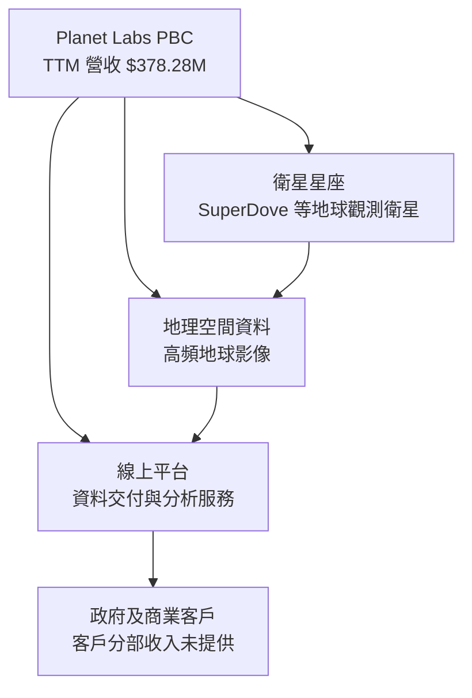
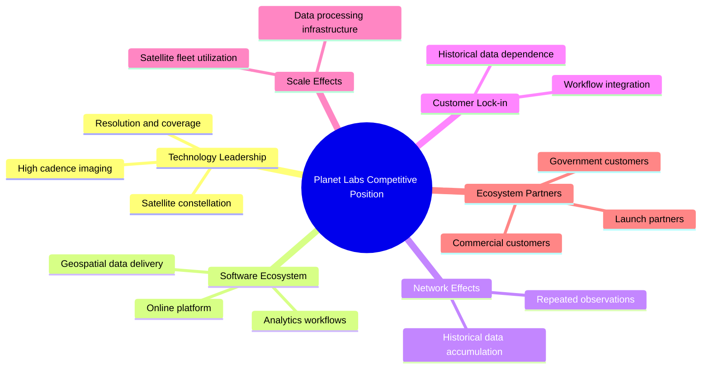
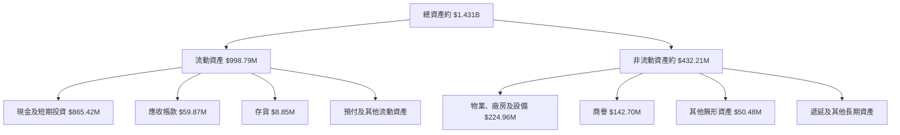
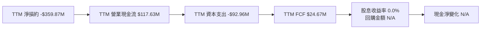
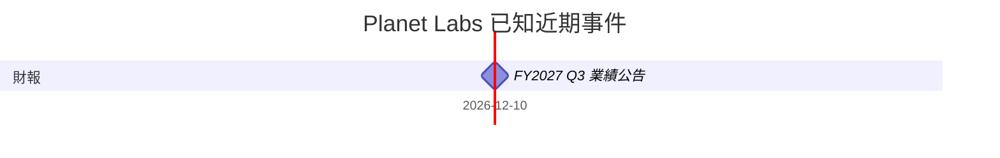
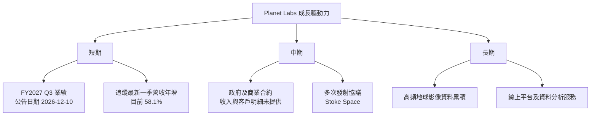
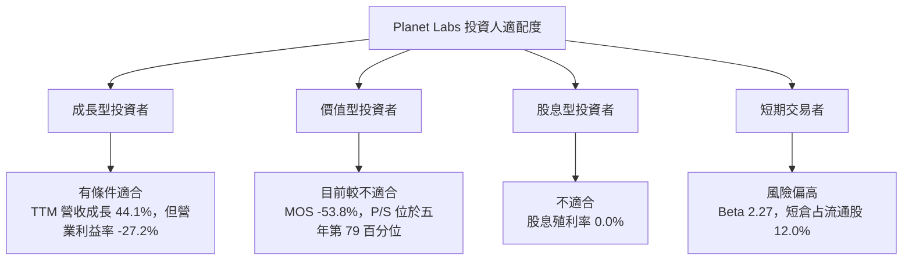

# PL 基本面深度分析報告
> **報告日期**：2026-11-15 ｜ **語言**：繁體中文 ｜ **數據來源**：SEC 申報資料 (XBRL)、Yahoo Finance、Finviz、StockAnalysis、Roic.ai ｜ **分析師**：CFA 級機構研究

> **資料口徑說明**：估值與核心財務指標優先採用程式根據 SEC 申報資料及價格資料庫核驗的數字。部分補充資料來源與核驗數字不一致，例如總債務、TTM 資本支出、FCF、營業利益率及 ROE；下文對這些項目會標明口徑，不以一組數字取代另一組，也不以不一致資料自行重建 DCF。最新收盤價一律採用 **2026-11-13 收盤價 $13.81**。

## 目錄

| # | 章節 | 核心結論 |
|---|------|----------|
| 1 | 執行摘要 | 評級：賣出；加權合理價值 $8.98；MOS -53.8% |
| 2 | 公司概覽與商業模式 | 衛星影像與地理空間資料平台具技術及資料資產優勢，分部收入資料未提供 |
| 3 | 損益表深度分析 | TTM 營收 $378.28M、成長 44.1%；仍虧損，惟最新一季營業利益率改善 |
| 4 | 資產負債表分析 | 現金及短期投資 $865.42M；總債務核驗值為 N/A，補充來源有口徑差異 |
| 5 | 現金流量深度分析 | TTM FCF $24.67M；資本支出與股權薪酬均高，現金流需持續觀察 |
| 6 | 獲利能力與資本效率 | ROIC 未提供；TTM 營業利益率 -27.2%，低於 13.14% WACC |
| 7 | 相對估值分析 | 同業 P/S 估值回推 $6.62；自身 P/S 處於五年歷史第 79 百分位 |
| 8 | DCF 內在價值評估 | DCF N/A：TTM 營業利益為負，不能依指定模型建立正值現金流基礎 |
| 9 | 成長催化劑 | 最新一季營收年增 58.1%；公司已公告 2026-12-10 發布 FY2027 Q3 業績 |
| 10 | 風險矩陣 | 主要風險為高估值、長期虧損與資本需求，以及衛星營運與競爭風險 |
| 11 | 投資建議 | 依規則 20 維持賣出；重估前需見到獲利改善與估值回落 |

## 1. 執行摘要

PL 的最新 TTM 營收為 **$378.28M、年增 44.1%**，最新一季營收年增 **58.1%**；但 TTM 營業利益率仍為 **-27.2%**，且 ROIC 未提供。按核驗估值方法，同業 P/S 法每股價值為 **$6.62**、分析師共識目標價為 **$30.27**，依固定權重計得加權合理價值 **$8.98**。相對 **2026-11-13 收盤價 $13.81**，MOS 為 **-53.8%**，符合規則 20 的 **賣出**門檻；由於 DCF 模型明確為 N/A，本報告不以自行假設的情境目標價補足。

### 1.0 一頁式投資儀表板（Portfolio Manager 30 秒速讀）

| 項目 | 內容 |
|------|------|
| **投資論點（3 句）** | ① TTM 營收年增 **44.1%**，最新一季年增 **58.1%**，顯示需求及收入增長加快。② TTM 營業利益率仍為 **-27.2%**，獲利轉正尚未獲數據證明。③ 加權合理價值 **$8.98**，低於 2026-11-13 收盤價 **$13.81**，MOS **-53.8%**。 |
| **綜合評分** | **4.8/10**（引用 1.1 六項算術平均） |
| **財務健康** | 🟡 現金及短期投資 **$865.42M**，但核驗總債務為 N/A；補充資料顯示債務口徑不一致，應核對季報。 |
| **ROIC vs WACC** | ROIC：N/A；WACC：**13.14%**。無法精確量化利差；營業利益率為負，現階段未見創造股東價值的證據。 |
| **FCF 趨勢** | TTM FCF **$24.67M**；FCF Yield **0.49%**。核驗資料顯示年度 FCF 由 FY2025 的 **-$68.78M** 升至 FY2026 的 **$51.41M**，但季度波動仍大。 |
| **估值** | Forward P/E：**-11048.001x**（補充估值資料；因預期 EPS 接近零且為負，解讀價值有限）｜EV/EBITDA：**-96.235x**（補充估值資料；EBITDA 為負）｜FCF Yield：**0.49%**（核驗口徑） |
| **DCF 內在價值（基準）** | **N/A**；核驗資料指出 TTM 營業利益為負，不適用指定 DCF 模型。折溢價：N/A。 |
| **安全邊際（MOS）** | **-53.8%**＝（加權合理價值 **$8.98** − 現價 **$13.81**）÷ 加權合理價值 **$8.98**｜🔴 無安全邊際 |
| **預期報酬（基準情境 12M）** | DCF 基準情境：N/A；以加權合理價值相對現價計算的上行空間為 **-35.0%**，非 DCF 情境報酬。 |
| **關鍵風險（前二）** | ① 現價高於加權合理價值 **53.8%**；② TTM 營業利益率 **-27.2%**、尚未建立持續獲利。 |
| **評級 + 信心度** | 🔴 **賣出** ｜ 信心：中（估值訊號清楚；DCF 缺位、債務資料存在口徑差異） |

### 1.1 綜合評分卡（全報告唯一）

| 維度 | 評分（1–10） | 主要依據（引用數字與其來源章節） |
|------|--------------|----------------------------------|
| 成長性 | 8.0 | TTM 營收年增 **44.1%**、最新一季年增 **58.1%**（第 3 章），收入增長是主要優勢。 |
| 獲利能力 | 2.0 | TTM 營業利益率 **-27.2%**、淨利率 **-95.1%**、F-Score **3/8**（第 3、6 章），尚未證明可持續獲利。 |
| 財務健康 | 7.0 | 現金及短期投資 **$865.42M**、流動比率 **2.843**、CCC **55 天**（第 4 章）；惟債務口徑有差異。 |
| 估值 | 1.0 | MOS **-53.8%**，P/S **13.1x**、自身五年歷史第 **79** 百分位（第 7、8 章）。 |
| 護城河 | 7.0 | 衛星星座、每日地球影像及線上資料平台構成差異化資產；營收成長提供商業化證據，但缺少客戶留存及分部資料（第 2 章）。 |
| 管理層與資本配置 | 4.0 | FY2026 SBC **$54.99M**、佔營收約 **17.9%**；稀釋股數未通過 F-Score 測試，且回購與資本回報資料有限（第 3、5 章）。 |
| **綜合評分** | **4.8** | 六項算術平均：\((8.0+2.0+7.0+1.0+7.0+4.0)÷6=4.8\)。 |

### 1.2 五大投資論點 + 三大核心風險

| 類型 | 項目 | 具體依據 | 信心度 |
|------|------|----------|--------|
| 🟢 **投資論點①** | 營收增長加速 | TTM 營收 **$378.28M**、年增 **44.1%**；最新一季年增 **58.1%**。若增長由可續約合約及平台使用推動，將改善固定成本吸收。 | 🟢 高 |
| 🟢 **投資論點②** | 高頻衛星影像及資料平台具差異化 | 公司以衛星星座提供高頻地球觀測影像，產品目標包含每日覆蓋；這類資料資產可支援政府及商業分析應用。 | 🟡 中 |
| 🟢 **投資論點③** | 毛利率已有規模經濟基礎 | TTM 毛利率 **55.5%**，顯示扣除直接服務成本後仍有正毛利，後續經營槓桿取決於營運費用能否低於收入增長。 | 🟡 中 |
| 🟢 **投資論點④** | 近期現金流轉正 | TTM 營業現金流 **$117.63M**、資本支出 **$92.96M**、FCF **$24.67M**；需留意此 FCF 仍可能受營運資金及資本支出時點影響。 | 🟡 中 |
| 🟢 **投資論點⑤** | 現金資源可支持業務投入 | 現金及短期投資 **$865.42M**，為衛星、平台與研發投入提供財務緩衝；總債務核驗值為 N/A，不能據此認定無債務。 | 🟡 中 |
| 🟡 **風險①** | 估值高於相對估值支撐 | 現價 **$13.81**，同業 P/S 法價值 **$6.62**；加權合理價值 **$8.98**，MOS **-53.8%**。 | 🔴 高衝擊 |
| 🔴 **風險②** | 虧損及利潤率改善仍未定型 | TTM 營業利益率 **-27.2%**、淨利率 **-95.1%**；若支出增速持續高於收入，增長不會自然轉化為股東盈餘。 | 🔴 高 |
| 🟡 **風險③** | 資本密集與稀釋 | TTM 資本支出 **$92.96M**、年度 SBC **$54.99M**；F-Score 顯示稀釋股數未通過測試。 | 🟡 中至高 |

### 1.3 快速統計卡片

| 指標 | 公司實際值（期間） | 同業中位數 | 狀態 |
|------|--------------------|------------|------|
| 營收成長（TTM） | **44.1%** | — | 🟢 |
| 營收成長（最新一季年增） | **58.1%** | **72.7%**（SPIR、BKSY、RKLB 三家中位數） | 🟢 |
| 毛利率（TTM） | **55.5%** | **40.3%**（SPIR、BKSY、RKLB 三家中位數） | 🟢 |
| 營業利益率（TTM） | **-27.2%** | — | 🔴 |
| ROIC（TTM） | N/A | — | 🟡 |
| Forward P/E | **-11048.001x** | N/A（同業中位數難以比較，Peer multiples 中存在負值與極端正值） | 🔴 |
| FCF Yield（TTM） | **0.49%** | — | 🟡 |
| Piotroski F-Score | **3 / 8** | — | 🔴 |

> 注：最新一季年增同業中位數為 SPIR **42.1%**、BKSY **118.4%**、RKLB **72.7%** 的中位數；毛利率中位數使用三家公司 TTM 毛利率 **40.3%、73.4%、36.2%**。

### 1.4 投資結論

```
╔══════════════════════════════════════════════════════════════════╗
║                    📊 投資結論摘要                               ║
╠══════════════════════════════════════════════════════════════════╣
║  評級：🔴 賣出（MOS -53.8%，符合規則 20）                       ║
║  價格（2026-11-13 收盤）：$13.81                                ║
║  DCF 內在價值（基準）：N/A（TTM 營業利益為負）                  ║
║  安全邊際 MOS：-53.8%（以加權合理價值 $8.98 為分母）            ║
║  加權合理價值（8.8）：$8.98                                     ║
║  綜合評分：4.8/10（引用 1.1）                                   ║
║  適合投資人：能承受高波動、重視營收成長且接受估值風險者；       ║
║              不適合以低估值或穩定獲利為主要條件的投資人。       ║
╚══════════════════════════════════════════════════════════════════╝
```

## 2. 公司概覽與商業模式

### 2.1 業務結構與收入來源

Planet Labs PBC 設計、建造並營運衛星星座，提供高頻地理空間影像與線上平台服務。公司概覽提及 SuperDove 衛星及每日地球成像能力。**分部收入、產品收入佔比及服務收入金額未提供**，以下只呈現可確認的營運關係，不推估收入占比。



### 2.2 市場份額

市場份額數據未提供，無法給出 PL 在全球地理空間影像或衛星遙測市場的收入占比。可確認的相對位置是：PL TTM 營收 **$378.28M**、TTM 成長 **44.1%**，其規模高於 Peer multiples 清單中 SPIR 與 BKSY 的營收倍數所代表的同業比較口徑，但缺少同業絕對營收數字，不作規模排名推論。最新一季營收年增 **58.1%**，低於 RKLB **72.7%**、BKSY **118.4%**，高於 SPIR **42.1%**。

### 2.3 競爭護城河分析



### 2.4 護城河強度

| 護城河項目 | 強度（強／中／弱） | 證據（引用數字或事實） | 會削弱它的情況 |
|------------|--------------------|------------------------|----------------|
| 技術與衛星星座 | 中 | 公司運營衛星星座並提供高頻影像；最新一季營收年增 **58.1%**，表示需求增長，但無技術性能與成本同業對照數字。 | 競爭者以更低成本、更高解析度或更高頻率提供資料。 |
| 軟體生態系統 | 中 | 服務透過線上平台交付；平台收入、使用者數及續約率未提供。 | 客戶轉向多來源資料整合平台，或軟體差異化不足。 |
| 網路效應 | 弱至中 | 持續成像可能形成歷史資料累積優勢；沒有用戶增長、資料使用量或單位經濟數據可驗證網路效應。 | 客戶價值主要來自單張影像而非資料累積。 |
| 客戶鎖定 | 中 | 地理空間資料可嵌入客戶工作流程，但客戶留存率、合約期限與客戶集中度未提供。 | 客戶易於多供應商採購、切換成本低。 |
| 規模效應 | 中 | TTM 毛利率 **55.5%**，顯示服務有正毛利基礎；公司仍有 TTM 營業虧損，規模效應尚未充分轉化為盈利。 | 衛星更新、發射與資料處理支出抵銷規模經濟。 |
| 生態夥伴 | 弱至中 | 公司公告與 Stoke Space 簽訂多次發射協議；未提供合作收入或成本節省量化資料。 | 發射供應受限、延誤或合作條款不具成本優勢。 |

> 1.1 護城河評分 **7.0/10** 的依據是衛星星座與平台交付模式具差異化，但客戶留存、分部收入、單位成本和平台使用數據仍不足以量化其持久性。

## 3. 損益表深度分析

### 3.1 年度收入成長趨勢（近4年）

年度營收由 FY2023 **$191.26M** 增至 FY2026 **$307.73M**，三年 CAGR 約 **17.2%**。FY2026 的年增 **25.9%** 高於 FY2025 的 **10.7%**，而最新 TTM 年增為 **44.1%**，反映近期增長重新加速。

```
╔══════════════════════════════════════════════════════════════════╗
║             Planet Labs 年度收入趨勢（FY2023-FY2026）            ║
╠══════════════════════════════════════════════════════════════════╣
║  FY2023  $191.26M  █████████████░░░░░░░░░░░  YoY: 基期          ║
║  FY2024  $220.70M  ███████████████░░░░░░░░░  YoY: +15.4%        ║
║  FY2025  $244.35M  █████████████████░░░░░░░  YoY: +10.7%        ║
║  FY2026  $307.73M  █████████████████████░░░  YoY: +25.9%        ║
╠══════════════════════════════════════════════════════════════════╣
║  三年營收 CAGR：約 +17.2%                                        ║
╚══════════════════════════════════════════════════════════════════╝
```

演算：FY2023 至 FY2026 三年 CAGR \(=(307.73÷191.26)^{1/3}-1\approx17.2\%\)。FY2026 增長回升與 TTM **44.1%** 增幅一致，但 TTM 與財年口徑不同，不應將兩者混作同一期間。

### 3.2 季度收入趨勢分析

| 季度（財報期末） | 營收 | QoQ 成長 | YoY 成長 | 備註 |
|------|------:|------:|------:|------|
| 2025-10-31 | $81.25M | +32.6% | +32.6%* | QoQ 按 2025-07-31 的 $73.39M 計算；此列 YoY 來源資料列示 +32.63%。 |
| 2026-01-31 | $86.82M | +6.9% | +41.1% | QoQ 按 2025-10-31 的 $81.25M 計算；同比增幅來自季度收入序列。 |
| 2026-04-30 | $94.15M | +8.4% | +42.1% | 來源季度增長數據列示 +42.08%。 |
| 2026-07-31 | $116.05M | +23.3% | +58.1% | 最新一季年增，非 TTM 成長率。 |

> *季度來源資料將 2025-10-31 列示年增 **32.63%**；由於未提供該季上一年同期營收，本報告保留來源值，不以不同期間另行重算。QoQ 以相鄰季度營收計算，顯示 2026-07-31 季度增速明顯抬升；能否延續需看 FY2027 Q3 後續業績。

### 3.3 利潤率演變分析

| 利潤率指標 | FY2023 | FY2024 | FY2025 | FY2026 | 趨勢 | 評估 |
|------------|--------:|--------:|--------:|--------:|------|------|
| **毛利率** | 49.2% | 51.2% | 57.2% | 56.1% | 整體提升後小幅回落 | 🟡 |
| **營業利益率** | -91.8% | -75.8% | -45.5% | -30.9% | 虧損率持續收窄 | 🟡 |
| **淨利率** | -84.7% | -63.7% | -50.4% | -80.2% | FY2026 因淨損擴大而轉弱 | 🔴 |

> 年度毛利率及營業利益率由年度損益表的毛利／營收、營業利益／營收計算。另按核驗資料，TTM 毛利率為 **55.5%**、TTM 營業利益率為 **-27.2%**、最新一季營業利益率為 **-11.6%**。補充資料另列最新季度營業利益率 **-22.7%**，與核驗數據不一致，本報告核心比較以核驗數據為準。

FY2023 至 FY2026 營業利益率改善，與營收增加及固定成本吸收相符；但 FY2026 淨利損失 **$246.86M**，高於 FY2025 的 **$123.20M**，顯示營業層面的改善沒有同步轉化為淨利。非營業損益、稅項及一次性項目明細不足，無法把淨損擴大歸因於單一因素。TTM 營業利益率仍為負，代表現階段規模擴張尚未達到整體獲利門檻。

### 3.4 費用結構分析

費用明細不足以可靠拆分全部營運費用，因此不繪製費用占比圓餅圖。可核實的單一費用項目為 FY2026 研發費用 **$106.75M**，約佔 FY2026 營收 **34.7%**（$106.75M ÷ $307.73M）。此比率代表研發投入相對收入仍高；其商業回報需由收入增長、毛利率及營業虧損收窄驗證。

### 3.5 季度 EPS 趨勢與盈餘品質（Quality of Earnings）

最近四季 EPS 預估與實際值均為 **N/A**，Yahoo Finance 的 EPS surprise 欄位也沒有可用數字，因此不能判定季度盈餘是否超預期或不及預期。可觀察季度淨損如下：

| 季度 | 淨利（損） | EPS 預估／實際 | 超預期／不及預期 |
|------|----------:|-----------------|------------------|
| 2025-10-31 | -$59.19M | N/A | N/A |
| 2026-01-31 | -$152.46M | N/A | N/A |
| 2026-04-30 | -$138.87M | N/A | N/A |
| 2026-07-31 | -$9.35M | N/A | N/A |

| 盈餘品質項目 | 數值/佔比 | 評估 |
|--------------|-----------|------|
| 股權薪酬 SBC / 營收 | **約 16.5%**（TTM；以最近四季 SBC 約 $62.51M ÷ TTM 營收 $378.28M） | 🔴 SBC 佔比高，非現金性質不代表沒有成本；若持續以股權薪酬支付，會稀釋每股經濟利益。 |
| SBC / 營業現金流 | **約 53.1%**（$62.51M ÷ $117.63M） | 🔴 SBC 約佔營業現金流一半；營業現金流未扣除稀釋成本，應與股數增長一併看。 |
| FCF / 淨利（現金轉換率） | **約 -6.9%**（TTM FCF $24.67M ÷ TTM 淨損約 $359.87M） | 🟡 分母為大額淨損，負比率不宜按一般獲利轉換率解讀；現金流為正，但 GAAP 盈餘仍弱。 |
| 一次性/非經常性損益 | 未能確認 | 季度淨損從 **-$152.46M** 變至 **-$9.35M**，但缺少非營業項目附註拆分，不能斷言變化由一次性項目造成。 |
| 有效稅率異常 | N/A | 未提供足以計算 TTM 有效稅率的稅前利潤與所得稅完整明細。 |
| 資本化支出 vs 費用化 | TTM 資本支出 **$92.96M**；資本化項目明細 N/A | 投資資本支出高，但無法判斷資本化政策、折舊年限或是否存在成本遞延。 |

> SBC／營收與 SBC／營業現金流是以最近四季季度 SBC 總額計算的比率；公司 FY2026 年報列 SBC **$54.99M**。跨期間口徑不同，不應混為同一年度數字。

**盈餘品質結論**：獲利含金量仍有限。TTM FCF 為正，但 TTM 淨損大且 SBC 佔營業現金流約 **53.1%**，因此現金流並不等同於扣除股東稀釋成本後的自由盈餘。估值不宜只依賴營業現金流，還需追蹤股數變化、SBC 比率與營業利潤率。

## 4. 資產負債表分析

### 4.1 資產結構分解

最新可用季度資產分項來自 StockAnalysis；以下合計因四捨五入與不同來源可能略有尾差，總資產約 **$1.431B**。



### 4.2 流動性與營運資金分析

| 指標 | 最新 TTM | 一年前 TTM | 變化 | 解讀 |
|------|----------:|----------:|------:|------|
| DSO 應收帳款天數 | **58 天** | **72 天** | **-14 天** | 收款天數下降，可能反映回款或收入組合改善；仍需注意政府及大型企業合約的回款節奏。 |
| DIO 存貨天數 | **19 天** | **N/A** | N/A | 一年前無可用存貨餘額，不能比較趨勢。 |
| DPO 應付帳款天數 | **22 天** | **37 天** | **-15 天** | 付款天數下降，可能代表供應商付款加快或採購結構改變；不足以單獨判定議價能力。 |
| CCC 現金轉換週期 | **55 天** | **N/A** | N/A | 一年前 CCC 不可計算。最新值表示現金由應收及存貨轉回的時間仍需管理。 |

流動比率為 **2.843**、速動比率 **2.634**，短期流動性在現有口徑下較充足。現金及短期投資由 FY2026 年末 **$640.09M** 增至最新 TTM **$865.42M**；但流動性不能取代獲利能力，也需與衛星資本支出及發射需求一併評估。

### 4.3 債務結構分析

核驗資料列示總債務 **N/A**、淨現金 **$865.42M**；另有補充市場資料列示總債務 **$498.62M**、淨現金 **$366.79M**。由於兩個來源對債務口徑不一致，以下不將補充資料替代核驗值，也不把淨現金能力描述為已完全確認。

```
╔══════════════════════════════════════════════════════════════════╗
║                  Planet Labs 債務健康診斷                       ║
╠══════════════════════════════════════════════════════════════════╣
║  現金及短期投資（核驗）： $865.42M                               ║
║  總債務（核驗）：         N/A                                    ║
║  淨現金（核驗）：         $865.42M（總債務資料缺漏）             ║
║  補充來源總債務：         $498.62M（與核驗口徑需調節）           ║
║  補充來源淨現金：         $366.79M                                ║
║  Debt/EBITDA：            N/A（債務與 EBITDA 口徑不一致／EBITDA為負）║
║  利息保障倍數：           N/A（利息費用明細不足）                ║
║  判斷：🟡 現金存量高，但債務及租賃口徑需回到 SEC 附註核對。      ║
╚══════════════════════════════════════════════════════════════════╝
```

### 4.4 股東權益趨勢

年度股東權益由 FY2023 **$576.10M** 降至 FY2026 **$188.43M**，同期 FY2026 總負債增至 **$957.25M**。權益縮減與長期累積虧損及資本結構變動相符；最新季度權益數據未提供，以下只列年度序列。

```
╔══════════════════════════════════════════════════════════════════╗
║                   股東權益年度變化                               ║
╠══════════════════════════════════════════════════════════════════╣
║  FY2023  $576.10M  ████████████████████                         ║
║  FY2024  $518.02M  ██████████████████                           ║
║  FY2025  $441.29M  ███████████████                              ║
║  FY2026  $188.43M  ██████                                       ║
╚══════════════════════════════════════════════════════════════════╝
```

## 5. 現金流量深度分析

### 5.1 現金流量瀑布圖



> TTM 淨損採 StockAnalysis 的 TTM 淨利數據。現金流瀑布只展示現金流定義與已知數字；股息以外的資本配置及現金變動未提供，不能將 FCF 全額假定為留存現金。

### 5.2 FCF 轉換率趨勢

| 財年／期間 | FCF | 淨利（損） | FCF / 淨利（損） | 解讀 |
|------|------:|------:|------:|------|
| FY2023 | -$86.69M | -$161.97M | +53.5% | 分子、分母皆為負，比例不能解讀為正向獲利轉換。 |
| FY2024 | -$93.12M | -$140.51M | +66.3% | 仍為負 FCF；公司需外部資本或現金存量支持投資。 |
| FY2025 | -$68.78M | -$123.20M | +55.8% | FCF 虧損收窄，但仍未轉正。 |
| FY2026 | +$51.41M | -$246.86M | -20.8% | FCF 轉正而 GAAP 淨損擴大，反映應計與非現金項目差異；需確認能否延續。 |
| TTM 至 2026-07-31 | +$24.67M | 約 -$359.87M | 約 -6.9% | 正 FCF 與大額淨損並存，不能以單一比率判定盈餘品質。 |

### 5.3 自由現金流趨勢

FY2026 年度 FCF **$51.41M**，較 FY2025 **-$68.78M** 改善 **$120.19M**；但 TTM 核驗 FCF 為 **$24.67M**，且核驗資本支出 **$92.96M**，與補充資料列示的 **$98.85M** 不同。按規定採用核驗口徑計算 FCF Yield **0.49%**。

```
╔══════════════════════════════════════════════════════════════════╗
║                自由現金流：年度與 TTM                           ║
╠══════════════════════════════════════════════════════════════════╣
║  FY2023   -$86.69M  ◀████████████████                           ║
║  FY2024   -$93.12M  ◀█████████████████                          ║
║  FY2025   -$68.78M  ◀████████████                                ║
║  FY2026   +$51.41M  ██████████▶                                 ║
║  TTM      +$24.67M  █████▶                                      ║
╠══════════════════════════════════════════════════════════════════╣
║  TTM FCF Yield：0.49%（核驗口徑）                               ║
╚══════════════════════════════════════════════════════════════════╝
```

### 5.4 資本配置評估

資本配置金額未完整提供，無法繪製各用途占比圓餅圖。

| 資本配置項目 | 可用數據 | 評估 |
|--------------|----------|------|
| 衛星與其他資本支出 | TTM **$92.96M** | 對衛星營運及資料基礎設施重要；需追蹤投入後的收入與毛利回報。 |
| 股權薪酬 | FY2026 **$54.99M**；最近四季約 **$62.51M** | 對員工激勵有作用，但會稀釋現有股東權益。 |
| 股息 | 殖利率 **0.0%** | 未以股息形式回饋股東。 |
| 股票回購 | N/A | 未提供回購金額。 |
| 其他投資及債務償還 | N/A | 未提供可拆分金額。 |

## 6. 獲利能力與資本效率

### 6.1 ROE / ROA / ROIC 趨勢

| 指標 | 可用期間數據 | 評估 |
|------|--------------|------|
| ROE | TTM 核驗值 **-63.8%** | 虧損拖累股東權益報酬。補充資料另列 -72.0%，存在來源差異；採用核驗值。 |
| ROA | TTM **-5.0%**（補充資料） | 資產尚未產生正會計報酬。 |
| ROIC | N/A | 未提供可引用的 ROIC 數值，不能以未核實估算替代。 |
| WACC | **13.14%** | 以核驗資本成本資料為準。 |

公司 TTM 營業利益率為 **-27.2%**，即使不把該比率等同於 ROIC，負營業獲利也顯示目前尚無法以經營收益覆蓋資本成本。ROIC 的精確值未提供，因此「ROIC 是否低於 WACC」不能作數值確證；目前只能判斷創造正經濟價值的證據不足。

### 6.2 ROIC vs WACC 分析（核心價值創造判斷）

```
╔══════════════════════════════════════════════════════════════════╗
║                ROIC vs WACC 深度分析                            ║
╠══════════════════════════════════════════════════════════════════╣
║  WACC（採用核驗值）：13.14%                                     ║
║  ├── 無風險利率（10Y 美債）：5.15%                              ║
║  ├── 市場風險溢酬 ERP：5.00%                                    ║
║  ├── 原始 Beta：2.27；調整後 Beta：1.85                         ║
║  ├── 股權成本 Ke：14.39%（核驗值）                             ║
║  ├── 稅前債務成本：0.69%；稅率：21.0%                          ║
║  ├── 資本權重：股權 91.0%，債務 9.0%                            ║
║  └── WACC：13.14%                                                ║
║                                                                  ║
║  ROIC（TTM）：N/A（未提供核驗值）                               ║
║  經營狀況參考：TTM 營業利益率 -27.2%                            ║
║  EVA（ROIC − WACC）：N/A，無法精確計算                           ║
║                                                                  ║
║  WACC  13.14%  ▓▓▓▓▓▓▓▓▓▓▓▓▓░░░░░░░░░░░░░░░░                    ║
║  ROIC  N/A     無可核驗數值                                      ║
║                                                                  ║
║  結論：ROIC 數值缺漏；負營業利益率表示目前未見覆蓋資本成本證據。 ║
╚══════════════════════════════════════════════════════════════════╝
```

**核驗 WACC 的代數一致性檢查**：調整後 Beta 按資料註明的 \(⅔×2.27+⅓×1\) 為 **1.8467**，四捨五入為 **1.85**；將四捨五入後 Beta 直接帶入 CAPM 得 \(5.15\%+1.85×5.00\%=14.40\%\)，與資料列示 Ke **14.39%** 差 **0.01 個百分點**，屬輸入未四捨五入前的精度差異。採用核驗 WACC **13.14%**，不另行替換。

### 6.3 杜邦三因素分解

| 因素 | 數值（TTM） | 解讀 |
|------|-------------|------|
| 淨利率 | **-95.1%** | 大額淨損是負 ROE 的主要來源。 |
| 資產週轉率 | **0.26** | 每單位資產創造的收入有限，尚需規模提升或資產使用效率改善。 |
| 權益乘數 | **2.54** | 槓桿放大資產相對於權益的倍數，但不能扭轉負淨利率。 |
| **ROE** | **-63.8%** | 核驗杜邦列示：\(-95.1\%×0.26×2.54=-63.8\%\)（四捨五入）。 |

ROE 為負主要由淨利率驅動，而非正向經營回報；權益乘數並未「撐起」正回報，反而會放大虧損對股東權益的影響。

### 6.4 財務體質：Piotroski F-Score

核驗 Piotroski F-Score 為 **3/8**；由於一項缺少輸入而排除，九項測試中有八項可判定。

| 測試 | 結果 | 解讀 |
|------|------|------|
| ROA > 0 | ❌ 未通過 | 公司尚未達到正資產報酬。 |
| 營業現金流 > 0 | ✅ 通過 | TTM 營業現金流為 **$117.63M**。 |
| ROA 高於一年前 | ❌ 未通過 | 資產報酬沒有改善。 |
| 營業現金流 > 淨利（應計品質） | ✅ 通過 | 營業現金流高於淨利；但在淨損狀態下，不能直接解讀為已具高品質獲利。 |
| 長期負債 ÷ 總資產低於一年前 | — 無法判定 | 缺少可用輸入。 |
| 流動比率高於一年前 | ✅ 通過 | 流動比率相對一年前改善。 |
| 稀釋股數未增加 | ❌ 未通過 | 股數稀釋會降低既有股東每股權益。 |
| 毛利率高於一年前 | ❌ 未通過 | 毛利率同比未改善。 |
| 資產週轉率高於一年前 | ❌ 未通過 | 資產使用效率尚未改善。 |

F-Score **3/8** 表明獲利與效率維度偏弱；營業現金流與流動比率是相對正向項目，不能抵銷 ROA、稀釋及毛利率測試未通過的訊號。

## 7. 相對估值分析

### 7.1 同業估值比較表格

Peer multiples 依 Yahoo Finance 數據。PL 自身倍數依提供的估值資料列示；PL 沒有可比的正盈餘 P/E，且負 EBITDA 使 EV/EBITDA 缺少正向解讀意義。

| 估值指標 | **PL** | **SPIR** | **BKSY** | **RKLB** | PL 評估 |
|----------|------:|--------:|--------:|--------:|-----------|
| **Trailing P/E** | N/A | N/A | N/A | N/A | 🔴 公司與同業多數未有可用 TTM 盈餘，不能以 P/E 建立有效比較。 |
| **Forward P/E** | -11048.001x | -20.7x | -85.0x | 859.6x | 🔴 PL 預估 EPS 接近零且為負，倍數極端；同業數值正負混雜，中位數不具穩定估值意義。 |
| **P/S Ratio** | 13.283x* | 5.3x | 7.4x | 47.0x | 🔴 PL 高於 SPIR、BKSY，低於 RKLB；同業中位數 **7.4x**（三家中位數）。 |
| **EV / EBITDA** | -96.235x* | -4.3x | 876.5x | -200.1x | 🔴 多家 EBITDA 為負或倍數極端，不適合直接橫向比較。 |
| **最新一季營收年增** | 58.1% | 42.1% | 118.4% | 72.7% | 🟡 PL 高於 SPIR，低於 BKSY 與 RKLB。 |
| **TTM 毛利率** | 55.5% | 40.3% | 73.4% | 36.2% | 🟢 PL 高於 SPIR、RKLB，低於 BKSY。 |

\* PL 倍數來自補充估值資料；五年自身歷史比較採核驗值 **P/S 13.1x**。Peer multiples 給出的同業中位數因不同方法口徑可能略異；8.8 估值方法指定採用同業中位數 P/S **6.4x**，故估值推導照用 **$6.62/股**，不替換為本表簡單中位數。

### 7.2 歷史估值區間分析

核驗歷史資料顯示 PL 當前 TTM P/S 為 **13.1x**，五年中位數 **6.9x**，區間 **2.1x–38.1x**，當前位於自身五年分布的第 **79 百分位**。股價從 2026-05 月收盤 **$51.14** 回落至 2026-11-13 的 **$13.81**，但歷史 P/S 百分位仍偏高；股價回落不代表相對收入估值已低於常態。

```
╔══════════════════════════════════════════════════════════════════╗
║                 PL 五年歷史 TTM P/S 位置                         ║
╠══════════════════════════════════════════════════════════════════╣
║  歷史低位       2.1x  ├────── 中位數 6.9x ──────┤ 38.1x 高位    ║
║  當前 P/S      13.1x  ▲ 第 79 百分位                             ║
║  當前／中位數   1.90x（13.1 ÷ 6.9）                             ║
╚══════════════════════════════════════════════════════════════════╝
```

### 7.3 情境價值（Bear / Base / Bull）

**N/A（DCF 無法計算：TTM 營業利益不為正，核驗模型未提供情境價值）。**依要求不自行建立悲觀、基準或樂觀 DCF 目標價。

### 7.4 相對估值隱含價格區間

以下照核驗估值方法列示。分析師共識屬參考值，並非相對估值倍數；不可把該共識誤當公司內在價值已獲驗證。

```
╔══════════════════════════════════════════════════════════════════╗
║                相對估值隱含每股價值                               ║
╠══════════════════════════════════════════════════════════════════╣
║  $6.62                         $13.81              $30.27         ║
║  同業 P/S                      現價                分析師共識     ║
║  權重 90%                                           權重 10%      ║
║                                                                  ║
║  加權合理價值：$8.98                                              ║
╚══════════════════════════════════════════════════════════════════╝
```

- **同業 P/S：$6.62/股**。估值方法依據為 SPIR、BKSY 的同業中位數 P/S **6.4x**，乘以 PL TTM 營收，並經核驗估值程序換算成每股價值；該方法相對現價折價 **52.1%**。
- **分析師共識目標價：$30.27/股**。11 位分析師平均目標價，相對現價上行空間 **119.2%**；目標價區間 **$17–$50**，屬外部預測，不是本報告自行建立的基本面估值。
- Forward P/E 因無法計算，未納入；權重依固定公司類型配置於可計算方法。

## 8. DCF 內在價值評估（Discounted Cash Flow）

> **DCF MODEL：N/A。**核驗資料指出 TTM 營業利益不為正，因此不適用指定 DCF 模型。依估值規則，本章 8.1–8.7 不另行建立或猜測 DCF；因此沒有可引用的逐年 FCFF、終值、DCF 內在價值、敏感度矩陣、DCF 情境或反推 DCF 數字。

### 8.0 估值推理鏈（Thinking Logic）

**Step 1 — 價值驅動變數**

PL 的估值主要由收入增長、營業利潤率轉正及其後現金流轉換決定。公司 TTM 營收 **$378.28M**、增長 **44.1%**，但 TTM 營業利益率 **-27.2%**；分部營收占比未提供，因此無法將主業、軟體平台及其他業務拆成精確價值來源。現階段最可能主導估值的變數是「增長能否轉化為正營業獲利」，而不是單純提高營收 CAGR。

**Step 2 — 模型選擇**

| 決策點 | 本報告採用 | 理由（含數字） | 曾考慮但否決 | 否決理由 |
|--------|-----------|----------------|--------------|----------|
| 現金流定義 | N/A | DCF MODEL 為 N/A；不能在缺少有效正營業利益基礎時自建 FCFF 預測。 | FCFE | 未提供可核驗的逐年股權現金流模型。 |
| 預測期 N | N/A | 核驗模型未給出預測期。 | 自行設定 5 年或其他年數 | 會構成未經核驗的模型假設。 |
| 終值方法 | N/A | 未提供 Gordon Growth 或退出倍數計算。 | 自行設定終值 | 無可稽核輸入。 |
| EBIT 基礎 | N/A | 核驗資料明確說明 TTM 營業利益不為正，DCF 不建立。 | GAAP／非 GAAP 自行選擇 | 將改變估值模型口徑。 |

**Step 3 — 關鍵假設推導鏈**

核驗 DCF 模型未提供預測期營收 CAGR、期末營業利潤率、永續成長率、資本支出、折舊、稅率、營運資金、SBC 處理與稀釋股數等假設。依規則寫為 N/A，不自行補入估值數字。

**Step 4 — 最脆弱的一環**

當前最脆弱的業務推論是高增長能否轉化為盈利：若營收增長無法伴隨營業虧損率收窄，則相對估值支撐及分析師共識目標價都可能下修。

**Step 5 — 計算路徑圖**

DCF 無法建立，因此不繪製會暗示模型輸入或輸出的計算路徑圖。

### 8.1 模型假設總表（Model Inputs）

**N/A（DCF MODEL 為 N/A：TTM 營業利益不為正，未提供模型輸入；不得自行設定預測期及現金流假設）。**

### 8.2 折現率推導（WACC）

WACC 以核驗資本成本數據為準，並與第 6.2 節相同。此處只列核驗輸入及算術一致性，不重新建立 DCF。

```
╔══════════════════════════════════════════════════════════════════╗
║                    WACC 核驗（折現率）                           ║
╠══════════════════════════════════════════════════════════════════╣
║  無風險利率 Rf（10Y 美債）：5.15%                                ║
║  ERP（假設值，核驗資本成本輸入）：5.00%                          ║
║  原始 Beta（Yahoo Finance）：2.27                                 ║
║  調整後 Beta：⅔ × 2.27 + ⅓ × 1 = 1.8467 ≈ 1.85                  ║
║  股權成本 Ke（核驗值）：14.39%                                   ║
║  稅前債務成本：0.69%                                              ║
║  稅後 Kd：0.69% × (1 − 21.0%) = 0.5451%                         ║
║  股權／債務權重：91.0%／9.0%                                     ║
║  WACC：91.0% × 14.39% + 9.0% × 0.5451% = 13.14396% ≈ 13.14%    ║
╚══════════════════════════════════════════════════════════════════╝
```

**輸入來歷及限制**：Rf、ERP、Beta、稅率、債務成本、資本權重及 WACC 均採程式計算的核驗資本成本資料；資料未提供無風險利率的觀察日期及 ERP 外部來源細節，因此不補述日期或聲稱其為市場實際觀測值。原始 Beta **2.27** 高，模型採用調整後 Beta **1.85**。Ke 核驗值 **14.39%** 與以已四捨五入 Beta 代入得到的 **14.40%** 有 0.01 個百分點差異；WACC 直接採用核驗值 **13.14%**。

### 8.3 逐年自由現金流預測（基準情境）

**N/A（DCF MODEL 未提供逐年營收、EBIT、NOPAT、D&A、Capex、ΔWC、FCFF、折現因子或 PV；不得另建模型）。**因此無法提供逐年表格、FY+1 逐步演算或歷史對預測的同口徑比較圖。

### 8.4 終值計算（Terminal Value）

**N/A（DCF MODEL 未提供終值方法、永續成長率或退出倍數）。**無法測試 WACC 與 g 的關係，也不計算終值或終值占企業價值比例。

### 8.5 企業價值 → 每股內在價值（Bridge）

**N/A（沒有 DCF 企業價值與終值現值，不能橋接至股權價值及每股 DCF 內在價值）。**依規則 16，本報告不提供以 DCF 值為基準的折溢價；該指標為 N/A。

### 8.6 敏感性分析（WACC × 永續成長率）

**N/A（無 DCF 基準價值、預測現金流及終值；核驗資料未提供敏感度矩陣，不能自行試算）。**

**三情境 DCF**：悲觀、基準、樂觀情境及機率加權值均 **N/A**，原因同上。

**敏感度結論**：g、WACC 或期末營業利潤率每變動 1 個百分點對 DCF 每股價值的影響 **N/A**。

### 8.7 反推 DCF（Reverse DCF：市場在預期什麼）

**N/A（核驗 DCF MODEL 未提供反推 DCF 結果；在禁止自建模型的規則下，無法從現價單獨反解營收 CAGR、利潤率、永續成長率或預測期）。**

### 8.8 估值三角驗證與安全邊際

| 估值方法 | 隱含每股價值 | 上行空間（÷現價） | 權重 | 說明 |
|----------|--------------:|------------------:|------:|------|
| 同業 P/S | **$6.62** | **-52.1%** | **90%** | 核驗方法採同業中位數 P/S **6.4x** × TTM 營收，程式換算每股價值。 |
| 分析師共識目標價 | **$30.27** | **+119.2%** | **10%** | 11 位分析師平均目標價，作參考。 |
| **加權合理價值** | **$8.98** | **-35.0%** | **100%** | 公司類型為未盈利公司；同業 Forward P/E 不可計算，權重依規則分配至可計算方法。 |

**加權演算**：依核驗方法指定數字，  
\[
\$6.62×90\%+\$30.27×10\%=\$5.958+\$3.027=\$8.985
\]
核驗資料列示加權合理價值 **$8.98**。兩項價格僅顯示至美分，直接以顯示值計算會產生半美分的四捨五入差異；為遵守核驗方法及全報告一致性，以下一律引用核驗加權值 **$8.98**，不另行調整。

**MOS 與上行空間**：

- MOS \(=(加權合理價值-現價)÷加權合理價值\)
- \((\$8.98-\$13.81)÷\$8.98=(-\$4.83)÷\$8.98=-53.8\%\)
- 上行空間 \(=(\$8.98-\$13.81)÷\$13.81=(-\$4.83)÷\$13.81=-35.0\%\)
- 折溢價以 DCF 基準值計算；因 DCF N/A，折溢價 N/A。

```
╔══════════════════════════════════════════════════════════════════╗
║                  估值區間與安全邊際                              ║
╠══════════════════════════════════════════════════════════════════╣
║  $6.62 ─────── $8.98 ───────── $13.81 ─────── $30.27            ║
║  同業 P/S      加權合理值       現價           分析師共識         ║
║                                                                  ║
║  安全邊際 MOS = ($8.98 − $13.81) ÷ $8.98 = -53.8%              ║
║  上行空間 = ($8.98 − $13.81) ÷ $13.81 = -35.0%                 ║
║  DCF 基準價：N/A；故 DCF 折溢價 N/A                             ║
║                                                                  ║
║  以 MOS ≥ 10% 為買入條件：價格上限約 $8.08                      ║
║  MOS 約 -10% 至 +10%：約 $8.08–$9.88                            ║
║  MOS < -10%：價格高於約 $9.88                                   ║
╚══════════════════════════════════════════════════════════════════╝
```

> 買入上限算式：\(\$8.98×(1-10\%)=\$8.082\approx\$8.08\)。MOS 約 -10% 的價格界線為 \(\$8.98×1.10=\$9.878\approx\$9.88\)。這些是依加權合理價值推導的估值區間，不是 DCF 情境目標價。

> 🔎 **程式複算（Python，依本節各項自動重算）**
>
> 加權合理價值 = $6.62 × 90% + $30.27 × 10% = **$8.98**（權重合計 100%）
>
> 以價格 $13.81 計：MOS = **-53.8%**，上行空間 = **-35.0%**
>
> ✅ 與本節所寫數值一致。

### 8.9 DCF 模型的局限與失效條件

- **終值依賴度**：N/A；DCF 沒有終值可計算。
- **最脆弱的估值假設**：未能以 DCF 數值量化；業務層面的主要脆弱點是營收增長是否能轉為正營業利益。若營業利益率持續為負，P/S 同業估值仍可能過高。
- **不適用情境說明**：公司 TTM 營業利益為負，DCF MODEL 指定為 N/A。現階段應以可核驗的相對銷售額估值、毛利率／費用槓桿與每股稀釋趨勢為主，不應把未經驗證的終值模型當作精確內在價值。
- **與第 10 章風險矩陣的連結**：需求增長放緩會影響收入增長；衛星資本支出或發射成本上升會壓低現金流；競爭壓價會壓縮毛利率。這些都會進一步削弱相對估值支撐。

### 8.10 複算檢核表（Audit Trail）

| # | 檢核項目 | 檢查方式 | 結果 |
|---|----------|----------|------|
| 1 | 所有高／中敏感度 DCF 輸入都有推導 | DCF 模型未提供，8.1–8.7 均標示 N/A，沒有自行補值 | ✅（未建立模型） |
| 2 | 每個 DCF 假設都有來歷 | 無 DCF 假設輸入 | ✅（不適用） |
| 3 | WACC 算式一致 | 採核驗 Ke、稅後 Kd 與權重，得 13.14396% ≈ 13.14% | ✅ |
| 4 | Kd 分母與債務權重範圍一致 | 沿用核驗成本資本輸入；外部債務金額口徑差異已揭露，未重建 WACC | ✅（採核驗值） |
| 5 | WACC 與第 6.2 節同值 | 兩處均為 **13.14%** | ✅ |
| 6 | 逐年預測年度數符合 N | DCF N/A，無預測年度表 | ✅（不適用） |
| 7 | FY+1 演算可複算 | DCF N/A，無 FY+1 輸入 | ✅（不適用） |
| 8 | 預測期 PV 加總可複算 | DCF N/A，無 PV 項目 | ✅（不適用） |
| 9 | WACC > g | g 未提供，不可測試 | ✅（不適用，未計終值） |
| 10 | 終值以 FY+N 現金流折現 | DCF N/A，未計終值 | ✅（不適用） |
| 11 | EV 至每股價值橋接可複算 | DCF N/A，未做橋接 | ✅（不適用） |
| 12 | SBC 組合一致 | DCF N/A，未將 SBC 或稀釋率放入模型 | ✅（不適用） |
| 13 | 敏感度矩陣基準格與 DCF 值一致 | 敏感度矩陣 N/A | ✅（不適用） |
| 14 | 矩陣有效格符合 WACC > g | 無矩陣 | ✅（不適用） |
| 15 | 情境機率加總 100% | DCF 情境 N/A，未設定機率 | ✅（不適用） |
| 16 | 反推每列只放開一個變數且有軌跡 | 反推 DCF N/A | ✅（不適用） |
| 17 | MOS 以 8.8 為分母，折溢價以 DCF 值為基準 | MOS **-53.8%** 以 $8.98 計；DCF 折溢價 N/A | ✅ |
| 18 | 報告完整至第 11 章 | 已列出 11 章 | ✅ |
| 19 | 加權合理價值等於方法加權和 | 顯示值計算為 $8.985；引用核驗值 $8.98，差異源自顯示精度 | ✅（保留核驗數字） |
| 20 | 評級符合規則 20 | MOS -53.8% < -25%，採用賣出，未作質化調整 | ✅ |

## 9. 成長催化劑

### 9.1 催化劑時間軸

可確認的近期日期是公司公告於 **2026-12-10** 發布 FY2027 Q3 業績。其他催化劑的確切時程未提供，以下不推測日期。



### 9.2 TAM 市場規模分析

**N/A（TAM 數據未提供）**。財務數據與近期消息沒有可引用的市場規模金額或年份，因此不估算 TAM 或市場滲透率。以公司自身指標觀察，TTM 營收 **$378.28M**、年增 **44.1%**，最新一季年增 **58.1%**；能否繼續擴張需由實際合約增長、續約與營業利潤率改善驗證。

### 9.3 成長驅動力結構圖



> 中長期催化劑的收入貢獻與落地日期未有量化資料，故圖中只列業務方向，不賦予金額或營收占比。

## 10. 風險矩陣

### 10.1 風險評分矩陣

未提供各風險發生機率的可靠數據；依規則不以主觀百分比繪製帶數值座標的 quadrantChart。下表改以質化風險排序呈現，並標明可量化的觀察依據。

### 10.2 風險清單詳細分析

| # | 風險項目 | 發生機率 | 財務衝擊 | 風險評估 | 緩解措施 |
|---|----------|----------|----------|----------|----------|
| 1 | 🔴 **估值收縮** | 中至高；當前 P/S **13.1x**，高於五年中位數 **6.9x** | 高；同業 P/S 方法價值 **$6.62**，低於現價 **52.1%** | 🔴 高 | 分段持倉；將新增資金與現金流、利潤率改善掛鉤，避免只根據短期營收增長追價。 |
| 2 | 🔴 **長期虧損、獲利轉正延遲** | 中至高；TTM 營業利益率 **-27.2%**、淨利率 **-95.1%** | 高；若費用增速持續高於收入，估值可能由高成長倍數下修 | 🔴 高 | 每季檢查營業利益率、營運費用增速及營業現金流。 |
| 3 | 🟡 **高資本支出與衛星營運風險** | 中；TTM Capex **$92.96M** | 中至高；發射延誤、衛星故障或替換成本增加可能消耗現金 | 🟡 高衝擊 | 追蹤資本支出／營收、衛星部署進度及新增資產帶來的收入。 |
| 4 | 🟡 **稀釋與 SBC** | 已存在；最近四季 SBC 約佔 TTM 營收 **16.5%** | 中；增加股數會壓低每股價值 | 🟡 中至高 | 追蹤稀釋股數增速、SBC／營收及人員激勵政策。 |
| 5 | 🟡 **同業競爭及定價壓力** | 中；PL 最新一季成長 **58.1%**，低於 BKSY **118.4%**、RKLB **72.7%** | 中；價格競爭可能侵蝕當前 **55.5%** TTM 毛利率 | 🟡 中 | 追蹤毛利率、客戶續約、產品組合及同業收入增長。 |
| 6 | 🟡 **財務資料口徑差異** | 已觀察到 | 中；總債務、FCF、營業利潤率等補充來源與核驗口徑存在差異 | 🟡 中 | 以 SEC 10-Q 的資產負債表及現金流附註調節債務、租賃及資本支出定義。 |

## 11. 投資建議

### 11.1 最終評級與評分

按加權合理價值 **$8.98** 與 2026-11-13 收盤價 **$13.81** 計算，MOS 為 **-53.8%**，符合規則 20 的 **賣出**門檻；未作質化上調或下調。1.1 綜合評分為 **4.8/10**，其六項子分數為成長性 **8.0**、獲利能力 **2.0**、財務健康 **7.0**、估值 **1.0**、護城河 **7.0**、管理層與資本配置 **4.0**。

### 11.2 合理價值與隱含報酬率

| 估值項目 | 每股價值 | 相對現價 | 機率／權重 | 說明 |
|----------|---------:|----------:|----------:|------|
| 同業 P/S | $6.62 | -52.1% | 90% | 核驗相對估值方法。 |
| 分析師共識目標價 | $30.27 | +119.2% | 10% | 11 位分析師平均目標價，不等同 DCF。 |
| **加權合理價值** | **$8.98** | **-35.0%** | **100%** | MOS **-53.8%**；符合賣出門檻。 |
| 悲觀 DCF 情境 | N/A | N/A | N/A | DCF MODEL 未提供情境估值。 |
| 基準 DCF 情境 | N/A | N/A | N/A | DCF MODEL 未提供情境估值。 |
| 樂觀 DCF 情境 | N/A | N/A | N/A | DCF MODEL 未提供情境估值。 |

### 11.3 買入時機與觸發因素

```
╔══════════════════════════════════════════════════════════════════╗
║                  ✅ 買入觸發因素 Checklist                      ║
╠══════════════════════════════════════════════════════════════════╣
║  目前狀態：現價 $13.81，高於加權合理價值 $8.98                 ║
║                                                                  ║
║  考慮建立／增加部位前，建議觀察：                                ║
║  ☐ 股價回到約 $8.08 或以下，對應 MOS 至少 10%                  ║
║  ☐ 最新一季營收增長仍保持正值，且收入指引未顯著下修             ║
║  ☐ TTM 營業利益率持續改善，並向損益兩平收斂                     ║
║  ☐ TTM FCF 維持正值，且不是只依賴一次性營運資金變動             ║
║                                                                  ║
║  加碼觸發條件：                                                  ║
║  ☐ 連續兩季營業利益率改善，並有費用槓桿證據                     ║
║  ☐ SBC／營收下降、稀釋股數增速放緩                              ║
║  ☐ SEC 申報資料調節後，債務與租賃負債口徑清楚                   ║
║                                                                  ║
║  減碼／重新評估條件：                                            ║
║  ☐ 營收增長連續兩季低於 20%                                     ║
║  ☐ TTM 營業利益率較 -27.2% 再惡化 5 個百分點以上               ║
║  ☐ TTM FCF 轉負，或資本支出增長無法帶來收入與毛利改善           ║
║  ☐ 稀釋股數持續增加且 SBC／營收高於目前約 16.5%                 ║
╚══════════════════════════════════════════════════════════════════╝
```

> 約 **$8.08** 的買入上限來自加權合理價值 $8.98 ×（1 − MOS 目標 10%）；不是 DCF 目標價。其他營運監控門檻是投資人追蹤用的風險觸發條件，並非公司管理層財測。

### 11.4 投資人適配度分析



### 11.5 每季財報監控清單（Quarterly Watch List）

| 監控指標 | 最新基準 | 加碼觸發條件 | 減碼／重新評估條件 |
|----------|----------|--------------|-------------------|
| 營收年增 | 最新一季 **58.1%** | 維持高於 **40%**，且收入指引支持延續 | 連續兩季低於 **20%** |
| TTM 營業利益率 | **-27.2%**；最新季度核驗值 **-11.6%** | TTM 持續改善、虧損收窄 | 惡化至低於 **-32.2%**，即較目前差 5 個百分點 |
| TTM 毛利率 | **55.5%** | 持平或提高，並反映服務組合改善 | 連續兩季下降且伴隨收入增長減速 |
| TTM 營業現金流 | **$117.63M** | 保持正值，並能支持資本支出 | 轉負或顯著弱於資本支出 |
| TTM Capex | **$92.96M** | 資本投入帶來收入、毛利及資產利用率改善 | 支出上升但收入與毛利未相應改善 |
| TTM FCF | **$24.67M** | 維持正值且來源具可持續性 | 轉負並持續兩季以上 |
| SBC／營收 | 約 **16.5%**（估算口徑見第 3.5 節） | 比率下降且稀釋股數放緩 | 比率上升或股數持續加速增加 |
| DSO／CCC | **58 天／55 天** | DSO 不持續上升，CCC 維持或縮短 | DSO 連續上升、回款惡化 |
| 流動性 | 流動比率 **2.843**、現金及短期投資 **$865.42M** | 現金足以支持計畫投入且負債口徑清晰 | 現金快速下降、融資需求增加 |
| 財報日期與展望 | FY2027 Q3 預定 **2026-12-10** 公布 | 實際營收及指引支持增長與利潤率改善 | 指引下修或費用增長快於營收 |

### 11.6 反面論證：什麼會證明論點錯誤（What Would Change My Mind）

```
╔══════════════════════════════════════════════════════════════════╗
║              ⚠️ 論點失效條件（Disconfirming Evidence）           ║
╠══════════════════════════════════════════════════════════════════╣
║  以下情況成立時，應重新檢視賣出評級與營運假設：                  ║
║  ☐ 最新一季營收年增連續兩季低於 20%                             ║
║  ☐ TTM 營業利益率低於目前 -27.2%，且連續兩季惡化               ║
║  ☐ TTM FCF 轉負並持續兩季，或營業現金流低於資本支出             ║
║  ☐ SBC／營收高於目前約 16.5%，且稀釋股數持續增加                ║
║  ☐ 現金及短期投資快速下降，且 SEC 申報顯示淨債務明顯增加         ║
║  ☐ DSO 明顯高於目前 58 天，顯示回款速度惡化                     ║
║  ☐ 公司增長不再轉化為毛利或營業利益率改善                       ║
╚══════════════════════════════════════════════════════════════════╝
```

> **免責聲明**：本報告為 AI 自動生成，僅供研究參考，不構成投資建議。投資有風險，入市需謹慎。

---

## 資料與來源

| 項目 | 內容 |
|------|------|
| 價格 | 13.81 USD，2026-11-13 收盤（Yahoo Finance 日線） |
| 財務報表 | SEC 10-Q filed 2026-09-03，最新季度 2026-07-31（FY2027 Q2） |
| 有回應的資料來源 | SEC 申報資料 (XBRL)、Yahoo Finance、Finviz、StockAnalysis、Roic.ai |
| 由程式計算 | TTM 數字、WACC、DCF 模型、估值方法與權重、加權合理價值、MOS、評級門檻、F-Score、杜邦分解、營運資金天數、綜合評分 |
| 撰寫模型 | openai / gpt-6-luna |

> 本區塊由產生報告的程式依實際取得的資料填寫，非模型撰寫。「由程式計算」的數字不是模型的估計；其餘判斷（評分、情境、策略）是模型的分析。
