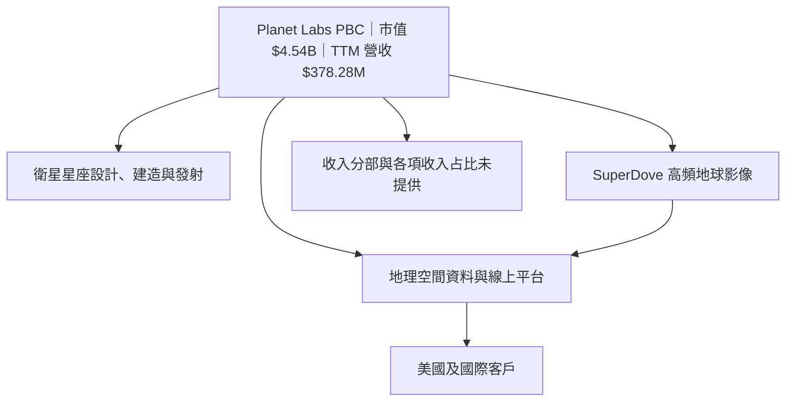
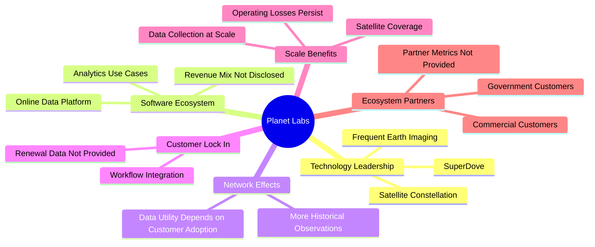
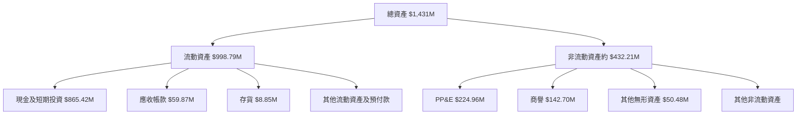
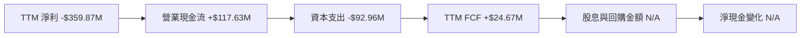
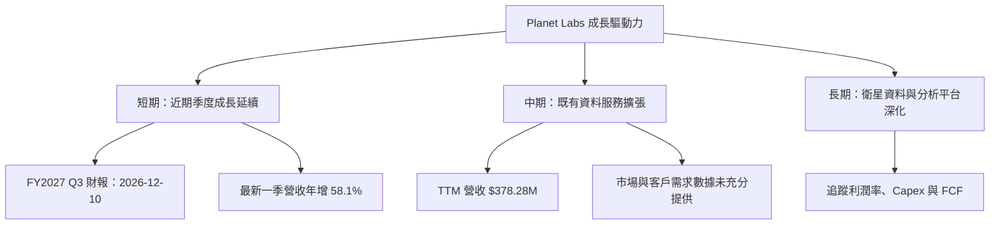
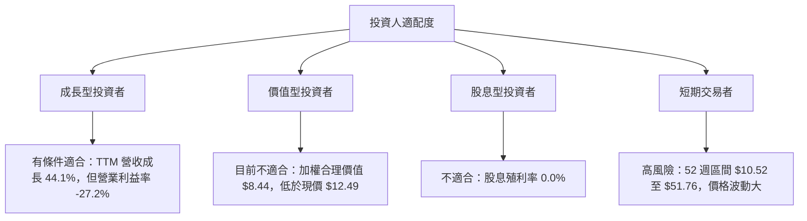

# PL 基本面深度分析報告
> **報告日期**：2026-11-17 ｜ **語言**：繁體中文 ｜ **數據來源**：SEC 申報資料 (XBRL)、Yahoo Finance、Finviz、StockAnalysis、Roic.ai ｜ **分析師**：CFA 級機構研究

## 目錄

| # | 章節 | 核心結論 |
|---|------|----------|
| 1 | 執行摘要 | 賣出；加權合理價值 $8.44，MOS -48.0% |
| 2 | 公司概覽與商業模式 | 日常地球影像與資料平台具差異化，但細分收入、市占與客戶留存數據未提供 |
| 3 | 損益表深度分析 | TTM 營收 $378.28M、年增 44.1%；TTM 營業利益率 -27.2% |
| 4 | 資產負債表分析 | 現金及短期投資 $865.42M；核驗總債務為 N/A，須留意來源口徑差異 |
| 5 | 現金流量深度分析 | TTM FCF $24.67M、FCF Yield 0.54%；歷史自由現金流波動大 |
| 6 | 獲利能力與資本效率 | ROIC N/A；目前營業虧損，尚無證據證明回報超過 12.97% WACC |
| 7 | 相對估值分析 | PL 的 P/S 11.9x，高於 SPIR、BKSY；高成長伴隨高估值風險 |
| 8 | DCF 內在價值評估 | DCF N/A：TTM 營業利益為負，不建立自製現金流模型 |
| 9 | 成長催化劑 | 最新一季營收年增 58.1%；TAM 數字未提供，近期財報是重要驗證點 |
| 10 | 風險矩陣 | 核心風險為估值、持續虧損與高資本支出 |
| 11 | 投資建議 | 依 MOS 評級為賣出；以 $8.44 加權合理價值作為估值錨 |

---

## 1. 執行摘要

PL 最新一季營收年增 **58.1%**，TTM 營收 **$378.28M、年增 44.1%**，顯示需求成長加速；但 TTM 營業利益率仍為 **-27.2%**，ROIC 未提供，且 TTM FCF 僅 **$24.67M**、FCF Yield 為 **0.54%**。以同業 P/S 與分析師共識計算的加權合理價值為 **$8.44**，相對 **2026-11-17 收盤價 $12.49** 的 MOS 為 **-48.0%**。依規則 20，評級為 **賣出**；這反映估值高於加權合理價值，並非否定公司的營收成長潛力。

### 1.0 一頁式投資儀表板

| 項目 | 內容 |
|------|------|
| **投資論點（3 句）** | ① TTM 營收年增 44.1%，最新一季年增 58.1%，成長加速。② TTM 營業利益率 -27.2%，目前成長尚未轉化為正營業獲利。③ 加權合理價值 $8.44，較 $12.49 收盤價低，MOS -48.0%。 |
| **綜合評分** | **5.1/10**（引用 1.1 評分卡） |
| **財務健康** | 🟡 現金及短期投資 $865.42M，但核驗總債務為 N/A，且公司仍處於營業虧損 |
| **ROIC vs WACC** | ROIC：N/A；WACC：12.97%。因 ROIC 缺資料，無法量化差距；營業虧損表示目前營運尚未證明能覆蓋資本成本 |
| **FCF 趨勢** | 最近 TTM FCF 為正 $24.67M；FCF Yield 0.54%，歷史年度 FCF 曾為負 |
| **估值** | Forward P/E -9,992.0x（虧損狀態下解讀有限）｜EV/EBITDA -86.312x｜FCF Yield 0.54% |
| **DCF 內在價值（基準）** | N/A；TTM 營業利益為負，核驗資料不提供 DCF 模型。折溢價 N/A |
| **安全邊際（MOS）** | **-48.0%**＝($8.44 − $12.49) ÷ $8.44；🔴 <10%，無安全邊際 |
| **預期報酬（基準情境 12M）** | DCF 情境未提供；以加權合理價值衡量的上行空間為 **-32.4%** |
| **關鍵風險（前二）** | 高估值與利潤轉正不確定；高 Capex 與 SBC 稀釋可能壓低股東實際回報 |
| **評級 + 信心度** | 🔴 **賣出** ｜ 信心：中（估值落差明確，長期成長與獲利路徑仍有不確定性） |

### 1.1 綜合評分卡（全報告唯一）

| 維度 | 評分（1–10） | 主要依據（引用數字與其來源章節） |
|------|--------------|----------------------------------|
| 成長性 | 8.0 | TTM 營收年增 44.1%、最新一季年增 58.1%（第 3 章）；需求成長明確，但持續性待確認 |
| 獲利能力 | 3.0 | TTM 營業利益率 -27.2%、F-Score 3/8；ROIC N/A（第 3、6 章） |
| 財務健康 | 6.5 | 現金及短期投資 $865.42M、流動比率 2.843；債務資料存在口徑差異（第 4 章） |
| 估值 | 2.0 | MOS -48.0%；P/S 11.9x，高於 SPIR 4.7x、BKSY 6.8x（第 7、8 章） |
| 護城河 | 7.0 | 每日地球觀測與資料平台具產品差異化；收入拆分、續約率與市占資料未提供（第 2 章） |
| 管理層與資本配置 | 4.0 | FY2026 SBC $54.99M，約為 FY2026 營收 17.9%；稀釋股數測試未通過（第 3、5 章） |
| **綜合評分** | **5.1** | 六項算術平均：(8.0 + 3.0 + 6.5 + 2.0 + 7.0 + 4.0) ÷ 6 = 5.083，四捨五入為 **5.1/10** |

### 1.2 五大投資論點 + 三大核心風險

| 類型 | 項目 | 具體依據 | 信心度 |
|------|------|----------|--------|
| 🟢 **投資論點①** | 營收成長正在加速 | TTM 營收 $378.28M、年增 44.1%；最新一季營收 $116.05M、年增 58.1%（第 3 章） | 🟢 高 |
| 🟢 **投資論點②** | 連續觀測資料具有產品差異化 | 公司以衛星星座提供高頻地球影像；管理概述稱 SuperDove 目標為每日地球影像，解析度最高約 3.5 公尺（第 2 章） | 🟡 中 |
| 🟢 **投資論點③** | 最近 TTM 自由現金流為正 | TTM 營業現金流 $117.63M、Capex $92.96M、FCF $24.67M（第 5 章） | 🟡 中 |
| 🟢 **投資論點④** | 現金資源提供營運緩衝 | 現金及短期投資 $865.42M（第 4 章）；債務數據來源有差異，不能據此直接下淨現金結論 | 🟡 中 |
| 🟢 **投資論點⑤** | 客戶場景可跨越多個產業 | 地理空間資料可用於監測與分析；但分產業收入、客戶集中度及續約率未提供，尚不能量化變現能力 | 🟡 中 |
| 🟡 **風險①** | 估值高於相對估值基準 | 加權合理價值 $8.44，較現價低；P/S 11.9x，高於 SPIR 4.7x、BKSY 6.8x（第 7、8 章） | 🔴 高 |
| 🔴 **風險②** | 營業虧損尚未消除 | TTM 營業利益率 -27.2%；最新季度營業利益率 -11.6%（核驗口徑，第 3 章） | 🔴 高 |
| 🟡 **風險③** | SBC 與資本支出削弱股東回報 | FY2026 SBC $54.99M，占營收約 17.9%；TTM Capex $92.96M（第 3、5 章） | 🟡 中 |

### 1.3 快速統計卡片

| 指標 | 公司實際值（期間） | 同業中位數 | 狀態 |
|------|--------------------|------------|------|
| 營收成長（TTM） | **44.1%** | — | 🟢 |
| 營收成長（最新一季年增） | **58.1%** | **72.7%**（SPIR、BKSY、RKLB） | 🟡 |
| 毛利率（TTM） | **55.5%** | **40.3%**（三家中位數） | 🟢 |
| 營業利益率（TTM） | **-27.2%** | — | 🔴 |
| ROIC（TTM） | **N/A** | — | 🟡 |
| Forward P/E | **-9,992.0x** | 不具可比解讀性：同業有負值與極高正值 | 🔴 |
| FCF Yield（TTM） | **0.54%** | — | 🟡 |
| Piotroski F-Score | **3 / 8** | — | 🔴 |

### 1.4 投資結論

```
╔══════════════════════════════════════════════════════════════════╗
║                    📊 投資結論摘要                               ║
╠══════════════════════════════════════════════════════════════════╣
║  評級：🔴 賣出（MOS -48.0%，依規則 20）                          ║
║  價格（2026-11-17 收盤）：$12.49                                 ║
║  DCF 內在價值（基準）：N/A（TTM 營業利益為負）                   ║
║  折溢價（相對 DCF）：N/A                                         ║
║  安全邊際 MOS：-48.0%（以加權合理價值 $8.44 為分母）            ║
║  加權合理價值（8.8）：$8.44                                     ║
║  綜合評分：5.1/10（引用 1.1）                                    ║
║  適合投資人：可承受高波動、願意承擔獲利轉正與估值收縮風險者      ║
╚══════════════════════════════════════════════════════════════════╝
```

---

## 2. 公司概覽與商業模式

Planet Labs PBC（PL）設計、建造並發射衛星星座，透過線上平台向美國及國際客戶提供高頻地理空間資料。公司概述提到 SuperDove 衛星可用於高頻地球影像；最新 TTM 營收為 **$378.28M**，但公司未提供足以拆分收入的業務部門數字。

### 2.1 業務結構與收入來源



收入來源的百分比分布及軟體與資料服務的獨立收入均未提供，因此不推估各板塊營收占比。平台交付有助於將衛星影像轉化為可重複使用的資料服務，但訂閱收入占比、客戶留存及合約期限缺少可核驗數字。

### 2.2 市場份額

市場份額數據未提供，亦無可引用的市場總量與年份。就已知相對位置而言，PL TTM 營收 **$378.28M**、TTM 成長 **44.1%**；同業資料顯示 SPIR 最新一季營收年增 42.1%、BKSY 118.4%、RKLB 72.7%。各公司業務範圍並不完全相同，這些成長率只可作為營運成長參照，不能當成市場份額比較。

### 2.3 競爭護城河分析



護城河的核心在於衛星網路產生的高頻觀測資料、累積的歷史資料與平台工作流程整合。資料未提供客戶留存、合約續約率、單位經濟或政府與商業收入占比，因此護城河的商業轉化程度仍需用未來財報驗證。

### 2.4 護城河強度

| 護城河項目 | 強度（強／中／弱） | 證據（引用數字或事實） | 會削弱它的情況 |
|------------|--------------------|------------------------|----------------|
| 技術與影像頻率 | 中 | 公司描述以衛星星座提供高頻地球影像，SuperDove 目標每日觀測 | 競爭者取得相近頻率、解析度或成本優勢 |
| 軟體與資料平台 | 中 | 透過線上平台交付地理空間資料；平台收入占比未提供 | 客戶偏好改用低成本替代資料或自建分析能力 |
| 網路效應 | 弱至中 | 更多觀測可能增加歷史資料價值；客戶／資料網路效應未量化 | 資料未形成明顯累積優勢，或客戶能跨供應商替換 |
| 客戶鎖定 | 未充分證實 | 客戶留存、續約率與合約年期未提供 | 續約率下降或採購集中度過高 |
| 規模效應 | 中 | 公司持有衛星星座與資料平台；TTM 營收 $378.28M | 衛星替換、發射與營運成本持續高於規模效益 |
| 生態夥伴 | 未充分證實 | 資料未列合作夥伴營收或通路貢獻 | 合作渠道無法帶來可重複收入 |

1.1 的護城河評分 **7.0/10**，理由是影像頻率與平台具產品差異化，但客戶留存、分部收入與單位經濟尚未提供，故不將技術特性直接等同於已驗證的定價權。

---

## 3. 損益表深度分析

### 3.1 年度收入成長趨勢（近4年）

FY2023 至 FY2026 營收由 **$191.26M** 增至 **$307.73M**，三年 CAGR 約 **17.2%**。年度數字取自公司財務資料；CAGR 為依年度營收計算值。

```
╔══════════════════════════════════════════════════════════════════╗
║           Planet Labs 年度收入趨勢（FY2023-FY2026）              ║
╠══════════════════════════════════════════════════════════════════╣
║  FY2023  $191.26M  █████████████                  YoY：基期      ║
║  FY2024  $220.70M  ███████████████                YoY：+15.4%    ║
║  FY2025  $244.35M  █████████████████              YoY：+10.7%    ║
║  FY2026  $307.73M  █████████████████████          YoY：+25.9%    ║
╠══════════════════════════════════════════════════════════════════╣
║  FY2023-FY2026 營收 CAGR：約 +17.2%                              ║
╚══════════════════════════════════════════════════════════════════╝
```

近年成長並非線性：FY2025 年增 10.7%，FY2026 回升至 25.9%；TTM 年增進一步達 44.1%。這代表近期收入動能改善，但單季高增是否可延續，需透過未來季報及合約／續約資料確認。

### 3.2 季度收入趨勢分析

| 季度 | 營收 | QoQ | YoY | 備註 |
|------|------:|----:|----:|------|
| 2025-10-31 | $81.25M | — | +32.6% | QoQ 未列前一季營收於最近四季表格以外，無法用同一列完整核對 |
| 2026-01-31 | $86.82M | +6.9% | +41.1% | QoQ 以 $86.82M ÷ $81.25M − 1 計算 |
| 2026-04-30 | $94.15M | +8.4% | +42.1% | YoY 以 $94.15M 對比 2025-04-30 $66.27M |
| 2026-07-31 | $116.05M | +23.3% | +58.1% | YoY 以 $116.05M 對比 2025-07-31 $73.39M；最新季加速 |

最新一季 QoQ 成長 23.3%，高於前三個季度的 6.9%–8.4%。不過，單季收入可能受合約交付與確認時點影響；需觀察後續季度是否維持高增，而非單季外推。

### 3.3 利潤率演變分析

| 利潤率指標 | FY2023 | FY2024 | FY2025 | FY2026 | 趨勢 | 評估 |
|------------|-------:|-------:|-------:|-------:|------|------|
| **毛利率** | 49.1% | 51.2% | 57.2% | 56.1% | FY2025 改善，FY2026 小幅回落 | 🟡 |
| **營業利益率** | -91.8% | -75.8% | -45.5% | -30.9% | 持續改善但仍為負 | 🔴 |

年度毛利率及營業利益率依各年度毛利、營收與營業利益計算。另按核驗口徑，TTM 毛利率為 **55.5%**、TTM 營業利益率為 **-27.2%**，最新一季營業利益率為 **-11.6%**。不同來源財務表的個別季度／年度數字有差異，本報告對核驗指標採用 SEC 申報資料的程式計算值。

**利潤率演變解析：**FY2023 至 FY2026 的營業虧損率收斂，與營收擴大、毛利率提升及營業槓桿改善相容；但費用明細、收入組合及非經常項目拆分不足，不能將全部改善歸因於單一因素。TTM 仍虧損，最新季單季改善也尚不足以證明已達可持續獲利規模。

### 3.4 費用結構分析

財務資料提供研發費用，但未提供足以完整拆分銷售、一般行政、研發及其他費用的同一期間明細，亦未提供可完整加總的費用結構數據。因此不繪製費用占比圓餅圖。FY2026 研發費用為 **$106.75M**，約為當年營收 **$307.73M** 的 **34.7%**；這反映公司仍投入衛星及平台能力建設，但高研發支出能否帶來規模化利潤，仍需觀察營業利益率。

### 3.5 季度 EPS 趨勢與盈餘品質（Quality of Earnings）

最近四季 EPS 預估與實際值均為缺失，無法判斷是否超預期或不及預期。可取得的實際季度淨利數字如下；季度 EPS 由 StockAnalysis 提供，因 EPS 預估值缺失，不能計算 surprise。

| 季度 | EPS 實際值 | EPS 預估／超預期判斷 | 季度淨利 |
|------|-----------:|---------------------|---------:|
| 2025-10-31 | -$0.19 | N/A；預估值缺失 | -$59.19M |
| 2026-01-31 | -$0.48 | N/A；預估值缺失 | -$152.46M |
| 2026-04-30 | -$0.40 | N/A；預估值缺失 | -$138.87M |
| 2026-07-31 | -$0.03 | N/A；預估值缺失 | -$9.35M |

| 盈餘品質項目 | 數值／佔比 | 評估 |
|--------------|-----------|------|
| 股權薪酬 SBC / 營收 | 最近四季 SBC 合計約 $62.51M ÷ TTM 營收 $378.28M = **16.5%** | 🔴 SBC 顯著稀釋股東經濟回報；流通股數未增加測試未通過 |
| SBC / 營業現金流 | 約 $62.51M ÷ $117.63M = **53.1%** | 🔴 SBC 相對營業現金流比重高 |
| FCF / 淨利（現金轉換率） | TTM 淨利 -$359.87M；$24.67M ÷ -$359.87M = **-6.9%** | 🔴 淨利為負，傳統現金轉換率不具正向解讀；現金流轉正主要不能等同於 GAAP 獲利 |
| 一次性／非經常性損益 | N/A；未提供可核驗拆分 | 🟡 無法排除單季淨利受非經常項目影響 |
| 有效稅率異常 | N/A；有效稅率明細未提供 | 🟡 無法確認稅務利益是否影響盈餘 |
| 資本化支出 vs 費用化 | TTM Capex $92.96M；資本化政策細項 N/A | 🟡 資產重投入重要，但無法量化資本化政策對當期利潤的影響 |

**盈餘品質結論：**公司尚未達到 GAAP 獲利，因而不存在可用正淨利驗證的現金轉換。TTM FCF 為正是有利訊號，但 SBC 約占 TTM 營業現金流 53.1%，且流通股數測試未通過；將 SBC 視為股東經濟成本後，單看報表 FCF 可能高估可分配給原股東的回報。

---

## 4. 資產負債表分析

### 4.1 資產結構分解

截至 2026-07-31，總資產約 **$1,431M**；以下列示 StockAnalysis 的資產明細，項目與總資產可能因四捨五入而略有差異。



現金與短期投資占流動資產大部分，提供營運與衛星投資緩衝；PP&E、商譽及無形資產亦占有一定規模。因資產明細來自不同資料源，非流動資產為總資產減流動資產所得的約數，並非獨立核驗的會計科目。

### 4.2 流動性與營運資金分析

| 指標 | 最新 TTM | 一年前 TTM | 變化 | 解讀 |
|------|----------|------------|------|------|
| DSO 應收帳款天數 | 58 天 | 72 天 | -14 天 | 收款天數下降，可能代表收款改善；仍需後續觀察 |
| DIO 存貨天數 | 19 天 | N/A | N/A | 一年前未提供可比較數字 |
| DPO 應付帳款天數 | 22 天 | 37 天 | -15 天 | 付款天數縮短，可能反映付款時點或供應商條件變化 |
| CCC 現金轉換週期 | 55 天 | N/A | N/A | 一年前 CCC 缺少 DIO，不能自行補算 |

其他流動性數據顯示流動比率 **2.843**、速動比率 **2.634**（Yahoo Finance 合併資料）。比率高於 1，表示流動資產大於流動負債；但公司仍處虧損且需持續投資衛星與平台，不能只憑短期比率推論長期融資風險低。

### 4.3 債務結構分析

核驗財務數據的「總債務」為 **N/A**，且核驗「淨現金」為 **$865.42M**。其他整合資料另列總債務 **$498.62M**、淨現金／負債 **$366.79M**；兩套口徑存在差異，因此本報告不將後者替代核驗數字，也不計算 Debt/EBITDA 或利息保障倍數。

```
╔══════════════════════════════════════════════════════════════════╗
║                 Planet Labs 債務健康診斷                         ║
╠══════════════════════════════════════════════════════════════════╣
║  核驗總債務：        N/A（其他來源報 $498.62M，口徑待核對）       ║
║  現金及短期投資：    $865.42M                                     ║
║  核驗淨現金：        $865.42M（照核驗值引用；不自行重算）         ║
║  Debt/EBITDA：       N/A（債務及 EBITDA 口徑不可直接核對）         ║
║  利息保障倍數：      N/A（利息費用與債務口徑不足）                ║
║  流動比率：          2.843                                        ║
║  主要判斷：          🟡 流動性數字看似充足，但債務資料有來源差異  ║
╚══════════════════════════════════════════════════════════════════╝
```

### 4.4 股東權益趨勢

| 財年 | 股東權益 |
|------|---------:|
| FY2023 | $576.10M |
| FY2024 | $518.02M |
| FY2025 | $441.29M |
| FY2026 | $188.43M |

```
╔══════════════════════════════════════════════════════════════════╗
║                 股東權益變化（年度）                              ║
╠══════════════════════════════════════════════════════════════════╣
║  FY2023  $576.10M  █████████████████████████                    ║
║  FY2024  $518.02M  ██████████████████████                       ║
║  FY2025  $441.29M  ███████████████████                          ║
║  FY2026  $188.43M  ████████                                     ║
╚══════════════════════════════════════════════════════════════════╝
```

FY2026 股東權益較 FY2025 顯著下降。公司當年度淨損為 **$246.86M**，但資產負債表變化還可能受融資、股權薪酬及其他權益變動影響；缺少完整權益變動表時，不將下降全部歸因於單一項目。

---

## 5. 現金流量深度分析

### 5.1 現金流量瀑布圖

營業現金流與 Capex 的 TTM 數字依核驗資料；淨利採可取得的 TTM 數字。股息／回購及現金變動沒有一致的 TTM 明細，故不填入估算值。



營業現金流大於零而淨利為負，顯示應計項目、非現金費用及營運資金變化對現金流有顯著影響。由於 SBC 占營業現金流比重偏高，正 FCF 不等同於同額的股東可分配現金。

### 5.2 FCF 轉換率趨勢

| 財年 | FCF | 淨利 | FCF / 淨利 |
|------|----:|-----:|-----------:|
| FY2023 | -$86.69M | -$161.97M | 約 53.5% |
| FY2024 | -$93.12M | -$140.51M | 約 66.3% |
| FY2025 | -$68.78M | -$123.20M | 約 55.8% |
| FY2026 | +$51.41M | -$246.86M | 約 -20.8% |

因分母淨利為負，FCF／淨利比率不宜被解讀為一般正向轉換率。FY2026 FCF 轉正而淨損擴大，說明現金流與會計盈餘方向不同；須配合 SBC、營運資金及投資支出變化解讀。

### 5.3 自由現金流趨勢

FY2026 年報 FCF 為 **$51.41M**；核驗 TTM FCF 為 **$24.67M**。兩者期間不同，不可混為同一個數字。歷史年度數字取自年度現金流表。

```
╔══════════════════════════════════════════════════════════════════╗
║                  自由現金流：年度歷史與最新 TTM                  ║
╠══════════════════════════════════════════════════════════════════╣
║  FY2023  -$86.69M  ◀████████████████                             ║
║  FY2024  -$93.12M  ◀█████████████████                            ║
║  FY2025  -$68.78M  ◀████████████                                 ║
║  FY2026  +$51.41M   █████████                                    ║
║  TTM      +$24.67M   ████       FCF Yield：0.54%（核驗口徑）      ║
╚══════════════════════════════════════════════════════════════════╝
```

年度 FCF 由 FY2023 至 FY2025 為負，FY2026 轉正；最新 TTM 仍為正，但金額低於 FY2026 全年。FCF Yield 僅 **0.54%**，表示按目前市值衡量，現金流收益率有限。

### 5.4 資本配置評估

現有資料不足以建立可加總的資本配置比例圓餅圖。已知 FY2026 Capex 為 **$82.95M**，SBC 為 **$54.99M**；公司未提供可對應同一期間的回購、股息及其他投資分配完整明細。

| 資本配置項目 | 可取得數字 | 評估 |
|--------------|-----------|------|
| 資本支出 | FY2026 $82.95M；TTM 核驗 $92.96M | 衛星與平台業務需持續投入；需追蹤 Capex 是否轉化為增量收入 |
| 股權薪酬 | FY2026 $54.99M | 占 FY2026 營收約 17.9%，稀釋成本不可忽略 |
| 股息 | 殖利率 0.0% | 未見股息回報 |
| 回購 | N/A | 未提供足夠數字 |
| 併購／其他投資 | N/A | 未提供可核驗拆分 |

---

## 6. 獲利能力與資本效率

### 6.1 ROE / ROA / ROIC 趨勢

| 指標 | 可取得數值 | 評估 |
|------|-----------|------|
| ROE（TTM） | **-63.8%**（核驗值） | 虧損導致股東權益回報為負；不代表槓桿本身是虧損的唯一原因 |
| ROA（TTM） | -5.0%（整合財務資料） | 資產尚未產生正淨利回報 |
| ROIC（TTM） | **N/A** | 未提供可核驗 ROIC；不能自行以不同期營業利益與投入資本計算 |
| 行業均值 | N/A | 未提供可比、同口徑資料 |

不同資料源的 ROE 數值不一致；本報告按核驗品質指標引用 **-63.8%**。公司營業利益仍為負，代表目前資本投入尚未轉化成正營業回報。

### 6.2 ROIC vs WACC 分析（核心價值創造判斷）

公司 ROIC 為 N/A，故無法精確計算 EVA 或判定 ROIC 與 WACC 的差額。核驗 WACC 為 **12.97%**；TTM 營業利益率 **-27.2%**，目前營運尚未顯示足以覆蓋資本成本的正向營業報酬。

```
╔══════════════════════════════════════════════════════════════════╗
║                ROIC vs WACC 深度分析                             ║
╠══════════════════════════════════════════════════════════════════╣
║  資本成本（使用核驗值）：                                         ║
║  ├── 無風險利率（10Y 美債）：       5.10%                         ║
║  ├── 市場風險溢酬 ERP：             5.00%                         ║
║  ├── 原始 Beta：                    2.27                          ║
║  ├── 調整後 Beta：                  1.85                          ║
║  ├── 股權成本 Ke：                  14.34%                        ║
║  ├── 稅前債務成本：                 0.69%                         ║
║  ├── 稅率：                         21.0%                         ║
║  ├── 股權／債務權重：               90.1%／9.9%                   ║
║  └── ✅ WACC：                      12.97%                        ║
║                                                                  ║
║  ROIC：N/A（未提供可核驗數字）                                    ║
║  TTM 營業利益率：-27.2%                                           ║
║  EVA：N/A（ROIC 未提供，不能計算）                                ║
║                                                                  ║
║  判斷：目前營業虧損，尚無證據證明回報超過 12.97% WACC             ║
╚══════════════════════════════════════════════════════════════════╝
```

WACC 的已提供組成可作一致性展示：CAPM 股權成本為 **5.10% + 1.85 × 5.00% = 14.35%**，核驗值列為 **14.34%**，微小差異屬輸入精度／四捨五入。依提供的股權、債務權重與稅後債務成本，WACC 約為 **90.1% × 14.34% + 9.9% × [0.69% × (1 − 21.0%)] = 12.97%**；本報告採用核驗 WACC，不另行重估。

### 6.3 杜邦三因素分解

| 因素 | 數值（TTM） | 解讀 |
|------|-------------|------|
| 淨利率 | -95.1% | 淨損幅度相對營收很高，是 ROE 為負的主要來源 |
| 資產週轉率 | 0.26 | 資產每年產生的營收有限，仍處擴張與投資階段 |
| 權益乘數 | 2.54 | 有槓桿效果，但不改變公司淨利為負的根本狀況 |
| **ROE** | **-63.8%** | 核驗品質指標列示：-95.1% × 0.26 × 2.54 = -63.8% |

ROE 的負值主要由負淨利率驅動，並非單純由財務槓桿所致；按品質指標區塊照抄其杜邦結果，不另行調整輸入。

### 6.4 財務體質：Piotroski F-Score

| 測試 | 結果 | 解讀 |
|------|------|------|
| ROA > 0 | ❌ 未通過 | 公司仍為虧損狀態 |
| 營業現金流 > 0 | ✅ 通過 | TTM 營業現金流 $117.63M |
| ROA 高於一年前 | ❌ 未通過 | 報表測試未通過，反映獲利改善尚未確認 |
| 營業現金流 > 淨利（應計品質） | ✅ 通過 | 營業現金流高於淨利，但淨利為負，須連同 SBC 解讀 |
| 長期負債 ÷ 總資產低於一年前 | — 無法判定 | 缺資料 |
| 流動比率高於一年前 | ✅ 通過 | 品質指標測試通過 |
| 稀釋股數未增加 | ❌ 未通過 | 股數稀釋會降低每股經濟利益 |
| 毛利率高於一年前 | ❌ 未通過 | 品質指標測試未通過 |
| 資產週轉率高於一年前 | ❌ 未通過 | 資產使用效率測試未通過 |

**Piotroski F-Score：3 / 8。** 分母為 8，因一項長期負債測試缺少資料而未納入。分數偏低，主要反映仍未獲利、毛利率與資產週轉測試未通過，以及股數稀釋。

---

## 7. 相對估值分析

### 7.1 同業估值比較

同業倍數依 Yahoo Finance 同業資料。PL 的 Forward P/E 來自整合市場資料，並與同業數值比較時須注意公司均未穩定獲利，負值或極高倍數的經濟解讀有限。

| 估值指標 | **PL** | **SPIR** | **BKSY** | **RKLB** | PL 評估 |
|----------|-------:|--------:|--------:|--------:|-----------|
| **Trailing P/E** | N/A | N/A | N/A | N/A | 🔴 多家公司尚無具解讀性的正本益比 |
| **Forward P/E** | -9,992.0x | -18.4x | -78.2x | 769.1x | 🔴 PL 接近盈虧平衡點的負 EPS 使倍數失真 |
| **P/S Ratio** | 12.013549x（市場整合資料）；歷史核驗值 11.9x | 4.7x | 6.8x | 42.0x | 🔴 PL 高於 SPIR 與 BKSY，低於 RKLB |
| **EV/EBITDA** | -86.312x | -3.7x | 807.8x | -176.4x | 🟡 同業獲利狀態差異大，倍數可比性低 |
| **最新一季營收年增** | 58.1% | 42.1% | 118.4% | 72.7% | 🟡 PL 成長高於 SPIR，低於 BKSY、RKLB |
| **毛利率（TTM）** | 55.5% | 40.3% | 73.4% | 36.2% | 🟢 高於 SPIR、RKLB，低於 BKSY |

P/S 顯示投資者已為 PL 的成長與資料平台特性支付較高價格。與 SPIR、BKSY 相比，PL 估值溢價需要較快成長及利潤改善支持；但其毛利率尚未轉化成正營業利潤。

### 7.2 歷史估值區間分析

歷史估值資料提供的是 P/S，而非 P/E；因此下圖呈現 P/S。

```
╔══════════════════════════════════════════════════════════════════╗
║           PL 五年歷史 P/S 區間（TTM）                             ║
╠══════════════════════════════════════════════════════════════════╣
║  五年低點：2.1x                                                  ║
║  五年中位數：6.9x                                                ║
║  目前：11.9x  ───────────────●                                   ║
║  五年高點：38.1x                                                 ║
║  當前百分位：79%                                                 ║
╠══════════════════════════════════════════════════════════════════╣
║  評估：目前估值位於自身五年區間偏高位置，高於歷史中位數          ║
╚══════════════════════════════════════════════════════════════════╝
```

現價 P/S 11.9x 高於五年中位數 6.9x，處於歷史第 79 百分位。雖然遠低於歷史高點 38.1x，但仍需收入持續成長及營業虧損收斂，才能降低倍數回落風險。

### 7.3 情境價值（Bear / Base / Bull）

**N/A（DCF 無法計算：TTM 營業利益不為正，核驗模型明確不建立以虧損為起點的 DCF）。** 因此不提供悲觀、基準與樂觀 DCF 情境價值。

### 7.4 相對估值隱含價格區間

```
╔══════════════════════════════════════════════════════════════════╗
║                   相對估值每股價值                                ║
╠══════════════════════════════════════════════════════════════════╣
║  $6.01 ───────────── $8.44 ───────────── $12.49                  ║
║  同業 P/S           加權合理價值          2026-11-17 收盤價       ║
║  -51.9%              MOS -48.0%            現價高於估值基準       ║
╠══════════════════════════════════════════════════════════════════╣
║  同業 P/S：$6.01；使用 SPIR、BKSY 同業中位數倍數 5.8x            ║
║  分析師共識：$30.27；11 位分析師平均目標價，權重 10%              ║
╚══════════════════════════════════════════════════════════════════╝
```

同業 P/S 方法的每股價值 **$6.01**、權重 **90%**，採 SPIR 與 BKSY 的同業中位數 P/S **5.8x**；其收入／股數換算採估值程式結果，因換算所用完全一致的股數口徑未提供，本報告照抄該每股價值而不另行重算。分析師共識目標價 **$30.27**、權重 **10%**。Forward P/E 因不可計算而未納入；固定估值權重不作調整。

---

## 8. DCF 內在價值評估（Discounted Cash Flow）

### 8.0 估值推理鏈（Thinking Logic）

**Step 1 — 價值由哪些變數決定？**  
PL 的估值主要取決於現有地球觀測資料服務的收入持續性、營收成長能否轉化為正營業利潤，以及衛星與平台再投資後能否形成正 FCF。分部收入占比未提供，因此無法量化主業、軟體服務或新業務各自占比。現階段估值最關鍵的變數是利潤轉正與可持續現金流，而不是單靠最新一季 58.1% 的營收年增率。

**Step 2 — 模型選擇與限制**

| 決策點 | 本報告採用 | 理由 | 曾考慮但否決 | 否決理由 |
|--------|-----------|------|--------------|----------|
| 現金流估值 | 不建立 DCF | 核驗 TTM 營業利益率 -27.2%，TTM 營業利益不為正 | 自行預測 FCFF | 缺少模型假設及核驗 DCF 逐年資料，亦不符合以正營業利益為估值基礎的條件 |
| 預測期 N | N/A | DCF MODEL 為 N/A | 任意指定年數 | 會形成未經核驗的自建模型 |
| 終值方法 | N/A | 無有效 DCF 預測現金流 | Gordon Growth／退出倍數 | 無基準期現金流可支撐 |
| EBIT 基礎 | N/A | 未啟動 DCF | GAAP／非 GAAP EBIT | 不以假設利潤率填補缺失資料 |

**Step 3 — 假設推導鏈**  
預測期營收 CAGR、期末營業利潤率、稅率、Capex、折舊攤銷、營運資金變動、SBC 處理、稀釋率、永續成長率及終值均無核驗 DCF 模型數字；因此不採用假設值，也不提供四段式預測推導。替代做法是以核驗的相對估值與分析師共識進行估值參考。

**Step 4 — 最脆弱的一環**  
最脆弱的是未來營收成長能否轉成正營業利潤與 FCF；若成長未帶來費用槓桿，基於收入的相對估值亦可能下修。

**Step 5 — 計算路徑圖**  
由於 DCF MODEL 為 N/A，不繪製會暗示存在模型數字的估值計算路徑圖。

### 8.1 模型假設總表（Model Inputs）

**N/A（DCF MODEL 未提供：TTM 營業利益為負，核驗估值流程不建立虧損折現模型）。**預測期、營收 CAGR、營業利潤率、稅率、Capex/營收、D&A/營收、營運資金假設、SBC 處理、稀釋率、永續成長率與終值方法均不適用，故不填入自行假設的數字。

### 8.2 折現率推導（WACC）

本節採用核驗 WACC **12.97%**；Beta 使用調整後 **1.85**，其計算方式為 **⅔ × 原始 Beta 2.27 + ⅓**。CAPM 輸入為 10 年期美債利率 **5.10%**、ERP **5.00%**，股權成本核驗值 **14.34%**；債務成本 **0.69%**、稅率 **21.0%**，股權／債務權重 **90.1%／9.9%**。

```
╔══════════════════════════════════════════════════════════════════╗
║                    WACC 推導（折現率）                            ║
╠══════════════════════════════════════════════════════════════════╣
║  無風險利率 Rf（10Y 美債）：              5.10%                  ║
║  市場風險溢酬 ERP：                       5.00%                  ║
║  原始 Beta（Yahoo）：                     2.27                   ║
║  調整後 Beta：                            1.85                   ║
║  股權成本核驗值：                         14.34%                 ║
║  稅前債務成本：                           0.69%                  ║
║  稅後債務成本：                           0.69% × (1 - 21.0%)    ║
║                                           = 0.5451%               ║
║  股權／債務權重：                         90.1%／9.9%             ║
║  WACC：                                   12.97%                 ║
╠══════════════════════════════════════════════════════════════════╣
║  輸入的日期明細：Rf 日期未另列；ERP 為假設值；                  ║
║  債務明細與平均計息負債均未提供，故不另造 WACC。                 ║
╚══════════════════════════════════════════════════════════════════╝
```

核驗 WACC 可按組成複算至約 **12.97%**：股權成本加權約 **90.1% × 14.34% = 12.91734%**；稅後債務成本加權約 **9.9% × 0.5451% = 0.05396%**；加總約 **12.97130%**，四捨五入至 **12.97%**。WACC 與第 6.2 節一致。由於股權市值、計息負債範圍及利息費用的細節未提供，不以市場資料自行重建資本權重。

### 8.3 逐年自由現金流預測（基準情境）

**N/A（DCF MODEL 未提供：TTM 營業利益不為正）。**核驗資料未提供逐年預測營收、EBIT、稅、D&A、Capex、營運資金變動、FCFF 或折現因子。依規則不自建模型，也不填造預測年度數字。

### 8.4 終值計算（Terminal Value）

**N/A（DCF 無逐年 FCFF 預測，亦無可用的 FY+N 現金流）。**因無基準期現金流及永續成長率，不能計算 Gordon Growth 或退出倍數終值，也不能判斷 WACC 與 g 的大小關係。

### 8.5 企業價值 → 每股內在價值（Bridge）

**N/A（DCF MODEL 未提供）**。預測期現值、終值現值、DCF 企業價值、現金與債務橋接、稀釋股數及每股 DCF 價值均不計算。故相對 DCF 基準價的折溢價亦為 N/A，不以相對估值取代 DCF。

### 8.6 敏感性分析（WACC × 永續成長率）

**N/A（沒有可核驗 DCF 基準現金流、終值或敏感度矩陣）。**不自行建立 WACC × g 矩陣、三情境 DCF 或機率加權價值。

### 8.7 反推 DCF（Reverse DCF：市場在預期什麼）

**N/A（DCF MODEL 未提供反推結果）。**現有資料不足以在固定其他 DCF 輸入後只反解單一變數；因此不提供營收 CAGR、期末利潤率、永續成長率或預測期反推值，也不製作試算軌跡。

### 8.8 估值三角驗證與安全邊際

| 估值方法 | 隱含每股價值 | 上行空間（÷現價） | 權重 | 說明 |
|----------|--------------:|-------------------:|-----:|------|
| 同業 P/S | $6.01 | -51.9% | 90% | SPIR、BKSY 同業中位數 P/S 5.8x，估值程式輸出每股價值 |
| 分析師共識目標價 | $30.27 | +142.4% | 10% | 11 位分析師平均目標價，作參考而非主要估值錨 |
| **加權合理價值** | **$8.44** | **-32.4%** | **100%** | 未納入 DCF；Forward P/E 因不可計算而剔除 |

**逐步演算：**

加權合理價值  
= `$6.01 × 90% + $30.27 × 10%`  
= `$5.409 + $3.027`  
= `$8.436`  
= **$8.44**（金額取至美分）

此估值權重來自公司類型「unprofitable」的固定方法配置；Forward P/E 因不可計算而未納入。加權合理價值保持未取整前的總和 **$8.436**，顯示為 **$8.44**。

MOS 使用加權合理價值作分母：

\[
\text{MOS} = \frac{8.44-12.49}{8.44}
= \frac{-4.05}{8.44}
= -48.0\%
\]

上行空間以現價作分母：

\[
\text{上行空間} = \frac{8.44-12.49}{12.49}
= \frac{-4.05}{12.49}
= -32.4\%
\]

```
╔══════════════════════════════════════════════════════════════════╗
║                  估值區間與安全邊際                              ║
╠══════════════════════════════════════════════════════════════════╣
║  $6.01 ───────── $8.44 ─────────────── $12.49                   ║
║  同業 P/S        加權合理價值           2026-11-17 收盤價         ║
║                                                                  ║
║  MOS = ($8.44 - $12.49) ÷ $8.44 = -48.0%                        ║
║  上行空間 = ($8.44 - $12.49) ÷ $12.49 = -32.4%                  ║
║  評估：🔴 MOS 為負；現價高於加權合理價值                         ║
║                                                                  ║
║  參考買入價格上限：$8.44 × (1 - 10%) = $7.60                    ║
║  （此為 MOS 達 10% 的估值門檻，不代表目前建議買入）               ║
╚══════════════════════════════════════════════════════════════════╝
```

> 🔎 **程式複算（Python，依本節各項自動重算）**
>
> 加權合理價值 = $6.01 × 90% + $30.27 × 10% = **$8.44**（權重合計 100%）
>
> 以價格 $12.49 計：MOS = **-48.0%**，上行空間 = **-32.4%**
>
> ✅ 與本節所寫數值一致。

### 8.9 DCF 模型的局限與失效條件

- **終值依賴度：** N/A；沒有可核驗 DCF 終值，不能計算終值占 EV 比重。
- **最脆弱的假設：** 因 DCF 不建立，不列出未經驗證的假設值。就估值框架而言，最重要的不確定因素是營收成長能否轉成正營業利潤，以及 SBC 和 Capex 對股東可分配現金的消耗。
- **不適用情境：** TTM 營業利益為負，單純將虧損以 WACC 折現會產生無意義的結果。現階段相對估值可作參考，但 P/S 不反映公司轉正所需時間及未來資本需求；營運穩定後再考慮 DCF、單位經濟及分部估值。
- **與第 10 章風險矩陣的連結：** 需求或政府採購放緩會影響收入成長；衛星投資成本上升會影響 Capex 與現金流；競爭加劇則會壓低毛利及未來營業利潤率。

### 8.10 複算檢核表（Audit Trail）

| # | 檢核項目 | 檢查方式 | 結果 |
|---|----------|----------|------|
| 1 | 高／中敏感度 DCF 輸入完整四段式推導 | DCF MODEL 為 N/A，沒有採用這些輸入 | ✅ 不適用；未自行填入假設 |
| 2 | 每個假設都有來歷 | 不建立 DCF 假設表 | ✅ 不適用 |
| 3 | WACC 組成與加權算式 | 依核驗輸入複算 | ✅ 約 12.97% |
| 4 | Kd 分母與債務權重範圍一致 | 詳細計息負債及平均餘額未提供；直接採核驗 WACC | ✅ 未自行推算負債範圍 |
| 5 | WACC 與第 6.2 節相同 | 比對兩節 | ✅ 12.97% |
| 6 | 逐年預測年度數等於 N | DCF MODEL 為 N/A | ✅ 不適用 |
| 7 | FY+1 FCFF 與 PV 可複算 | 無逐年模型 | ✅ 不適用 |
| 8 | 預測期 PV 加總 | 無逐年模型 | ✅ 不適用 |
| 9 | WACC > g | g 未提供 | ✅ 不適用；未計算終值 |
| 10 | 終值以 FY+N 現金流為基礎 | 無 FY+N 現金流 | ✅ 不適用 |
| 11 | DCF 橋接至每股價值 | 無 DCF EV 與股數橋接 | ✅ 不適用 |
| 12 | SBC EBIT 基礎、FCFF 扣除及稀釋率一致 | 未建立 DCF 模型 | ✅ 不適用 |
| 13 | 敏感度矩陣基準格與 DCF 每股價值一致 | 無矩陣及 DCF 值 | ✅ 不適用 |
| 14 | 敏感度格子符合 WACC > g | 無矩陣 | ✅ 不適用 |
| 15 | 三情境機率與加權算式 | 未提供 DCF 情境 | ✅ 不適用 |
| 16 | 反推 DCF 一次只放開一個變數 | 未提供反推結果 | ✅ 不適用 |
| 17 | MOS 分母為 8.8 加權價值；折溢價以 DCF 為基準 | MOS 使用 $8.44；DCF 折溢價 N/A | ✅ |
| 18 | 報告完整至第 11 章 | 核對章節 | ✅ |
| 19 | 加權合理價值等於各方法加權總和 | $6.01 × 90% + $30.27 × 10% = $8.436 | ✅ |
| 20 | 評級符合 MOS 門檻 | MOS -48.0% | ✅ 賣出 |

---

## 9. 成長催化劑

### 9.1 催化劑時間軸

資料未提供可確認的產品推出或商業化日期，因此不以假設日期繪製時間軸。已知近期事件為公司預計於 **2026-12-10** 公布 FY2027 Q3 財報，屆時可檢驗最新一季成長是否延續。

### 9.2 TAM 市場規模分析

**N/A（TAM 數據未提供）。**公司 TTM 營收 **$378.28M**、TTM 年增 **44.1%**、最新一季年增 **58.1%**，顯示目前營收仍在擴張。由於沒有可引用的市場規模、年份與公司滲透率資料，不估算 TAM 金額或市場滲透率。

### 9.3 成長驅動力結構圖



近期財報是最近的量化檢驗點；中長期催化劑取決於收入成長能否伴隨營業虧損收窄及 FCF 擴大。因缺少管理層指引與客戶層級數據，不對未來成長率作額外預測。

---

## 10. 風險矩陣

### 10.1 風險評分矩陣

可用財務資料不足以量化各風險的發生機率與衝擊百分比，故不以未經核驗的座標製作數字型象限圖。主要風險按財務影響及可觀察指標列示如下：

| 風險項目 | 機率判斷 | 潛在衝擊 | 主要監控數字 |
|----------|----------|----------|-------------|
| 高估值與倍數收縮 | 中至高 | 估值可能向同業 P/S 收斂 | PL P/S 11.9x；同業 SPIR 4.7x、BKSY 6.8x |
| 營業虧損持續 | 中至高 | 獲利轉正延後、估值支撐減弱 | TTM 營業利益率 -27.2% |
| 資本支出與 SBC 壓力 | 中 | FCF 被投資需求及股數稀釋侵蝕 | TTM Capex $92.96M；最近四季 SBC 約 $62.51M |

### 10.2 風險清單詳細分析

| # | 風險項目 | 發生機率 | 財務衝擊 | 風險評估 | 緩解措施 |
|---|----------|----------|----------|----------|----------|
| 1 | 🔴 **估值高於相對價值基準** | 中至高；非統計機率 | P/S 11.9x，遠高於 SPIR 4.7x 與 BKSY 6.8x；若倍數收斂，股價可能承壓 | 🔴 高 | 以分批投資與估值上限管理風險；監控營收增長能否支持倍數 |
| 2 | 🔴 **獲利轉正延後** | 中至高 | TTM 營業利益率 -27.2%；持續虧損降低估值可預測性 | 🔴 高 | 逐季追蹤營業利益率、費用增速及 FCF，而非僅看營收 |
| 3 | 🟡 **SBC 稀釋與 Capex 壓力** | 中 | 最近四季 SBC 約占 TTM 營收 16.5%；TTM Capex $92.96M | 🟡 中至高 | 追蹤稀釋股數、SBC/營收及 Capex/營收 |
| 4 | 🟡 **營運資金與收款變化** | 中 | DSO 58 天，雖低於一年前 72 天，但 CCC 為 55 天 | 🟡 中 | 追蹤應收帳款、DSO 與合約收款條件 |
| 5 | 🟡 **債務資料來源不一致** | 中 | 核驗總債務 N/A；其他來源列 $498.62M | 🟡 中 | 以最新 SEC 申報的債務附註、到期表及現金限制事項核對 |

---

## 11. 投資建議

### 11.1 最終評級與評分

MOS 為 **-48.0%**，低於規則 20 的 -25% 門檻，故評級為 **賣出**，沒有作質化升降級。綜合評分為 **5.1/10**；六項評分依序為成長性 8.0、獲利能力 3.0、財務健康 6.5、估值 2.0、護城河 7.0、管理層與資本配置 4.0，評分卡見第 1.1 節。

### 11.2 合理價值與隱含報酬率

| 估值參考 | 每股價值 | 相對現價 $12.49 | 說明 |
|----------|---------:|----------------:|------|
| 同業 P/S | $6.01 | -51.9% | 權重 90% |
| 分析師共識目標價 | $30.27 | +142.4% | 權重 10%；11 位分析師平均值 |
| **加權合理價值** | **$8.44** | **上行空間 -32.4%；MOS -48.0%** | MOS 分母為加權合理價值 |
| 悲觀／基準／樂觀 DCF 情境 | N/A | N/A | DCF MODEL 未提供，TTM 營業利益為負 |

分析師平均目標價與相對估值結果差距很大，因此只按固定 10% 權重納入，而不將其當作主要價值錨。

### 11.3 買入時機與觸發因素

```
╔══════════════════════════════════════════════════════════════════╗
║                  ✅ 買入觸發因素 Checklist                      ║
╠══════════════════════════════════════════════════════════════════╣
║  目前判斷：現價 $12.49，高於加權合理價值 $8.44                  ║
║                                                                  ║
║  考慮建立部位前，建議觀察：                                      ║
║  ☐ 股價回落至約 $7.60 或以下，達到 MOS 約 10% 的估值門檻         ║
║  ☐ TTM 營業利益率持續改善，且不是單季波動                        ║
║  ☐ TTM FCF 持續為正，並能在扣除 SBC 經濟成本後改善               ║
║  ☐ 股數稀釋速度下降，SBC / 營收占比下行                          ║
║                                                                  ║
║  加碼觸發條件：                                                  ║
║  ☐ 連續數季營收成長與營業利潤率同步改善                          ║
║  ☐ FCF 增長快於營收，且 Capex 沒有持續超出現金流承受能力         ║
║                                                                  ║
║  減碼／退出檢查條件：                                            ║
║  ☐ 連續兩季營收年增明顯減速，且沒有新的已披露成長支撐            ║
║  ☐ TTM 營業利益率惡化，或 TTM FCF 轉負                           ║
║  ☐ SBC / 營收上升或稀釋股數持續增加                              ║
╚══════════════════════════════════════════════════════════════════╝
```

**$7.60** 是以加權合理價值 $8.44 計算 MOS 10% 的價格上限：`$8.44 × (1 − 10%) = $7.596 ≈ $7.60`。這是估值門檻，不是精確預測的短期底部。

### 11.4 投資人適配度分析



### 11.5 每季財報監控清單（Quarterly Watch List）

| 指標 | 目前基準 | 觸發加碼／改善訊號 | 觸發減碼／警訊 |
|------|----------|-------------------|----------------|
| 營收年增 | 最新一季 +58.1%；TTM +44.1% | 年增維持在正成長且連續數季未明顯減速 | 連續兩季低於 30%，且無法由合約時點解釋 |
| 營業利益率 | TTM -27.2%；最新一季 -11.6%（核驗口徑） | 逐季改善並持續收斂至損益兩平 | 連續兩季惡化或費用增速高於營收 |
| 毛利率 | TTM 55.5% | 維持或改善，且能帶動營業槓桿 | 明顯下滑，或毛利改善未轉化成較低營業虧損 |
| 營業現金流 | TTM $117.63M | 營收增長時 OCF 同步維持正值 | OCF 轉負或應收帳款增速長期快於收入 |
| Capex | TTM $92.96M | Capex 帶來收入與 FCF 增長 | Capex 上升、但營收及 FCF 未改善 |
| FCF | TTM $24.67M；FCF Yield 0.54% | FCF 持續為正並逐步增長 | TTM FCF 轉負或現金消耗加快 |
| SBC 與稀釋 | 最近四季 SBC 約 $62.51M；稀釋股數測試未通過 | SBC / 營收下降、稀釋放緩 | SBC / 營收上升或股數加速增加 |
| DSO／CCC | DSO 58 天；CCC 55 天 | DSO 維持或下降，CCC 不明顯拉長 | DSO 回升至或高於一年前 72 天，且收款延遲 |
| 管理層財測 | 未提供可核驗的財測數字 | 財測達成且營業利潤率同步改善 | 下修營收指引或延後獲利轉正時程 |

### 11.6 反面論證：什麼會證明論點錯誤（What Would Change My Mind）

```
╔══════════════════════════════════════════════════════════════════╗
║            ⚠️ 論點失效條件（Disconfirming Evidence）             ║
╠══════════════════════════════════════════════════════════════════╣
║  以下任一情況出現，應重新檢視持有理由與估值假設：                ║
║  ☐ 營收年增連續兩季低於 30%，且無已披露合約時點因素解釋         ║
║  ☐ TTM 營業利益率較核驗基準 -27.2% 進一步惡化                   ║
║  ☐ TTM FCF 轉負，或營業現金流由正轉負                           ║
║  ☐ SBC / 營收高於目前約 16.5%，且稀釋股數持續上升                ║
║  ☐ DSO 回升至或高於一年前 72 天，並伴隨應收帳款逾期增加          ║
║  ☐ 債務與現金核對後顯示流動性顯著低於目前整合資料所示            ║
║  ☐ 股價仍高於估值基準，但營收成長、利潤率與 FCF 未共同改善       ║
╚══════════════════════════════════════════════════════════════════╝
```

> **免責聲明**：本報告為 AI 自動生成，僅供研究參考，不構成投資建議。投資有風險，入市需謹慎。

---

## 資料與來源

| 項目 | 內容 |
|------|------|
| 價格 | 12.49 USD，2026-11-17 收盤（Yahoo Finance 日線） |
| 財務報表 | SEC 10-Q filed 2026-09-03，最新季度 2026-07-31（FY2027 Q2） |
| 有回應的資料來源 | SEC 申報資料 (XBRL)、Yahoo Finance、Finviz、StockAnalysis、Roic.ai |
| 由程式計算 | TTM 數字、WACC、DCF 模型、估值方法與權重、加權合理價值、MOS、評級門檻、F-Score、杜邦分解、營運資金天數、綜合評分 |
| 撰寫模型 | openai / gpt-6-luna |

> 本區塊由產生報告的程式依實際取得的資料填寫，非模型撰寫。「由程式計算」的數字不是模型的估計；其餘判斷（評分、情境、策略）是模型的分析。
