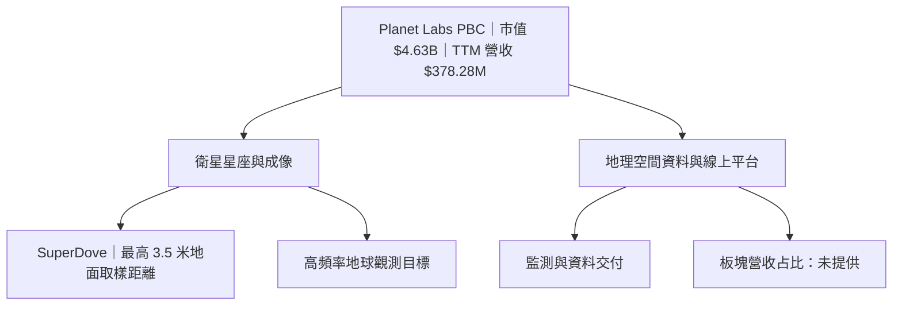
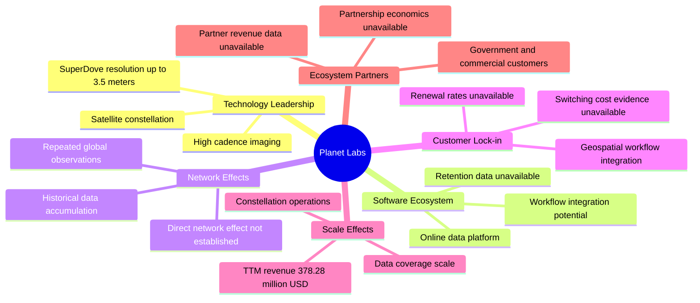
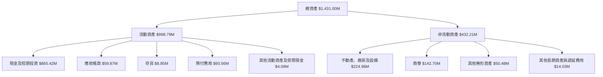
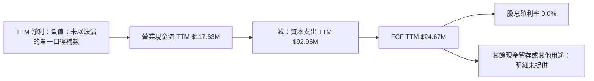
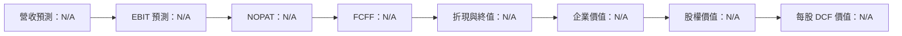
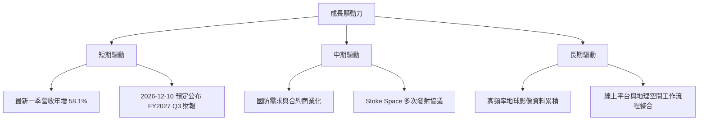
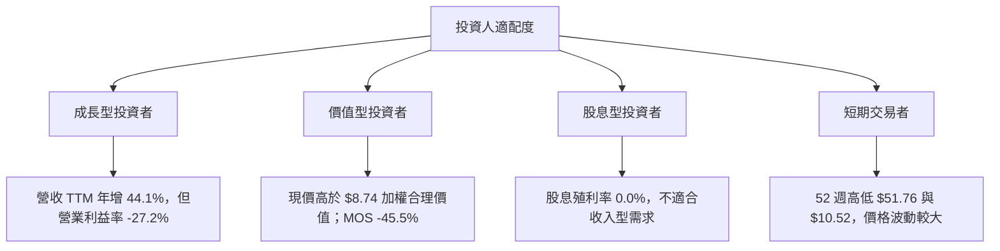

# PL 基本面深度分析報告
> **報告日期**：2026-11-17 ｜ **語言**：繁體中文 ｜ **數據來源**：SEC 申報資料 (XBRL)、Yahoo Finance、Finviz、StockAnalysis、Roic.ai ｜ **分析師**：CFA 級機構研究

## 目錄

| # | 章節 | 核心結論 |
|---|------|----------|
| 1 | 執行摘要 | 賣出；加權合理價值 $8.74，MOS -45.5% |
| 2 | 公司概覽與商業模式 | 高頻衛星影像與資料平台具差異化，但市場份額與客戶鎖定數據未提供 |
| 3 | 損益表深度分析 | TTM 營收 $378.28M、年增 44.1%；TTM 營業利益率 -27.2% |
| 4 | 資產負債表分析 | 現金及短期投資 $865.42M；總債務資料來源不一致，須核對 |
| 5 | 現金流量深度分析 | TTM FCF $24.67M；但正 FCF 與大額會計虧損並存 |
| 6 | 獲利能力與資本效率 | WACC 13.01%；ROIC 未提供，無法量化價值利差 |
| 7 | 相對估值分析 | P/S 高於自身五年中位數；同業 P/S 方法估值 $6.35 |
| 8 | DCF 內在價值評估 | DCF N/A：TTM 營業利益為負，不建立自有 DCF |
| 9 | 成長催化劑 | 影像資料、平台與國防需求有成長空間；TAM 數字未提供 |
| 10 | 風險矩陣 | 估值、虧損與資料／資本密集度為主要風險 |
| 11 | 投資建議 | 依 MOS 評級為賣出；後續重點是成長能否轉為持續獲利與現金流 |

---

## 1. 執行摘要

### 1.0 一頁式投資儀表板（Portfolio Manager 30 秒速讀）

| 項目 | 內容 |
|------|------|
| **投資論點（3 句）** | ① TTM 營收 $378.28M、年增 44.1%，最新一季年增 58.1%，需求與交付動能仍高。② TTM 營業利益率為 -27.2%，且 ROE 為 -63.8%，目前成長尚未轉化為穩定會計獲利。③ 同業 P/S 估值法為 $6.35，低於 2026-11-16 收盤價 $12.72；加權合理價值 $8.74，MOS 為 -45.5%。 |
| **綜合評分** | **5.2/10**（引用 1.1 評分卡；六項算術平均） |
| **財務健康** | 🟡 現金及短期投資 $865.42M、流動比率 2.843；但總債務資料存在來源差異，且 Piotroski F-Score 為 3/8。 |
| **ROIC vs WACC** | ROIC：N/A；WACC：13.01%。因 ROIC 未提供，無法量化利差；負營業利益代表尚無正向價值創造的證據。 |
| **FCF 趨勢** | TTM FCF $24.67M，FCF Yield **0.53%**（採用 SEC 申報資料口徑的程式計算值）；正 FCF 尚需與大額淨損及資本支出需求一併觀察。 |
| **估值** | Forward P/E -10,176.0x（因預期 EPS 接近零而無解讀性）；EV/EBITDA -88.041x；FCF Yield 0.53%。 |
| **DCF 內在價值（基準）** | **N/A**；DCF 模型未建立，原因為 TTM 營業利益為負。DCF 折溢價亦不適用。 |
| **安全邊際（MOS）** | **-45.5%**＝($8.74 − $12.72) ÷ $8.74；基準為 8.8 加權合理價值。🔴 |
| **預期報酬（基準情境 12M）** | N/A（DCF 情境未提供）；以加權合理價值對照現價的隱含上行空間為 **-31.3%**，不是 12 個月預測報酬。 |
| **關鍵風險（前二）** | 高估值在成長放緩時面臨倍數收縮；營業虧損與高資本支出使獲利轉正時間不確定。 |
| **評級 + 信心度** | 🔴 **賣出**｜信心：中低；MOS 直接來自程式計算的估值方法與權重，DCF 因營業虧損無法提供獨立驗證。 |

### 1.1 綜合評分卡（全報告唯一）

| 維度 | 評分（1–10） | 主要依據（引用數字與其來源章節） |
|------|--------------|----------------------------------|
| 成長性 | 8.0 | TTM 營收年增 44.1%、最新一季年增 58.1%；詳見第 3 章。 |
| 獲利能力 | 3.0 | TTM 營業利益率 -27.2%、ROE -63.8%、Piotroski 3/8；ROIC 未提供，詳見第 3、6 章。 |
| 財務健康 | 6.0 | 現金及短期投資 $865.42M、流動比率 2.843；但總債務來源有差異，詳見第 4 章。 |
| 估值 | 2.0 | MOS -45.5%；P/S 12.1x，高於五年中位數 6.9x，詳見第 7、8 章。 |
| 護城河 | 7.0 | 日常地球影像資料、衛星星座與線上平台形成差異化；缺少客戶留存、續約率及市場份額數據，詳見第 2 章。 |
| 管理層與資本配置 | 5.0 | FY2026 SBC $54.99M、最新 F-Score 中稀釋股數未通過；未提供足夠回購與投資回報資料，詳見第 3、5 章。 |
| **綜合評分** | **5.2** | 六項算術平均：(8.0 + 3.0 + 6.0 + 2.0 + 7.0 + 5.0) ÷ 6 = **5.2**。 |

### 1.2 五大投資論點 + 三大核心風險

| 類型 | 項目 | 具體依據 | 信心度 |
|------|------|----------|--------|
| 🟢 **投資論點①** | 高速營收成長 | TTM 營收 $378.28M、年增 44.1%；最新一季營收年增 58.1%。若不是短期合約集中，而是平台使用及資料需求擴大，成長可提高未來營業槓桿。 | 🟢 高 |
| 🟢 **投資論點②** | 可反覆交付的衛星影像資料 | 公司營運衛星星座並透過線上平台交付地理空間資料；日常成像能力有別於低頻率、單次任務型資料。 | 🟡 中 |
| 🟢 **投資論點③** | 資產流動性提供投資緩衝 | 現金及短期投資 $865.42M、流動比率 2.843；能支持衛星與平台投入，但不代表目前資本支出可長期維持。 | 🟡 中 |
| 🟢 **投資論點④** | 最新一季營業損失率改善 | 最新一季營業利益率為 -11.6%，高於（即虧損收窄於）TTM -27.2%；需連續季度確認是否為結構性改善。 | 🟡 中 |
| 🟢 **投資論點⑤** | 財報現金流已轉正 | TTM 營業現金流 $117.63M、資本支出 $92.96M，得 TTM FCF $24.67M；若能在擴充星座下維持正值，將降低外部融資依賴。 | 🟡 中 |
| 🟡 **風險①** | 成長與估值不匹配 | 股價 $12.72，高於同業 P/S 估值法 $6.35；加權合理價值 $8.74，MOS -45.5%。 | 🔴 高衝擊 |
| 🔴 **風險②** | 虧損與盈餘品質 | TTM 營業利益率 -27.2%、淨利率 -95.1%；FY2026 SBC 為 $54.99M，約佔年度營收 17.9%。 | 🔴 高 |
| 🟡 **風險③** | 財務數據存在口徑差異 | 一組 SEC／程式計算數字將總債務列為 N/A；另一組彙整數據列出總債務 $498.62M。估值及流動性判斷須以最新申報逐項核對。 | 🟡 中 |

### 1.3 快速統計卡片

| 指標 | 公司實際值（期間） | 同業中位數 | 狀態 |
|------|--------------------|------------|------|
| 營收成長（TTM） | **44.1%** | — | 🟢 |
| 營收成長（最新一季年增） | **58.1%** | 72.7%（SPIR、BKSY、RKLB 三家中位數） | 🟢 公司成長高於 SPIR、BKSY；低於 RKLB |
| 毛利率（TTM） | **55.5%** | 40.3%（SPIR、BKSY、RKLB 中位數） | 🟢 |
| 營業利益率（TTM） | **-27.2%** | — | 🔴 |
| Forward P/E | **-10,176.0x** | -19.4x、-82.7x、801.5x；中位數 -19.4x | 🔴 EPS 接近零，倍數失真 |
| FCF Yield（TTM） | **0.53%** | — | 🟡 |

### 1.4 投資結論

```text
╔══════════════════════════════════════════════════════════════════╗
║                    📊 投資結論摘要                               ║
╠══════════════════════════════════════════════════════════════════╣
║  評級：賣出（依 MOS 規則；未作質化調整）                         ║
║  價格（2026-11-16 收盤）：$12.72                                ║
║  DCF 內在價值（基準）：N/A（TTM 營業利益為負）                   ║
║  安全邊際 MOS：-45.5%＝($8.74−$12.72)÷$8.74                    ║
║  加權合理價值（8.8）：$8.74                                      ║
║  綜合評分：5.2/10（引用 1.1）                                    ║
║  適合投資人：能承受高波動、以長期營收成長為主的成長型投資人；   ║
║              不適合以現金回報或估值折價為核心的投資人。         ║
╚══════════════════════════════════════════════════════════════════╝
```

---

## 2. 公司概覽與商業模式

### 2.1 業務結構與收入來源

公司資料描述顯示，Planet Labs PBC 設計、建造並發射衛星星座，並透過線上平台提供高頻地理空間資料。財務數據未提供各業務板塊營收、軟體與服務拆分或客戶別收入，因此不拆分收入占比，也不以示意比例繪圖。



### 2.2 市場份額

市場份額數據未提供。公司 TTM 營收為 $378.28M、TTM 年增 44.1%，最新一季年增 58.1%；在提供的同業中，最新一季年增率低於 RKLB 的 72.7%，高於 SPIR 的 42.1%，但同業業務結構不完全相同，不能據此推定市場份額。

### 2.3 競爭護城河分析



### 2.4 護城河強度

| 護城河項目 | 強度（強／中／弱） | 證據（引用數字或事實） | 會削弱它的情況 |
|------------|--------------------|------------------------|----------------|
| 技術與資料累積 | 中 | 衛星星座目標為每日成像，SuperDove 最高地面取樣距離 3.5 米。 | 競爭者提升影像頻率、解析度或降低資料價格。 |
| 軟體平台 | 中 | 公司透過線上平台交付地理空間資料；沒有平台訂閱占比、留存率或淨收入留存率資料。 | 客戶可低成本多源採購，或資料工作流程難以形成黏著。 |
| 網路效應 | 弱至中 | 持續成像可累積時間序列資料，但未提供可證明使用者增加會提升其他使用者價值的數據。 | 資料增量未能轉化為更佳產品或更高續約率。 |
| 客戶鎖定 | 中 | 監測資料可能嵌入客戶工作流程；客戶流失率及轉換成本未提供。 | 替代資料來源增加、客戶可快速切換。 |
| 規模效應 | 中 | TTM 營收 $378.28M，最新一季營收年增 58.1%；衛星星座具固定成本特徵。 | 衛星折舊、維護與發射成本隨規模增加，未形成單位成本下降。 |
| 生態夥伴 | 弱至中 | 資料提及多發射協議新聞，但未提供合作收入、成本或商業化貢獻。 | 合作未轉化為可靠發射能力或新增收入。 |

護城河評分理由：第 1.1 節評為 **7.0/10**，主要依據是衛星星座與資料累積形成的產品差異化；客戶留存、資料平台收入占比及市場份額均缺乏可量化佐證，因此不評為更高。

---

## 3. 損益表深度分析

### 3.1 年度收入成長趨勢（近 4 年）

年度營收取自公司年度損益表，FY2023 至 FY2026 的三年 CAGR 約為 **17.2%**，計算為 \((307.73 ÷ 191.26)^{1/3} - 1\)。FY2026 成長加快至 25.9%；相較之下，TTM 年增率達 44.1%，顯示近期成長明顯高於歷史年度趨勢。

```text
╔══════════════════════════════════════════════════════════════════╗
║           Planet Labs 年度收入趨勢（FY2023-FY2026）              ║
╠══════════════════════════════════════════════════════════════════╣
║ FY2023  $191.26M  ███████████████████░░░░░░░░░░  基期            ║
║ FY2024  $220.70M  ██████████████████████░░░░░░░  YoY: +15.4%     ║
║ FY2025  $244.35M  ████████████████████████░░░░░  YoY: +10.7%     ║
║ FY2026  $307.73M  ██████████████████████████████  YoY: +25.9%    ║
╠══════════════════════════════════════════════════════════════════╣
║ FY2023-FY2026 三年營收 CAGR：約 +17.2%                            ║
║ TTM 營收 $378.28M；TTM 年增率 44.1%                              ║
╚══════════════════════════════════════════════════════════════════╝
```

### 3.2 季度收入趨勢分析

| 季度 | 營收 | QoQ | YoY | 備註 |
|------|------:|----:|----:|------|
| FY2026 Q3（2025-10-31） | $81.25M | +10.7% | +32.6% | QoQ 以 FY2026 Q2 $73.39M 計算；YoY 取 StockAnalysis 季度序列。 |
| FY2026 Q4（2026-01-31） | $86.82M | +6.9% | +41.1% | QoQ 以 $81.25M 計算；季節性及合約交付時點可能影響季度變化。 |
| FY2027 Q1（2026-04-30） | $94.15M | +8.4% | +42.1% | QoQ 以 $86.82M 計算。 |
| FY2027 Q2（2026-07-31） | $116.05M | +23.3% | **+58.1%** | 最新一季年增率依程式計算值；QoQ 以 $94.15M 計算。 |

最新一季 QoQ 23.3%、YoY 58.1%，代表交付與收入認列加速；但單季加速是否可持續，仍須觀察後續季度的合約節奏、客戶需求及毛利率，而不能單靠一季年增率外推全年。

### 3.3 利潤率演變分析

年度毛利率與營業利益率依年度損益表的營收、毛利及營業利益計算；TTM 及最新一季營業利益率則採程式計算的標準口徑。

| 利潤率指標 | FY2023 | FY2024 | FY2025 | FY2026 | 趨勢 | 評估 |
|------------|-------:|-------:|-------:|-------:|------|------|
| **毛利率** | 49.2% | 51.2% | 57.2% | 56.0% | FY2025 擴張、FY2026 小幅回落 | 🟢 |
| **營業利益率** | -91.9% | -75.8% | -45.5% | -30.9% | 虧損率逐年收窄；FY2026 仍為大幅負值 | 🔴 |
| **淨利率** | -84.7% | -63.7% | -50.4% | -80.2% | FY2026 淨損顯著加深；淨利受營業外項目影響 | 🔴 |

TTM 營業利益率為 **-27.2%**；最新一季為 **-11.6%**。營業虧損率改善方向與營收成長相符，可能反映收入增加後的固定成本攤薄；但可用資料不足以拆解雲端、研發、衛星折舊及一次性費用各自的影響，因此不能把單季改善直接視為已達到成熟盈利模式。FY2026 毛利率由 FY2025 的 57.2% 降至 56.0%，顯示毛利改善並非單向。

### 3.4 費用結構分析

完整費用項目拆分（例如銷售、一般及行政費用、衛星折舊與其他營業費用）未提供，且年度資料不足以建立不重複的費用組成圓餅圖。可確認 FY2026 研發費用為 **$106.75M**，約為當年營收 $307.73M 的 **34.7%**；這反映公司仍投入大量研發，但其對未來收入與毛利的回報尚待驗證。

### 3.5 季度 EPS 趨勢與盈餘品質（Quality of Earnings）

| 季度 | EPS 預估 | EPS 實際／可用資料 | 超預期／不及預期 |
|------|---------|-------------------|------------------|
| 2026-07-31 | N/A | EPS 估值 N/A；淨利 -$9.35M | 無法判定 |
| 2026-04-30 | N/A | EPS 估值 N/A；淨利 -$138.87M | 無法判定 |
| 2026-01-31 | N/A | EPS 估值 N/A；淨利 -$152.46M | 無法判定 |
| 2025-10-31 | N/A | EPS 估值 N/A；淨利 -$59.19M | 無法判定 |

EPS 驚喜資料中的預估值與實際值均為缺漏，不能將資料列上的「未超預期」符號解讀為實際 miss；目前只能判定 **四季 EPS beat/miss 無法驗證**。季度淨利數據顯示虧損波動大，尤其 2026-04-30 與 2026-01-31 季度淨損較大，單季營收成長並未直接轉化為穩定淨利。

| 盈餘品質項目 | 數值／佔比 | 評估 |
|--------------|-----------|------|
| 股權薪酬 SBC / 營收 | FY2026 $54.99M ÷ $307.73M = **17.9%** | 🔴 SBC 相對營收占比高；即使不直接流出現金，也會稀釋股東持股比例及每股經濟價值。 |
| SBC / 營業現金流 | FY2026 $54.99M ÷ $134.36M = **40.9%** | 🟡 SBC 規模相當於年度營業現金流約四成；不能將現金流強度完全視為對現有股東的現金回報。 |
| FCF / 淨利（現金轉換率） | TTM FCF $24.67M；TTM 淨利為負，比例無法作正向轉換解讀 | 🔴 正 FCF 與大額會計淨損並存；以負淨利作分母時，單一比率不具一般現金轉換率意義。 |
| 一次性／非經常性損益 | N/A（未提供完整調整項目） | 無法判斷季度淨損波動中有多少屬於一次性項目。 |
| 有效稅率異常 | N/A（未提供可核對的有效稅率） | 無法判定稅務利益是否對當期淨利造成重大影響。 |
| 資本化支出 vs 費用化 | TTM 資本支出 $92.96M；資本化與費用化明細 N/A | 資本支出反映衛星及基礎設施投入；未提供足夠明細評估是否有成本資本化改變盈餘的情形。 |

**盈餘品質結論**：目前 GAAP 淨利為大額負值，而 TTM FCF 為正；兩者差異可能來自非現金費用及營運資金等因素，但未提供完整調節表，不能把正 FCF 直接等同已實現的股東盈餘。SBC 占比偏高，也降低每股經濟報酬的含金量。

---

## 4. 資產負債表分析

### 4.1 資產結構分解

以下採 StockAnalysis 顯示的 2026-07-31 資產表；總資產 $1,431M、流動資產 $998.79M。非流動資產總額以總資產減流動資產表示。



### 4.2 流動性與營運資金分析

| 指標 | 最新 TTM／期末 | 一年前 | 變化 | 解讀 |
|------|---------------:|-------:|------:|------|
| 流動比率 | 2.843 | N/A | N/A | 短期資產高於短期負債；仍須注意現金等資產是否因星座投資而快速消耗。 |
| 速動比率 | 2.634 | N/A | N/A | 排除存貨後短期流動性仍充足。 |
| DSO 應收帳款天數 | 58 天 | 72 天 | -14 天 | 收款天數下降，通常有利於營運資金；其成因是否來自客戶組合或收款條件，資料未提供。 |
| DIO 存貨天數 | 19 天 | N/A | N/A | 一年前無可用存貨餘額，不能判斷趨勢。 |
| DPO 應付帳款天數 | 22 天 | 37 天 | -15 天 | 付款天數下降，可能反映付款時點或供應商條件變化；不能單憑該數字判斷議價力。 |
| CCC 現金轉換週期 | 55 天 | N/A | N/A | 一年前 CCC 為 N/A，因存貨資料未提供，不作反推。 |

DSO、DIO、DPO 與 CCC 依品質指標的程式計算值照列，未自行重算或填補 N/A。現金及短期投資為 $865.42M；此處不將它與不同來源的債務數據混合推算淨現金。

### 4.3 債務結構分析

```text
╔══════════════════════════════════════════════════════════════════╗
║                   Planet Labs 債務健康診斷                       ║
╠══════════════════════════════════════════════════════════════════╣
║  現金及短期投資： $865.42M  資料庫與 SEC 口徑                    ║
║  總債務：         N/A       程式計算主要數據列未提供              ║
║  淨現金：         $865.42M  依 VERIFIED FIGURES 原值引用          ║
║                                                                  ║
║  交叉來源差異：彙整市場數據另列總債務 $498.62M、淨現金 $366.79M  ║
║  評估：兩種口徑不一致；本報告不自行合併或反推，需核對最新 10-Q。║
║                                                                  ║
║  流動比率：2.843  🟢                                             ║
║  Debt/EBITDA：N/A（TTM EBITDA 為負，倍數不具一般解讀性）         ║
║  利息保障倍數：N/A（利息費用與可比期間資料未完整提供）           ║
╚══════════════════════════════════════════════════════════════════╝
```

債務資料差異是資產負債表分析的重要限制。SEC 申報資料應作最終核對基礎；在核實債務分類、融資租賃及到期結構前，不宜以單一淨現金數據推論公司沒有償債風險。

### 4.4 股東權益趨勢

```text
╔══════════════════════════════════════════════════════════════════╗
║                 Planet Labs 歷年股東權益變化                     ║
╠══════════════════════════════════════════════════════════════════╣
║ FY2023  $576.10M  ██████████████████████████████                 ║
║ FY2024  $518.02M  ███████████████████████████                    ║
║ FY2025  $441.29M  ███████████████████████                        ║
║ FY2026  $188.43M  ██████████                                     ║
╠══════════════════════════════════════════════════════════════════╣
║ FY2023-FY2026 股東權益明顯下降；FY2026 資產負債表總負債升至     ║
║ $957.25M，應追蹤融資結構、虧損與股權稀釋對權益的共同影響。     ║
╚══════════════════════════════════════════════════════════════════╝
```

---

## 5. 現金流量深度分析

### 5.1 現金流量瀑布圖



自由現金流採用 **營業現金流 − 資本支出** 的指定口徑：$117.63M − $92.96M = $24.67M。其他彙整財務數據列出的資本支出與 FCF 數值不同，本報告對 TTM FCF 一律採程式計算值。

### 5.2 FCF 轉換率趨勢

| 財年 | FCF | 淨利 | FCF／淨利 | 解讀 |
|------|----:|----:|---------:|------|
| FY2023 | -$86.69M | -$161.97M | 53.5% | 兩者皆為負；比例不表示獲利品質良好。 |
| FY2024 | -$93.12M | -$140.51M | 66.3% | FCF 仍負，營運與投資現金需求高。 |
| FY2025 | -$68.78M | -$123.20M | 55.8% | FCF 虧損收窄，但仍未轉正。 |
| FY2026 | $51.41M | -$246.86M | -20.8% | FCF 轉正而淨損加深，反映應以現金流調節表理解兩者差異。 |

### 5.3 自由現金流趨勢

| 期間 | FCF | 觀察 |
|------|----:|------|
| FY2023 | -$86.69M | 年度 FCF 為負。 |
| FY2024 | -$93.12M | FCF 負值擴大。 |
| FY2025 | -$68.78M | 虧損收窄。 |
| FY2026 | $51.41M | 年度 FCF 轉正。 |
| TTM 至 2026-07-31 | **$24.67M** | 按指定營業現金流減資本支出口徑；FCF Yield 0.53%。 |

```text
╔══════════════════════════════════════════════════════════════════╗
║                 自由現金流歷史趨勢（美元）                       ║
╠══════════════════════════════════════════════════════════════════╣
║ FY2023  -$86.69M  ◀████████████████████                         ║
║ FY2024  -$93.12M  ◀█████████████████████                        ║
║ FY2025  -$68.78M  ◀████████████████                             ║
║ FY2026  +$51.41M  ███████████                                    ║
║ TTM     +$24.67M  █████                                          ║
╠══════════════════════════════════════════════════════════════════╣
║ TTM FCF Yield：0.53%（以程式計算值為準）                         ║
╚══════════════════════════════════════════════════════════════════╝
```

### 5.4 資本配置評估

資料未提供可完整對照的回購、股息、收購、衛星投資及留存現金明細，因此不畫資本配置比例圓餅圖。FY2026 資本支出為 $82.95M、SBC 為 $54.99M；股息殖利率為 0.0%。公司資本配置的重點是持續投資星座與產品能力，評估成敗的關鍵在於投入後是否形成可持續的收入成長、毛利及正 FCF，而非只看當期資本支出。

---

## 6. 獲利能力與資本效率

### 6.1 ROE／ROA／ROIC 趨勢

| 指標 | 可用數據 | 評估 |
|------|----------|------|
| ROE（TTM） | **-63.8%**（QUALITY FIGURES） | 負值反映目前淨損；槓桿及負權益變化會使 ROE 解讀更複雜。 |
| ROA（TTM） | -5.0%（彙整財務數據） | 資產尚未形成正向淨利回報。 |
| ROIC（TTM） | N/A（數據未提供） | 無法計算或推估 ROIC，亦無法直接比較其與 WACC 的利差。 |
| 行業均值 | N/A（沒有可核實的同口徑數據） | 不列入比較。 |

來源數字的 ROE 存在口徑差異：QUALITY FIGURES 為 -63.8%，另一彙整欄位為 -72.0%。本節引用指定品質指標的 -63.8%，不混用不同口徑。

### 6.2 ROIC vs WACC 分析（核心價值創造判斷）

```text
╔══════════════════════════════════════════════════════════════════╗
║                ROIC vs WACC 深度分析                            ║
╠══════════════════════════════════════════════════════════════════╣
║  WACC（程式計算採用值）：13.01%                                  ║
║  ├── 無風險利率（10Y 美債）：       5.12%                       ║
║  ├── ERP：                          5.00%                       ║
║  ├── Beta 原始值：                  2.27                        ║
║  ├── Beta 採用值（調整後）：        1.85                        ║
║  ├── 股權成本 Ke：                  14.35%                      ║
║  ├── 稅前債務成本：                 0.69%                       ║
║  ├── 股權／債務權重：               90.3%／9.7%                 ║
║  └── WACC：                         13.01%                      ║
║                                                                  ║
║  ROIC：N/A（數據未提供）                                         ║
║  EVA／ROIC−WACC：N/A，無法量化。                                 ║
║  TTM 營業利益率：-27.2%；營業利益仍為負值。                     ║
║                                                                  ║
║  結論：目前沒有正向 ROIC 高於 WACC 的證據；營業虧損顯示公司尚未 ║
║  證明其投入資本能創造超過資本成本的回報。                       ║
╚══════════════════════════════════════════════════════════════════╝
```

WACC 及其各組成採程式計算原值；本報告不另行估算替代 WACC。由於 ROIC 未提供，不能虛構數字或計算 EVA；但負營業利益率與大額淨損意味現階段尚未展現持續的正向經濟利潤。

### 6.3 杜邦三因素分解

| 因素 | 數值（TTM） | 解讀 |
|------|-------------|------|
| 淨利率 | -95.1% | 大額淨損是 ROE 為負的主要驅動因素。 |
| 資產週轉率 | 0.26 | 每單位資產所產生的營收有限；衛星及基礎設施投資具資本密集特徵。 |
| 權益乘數 | 2.54 | 存在財務槓桿，但無法抵銷負淨利率。 |
| **ROE** | **-63.8%** | QUALITY FIGURES 原值：淨利率 -95.1% × 資產週轉率 0.26 × 權益乘數 2.54 = ROE -63.8%。 |

依指定品質指標照列；各因子呈現精度有限，不能以顯示後的四捨五入值取代原始計算結果。ROE 為負主要由淨利率驅動，不是由槓桿創造正向股東報酬。

### 6.4 財務體質：Piotroski F-Score

**Piotroski F-Score：3/8**。一項因資料缺漏無法判定，故分母為 8；以下九項測試照列原始狀態。

| 測試 | 結果 | 解讀 |
|------|------|------|
| ROA > 0 | ❌ 未通過 | 淨資產回報尚未轉正。 |
| 營業現金流 > 0 | ✅ 通過 | TTM 營業現金流為正。 |
| ROA 高於一年前 | ❌ 未通過 | 相對一年前未改善。 |
| 營業現金流 > 淨利（應計品質） | ✅ 通過 | 現金流測試通過，但公司淨利為負，仍須看完整現金流調節。 |
| 長期負債／總資產低於一年前 | — 無法判定 | 缺少計算所需資料。 |
| 流動比率高於一年前 | ✅ 通過 | 流動性相對改善。 |
| 稀釋股數未增加 | ❌ 未通過 | 股數稀釋會攤薄現有股東權益。 |
| 毛利率高於一年前 | ❌ 未通過 | 毛利率年比未改善。 |
| 資產週轉率高於一年前 | ❌ 未通過 | 資產使用效率未改善。 |

3/8 顯示公司在流動性與營業現金流方面有正向訊號，但獲利、毛利率、資產效率及股數稀釋等項目未通過，財務體質尚未全面改善。

---

## 7. 相對估值分析

### 7.1 同業估值比較

倍數採 Yahoo Finance 的 Peer multiples；Planet Labs 公司倍數採提供的市場估值數據。負獲利公司的 P/E 與 EV/EBITDA 對營運估值解讀有限。

| 估值指標 | **PL** | **SPIR** | **BKSY** | **RKLB** | PL 評估 |
|----------|-------:|--------:|--------:|--------:|-----------|
| **Trailing P/E** | N/A | N/A | N/A | N/A | 🔴 多數公司虧損，不能用 P/E 作主估值。 |
| **Forward P/E** | -10,176.0x | -19.4x | -82.7x | 801.5x | 🔴 PL 預期 EPS 極接近零，倍數高度失真。 |
| **P/S Ratio** | 12.1x¹ | 5.0x | 7.2x | 43.8x | 🟡 PL 高於 SPIR、BKSY，低於 RKLB；成長與利潤轉化須支持溢價。 |
| **EV/EBITDA** | -88.041x | -4.0x | 853.0x | -184.8x | 🔴 同業數值受負 EBITDA 或極低 EBITDA 扭曲。 |
| **最新一季營收 YoY** | 58.1% | 42.1% | 118.4% | 72.7% | 🟡 PL 高於 SPIR，低於 BKSY、RKLB。 |
| **毛利率（TTM）** | 55.5% | 40.3% | 73.4% | 36.2% | 🟢 PL 高於 SPIR、RKLB，低於 BKSY。 |

¹ 自身歷史估值區間採用的 P/S 原值為 12.1x；市場彙整欄位另列 12.234776x，依規則使用程式計算的自身歷史區間數值。Peer P/S 中位數為 SPIR 與 BKSY 的 **6.1x**，作為指定同業 P/S 估值方法基礎。

### 7.2 歷史估值區間分析

```text
╔══════════════════════════════════════════════════════════════════╗
║                PL 五年歷史 P/S 估值位置                         ║
╠══════════════════════════════════════════════════════════════════╣
║ 五年區間下緣  2.1x  ├──●──────────────────────────────┤ 38.1x ║
║ 五年中位數    6.9x  ├──────●──────────────────────────┤       ║
║ 目前 P/S     12.1x  ├──────────●──────────────────────┤       ║
║                      目前位於歷史百分位第 79 百分位              ║
╠══════════════════════════════════════════════════════════════════╣
║ 目前 P/S 高於五年中位數約 75%，在歷史區間偏高位置。              ║
║ 營收高成長提供估值支撐，但仍需觀察營業虧損是否持續收窄。         ║
╚══════════════════════════════════════════════════════════════════╝
```

### 7.3 情境價值（Bear / Base / Bull）

**N/A（DCF 無法計算：TTM 營業利益為負；程式未提供 DCF MODEL 與 Scenarios）。**依規則不自行建立情境目標價或假設退出倍數。

### 7.4 相對估值隱含價格區間

```text
╔══════════════════════════════════════════════════════════════════╗
║                相對估值方法隱含每股價值                          ║
╠══════════════════════════════════════════════════════════════════╣
║ 同業 P/S 方法：$6.35  ──────────┐                               ║
║                                  ├── 加權合理價值 $8.74          ║
║ 分析師共識目標：$30.27 ─────────┘                               ║
║ 當前股價：$12.72；高於加權合理價值，低於分析師平均目標價。      ║
╠══════════════════════════════════════════════════════════════════╣
║ 同業 P/S：SPIR、BKSY 中位數 6.1x × TTM 營收與股數換算方法       ║
║ 分析師共識：11 位分析師平均目標價 $30.27                         ║
╚══════════════════════════════════════════════════════════════════╝
```

---

## 8. DCF 內在價值評估（Discounted Cash Flow）

### 8.0 估值推理鏈（Thinking Logic）

**Step 1 — 價值由哪些變數決定？**  
Planet Labs 的估值長期取決於地理空間資料收入能否持續擴大、營業利潤率能否由 TTM -27.2% 轉正，以及高資本支出下能否維持自由現金流。各業務收入占比未提供，無法拆分主業與新業務的收入權重；在當前虧損狀態，利潤率轉正與持續性是估值最關鍵、也最難驗證的變數。

**Step 2 — 模型選擇**

| 決策點 | 本報告採用 | 理由（含數字） | 曾考慮但否決 | 否決理由 |
|--------|-----------|----------------|--------------|----------|
| 現金流定義 | N/A | 程式提供的 DCF MODEL 為 N/A；TTM 營業利益為負。 | 自行建立 FCFF／FCFE | 嚴格採用程式模型；不可自建 DCF。 |
| 預測期 N | N/A | 模型未提供預測期長度。 | 任意設定多年期 | 缺少模型假設來源，會形成不可稽核估值。 |
| 終值方法 | N/A | 未提供終值計算。 | Gordon Growth／退出倍數 | 不可自行輸入未提供假設。 |
| EBIT 基礎 | N/A | 未提供模型及逐年預測。 | GAAP／非 GAAP 假設 | 不虛構利潤率、SBC 或股數假設。 |

**Step 3 — 關鍵假設推導鏈**  
營收 CAGR、期末營業利潤率、永續成長率、預測期、Capex、折舊、營運資金、SBC 處理及稀釋股數等模型輸入均未提供；因此沒有可合法建立的「錨點 → 調整 → 採用值 → 否決值」數字推導鏈。強行填值會違反模型數字照抄原則。

**Step 4 — 最脆弱環節**  
TTM 營業利益為負，使正向成熟現金流的時間與規模缺乏可驗證起點；任何自行設定利潤率轉正路徑都可能主導估值，因此不產出 DCF 價值。

**Step 5 — 計算路徑圖**



### 8.1 模型假設總表（Model Inputs）

**N/A（DCF MODEL 未提供；原因為 TTM 營業利益不為正）。**依要求不自建模型，故不填入未有來源的預測期、營收 CAGR、營業利潤率、稅率、Capex、D&A、營運資金、SBC、稀釋率、終值成長率及其他模型假設。

**SBC 防呆說明**：本報告沒有執行 DCF，未採用組合 (A)、(B) 或 (C)，也未計算模型股數；因此不對 SBC 作模型內重複扣除或稀釋處理。

### 8.2 折現率推導（WACC）

以下引用程式計算的資本成本數據，不另建替代 WACC。原始 Beta 與調整 Beta 均列示；調整 Beta 為 \(⅔ × 2.27 + ⅓\)，程式採用值為 1.85。

```text
╔══════════════════════════════════════════════════════════════════╗
║                    WACC 推導（折現率）                           ║
╠══════════════════════════════════════════════════════════════════╣
║ 股權成本 Ke：14.35%（程式計算值）                               ║
║ ├── 無風險利率（10Y 美債）：5.12%                               ║
║ ├── ERP：5.00%                                                   ║
║ ├── Beta 原始值：2.27；調整後採用值：1.85                       ║
║ ├── 規模／國別溢酬：未另加計                                     ║
║ └── Ke 依 CAPM 組成由程式計算；採用原值 14.35%                  ║
║                                                                  ║
║ 債務成本：                                                       ║
║ ├── 稅前 Kd：0.69%                                               ║
║ ├── 預設稅率：21.0%                                              ║
║ └── 稅後 Kd：0.69% × (1 − 21.0%) = 0.5451%                      ║
║                                                                  ║
║ 資本權重：E 90.3%／D 9.7%                                        ║
║ WACC：90.3% × 14.35% + 9.7% × 0.5451% = 13.01%（程式採用值）   ║
╚══════════════════════════════════════════════════════════════════╝
```

Rf 日期未提供；ERP 為假設輸入；Beta 來源為 Yahoo Finance。債務成本的利息費用、平均計息負債明細及市值基礎的 E、D 金額未提供，因此不能完整重建 WACC 的每一步底層美元金額。依規則直接使用程式給定的 **WACC 13.01%**，第 6.2 節亦採相同數值。

### 8.3 逐年自由現金流預測（基準情境）

**N/A（DCF MODEL 未提供：TTM 營業利益為負）。**不提供 FY+1 至 FY+N 的逐年營收、利潤率、FCFF、折現因子或計算示例，避免建立未經程式計算的自有模型。亦不以歷史年度 FCF 外推預測 CAGR。

### 8.4 終值計算（Terminal Value）

**N/A（無 DCF 預測期現金流、永續成長率或退出倍數輸入）。**無法檢查 WACC 與 g 的關係，亦不計算 Gordon Growth 或退出倍數終值。

### 8.5 企業價值 → 每股內在價值（Bridge）

**N/A（DCF 企業價值及股權價值未計算）。**不以現金、債務與流通股數自行拼接 DCF 每股價值。折溢價只適用於可得的 DCF 基準內在價值，本報告因 DCF 為 N/A 而不計算。

### 8.6 敏感性分析（WACC × 永續成長率）

**N/A（未提供 DCF 敏感性矩陣）。**不自行設定 5×5 矩陣、情境估值、機率或敏感度彈性。DCF 無法計算，也不提供三情境 DCF 目標價。

### 8.7 反推 DCF（Reverse DCF：市場在預期什麼）

**N/A（沒有可用的基準 DCF 模型與輸入）。**現價 $12.72 無法在缺少營收、利潤率、終值及股數假設時反解單一市場隱含變數；不自行建造反推模型或提供試算軌跡。

### 8.8 估值三角驗證與安全邊際

| 估值方法 | 隱含每股價值 | 上行空間（÷現價） | 權重 | 說明 |
|----------|--------------:|------------------:|------:|------|
| 同業 P/S | $6.35 | -50.1% | 90% | SPIR、BKSY 的同業中位數 P/S 6.1x，配合公司 TTM 營收計算。 |
| 分析師共識目標價 | $30.27 | +138.0% | 10% | 11 位分析師目標價平均；屬參考，不代表可實現價值。 |
| **加權合理價值** | **$8.74** | **-31.3%** | **100%** | 未能計算的同業 Forward P/E 不納入；依「未獲利公司」固定權重。 |

加權計算：

\[
\$6.35 \times 90\% + \$30.27 \times 10\%
= \$5.715 + \$3.027
= \$8.742
\approx \$8.74
\]

權重合計：90% + 10% = 100%。加權合理價值採程式提供原值 **$8.74**；不再事後調整。

| 指標 | 計算 | 結果 |
|------|------|------:|
| **MOS** | \((\$8.74 - \$12.72) ÷ \$8.74\) | **-45.5%** |
| **上行空間** | \((\$8.74 - \$12.72) ÷ \$12.72\) | **-31.3%** |

```text
╔══════════════════════════════════════════════════════════════════╗
║                  估值區間與安全邊際                              ║
╠══════════════════════════════════════════════════════════════════╣
║ 同業 P/S $6.35 ── 加權合理值 $8.74 ── 現價 $12.72 ── 共識 $30.27║
║                                                                  ║
║ 安全邊際 MOS = ($8.74 − $12.72) ÷ $8.74 = -45.5%                ║
║ 上行空間     = ($8.74 − $12.72) ÷ $12.72 = -31.3%               ║
║ 評估：🔴 MOS 為負且現價高於加權合理價值。                       ║
║                                                                  ║
║ MOS 達 10% 的價格上限：$8.74 × (1 − 10%) = $7.87                ║
║ MOS 達 25% 的價格上限：$8.74 × (1 − 25%) = $6.56                ║
║ 以上為依 MOS 算式推導的觀察門檻，不構成 DCF 或個股目標價。       ║
╚══════════════════════════════════════════════════════════════════╝
```

> 🔎 **程式複算（Python，依本節各項自動重算）**
>
> 加權合理價值 = $6.35 × 90% + $30.27 × 10% = **$8.74**（權重合計 100%）
>
> 以價格 $12.72 計：MOS = **-45.5%**，上行空間 = **-31.3%**
>
> ✅ 與本節所寫數值一致。

### 8.9 DCF 模型的局限與失效條件

- **終值依賴度**：N/A；沒有可用 DCF 終值與企業價值，不能計算占比。
- **最脆弱的假設**：模型未提供營業利益轉正時間與成熟利潤率；若成長未帶來利潤改善，營收倍數估值亦可能收縮。
- **不適用情境說明**：TTM 營業利益為負，傳統正向 FCFF DCF 不適用。現階段應以同業 EV/Sales 或 P/S、毛利及營業費用趨勢、單位經濟性和現金消耗來交叉檢驗。
- **與第 10 章風險矩陣的連結**：國防或商業需求放緩會影響營收成長；發射、衛星或資料基礎設施成本增加會影響毛利、Capex 與 FCF；高估值則使市場倍數對成長落差更敏感。

### 8.10 複算檢核表（Audit Trail）

| # | 檢核項目 | 檢查方式 | 結果 |
|---|----------|----------|------|
| 1 | 所有高／中敏感度輸入都有完整四段式推導 | DCF MODEL 為 N/A，沒有模型輸入 | N/A |
| 2 | 每個模型假設都有來歷 | 未填入模型假設 | N/A |
| 3 | WACC 五步算式齊全且重算正確 | 採用程式 WACC 13.01%；底層金額未完整提供 | N/A（採用原值） |
| 4 | Kd 分母與債務權重範圍一致 | 計息負債明細未提供，且總債務來源有差異 | N/A |
| 5 | WACC 與第 6.2 節同值 | 兩節均採 13.01% | ✅ |
| 6 | 逐年預測年度數等於 N | DCF 預測表未建立 | N/A |
| 7 | 代表年度 FCFF 與 PV 可複算 | 無逐年模型 | N/A |
| 8 | 預測期 PV 逐項加總 | 無預測期 PV | N/A |
| 9 | WACC > g | g 未提供 | N/A |
| 10 | 終值以 FY+N 現金流為基礎 | 無終值模型 | N/A |
| 11 | EV 至每股價值橋接可複算 | DCF EV 未計算 | N/A |
| 12 | SBC 組合與股數稀釋相容 | 無 DCF，未採 A／B／C | N/A |
| 13 | 敏感性矩陣基準格等於 DCF 每股價值 | 無矩陣 | N/A |
| 14 | 敏感性矩陣只含 WACC > g 有效格 | 無矩陣 | N/A |
| 15 | 三情境機率合計 100% | DCF Scenarios 未提供 | N/A |
| 16 | 反推 DCF 每列只放開一個變數 | 未建立 Reverse DCF | N/A |
| 17 | MOS 採 8.8 加權合理價值；DCF 折溢價採 8.5 基準 | MOS -45.5%；DCF 價值 N/A | ✅（DCF 折溢價不適用） |
| 18 | 報告完整至第 11 章 | 已完整列示 11 章 | ✅ |
| 19 | 加權合理價值等於方法價值乘權重之和 | $6.35×90% + $30.27×10% = $8.742，四捨五入 $8.74 | ✅ |
| 20 | 評級符合 MOS 規則 | MOS -45.5% < -25%，評級賣出 | ✅ |

---

## 9. 成長催化劑

### 9.1 催化劑時間軸

未提供可驗證各催化劑落地日期及財務影響的資料；近期公司新聞提及多發射協議與國防交易，但沒有足夠資料量化其營收貢獻。因此不以估計日期製作 Mermaid gantt 圖。

| 時間範圍 | 可觀察催化劑 | 追蹤方式 |
|----------|--------------|----------|
| 短期 | FY2027 Q3 財報預定 2026-12-10 公布 | 觀察營收年增、毛利率、營業虧損率及資本支出。 |
| 中期 | 與 Stoke Space 的多次發射協議、國防合約相關新聞 | 追蹤是否轉為可確認合約、收入與發射排程。 |
| 長期 | 高頻衛星影像與線上地理空間平台擴張 | 追蹤平台收入、客戶續約、毛利及每單位衛星投資回報；相關指標未提供。 |

### 9.2 TAM 市場規模分析

**N/A（TAM 數據未提供）。**公司 TTM 營收為 $378.28M，TTM 年增 44.1%；最新一季年增 58.1%，顯示營運規模仍在擴張。惟沒有可引用的市場總額、年份與滲透率數字，不估算 TAM 或市場份額。

### 9.3 成長驅動力結構圖



---

## 10. 風險矩陣

### 10.1 風險評分矩陣

未提供可量化的事件機率與財務衝擊數據。為避免以未經驗證的估計數字繪製象限圖，本節改以風險清單呈現，不製作含主觀座標的 quadrantChart。

### 10.2 風險清單詳細分析

| # | 風險項目 | 發生機率 | 財務衝擊 | 風險評估 | 緩解措施 |
|---|----------|----------|----------|----------|----------|
| 1 | 🔴 **估值倍數收縮** | 無法量化；目前 P/S 12.1x，五年中位數 6.9x | 若成長低於預期，估值可能向自身歷史中位數或同業倍數靠攏 | 🔴 高 | 以分批建倉與估值門檻控制風險；每季核對營收成長與毛利。 |
| 2 | 🔴 **持續營業虧損** | 已發生；TTM 營業利益率 -27.2% | 可能延後自我融資與獲利轉正 | 🔴 高 | 追蹤營業費用增速、最新季營業利益率及管理層財測。 |
| 3 | 🔴 **資本支出與衛星投資回報不確定** | TTM Capex $92.96M | 發射、衛星建置或維護成本上升可能壓低 FCF | 🔴 高 | 核對 Capex 對應的新增容量、營收及毛利貢獻。 |
| 4 | 🟡 **股權稀釋** | F-Score 中「稀釋股數未增加」未通過；FY2026 SBC $54.99M | 每股價值可能低於公司總營收成長所暗示的增幅 | 🟡 中高 | 追蹤稀釋股數、SBC／營收及員工股權獎酬變化。 |
| 5 | 🟡 **競爭及替代資料來源** | 競爭者成長率差異大；PL 最新季 58.1%，BKSY 118.4% | 競爭可能壓低價格、毛利或客戶續約 | 🟡 中高 | 追蹤客戶留存、合約續約、毛利率及新增資料產品採用。 |
| 6 | 🟡 **債務口徑與資本結構不確定** | 財務資料一處列總債務 N/A，另一處列 $498.62M | 可能影響淨現金、利息負擔及融資彈性評估 | 🟡 中 | 核對最新 10-Q 中債務、租賃、到期日與利息費用明細。 |

---

## 11. 投資建議

### 11.1 最終評級與評分

依 8.8 加權合理價值 $8.74 與 2026-11-16 收盤價 $12.72 計算，MOS 為 -45.5%，低於 -25% 門檻，故評級為 **賣出**，未作質化調整。公司品質綜合評分為 **5.2/10**，由第 1.1 節成長性 8.0、獲利能力 3.0、財務健康 6.0、估值 2.0、護城河 7.0、管理層與資本配置 5.0 的算術平均得出。

### 11.2 合理價值與隱含報酬率

| 估值項目 | 每股價值 | 相對現價 $12.72 | 權重／機率 | 說明 |
|----------|---------:|----------------:|-----------:|------|
| 加權合理價值 | **$8.74** | **-31.3%** | 100% 權重 | 8.8 同業 P/S 與分析師共識加權結果。 |
| 悲觀 DCF 情境 | N/A | N/A | N/A | DCF MODEL 為 N/A，不給情境目標價。 |
| 基準 DCF 情境 | N/A | N/A | N/A | DCF MODEL 為 N/A，不給情境目標價。 |
| 樂觀 DCF 情境 | N/A | N/A | N/A | DCF MODEL 為 N/A，不給情境目標價。 |

### 11.3 買入時機與觸發因素

```text
╔══════════════════════════════════════════════════════════════════╗
║                  ✅ 買入觸發因素 Checklist                      ║
╠══════════════════════════════════════════════════════════════════╣
║  目前評級為賣出；下列條件用於重新評估，不代表立即買入。         ║
║                                                                  ║
║  重新評估條件（需多數符合）：                                    ║
║  ☐ TTM 營業利益率由 -27.2% 持續改善，且連續季度可驗證           ║
║  ☐ 營收年增維持正成長，同時毛利率不再走弱                       ║
║  ☐ TTM FCF 在維持衛星投資下持續為正                             ║
║  ☐ 最新 10-Q 核實總債務、租賃負債及現金餘額                     ║
║                                                                  ║
║  價值觀察區（按 MOS 門檻計算）：                                  ║
║  ☐ 股價不高於 $7.87：相對 $8.74 加權價值的 MOS 至少 10%        ║
║  ☐ 股價不高於 $6.56：相對 $8.74 加權價值的 MOS 至少 25%        ║
║                                                                  ║
║  減碼／退出觸發條件：                                             ║
║  ☐ 連續季度營收增速明顯放緩，且營業虧損率惡化                   ║
║  ☐ TTM FCF 轉負並伴隨現金及短期投資快速下降                     ║
║  ☐ 股權稀釋與 SBC 占營收持續上升，侵蝕每股經濟價值              ║
╚══════════════════════════════════════════════════════════════════╝
```

### 11.4 投資人適配度分析



### 11.5 每季財報監控清單（Quarterly Watch List）

| 監控指標 | 目前基準 | 觸發加碼／重新評估 | 觸發減碼／風險警示 |
|----------|----------|--------------------|--------------------|
| 營收年增率 | 最新一季 58.1%；TTM 44.1% | 營收持續成長，且有後續合約與客戶採用佐證 | 連續兩季年增顯著放緩，且管理層下修前景 |
| 營業利益率 | TTM -27.2%；最新季 -11.6% | 虧損率連續改善，收入成長開始帶動費用槓桿 | 虧損率重新擴大，或營收增加但營業利益未改善 |
| 毛利率 | TTM 55.5% | 維持或改善，並能解釋產品組合變化 | 持續下滑，顯示定價或交付成本承壓 |
| FCF | TTM $24.67M | 投資衛星與平台後仍維持正值 | TTM FCF 轉負且現金餘額快速下降 |
| Capex | TTM $92.96M | 資本支出對應可驗證新增容量及收入 | Capex 增長快於收入，且無清楚回報指標 |
| SBC／稀釋 | FY2026 SBC $54.99M；F-Score 稀釋測試未通過 | SBC／營收下降、稀釋股數增速放慢 | SBC 占比上升或稀釋加快 |
| 流動性與債務 | 現金及短期投資 $865.42M；總債務須核實 | 10-Q 債務與現金口徑一致，流動性維持充足 | 債務明顯增加或現金消耗速度高於預期 |
| 合約與發射 | Stoke Space 多次發射協議等新聞 | 新協議轉化為具體可確認合約與收入 | 發射延誤、合約取消或商業化貢獻不明 |

### 11.6 反面論證：什麼會證明論點錯誤（What Would Change My Mind）

```text
╔══════════════════════════════════════════════════════════════════╗
║              ⚠️ 論點失效條件（Disconfirming Evidence）           ║
╠══════════════════════════════════════════════════════════════════╣
║  出現以下情況時，應重新檢視成長與估值論點：                     ║
║  ☐ 連續兩季最新季度營收年增低於 TTM 成長率 44.1%，且續降         ║
║  ☐ 營業利益率較最新季 -11.6% 反向惡化，連續兩季擴大虧損         ║
║  ☐ TTM FCF 轉負，且現金及短期投資由 $865.42M 快速下降           ║
║  ☐ SBC／營收高於 FY2026 約 17.9%，並伴隨稀釋股數持續增加        ║
║  ☐ 毛利率由 TTM 55.5% 持續下滑，顯示成長伴隨定價或成本惡化      ║
║  ☐ 最新 10-Q 證實債務及融資負擔高於本報告採用的可核實口徑       ║
║  ☐ 合約、發射合作或國防需求未能轉化為可辨認的收入與毛利         ║
║  ☐ 當市場估值仍高於 $8.74 加權合理價值，而基本面未改善           ║
╚══════════════════════════════════════════════════════════════════╝
```

> **免責聲明**：本報告為 AI 自動生成，僅供研究參考，不構成投資建議。投資有風險，入市需謹慎。

---

## 資料與來源

| 項目 | 內容 |
|------|------|
| 價格 | 12.72 USD，2026-11-16 收盤（Yahoo Finance 日線） |
| 財務報表 | SEC 10-Q filed 2026-09-03，最新季度 2026-07-31（FY2027 Q2） |
| 有回應的資料來源 | SEC 申報資料 (XBRL)、Yahoo Finance、Finviz、StockAnalysis、Roic.ai |
| 由程式計算 | TTM 數字、WACC、DCF 模型、估值方法與權重、加權合理價值、MOS、評級門檻、F-Score、杜邦分解、營運資金天數、綜合評分 |
| 撰寫模型 | openai / gpt-6-luna |

> 本區塊由產生報告的程式依實際取得的資料填寫，非模型撰寫。「由程式計算」的數字不是模型的估計；其餘判斷（評分、情境、策略）是模型的分析。
