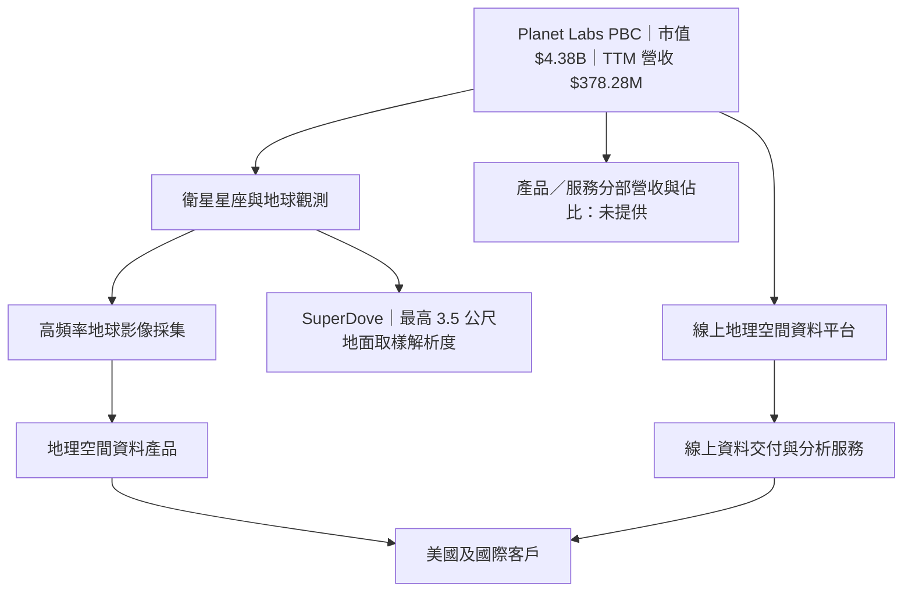
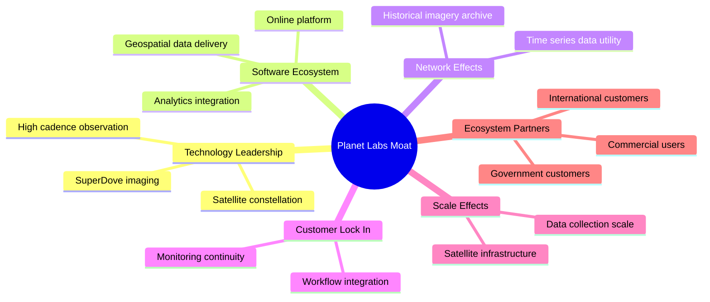
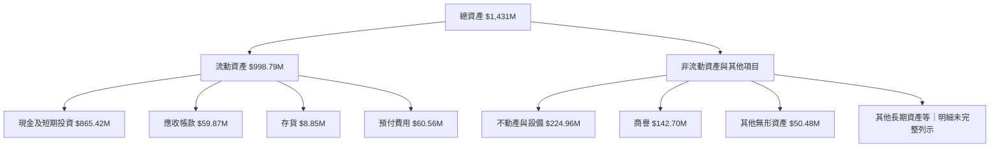
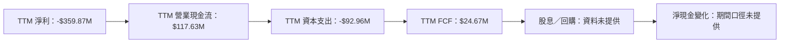
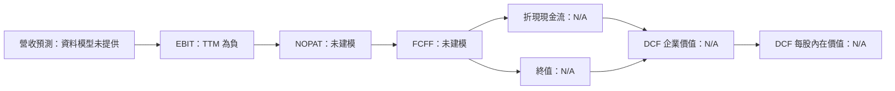
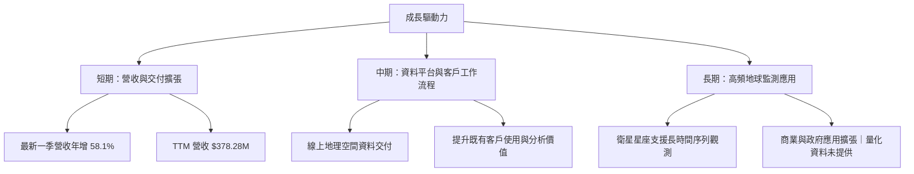
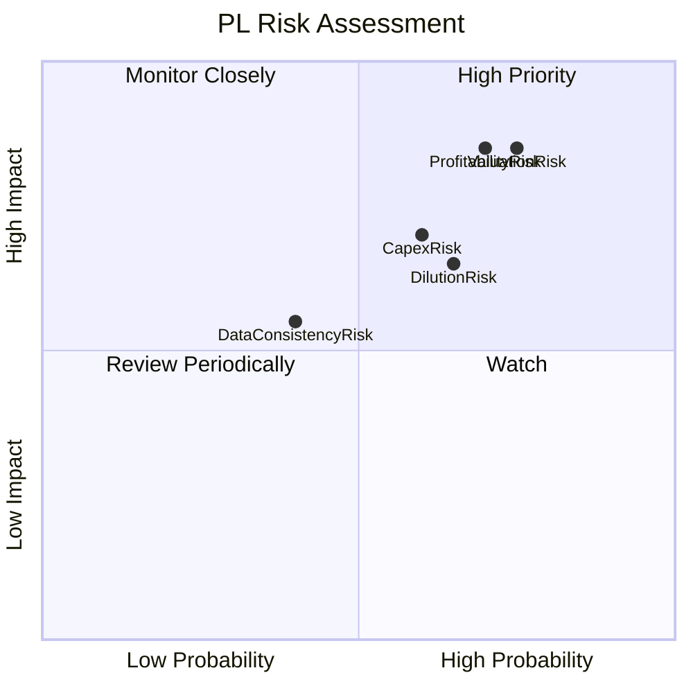
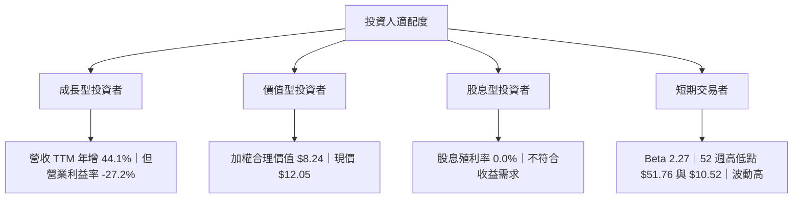

# PL 基本面深度分析報告
> **報告日期**：2026-11-18 ｜ **語言**：繁體中文 ｜ **數據來源**：SEC 申報資料 (XBRL)、Yahoo Finance、Finviz、StockAnalysis、Roic.ai ｜ **分析師**：CFA 級機構研究

## 目錄

| # | 章節 | 核心結論 |
|---|------|----------|
| 1 | 執行摘要 | 賣出；加權合理價值 $8.24，MOS -46.2% |
| 2 | 公司概覽與商業模式 | 衛星影像與地理空間資料平台具差異化，收入構成與市場份額資料未提供 |
| 3 | 損益表深度分析 | TTM 營收 $378.28M，TTM 成長 44.1%；營業利益率仍為 -27.2% |
| 4 | 資產負債表分析 | 現金及短期投資 $865.42M；債務資料來源存在不一致 |
| 5 | 現金流量深度分析 | TTM FCF $24.67M、FCF Yield 0.56%；資本支出仍高 |
| 6 | 獲利能力與資本效率 | ROIC 未提供；ROIC 是否高於 12.89% WACC 無法確認 |
| 7 | 相對估值分析 | P/S 11.5x，高於自身五年中位數 6.9x；相對估值法偏向高估 |
| 8 | DCF 內在價值評估 | DCF 不適用：TTM 營業利益為負；依固定估值方法加權價值 $8.24 |
| 9 | 成長催化劑 | 最新一季營收年增 58.1%；具成長動能，但無可引用的 TAM 數字 |
| 10 | 風險矩陣 | 估值、虧損與高資本支出、股權稀釋為主要風險 |
| 11 | 投資建議 | 現價 $12.05 高於加權合理價值；等待估值與獲利品質改善 |

---

## 1. 執行摘要

### 1.0 一頁式投資儀表板（Portfolio Manager 30 秒速讀）

| 項目 | 內容 |
|------|------|
| **投資論點（3 句）** | ① Planet Labs 提供高頻地球影像與地理空間資料服務，最新一季營收年增 **58.1%**，顯示需求仍在擴張。② TTM 營業利益率為 **-27.2%**，且 Piotroski F-Score 為 **3/8**，營收增長尚未轉化為穩定 GAAP 獲利。③ 2026-11-18 收盤價 **$12.05**，高於加權合理價值 **$8.24**；MOS **-46.2%**，估值風險仍高。 |
| **綜合評分** | **4.8/10**（引用 1.1 評分卡） |
| **財務健康** | 🟡 現金及短期投資 **$865.42M**、流動比率 **2.843**；但債務資料來源不一致，且仍有營業虧損。 |
| **ROIC vs WACC** | ROIC：**N/A**；WACC：**12.89%**。ROIC 未提供，無法確認是否創造股東價值。 |
| **FCF 趨勢** | TTM FCF **$24.67M**；FCF Yield **0.56%**。FCF 已轉正，但因資本支出高、盈利仍為負，持續性尚待驗證。 |
| **估值** | Forward P/E **-9,640.0x**（近零且為負的預估 EPS 令倍數失去解讀性）｜EV/EBITDA **-86.312x**｜FCF Yield **0.56%** |
| **DCF 內在價值（基準）** | **N/A**；TTM 營業利益為負，固定 DCF 模型不計算。DCF 折溢價亦為 N/A。 |
| **安全邊際（MOS）** | **-46.2%＝($8.24 − $12.05) ÷ $8.24**，基準為 8.8 加權合理價值；🔴 現價高於合理價值。 |
| **預期報酬（基準情境 12M）** | **N/A**；DCF MODEL 未提供情境價值。以加權合理價值參考，現價至 $8.24 的上行空間為 **-31.6%**。 |
| **關鍵風險（前二）** | ① 高估值與盈利尚未成熟；② 高資本支出、股權薪酬與稀釋可能侵蝕每股價值。 |
| **評級 + 信心度** | 🔴 **賣出** ｜ 信心：**中**（估值方法指向折價空間，但盈利與債務資料存在不確定性） |

### 1.1 綜合評分卡（全報告唯一）

| 維度 | 評分（1–10） | 主要依據（引用數字與其來源章節） |
|------|--------------|----------------------------------|
| 成長性 | 8.0 | TTM 營收年增 **44.1%**、最新一季年增 **58.1%**；但較高增速能否持續仍未確定（第 3 章）。 |
| 獲利能力 | 2.0 | TTM 營業利益率 **-27.2%**、Piotroski **3/8**；ROIC 未提供（第 3、6 章）。 |
| 財務健康 | 7.0 | 現金及短期投資 **$865.42M**、流動比率 **2.843**；債務數據存在來源差異（第 4 章）。 |
| 估值 | 1.0 | MOS **-46.2%**；P/S **11.5x**，高於五年中位數 **6.9x**（第 7、8 章）。 |
| 護城河 | 7.0 | 自有衛星星座、每日地球觀測的產品定位與雲端資料平台形成差異化；未提供客戶集中度、續約率或分部數據（第 2 章）。 |
| 管理層與資本配置 | 4.0 | FY2026 SBC **$54.99M**，約為當年營收 **17.9%**；流通股數未能通過 Piotroski 稀釋股數測試（第 3、5 章）。 |
| **綜合評分** | **4.8** | 六項算術平均：**(8.0 + 2.0 + 7.0 + 1.0 + 7.0 + 4.0) ÷ 6 = 4.83 ≈ 4.8**。 |

### 1.2 五大投資論點 + 三大核心風險

| 類型 | 項目 | 具體依據 | 信心度 |
|------|------|----------|--------|
| 🟢 **投資論點①** | 營收增長加速 | TTM 營收年增 **44.1%**，最新一季年增 **58.1%**；連續數季季營收提高，顯示需求與交付規模在擴大。 | 🟢 高 |
| 🟢 **投資論點②** | 高頻衛星資料具差異化 | 公司擁有衛星星座並以線上平台交付地球影像資料，產品有助於客戶建立時間序列監測能力；但客戶留存等量化數據未提供。 | 🟡 中 |
| 🟢 **投資論點③** | 現金儲備提供營運緩衝 | 現金及短期投資 **$865.42M**，流動比率 **2.843**；能支應衛星建置與營運，但需同時留意資本支出消耗。 | 🟢 高 |
| 🟢 **投資論點④** | TTM FCF 已為正 | TTM OCF **$117.63M**、Capex **$92.96M**、FCF **$24.67M**；若能穩定維持，將降低對外部融資的依賴。 | 🟡 中 |
| 🟢 **投資論點⑤** | 最新季度營業虧損率收窄 | 最新季營業利益 **-$13.51M**、營收 **$116.05M**，營業利益率約 **-11.6%**；比 TTM **-27.2%** 好，但單季改善仍需多季驗證。 | 🟡 中 |
| 🟡 **風險①** | 高估值未由 GAAP 盈利支撐 | P/S **11.5x**，五年估值百分位 **79%**；TTM 淨利率 **-95.1%**，加權合理價值 **$8.24** 低於現價。 | 🔴 高衝擊 |
| 🔴 **風險②** | 高投資需求與稀釋 | FY2026 Capex **$82.95M**、SBC **$54.99M**；Piotroski 的稀釋股數測試未通過。 | 🔴 高衝擊 |
| 🟡 **風險③** | 指標及負債資料不一致 | 財務資料列示總債務 **N/A**，另有彙整資料列示債務 **$498.62M**；估值與資本結構需以 SEC 申報資料進一步核對。 | 🟡 中度 |

### 1.3 快速統計卡片

| 指標 | 公司實際值（期間） | 同業中位數 | 狀態 |
|------|--------------------|------------|------|
| 營收成長（TTM） | **44.1%** | — | 🟢 |
| 營收成長（最新一季年增） | **58.1%** | **72.7%** | 🟡 |
| 毛利率（TTM） | **55.5%** | **40.3%** | 🟢 |
| 營業利益率（TTM） | **-27.2%** | — | 🔴 |
| ROIC（TTM） | **N/A** | — | ⚪ |
| Forward P/E | **-9,640.0x** | **-18.3x** | 🔴（負 EPS 倍數不具正常估值解讀性） |
| FCF Yield（TTM） | **0.56%** | — | 🟡 |
| Piotroski F-Score | **3 / 8** | — | 🔴 |

> 同業中位數依 Peer multiples 區塊計算；營收成長率中位數取 SPIR、BKSY、RKLB 三家公司資料。

### 1.4 投資結論

```text
╔══════════════════════════════════════════════════════════════════╗
║                       📊 投資結論摘要                            ║
╠══════════════════════════════════════════════════════════════════╣
║  評級：🔴 賣出（MOS = -46.2%，依規則 20）                        ║
║  價格（2026-11-18 收盤）：$12.05                                 ║
║  DCF 內在價值（基準）：N/A（TTM 營業利益為負）                   ║
║  安全邊際 MOS：-46.2%（以加權合理價值 $8.24 為基準）             ║
║  加權合理價值（8.8）：$8.24                                      ║
║  綜合評分：4.8/10（引用 1.1）                                    ║
║  適合投資人：能承受高波動、願意追蹤季度營運的成長型投資人；      ║
║              不適合以現金流穩定或低估值為主要要求的投資人。      ║
╚══════════════════════════════════════════════════════════════════╝
```

評級沒有因質化因素調整：MOS **-46.2%** 已低於規則 20 的 **-25%** 賣出門檻。評級來自估值結果，並非否定公司的營收成長或產品差異化。

---

## 2. 公司概覽與商業模式

### 2.1 業務結構與收入來源

Planet Labs PBC 設計、建造並發射衛星，透過線上平台提供地理空間資料。公司資料指出，其 SuperDove 衛星旨在高頻率拍攝地球，最高地面取樣解析度可達 **3.5 公尺**。財務資料沒有提供各產品線收入、收入佔比或軟體與資料服務拆分，因此下圖只呈現可確認的商業關係，不推定分部比例。



公司營收由 FY2023 的 **$191.26M** 增至 FY2026 的 **$307.73M**；最新 TTM 為 **$378.28M**。這反映商業化規模擴大，但目前沒有數據可判斷衛星影像、分析軟體與其他服務各自對成長的貢獻。

### 2.2 市場份額

市場份額數據未提供，財務資料與新聞標題也未提供可核實的市場份額數字與年份，因此不估算或繪製市佔圖。相對規模方面，PL 的 TTM 營收為 **$378.28M**，高於 SPIR、BKSY 的同業估值資料所反映的營收規模未必可直接比較；在同業三家公司最新一季營收增速中，PL 的 **58.1%** 低於 BKSY 的 **118.4%**、RKLB 的 **72.7%**，高於 SPIR 的 **42.1%**。

### 2.3 競爭護城河分析



### 2.4 護城河強度

| 護城河項目 | 強度（強／中／弱） | 證據（引用數字或事實） | 會削弱它的情況 |
|------------|--------------------|------------------------|----------------|
| 衛星與影像技術 | 中 | 公司運營衛星星座，SuperDove 最高解析度可達 **3.5 公尺**，以高頻觀測作為產品特徵。 | 影像解析度、重訪頻率或單位成本被競爭者超越。 |
| 軟體與資料平台 | 中 | 地理空間資料透過線上平台交付；但平台收入、軟體毛利與客戶使用指標未提供。 | 客戶可低成本切換至替代資料供應商，或平台功能缺乏差異化。 |
| 歷史資料與網路效應 | 中 | 長期影像時間序列對監測型工作流程可能有價值；可驗證的資料庫規模與增量價值未提供。 | 客戶只需單次影像，或其他供應商可取得相近歷史資料。 |
| 客戶鎖定 | 中 | 資料可能嵌入客戶的監測與分析流程；續約率、客戶集中度與合約期限未提供。 | 續約率下滑、合約短期化，或客戶轉向多供應商採購。 |
| 規模效應 | 中 | 衛星星座與資料處理基礎設施有固定投入特性；FY2026 Capex 為 **$82.95M**。 | 高資本支出未能換得更低單位成本或更高毛利。 |
| 生態夥伴 | 弱至中 | 公司服務美國及國際客戶；合作夥伴數量與合作收入未提供。 | 合作渠道不足，或主要客戶自行建置替代方案。 |

**1.1 護城河評分為 7.0/10**：分數反映衛星星座、影像頻率與線上資料平台構成的差異化，但因缺少續約率、客戶集中度、分部毛利及單位成本數據，不能把技術差異直接等同於已證明的定價權。

---

## 3. 損益表深度分析

### 3.1 年度收入成長趨勢（近 4 年）

```text
╔══════════════════════════════════════════════════════════════════╗
║           Planet Labs 年度收入趨勢（FY2023–FY2026）              ║
╠══════════════════════════════════════════════════════════════════╣
║  FY2023   $191.26M  █████████████░░░░░░░░░░░  基期              ║
║  FY2024   $220.70M  ███████████████░░░░░░░░░  YoY: +15.4% 🟢   ║
║  FY2025   $244.35M  █████████████████░░░░░░░  YoY: +10.7% 🟡   ║
║  FY2026   $307.73M  █████████████████████░░░  YoY: +25.9% 🟢   ║
╠══════════════════════════════════════════════════════════════════╣
║  FY2023–FY2026 收入 CAGR：約 +17.2%                              ║
╚══════════════════════════════════════════════════════════════════╝
```

收入 CAGR 算式：**($307.73M ÷ $191.26M)^(1/3) − 1 ≈ 17.2%**。FY2025 成長降至 **10.7%**，FY2026 回升至 **25.9%**；最新 TTM 成長進一步達 **44.1%**。這顯示增速加快，但是否由可持續合約需求、產品組合或一次性大型訂單推動，現有資料無法拆解。

### 3.2 季度收入趨勢分析

| 季度 | 營收 | QoQ 成長 | YoY 成長 | 備註 |
|------|------:|---------:|---------:|------|
| 2025-10-31 | $81.25M | **+32.0%**¹ | **+32.63%** | 相較前一季 $61.35M 左右的基礎變化；前期單季比較資料有來源整理差異，QoQ 僅按已列連續季度營收計算。 |
| 2026-01-31 | $86.82M | **+6.9%** | **+41.05%** | 相較 2025-01 季營收 $61.55M；成長持續。 |
| 2026-04-30 | $94.15M | **+8.4%** | **+42.08%** | 單季收入再提高，YoY 高於 FY2026 全年成長率。 |
| 2026-07-31 | $116.05M | **+23.3%** | **+58.1%** | 最新一季加速；單季年增率，不是 TTM 成長率。 |

¹ 2025-10-31 前一季營收在不同來源列示略有差異；不將此 QoQ 數值作主要判斷。以後三季一致列示的相鄰季度營收計算：**$86.82M ÷ $81.25M − 1 = 6.9%**、**$94.15M ÷ $86.82M − 1 = 8.4%**、**$116.05M ÷ $94.15M − 1 = 23.3%**。最新季年增 **58.1%** 來自單季同比資料。

### 3.3 利潤率演變分析

| 利潤率指標 | FY2023 | FY2024 | FY2025 | FY2026 | 趨勢 | 評估 |
|------------|-------:|-------:|-------:|-------:|------|------|
| **毛利率**¹ | 49.2% | 51.2% | 57.2% | 56.1% | 先升後略降 | 🟡 |
| **營業利益率**¹ | -91.9% | -75.8% | -45.5% | -30.9% | 連續改善，但仍大幅虧損 | 🔴 |
| **淨利率**¹ | -84.7% | -63.7% | -50.4% | -80.2% | FY2026 惡化 | 🔴 |
| **營業利益率（TTM，核驗值）** | — | — | — | **-27.2%** | TTM 仍為負 | 🔴 |
| **營業利益率（最新季度，核驗值）** | — | — | — | **-11.6%** | 單季較 TTM 改善 | 🟡 |

¹ 年度毛利率、營業利益率與淨利率以年度損益表的毛利、營業利益、淨利除以營收計算。TTM 與最新季利潤率採用 SEC 10-Q 衍生的核驗值；來源之間部分列示口徑有差異，故分開展示。

**利潤率演變深度解析：**FY2023 至 FY2026，營業利益率由 **-91.9%** 改善至 **-30.9%**，並且 TTM 核驗值進一步改善至 **-27.2%**。規模擴大有助於分攤研發、衛星營運與平台成本；FY2026 毛利率約 **56.1%**，較 FY2025 的 **57.2%** 略降，表示營收擴張未同步持續推高毛利。FY2026 淨利率惡化至約 **-80.2%**，主要表現為淨虧損 **$246.86M**，遠高於營業虧損 **$95.07M**；一次性項目或非營業損益的具體拆分未提供，不能將全部差額歸因於特定項目。

### 3.4 費用結構分析

資料提供年度研發費用，但未提供足以完整拆分銷售、一般行政、折舊、衛星營運及其他費用的同口徑資料，因此不繪製會造成虛假精確度的費用圓餅圖。

| 項目 | 金額 | 相對營收 | 解讀 |
|------|------:|---------:|------|
| FY2026 研發費用 | **$106.75M** | **34.7%** | 研發投入高，可能支持衛星與資料產品迭代；若營收擴張不能帶動營業槓桿，投入回報會偏低。 |
| FY2026 毛利 | **$172.49M** | **56.1%** | 毛利須覆蓋研發、銷管及其他營運費用；FY2026 營業虧損仍達 **$95.07M**。 |
| FY2026 營業虧損 | **-$95.07M** | **-30.9%** | 營收規模仍不足以覆蓋營運成本。 |

### 3.5 季度 EPS 趨勢與盈餘品質（Quality of Earnings）

過去四季的 EPS 預估值與實際值在市場資料中均為 `nan`，因此**無法判斷超預期或不及預期**。已知季度淨利分別為 2025-10 **-$59.19M**、2026-01 **-$152.46M**、2026-04 **-$138.87M**、2026-07 **-$9.35M**。最新季度虧損收窄，但此前兩季虧損較大，季度淨利波動顯著。

| 盈餘品質項目 | 數值/佔比 | 評估 |
|--------------|-----------|------|
| 股權薪酬 SBC / 營收 | TTM SBC **$62.51M** ÷ TTM 營收 **$378.28M** = **16.5%** | 🔴 SBC 相對營收偏高；對每股股東回報造成稀釋成本。 |
| SBC / 營業現金流 | **$62.51M ÷ $117.63M = 53.1%** | 🟡 現金流包含較大非現金 SBC 加回，OCF 的現金含量須與 SBC 稀釋一併看。 |
| FCF / 淨利（現金轉換率） | **$24.67M ÷ -$359.87M = -6.9%** | 🔴 淨利為虧損，比例不適合用作一般盈利轉現金指標；正 FCF 並不代表 GAAP 盈利。 |
| 一次性/非經常性損益 | N/A（未提供可核實拆分） | 無法判定一次性項目是否推高或壓低季度盈餘。 |
| 有效稅率異常 | N/A（未提供可核實 TTM 有效稅率） | 不將預設稅率或其他估算冒充為實際有效稅率。 |
| 資本化支出 vs 費用化 | TTM Capex **$92.96M**；資本化與費用化細項 N/A | 衛星與基礎設施支出需投入資本；沒有足夠資料判斷是否有成本由費用轉為資本化。 |

**盈餘品質結論：**現有證據不支持把 PL 視為已成熟的盈利公司。TTM FCF 為正，但 TTM 淨利仍為負；SBC 約佔 TTM 營收 **16.5%**、OCF **53.1%**，意味部分現金流優勢伴隨股權稀釋。估值應優先參考營收倍數、現金消耗與每股稀釋，而不宜使用 P/E 或將單季 FCF 外推為穩定盈利。

---

## 4. 資產負債表分析

### 4.1 資產結構分解

下圖採 StockAnalysis 2026-07-31 資產負債表所列項目。未列項目不作反推，圖中「其他資產」保留為未細分項目。



### 4.2 流動性與營運資金分析

| 流動性指標 | 最新值 | 前期值 | 解讀 |
|------------|-------:|-------:|------|
| 流動比率 | **2.843** | N/A | 流動資產高於流動負債，具短期流動性緩衝。 |
| 速動比率 | **2.634** | N/A | 即使排除部分流動資產，仍高於 1；不代表長期資本支出沒有壓力。 |
| 現金及短期投資 | **$865.42M** | FY2026 年末 **$640.09M** | 資金較 FY2026 年末增加；財務資料沒有資金來源拆分，不能直接認定全由營運現金流累積。 |

**營運資金天數（照錄品質指標）**

| 指標 | 最新 TTM | 一年前 TTM | 變化 | 解讀 |
|------|----------|------------|------|------|
| DSO 應收帳款天數 | **58 天** | **72 天** | **-14 天** | 收款週期縮短，方向有利於營運資金；若營收組合改變，仍需追蹤。 |
| DIO 存貨天數 | **19 天** | **N/A** | N/A | 公司一年前未提供可計算存貨餘額，不能比較變化。 |
| DPO 應付帳款天數 | **22 天** | **37 天** | **-15 天** | 付款時間縮短；可能反映供應商付款節奏或採購結構改變，無法僅憑天數判斷議價力。 |
| CCC 現金轉換週期 | **55 天** | **N/A** | N/A | 最新 CCC 為 55 天；一年前 DIO、CCC 缺資料，不推算。 |

### 4.3 債務結構分析

不同資料來源的債務欄位存在差異：核驗數據列示總債務 **N/A**、淨現金 **$865.42M**；彙整市場資料另列總債務 **$498.62M**、淨現金 **$366.79M**。兩組數字不可混用，以下明確分開呈現，不自行以一組覆蓋另一組。

```text
╔══════════════════════════════════════════════════════════════════╗
║                 Planet Labs 債務健康診斷                         ║
╠══════════════════════════════════════════════════════════════════╣
║  現金及短期投資（核驗值）：$865.42M   ████████████████████       ║
║  總債務（核驗欄位）：      N/A        數據未提供                  ║
║  淨現金（核驗欄位）：      $865.42M   依該欄位原值引用            ║
║                                                                  ║
║  另一彙整來源列示：總債務 $498.62M、淨現金 $366.79M              ║
║  兩組來源口徑未能核對，故不計算 Debt/EBITDA 或利息保障倍數。     ║
║  流動比率：2.843 🟢    速動比率：2.634 🟢                        ║
╚══════════════════════════════════════════════════════════════════╝
```

### 4.4 股東權益趨勢

```text
╔══════════════════════════════════════════════════════════════════╗
║                 Planet Labs 股東權益趨勢                         ║
╠══════════════════════════════════════════════════════════════════╣
║  FY2023  $576.10M  ████████████████████                          ║
║  FY2024  $518.02M  ██████████████████                            ║
║  FY2025  $441.29M  ███████████████                                ║
║  FY2026  $188.43M  ██████                                         ║
╠══════════════════════════════════════════════════════════════════╣
║  FY2023–FY2026 股東權益下降；FY2026 年負債與資產變動幅度亦較大。 ║
║  需結合融資、股份發行與淨損失拆解，不能只由期末權益推斷原因。  ║
╚══════════════════════════════════════════════════════════════════╝
```

---

## 5. 現金流量深度分析

### 5.1 現金流量瀑布圖

已提供 TTM OCF、Capex 與 FCF，但未提供可匹配口徑的 TTM 淨利及股息、回購金額，故圖中不填入未提供數字。



### 5.2 FCF 轉換率趨勢

| 財年 | FCF | 淨利 | FCF / 淨利 | 解讀 |
|------|----:|----:|-----------:|------|
| FY2023 | **-$86.69M** | **-$161.97M** | **53.5%** | 兩者均為負，比例不宜解讀為正向盈利轉換。 |
| FY2024 | **-$93.12M** | **-$140.51M** | **66.3%** | 現金流虧損仍大於 FY2023。 |
| FY2025 | **-$68.78M** | **-$123.20M** | **55.8%** | FCF 虧損收窄，但仍未轉正。 |
| FY2026 | **$51.41M** | **-$246.86M** | **-20.8%** | FCF 轉正而淨利虧損擴大，差異須以 SBC、營運資金及非現金項目拆解。 |
| TTM 至 2026-07-31 | **$24.67M** | **-$359.87M** | **-6.9%** | 以虧損作分母，比例不代表通常意義的現金轉換率。 |

### 5.3 自由現金流趨勢

```text
╔══════════════════════════════════════════════════════════════════╗
║           自由現金流：歷史實際與最新 TTM                         ║
╠══════════════════════════════════════════════════════════════════╣
║  FY2023  -$86.69M  ◀█████████████████░░░                         ║
║  FY2024  -$93.12M  ◀██████████████████░                         ║
║  FY2025  -$68.78M  ◀██████████████░░░░                           ║
║  FY2026  +$51.41M  ██████████                                     ║
║  TTM     +$24.67M  █████                                          ║
╠══════════════════════════════════════════════════════════════════╣
║  TTM FCF Yield：0.56%（以核驗的 TTM FCF 計算）                    ║
║  注意：另一彙整資料的 TTM Capex／FCF 數字不同，本報告採核驗值。  ║
╚══════════════════════════════════════════════════════════════════╝
```

FY2026 FCF 轉正是一項改善，但 TTM FCF **$24.67M** 低於 FY2026 的 **$51.41M**。同時，TTM Capex **$92.96M** 佔 TTM 營收約 **24.6%**（$92.96M ÷ $378.28M），衛星與相關資產投入對自由現金流的影響仍大。

### 5.4 資本配置評估

回購、股息與各類投資支出沒有完整的同期間金額拆分，因此不畫資本配置圓餅圖。

| 項目 | 已知數據 | 評估 |
|------|----------|------|
| 資本支出 | TTM **$92.96M**；FY2026 **$82.95M** | 與衛星星座業務的資產投入相符，但需觀察投資轉化為增量營收與毛利的速度。 |
| 股權薪酬 | FY2026 **$54.99M**；TTM 四季合計 **$62.51M** | SBC 對每股經濟利益有稀釋效果，應與現金流同時評估。 |
| 股息 | 股息殖利率 **0.0%** | 未以現金股息回饋股東。 |
| 回購 | N/A（數據未提供） | 不推定公司未回購或有回購。 |
| 留存現金 | 現金及短期投資 **$865.42M** | 提供融資彈性，但資金如何分配需關注未來公告與申報資料。 |

---

## 6. 獲利能力與資本效率

### 6.1 ROE / ROA / ROIC 趨勢

| 指標 | 最新數值 | 歷史／比較 | 評估 |
|------|---------:|------------|------|
| ROE（品質指標，TTM） | **-63.8%** | TTM | 負值，反映淨損失；不可視為股東資本回報。 |
| ROA（彙整資料，TTM） | **-5.0%** | TTM | 資產尚未產生正淨利。 |
| ROIC | **N/A** | 歷史 ROIC 欄位未提供 | 無法以數字判斷公司資本回報是否超過資本成本。 |
| WACC | **12.89%** | 見 6.2 | 風險調整後資本成本；與 ROIC 的直接比較因 ROIC 缺值而不能完成。 |

### 6.2 ROIC vs WACC 分析（核心價值創造判斷）

```text
╔══════════════════════════════════════════════════════════════════╗
║                 ROIC vs WACC 深度分析                            ║
╠══════════════════════════════════════════════════════════════════╣
║  WACC 輸入（採用成本資本資料）：                                  ║
║  ├── 無風險利率（10Y 美債）：       5.07%                        ║
║  ├── 市場風險溢酬 ERP：             5.00%                        ║
║  ├── Beta 原始值：                  2.27                         ║
║  ├── Beta 採用值（調整後）：        1.85                         ║
║  ├── 股權成本：                     14.30%                       ║
║  ├── 稅前債務成本：                 0.69%                        ║
║  ├── 資本結構股權／債務權重：       89.8%／10.2%                 ║
║  └── ✅ WACC：                      12.89%                       ║
║                                                                  ║
║  ROIC（TTM）：N/A（未提供可核實數值）                             ║
║  EVA = ROIC − WACC：N/A                                           ║
║                                                                  ║
║  結論：ROIC 是否高於 12.89% 無法確認；不能宣稱已創造股東價值。   ║
╚══════════════════════════════════════════════════════════════════╝
```

原始 Beta **2.27** 經調整為 **1.85**，方式為 **⅔ × 2.27 + ⅓ × 1 = 1.85**。成本資本資料列示 Ke **14.30%**、稅前 Kd **0.69%**、股權／債務權重 **89.8%／10.2%**，並直接給定 WACC **12.89%**。依嚴格資料規則，本報告採用該 WACC，不另建一組資本結構或重算替代折現率。10Y 美債利率的具體觀察日期未提供；ERP 為資料中的假設值。

### 6.3 杜邦三因素分解

| 因素 | 數值（TTM） | 解讀 |
|------|-------------|------|
| 淨利率 | **-95.1%** | 大幅淨虧損是 ROE 為負的主要來源。 |
| 資產週轉率 | **0.26** | 每單位資產產生的營收有限，衛星與資料資產需要較長時間形成收入。 |
| 權益乘數 | **2.54** | 資產相對權益的槓桿放大效果存在，但並未消除負淨利率。 |
| **ROE** | **-63.8%** | 品質指標原值；分項均為四捨五入數值，與報告 ROE 原值可能有小幅乘算差異。 |

### 6.4 財務體質：Piotroski F-Score

Piotroski F-Score 原值為 **3/8**；其中有一項因缺資料未能判定，故測試分母為 8，而非 9。

| 測試 | 結果 | 解讀 |
|------|------|------|
| ROA > 0 | ❌ 未通過 | 公司仍錄得淨損失。 |
| 營業現金流 > 0 | ✅ 通過 | TTM OCF 為 **$117.63M**。 |
| ROA 高於一年前 | ❌ 未通過 | 資產回報未改善至通過條件。 |
| 營業現金流 > 淨利（應計品質） | ✅ 通過 | 現金流高於淨利；因淨利為負，仍需留意 SBC 與非現金項目。 |
| 長期負債 ÷ 總資產低於一年前 | — 無法判定 | 缺少測試所需的對比資料。 |
| 流動比率高於一年前 | ✅ 通過 | 流動性測試通過。 |
| 稀釋股數未增加 | ❌ 未通過 | 股數稀釋對每股價值構成風險。 |
| 毛利率高於一年前 | ❌ 未通過 | 未達同比改善條件。 |
| 資產週轉率高於一年前 | ❌ 未通過 | 資產使用效率未達同比改善條件。 |

整體 **3/8** 顯示流動性與現金流項目有優點，但盈利能力、毛利率、資產效率和股數稀釋仍是弱項。

---

## 7. 相對估值分析

### 7.1 同業估值比較表格

| 估值指標 | **PL** | **SPIR** | **BKSY** | **RKLB** | PL 評估 |
|----------|------:|---------:|---------:|---------:|-----------|
| **Trailing P/E** | N/A | N/A | N/A | N/A | 🔴 PL 尚未盈利；同業資料亦不可比。 |
| **Forward P/E** | **-9,640.0x** | **-18.3x** | **-73.8x** | **741.4x** | 🔴 PL 預估 EPS 接近零且為負，倍數無法用作正常相對估值。 |
| **P/S Ratio** | **11.5x** | **4.7x** | **6.4x** | **40.5x** | 🟡 PL 高於 SPIR、BKSY，低於 RKLB；公司自身五年中位數為 6.9x。 |
| **EV/EBITDA** | **-86.312x** | **-3.7x** | **807.8x** | **-176.3x** | 🔴 EBITDA 為負或極小時倍數失真，不適合單獨作估值依據。 |
| **最新一季營收年增** | **58.1%** | **42.1%** | **118.4%** | **72.7%** | 🟡 PL 成長快於 SPIR，低於 BKSY、RKLB。 |
| **毛利率（TTM）** | **55.5%** | **40.3%** | **73.4%** | **36.2%** | 🟢 高於 SPIR、RKLB，低於 BKSY。 |

PL 的 P/S **11.5x** 不是同業中最低，但 RKLB 的 **40.5x** 也不能直接視為合理錨點，因業務組合與成長預期可能不同。估值方法區塊另採 SPIR 與 BKSY 的 P/S 中位數 **5.6x**，該方法依固定規則用於相對估值；不以 PL 自身 11.5x 推回現價。

### 7.2 歷史估值區間分析

```text
╔══════════════════════════════════════════════════════════════════╗
║                  PL 自身五年 P/S 估值區間                         ║
╠══════════════════════════════════════════════════════════════════╣
║  五年區間： 2.1x ─────────────────────────────── 38.1x           ║
║  五年中位數：6.9x                                                ║
║  當前 P/S： 11.5x  ●                                             ║
║  當前百分位：79%                                                  ║
╠══════════════════════════════════════════════════════════════════╣
║  當前估值高於五年中位數，位於自身歷史區間偏高位置。              ║
╚══════════════════════════════════════════════════════════════════╝
```

此處為 **P/S** 歷史估值，不是 P/E。當前 11.5x 高於五年中位數 6.9x，代表市場仍為增長與未來利潤率改善支付溢價。

### 7.3 情境價值（Bear / Base / Bull，照抄 DCF MODEL 的 Scenarios）

**N/A（DCF 無法計算：TTM 營業利益不為正；固定資料模型沒有提供 DCF 情境價值及其假設。）**依規則不另行自建情境目標價。

### 7.4 相對估值隱含價格區間

```text
╔══════════════════════════════════════════════════════════════════╗
║               相對估值方法與市場價格位置                         ║
╠══════════════════════════════════════════════════════════════════╣
║  同業 P/S 估值： $5.79  ────────────── 現價 $12.05              ║
║  分析師共識：   $30.27（11 位分析師平均目標價）                  ║
║                                                                  ║
║  同業 P/S 方法：SPIR、BKSY 中位數 5.6x × PL TTM 營收             ║
║  分析師共識：   參考值，非公司自身現金流估值                     ║
╚══════════════════════════════════════════════════════════════════╝
```

| 方法 | 每股價值 | 相對現價 | 依據 |
|------|---------:|---------:|------|
| 同業 P/S | **$5.79** | **-52.0%** | 同業中位數 **5.6x**（SPIR、BKSY）乘以 PL TTM 營收，按固定估值方法區塊原值引用。 |
| 分析師共識目標價 | **$30.27** | **+151.2%** | 11 位分析師平均目標價；資料未提供一致的預測模型假設，應視為外部參考而非基準內在價值。 |

---

## 8. DCF 內在價值評估（Discounted Cash Flow）

### 8.0 估值推理鏈（Thinking Logic）

**估值命題：**PL 的經濟價值長期取決於現有地球影像與資料服務能否持續擴張、平台及分析服務能否提高每客戶價值，以及營業利潤率能否由負值轉正。現有資料未提供分部收入，因此無法可靠地把 TTM 營收 **$378.28M** 拆成主業、平台或新業務比例。

| 決策點 | 本報告採用 | 理由（含數字） | 曾考慮但否決 | 否決理由 |
|--------|-----------|----------------|--------------|----------|
| 現金流定義 | 不建立 DCF | 固定 DCF 模型標示 N/A；TTM 營業利益率為 **-27.2%** | FCFF／FCFE 自行預測 | 不符合 DCF 模型輸入資料優先規則，且負營業利益無法提供可稽核預測。 |
| 預測期 N | N/A | 固定 DCF 模型沒有預測年數 | 自行設定 5–10 年 | 無模型數字或管理層財測錨點，設定年數會形成黑箱。 |
| 終值方法 | N/A | 沒有 DCF MODEL 假設與終值資料 | Gordon Growth／退出倍數 | 缺乏逐年 FCF 與模型設定，不得自行建立。 |
| EBIT 基礎 | N/A | 不計算 DCF | GAAP／非 GAAP | 無法展開年度 EBIT 與稅後營業利潤。 |

**關鍵假設推導鏈：**固定 DCF MODEL 因 TTM 營業利益為負而不提供預測參數；因此營收 CAGR、期末營業利潤率、g、WACC 在 DCF 內的敏感度、Capex、D&A、ΔWC、股數與 SBC 組合均不得另行填值。

**最脆弱的一環：**若直接對尚未盈利企業自行假設未來營業利潤率，估值會對營業槓桿和終值極度敏感；缺乏可稽核輸入時，不給出自建 DCF 價格比提供偽精確數字更可靠。



### 8.1 模型假設總表（Model Inputs）

| 假設項目 | 採用值 | 依據 / 來源 | 敏感度 |
|----------|--------|-------------|--------|
| 預測期長度 N | N/A | 固定 DCF MODEL 未提供；不得自訂 | N/A |
| 營收 CAGR | N/A | 固定 DCF MODEL 未提供預測假設 | N/A |
| 營業利潤率 | N/A | TTM 營業利益率 **-27.2%**，但模型不對虧損自行外推 | N/A |
| 有效稅率 | N/A | DCF 模型未提供實際有效稅率假設 | N/A |
| Capex / 營收 | N/A | TTM Capex **$92.96M** 可作歷史資料，但模型未提供預測比例 | N/A |
| D&A / 營收 | N/A | 模型未提供預測假設 | N/A |
| ΔWC / 營收增額 | N/A | 模型未提供預測假設 | N/A |
| EBIT 基礎 | N/A | DCF 未建立 | N/A |
| SBC 處理 | N/A | DCF 未建立 | N/A |
| 年稀釋率 | N/A | DCF 未建立；歷史品質測試顯示稀釋股數未通過 | N/A |
| 永續成長率 g | N/A | DCF 未建立 | N/A |
| 終值方法 | N/A | DCF 未建立 | N/A |
| WACC | **12.89%** | 成本資本資料原值；第 6.2 節一致引用 | N/A |

**FCF 定義：**DCF 不適用，因此不採 FCFF 或 FCFE 預測。現有 TTM FCF 定義為營業現金流減資本支出，數值為 **$24.67M**。

**SBC 防呆規則：**本報告沒有建立 DCF，故不選用 (A)、(B) 或 (C) 組合，也不將 SBC 在模型中扣除或稀釋；SBC 僅在盈餘品質分析中獨立披露。

### 8.2 折現率推導（WACC）

```text
╔══════════════════════════════════════════════════════════════════╗
║                 WACC 推導（採用成本資本資料）                    ║
╠══════════════════════════════════════════════════════════════════╣
║  股權成本 Ke（CAPM，原值引用）：                                  ║
║  ├── 無風險利率 Rf（10Y 美債）：      5.07%                       ║
║  ├── 市場風險溢酬 ERP：               5.00%                       ║
║  ├── 原始 Beta：                      2.27                        ║
║  ├── 調整後 Beta：                    1.85                        ║
║  ├── Beta 調整：                      ⅔ × 2.27 + ⅓ × 1 = 1.85     ║
║  └── Ke（成本資本資料）：              14.30%                      ║
║                                                                  ║
║  債務成本：                                                        ║
║  ├── 稅前 Kd：                         0.69%                       ║
║  ├── 稅率假設：                        21.0%                       ║
║  └── 稅後 Kd：                         由固定成本資本模型納入      ║
║                                                                  ║
║  資本結構權重：E 89.8%／D 10.2%                                   ║
║  ✅ WACC：                         12.89%                          ║
╚══════════════════════════════════════════════════════════════════╝
```

成本資本資料提供的 WACC 及各組成已直接採用；其權重與市場資料內的負債列示口徑存在差異風險，故不另以彙整市場債務數據重算。**計算值與採用值：**提供資料已列 WACC **12.89%**；未提供可完整重現該數值的市值、平均計息負債與利息費用配對明細，所以不宣稱本報告獨立重算出另一個 WACC。該值與第 6.2 節一致。

### 8.3 逐年自由現金流預測（基準情境）

**N/A（DCF MODEL 未提供：TTM 營業利益不為正，固定模型因此不對虧損折現；不得自建預測。）**

逐年營收、EBIT、稅、NOPAT、D&A、Capex、營運資金變動、FCFF、折現因子與現值均不計算。歷史錨點顯示 FY2023、FY2024、FY2025 FCF 分別為 **-$86.69M、-$93.12M、-$68.78M**，FY2026 為 **$51.41M**，最新 TTM 為 **$24.67M**；正 FCF 能否延續需觀察後續資本支出與營運資金變化。

### 8.4 終值計算（Terminal Value）

**N/A（沒有預測期末 FCFF、WACC 與永續成長率 g 的 DCF 模型輸入；不計算 Gordon Growth 或退出倍數終值。）**

### 8.5 企業價值 → 每股內在價值（Bridge）

```text
╔══════════════════════════════════════════════════════════════════╗
║              企業價值 → 每股內在價值 橋接表                      ║
╠══════════════════════════════════════════════════════════════════╣
║  預測期 FCF 現值合計：              N/A                           ║
║  終值現值 PV(TV)：                  N/A                           ║
║  企業價值 EV：                      N/A                           ║
║  現金及短期投資：                   $865.42M（非 DCF 橋接值）      ║
║  總債務：                           N/A（核驗欄位）               ║
║  稀釋後流通股數：                   DCF 模型未提供                 ║
║  DCF 每股內在價值：                 N/A                           ║
║  現價（2026-11-18 收盤）：           $12.05                        ║
╚══════════════════════════════════════════════════════════════════╝
```

DCF 每股價值與折溢價均為 **N/A**。依規則，MOS 只在第 8.8 節以加權合理價值計算，不在此處重複計算。

### 8.6 敏感性分析（WACC × 永續成長率）

**N/A（固定 DCF MODEL 未提供基準每股價值、g 或敏感性矩陣；不自行建立矩陣或情境。）**

### 8.7 反推 DCF（Reverse DCF：市場在預期什麼）

**N/A（固定 DCF MODEL 未提供反推結果，且本報告不自建 DCF。）**無法以現價反解營收 CAGR、期末營業利潤率、g 或高成長年數；不得把分析師共識目標價當成 DCF 反推結果。

### 8.8 估值三角驗證與安全邊際

| 估值方法 | 隱含每股價值 | 上行空間（÷現價） | 權重 | 說明 |
|----------|--------------:|-------------------:|------:|------|
| 同業 P/S | **$5.79** | **-52.0%** | **90%** | SPIR、BKSY 同業中位數 **5.6x** 乘以 PL TTM 營收，依固定估值方法原值引用。 |
| 分析師共識目標價 | **$30.27** | **+151.2%** | **10%** | 11 位分析師平均目標價，作外部參考，不是 DCF 基準值。 |
| **加權合理價值** | **$8.24** | **-31.6%** | **100%** | 公司類型為未盈利公司；固定權重為同業 P/S 90%、分析師共識 10%。 |

**逐步演算（權重外顯）：**

- 同業 P/S 加權值：**$5.79 × 90% = $5.211**
- 分析師共識加權值：**$30.27 × 10% = $3.027**
- 加權合理價值：**$5.211 + $3.027 = $8.238 ≈ $8.24**
- 權重檢查：**90% + 10% = 100%**
- Forward P/E 方法因未盈利、無法計算而未納入固定估值方法，權重依該方法區塊設定分配至其餘方法；本報告不新增或更改方法。

```text
╔══════════════════════════════════════════════════════════════════╗
║                  估值區間與安全邊際                              ║
╠══════════════════════════════════════════════════════════════════╣
║  同業 P/S $5.79 ── 加權合理值 $8.24 ── 現價 $12.05 ── 分析師 $30.27║
║                                                                  ║
║  安全邊際 MOS = ($8.24 − $12.05) ÷ $8.24 = -46.2%               ║
║  MOS 評估：🔴 現價高於加權合理價值                                ║
║  上行空間 = ($8.24 − $12.05) ÷ $12.05 = -31.6%                  ║
║  （MOS 與上行空間分母不同；本報告不將二者混用。）                ║
║                                                                  ║
║  建議買入區間：≤ $7.42（對應 MOS 至少 10% 的價格上限）           ║
║  合理持有區間：$7.42 – $9.06（MOS 約 +10% 至 -10%）              ║
║  減碼考慮區間：$9.06 – $10.30（MOS 約 -10% 至 -25%）             ║
║  賣出門檻：高於 $10.30（MOS 低於 -25%）                          ║
╚══════════════════════════════════════════════════════════════════╝
```

買入區間上限算式：**$8.24 × (1 − 10%) = $7.416 ≈ $7.42**。MOS -10% 價格界線：**$8.24 × 1.10 = $9.064 ≈ $9.06**；MOS -25% 界線：**$8.24 × 1.25 = $10.30**。這些是依規則 20 的估值門檻推導，不代表基本面風險已消失。

> 🔎 **程式複算（Python，依本節各項自動重算）**
>
> 加權合理價值 = $5.79 × 90% + $30.27 × 10% = **$8.24**（權重合計 100%）
>
> 以價格 $12.05 計：MOS = **-46.2%**，上行空間 = **-31.6%**
>
> ✅ 與本節所寫數值一致。

### 8.9 DCF 模型的局限與失效條件

- **終值依賴度：**N/A；DCF 未提供終值或企業價值，不能計算終值佔比。
- **最脆弱的假設：**若未來營業利潤率無法由目前 TTM **-27.2%** 改善，任何以正利潤率為基礎的長期估值都會下修；固定 DCF MODEL 未提供可量化的下行情境值。
- **不適用情境：**公司仍有營業虧損，TTM 淨利率為 **-95.1%**，即使 TTM FCF 為正，也容易受營運資金、SBC 與資本支出波動影響。此階段相對估值可參考 EV/Sales、P/S，並持續檢查每客戶收入、續約與衛星投資回報；相關單位經濟數據未提供。
- **與第 10 章風險矩陣連結：**營收增速放緩影響銷售基礎；成本與資本支出上升影響 FCF；股權稀釋則影響每股價值。上述變數均是成熟 DCF 的核心輸入，但本次不以缺少的模型假設自行補值。

### 8.10 複算檢核表（Audit Trail）

| # | 檢核項目 | 檢查方式 | 結果 |
|---|----------|----------|------|
| 1 | 所有 DCF 高／中敏感度輸入都有四段式推導 | DCF MODEL 為 N/A，沒有相應輸入 | ✅ 不適用，未自建輸入 |
| 2 | 每個假設都有來歷 | DCF 假設均列 N/A 與原因；WACC 引用成本資本資料 | ✅ |
| 3 | WACC 五步算式齊全且重算正確 | 僅採用資料給定 WACC **12.89%**，未另造重算值 | ⚠️ 成本資本資料未提供完整原始權重金額，故不能獨立複算 |
| 4 | Kd 分母與債務權重範圍一致 | 債務原始明細及利息配對資料不足 | ⚠️ 依固定成本資本原值引用，不自行重算 |
| 5 | WACC 與第 6.2 節同值 | 兩處均 **12.89%** | ✅ |
| 6 | 逐年預測年度數與 N 相符 | DCF N/A，沒有預測表 | ✅ 不適用 |
| 7 | FY+1 九步算式可複算 | 沒有 FY+1 模型數值 | ✅ 不適用 |
| 8 | 預測期 PV 加總正確 | 無預測期 PV | ✅ 不適用 |
| 9 | WACC > g | g 未提供 | ✅ 不適用 |
| 10 | 終值以 FY+N FCFF 為基礎 | 無終值模型 | ✅ 不適用 |
| 11 | EV 至每股價值橋接可複算 | DCF 橋接為 N/A | ✅ 不適用 |
| 12 | SBC 組合在經濟上相容 | 未建立 DCF，未扣 SBC、未推導股數 | ✅ 不適用 |
| 13 | 敏感性矩陣基準格與 DCF 基準值一致 | 矩陣與 DCF 均 N/A | ✅ 不適用 |
| 14 | 矩陣無效格標示正確 | 無矩陣 | ✅ 不適用 |
| 15 | 三情境機率合計 100% | DCF 情境未提供 | ✅ 不適用 |
| 16 | 反推 DCF 每列只放開一個變數 | 未建立反推模型 | ✅ 不適用 |
| 17 | MOS 分母為 8.8 加權合理價值，折溢價以 DCF 值為基準 | MOS 使用 **$8.24**；DCF 折溢價 N/A | ✅ |
| 18 | 報告完整至第 11 章 | 全部章節已列 | ✅ |
| 19 | 加權合理價值等於方法加權總和 | **$5.79 × 90% + $30.27 × 10% = $8.238 ≈ $8.24** | ✅ |
| 20 | 評級符合 MOS 門檻 | MOS **-46.2%**，低於 -25%，評級賣出 | ✅ |

**資料限制註記：**第 3、4 項因成本資本輸入沒有完整原始金額與債務口徑，無法做獨立重算；修正方式是嚴格採用提供的 **12.89% WACC**，不以不同來源的負債數值重新建模。這不影響 8.8 以固定估值方法計算的加權合理價值。

---

## 9. 成長催化劑

### 9.1 催化劑時間軸

財務與新聞資料沒有提供已確認的產品發表日期、合約交付日期或管理層財測時間點，因此不以猜測日期繪製 Gantt 時間軸。可追蹤的近期指標為下一次季度營收成長、營業利益率、Capex 與 FCF；這些指標將決定高增長能否轉化為營運槓桿。

### 9.2 TAM 市場規模分析

**N/A（TAM 數據未提供可引用的來源與年份）。**目前可核實的公司規模是 TTM 營收 **$378.28M**、TTM 營收成長 **44.1%**、最新一季年增 **58.1%**。沒有 TAM 數值，不能據此計算市場滲透率或推定長期營收上限。

### 9.3 成長驅動力結構圖

以下是依公司業務模式整理的質化驅動因素，不代表每項因素已量化或已確認為當期收入來源。



---

## 10. 風險矩陣

### 10.1 風險評分矩陣

以下機率與衝擊座標是分析師的**質化風險排序**，並非財務資料庫提供的統計機率；不將其解讀成損失預測。



### 10.2 風險清單詳細分析

| # | 風險項目 | 發生機率 | 財務衝擊 | 風險評估 | 緩解措施 |
|---|----------|----------|----------|----------|----------|
| 1 | 🔴 **估值倍數收縮** | 中高（質化） | P/S **11.5x**，高於自身中位數 **6.9x**；若估值向同業 P/S 估值 **$5.79** 靠攏，現價下行風險顯著。 | 🔴 高 | 設定價格紀律；只有在營收增長、毛利率和營業利益率共同改善時，才重新評估高倍數是否可持續。 |
| 2 | 🔴 **長期虧損與盈利轉正延遲** | 中高（質化） | TTM 營業利益率 **-27.2%**；Piotroski **3/8**。若營收增長未改善成本吸收，估值將缺乏盈利支撐。 | 🔴 高 | 季度追蹤營業虧損、毛利率、SBC/營收與現金消耗；設定轉正路徑，而非只看收入成長。 |
| 3 | 🟡 **資本支出與衛星投資回報** | 中（質化） | TTM Capex **$92.96M**，約為 TTM 營收 **24.6%**；若支出增加而 FCF 下滑，現金緩衝會縮短。 | 🔴 高 | 追蹤 Capex/營收、TTM FCF 與新增資產利用率；核實衛星投入對新增合約及毛利的貢獻。 |
| 4 | 🟡 **SBC 與每股稀釋** | 中高（質化） | TTM SBC **$62.51M**，佔營收 **16.5%**、OCF **53.1%**；稀釋股數測試未通過。 | 🟡 中高 | 每季追蹤稀釋後股數與 SBC/營收，將每股營收增長與總營收增長分開觀察。 |
| 5 | 🟡 **債務與財務口徑不一致** | 中（質化） | 核驗欄位總債務為 N/A；另一來源列 **$498.62M**，淨現金數字亦有差異。 | 🟡 中 | 以最新 SEC 10-Q 的債務、租賃與現金明細核對，避免錯用 EV 與資本結構數字。 |
| 6 | 🟡 **客戶、產品或區域集中度未明** | 未知 | 未提供客戶集中度、續約率、合約期限與分部營收，無法量化單一客戶流失影響。 | 🟡 中 | 追蹤大客戶收入佔比、續約率、訂單轉收入速度及政府／商業客戶組合。 |

---

## 11. 投資建議

### 11.1 最終評級與評分

依 **MOS -46.2%**，規則 20 對應 **🔴賣出**，不作一級質化調整。公司品質綜合評分為 **4.8/10**；六項分數為成長性 **8.0**、獲利能力 **2.0**、財務健康 **7.0**、估值 **1.0**、護城河 **7.0**、管理層與資本配置 **4.0**。營收成長與現金儲備是優點，但負營業利潤率、高 P/S 與稀釋令現價風險報酬不具吸引力。

### 11.2 合理價值與隱含報酬率

| 估值項目 | 每股價值 | 相對現價 $12.05 | 權重／機率 | 備註 |
|----------|---------:|----------------:|------------|------|
| 加權合理價值 | **$8.24** | **-31.6%** | 固定估值權重合計 100% | 依同業 P/S 與分析師共識加權。 |
| 悲觀 DCF 情境 | N/A | N/A | N/A | DCF MODEL 未提供情境。 |
| 基準 DCF 情境 | N/A | N/A | N/A | DCF MODEL 未提供情境。 |
| 樂觀 DCF 情境 | N/A | N/A | N/A | DCF MODEL 未提供情境。 |

### 11.3 買入時機與觸發因素

```text
╔══════════════════════════════════════════════════════════════════╗
║                  ✅ 買入觸發因素 Checklist                       ║
╠══════════════════════════════════════════════════════════════════╣
║  重新評估或建立部位前，優先等待以下證據：                         ║
║  ☐ 股價回到 $7.42 以下，對應加權合理價值至少 10% MOS              ║
║  ☐ 最新一季營收年增維持在 40% 以上，且不是單季基期因素            ║
║  ☐ TTM 營業利益率連續改善，且虧損收窄不依賴未明一次性項目        ║
║  ☐ TTM FCF 保持正值，並確認資本支出沒有使現金流再度轉負          ║
║                                                                  ║
║  加碼觸發條件（出現以下任一，仍須核對估值）：                     ║
║  ☐ 連續兩季營業利益率改善，且 SBC/營收同步下降                   ║
║  ☐ TTM FCF 高於 $24.67M，並非單靠營運資金短期變動               ║
║  ☐ SEC 申報資料確認現金、債務與租賃負債口徑                     ║
║                                                                  ║
║  減碼／停損觸發條件（出現以下任一）：                             ║
║  ☐ 連續兩季最新季度營收年增低於 30%                              ║
║  ☐ TTM FCF 轉負，或 Capex 上升但營收增長同步明顯放緩             ║
║  ☐ SBC/營收高於目前 TTM 約 16.5%，且稀釋股數持續增加             ║
║  ☐ 以加權合理價值 $8.24 衡量，股價仍高於 $10.30                  ║
╚══════════════════════════════════════════════════════════════════╝
```

### 11.4 投資人適配度分析



| 投資人類型 | 適配度 | 原因 |
|------------|--------|------|
| 成長型投資者 | 中 | 最新一季營收年增 **58.1%**，但尚未證明收入增長可持續轉化為正營業利益。 |
| 價值型投資者 | 低 | MOS **-46.2%**，P/S **11.5x** 高於自身五年中位數 **6.9x**。 |
| 股息型投資者 | 低 | 股息殖利率 **0.0%**，且公司仍錄得淨損失。 |
| 短期交易者 | 中 | Beta **2.27**，52 週高低點分別 **$51.76**、**$10.52**；波動高，不宜以波動取代基本面風控。 |

### 11.5 每季財報監控清單（Quarterly Watch List）

| 監控指標 | 最新基準 | 加碼訊號 | 減碼／重新評估訊號 |
|----------|---------|----------|--------------------|
| 單季營收年增 | **58.1%** | 維持 **≥40%**，且至少連續兩季 | 連續兩季 **<30%** |
| TTM 營收成長 | **44.1%** | 維持或提高，並有訂單或客戶需求支持 | 下滑至 **<30%** 且趨勢持續 |
| TTM 營業利益率 | **-27.2%** | 連續改善，且最新季改善可延續 | 惡化至低於 **-30%** 或連續兩季收縮 |
| 最新季度營業利益率 | **-11.6%** | 虧損率繼續收窄 | 反彈至 **-20% 以下**且缺乏一次性解釋 |
| 毛利率（TTM） | **55.5%** | 維持或提高 | 低於 **50%** 並連續兩季惡化 |
| TTM FCF | **$24.67M** | 維持正值並高於目前基準 | 轉負或連續兩季下滑 |
| TTM Capex | **$92.96M** | Capex 投入伴隨營收和毛利成長 | Capex 增加而營收增速降至 **<30%** |
| SBC / 營收 | **16.5%** | 逐步低於目前基準 | 高於 **20%** 並伴隨股數增加 |
| 流動性 | 流動比率 **2.843**、現金及短期投資 **$865.42M** | 現金儲備與流動比率保持穩定 | 現金連續下滑且 FCF 為負 |
| 股數稀釋 | Piotroski 測試未通過 | 稀釋股數穩定或下降 | 稀釋股數年增 **>5%** |
| 財測與訂單 | 管理層財測資料未提供 | 財測上修且訂單能轉為營收 | 財測下修、訂單延後或取消 |

### 11.6 反面論證：什麼會證明論點錯誤（What Would Change My Mind）

```text
╔══════════════════════════════════════════════════════════════════╗
║              ⚠️ 論點失效條件（Disconfirming Evidence）           ║
╠══════════════════════════════════════════════════════════════════╣
║  若以下情況發生，應重新檢視公司的成長論點與持倉：                ║
║  ☐ 最新一季營收年增連續兩季低於 30%                              ║
║  ☐ TTM 營業利益率低於 -30%，或最新季度營業利益率回到 -20% 以下   ║
║  ☐ TTM FCF 轉負，且不是可解釋的一次性營運資金變化                ║
║  ☐ SBC/營收高於 20%，或稀釋股數年增超過 5%                       ║
║  ☐ 毛利率連續兩季低於 50%，顯示產品組合或定價能力惡化            ║
║  ☐ 現金及短期投資明顯下降，且營運現金流不足以覆蓋 Capex          ║
║  ☐ SEC 申報資料確認的債務負擔高於目前可核對口徑                   ║
╚══════════════════════════════════════════════════════════════════╝
```

> **免責聲明**：本報告為 AI 自動生成，僅供研究參考，不構成投資建議。投資有風險，入市需謹慎。

---

## 資料與來源

| 項目 | 內容 |
|------|------|
| 價格 | 12.05 USD，2026-11-18 收盤（Yahoo Finance 日線） |
| 財務報表 | SEC 10-Q filed 2026-09-03，最新季度 2026-07-31（FY2027 Q2） |
| 有回應的資料來源 | SEC 申報資料 (XBRL)、Yahoo Finance、Finviz、StockAnalysis、Roic.ai |
| 由程式計算 | TTM 數字、WACC、DCF 模型、估值方法與權重、加權合理價值、MOS、評級門檻、F-Score、杜邦分解、營運資金天數、綜合評分 |
| 撰寫模型 | openai / gpt-6-luna |

> 本區塊由產生報告的程式依實際取得的資料填寫，非模型撰寫。「由程式計算」的數字不是模型的估計；其餘判斷（評分、情境、策略）是模型的分析。
