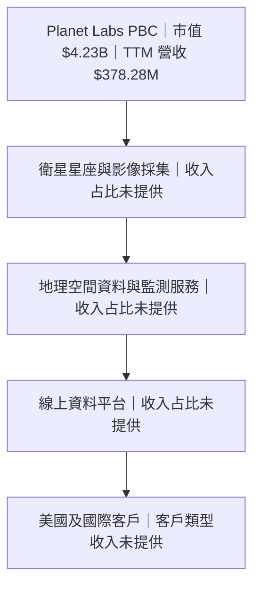
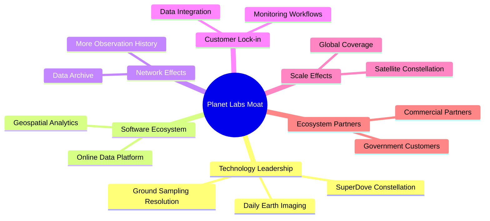
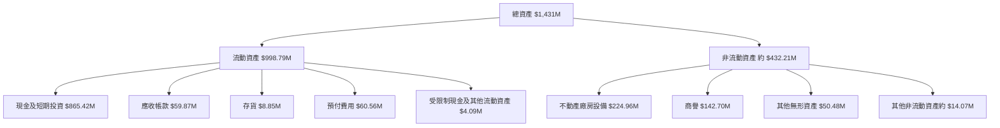
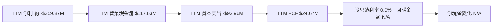
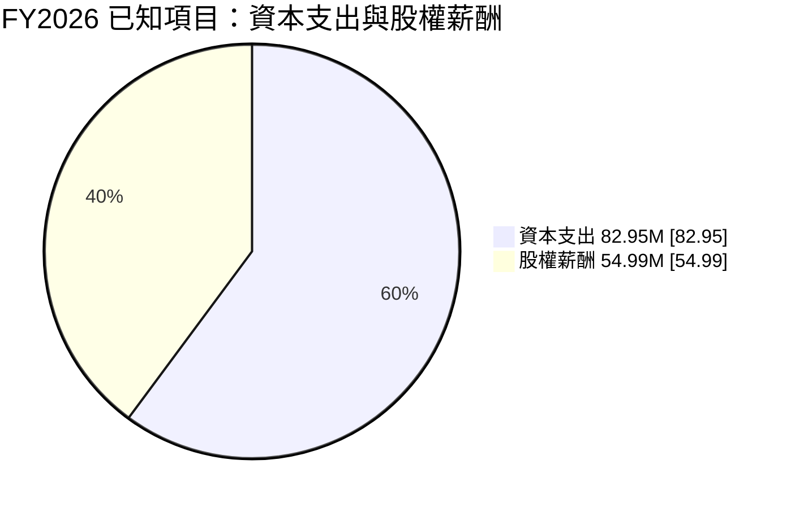
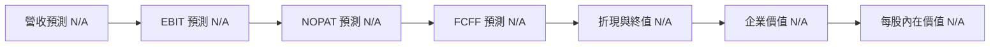
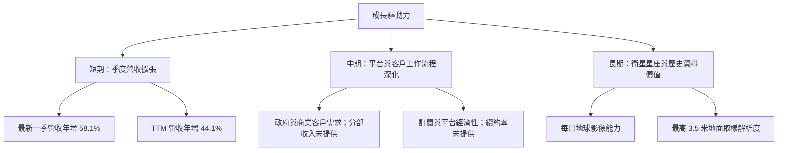
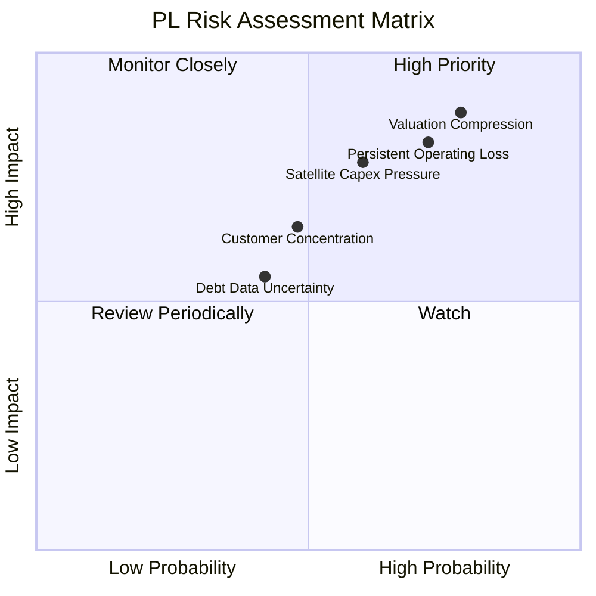
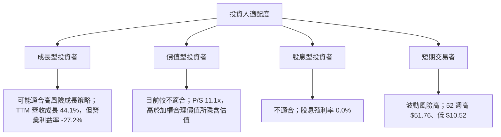

# PL 基本面深度分析報告
> **報告日期**：2026-11-19 ｜ **語言**：繁體中文 ｜ **數據來源**：SEC 申報資料 (XBRL)、Yahoo Finance、Finviz、StockAnalysis、Roic.ai ｜ **分析師**：CFA 級機構研究

## 目錄

| # | 章節 | 核心結論 |
|---|------|----------|
| 1 | 執行摘要 | 賣出；加權合理價值 $7.91，MOS -47.0% |
| 2 | 公司概覽與商業模式 | 每日地球影像及線上地理空間資料平台具差異化，但市場份額資料未提供 |
| 3 | 損益表深度分析 | TTM 營收 $378.28M、成長 44.1%；TTM 營業利益率 -27.2% |
| 4 | 資產負債表分析 | 現金及短期投資 $865.42M；債務欄位存在來源差異 |
| 5 | 現金流量深度分析 | TTM FCF $24.67M、FCF Yield 0.58%；年度 FCF 歷史波動大 |
| 6 | 獲利能力與資本效率 | ROIC 未提供，無法量化比較；負營業利益率顯示尚未證明價值創造 |
| 7 | 相對估值分析 | P/S 11.1x，高於 SPIR、BKSY；高於自身五年中位數 |
| 8 | DCF 內在價值評估 | DCF 不適用；按規定以同業 P/S 與分析師共識加權估值 |
| 9 | 成長催化劑 | 成長率提升及衛星資料需求是潛在催化劑，但具體 TAM、商業化時間未提供 |
| 10 | 風險矩陣 | 估值、持續虧損及高資本需求為主要風險 |
| 11 | 投資建議 | 依 MOS 評級賣出；現價高於加權合理價值，持續追蹤利潤率與現金流 |

---

## 1. 執行摘要

Planet Labs PBC（PL）以 $11.63（2026-11-19 收盤）交易，TTM 營收 $378.28M、年增 44.1%，最新一季營收年增 58.1%；但 TTM 營業利益率仍為 -27.2%，ROIC 數值未提供，且 TTM FCF $24.67M 對 $4.23B 市值的 FCF Yield 僅 0.58%。依固定估值方法計算的加權合理價值為 $7.91，安全邊際 MOS 為 -47.0%，符合 **賣出**門檻；公司營收增長是正面因素，但目前估值已高於同業 P/S 估值與加權價值。

### 1.0 一頁式投資儀表板（Portfolio Manager 30 秒速讀）

| 項目 | 內容 |
|------|------|
| **投資論點（3 句）** | ① TTM 營收成長 44.1%、最新一季年增 58.1%，顯示商業需求在加速。② TTM 營業利益率 -27.2%，尚未證明營收增長能轉化為持續獲利。③ P/S 11.1x，高於 SPIR 4.6x、BKSY 5.8x；加權合理價值 $7.91，低於現價 $11.63。 |
| **綜合評分** | 5.0/10（引用 1.1 評分卡） |
| **財務健康** | 🟡 現金及短期投資 $865.42M、流動比率 2.843；但現金／債務資料來源存在差異，需以後續申報核實。 |
| **ROIC vs WACC** | ROIC：N/A；WACC：12.84%。ROIC 未提供，無法直接計算價值利差；營業利益率為負，營運層面尚未證明正向資本報酬。 |
| **FCF 趨勢** | TTM FCF $24.67M；FCF Yield 0.58%。年度 FCF 從 FY2025 -$68.78M 轉至 FY2026 $51.41M，波動顯著。 |
| **估值** | Forward P/E -9,304.0x（負盈餘下無實用性）｜EV/EBITDA -83.0x｜FCF Yield 0.58% |
| **DCF 內在價值（基準）** | N/A（TTM 營業利益為負，按模型規則不建立 DCF）；DCF 折溢價 N/A。 |
| **安全邊際（MOS）** | **-47.0%**＝($7.91 − $11.63) ÷ $7.91；基準為 8.8 加權合理價值，🔴 無安全邊際。 |
| **預期報酬（基準情境 12M）** | N/A（DCF MODEL 未提供情境值）。以加權合理價值衡量的上行空間為 -32.0%，不是 DCF 情境報酬。 |
| **關鍵風險（前二）** | 高估值與持續虧損；衛星部署及資本支出需求可能令 FCF 再度轉負。 |
| **評級 + 信心度** | 🔴 **賣出** ｜ 信心：中（加權估值訊號明確，但公司債務與部分財務指標來源不一致，且 DCF 不適用）。 |

### 1.1 綜合評分卡（全報告唯一）

| 維度 | 評分（1–10） | 主要依據（引用數字與其來源章節） |
|------|--------------|----------------------------------|
| 成長性 | 8.5 | TTM 營收年增 44.1%、最新一季年增 58.1%（第 3 章）；目前增長加速，但尚未證明可持續。 |
| 獲利能力 | 2.0 | TTM 營業利益率 -27.2%、淨利率 -95.1%、Piotroski F-Score 3/8（第 3、6 章）。 |
| 財務健康 | 7.0 | 現金及短期投資 $865.42M、流動比率 2.843、CCC 55 天（第 4 章）；債務資料有來源差異。 |
| 估值 | 1.0 | MOS -47.0%；P/S 11.1x，高於 SPIR、BKSY 及自身五年中位數 6.9x（第 7、8 章）。 |
| 護城河 | 7.5 | 高頻衛星影像、資料平台及每日成像能力具差異化；客戶集中度、續約率與市場份額未提供（第 2 章）。 |
| 管理層與資本配置 | 4.0 | FY2026 SBC $54.99M，約為該年營收 17.9%；稀釋股數未通過 F-Score 測試，未見股息（第 3、5 章）。 |
| **綜合評分** | **5.0** | 六項算術平均： (8.5 + 2.0 + 7.0 + 1.0 + 7.5 + 4.0) ÷ 6 = 5.0。 |

### 1.2 五大投資論點 + 三大核心風險

| 類型 | 項目 | 具體依據 | 信心度 |
|------|------|----------|--------|
| 🟢 **投資論點①** | 營收成長正在加速 | TTM 營收年增 44.1%；最新一季營收年增 58.1%，高於此前所列季度增長率。若增長來自持續訂閱與新客戶擴張，可能提高平台營運槓桿。 | 🟢 高 |
| 🟢 **投資論點②** | 影像資料供給具有差異化 | 公司以 SuperDove 星座提供每日地球影像，最高地面取樣解析度約 3.5 米；若資料更新頻率形成工作流程依賴，可能提高客戶轉換成本。 | 🟡 中 |
| 🟢 **投資論點③** | 現金儲備提供營運緩衝 | 現金及短期投資 $865.42M；即使債務欄位有資料衝突，現金資產規模仍為重要緩衝。 | 🟡 中 |
| 🟢 **投資論點④** | TTM FCF 已轉正 | TTM 營業現金流 $117.63M、資本支出 $92.96M，官方口徑 FCF $24.67M；但此現金流基礎仍不足以支撐目前市值的高倍數。 | 🟡 中 |
| 🟢 **投資論點⑤** | 顧客用途涵蓋多類監測需求 | 地理空間資料可用於政府、國防、農業及商業監測；具體各板塊收入與客戶占比未提供，不能據此推定收入分散程度。 | 🟡 中 |
| 🟡 **風險①** | 估值倍數收縮 | P/S 11.1x，高於同業 SPIR 4.6x、BKSY 5.8x，且高於自身五年中位數 6.9x；若增長低於預期，倍數下修可能放大股價跌幅。 | 🔴 高衝擊 |
| 🔴 **風險②** | 尚未達到營業獲利 | TTM 營業利益率 -27.2%、FY2026 營業虧損 $95.07M；若收入增長未伴隨費用率下降，虧損可能延續。 | 🔴 高 |
| 🟡 **風險③** | FCF 與資本支出波動 | FY2025 FCF -$68.78M、FY2026 $51.41M，年度現金流變動大；衛星建置與發射支出若增加，可能消耗現金儲備。 | 🟡 中 |

### 1.3 快速統計卡片

| 指標 | 公司實際值（期間） | 同業中位數 | 狀態 |
|------|--------------------|------------|------|
| 營收成長（TTM） | **44.1%** | — | 🟢 |
| 營收成長（最新一季年增） | **58.1%** | 72.7%（SPIR、BKSY、RKLB） | 🟢 |
| 毛利率（TTM） | **55.5%** | 40.3%（SPIR）、73.4%（BKSY）、36.2%（RKLB），中位數 40.3% | 🟢 |
| 營業利益率（TTM） | **-27.2%** | — | 🔴 |
| ROIC（TTM） | **N/A** | — | 🟡 |
| Forward P/E | **-9,304.0x** | -17.8x（SPIR）、-67.1x（BKSY）、712.3x（RKLB） | 🔴 |
| FCF Yield（TTM） | **0.58%** | — | 🟡 |
| Piotroski F-Score | **3 / 8** | — | 🔴 |

> 同業最新一季營收成長率中位數為排序後的中間值 72.7%（SPIR 42.1%、BKSY 118.4%、RKLB 72.7%）。公司毛利率高於同業中位數，但虧損及估值倍數仍需一併考量。

### 1.4 投資結論

```
╔══════════════════════════════════════════════════════════════════╗
║                    📊 投資結論摘要                               ║
╠══════════════════════════════════════════════════════════════════╣
║  評級：賣出（依加權合理價值 MOS -47.0%）                         ║
║  價格（2026-11-19 收盤）：$11.63                                 ║
║  DCF 內在價值（基準）：N/A（TTM 營業利益為負，模型不適用）      ║
║  安全邊際 MOS：-47.0%（＝($7.91−$11.63)÷$7.91）                 ║
║  加權合理價值（8.8）：$7.91                                      ║
║  綜合評分：5.0/10（引用 1.1）                                    ║
║  適合投資人：可承受高波動、以長期營收增長為主的投資人；不適合   ║
║              追求低估值、穩定獲利或股息收入的投資人             ║
╚══════════════════════════════════════════════════════════════════╝
```

---

## 2. 公司概覽與商業模式

### 2.1 業務結構與收入來源

公司設計、建造並營運衛星星座，將高頻地球影像及地理空間資料透過線上平台提供給客戶。財務資料列出公司整體 TTM 營收 $378.28M，但未提供各產品、客戶類型或軟體服務的收入金額及占比，故不虛構細分比例。



**收入結構判讀：**公司的垂直整合模式將衛星硬體、影像採集及資料交付結合，理論上可透過同一衛星星座服務多個客戶。但資料未提供硬體、資料訂閱及專業服務收入拆分，無法量化高毛利軟體收入占比或經常性收入比重。

### 2.2 市場份額

市場份額數據未提供，亦未提供可核實的全球或特定地理空間影像市場規模，因此不估算市場占比。PL TTM 營收 $378.28M、成長 44.1%，最新一季年增 58.1%，顯示公司規模及增速具一定競爭位置；但與 SPIR、BKSY、RKLB 的業務範圍並非完全相同，營收倍數比較不能直接視為市場份額比較。

### 2.3 競爭護城河分析



### 2.4 護城河強度

| 護城河項目 | 強度（強／中／弱） | 證據（引用數字或事實） | 會削弱它的情況 |
|------------|--------------------|------------------------|----------------|
| 技術與資料頻率 | 中至強 | 公司定位為每天成像，SuperDove 最高解析度約 3.5 米；長期影像資料可能支持變化偵測。 | 競爭者提高重訪頻率、解析度或降低取得成本。 |
| 軟體生態系統 | 中 | 資料透過線上平台交付，具建立客戶工作流程的潛力；平台收入與客戶黏著數據未提供。 | 客戶改用多家供應商或標準化資料接口降低轉換成本。 |
| 網路效應 | 弱至中 | 歷史影像累積可能提升資料價值，但新增客戶是否直接提升既有客戶效用，未有量化證據。 | 歷史資料可替代性增加，或客戶只購買單次資料。 |
| 客戶鎖定 | 中 | 地理監測資料若整合進客戶工作流程，可增加轉換成本；續約率、客戶留存率未提供。 | 政府及商業客戶重新招標、資料採購轉向多源供應。 |
| 規模效應 | 中 | 衛星星座有固定建置及營運成本，TTM 毛利率 55.5%；但營業利益率 -27.2%，規模效益尚未體現為營業獲利。 | 衛星更新、發射及維護成本隨星座擴張同步增加。 |
| 生態夥伴 | 弱至中 | 公司服務美國及國際客戶，新聞提到與 Stoke Space 合作；合作的經濟貢獻未提供。 | 合作關係未能帶來新合約或形成可持續交付能力。 |

第 1.1 節「護城河」評分 7.5/10，主要反映每日影像能力、衛星資料積累及平台交付的差異化；但客戶留存、訂閱收入占比及市場份額缺少量化佐證。

---

## 3. 損益表深度分析

### 3.1 年度收入成長趨勢（近 4 年）

年度營收及同比增長率來自年度損益資料。以下長條僅用於相對呈現年度營收，不代表市場份額。

```
╔══════════════════════════════════════════════════════════════════╗
║             Planet Labs 年度收入趨勢（FY2023-FY2026）            ║
╠══════════════════════════════════════════════════════════════════╣
║  FY2023  $191.26M  ██████████████░░░░░░░░░░  YoY：+15.4%       ║
║  FY2024  $220.70M  ████████████████░░░░░░░░  YoY：+15.4%       ║
║  FY2025  $244.35M  ██████████████████░░░░░░  YoY：+10.7%       ║
║  FY2026  $307.73M  ████████████████████████  YoY：+25.9%       ║
║                                                                  ║
║  FY2023-FY2026 營收 CAGR：                                       ║
║  (307.73 ÷ 191.26)^(1/3) − 1 = 約 17.2%                         ║
╚══════════════════════════════════════════════════════════════════╝
```

年度收入從 FY2023 的 $191.26M 增至 FY2026 的 $307.73M，三年 CAGR 約 17.2%。FY2026 年增 25.9%，高於 FY2025 的 10.7%；最新 TTM 年增更達 44.1%，反映增長速度提升。惟數據未提供增長來自價格、合約擴張或新客戶的分解，因此需追蹤後續營收組成與客戶續約。

### 3.2 季度收入趨勢分析

| 季度 | 營收 | QoQ 成長率 | YoY 成長率 | 備註 |
|------|------|------------|------------|------|
| 2025-10-31 | $81.25M | +6.9% | +32.6% | QoQ 以 2025-07-31 $73.39M 為基期。 |
| 2026-01-31 | $86.82M | +6.9% | +41.1% | QoQ 以 $81.25M 計算；YoY 以 2025-01-31 $61.55M 計算。 |
| 2026-04-30 | $94.15M | +8.4% | +42.1% | QoQ 以 $86.82M 計算；YoY 以 $66.27M 計算。 |
| 2026-07-31 | $116.05M | +23.3% | +58.1% | QoQ 以 $94.15M 計算；YoY 以 $73.39M 計算。 |

季度營收逐季增加，最近一季 QoQ 增速加快至 23.3%。但單季 QoQ 可能受到合約交付時點、季節性及認列節奏影響，不能單獨視為持續增長率；較重要的是後續季度能否維持 YoY 高增長並改善營業虧損。

### 3.3 利潤率演變分析

| 利潤率指標 | FY2023 | FY2024 | FY2025 | FY2026 | 趨勢 | 評估 |
|------------|--------|--------|--------|--------|------|------|
| **毛利率** | 49.2% | 51.2% | 57.2% | 56.1% | 上升後小幅回落 | 🟡 FY2026 仍維持較高毛利，但未能轉為正營業獲利。 |
| **營業利益率** | -91.9% | -75.8% | -45.5% | -30.9% | 持續改善 | 🟡 虧損率收窄；TTM 官方口徑為 -27.2%，最新一季為 -11.6%。 |

> FY2026 毛利率按年度損益表毛利 $172.49M ÷ 營收 $307.73M 計算；同一年度其他來源的毛利列值略有差異，故以年度損益表所列項目計算。

**利潤率演變深度解析：**FY2023 至 FY2026，年度營業利益率由 -91.9% 改善至 -30.9%，相對營收的虧損幅度收窄。可能反映營收增加及固定成本吸收改善；但公司資料未提供可將改善拆分至定價、客戶組合、衛星折舊或人力成本的明細。FY2026 毛利率約 56.1%，仍有 $95.07M 營業虧損，說明研發、銷售及管理費用負擔仍重大。TTM 營業利益率 -27.2% 與最新一季 -11.6% 顯示近期可能進一步改善，惟單季結果需後續數季驗證。

### 3.4 費用結構分析

N/A（數據未提供：缺少完整、同一期間的研發、銷售及管理費用拆分，且無法以現有數字建立不重複計算的費用組成圖）。已知 FY2026 研發費用為 $106.75M；年度營業虧損為 $95.07M。僅憑這兩項不能推導全部費用項目。

### 3.5 季度 EPS 趨勢與盈餘品質（Quality of Earnings）

| 季度 | EPS 實際值 | EPS 預估 | 超預期／不及預期 |
|------|------------|----------|------------------|
| 2025-10-31 | -$0.19 | N/A | N/A（預估值缺失） |
| 2026-01-31 | -$0.48 | N/A | N/A（預估值缺失） |
| 2026-04-30 | -$0.40 | N/A | N/A（預估值缺失） |
| 2026-07-31 | -$0.03 | N/A | N/A（預估值缺失） |

資料中的四季 EPS estimate 均為 NaN，故無法判斷盈餘是否超預期或不及預期。EPS 由 -$0.48 改善至 -$0.03，但單季淨利及 EPS 受非營業項目影響，不能只憑 EPS 判定核心營運已轉盈。

| 盈餘品質項目 | 數值／佔比 | 評估 |
|--------------|-----------|------|
| 股權薪酬 SBC / 營收 | FY2026：$54.99M ÷ $307.73M = **17.9%** | 🔴 SBC 是實質稀釋成本；比重高，會削弱每股股東回報。 |
| SBC / 營業現金流 | FY2026：$54.99M ÷ $134.36M = **40.9%** | 🔴 SBC 相當於當年度營業現金流約四成；兩者為 FY2026 同期間數據。 |
| FCF / 淨利（現金轉換率） | TTM 淨利約 -$359.87M；TTM FCF $24.67M，比例約 **-6.9%** | 🔴 淨利為負，傳統現金轉換率不具常規解讀；正 FCF 不能代表 GAAP 獲利已健康。 |
| 一次性／非經常性損益 | FY2026 淨利 -$246.86M，FY2026 Q2 淨利 -$138.87M；單項調整明細 N/A | 🟡 單季淨利波動大，缺少調整項目明細，無法判斷一次性損益方向。 |
| 有效稅率異常 | N/A | N/A（未提供可核實的 TTM 稅前所得及所得稅費用拆分）。 |
| 資本化支出 vs 費用化 | TTM 資本支出 $92.96M；FY2026 研發費用 $106.75M | 🟡 資本支出與研發為不同會計項目；缺少資本化政策細節，不能斷定有成本遞延或利潤高估。 |

**盈餘品質結論：**TTM 淨利率 -95.1%、營業利益率 -27.2%，且 SBC 占 FY2026 營收 17.9%，現階段 GAAP 盈餘品質偏弱。正的 TTM FCF 是改善訊號，但年度 FCF 歷史波動大；SBC 雖不直接作為現金流出，仍透過股數稀釋降低每股價值。

---

## 4. 資產負債表分析

### 4.1 資產結構分解

以下採用 2026-07-31 資產負債表項目；總資產 $1,431M，流動資產 $998.79M，非流動資產約 $432.21M。



現金及短期投資約占流動資產 86.6%（$865.42M ÷ $998.79M），資產流動性主要由現金類資產支撐。非流動資產中，PP&E 約 $224.96M，符合衛星及相關設備具有資本密集特徵；折舊及未來更新需求是評估長期 FCF 的關鍵。

### 4.2 流動性與營運資金分析

| 指標 | 最新 TTM | 一年前 TTM | 變化 | 解讀 |
|------|----------|------------|------|------|
| 流動比率 | 2.843 | N/A | N/A | 流動資產覆蓋流動負債能力較高；同期間流動負債列值需依最新申報核實。 |
| 速動比率 | 2.634 | N/A | N/A | 顯示現金及應收款等速動資產提供較大流動性緩衝。 |
| DSO 應收帳款天數 | 58 天 | 72 天 | -14 天 | 收款天數下降，通常意味著應收款周轉改善；仍需留意政府及大型客戶付款時點。 |
| DIO 存貨天數 | 19 天 | N/A | N/A | 一年前數值未提供；無法判斷存貨周轉趨勢。 |
| DPO 應付帳款天數 | 22 天 | 37 天 | -15 天 | 付款天數下降，可能反映付款時點或供應商條款變動；不能單憑數字推斷議價力。 |
| CCC 現金轉換週期 | 55 天 | N/A | N/A | 一年前 CCC 未提供；本期應收、存貨及應付天數合計呈現資金占用約 55 天。 |

資料顯示 DSO 改善 14 天，但 DPO 下降 15 天；應收款改善的現金效益可能部分被較快付款抵銷。DIO 一年前及 CCC 一年前均為 N/A，不對缺值反推。

### 4.3 債務結構分析

財務數據的核實口徑將總債務列為 N/A、淨現金列為 $865.42M；其他市場資料則列總債務 $498.62M、淨現金／淨債務 $366.79M。由於來源欄位不一致，本報告不以其中一組數字替換核實口徑，也不以有衝突的債務數字計算槓桿倍數。

```
╔══════════════════════════════════════════════════════════════════╗
║                 Planet Labs 債務健康診斷                         ║
╠══════════════════════════════════════════════════════════════════╣
║  總債務（核實口徑）：N/A；其他來源列 $498.62M，需核對申報口徑   ║
║  現金及短期投資：  $865.42M                                      ║
║  淨現金（核實欄位）：$865.42M；未以不同來源數字重新計算         ║
║  Debt/EBITDA：    N/A（債務口徑衝突，且 EBITDA 為負）            ║
║  Interest Coverage：N/A（缺少同口徑利息費用與債務明細）         ║
║  流動比率：       2.843                                         ║
║  評估：🟡 現金儲備充足，但債務總額及淨現金須以 SEC 申報核實      ║
╚══════════════════════════════════════════════════════════════════╝
```

### 4.4 股東權益趨勢

| 年度 | 股東權益 | 年變化 | 解讀 |
|------|----------|--------|------|
| 2023-01-31 | $576.10M | — | 基準年度。 |
| 2024-01-31 | $518.02M | -$58.08M | 虧損及股東權益變動使權益下降。 |
| 2025-01-31 | $441.29M | -$76.73M | 權益持續減少。 |
| 2026-01-31 | $188.43M | -$252.86M | 降幅擴大；同期淨虧損 $246.86M，主要背景為持續虧損，但權益變動尚需完整股東權益表拆分。 |

```
╔══════════════════════════════════════════════════════════════════╗
║                 股東權益趨勢（年度）                             ║
╠══════════════════════════════════════════════════════════════════╣
║  2023-01-31  $576.10M  ████████████████████████                 ║
║  2024-01-31  $518.02M  ██████████████████████                   ║
║  2025-01-31  $441.29M  ██████████████████                       ║
║  2026-01-31  $188.43M  ████████                                 ║
╚══════════════════════════════════════════════════════════════════╝
```

---

## 5. 現金流量深度分析

### 5.1 現金流量瀑布圖

現金流瀑布使用核實 TTM 口徑。股息殖利率為 0.0%；回購及淨現金變動金額未提供。



> TTM 淨利約數由 TTM 淨利率 -95.1% 乘以營收 $378.28M 得出，為近似值；瀑布圖不表示淨利直接加總到營業現金流，兩者間包含非現金項目及營運資金變動。

### 5.2 FCF 轉換率趨勢

| 財年 | 淨利 | FCF | FCF / 淨利 | 解讀 |
|------|------|-----|------------|------|
| FY2023 | -$161.97M | -$86.69M | 約 53.5% | 分子與分母皆為負，比例不代表正常現金轉換率。 |
| FY2024 | -$140.51M | -$93.12M | 約 66.3% | 仍為虧損且 FCF 為負，經營現金尚未自我支持。 |
| FY2025 | -$123.20M | -$68.78M | 約 55.8% | 虧損縮小，但 FCF 仍為負。 |
| FY2026 | -$246.86M | $51.41M | 約 -20.8% | 淨利虧損擴大但 FCF 轉正；兩項走勢分歧，須檢查非現金損益及營運資金因素。 |

負淨利下 FCF／淨利比率容易產生誤導，故此表只展示算術關係，不以比例高低作為獲利品質判斷。FY2026 FCF 轉正是正面現金流變化，但淨利同時惡化，後續需要連續期間驗證。

### 5.3 自由現金流趨勢

年度 FCF 依年度現金流量表；TTM FCF 則依核實定義「營業現金流 − 資本支出」計算，期間不同，不互相替代。

```
╔══════════════════════════════════════════════════════════════════╗
║                 自由現金流趨勢（年度／TTM）                      ║
╠══════════════════════════════════════════════════════════════════╣
║  FY2023  -$86.69M  ░░░░░░░░░░░░░░░░░░░░░░░░  FCF 為負          ║
║  FY2024  -$93.12M  ░░░░░░░░░░░░░░░░░░░░░░░░  FCF 為負          ║
║  FY2025  -$68.78M  ░░░░░░░░░░░░░░░░░░░░░░░░  FCF 為負          ║
║  FY2026  +$51.41M  ██████████████░░░░░░░░░░  FCF 轉正          ║
║  TTM     +$24.67M  ███████░░░░░░░░░░░░░░░░░  Yield 0.58%       ║
╚══════════════════════════════════════════════════════════════════╝
```

TTM 營業現金流 $117.63M 扣除資本支出 $92.96M 得到 FCF $24.67M。儘管轉正，FCF Yield 僅 0.58%，表示現金流尚不足以支持現有市值所隱含的高成長預期。

### 5.4 資本配置評估

| 資本配置項目 | 可核實數據 | 評估 |
|--------------|------------|------|
| 資本支出 | TTM $92.96M；FY2026 $82.95M | 衛星與基礎設施支出是業務必要投資；但金額占營收比重不低，需追蹤投資回報。 |
| 股權薪酬 | FY2026 $54.99M | 占 FY2026 營收 17.9%，對現有股東有稀釋成本。 |
| 股息 | 殖利率 0.0% | 未見現金股息回報。 |
| 股票回購 | N/A | 未提供足以核實的回購金額。 |
| 債務與現金變動 | N/A | 債務來源欄位有差異，無法建立完整年度資本配置對帳。 |



> 圓餅圖僅呈現 FY2026 已提供的兩項金額，不代表全部資本配置或總支出組成。

---

## 6. 獲利能力與資本效率

### 6.1 ROE / ROA / ROIC 趨勢

| 指標 | 可得數據 | 評估 |
|------|----------|------|
| ROE | TTM -63.8%（品質數據口徑）；其他彙整來源列 -72.0% | 存在資料口徑差異；依品質指標採用 -63.8%。杜邦分解顯示負淨利率是主要壓力。 |
| ROA | TTM -5.0%（彙整來源） | 為負，反映資產尚未產生正淨利。 |
| ROIC | N/A | 未提供可核實的 ROIC 數值，不能自行推導並冒充已核實數據。 |
| WACC | 12.84% | 採用資本成本資料所列數值。 |
| 行業均值對比 | N/A | 未提供可引用同口徑行業均值。 |

### 6.2 ROIC vs WACC 分析（核心價值創造判斷）

```
╔══════════════════════════════════════════════════════════════════╗
║                ROIC vs WACC 深度分析                            ║
╠══════════════════════════════════════════════════════════════════╣
║  WACC（採用核實資本成本資料）：12.84%                            ║
║  ├── 無風險利率（10Y 美債）：       5.05%                        ║
║  ├── 市場風險溢酬 ERP：             5.00%                        ║
║  ├── 原始 Beta（Yahoo）：           2.27                         ║
║  ├── 調整後 Beta（採用）：          1.85                         ║
║  ├── Beta 調整：                    ⅔ × 2.27 + ⅓ × 1 = 1.85     ║
║  ├── 股權成本（提供值）：           14.29%                       ║
║  ├── 稅前債務成本（提供值）：       0.69%                        ║
║  ├── 稅率：                         21.0%                        ║
║  ├── 股權／債務權重：               89.5%／10.5%                 ║
║  └── ✅ WACC：                      12.84%                       ║
║                                                                  ║
║  ROIC：N/A（數據未提供，不以不完整資產負債項目自行推算）          ║
║  EVA（ROIC − WACC）：N/A                                           ║
║                                                                  ║
║  結論：無法量化 ROIC 相對 WACC 的差額；但 TTM 營業利益率 -27.2% ║
║        表示當前營運仍處於虧損，尚未證明已創造正向股東價值。     ║
╚══════════════════════════════════════════════════════════════════╝
```

資本成本資料列示股權成本 14.29%，由已顯示的四捨五入輸入代入 CAPM 可得 5.05% + 1.85 × 5.00% = 14.30%；0.01 個百分點差異可由底層未四捨五入輸入造成。WACC 直接採用提供值 12.84%，不另行替換。由於 ROIC 未提供，不能用營業利益率代替 ROIC，也不能宣稱已精確計算 EVA；目前負營業利益率則足以說明營運尚未達到獲利成熟階段。

### 6.3 杜邦三因素分解

| 因素 | 數值（TTM） | 解讀 |
|------|-------------|------|
| 淨利率 | -95.1% | 負淨利率是 ROE 為負的主要驅動因素。 |
| 資產週轉率 | 0.26 | 每單位資產產生的營收有限，反映衛星及平台資產投入較重。 |
| 權益乘數 | 2.54 | 財務槓桿提高 ROE 對淨利率變動的敏感度，但並未扭轉負報酬。 |
| **ROE** | **-63.8%** | 品質指標原值：-95.1% × 0.26 × 2.54 = -63.8%（四捨五入後）。 |

### 6.4 財務體質：Piotroski F-Score

**Piotroski F-Score：3/8**。缺少一項長期負債測試輸入，因此分母為八項可判定測試，而不是九項。

| 測試 | 結果 | 解讀 |
|------|------|------|
| ROA > 0 | ❌ 未通過 | 公司仍未以資產取得正向回報。 |
| 營業現金流 > 0 | ✅ 通過 | TTM 營業現金流為 $117.63M。 |
| ROA 高於一年前 | ❌ 未通過 | 品質指標判定未改善。 |
| 營業現金流 > 淨利（應計品質） | ✅ 通過 | 現金流高於淨利；但淨利為負，仍需看現金流可持續性。 |
| 長期負債 ÷ 總資產低於一年前 | — 無法判定 | 缺少所需資料，不作補算。 |
| 流動比率高於一年前 | ✅ 通過 | 流動性相較一年前改善。 |
| 稀釋股數未增加 | ❌ 未通過 | 股數增加會稀釋每股經濟價值。 |
| 毛利率高於一年前 | ❌ 未通過 | 品質指標判定毛利率同比未通過。 |
| 資產週轉率高於一年前 | ❌ 未通過 | 資產使用效率未改善。 |

F-Score 3/8 顯示現金流及流動性有正面項目，但獲利、稀釋與資產效率仍是弱項。尤其股權薪酬與稀釋股數增加，意味營收增長不一定等比例轉化為每股價值增長。

---

## 7. 相對估值分析

### 7.1 同業估值比較表格

| 估值指標 | **PL** | **SPIR** | **BKSY** | **RKLB** | 本公司評估 |
|----------|--------|---------|---------|---------|-----------|
| **Trailing P/E** | N/A | N/A | N/A | N/A | 🔴 PL 尚未盈利；同業也多數無可用 TTM P/E。 |
| **Forward P/E** | -9,304.0x | -17.8x | -67.1x | 712.3x | 🔴 PL 的前瞻 EPS 接近零且為負，倍數不具穩定解讀性。 |
| **P/S Ratio** | 11.1x | 4.6x | 5.8x | 38.9x | 🔴 高於 SPIR、BKSY；低於高估值的 RKLB。 |
| **EV/EBITDA** | -83.0x | -3.7x | 762.5x | -169.0x | 🟡 同業盈利狀況差異大，負 EBITDA 或極高倍數不宜機械比較。 |
| **最新一季營收年增** | 58.1% | 42.1% | 118.4% | 72.7% | 🟢 PL 增速高於 SPIR、低於 BKSY 及 RKLB。 |
| **毛利率（TTM）** | 55.5% | 40.3% | 73.4% | 36.2% | 🟢 高於同業中位數 40.3%；但毛利率優勢尚未轉成營業獲利。 |

同業倍數由 Yahoo Finance 同業資料提供；PL 的市場倍數來自市場資料。SPIR、BKSY、RKLB 商業模式與收入組成各有差異，尤其 RKLB 的 P/S 38.9x 不宜當作 PL 的直接合理倍數。相對估值方法所用的同業中位數 P/S 依固定方法採 SPIR 與 BKSY 的中位數 5.2x。

### 7.2 歷史估值區間分析

歷史估值資料提供的是 P/S，而非 P/E，因此以下呈現 P/S 五年區間。

```
╔══════════════════════════════════════════════════════════════════╗
║               PL 自身五年 P/S 估值區間                           ║
╠══════════════════════════════════════════════════════════════════╣
║  五年低點：2.1x      五年中位數：6.9x      五年高點：38.1x      ║
║  目前：11.1x         百分位：79%                                  ║
║                                                                  ║
║  評估：目前 P/S 高於中位數 6.9x，位於自身五年區間偏高位置。     ║
╚══════════════════════════════════════════════════════════════════╝
```

目前 P/S 11.1x 約為五年中位數 6.9x 的 1.61 倍；雖仍遠低於歷史高點 38.1x，但目前百分位為 79%，估值緩衝有限。歷史高倍數不構成合理價值依據。

### 7.3 情境價值（Bear / Base / Bull）

**N/A（DCF 無法計算：TTM 營業利益不為正，DCF MODEL 未提供情境值）。**依估值規則，不自行設定悲觀、基準或樂觀 DCF 目標價。

### 7.4 相對估值隱含價格區間

```
╔══════════════════════════════════════════════════════════════════╗
║                  相對估值方法與每股價值                          ║
╠══════════════════════════════════════════════════════════════════╣
║  同業 P/S 估值：                 $5.43                           ║
║  分析師共識目標價：              $30.27                          ║
║  現價（2026-11-19 收盤）：       $11.63                          ║
║                                                                  ║
║  $5.43 ───────────── $11.63 ─────────────────── $30.27          ║
║  同業 P/S              現價                       分析師共識     ║
╚══════════════════════════════════════════════════════════════════╝
```

- **同業 P/S：$5.43**。固定估值資料採用 SPIR 4.6x 與 BKSY 5.8x 的同業中位數 5.2x，乘以 PL TTM 營收，再依估值方法模型折算至每股價值。
- **分析師共識：$30.27**。來自 11 位分析師的平均目標價；低端 $17.00、高端 $50.00。此為分析師預期，不是公司已實現的財務價值。
- 兩個方法的差距很大，反映共識目標價對未來增長及利潤改善的假設，顯著高於同業 P/S 方法所支持的價值。

---

## 8. DCF 內在價值評估（Discounted Cash Flow）

> **DCF MODEL：N/A。**TTM 營業利益不為正，核實估值模型依規則不以負營業所得建立 DCF。本章 8.1–8.7 按要求標示 N/A，不另建模型、不自行補入預測值。估值判斷採用 8.8 的固定估值方法。

### 8.0 估值推理鏈（Thinking Logic：在算之前先想清楚）

**Step 1 — PL 價值由哪些變數決定？**  
PL 的估值主要取決於現有影像資料業務的持續收入（目前公司整體 TTM 營收 $378.28M）、營收增長轉化為營業利潤及 FCF 的能力，以及未來衛星與資料平台需求。各業務線占營收比重未提供，不能把整體營收拆成具體業務比重。根據現有財務資料，**營業利潤率轉正及 FCF 持續性**是最可能改變估值的營運變數：最新一季營業利益率 -11.6%，但 TTM 仍為 -27.2%。

**Step 2 — 模型選擇**

| 決策點 | 本報告採用 | 理由（含數字） | 曾考慮但否決 | 否決理由 |
|--------|-----------|----------------|--------------|----------|
| 現金流定義 | DCF 不建立 | TTM 營業利益為負，模型明確標示 N/A | FCFF 自建模型 | 不符合 DCF MODEL 唯一模型及禁止自行推算的規則。 |
| 預測期 N | N/A | 模型未提供預測期間 | 自行指定 5 年或 10 年 | 會形成未經程式核實的假設。 |
| 終值方法 | N/A | DCF 模型未提供終值假設 | Gordon Growth／退出倍數 | 需自行建模，違反資料引用規則。 |
| EBIT 基礎 | N/A | 不建立 DCF | GAAP／非 GAAP EBIT 預測 | 缺少核實預測數據。 |

**Step 3 — 關鍵假設推導鏈**  
營收 CAGR、期末營業利潤率、有效稅率、Capex／營收、D&A／營收、ΔWC、SBC 處理、稀釋率、g、終值方法及 WACC 的 DCF 應用值均未提供。由於 DCF MODEL 為 N/A，不以歷史或主觀假設替代。

**Step 4 — 最脆弱的一環**  
即使營收延續最新一季 58.1% 的同比增長，若營業利益率無法從 TTM -27.2% 持續收斂，估值仍可能無法由現金流支撐；現有資料不足以量化該風險的 DCF 價值影響。

**Step 5 — 計算路徑圖**



### 8.1 模型假設總表（Model Inputs）

| 假設項目 | 採用值 | 依據／來源 | 敏感度 |
|----------|--------|-------------|--------|
| 預測期長度 N | N/A | DCF MODEL 未建立 | N/A |
| 營收 CAGR（預測期） | N/A | 模型未提供；歷史增長不等同預測 | N/A |
| 營業利潤率（期末） | N/A | TTM 營業利益率 -27.2%，但無模型預測 | N/A |
| 有效稅率 | N/A | 21.0% 僅為資本成本資料的預設稅率，不能默認為 DCF 實際假設 | N/A |
| Capex / 營收 | N/A | 模型未提供；TTM 資本支出 $92.96M 不足以建立完整預測 | N/A |
| 折舊攤銷 D&A / 營收 | N/A | 模型未提供 | N/A |
| 營運資金變動 / 營收增額 | N/A | 模型未提供 | N/A |
| EBIT 基礎 | N/A | 無 DCF 預測 | N/A |
| 股權薪酬 SBC 處理 | N/A | 無 DCF 預測 | N/A |
| 年稀釋率（股數） | N/A | 模型未提供 | N/A |
| 永續成長率 g | N/A | 模型未提供 | N/A |
| 終值方法 | N/A | 模型未提供 | N/A |
| WACC | 12.84%（資本成本資料值） | 8.2 節列示；不是 DCF 可用性或估值本身的充分條件 | N/A |

DCF 的年預測表、逐年 FCFF、終值及現值均為 **N/A（TTM 營業利益不為正，DCF MODEL 未提供）**。因此不作逐年算式或敏感性矩陣，以免填入未經核實的模型數字。

### 8.2 折現率推導（WACC）

WACC 在資本效率分析與估值分析中均採用核實資本成本資料的 **12.84%**。Beta 原始值 2.27，採用調整後 Beta 1.85；調整方式為 ⅔ × 2.27 + ⅓ × 1 = 1.85。

```
╔══════════════════════════════════════════════════════════════════╗
║                    WACC 推導（折現率）                           ║
╠══════════════════════════════════════════════════════════════════╣
║  股權成本 Ke（CAPM，提供值）：14.29%                            ║
║  ├── 無風險利率 Rf（10Y 美債）：       5.05%                     ║
║  ├── 市場風險溢酬 ERP：                5.00%                     ║
║  ├── 原始 Beta（Yahoo）：              2.27                      ║
║  ├── 調整後 Beta（採用）：             1.85                      ║
║  ├── Beta 調整：                       ⅔ × 2.27 + ⅓ × 1 = 1.85  ║
║  └── Ke：                              14.29%（採用提供值）      ║
║                                                                  ║
║  債務成本：                                                    ║
║  ├── 稅前債務成本（提供值）：          0.69%                     ║
║  ├── 稅率（預設）：                    21.0%                     ║
║  └── 稅後 Kd 算術：0.69% × (1 − 21.0%) = 約 0.545%              ║
║                                                                  ║
║  資本結構（提供權重）：E 89.5%／D 10.5%                         ║
║  └── ✅ 採用 WACC：12.84%（資本成本資料原值）                   ║
╚══════════════════════════════════════════════════════════════════╝
```

Rf、ERP、Beta、資本權重及稅前債務成本均依資本成本資料列示；該資料未提供無風險利率的精確觀察日、股權市值／計息負債的明細算式或規模溢酬，因此不自行補算。依已顯示的四捨五入輸入重算 WACC 可能與 12.84% 相差數個基點，故依規則直接採用提供的 12.84%，不另建 WACC。因 DCF MODEL 為 N/A，WACC 不轉化成 DCF 折現價值。

### 8.3 逐年自由現金流預測（基準情境）

**N/A（DCF MODEL 未提供；原因：TTM 營業利益不為正）。**逐年營收、EBIT、NOPAT、FCFF、折現因子、預測期現值總和及逐步演算均不適用，不能自行建立替代預測。歷史 TTM FCF $24.67M 不等同未來預測 FCF，也不作為模型輸入替代值。

### 8.4 終值計算（Terminal Value）

**N/A（DCF MODEL 未提供預測期 FCFF、永續成長率 g 或退出倍數）。**不進行 Gordon Growth 或退出倍數計算。

### 8.5 企業價值 → 每股內在價值（Bridge）

**N/A（DCF MODEL 未提供企業價值橋接）。**因缺少預測期現金流及終值，不推算 DCF 每股價值。價格相對 DCF 內在價值的折溢價亦為 N/A；本報告不以相對估值價值代替 DCF 價值。

### 8.6 敏感性分析（WACC × 永續成長率）

**N/A（DCF MODEL 未提供基準每股價值、預測現金流或永續成長率）。**不自行建立 5×5 矩陣，不提供 DCF 三情境或機率加權價值。

### 8.7 反推 DCF（Reverse DCF：市場在預期什麼）

**N/A（DCF MODEL 未提供）。**現價 $11.63 可與相對估值及分析師目標價比較，但不能在缺少基準模型的情況下反解營收 CAGR、利潤率或高成長年數。

### 8.8 估值三角驗證與安全邊際

| 估值方法 | 隱含每股價值 | 上行空間（÷現價） | 權重 | 說明 |
|----------|--------------|-------------------|------|------|
| 同業 P/S | $5.43 | -53.3% | 90% | 同業中位數 P/S 5.2x（SPIR、BKSY）按固定估值方法套用 PL TTM 營收。 |
| 分析師共識目標價 | $30.27 | +160.3% | 10% | 11 位分析師平均目標價；參考性較高，並非可驗證現金流價值。 |
| **加權合理價值** | **$7.91** | **-32.0%** | **100%** | 按不盈利公司固定權重；同業 Forward P/E 無法計算，其權重依固定方法分配至可用方法。 |

**逐步演算（權重外顯）：**

\[
\$5.43 \times 90\% + \$30.27 \times 10\%
= \$4.887 + \$3.027
= \$7.914
\approx \$7.91
\]

權重合計為 90% + 10% = 100%。加權合理價值的列示值採 $7.91；未再作事後估值折讓。

- **MOS** = ($7.91 − $11.63) ÷ $7.91 = -$3.72 ÷ $7.91 = **-47.0%**。
- **上行空間** = ($7.91 − $11.63) ÷ $11.63 = -$3.72 ÷ $11.63 = **-32.0%**。
- **折溢價**以 DCF 基準價值為分母；DCF 為 N/A，故折溢價為 **N/A**。
- 依 MOS 規則，-47.0% 低於 -25%，評級為 **賣出**，沒有作一級質化調整。

```
╔══════════════════════════════════════════════════════════════════╗
║                  估值區間與安全邊際                              ║
╠══════════════════════════════════════════════════════════════════╣
║  同業 P/S $5.43 ─── 加權合理值 $7.91 ─── 現價 $11.63 ─── 共識 $30.27║
║                                                                  ║
║  安全邊際 MOS = ($7.91 − $11.63) ÷ $7.91 = -47.0%               ║
║  MOS 評估：🔴 無安全邊際                                         ║
║  上行空間 = ($7.91 − $11.63) ÷ $11.63 = -32.0%                  ║
║  DCF 折溢價：N/A（DCF 基準內在價值未提供）                       ║
║                                                                  ║
║  評級門檻價格參考：                                               ║
║  MOS ≥ 10% 對應價格上限：$7.91 × 90% = 約 $7.12                 ║
║  MOS = 0% 對應價格：$7.91                                        ║
║  MOS = -25% 對應價格：$7.91 ÷ 75% = 約 $10.55                   ║
╚══════════════════════════════════════════════════════════════════╝
```

> 🔎 **程式複算（Python，依本節各項自動重算）**
>
> 加權合理價值 = $5.43 × 90% + $30.27 × 10% = **$7.91**（權重合計 100%）
>
> 以價格 $11.63 計：MOS = **-47.0%**，上行空間 = **-32.0%**
>
> ✅ 與本節所寫數值一致。

### 8.9 DCF 模型的局限與失效條件

- **終值依賴度：**N/A；DCF 未建立，沒有可核實的終值占 EV 比重。
- **最脆弱的假設：**沒有可報告的 DCF 假設。就營運觀察而言，營收增長能否轉為正營業利益、以及 TTM FCF 能否持續為正，是目前最重要的驗證事項。
- **不適用情境說明：**公司 TTM 營業利益率為 -27.2%，而 TTM FCF 雖為正，年度 FCF 仍從 FY2025 -$68.78M 轉至 FY2026 $51.41M，波動較大。對此類尚未穩定獲利的公司，應將同業 EV/Sales、P/S、單位經濟性及現金跑道作為補充，並在轉盈後再採用 DCF。
- **與第 10 章風險矩陣的連結：**增長放緩衝擊收入預期；衛星資本支出上升壓低 FCF；競爭或政府採購延遲則可能同時降低營收成長與營業利潤率。

### 8.10 複算檢核表（Audit Trail：輸出前自我驗算）

| # | 檢核項目 | 檢查方式 | 結果 |
|---|----------|----------|------|
| 1 | 所有 DCF 高／中敏感度輸入都有四段式推導 | DCF MODEL 為 N/A；沒有輸入可推導 | ✅（依規則標示 N/A，未另建模型） |
| 2 | 每個 DCF 假設都有來歷 | 假設表逐項註明模型未提供 | ✅ |
| 3 | WACC 五步算式齊全且相乘相加正確 | 遵守直接採用提供 WACC 的規則；原始底層權重金額未提供 | N/A |
| 4 | Kd 分母與債務權重 D 範圍一致 | 債務總額有資料來源差異，未自行重算 | N/A |
| 5 | WACC 與第 6.2 節同值 | 兩節均採 12.84% | ✅ |
| 6 | 逐年表格年度數等於 N | DCF MODEL 為 N/A，未列預測年度 | N/A |
| 7 | FY+1 FCFF 與 PV 算式可複算 | 無 FY+1 模型數據 | N/A |
| 8 | 預測期 PV 逐項加總 | 無預測期 PV | N/A |
| 9 | WACC > g | g 未提供 | N/A |
| 10 | 終值以 FY+N 現金流為基礎、折現 N 期 | 無終值模型 | N/A |
| 11 | EV → 每股橋接可複算 | 無 DCF EV 及橋接 | N/A |
| 12 | SBC EBIT／現金流／稀釋三要素相容 | DCF 未建立，不存在模型 SBC 重複扣除 | N/A |
| 13 | 敏感性矩陣基準格等於 DCF 每股價值 | 無 DCF 基準值或矩陣 | N/A |
| 14 | 矩陣只在 WACC > g 時填數 | 無矩陣 | N/A |
| 15 | 三情境機率相加為 100% | DCF 情境未提供，不自行設定 | N/A |
| 16 | 反推 DCF 一次只放開一變數且有疊代軌跡 | 無基準模型 | N/A |
| 17 | MOS 以 8.8 加權價值為分母；折溢價以 8.5 DCF 值為基準 | MOS -47.0%；DCF 折溢價 N/A | ✅ |
| 18 | 報告完整輸出至第 11 章 | 章節 1–11 均列出 | ✅ |
| 19 | 加權價值等於各估值項目的加權和 | $5.43×90% + $30.27×10% = $7.914，列示 $7.91 | ✅ |
| 20 | 評級符合 MOS 門檻 | MOS -47.0% < -25%，採賣出，未調整 | ✅ |

> N/A 項目代表估值模型本身未提供或底層輸入不足，非已完成 DCF 並通過複算；估值信心因 DCF 不適用及債務資料來源差異而受限。

---

## 9. 成長催化劑

### 9.1 催化劑時間軸

公司未提供可核實的催化劑發生日期、簽約金額或產品商業化時間，因此不以假定日期繪製甘特圖。

| 時間範圍 | 可追蹤催化劑 | 已有量化依據 | 投資觀察點 |
|----------|--------------|--------------|------------|
| 短期：未來財報 | 最新增長能否延續 | TTM 營收成長 44.1%；最新一季年增 58.1% | 營收同比、營業利益率及 FCF 是否同步改善。 |
| 中期：資料未提供 | 平台、政府及商業客戶擴張 | 客戶類型收入拆分及合約金額未提供 | 追蹤續約、訂單、遞延收入與客戶集中度。 |
| 長期：資料未提供 | 更高頻率及歷史影像資料商業化 | 公司目標為每日成像，最高解析度約 3.5 米 | 追蹤新衛星部署、單位成本與資料使用收入。 |

### 9.2 TAM 市場規模分析

**N/A（TAM 數據未提供）。**目前可量化的是 PL TTM 營收 $378.28M、TTM 成長 44.1%及最新一季年增 58.1%；但缺少具來源與年份的市場規模，不能計算滲透率。若公司能將高頻影像資料擴展至更多客戶及用途，營收仍可能成長，但其可服務市場規模及可獲利部分需待公司揭露與外部資料佐證。

### 9.3 成長驅動力結構圖



短期增長有近期財務數字支持；中長期催化劑則仍是業務模式上的可能性，缺乏合約金額、滲透率及單位經濟資料，不應視為已實現的財務增長。

---

## 10. 風險矩陣

### 10.1 風險評分矩陣

以下象限位置為定性風險排序，不代表財務報表中的實際發生機率統計。



### 10.2 風險清單詳細分析

| # | 風險項目 | 發生機率 | 財務衝擊 | 風險評分 | 緩解措施 |
|---|----------|----------|----------|----------|----------|
| 1 | 🔴 **估值倍數收縮** | 中高；無可驗證頻率 | 高；P/S 從 11.1x 向自身中位數 6.9x 收斂，可能對股價造成顯著壓力；不等同價格預測 | 🔴 高 | 以分批、估值紀律管理部位；追蹤營收、毛利及營業利潤率，避免只按新聞或歷史高點定價。 |
| 2 | 🔴 **虧損延續或轉盈延後** | 中高 | 高；TTM 營業利益率 -27.2%，FY2026 營業虧損 $95.07M | 🔴 高 | 按季檢查營業費用增長是否低於營收增長，並追蹤最新一季 -11.6% 的營業利益率能否延續改善。 |
| 3 | 🟡 **資本支出與 FCF 波動** | 中 | 中高；TTM Capex $92.96M、FCF $24.67M，FY2025 FCF 曾為 -$68.78M | 🟡 高 | 追蹤衛星部署與發射支出、營業現金流及 FCF；若 FCF 轉負且現金下降，重新評估融資需求。 |
| 4 | 🟡 **資料替代與競爭加劇** | 中 | 中高；同業最新季度成長從 42.1% 到 118.4%，競爭者可爭取政府及商業需求 | 🟡 中高 | 觀察續約率、合約勝率、客戶留存及毛利率；相關數據未提供，應要求後續披露。 |
| 5 | 🟡 **股權稀釋** | 中 | 中；FY2026 SBC $54.99M，占營收 17.9%，Piotroski 稀釋股數測試未通過 | 🟡 中高 | 監控稀釋股數同比、SBC／營收及每股營收增長；不只以公司總營收評估股東價值。 |
| 6 | 🟡 **債務資訊口徑不一致** | 中 | 中；核實資料總債務 N/A，其他來源列 $498.62M | 🟡 中 | 以 SEC 10-Q／10-K 債務附註核對借款、租賃及到期日，避免以不一致資料計算淨現金或槓桿。 |

---

## 11. 投資建議

### 11.1 最終評級與評分

依加權合理價值 $7.91 及現價 $11.63 計算，MOS 為 -47.0%，依規則 20 評級為 **賣出**，未作一級調整。公司品質綜合評分為 5.0/10，沿用第 1.1 節六項分數；營收增長與現金儲備是優勢，獲利能力及估值是主要弱項。

### 11.2 合理價值與隱含報酬率

| 方法／情境 | 每股價值 | 相對現價 | 機率／權重 | 解讀 |
|------------|----------|----------|------------|------|
| 同業 P/S | $5.43 | -53.3% | 90% | 同業估值方法的主要權重。 |
| 分析師共識 | $30.27 | +160.3% | 10% | 11 位分析師平均目標價，與相對估值差距大。 |
| **加權合理價值** | **$7.91** | **-32.0%** | **100%** | MOS -47.0%；規則 20 評級為賣出。 |
| DCF 悲觀情境 | N/A | N/A | N/A | DCF MODEL 未提供。 |
| DCF 基準情境 | N/A | N/A | N/A | DCF MODEL 未提供。 |
| DCF 樂觀情境 | N/A | N/A | N/A | DCF MODEL 未提供。 |

### 11.3 買入時機與觸發因素

```
╔══════════════════════════════════════════════════════════════════╗
║                  ✅ 買入觸發因素 Checklist                      ║
╠══════════════════════════════════════════════════════════════════╣
║  現價操作：                                                      ║
║  ☐ 現價 $11.63 高於加權合理價值 $7.91，暫不建議新增部位          ║
║                                                                  ║
║  估值重新評估觸發條件：                                          ║
║  ☐ 股價回落至約 $7.12 或以下，對應 MOS 約 10% 或更高            ║
║  ☐ 營收仍維持同比增長，且營業利益率持續改善                     ║
║                                                                  ║
║  加碼觸發條件：                                                  ║
║  ☐ TTM FCF 持續為正，且資本支出沒有抵銷營業現金流改善           ║
║  ☐ 稀釋股數增長放緩，SBC／營收明顯下降                           ║
║                                                                  ║
║  減碼／重新檢視條件：                                            ║
║  ☐ 最新一季營收年增連續兩季低於 30%                             ║
║  ☐ 營業利益率連續兩季較 -11.6% 惡化                              ║
║  ☐ TTM FCF 轉負，或現金及短期投資持續下降                        ║
╚══════════════════════════════════════════════════════════════════╝
```

$7.12 是以加權合理價值 $7.91 乘以 90% 得出、對應 MOS 10% 的估值門檻，不是 DCF 目標價。若股價回落但基本面同步惡化，仍需重新計算合理價值，不能機械地視為買入訊號。

### 11.4 投資人適配度分析



### 11.5 每季財報監控清單（Quarterly Watch List）

| 監控指標 | 最新基準 | 觸發加碼／正面訊號 | 觸發減碼／負面訊號 |
|----------|----------|-------------------|-------------------|
| 營收同比增長 | 最新一季 58.1%；TTM 44.1% | 增長延續且未依賴單一季度認列 | 連續兩季低於 30%，或明顯低於管理層指引 |
| 營業利益率 | 最新一季 -11.6%；TTM -27.2% | 虧損率持續收窄並能跨季延續 | 連續兩季較最新一季顯著惡化 |
| 毛利率 | TTM 55.5% | 毛利率穩定或提高，且營業費用率同步下降 | 毛利率連續下降或收入增長伴隨毛利惡化 |
| 營業現金流 | TTM $117.63M | 維持正值且品質不依賴一次性營運資金釋放 | 轉負或連續下滑 |
| 資本支出 | TTM $92.96M | 支出增長能帶動營收及產能利用改善 | 支出上升、但營收或 FCF 未改善 |
| FCF | TTM $24.67M；Yield 0.58% | 持續為正並逐步提高 | 轉負且現金餘額持續下降 |
| SBC 與稀釋股數 | FY2026 SBC $54.99M；占營收 17.9% | SBC 占比下降、稀釋股數增長放緩 | SBC 占比上升或稀釋加快 |
| 現金及短期投資 | $865.42M | 維持充足且債務資料經申報核實 | 現金快速下降或需新增高成本融資 |
| 客戶與訂單 | 客戶集中度、續約率及訂單金額 N/A | 公司披露續約、訂單或遞延收入持續改善 | 大型客戶流失、政府採購延遲或訂單取消 |

### 11.6 反面論證：什麼會證明論點錯誤（What Would Change My Mind）

```
╔══════════════════════════════════════════════════════════════════╗
║              ⚠️ 論點失效條件（Disconfirming Evidence）           ║
╠══════════════════════════════════════════════════════════════════╣
║  下列情況將推翻營收成長可轉化為股東價值的正面論點：             ║
║                                                                  ║
║  ☐ 最新一季營收同比連續兩季低於 30%                              ║
║  ☐ 營業利益率連續兩季較 -11.6% 惡化，或 TTM 長期維持 -27.2%附近 ║
║  ☐ TTM FCF 轉負，且下一財年仍未恢復正值                          ║
║  ☐ SBC／營收高於 FY2026 的 17.9%，且稀釋股數持續增加             ║
║  ☐ 現金及短期投資顯著下滑，並需新增融資支應衛星投資              ║
║  ☐ 公司披露資料顯示客戶流失或續約、訂單指標持續惡化              ║
║                                                                  ║
║  估值論點亦需在 P/S 仍高於同業而營業獲利未改善時持續受檢視。     ║
╚══════════════════════════════════════════════════════════════════╝
```

> **免責聲明**：本報告為 AI 自動生成，僅供研究參考，不構成投資建議。投資有風險，入市需謹慎。

---

## 資料與來源

| 項目 | 內容 |
|------|------|
| 價格 | 11.63 USD，2026-11-19 收盤（Yahoo Finance 日線） |
| 財務報表 | SEC 10-Q filed 2026-09-03，最新季度 2026-07-31（FY2027 Q2） |
| 有回應的資料來源 | SEC 申報資料 (XBRL)、Yahoo Finance、Finviz、StockAnalysis、Roic.ai |
| 由程式計算 | TTM 數字、WACC、DCF 模型、估值方法與權重、加權合理價值、MOS、評級門檻、F-Score、杜邦分解、營運資金天數、綜合評分 |
| 撰寫模型 | openai / gpt-6-luna |

> 本區塊由產生報告的程式依實際取得的資料填寫，非模型撰寫。「由程式計算」的數字不是模型的估計；其餘判斷（評分、情境、策略）是模型的分析。
