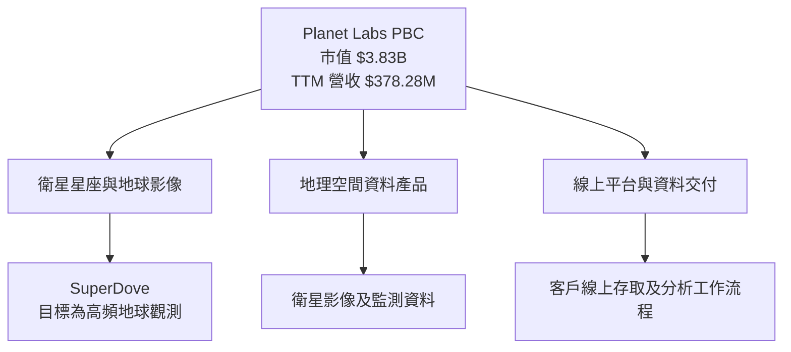
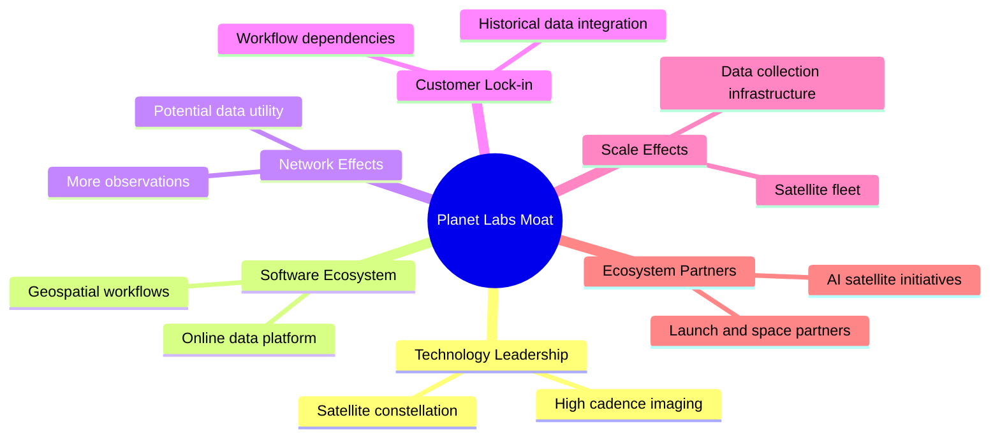
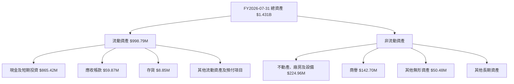
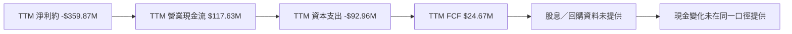
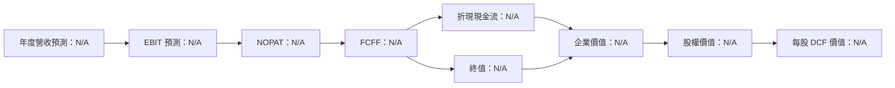
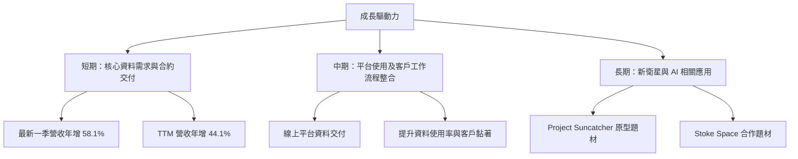
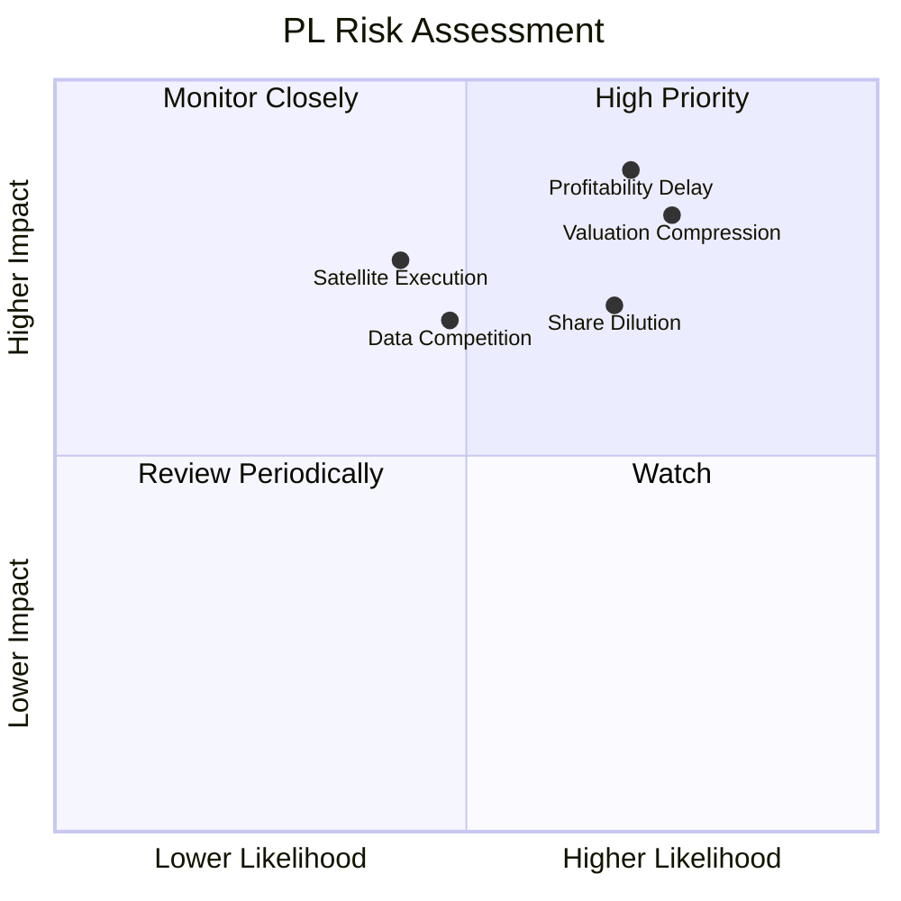
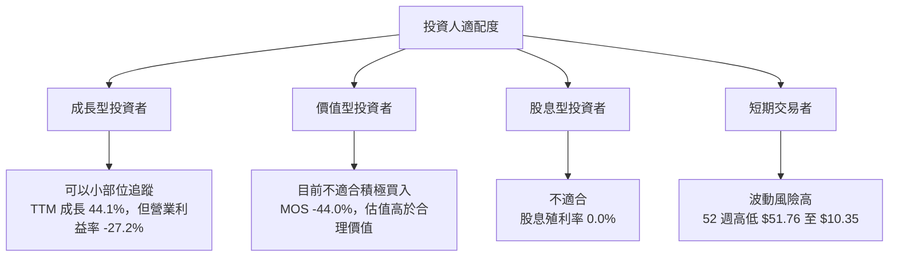

# PL 基本面深度分析報告

> **報告日期**：2026-11-20 ｜ **語言**：繁體中文 ｜ **數據來源**：SEC 申報資料 (XBRL)、Yahoo Finance、Finviz、StockAnalysis、Roic.ai ｜ **分析師**：CFA 級機構研究

## 目錄

| # | 章節 | 核心結論 |
|---|------|----------|
| 1 | 執行摘要 | **賣出**；加權合理價值 **$7.31**；MOS **-44.0%** |
| 2 | 公司概覽與商業模式 | 衛星影像資料與線上平台具差異化；收入組成比例未提供 |
| 3 | 損益表深度分析 | TTM 營收 **$378.28M**、成長 **44.1%**；仍處營業虧損 |
| 4 | 資產負債表分析 | 現金及短期投資 **$865.42M**；總債務資料有矛盾，Verified Figures 為 N/A |
| 5 | 現金流量深度分析 | TTM FCF **$24.67M**，但資本支出高、SBC 顯著 |
| 6 | 獲利能力與資本效率 | ROIC 未提供；營業虧損顯示目前未能證明創造超過 WACC 的價值 |
| 7 | 相對估值分析 | P/S 高於五年中位數；同業估值分歧大 |
| 8 | DCF 內在價值評估 | DCF **N/A**：TTM 營業利益為負，不能以虧損現金流建立有效基準 DCF |
| 9 | 成長催化劑 | 成長來自高頻衛星影像、平台及新合作；催化劑量化財務貢獻未提供 |
| 10 | 風險矩陣 | 估值、持續虧損與股權稀釋為主要風險 |
| 11 | 投資建議 | 現價高於加權合理價值；應等待估值回落及獲利改善證據 |

---

## 1. 執行摘要

PL 的最新季度營收年增 **58.1%**，TTM 營收年增 **44.1%**，反映需求及商業化速度提升；但 TTM 營業利益率仍為 **-27.2%**，ROE 為 **-63.8%**，且 TTM FCF Yield 僅 **0.64%**。估值方面，程式計算的同業 P/S 與分析師共識加權合理價值為 **$7.31**，低於 **2026-11-20 收盤價 $10.53**；MOS 為 **-44.0%**，對應規則 20 的 **賣出**。DCF 因 TTM 營業利益為負而不適用，故不以未驗證的遠期獲利假設抵銷相對估值所呈現的高估風險。

### 1.0 一頁式投資儀表板

| 項目 | 內容 |
|------|------|
| **投資論點（3 句）** | ① TTM 營收 **$378.28M**、年增 **44.1%**，且最新一季年增 **58.1%**，顯示商業化仍在擴張。② TTM 營業利益率 **-27.2%**，代表營收成長尚未轉成營業獲利。③ 加權合理價值 **$7.31**、現價 **$10.53**，MOS **-44.0%**，估值尚未提供足夠下檔保護。 |
| **綜合評分** | **5.0/10**（引用 1.1 評分卡） |
| **財務健康** | 🟡 現金及短期投資 **$865.42M**；但負債來源數字不一致，且 F-Score 僅 **3/8**。 |
| **ROIC vs WACC** | ROIC：**N/A**；WACC：**12.58%**。TTM 營業利益率 **-27.2%**，現階段沒有證據顯示回報高於資本成本。 |
| **FCF 趨勢** | TTM FCF **$24.67M**；FCF Yield **0.64%**。年度 FCF 曾由 FY2025 **-$68.78M** 轉為 FY2026 **$51.41M**，但 TTM 資料口徑與年度表不同，需持續驗證。 |
| **估值** | Forward P/E **-8,424.0x**（負 EPS 下無實用估值意義）｜EV/EBITDA **-79.847x**｜FCF Yield **0.64%**（Verified Figures） |
| **DCF 內在價值（基準）** | **N/A**；現價相對 DCF 折溢價不適用。 |
| **安全邊際（MOS）** | **-44.0%＝($7.31 − $10.53) ÷ $7.31**；加權合理價值為 8.8 節唯一 MOS 基準。🔴 |
| **預期報酬（基準情境 12M）** | DCF 基準情境 **N/A**；以加權合理價值作估值參考，隱含上行空間 **-30.6%**，並非 12 個月價格預測。 |
| **關鍵風險（前二）** | ① 虧損改善速度不及營收成長；② 現價相對同業 P/S 估值高且波動大。 |
| **評級 + 信心度** | 🔴 **賣出** ｜ 信心：中（相對估值可計算，但 DCF 不適用、負債資料有衝突） |

### 1.1 綜合評分卡

| 維度 | 評分（1–10） | 主要依據（引用數字與其來源章節） |
|------|--------------|----------------------------------|
| 成長性 | 8.0 | TTM 營收年增 **44.1%**、最新一季年增 **58.1%**（第 3 章）；成長加速但須留意季度基期及持續性。 |
| 獲利能力 | 2.0 | TTM 營業利益率 **-27.2%**、ROE **-63.8%**、Piotroski **3/8**（第 3、6 章）。 |
| 財務健康 | 7.0 | 現金及短期投資 **$865.42M**；流動比率 **2.843**（來源交叉表）；惟總債務資料不一致，保留折扣（第 4 章）。 |
| 估值 | 2.0 | MOS **-44.0%**；P/S 約 **10.0x**，高於五年中位數 **6.9x**（第 7、8 章）。 |
| 護城河 | 7.0 | 高頻衛星影像、衛星星座與平台的整合具有差異化；客戶留存、轉換成本及分部經濟數據未提供（第 2 章）。 |
| 管理層與資本配置 | 4.0 | FY2026 SBC **$54.99M**，約為營收 **17.9%**；稀釋股數測試未通過，且回購紀錄未提供（第 3、5 章）。 |
| **綜合評分** | **5.0** | 六項算術平均：\((8+2+7+2+7+4) ÷ 6 = 5.0\)。 |

### 1.2 五大投資論點 + 三大核心風險

| 類型 | 項目 | 具體依據 | 信心度 |
|------|------|----------|--------|
| 🟢 **投資論點①** | 營收增速加快 | TTM 營收年增 **44.1%**；最新季度年增 **58.1%**。若持續，客戶需求擴張可提升營運槓桿。 | 🟢 高 |
| 🟢 **投資論點②** | 衛星星座帶來高頻資料能力 | 公司以每日地球觀測為產品目標，提供最高約 **3.5 米**地面取樣距離的影像；此為公司定位描述，非營收分部數據。 | 🟡 中 |
| 🟢 **投資論點③** | TTM 營業現金流轉正 | TTM 營業現金流 **$117.63M**，高於 TTM 資本支出 **$92.96M**，形成 **$24.67M** FCF。 | 🟡 中 |
| 🟢 **投資論點④** | 現金資源提供投資緩衝 | 現金及短期投資 **$865.42M**，可支持衛星及平台投資；但總債務數據未能以一致來源確認。 | 🟡 中 |
| 🟢 **投資論點⑤** | 地理空間資料可延伸至 AI 與合作場景 | 新聞列示 Project Suncatcher、Stoke Space 等合作題材；收入、合約價值及量產時間未提供，應視作選擇權而非已入帳成長。 | 🟡 中 |
| 🟡 **風險①** | 持續營業虧損 | TTM 營業利益率 **-27.2%**；若營收成長不能轉成費用槓桿，估值對遠期獲利假設高度敏感。 | 🔴 高衝擊 |
| 🔴 **風險②** | 估值高於同業中位及自身歷史中位 | P/S 現值約 **10.0x**，五年中位 **6.9x**，處於歷史 **79 百分位**；回歸均值可能壓低股價。 | 🔴 高 |
| 🔴 **風險③** | SBC 與股數稀釋 | FY2026 SBC **$54.99M**、約占營收 **17.9%**；F-Score 的稀釋股數測試未通過。 | 🔴 高 |

### 1.3 快速統計卡片

| 指標 | 公司實際值（期間） | 同業中位數 | 狀態 |
|------|--------------------|------------|------|
| 營收成長（TTM） | **44.1%** | — | 🟢 |
| 營收成長（最新一季年增） | **58.1%** | **72.7%**（SPIR、BKSY、RKLB 中位數） | 🟢 |
| 毛利率（TTM） | **55.5%** | **40.3%**（同業中位數） | 🟢 |
| 營業利益率（TTM） | **-27.2%** | — | 🔴 |
| ROIC（TTM） | **N/A** | — | 🟡 |
| Forward P/E | **-8,424.0x** | 不適合比較：同業為負值或極端正值 | 🔴 |
| FCF Yield（TTM） | **0.64%** | — | 🟡 |
| Piotroski F-Score | **3 / 8** | — | 🔴 |

> FCF Yield 與市場資料彙整表中另有 **0.49%**，本報告依 Verified Figures 的明確定義採用 **0.64%**；此類來源差異不以自行反推方式調和。

### 1.4 投資結論

```text
╔══════════════════════════════════════════════════════════════════╗
║                    📊 投資結論摘要                               ║
╠══════════════════════════════════════════════════════════════════╣
║  評級：賣出（依 8.8 MOS 規則；不作質化調整）                     ║
║  價格（2026-11-20 收盤）：$10.53                                 ║
║  DCF 內在價值（基準）：N/A（TTM 營業利益為負）                   ║
║  安全邊際 MOS：-44.0%（以加權合理價值 $7.31 為分母）             ║
║  加權合理價值（8.8）：$7.31                                      ║
║  綜合評分：5.0/10（引用 1.1）                                    ║
║  適合投資人：能承受高波動、以小部位追蹤長期成長的投資人；        ║
║              不適合重視估值折讓、穩定獲利或現金股息者。          ║
╚══════════════════════════════════════════════════════════════════╝
```

---

## 2. 公司概覽與商業模式

### 2.1 業務結構與收入來源

Planet Labs PBC 設計、建造並營運衛星星座，將地球觀測影像與地理空間資料透過線上平台提供給客戶。現有資料未列出各產品、客戶類型或軟體服務的營收佔比，因此不對分部比例作估計。



### 2.2 市場份額

市場份額數據未提供，故不繪製市佔率圖表，也不推算滲透率。以規模與成長看，公司 TTM 營收 **$378.28M**、年增 **44.1%**；同業最新季度成長率中位數約 **72.7%**，顯示 PL 成長快，但不是所列同業中最高。

### 2.3 競爭護城河分析



### 2.4 護城河強度

| 護城河項目 | 強度（強／中／弱） | 證據（引用數字或事實） | 會削弱它的情況 |
|------------|--------------------|------------------------|----------------|
| 技術與資料收集能力 | 中至強 | 自營衛星星座、SuperDove，目標提供高頻觀測；公司描述最高約 **3.5 米**解析度。 | 競爭者以更高解析度、更低成本或更高重訪頻率提供替代資料。 |
| 軟體平台 | 中 | 影像透過線上平台交付，但平台訂閱收入、毛利及留存率未提供。 | 平台只是資料交付介面，客戶可輕易多源採購或轉換。 |
| 網路效應 | 弱至中 | 長期影像資料可能提高時間序列價值，但用戶數、資料使用量及網路效應證據未提供。 | 資料庫沒有形成獨特工作流程或持續改善的使用者效用。 |
| 客戶鎖定 | 未充分證實 | DSO **58 天**，但此指標僅反映收款週期，不能替代留存或續約資料。 | 客戶集中、合約短期化、續約率下降。 |
| 規模效應 | 中 | TTM 營收 **$378.28M**，並有衛星星座與平台基礎設施。 | 衛星替換、發射及資本支出長期高於規模帶來的成本下降。 |
| 生態夥伴 | 中 | 新聞提及 Project Suncatcher 與 Stoke Space 合作題材，未提供財務貢獻。 | 合作停留於測試或無法轉為具收入的商業服務。 |

1.1「護城河」評分 **7.0/10**，理由是衛星星座與資料平台具有結構性差異，但客戶留存、平台收入及單位經濟性資料不足以確認護城河已轉成穩定獲利。

---

## 3. 損益表深度分析

### 3.1 年度收入成長趨勢（近 4 年）

年度營收採年度損益表數字；同比增速為依相鄰年度營收計算。

```text
╔══════════════════════════════════════════════════════════════════╗
║              Planet Labs 年度收入趨勢（FY2023-FY2026）          ║
╠══════════════════════════════════════════════════════════════════╣
║  FY2023  $191.26M  ████████████░░░░░░░░░░░░  YoY：基期          ║
║  FY2024  $220.70M  ██████████████░░░░░░░░░░  YoY：+15.4% 🟢     ║
║  FY2025  $244.35M  ███████████████░░░░░░░░░  YoY：+10.7% 🟡     ║
║  FY2026  $307.73M  ████████████████████░░░░  YoY：+25.9% 🟢     ║
║                                                                  ║
║  FY2023-FY2026 CAGR：約 17.2%                                    ║
╚══════════════════════════════════════════════════════════════════╝
```

FY2026 加速至 **25.9%**，而 TTM 年增達 **44.1%**，說明最近數季的擴張快於過往三年 CAGR；但最新季度增速不能直接外推為長期成長率，因為大型合約認列時點及基期可能造成波動。

### 3.2 季度收入趨勢分析

| 季度 | 營收 | QoQ 成長 | YoY 成長 | 備註 |
|------|------:|---------:|---------:|------|
| 2025-10-31 | $81.25M | — | 32.63% | YoY 成長較前幾年加快。 |
| 2026-01-31 | $86.82M | 6.9% | 41.05% | 同比加速；QoQ 以 $86.82M ÷ $81.25M − 1 計。 |
| 2026-04-30 | $94.15M | 8.4% | 42.08% | 營收延續增長。 |
| 2026-07-31 | $116.05M | 23.3% | 58.1% | 最新季度營收跳升；同比率採 Verified Figures 的單季年增數字。 |

最近四季營收逐季增加，最新季 QoQ 加速至 **23.3%**。這可能反映合約交付、需求增加或認列節奏，但缺少分部與合約資料，不能判定加速來源或持續時間。

### 3.3 利潤率演變分析

年度毛利率以年度毛利除年度營收計算；年度營業利益率以年度營業利益除年度營收計算。TTM 欄依 Verified Figures 原值。

| 利潤率指標 | FY2023 | FY2024 | FY2025 | FY2026／TTM | 趨勢 | 評估 |
|------------|------:|------:|------:|------------:|------|------|
| **毛利率** | 49.2% | 51.2% | 57.2% | FY2026：56.0%；TTM：55.5% | FY2025 改善後略回落 | 🟡 毛利仍高於同業中位數，但近期未持續擴張。 |
| **營業利益率** | -91.9% | -75.8% | -45.5% | FY2026：-30.9%；TTM：-27.2% | 虧損幅度逐年收窄 | 🟡 改善方向正面，但尚未接近損益兩平。 |

毛利率由 FY2023 的 **49.2%** 升至 FY2025 的 **57.2%**，可能與產品組合、容量利用及資料交付規模有關；現有資料沒有分部毛利及單位成本，不能將改善單一歸因於定價。營業虧損率收窄，表示營收擴大可能提高固定成本吸收，但 TTM 仍虧損 **27.2%**，研發與衛星相關投資尚未轉成成熟營業槓桿。

> 最新季度營業利益率的資料來源有差異：Verified Figures 為 **-11.6%**，另一彙整欄位顯示 **-22.7%**。本報告依規則採用 Verified Figures 的 **-11.6%**，但不將單季改善直接外推為 TTM 趨勢。

### 3.4 費用結構分析

費用明細不足以建立完整比例圓餅圖。FY2026 研發費用為 **$106.75M**，約占 FY2026 營收 **34.7%**（$106.75M ÷ $307.73M）；研發投入有助於衛星與平台能力建置，但若營收成長無法覆蓋研發及一般管理費用，虧損會持續。

### 3.5 季度 EPS 趨勢與盈餘品質（Quality of Earnings）

| 季度 | 實際 EPS | 超預期／不及預期 | 評估 |
|------|---------:|------------------|------|
| 2025-10-31 | -$0.19 | N/A：估值預期與實際值為 nan | 無法判斷 beat/miss。 |
| 2026-01-31 | -$0.48 | N/A：估值預期與實際值為 nan | 單季虧損擴大；欠缺一致的分析師預期數據。 |
| 2026-04-30 | -$0.40 | N/A：估值預期與實際值為 nan | 仍為虧損，較前季收窄。 |
| 2026-07-31 | -$0.03 | N/A：估值預期與實際值為 nan | 虧損顯著收窄，但需後續季度確認。 |

| 盈餘品質項目 | 數值／佔比 | 評估 |
|--------------|-----------|------|
| 股權薪酬 SBC / 營收 | FY2026：**$54.99M ÷ $307.73M = 17.9%** | 🔴 佔比高；即使不直接消耗現金，仍以稀釋方式轉移股東價值。 |
| SBC / 營業現金流 | FY2026：**$54.99M ÷ $134.36M = 40.9%** | 🟡 現金流中相當部分需與股權薪酬並看，不能只看營業現金流改善。 |
| SBC / FCF | FY2026：**$54.99M ÷ $51.41M = 107.0%** | 🔴 SBC 大於年度 FCF；當期 FCF 尚不能充分代表扣除股東稀釋成本後的經濟盈餘。 |
| FCF / 淨利（現金轉換率） | TTM FCF **$24.67M**；TTM 淨利約 **-$359.87M**；比率約 **-6.9%** | 🔴 淨利為負，該比率不具一般正獲利公司的解讀意義。 |
| 一次性／非經常性損益 | N/A：未提供完整調節項 | 無法量化單次項目對季度 EPS 的影響。 |
| 有效稅率異常 | N/A：實際有效稅率未提供 | WACC 的 **21.0%** 是模型預設稅率，不可當成公司實際有效稅率。 |
| 資本化支出 vs 費用化 | TTM 資本支出 **$92.96M**；資本化政策細節未提供 | 衛星資產投資經資本化後逐期折舊；需檢查資產壽命及資本支出是否高於折舊，但資料不足以判定是否遞延成本。 |

**盈餘品質結論：** GAAP 淨利仍為負，且 SBC 約為 FY2026 營收的 **17.9%**。TTM FCF 雖為正，但資本支出高、SBC 亦高，不能將正 FCF 直接等同於已形成穩定、可分配的股東盈餘。四季 EPS 預期數據缺漏，故不宣稱季度盈餘超預期或不及預期。

---

## 4. 資產負債表分析

### 4.1 資產結構分解



各來源的現金、流動資產及總資產口徑可能含限制現金或分類差異；以上依 StockAnalysis 的 FY2026-07-31 資產明細列示，而現金及短期投資的核心結論採 Verified Figures **$865.42M**。

### 4.2 流動性與營運資金分析

| 指標 | 最新 TTM | 一年前 TTM | 變化 | 解讀 |
|------|----------:|------------:|------:|------|
| DSO 應收帳款天數 | **58 天** | **72 天** | **-14 天** | 收款週期縮短，可能有助現金轉換；不能單憑 DSO 判定合約品質。 |
| DIO 存貨天數 | **19 天** | **N/A** | N/A | 一年前資料未提供，無法判定變化。 |
| DPO 應付帳款天數 | **22 天** | **37 天** | **-15 天** | 對供應商付款週期縮短；可能代表付款速度提高或採購結構改變，不能單憑此指標推斷議價力。 |
| CCC 現金轉換週期 | **55 天** | **N/A** | N/A | 因一年前 DIO / CCC 缺資料，無法同比。 |

來源所列流動比率 **2.843**、速動比率 **2.634**；以流動性而言具緩衝，但長期衛星投資與持續營業虧損仍會消耗現金。

### 4.3 債務結構分析

Verified Figures 對總債務標示 **N/A**，淨現金則照其口徑為 **$865.42M**。另一彙整欄位列總債務 **$498.62M**、淨現金 **$366.79M**；兩者不能在缺乏同一報表日期與負債範圍核對下混用，因此不採後者替代 Verified Figures。

```text
╔══════════════════════════════════════════════════════════════════╗
║                 Planet Labs 債務健康診斷                         ║
╠══════════════════════════════════════════════════════════════════╣
║  總債務（Verified Figures）：N/A                                 ║
║  現金及短期投資：             $865.42M                            ║
║  淨現金：                     $865.42M（依 Verified Figures）     ║
║  Debt/EBITDA：                N/A（債務口徑及 EBITDA 均不適合）   ║
║  Interest Coverage：          N/A（利息費用資料不足）             ║
║  流動比率（交叉來源）：       2.843                               ║
║  判斷：現金緩衝充足；負債總額存在來源差異，需以 10-Q 核對。       ║
╚══════════════════════════════════════════════════════════════════╝
```

### 4.4 股東權益趨勢

```text
╔══════════════════════════════════════════════════════════════════╗
║                 股東權益趨勢（年度）                             ║
╠══════════════════════════════════════════════════════════════════╣
║  FY2023  $576.10M  ████████████████████                          ║
║  FY2024  $518.02M  ██████████████████                            ║
║  FY2025  $441.29M  ███████████████                                ║
║  FY2026  $188.43M  ███████                                        ║
║                                                                  ║
║  FY2023 至 FY2026 減少約 67.3%；需結合虧損、融資及股權發行解讀。║
╚══════════════════════════════════════════════════════════════════╝
```

FY2026 股東權益降至 **$188.43M**，而總資產升至約 **$1.15B**（年度資產表）；不同來源的期末資產數字不一致，故不據此推算單一槓桿結論。股權稀釋、累計虧損及融資活動應一併檢視。

---

## 5. 現金流量深度分析

### 5.1 現金流量瀑布圖



淨利轉營業現金流的調節明細未提供，圖中因此只呈現已報數字間的現金流關係，不表示淨利與營業現金流差異已完全解釋。

### 5.2 FCF 轉換率趨勢

| 財年／期間 | FCF | 淨利 | FCF / 淨利 | 解讀 |
|------------|----:|----:|-----------:|------|
| FY2023 | -$86.69M | -$161.97M | 53.5% | 兩者均為負，比例不等同正向現金轉換。 |
| FY2024 | -$93.12M | -$140.51M | 66.3% | FCF 較淨利虧損幅度小，但仍消耗現金。 |
| FY2025 | -$68.78M | -$123.20M | 55.8% | 虧損與負 FCF 延續。 |
| FY2026 | $51.41M | -$246.86M | -20.8% | FCF 轉正但淨利虧損擴大；兩指標分歧需看非現金項目及營運資金。 |
| TTM | $24.67M | 約 -$359.87M | 約 -6.9% | 期間口徑下仍是正 FCF、負淨利；比例不宜當作正常盈利轉換率。 |

### 5.3 自由現金流趨勢

```text
╔══════════════════════════════════════════════════════════════════╗
║                 自由現金流：年度資料                             ║
╠══════════════════════════════════════════════════════════════════╣
║  FY2023  -$86.69M  ◀████████████████                            ║
║  FY2024  -$93.12M  ◀█████████████████                           ║
║  FY2025  -$68.78M  ◀█████████████                               ║
║  FY2026   $51.41M  ██████████▶                                   ║
║  TTM      $24.67M  █████▶                                        ║
╠══════════════════════════════════════════════════════════════════╣
║  TTM FCF Yield：0.64%（Verified Figures）                        ║
║  年度與 TTM FCF 來源列示口徑不同，避免將其視為完全可比序列。     ║
╚══════════════════════════════════════════════════════════════════╝
```

年度現金流表顯示 FY2026 FCF 轉正，但 Verified Figures 的 TTM FCF 為 **$24.67M**；另一彙整欄位另列 **$18.78M**，差異可能源於資本支出資料口徑。本文採 Verified Figures 的 TTM 定義，不以其他口徑替換。

### 5.4 資本配置評估

完整回購、股息與併購支出分項資料未提供，故不繪製比例圓餅圖。

| 資本配置項目 | 可用數據 | 評估 |
|--------------|----------|------|
| 資本支出 | TTM **$92.96M**；年度 FY2026 **$82.95M** | 資本密集度高，與衛星及基礎設施投資相符；需觀察投資後的營收及毛利回報。 |
| 研發 | FY2026 **$106.75M** | 約為年度營收 **34.7%**；支持產品與技術投資，但短期壓低獲利。 |
| 股息 | 股息殖利率 **0.0%** | 未見現金股息回饋。 |
| 回購 | N/A：資料未提供 | 不對回購規模作推斷。 |
| 留存現金 | 現金及短期投資 **$865.42M** | 提供流動性緩衝；實際可支用現金需考慮合約、限制及未來投資承諾。 |

---

## 6. 獲利能力與資本效率

### 6.1 ROE / ROA / ROIC 趨勢

| 指標 | FY2023 | FY2024 | FY2025 | 最新可用值 | 評估 |
|------|------:|------:|------:|-----------:|------|
| ROE | N/A | N/A | N/A | **-63.8% TTM**（QUALITY FIGURES） | 虧損導致負回報；不應視為正常正向資本回報。 |
| ROA | N/A | N/A | N/A | **-5.0%**（來源交叉欄位） | 仍為負，資產尚未產生正的淨利回報。 |
| ROIC | N/A | N/A | N/A | N/A | 沒有可直接引用的 ROIC 數據。 |

不列產業均值，因來源未提供可核對的同口徑行業數字。ROIC 亦不以營業利益、現金或總負債自行拼出數值。

### 6.2 ROIC vs WACC 分析（核心價值創造判斷）

```text
╔══════════════════════════════════════════════════════════════════╗
║                 ROIC vs WACC 深度分析                           ║
╠══════════════════════════════════════════════════════════════════╣
║  WACC（Cost of capital 區塊，直接採用）：12.58%                  ║
║  ├── 無風險利率（10Y 美債）：4.91%                               ║
║  ├── 股權風險溢酬 ERP：5.00%                                     ║
║  ├── 原始 Beta：2.27                                             ║
║  ├── 調整後 Beta：1.85（⅔ × 2.27 + ⅓）                          ║
║  ├── 股權成本：14.15%（照引成本資本區塊）                       ║
║  ├── 稅前債務成本：0.69%                                         ║
║  ├── 股權／債務權重：88.5%／11.5%                               ║
║  └── WACC：12.58%                                                ║
║                                                                  ║
║  ROIC：N/A（來源未提供可靠、可直接引用數值）                     ║
║  盈利佐證：TTM 營業利益率 -27.2%，ROE -63.8%                    ║
║  結論：無證據證明 ROIC > WACC；目前營業虧損表示經濟價值創造     ║
║        尚未獲得驗證。                                            ║
╚══════════════════════════════════════════════════════════════════╝
```

來源中的 CAPM 輸入因四捨五入，股權成本 **14.15%** 與直接以已四捨五入的 Rf、Beta、ERP 重算可能相差約 **0.01 個百分點**；本文按指示引用成本資本區塊值，不另以重算數字取代。ROIC 缺值，不計算 EVA 或宣稱確切 ROIC–WACC 利差。

### 6.3 杜邦三因素分解

| 因素 | 數值（TTM） | 解讀 |
|------|-------------|------|
| 淨利率 | **-95.1%** | 巨額淨虧損相對營收偏高，是 ROE 為負的主要因素。 |
| 資產週轉率 | **0.26** | 每單位資產產生的營收有限；衛星與平台資產需更高利用率才能改善回報。 |
| 權益乘數 | **2.54** | 槓桿放大權益報酬波動，但不能將負淨利率轉成正 ROE。 |
| **ROE** | **-63.8%** | QUALITY FIGURES 原值：淨利率 **-95.1% × 0.26 × 2.54 = -63.8%**。 |

### 6.4 財務體質：Piotroski F-Score

Piotroski F-Score 為 **3 / 8**。可判定項目中，營業現金流為正、營業現金流高於淨利、流動比率改善三項通過；長期負債測試因缺資料而不計入分母。

| 測試 | 結果 | 解讀 |
|------|------|------|
| ROA > 0 | ❌ 未通過 | 淨利資產回報仍為負。 |
| 營業現金流 > 0 | ✅ 通過 | TTM 營業現金流 **$117.63M**。 |
| ROA 高於一年前 | ❌ 未通過 | 資產回報未改善。 |
| 營業現金流 > 淨利（應計品質） | ✅ 通過 | 現金流高於淨利；但公司淨利為負，仍需檢查非現金項目。 |
| 長期負債 ÷ 總資產低於一年前 | — 無法判定 | 缺少可比負債資料，不補值。 |
| 流動比率高於一年前 | ✅ 通過 | 相較一年前改善。 |
| 稀釋股數未增加 | ❌ 未通過 | 股數增加會稀釋既有股東持有比例。 |
| 毛利率高於一年前 | ❌ 未通過 | 按此品質測試口徑未通過；與年度毛利率計算略有來源差異。 |
| 資產週轉率高於一年前 | ❌ 未通過 | 資產效率未改善。 |

---

## 7. 相對估值分析

### 7.1 同業估值比較

下表同業倍數使用 Peer multiples 原值；PL 公司估值採來源彙整欄位。PL Forward P/E 因預估 EPS 接近零且為負，經濟解讀有限。

| 估值指標 | **PL** | **SPIR** | **BKSY** | **RKLB** | PL 評估 |
|----------|------:|--------:|--------:|--------:|-----------|
| **Trailing P/E** | N/A | N/A | N/A | N/A | 🔴 公司與同業多數未有可用正獲利，P/E 不適用。 |
| **Forward P/E** | **-8,424.0x** | -16.5x | -58.5x | 634.5x | 🔴 PL 負 EPS 且分母接近零，倍數失真，不宜作排名。 |
| **P/S Ratio** | **10.0x**（五年估值區塊） | 4.3x | 5.1x | 34.7x | 🟡 高於 SPIR、BKSY；低於高估值的 RKLB。 |
| **EV / EBITDA** | **-79.847x** | -3.6x | 695.2x | -161.3x | 🔴 EBITDA 為負或倍數極端，跨公司可比性低。 |
| **最新季度營收年增** | **58.1%** | 42.1% | 118.4% | 72.7% | 🟢 PL 成長快於 SPIR，但低於 BKSY、RKLB。 |
| **毛利率（TTM）** | **55.5%** | 40.3% | 73.4% | 36.2% | 🟢 高於 SPIR、RKLB，低於 BKSY。 |

### 7.2 歷史估值區間分析

```text
╔══════════════════════════════════════════════════════════════════╗
║             P/S 五年歷史估值區間（TTM）                          ║
╠══════════════════════════════════════════════════════════════════╣
║  歷史低點：2.1x ├─────────────────────────────────┤ 歷史高點：38.1x
║  五年中位數：6.9x            ▲ 現值：10.0x                        ║
║  現值百分位：79 百分位                                          ║
║                                                                  ║
║  解讀：現值高於五年中位數，處於自身估值分布的偏高區。            ║
╚══════════════════════════════════════════════════════════════════╝
```

### 7.3 情境價值（Bear / Base / Bull）

**N/A（DCF 無法計算：TTM 營業利益為負，DCF MODEL 未提供情境值）。** 不自行設定悲觀、基準、樂觀目標價。

### 7.4 相對估值隱含價格區間

```text
╔══════════════════════════════════════════════════════════════════╗
║                 相對估值方法與現價位置                           ║
╠══════════════════════════════════════════════════════════════════╣
║  同業 P/S：$4.87 ───────── 加權合理價值：$7.31 ───── 現價：$10.53║
║  分析師共識：$29.23（12 位分析師平均目標價；權重僅 10%）         ║
╚══════════════════════════════════════════════════════════════════╝
```

- **同業 P/S：$4.87**。依 Peer multiples 中 **SPIR 4.3x、BKSY 5.1x** 的中位數 **4.7x**，由程式按公司 TTM 營收與股數／企業價值橋接計算；原始方法價值照引，不另改算式或權重。
- **分析師共識目標價：$29.23**。12 位分析師平均目標價；其假設與估值方法未提供，因此僅占 **10%** 權重。
- **同業 Forward P/E** 無法計算，權重依既定方法併入其他可用方法，不另新增估值方法。

---

## 8. DCF 內在價值評估（Discounted Cash Flow）

### 8.0 估值推理鏈（Thinking Logic）

**Step 1 — 價值來源：** PL 的價值主要取決於現有衛星影像／資料平台營收能否轉為可持續的正營業現金流，以及成長投資能否提升利用率。現有資料僅提供整體 TTM 營收 **$378.28M**，未提供業務分部收入，因此各來源佔比為 N/A。最重要的估值變數應是獲利轉正與長期營業利潤率，但目前 TTM 營業利益為負。

**Step 2 — 模型選擇**

| 決策點 | 本報告採用 | 理由（含數字） | 曾考慮但否決 | 否決理由 |
|--------|-----------|----------------|--------------|----------|
| 現金流定義 | FCFF DCF：N/A | TTM 營業利益率 **-27.2%**；官方 DCF MODEL 未提供。 | 自建 FCFF | 違反既定模型與資料規則，且負營業利益不能提供有效基準。 |
| 預測期 N | N/A | DCF MODEL 標示 N/A。 | 自行設定 5–10 年 | 缺少程式模型的年度預測輸入。 |
| 終值方法 | N/A | 無可用基準 DCF 現金流及終值。 | Gordon Growth／退出倍數 | 會形成自行假設的黑箱終值。 |
| EBIT 基礎 | N/A | DCF MODEL 不適用。 | GAAP 或非 GAAP EBIT | 無可照引的模型輸入與逐年預測。 |

**Step 3 — 關鍵假設推導鏈：** DCF MODEL 標示 N/A，因此營收 CAGR、期末營業利潤率、g、Capex、折舊、營運資金、SBC 處理、稀釋率與終值均無程式模型數值可照引；不以歷史增速或分析師共識自行補模。

**Step 4 — 最脆弱環節：** 若未來獲利改善速度遠低於市場預期，現價支撐將減弱；但沒有程式情境值，無法提供可稽核的美元跌幅。

**Step 5 — 計算路徑圖：**



### 8.1 模型假設總表（Model Inputs）

| 假設項目 | 採用值 | 依據／來源 | 敏感度 |
|----------|--------|-------------|--------|
| 預測期長度 N | N/A | DCF MODEL：N/A | N/A |
| 營收 CAGR | N/A | DCF MODEL：N/A | N/A |
| 營業利潤率（期末） | N/A | DCF MODEL：N/A | N/A |
| 有效稅率 | N/A | 公司實際有效稅率及模型輸入未提供 | N/A |
| Capex / 營收 | N/A | DCF MODEL：N/A | N/A |
| 折舊攤銷 / 營收 | N/A | DCF MODEL：N/A | N/A |
| 營運資金變動 / 營收增額 | N/A | DCF MODEL：N/A | N/A |
| EBIT 基礎 | N/A | DCF MODEL：N/A | N/A |
| SBC 處理 | N/A | DCF MODEL：N/A | N/A |
| 年稀釋率 | N/A | DCF MODEL：N/A | N/A |
| 永續成長率 g | N/A | DCF MODEL：N/A | N/A |
| 終值方法 | N/A | DCF MODEL：N/A | N/A |
| WACC | **12.58%**（公司整體折現率參考） | Cost of capital 區塊；但 DCF 模型未提供，故不以此自行建模。 | — |

DCF MODEL 為 N/A，故不呈列逐年 FCFF、終值、敏感度矩陣、DCF 三情境或反推 DCF。

### 8.2 折現率推導（WACC）

本節照引 Cost of capital 區塊，不重建模型。原始 Beta **2.27**，依區塊採調整後 Beta **1.85**，調整方式為 **⅔ × 2.27 + ⅓**；10 年期美國公債殖利率 **4.91%**，假設 ERP **5.00%**，股權成本照引 **14.15%**。稅前債務成本 **0.69%**、預設稅率 **21.0%**，股權／債務權重 **88.5%／11.5%**，WACC **12.58%**。該 WACC 與第 6.2 節一致。

> 10 年期公債利率資料區塊未提供觀測日期，故不補填日期；ERP 為資本成本區塊的假設值。按規則不另推算 WACC，也不把未核對的總債務金額代入權重。

### 8.3 逐年自由現金流預測（基準情境）

**N/A（DCF MODEL：TTM 營業利益不為正，虧損折現不能作為可靠估值；模型未提供年度預測數字）。** 因此不自行建立逐年預測、算式或歷史 FCF CAGR 比較。

### 8.4 終值計算（Terminal Value）

**N/A（缺少基準 DCF、FY+N FCFF、永續成長率及終值模型輸入）。** 不計算 Gordon Growth 或退出倍數終值。

### 8.5 企業價值 → 每股內在價值（Bridge）

**N/A（DCF MODEL 未提供）。** 本節 DCF 折溢價不計算。依規則 16，安全邊際只在 8.8 以加權合理價值計算一次。

### 8.6 敏感性分析（WACC × 永續成長率）

**N/A（DCF MODEL 未提供敏感度矩陣）。** 不自行填入 WACC 或 g 的情境價格，也不推導三情境 DCF 價值。

### 8.7 反推 DCF（Reverse DCF）

**N/A（沒有可用 DCF 基準模型可供反解）。** 現價只有一條估值方程式；在沒有基準營收、利潤率、折現期及終值設定時，不能反推出市場隱含成長率或利潤率。

### 8.8 估值三角驗證與安全邊際

| 估值方法 | 隱含每股價值 | 上行空間（÷現價） | 權重 | 說明 |
|----------|--------------:|-------------------:|------:|------|
| 同業 P/S | **$4.87** | **-53.8%** | **90%** | 同業 P/S 中位數 **4.7x**，以 SPIR、BKSY 為同業集合，按既定估值程序計算。 |
| 分析師共識目標價 | **$29.23** | **+177.6%** | **10%** | 12 位分析師平均目標價；權重受限，不視為已驗證內在價值。 |
| **加權合理價值** | **$7.31** | **-30.6%** | **100%** | 不作事後調整。 |

**逐步演算：**

\[
\text{加權合理價值}
= \$4.87 \times 90\% + \$29.23 \times 10\%
= \$4.383 + \$2.923
= \$7.306
\approx \$7.31
\]

**MOS：**

\[
\text{MOS}
= \frac{\$7.31-\$10.53}{\$7.31}
= \frac{-\$3.22}{\$7.31}
\approx -44.0\%
\]

**隱含上行空間：**

\[
\text{上行空間}
= \frac{\$7.31-\$10.53}{\$10.53}
= \frac{-\$3.22}{\$10.53}
\approx -30.6\%
\]

公司類型為未獲利公司，估值權重依固定方法採同業 P/S **90%**、分析師共識 **10%**；同業 Forward P/E 因不可計算而未作獨立方法。評級照 Verified Figures：MOS **-44.0%**，為 **賣出**。

```text
╔══════════════════════════════════════════════════════════════════╗
║                  估值區間與安全邊際                              ║
╠══════════════════════════════════════════════════════════════════╣
║  同業 P/S $4.87 ── 加權合理值 $7.31 ── 現價 $10.53 ── 共識 $29.23║
║                                                                  ║
║  安全邊際 MOS = ($7.31 − $10.53) ÷ $7.31 = -44.0%               ║
║  上行空間 = ($7.31 − $10.53) ÷ $10.53 = -30.6%                  ║
║                                                                  ║
║  評級：🔴 賣出                                                    ║
║  若要取得 MOS ≥ 10%，價格須不高於 $7.31 × 90% = $6.58。          ║
╚══════════════════════════════════════════════════════════════════╝
```

> 🔎 **程式複算（Python，依本節各項自動重算）**
>
> 加權合理價值 = $4.87 × 90% + $29.23 × 10% = **$7.31**（權重合計 100%）
>
> 以價格 $10.53 計：MOS = **-44.0%**，上行空間 = **-30.6%**
>
> ✅ 與本節所寫數值一致。

### 8.9 DCF 模型的局限與失效條件

- **終值依賴度：** N/A；DCF 模型未提供終值及企業價值拆解。
- **最脆弱的假設：** 營收高速成長能否轉成正營業利潤，以及現金支出能否隨規模下降。因 DCF 為 N/A，無法以美元量化假設失敗的估值損失。
- **不適用情境：** TTM 營業利益率 **-27.2%**、TTM 淨利率 **-95.1%**，遠期現金流高度依賴假設；現階段宜以同業 P/S、營收品質、毛利趨勢及單位經濟性追蹤，不應將虧損 DCF 的結果視為精確內在價值。
- **與第 10 章風險連結：** 競爭或合約延誤可能降低營收成長；衛星更新與資本支出增加會壓低 FCF；SBC 及股數增加會稀釋每股價值。

### 8.10 複算檢核表（Audit Trail）

| # | 檢核項目 | 檢查方式 | 結果 |
|---|----------|----------|------|
| 1 | 高／中敏感度輸入完整推導 | DCF MODEL 為 N/A，無可列輸入 | N/A |
| 2 | 每個假設均有來歷 | 僅保留可引用資本成本與估值數據；不補模型假設 | ✅ |
| 3 | WACC 五步重算 | 採用區塊 WACC **12.58%**，不另建計算 | N/A |
| 4 | Kd 分母與債務權重範圍一致 | 債務口徑存在差異，DCF 未使用自行重算權重 | N/A |
| 5 | WACC 與第 6.2 節同值 | 兩處均為 **12.58%** | ✅ |
| 6 | 預測年度數等於 N | 模型 N/A，沒有年度欄位 | N/A |
| 7 | FY+1 九步算式 | DCF MODEL N/A | N/A |
| 8 | 預測期 PV 加總 | 無預測期 PV | N/A |
| 9 | WACC > g | g 未提供 | N/A |
| 10 | 終值基於 FY+N 並折現 N 期 | 無終值模型 | N/A |
| 11 | EV 至每股價值橋接 | DCF bridge N/A | N/A |
| 12 | SBC 模型處理組合 | DCF 未建模，不適用組合判定 | N/A |
| 13 | 敏感度基準格等於 DCF 價值 | 矩陣 N/A | N/A |
| 14 | 矩陣有效格與 WACC > g | 矩陣 N/A | N/A |
| 15 | 三情境機率加總 | DCF 情境 N/A | N/A |
| 16 | 反推 DCF 一次一個變數 | 反推模型 N/A | N/A |
| 17 | MOS 與折溢價基準一致 | MOS 只用 8.8 加權價值；DCF 折溢價不計 | ✅ |
| 18 | 報告完整至第 11 章 | 章節 1–11 均列示 | ✅ |
| 19 | 加權合理價值等於加權總和 | $4.87×90% + $29.23×10% = $7.306 ≈ $7.31 | ✅ |
| 20 | 評級符合 MOS 門檻 | MOS **-44.0%**，評級 **賣出** | ✅ |

---

## 9. 成長催化劑

### 9.1 催化劑時間軸

可核對資料沒有提供各合作案的執行時間表、收入起始季度或量化里程碑，因此不以推測日期製作 Gantt 時間軸。已知新聞題材包括 Project Suncatcher AI 衛星原型、Stoke Space 合作及衛星資料平台延伸；其商業化時間與收入貢獻仍需後續公告確認。

### 9.2 TAM 市場規模分析

**N/A（可用資料沒有同時具備來源、年份及市場定義的可核實 TAM 數字）。** 新聞標題出現「$40 Billion Addressable Market」描述，但沒有提供可核對的市場研究來源、年份及適用市場口徑，故不將其當作可靠 TAM。PL TTM 營收 **$378.28M**、年增 **44.1%**，說明現有業務仍有擴大空間，但不能據此推算市場滲透率。

### 9.3 成長驅動力結構圖



中期與長期節點是質化催化方向，不代表已確定的營收或合約金額；投資人應以後續收入認列、毛利率和資本支出回報驗證。

---

## 10. 風險矩陣

### 10.1 風險評分矩陣

以下位置為定性風險判斷，不是公司申報的財務數值；不將主觀機率偽裝成統計機率。



### 10.2 風險清單詳細分析

| # | 風險項目 | 發生機率 | 財務衝擊 | 風險評分 | 緩解措施 |
|---|----------|----------|----------|----------|----------|
| 1 | 🔴 **獲利改善延遲** | 中高；定性判斷 | 高：TTM 營業利益率已為 **-27.2%**，若虧損持續，估值依賴遠期盈利假設 | 🔴 高 | 追蹤季度營業利益率、營業現金流與 FCF；要求營收成長逐步帶來虧損收窄。 |
| 2 | 🔴 **估值壓縮** | 中高；定性判斷 | 高：P/S **10.0x**，高於五年中位數 **6.9x**；歷史百分位 **79%** | 🔴 高 | 分批控制持倉；比較股價與實際營收、毛利及獲利進度，而非只看分析師目標價。 |
| 3 | 🟠 **SBC 與股數稀釋** | 中高；F-Score 測試未通過 | 中高：FY2026 SBC **$54.99M**，約占營收 **17.9%** | 🟠 中高 | 每季追蹤稀釋股數、SBC／營收及 SBC／FCF，確認人力支出與商業化產出相稱。 |
| 4 | 🟠 **衛星營運及資本支出風險** | 中；定性判斷 | 高：TTM 資本支出 **$92.96M**；設備、發射或衛星可用率若受阻，可能同時影響營收和現金流 | 🟠 中高 | 追蹤衛星可用率、發射計畫、資本支出與合約交付進度。 |
| 5 | 🟡 **資料來源與負債口徑差異** | 已觀察到 | 中：Verified Figures 總債務為 N/A，另一彙整來源列 **$498.62M** | 🟡 中 | 以最新 SEC 10-Q 的債務、租賃與現金分類為準，未核對前避免以淨現金推算股權價值。 |

---

## 11. 投資建議

### 11.1 最終評級與評分

PL 評級為 **賣出**：加權合理價值 **$7.31**，較 **2026-11-20 收盤價 $10.53** 低，MOS **-44.0%**，符合規則 20，未作一級質化調整。綜合評分 **5.0/10**，六項分數依序為成長性 **8.0**、獲利能力 **2.0**、財務健康 **7.0**、估值 **2.0**、護城河 **7.0**、管理層與資本配置 **4.0**。

### 11.2 合理價值與隱含報酬率

| 估值基準 | 每股價值 | 相對現價 $10.53 | 權重／機率 | 解讀 |
|----------|---------:|----------------:|------------:|------|
| 加權合理價值 | **$7.31** | **-30.6%** | 方法權重合計 100% | 以同業 P/S 及分析師共識加權；MOS 為 **-44.0%**。 |
| 悲觀 DCF 情境 | N/A | N/A | N/A | DCF MODEL 未提供情境值。 |
| 基準 DCF 情境 | N/A | N/A | N/A | DCF MODEL 未提供情境值。 |
| 樂觀 DCF 情境 | N/A | N/A | N/A | DCF MODEL 未提供情境值。 |

### 11.3 買入時機與觸發因素

```text
╔══════════════════════════════════════════════════════════════════╗
║                  ✅ 買入觸發因素 Checklist                      ║
╠══════════════════════════════════════════════════════════════════╣
║  目前判斷：現價 $10.53 高於加權合理價值 $7.31，不建議追價。      ║
║                                                                  ║
║  重新考慮買入的條件：                                            ║
║  ☐ 股價回到 $6.58 或以下，即相對 $7.31 合理價值有至少 10% MOS。  ║
║  ☐ 營收維持成長，且營業虧損率連續改善，而非單季波動。            ║
║  ☐ TTM FCF 維持正值，並確認資本支出後的現金流品質。              ║
║  ☐ SBC／營收及稀釋股數增速下降。                                 ║
║                                                                  ║
║  加碼觸發條件：                                                  ║
║  ☐ 營業利益率持續收窄負值，且營業現金流未因營運資金短期變動惡化。║
║  ☐ 最新 SEC 申報核實總債務、租賃負債與現金口徑。                 ║
║                                                                  ║
║  減碼／退出條件：                                                ║
║  ☐ 最新季度營收年增連續兩季低於 30%（分析師監控門檻）。          ║
║  ☐ TTM FCF 轉負，且營業虧損率連續兩季惡化。                     ║
║  ☐ SBC／營收持續高於 FY2026 的 17.9%，或稀釋股數加速上升。       ║
╚══════════════════════════════════════════════════════════════════╝
```

上述觸發門檻為投資監控規則，不是公司財測或已公布的經營目標。買入價 **$6.58** 由加權合理價值 **$7.31 × (1 − 10%)** 推導；不等同價格必然會到達該水平。

### 11.4 投資人適配度分析



### 11.5 每季財報監控清單（Quarterly Watch List）

| 監控指標 | 最新基準 | 加碼觀察條件 | 減碼／重新評估條件 |
|----------|---------|--------------|-------------------|
| 營收年增率 | 最新一季 **58.1%** | 成長保持在 **40% 以上**，並由多季資料確認 | 連續兩季低於 **30%** |
| 營業利益率 | TTM **-27.2%**；最新季度 Verified Figures **-11.6%** | TTM 虧損率逐季收窄，並能說明費用槓桿來源 | 連續兩季惡化；注意季度來源中另有 **-22.7%** 差異 |
| 毛利率 | TTM **55.5%** | 維持或改善，且能由產品組合或成本改善解釋 | 連續兩季下滑並伴隨營收放緩 |
| 營業現金流 | TTM **$117.63M** | 現金流為正且非單靠一次性營運資金變化 | TTM 轉負或明顯低於資本支出 |
| 資本支出 | TTM **$92.96M** | 投資後營收、毛利或衛星利用率改善 | Capex 增加但營收及毛利無相應改善 |
| FCF | TTM **$24.67M** | 維持正值，並逐步提升 FCF 轉換能力 | TTM 轉負且持續兩季 |
| SBC 與股數 | FY2026 SBC **$54.99M**；F-Score 稀釋股數測試未通過 | SBC／營收低於 FY2026 約 **17.9%**，稀釋放慢 | SBC／營收高於基準且稀釋加速 |
| 現金與負債 | 現金及短期投資 **$865.42M**；債務口徑有差異 | 最新 10-Q 的現金、債務、租賃項目可勾稽 | 未核實債務增加或現金下降速度加快 |
| AI／新合作 | Project Suncatcher、Stoke Space 等新聞題材；營收貢獻未提供 | 公布具體客戶、合約價值、交付時程或收入認列 | 合作長期停留在概念或原型，未形成可驗證收入 |
| 管理層財測 | 本資料未提供完整財測 | 實際營收與利潤率達到公開財測 | 連續未達財測或頻繁下修 |

### 11.6 反面論證：什麼會證明論點錯誤（What Would Change My Mind）

```text
╔══════════════════════════════════════════════════════════════════╗
║              ⚠️ 論點失效條件（Disconfirming Evidence）           ║
╠══════════════════════════════════════════════════════════════════╣
║  多頭論點應在以下可量化條件出現時重新檢視：                      ║
║  ☐ 最新一季營收年增連續兩季低於 30%。                            ║
║  ☐ TTM 營業利益率低於目前 -27.2%，且連續兩季惡化。              ║
║  ☐ TTM FCF 由 $24.67M 轉為負值，且下一季未見改善。              ║
║  ☐ SBC／營收連續兩季高於 FY2026 基準約 17.9%，股數同步上升。     ║
║  ☐ 現金及短期投資從 $865.42M 快速下降，但營收成長與毛利無改善。  ║
║  ☐ 新衛星或 AI 合作在合理商業週期內未形成可辨識的合約及收入。    ║
║  ☐ 未來 ROIC 一旦可得，若低於 WACC 12.58%，且長期無改善跡象。   ║
╚══════════════════════════════════════════════════════════════════╝
```

> **免責聲明**：本報告為 AI 自動生成，僅供研究參考，不構成投資建議。投資有風險，入市需謹慎。

---

## 資料與來源

| 項目 | 內容 |
|------|------|
| 價格 | 10.53 USD，2026-11-20 收盤（Yahoo Finance 日線） |
| 財務報表 | SEC 10-Q filed 2026-09-03，最新季度 2026-07-31（FY2027 Q2） |
| 有回應的資料來源 | SEC 申報資料 (XBRL)、Yahoo Finance、Finviz、StockAnalysis、Roic.ai |
| 由程式計算 | TTM 數字、WACC、DCF 模型、估值方法與權重、加權合理價值、MOS、評級門檻、F-Score、杜邦分解、營運資金天數、綜合評分 |
| 撰寫模型 | openai / gpt-6-luna |

> 本區塊由產生報告的程式依實際取得的資料填寫，非模型撰寫。「由程式計算」的數字不是模型的估計；其餘判斷（評分、情境、策略）是模型的分析。
